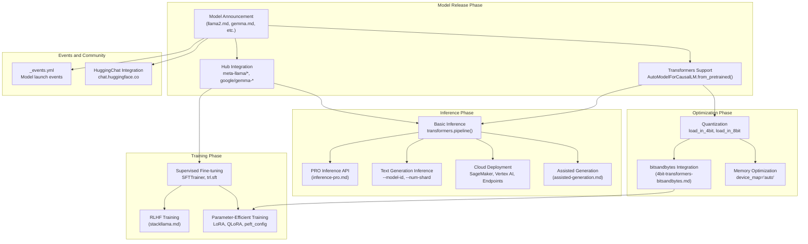
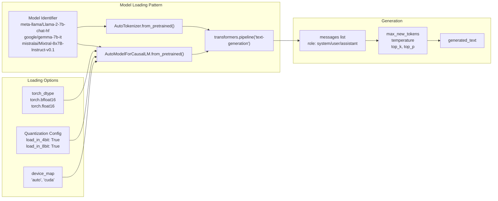
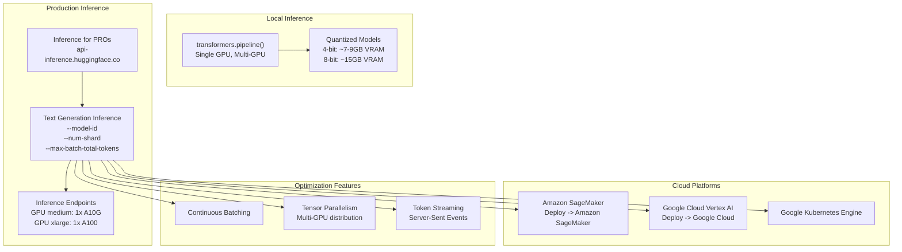
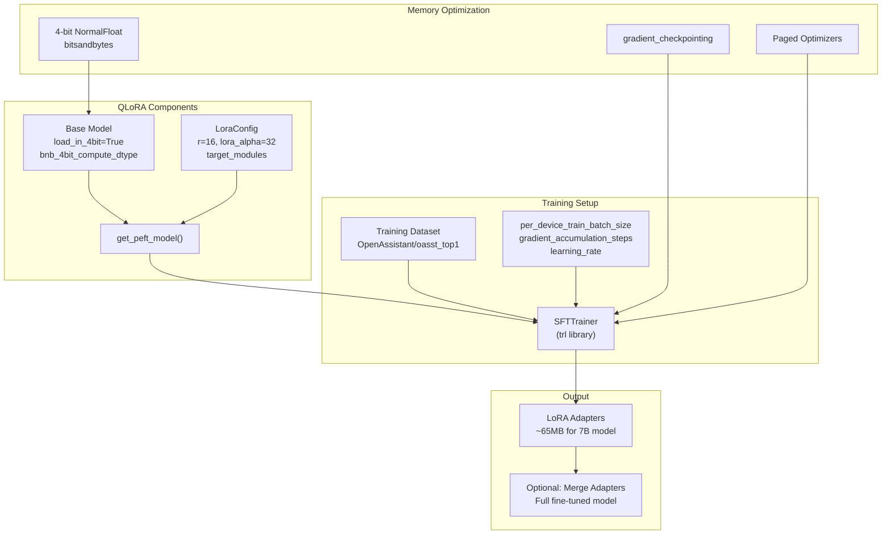
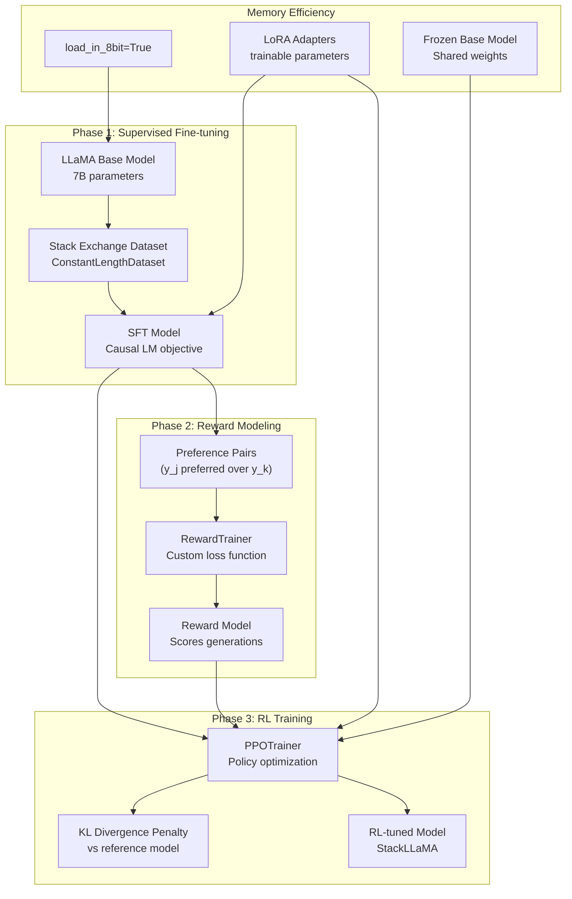
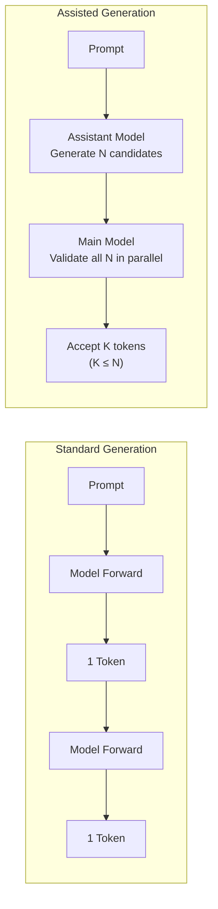

<!-- source: DeepWiki mcp.deepwiki.com · repo huggingface/blog · page 2 Large Language Models · fetched 2026-10-26 -->

# Large Language Models

<details>
<summary>Relevant source files</summary>

The following files were used as context for generating this wiki page:

- [4bit-transformers-bitsandbytes.md](4bit-transformers-bitsandbytes.md)
- [_events.yml](_events.yml)
- [accelerate-deepspeed.md](accelerate-deepspeed.md)
- [assets/138_stackllama/thumbnail.png](assets/138_stackllama/thumbnail.png)
- [assets/147_falcon/falcon_thumbnail.jpg](assets/147_falcon/falcon_thumbnail.jpg)
- [assets/83_accelerate_deepspeed/chatbot.png](assets/83_accelerate_deepspeed/chatbot.png)
- [assets/83_accelerate_deepspeed/cls_run.png](assets/83_accelerate_deepspeed/cls_run.png)
- [assets/83_accelerate_deepspeed/deepspeed-thumbnail.png](assets/83_accelerate_deepspeed/deepspeed-thumbnail.png)
- [assets/98_spaces_3dmoljs/thumbnail.png](assets/98_spaces_3dmoljs/thumbnail.png)
- [assets/assisted-generation/thumbnail.png](assets/assisted-generation/thumbnail.png)
- [assets/diffusion-models-event/thumbnail.png](assets/diffusion-models-event/thumbnail.png)
- [assets/gemma/Gemma-logo-small.png](assets/gemma/Gemma-logo-small.png)
- [assets/gemma/gcp-deploy.png](assets/gemma/gcp-deploy.png)
- [assets/gemma/gcp-train-gemma.png](assets/gemma/gcp-train-gemma.png)
- [assets/gemma/thumbnail.jpg](assets/gemma/thumbnail.jpg)
- [assets/inference_pro/thumbnail.png](assets/inference_pro/thumbnail.png)
- [assets/instruction_tuning_sd/thumbnail.png](assets/instruction_tuning_sd/thumbnail.png)
- [assets/llama2/thumbnail.jpg](assets/llama2/thumbnail.jpg)
- [assets/llama3/thumbnail.jpg](assets/llama3/thumbnail.jpg)
- [assets/mixtral/thumbnail.jpg](assets/mixtral/thumbnail.jpg)
- [assisted-generation.md](assisted-generation.md)
- [diffusion-models-event.md](diffusion-models-event.md)
- [falcon.md](falcon.md)
- [gemma.md](gemma.md)
- [inference-pro.md](inference-pro.md)
- [instruction-tuning-sd.md](instruction-tuning-sd.md)
- [llama2.md](llama2.md)
- [llama3.md](llama3.md)
- [mixtral.md](mixtral.md)
- [spaces_3dmoljs.md](spaces_3dmoljs.md)
- [stackllama.md](stackllama.md)
- [zh/Llama2-for-non-engineers.md](zh/Llama2-for-non-engineers.md)
- [zh/gemma.md](zh/gemma.md)
- [zh/huggy-lingo.md](zh/huggy-lingo.md)
- [zh/llama3.md](zh/llama3.md)
- [zh/mixtral.md](zh/mixtral.md)

</details>


This document provides an overview of Large Language Model (LLM) content in the Hugging Face blog repository. It covers model releases, deployment strategies, optimization techniques, and training approaches for state-of-the-art open language models. For specific model families and their integration details, see [Open-Weight LLM Families](#2.1). For training techniques including supervised fine-tuning and RLHF, see [Training and Fine-tuning LLMs](#2.2). For quantization and memory optimization methods, see [LLM Optimization and Quantization](#2.3). For generation strategies and decoding methods, see [Text Generation and Decoding](#2.4).

## Content Organization

The blog repository documents LLMs across several major dimensions: model releases (introducing new open-weight families), deployment infrastructure (inference endpoints, cloud integrations), optimization techniques (quantization, efficient training), and training methodologies (SFT, RLHF, parameter-efficient methods). Each blog post typically covers end-to-end workflows from model loading to deployment or fine-tuning.

### LLM Model Coverage

The repository documents major open-weight LLM releases with comprehensive integration guides. The following table shows the primary model families covered:

| Model Family | Blog Post | Parameter Sizes | Key Features |
|--------------|-----------|-----------------|--------------|
| Llama 2 | llama2.md | 7B, 13B, 70B | RLHF-tuned, 4k context, commercial license |
| Llama 3 | llama3.md | 8B, 70B | 128K vocab, GQA, 8k context |
| Gemma | gemma.md | 2B, 7B | Gemini-based, 8k context, Apache 2.0 |
| Falcon | falcon.md | 7B, 40B | RefinedWeb training, multi-query attention |
| Mixtral | mixtral.md | 8x7B MoE | Sparse MoE, 32k context, matches GPT-3.5 |

Sources: [llama2.md:1-242](), [llama3.md:1-283](), [gemma.md:1-294](), [falcon.md:1-297](), [mixtral.md:1-304]()

### LLM Lifecycle in Blog Content



**LLM Content Workflow**

This diagram shows how blog content covers the complete LLM lifecycle from release to deployment and training.

Sources: [llama2.md:1-242](), [inference-pro.md:1-342](), [4bit-transformers-bitsandbytes.md:1-459](), [stackllama.md:1-291](), [assisted-generation.md:1-351](), [_events.yml:1-324]()

## Model Integration Patterns

### Transformers Integration

All documented LLM releases follow a consistent integration pattern with the `transformers` library. The basic loading pattern uses `AutoModelForCausalLM` and `AutoTokenizer`:



**Standard LLM Loading and Generation Pattern**

Sources: [llama2.md:84-126](), [gemma.md:104-167](), [llama3.md:99-176](), [mixtral.md:123-164]()

### Prompt Format Specifications

Each model family uses a specific prompt template that must be followed for effective instruction following. The blog posts document these formats:

| Model Family | Prompt Format Key Tokens | Template Location |
|--------------|--------------------------|-------------------|
| Llama 2 | `<s>[INST] <<SYS>>`, `<</SYS>>`, `[/INST]` | llama2.md:184-220 |
| Llama 3 | `<\|begin_of_text\|>`, `<\|start_header_id\|>`, `<\|end_header_id\|>`, `<\|eot_id\|>` | llama3.md:80-89 |
| Gemma | `<start_of_turn>user`, `<end_of_turn>`, `<start_of_turn>model` | gemma.md:76-91 |
| Mixtral | `<s> [INST]`, `[/INST]` | mixtral.md:87-95 |

The chat templates are accessible via `tokenizer.apply_chat_template()` in transformers for automatic formatting.

Sources: [llama2.md:178-226](), [llama3.md:77-92](), [gemma.md:76-91](), [mixtral.md:87-95]()

## Deployment Infrastructure

### Inference Options



**Inference Deployment Options**

Sources: [llama2.md:139-152](), [inference-pro.md:37-324](), [gemma.md:199-221](), [falcon.md:142-203]()

### PRO Inference API Models

The `inference-pro.md` document details curated models available through the PRO subscription. These models use Text Generation Inference as the backend:

- `meta-llama/Meta-Llama-3-8B-Instruct` (8k context)
- `meta-llama/Meta-Llama-3-70B-Instruct` (8k context)
- `mistralai/Mixtral-8x7B-Instruct-v0.1` (32k context)
- `mistralai/Mistral-7B-Instruct-v0.2` (32k context)
- `codellama/CodeLlama-34b-Instruct-hf` (16k context)
- `stabilityai/stable-diffusion-xl-base-1.0` (image generation)

API endpoint pattern: `https://api-inference.huggingface.co/models/{model_id}`

Sources: [inference-pro.md:37-53](), [inference-pro.md:56-86]()

## Training and Fine-tuning Approaches

### Parameter-Efficient Fine-Tuning

The blog extensively covers PEFT methods, particularly QLoRA (4-bit quantization + LoRA):



**QLoRA Fine-tuning Architecture**

The typical command pattern for QLoRA fine-tuning:

```bash
accelerate launch --num_processes=1 examples/scripts/sft.py \
  --model_name_or_path meta-llama/Llama-2-7b-hf \
  --dataset_name timdettmers/openassistant-guanaco \
  --load_in_4bit \
  --use_peft \
  --batch_size 4 \
  --gradient_accumulation_steps 2
```

Sources: [llama2.md:153-177](), [gemma.md:223-277](), [falcon.md:240-293](), [mixtral.md:186-218](), [4bit-transformers-bitsandbytes.md:1-459]()

### RLHF Training Pipeline

The StackLLaMA example ([stackllama.md:1-291]()) demonstrates the complete RLHF pipeline:



**RLHF Training Pipeline for StackLLaMA**

Key code references:
- SFT training with packing: [stackllama.md:78-111]()
- Reward model training: [stackllama.md:117-157]()
- PPO training loop: [stackllama.md:159-212]()

Sources: [stackllama.md:1-291]()

## Quantization and Optimization

### Quantization Methods

The repository documents several quantization approaches:

| Method | Precision | Memory Reduction | Loading Code |
|--------|-----------|------------------|--------------|
| bitsandbytes 8-bit | INT8 | ~2x | `load_in_8bit=True` |
| bitsandbytes 4-bit | NF4/FP4 | ~4x | `load_in_4bit=True` |
| GPTQ | INT4 | ~4x | `GPTQConfig(bits=4)` |

For a 7B parameter model:
- FP16: ~14GB VRAM
- INT8: ~7GB VRAM  
- INT4: ~3.5GB VRAM

Typical 4-bit loading configuration:

```python
from transformers import BitsAndBytesConfig

quantization_config = BitsAndBytesConfig(
    load_in_4bit=True,
    bnb_4bit_compute_dtype=torch.float16,
    bnb_4bit_use_double_quant=True,
    bnb_4bit_quant_type="nf4"
)
```

Sources: [4bit-transformers-bitsandbytes.md:82-459](), [llama2.md:84-97](), [falcon.md:142-173](), [mixtral.md:219-285]()

### Assisted Generation

Assisted generation ([assisted-generation.md:1-351]()) reduces latency by using a smaller "assistant" model to propose candidate tokens that the main model validates in parallel:



**Standard vs Assisted Generation**

Configuration:
```python
assistant_model = AutoModelForCausalLM.from_pretrained("assistant-model-id")
outputs = model.generate(
    input_ids,
    assistant_model=assistant_model,
    do_sample=True
)
```

Can achieve up to 10x speedup on commodity hardware for specific use cases.

Sources: [assisted-generation.md:1-351]()

## Event and Release Tracking

The `_events.yml` file ([_events.yml:1-324]()) tracks major LLM-related events:

- Model launches: Llama 2 (line 19), Falcon (line 29), diffusion models (line 131)
- Technical workshops and webinars
- Community events and reading groups
- Live demos and announcements (HuggingCast series)

Events link directly to model releases and provide historical context for major open-source LLM milestones.

Sources: [_events.yml:1-324]()

## Key Integration Points

### Hugging Face Hub Model Identifiers

All documented models follow the Hub namespace pattern:

- Llama models: `meta-llama/Llama-2-{size}b-{variant}-hf` or `meta-llama/Meta-Llama-3-{size}B-{variant}`
- Gemma models: `google/gemma-{size}b` or `google/gemma-{size}b-it`
- Falcon models: `tiiuae/falcon-{size}b` or `tiiuae/falcon-{size}b-instruct`
- Mixtral models: `mistralai/Mixtral-8x7B-{variant}-v0.1`

### Common Configuration Parameters

Across all blog posts, these parameters appear consistently:

**Generation parameters:**
- `max_new_tokens`: Maximum tokens to generate
- `temperature`: Sampling randomness (0.0-1.0)
- `top_k`, `top_p`: Nucleus sampling parameters
- `do_sample`: Enable sampling vs greedy decoding
- `eos_token_id`: End-of-sequence token(s)

**Loading parameters:**
- `torch_dtype`: Model precision (torch.float16, torch.bfloat16)
- `device_map`: Device placement strategy ("auto", "cuda", manual mapping)
- `load_in_4bit`/`load_in_8bit`: Quantization flags
- `trust_remote_code`: Allow custom model code (required for some models)

**Training parameters:**
- `per_device_train_batch_size`: Batch size per GPU
- `gradient_accumulation_steps`: Gradient accumulation for effective batch size
- `learning_rate`: Optimizer learning rate (typically 1e-5 to 2e-4 for fine-tuning)
- `num_train_epochs`: Training epochs

Sources: [llama2.md:115-135](), [gemma.md:136-165](), [mixtral.md:141-163](), [inference-pro.md:240-282]()

---

