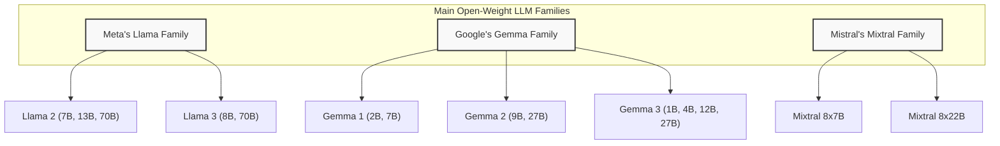
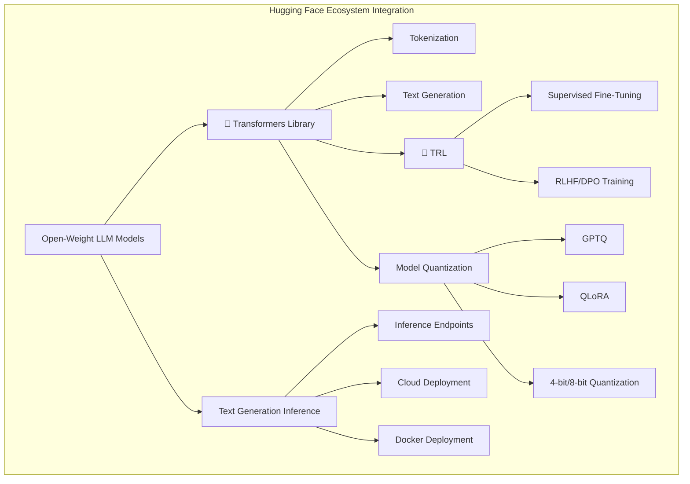

<!-- source: DeepWiki mcp.deepwiki.com · repo huggingface/blog · page 2.1 Open-Weight LLM Families · fetched 2026-10-26 -->

# Open-Weight LLM Families

<details>
<summary>Relevant source files</summary>

The following files were used as context for generating this wiki page:

- [4bit-transformers-bitsandbytes.md](4bit-transformers-bitsandbytes.md)
- [_events.yml](_events.yml)
- [accelerate-deepspeed.md](accelerate-deepspeed.md)
- [assets/138_stackllama/thumbnail.png](assets/138_stackllama/thumbnail.png)
- [assets/147_falcon/falcon_thumbnail.jpg](assets/147_falcon/falcon_thumbnail.jpg)
- [assets/83_accelerate_deepspeed/chatbot.png](assets/83_accelerate_deepspeed/chatbot.png)
- [assets/83_accelerate_deepspeed/cls_run.png](assets/83_accelerate_deepspeed/cls_run.png)
- [assets/83_accelerate_deepspeed/deepspeed-thumbnail.png](assets/83_accelerate_deepspeed/deepspeed-thumbnail.png)
- [assets/98_spaces_3dmoljs/thumbnail.png](assets/98_spaces_3dmoljs/thumbnail.png)
- [assets/assisted-generation/thumbnail.png](assets/assisted-generation/thumbnail.png)
- [assets/diffusion-models-event/thumbnail.png](assets/diffusion-models-event/thumbnail.png)
- [assets/gemma/Gemma-logo-small.png](assets/gemma/Gemma-logo-small.png)
- [assets/gemma/gcp-deploy.png](assets/gemma/gcp-deploy.png)
- [assets/gemma/gcp-train-gemma.png](assets/gemma/gcp-train-gemma.png)
- [assets/gemma/thumbnail.jpg](assets/gemma/thumbnail.jpg)
- [assets/inference_pro/thumbnail.png](assets/inference_pro/thumbnail.png)
- [assets/instruction_tuning_sd/thumbnail.png](assets/instruction_tuning_sd/thumbnail.png)
- [assets/llama2/thumbnail.jpg](assets/llama2/thumbnail.jpg)
- [assets/llama3/thumbnail.jpg](assets/llama3/thumbnail.jpg)
- [assets/mixtral/thumbnail.jpg](assets/mixtral/thumbnail.jpg)
- [assisted-generation.md](assisted-generation.md)
- [diffusion-models-event.md](diffusion-models-event.md)
- [falcon.md](falcon.md)
- [gemma.md](gemma.md)
- [inference-pro.md](inference-pro.md)
- [instruction-tuning-sd.md](instruction-tuning-sd.md)
- [llama2.md](llama2.md)
- [llama3.md](llama3.md)
- [mixtral.md](mixtral.md)
- [spaces_3dmoljs.md](spaces_3dmoljs.md)
- [stackllama.md](stackllama.md)
- [zh/Llama2-for-non-engineers.md](zh/Llama2-for-non-engineers.md)
- [zh/gemma.md](zh/gemma.md)
- [zh/huggy-lingo.md](zh/huggy-lingo.md)
- [zh/llama3.md](zh/llama3.md)
- [zh/mixtral.md](zh/mixtral.md)

</details>


This document provides a comprehensive overview of major open-weight Large Language Model (LLM) families, including their architectures, sizes, capabilities, and integration within the Hugging Face ecosystem. It covers Meta's Llama models, Google's Gemma models, and Mistral AI's Mixtral models, focusing on their technical specifications, performance characteristics, and use patterns.

For information about specialized Code LLMs, see [Code LLMs](#2.2).

## Key Open-Weight LLM Families

Open-weight LLMs are models whose weights are publicly available for research and commercial applications, under various licenses. The major families covered in this document include:



Sources: [gemma3.md](gemma3.md), [gemma.md](gemma.md), [llama3.md](llama3.md), [mixtral.md](mixtral.md)

## Meta's Llama Family

Meta's Llama models are a series of powerful open-weight language models that have advanced the state of open AI. The family includes Llama 2 and Llama 3, each available in various sizes.

### Llama 3

Llama 3 represents Meta's latest iteration in the Llama series, released with significant improvements over Llama 2:

- **Available Variants**:
  - Base models: 8B and 70B parameters
  - Instruction-tuned models: 8B-Instruct and 70B-Instruct
  - Llama Guard 2 (safety-focused model fine-tuned on Llama 3 8B)

- **Key Features**:
  - Expanded vocabulary size (128,256 tokens vs. 32K in Llama 2)
  - 8K token context window
  - Grouped-Query Attention (GQA) for efficient processing
  - Trained on 15 trillion tokens (8x more data than Llama 2)
  - Strong multilingual capabilities

- **Chat Format**:
  ```
  <|begin_of_text|><|start_header_id|>system<|end_header_id|>
  
  {{ system_prompt }}<|eot_id|><|start_header_id|>user<|end_header_id|>
  
  {{ user_msg_1 }}<|eot_id|><|start_header_id|>assistant<|end_header_id|>
  
  {{ model_answer_1 }}<|eot_id|>
  ```

- **Performance**: Llama 3 70B demonstrates significant improvements over Llama 2, with the 70B model achieving a leaderboard score of 26.37 compared to Llama 2 70B's 18.25.

Sources: [llama3.md:39-56](llama3.md), [llama3.md:77-91](llama3.md)

### Llama 2

The predecessor to Llama 3, Llama 2 provides solid performance while requiring fewer computational resources:

- **Available Variants**:
  - Base models: 7B, 13B, and 70B parameters
  - Chat (instruction-tuned) models for all sizes

- **Licensing**: Llama 2 license allows for commercial use with relatively permissive terms.

- **Benchmark Performance**: On the Open LLM Leaderboard, Llama 2 70B achieved a score of 18.25, while the 7B version scored 8.72.

Sources: [llama3.md:60-72](llama3.md)

## Google's Gemma Family

Google's Gemma models are a series of state-of-the-art LLMs designed for efficient deployment across various hardware platforms. The family has evolved through multiple generations with Gemma 3 being the latest release.

### Gemma 3

Gemma 3 represents Google's latest multimodal, multilingual LLM:

- **Available Variants**:
  - 1B: Text-only, English, 32K context window
  - 4B, 12B, 27B: Multimodal (text and images), 140+ languages, 128K context window
  - Both pre-trained (PT) and instruction-tuned (IT) versions available

- **Key Features**:
  - Multimodal capabilities (image + text) using SigLIP vision encoder
  - Bidirectional attention for image tokens
  - Extended context window (32K for 1B, 128K for others)
  - Improved multilingualism with double the amount of multilingual data
  - Enhanced tokenizer (262K entries) optimized for Chinese, Japanese, and Korean

- **Technical Enhancements**:
  - Positional embeddings improved with RoPE base frequency upgraded from 10K to 1M
  - KV Cache optimization with sliding window interleaved attention
  - "Pan and scan" algorithm for processing images during inference

- **Performance**: Gemma 3 27B-IT outperforms Gemma 2 27B-IT and competes with Gemini 1.5-Pro across benchmarks, achieving an LMSys Elo score of 1339.

Sources: [gemma3.md:14-45](gemma3.md), [gemma3.md:50-82](gemma3.md), [gemma3.md:89-99](gemma3.md)

### Gemma (1st Generation)

The first generation of Google's Gemma models:

- **Available Variants**:
  - 2B and 7B parameter models
  - Both base and instruction-tuned versions

- **Performance**: Gemma 7B shows strong performance comparable to Mistral 7B, while Gemma 2B provides decent performance for its size.

- **Prompt Format**:
  ```
  <start_of_turn>user
  knock knock<end_of_turn>
  <start_of_turn>model
  who is there<end_of_turn>
  <start_of_turn>user
  LaMDA<end_of_turn>
  <start_of_turn>model
  LaMDA who?<end_of_turn>
  ```

Sources: [gemma.md:16-48](gemma.md), [gemma.md:74-90](gemma.md)

## Mistral's Mixtral Family

Mixtral represents an innovative approach to LLMs using Mixture of Experts (MoE) architecture, developed by Mistral AI.

### Architecture: Mixture of Experts

```mermaid
graph TD
    subgraph "Standard Transformer"
        InputS["Input"] --> AttentionS["Attention Layers"]
        AttentionS --> FFNS["Feed-Forward Network"]
        FFNS --> OutputS["Output"]
    end
    
    subgraph "Mixture of Experts (MoE)"
        Input["Input"] --> Attention["Attention Layers"]
        Attention --> Router["Router Network"]
        Router --> |Routes tokens| Experts["Multiple Expert FFNs"]
        Router --> |"Selects 2 experts per token"| Gate["Gating Mechanism"]
        Experts --> Gate
        Gate --> Output["Output"]
    end
    
    subgraph "Mixtral 8x7B Structure"
        MixInput["Input"] --> MixAttention["Attention Block"]
        MixAttention --> MixRouter["Router"]
        MixRouter --> |"Routes to"| Expert1["Expert 1"]
        MixRouter --> |"Routes to"| Expert2["Expert 2"]
        MixRouter --> |"Routes to"| Expert8["Expert 8"]
        Expert1 --> MixCombiner["Weighted Combination"]
        Expert2 --> MixCombiner
        Expert8 --> MixCombiner
        MixCombiner --> MixOutput["Output"]
    end
```



Sources: [mixtral.md:46-48](mixtral.md), [mixtral.md:84-93](mixtral.md)

### Mixtral 8x7B

- **Architecture**: Contains 8 "expert" models, where each token is processed by the 2 most relevant experts
- **Effective Parameters**: ~45B parameters total, but computes at the speed of a 12B parameter model
- **Context Length**: 32K tokens
- **Language Support**: English, French, German, Spanish, and Italian
- **Capabilities**: Strong coding abilities (40.2% on HumanEval)
- **Licensing**: Apache 2.0 license, commercially permissive

- **Prompt Format**:
  ```
  <s> [INST] User Instruction 1 [/INST] Model answer 1</s> [INST] User instruction 2[/INST]
  ```

- **Performance**: The instruction-tuned version outperforms all other open-access models on MT-Bench with a score of 8.30, comparable to GPT-3.5.

Sources: [mixtral.md:44-88](mixtral.md), [mixtral.md:92-102](mixtral.md)

## Performance Comparison

The following table provides a comparative overview of the performance of major open-weight LLM families:

| Model | Parameters | Context Length | Benchmark Score | Commercial Use | License |
|-------|------------|----------------|----------------|----------------|---------|
| Llama 3 70B | 70B | 8K | 26.37 (Leaderboard) | ✅ | Llama 3 license |
| Llama 3 8B | 8B | 8K | 13.41 (Leaderboard) | ✅ | Llama 3 license |
| Mixtral 8x7B | ~45B effective | 32K | 68.42 (Leaderboard) | ✅ | Apache 2.0 |
| Gemma 3 27B | 27B | 128K | 1339 (LMSys Elo) | ✅ | Gemma license |
| Gemma 3 12B | 12B | 128K | - | ✅ | Gemma license |
| Gemma 7B | 7B | 8K | 63.75 (Leaderboard) | ✅ | Gemma license |
| Llama 2 70B | 70B | 4K | 18.25 (Leaderboard) | ✅ | Llama 2 license |
| Llama 2 7B | 7B | 4K | 8.72 (Leaderboard) | ✅ | Llama 2 license |

Note: Different benchmark metrics are used across models, making direct comparisons challenging.

Sources: [llama3.md:60-72](llama3.md), [gemma3.md:89-99](gemma3.md), [mixtral.md:59-88](mixtral.md)

## Integration with Hugging Face Ecosystem

The Hugging Face ecosystem provides comprehensive support for these open-weight LLM families, enabling easy loading, inference, fine-tuning, and deployment.



### Loading and Inference

All the open-weight LLM families can be loaded using the Transformers library:

```python
from transformers import AutoTokenizer, AutoModelForCausalLM
import torch

# Example for loading Llama 3
model_id = "meta-llama/Meta-Llama-3-8B"
tokenizer = AutoTokenizer.from_pretrained(model_id)
model = AutoModelForCausalLM.from_pretrained(
    model_id, 
    torch_dtype=torch.bfloat16, 
    device_map="auto"
)

# For Mixtral models
# from transformers import MixtralForCausalLM
# model = MixtralForCausalLM.from_pretrained("mistralai/Mixtral-8x7B-v0.1")

# For Gemma 3
# from transformers import Gemma3ForCausalLM, Gemma3ForConditionalGeneration
# model = Gemma3ForCausalLM.from_pretrained("google/gemma-3-7b")
# model_multimodal = Gemma3ForConditionalGeneration.from_pretrained("google/gemma-3-4b-it")
```

Sources: [llama3.md:110-147](llama3.md), [gemma3.md:101-144](gemma3.md), [mixtral.md:143-167](mixtral.md)

### Model Quantization

For efficient deployment on consumer hardware, all models support various quantization methods:

- **4-bit Quantization**: Reduces memory requirements by ~75% compared to FP16
- **GPTQ**: Post-training quantization with calibration
- **QLoRA**: For fine-tuning quantized models

```python
# 4-bit quantization example
from transformers import BitsAndBytesConfig

quantization_config = BitsAndBytesConfig(
    load_in_4bit=True,
    bnb_4bit_compute_dtype=torch.float16
)

model = AutoModelForCausalLM.from_pretrained(
    model_id,
    quantization_config=quantization_config,
    device_map="auto"
)
```

Sources: [llama3.md:159-173](llama3.md), [mixtral.md:219-263](mixtral.md), [gemma3.md:106-107](gemma3.md)

### Fine-tuning

The TRL library provides easy fine-tuning capabilities:

```bash
# Example TRL command for SFT fine-tuning
trl sft \
--model_name_or_path meta-llama/Meta-Llama-3-8B \
--dataset_name HuggingFaceH4/no_robots \
--learning_rate 0.0001 \
--per_device_train_batch_size 4 \
--max_seq_length 2048 \
--output_dir ./llama3-sft \
--use_peft \
--load_in_4bit \
--gradient_checkpointing
```

Sources: [llama3.md:221-257](llama3.md), [mixtral.md:185-215](mixtral.md), [gemma.md:224-267](gemma.md)

### Deployment Options

Multiple deployment options are available:

1. **Text Generation Inference (TGI)**: Production-ready inference container with continuous batching and tensor parallelism
2. **Inference Endpoints**: Managed deployment service for production applications
3. **Cloud Provider Integrations**: Native integrations with AWS SageMaker, Google Cloud Vertex AI
4. **On-device Solutions**: MLX for Apple Silicon, llama.cpp for optimized CPU inference

Sources: [gemma3.md:262-307](gemma3.md), [llama3.md:177-201](llama3.md), [mixtral.md:166-190](mixtral.md)

## Specialized Capabilities

Each LLM family has unique strengths that make them suitable for different applications:

- **Llama 3**: Strong general performance, balanced with good multilingual capabilities
- **Gemma 3**: Multimodal capabilities with image understanding, strong multilingual support, and long context windows (up to 128K tokens)
- **Mixtral**: Efficient computation with MoE architecture, strong multilingual and coding abilities

The selection of an appropriate model depends on the specific requirements of your application, including computational resources, context length needs, and multimodal capabilities.

Sources: [gemma3.md:33-44](gemma3.md), [llama3.md:39-56](llama3.md), [mixtral.md:44-65](mixtral.md)

---

