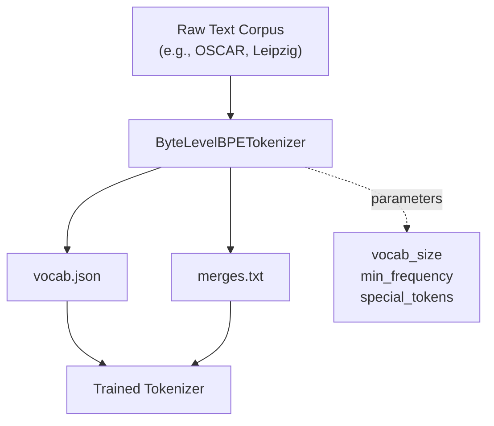
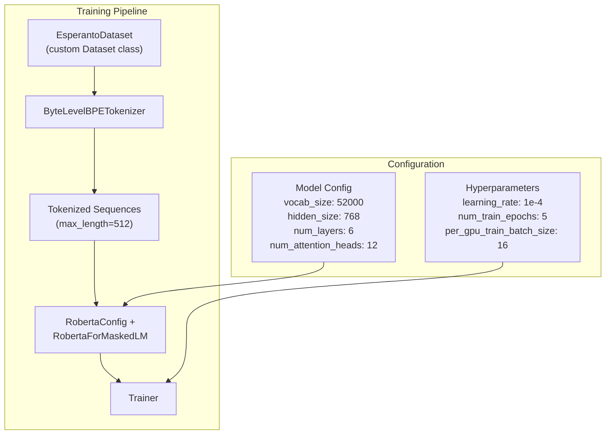
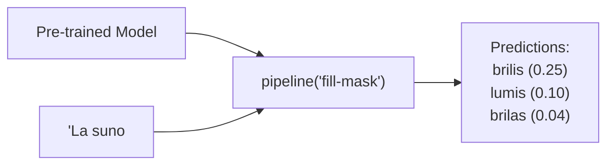
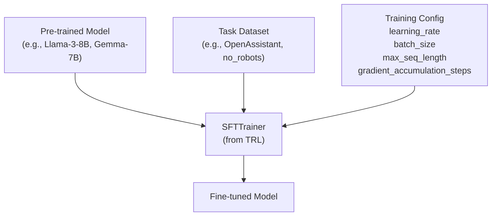
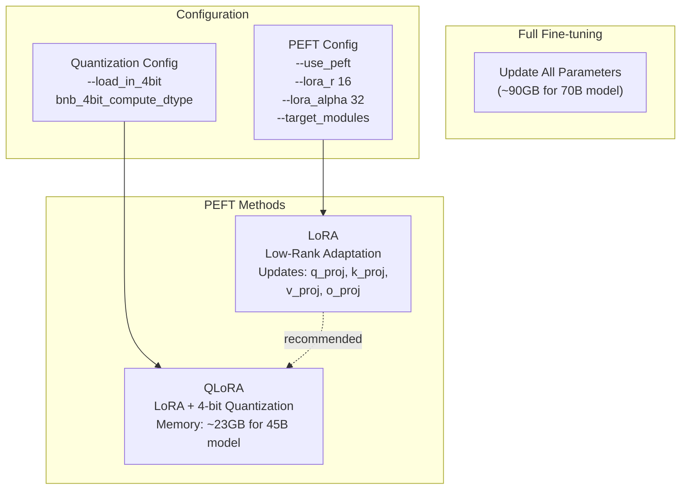
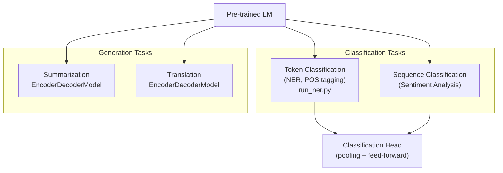
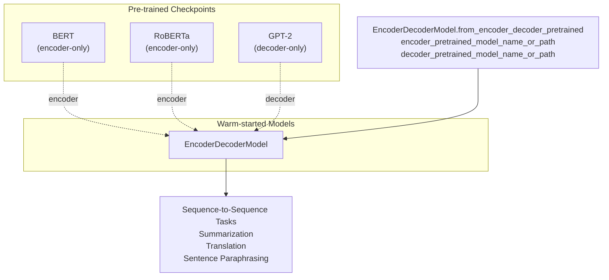
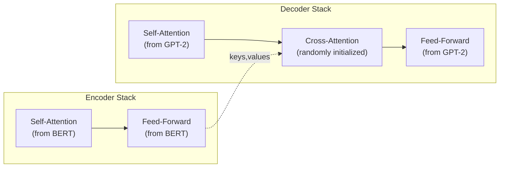
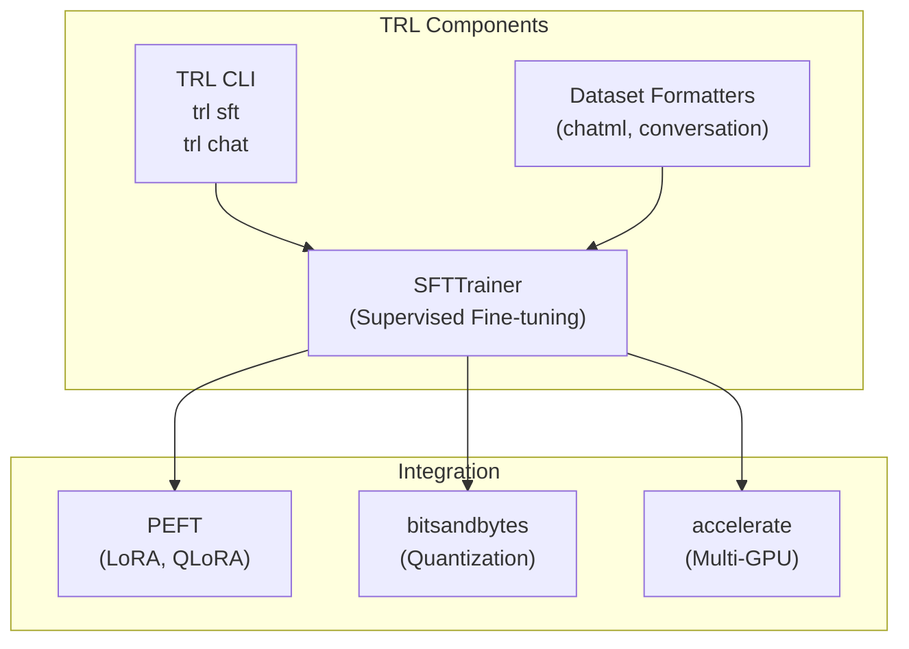
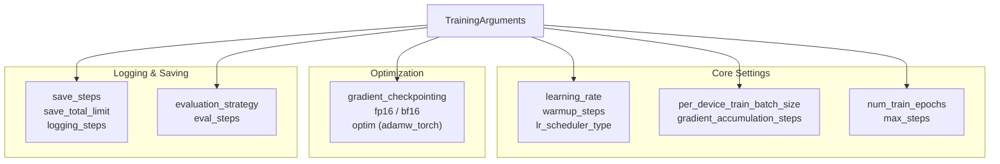

<!-- source: DeepWiki mcp.deepwiki.com · repo huggingface/blog · page 2.2 Training and Fine-tuning LLMs · fetched 2026-10-26 -->

# Training and Fine-tuning LLMs

<details>
<summary>Relevant source files</summary>

The following files were used as context for generating this wiki page:

- [assets/03_reformer/thumbnail.png](assets/03_reformer/thumbnail.png)
- [assets/04_pytorch_block_sparse/thumbnail.png](assets/04_pytorch_block_sparse/thumbnail.png)
- [assets/05_encoder_decoder/thumbnail.png](assets/05_encoder_decoder/thumbnail.png)
- [assets/07_porting_fsmt/thumbnail.png](assets/07_porting_fsmt/thumbnail.png)
- [assets/08_warm_starting_encoder_decoder/thumbnail.png](assets/08_warm_starting_encoder_decoder/thumbnail.png)
- [assets/gemma/Gemma-logo-small.png](assets/gemma/Gemma-logo-small.png)
- [assets/gemma/gcp-deploy.png](assets/gemma/gcp-deploy.png)
- [assets/gemma/gcp-train-gemma.png](assets/gemma/gcp-train-gemma.png)
- [assets/gemma/thumbnail.jpg](assets/gemma/thumbnail.jpg)
- [assets/llama3/thumbnail.jpg](assets/llama3/thumbnail.jpg)
- [assets/mixtral/thumbnail.jpg](assets/mixtral/thumbnail.jpg)
- [encoder-decoder.md](encoder-decoder.md)
- [gemma.md](gemma.md)
- [how-to-generate.md](how-to-generate.md)
- [how-to-train.md](how-to-train.md)
- [llama3.md](llama3.md)
- [mixtral.md](mixtral.md)
- [notebooks/03_reformer.ipynb](notebooks/03_reformer.ipynb)
- [notebooks/05_encoder_decoder.ipynb](notebooks/05_encoder_decoder.ipynb)
- [notebooks/08_warm_starting_encoder_decoder.ipynb](notebooks/08_warm_starting_encoder_decoder.ipynb)
- [pytorch_block_sparse.md](pytorch_block_sparse.md)
- [reformer.md](reformer.md)
- [warm-starting-encoder-decoder.md](warm-starting-encoder-decoder.md)
- [zh/Llama2-for-non-engineers.md](zh/Llama2-for-non-engineers.md)
- [zh/gemma.md](zh/gemma.md)
- [zh/huggy-lingo.md](zh/huggy-lingo.md)
- [zh/llama3.md](zh/llama3.md)
- [zh/mixtral.md](zh/mixtral.md)

</details>


## Purpose and Scope

This document covers the techniques and practical implementations for training large language models (LLMs) from scratch and fine-tuning pre-trained models on specific tasks. It focuses on the `transformers` and `trl` libraries' approaches to model training, including:

- Training new language models from scratch with custom tokenizers
- Fine-tuning pre-trained models using supervised fine-tuning (SFT)
- Parameter-efficient fine-tuning techniques (PEFT, LoRA, QLoRA)
- Warm-starting encoder-decoder models from pre-trained checkpoints
- Memory optimization techniques for training on consumer hardware

For deploying trained models, see [Model Deployment and Inference](#5). For specific reinforcement learning techniques like RLHF and DPO, see [Reinforcement Learning from Human Feedback](#4.3). For distributed training strategies, see [Distributed Training](#4.4).

## Training Language Models from Scratch

Training a language model from scratch involves two main phases: tokenizer training and model pre-training.

### Tokenizer Training

The first step is training a custom tokenizer optimized for the target language or domain. The `tokenizers` library provides efficient implementations of various tokenization algorithms.



**Sources:** [how-to-train.md:42-111]()

The tokenizer training process uses `ByteLevelBPETokenizer` which builds vocabulary from single bytes, ensuring all words are decomposable without unknown tokens. Key configuration parameters include:

- **vocab_size**: Target vocabulary size (e.g., 52,000)
- **min_frequency**: Minimum token frequency threshold
- **special_tokens**: Model-specific tokens like `<s>`, `<pad>`, `</s>`, `<unk>`, `<mask>`

The training produces two artifacts: `vocab.json` containing ranked tokens by frequency, and `merges.txt` listing learned byte-pair merges.

**Sources:** [how-to-train.md:48-111]()

### Model Pre-training

Pre-training involves training the model on a large corpus using self-supervised objectives like masked language modeling (MLM) or causal language modeling (CLM).



**Sources:** [how-to-train.md:139-216](), [encoder-decoder.md:143-147]()

The training process uses:

1. **Custom Dataset**: Implements `torch.utils.data.Dataset` to load and tokenize text files on-the-fly or as preprocessing
2. **Model Architecture**: RoBERTa-like models for masked language modeling, or GPT-like models for causal language modeling
3. **Training Script**: `run_language_modeling.py` handles the training loop with MLM objective
4. **Trainer API**: `transformers.Trainer` manages training, evaluation, and checkpointing

Key hyperparameters from the example:
- `--model_type roberta`
- `--mlm` (for masked language modeling)
- `--learning_rate 1e-4`
- `--num_train_epochs 5`
- `--per_gpu_train_batch_size 16`
- `--evaluate_during_training`

**Sources:** [how-to-train.md:143-216]()

### Validation and Testing

After pre-training, the model can be tested using `FillMaskPipeline` for MLM models or text generation for CLM models:



**Sources:** [how-to-train.md:220-285]()

## Fine-tuning Pre-trained Models

Fine-tuning adapts pre-trained models to specific downstream tasks using labeled data. This section covers both full fine-tuning and parameter-efficient methods.

### Supervised Fine-tuning (SFT)

Supervised fine-tuning trains the model on task-specific examples to adapt its behavior.



**Sources:** [llama3.md:221-258](), [gemma.md:244-276]()

The TRL library provides the `SFTTrainer` class which handles:
- Automatic dataset formatting (e.g., to chatml format)
- Integration with PEFT for efficient training
- Memory-efficient training configurations

Using the TRL CLI:

```bash
trl sft \
  --model_name_or_path meta-llama/Meta-Llama-3-8B \
  --dataset_name HuggingFaceH4/no_robots \
  --learning_rate 0.0001 \
  --per_device_train_batch_size 4 \
  --max_seq_length 2048 \
  --output_dir ./llama3-sft
```

**Sources:** [llama3.md:242-255]()

### Parameter-Efficient Fine-Tuning (PEFT)

PEFT techniques reduce memory requirements and training time by only updating a small subset of parameters.



**Sources:** [mixtral.md:186-218](), [gemma.md:244-276](), [llama3.md:221-258]()

#### LoRA Configuration

LoRA adds trainable low-rank matrices to transformer layers:

- **lora_r**: Rank of update matrices (typically 8-64)
- **lora_alpha**: Scaling factor (typically 2× lora_r)
- **target_modules**: Which layers to adapt (attention projections: `q_proj`, `k_proj`, `v_proj`, `o_proj`)

**Important**: For Mixture-of-Experts models like Mixtral, do not target MLP layers as they are sparse and don't interact well with PEFT.

**Sources:** [mixtral.md:189-218]()

#### QLoRA Implementation

QLoRA combines LoRA with 4-bit quantization for extreme memory efficiency:

```bash
accelerate launch examples/scripts/sft.py \
  --model_name mistralai/Mixtral-8x7B-v0.1 \
  --dataset_name trl-lib/ultrachat_200k_chatml \
  --batch_size 2 \
  --learning_rate 2e-4 \
  --use_peft \
  --peft_lora_r 16 --peft_lora_alpha 32 \
  --target_modules q_proj k_proj v_proj o_proj \
  --load_in_4bit
```

**Sources:** [mixtral.md:200-215]()

This configuration enables fine-tuning large models on single consumer GPUs (e.g., A100 40GB).

### Task-Specific Fine-tuning

Fine-tuning can be adapted to various downstream tasks by using appropriate training scripts and objectives.



**Sources:** [how-to-train.md:287-327](), [warm-starting-encoder-decoder.md:1-66]()

Example for token classification (POS tagging):

The `run_ner.py` script can be used for any token classification task by formatting data in CoNLL-2003 format. The script:
- Loads the pre-trained model
- Adds a token classification head
- Fine-tunes on labeled sequences

**Sources:** [how-to-train.md:287-327]()

## Warm-starting Encoder-Decoder Models

Warm-starting leverages pre-trained encoder-only (e.g., BERT) or decoder-only (e.g., GPT-2) checkpoints to initialize encoder-decoder models, avoiding expensive pre-training from scratch.



**Sources:** [warm-starting-encoder-decoder.md:34-66](), [encoder-decoder.md:331-537]()

### EncoderDecoderModel Framework

The `EncoderDecoderModel` class in transformers enables combining any pre-trained encoder and decoder:

```python
# Example: BERT encoder + GPT-2 decoder
from transformers import EncoderDecoderModel

model = EncoderDecoderModel.from_encoder_decoder_pretrained(
    encoder_pretrained_model_name_or_path="bert-base-uncased",
    decoder_pretrained_model_name_or_path="gpt2"
)
```

**Sources:** [warm-starting-encoder-decoder.md:48-66]()

This approach is effective for:
- **Summarization**: BERT/RoBERTa encoder + GPT-2 decoder
- **Translation**: Language-specific BERT encoder + GPT-2 decoder
- **Dialogue**: BERT encoder + DialoGPT decoder

The warm-started models achieve competitive results compared to fully pre-trained encoder-decoder models (T5, Pegasus, BART) at a fraction of the training cost.

**Sources:** [warm-starting-encoder-decoder.md:26-43]()

### Cross-Attention Initialization

When warm-starting, the cross-attention layers (which attend from decoder to encoder) must be randomly initialized since they don't exist in the standalone encoder/decoder models. The model requires fine-tuning to learn effective cross-attention patterns.



**Sources:** [encoder-decoder.md:520-531](), [warm-starting-encoder-decoder.md:34-66]()

## Memory Optimization Techniques

Training and fine-tuning LLMs requires significant memory. Several techniques reduce memory requirements:

### Quantization

Quantization reduces precision of model weights and activations:

| Precision | Memory for 45B params | Supported by |
|-----------|----------------------|--------------|
| float16 | >90 GB | Native PyTorch |
| 8-bit | >45 GB | bitsandbytes |
| 4-bit | >23 GB | bitsandbytes |

**Sources:** [mixtral.md:114-121]()

Loading with 4-bit quantization:

```python
from transformers import AutoModelForCausalLM
import torch

model = AutoModelForCausalLM.from_pretrained(
    "mistralai/Mixtral-8x7B-Instruct-v0.1",
    torch_dtype=torch.float16,
    load_in_4bit=True,
    bnb_4bit_compute_dtype=torch.float16
)
```

**Sources:** [mixtral.md:226-236](), [gemma.md:154-164]()

### Gradient Checkpointing

Gradient checkpointing trades compute for memory by recomputing intermediate activations during backward pass instead of storing them:

```bash
trl sft \
  --gradient_checkpointing \
  --gradient_accumulation_steps 4
```

This enables training larger models or using larger batch sizes on the same hardware.

**Sources:** [llama3.md:242-255]()

### Mixed Precision Training

Using `bfloat16` or `float16` reduces memory footprint and speeds up training on modern GPUs:

```python
model = AutoModelForCausalLM.from_pretrained(
    model_id,
    torch_dtype=torch.bfloat16  # or torch.float16
)
```

**Sources:** [llama3.md:115-175](), [gemma.md:123-152]()

## Training Scripts and Tools

### Transformers Training Scripts

The transformers library provides production-ready training scripts:

- **run_language_modeling.py**: Pre-training with MLM or CLM objectives
- **run_ner.py**: Token classification fine-tuning
- **run_summarization.py**: Sequence-to-sequence fine-tuning

**Sources:** [how-to-train.md:143-216](), [how-to-train.md:287-327]()

### TRL Library

The TRL (Transformer Reinforcement Learning) library provides high-level interfaces for LLM fine-tuning:



**Sources:** [llama3.md:221-258](), [gemma.md:244-276](), [mixtral.md:186-218]()

Key features:
- **Automatic chat formatting**: Converts datasets to model-specific chat templates
- **PEFT integration**: Seamless LoRA/QLoRA support
- **Multi-GPU training**: Via accelerate library
- **CLI interface**: Simple command-line training without code

Example using TRL CLI:

```bash
trl sft \
  --model_name_or_path meta-llama/Meta-Llama-3-8B \
  --dataset_name HuggingFaceH4/no_robots \
  --learning_rate 0.0001 \
  --per_device_train_batch_size 4 \
  --max_seq_length 2048 \
  --output_dir ./llama3-sft \
  --use_peft \
  --load_in_4bit \
  --log_with wandb \
  --gradient_checkpointing
```

**Sources:** [llama3.md:242-255]()

### Trainer Configuration

The `Trainer` class provides extensive configuration options:



**Sources:** [how-to-train.md:191-216]()

## Best Practices

### Model Selection for Fine-tuning

When selecting models for fine-tuning:

1. **For Summarization/Translation**: Use warm-started encoder-decoder models (BERT→GPT-2) or pre-trained seq2seq models (T5, BART)
2. **For Chat/Instruction**: Use pre-trained causal LMs (Llama, Gemma, Mixtral) with SFT
3. **For Classification**: Use encoder models (BERT, RoBERTa) with classification head

**Sources:** [warm-starting-encoder-decoder.md:34-66](), [how-to-train.md:287-327]()

### Hyperparameter Guidelines

Based on successful training examples:

- **Learning Rate**: 1e-4 to 2e-4 for fine-tuning, 1e-4 for pre-training
- **Batch Size**: As large as GPU memory allows (use gradient accumulation if needed)
- **LoRA Rank**: 8-16 for most tasks, up to 64 for complex tasks
- **Sequence Length**: Match pre-training length or task requirements

**Sources:** [how-to-train.md:191-216](), [mixtral.md:200-218](), [llama3.md:242-255]()

### Training Monitoring

Monitor training progress using:

```python
# Enable evaluation during training
--evaluate_during_training
--logging_steps 10
--eval_steps 500

# Use TensorBoard for visualization
tensorboard dev upload --logdir runs
```

Key metrics to track:
- Training/validation loss convergence
- Perplexity (for language modeling)
- Task-specific metrics (accuracy, F1, BLEU, etc.)

**Sources:** [how-to-train.md:194-218]()

---

