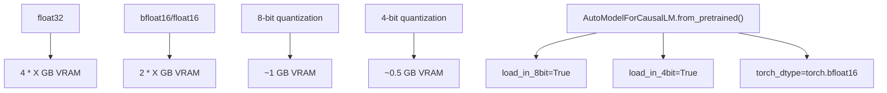
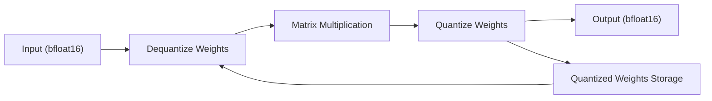
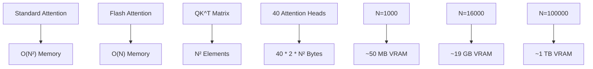
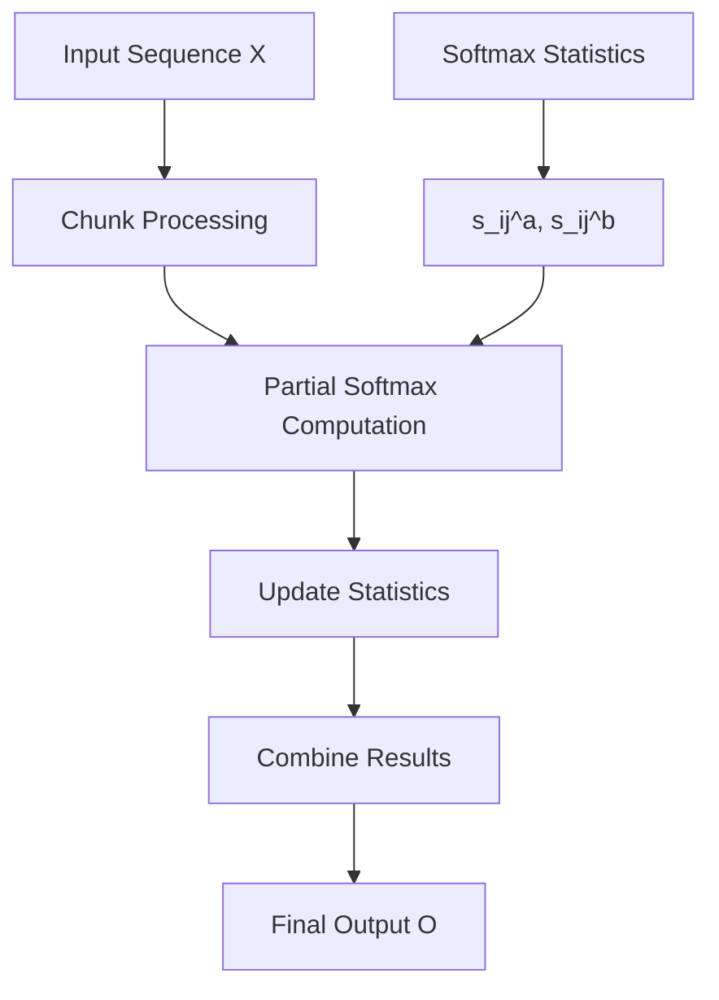
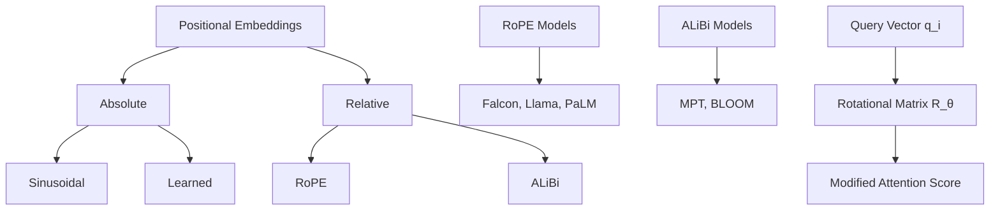
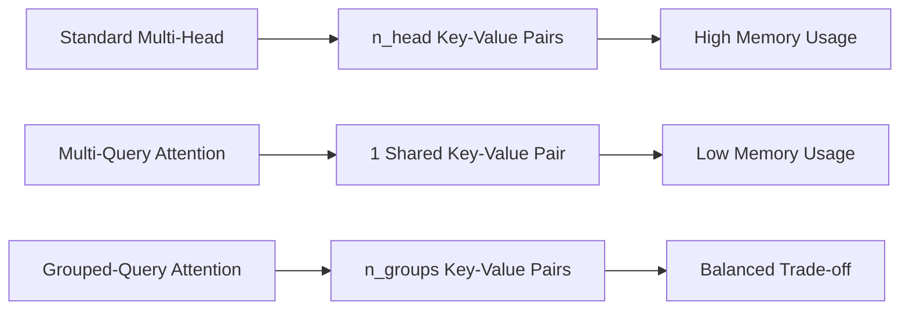
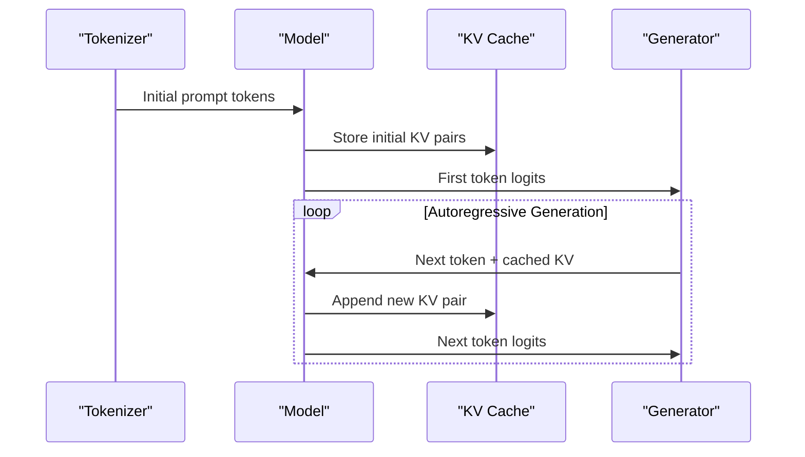
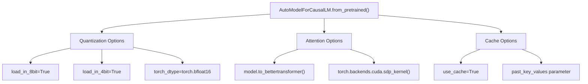
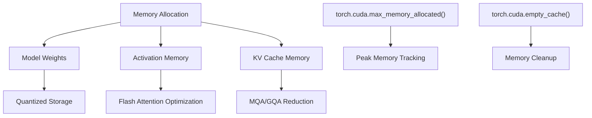

<!-- source: DeepWiki mcp.deepwiki.com · repo huggingface/blog · page 2.3 LLM Optimization and Quantization · fetched 2026-10-26 -->

# LLM Optimization

<details>
<summary>Relevant source files</summary>

The following files were used as context for generating this wiki page:

- [1_58_llm_extreme_quantization.md](1_58_llm_extreme_quantization.md)
- [4bit-transformers-bitsandbytes.md](4bit-transformers-bitsandbytes.md)
- [_blog.yml](_blog.yml)
- [_events.yml](_events.yml)
- [_tags.yml](_tags.yml)
- [accelerate-deepspeed.md](accelerate-deepspeed.md)
- [assets/138_stackllama/thumbnail.png](assets/138_stackllama/thumbnail.png)
- [assets/147_falcon/falcon_thumbnail.jpg](assets/147_falcon/falcon_thumbnail.jpg)
- [assets/192_pi0/new_thumbnail_pi0.001.png](assets/192_pi0/new_thumbnail_pi0.001.png)
- [assets/193_l2d/lerobot-driver.gif](assets/193_l2d/lerobot-driver.gif)
- [assets/1_58_llm_extreme_quantization/thumbnail.png](assets/1_58_llm_extreme_quantization/thumbnail.png)
- [assets/83_accelerate_deepspeed/chatbot.png](assets/83_accelerate_deepspeed/chatbot.png)
- [assets/83_accelerate_deepspeed/cls_run.png](assets/83_accelerate_deepspeed/cls_run.png)
- [assets/83_accelerate_deepspeed/deepspeed-thumbnail.png](assets/83_accelerate_deepspeed/deepspeed-thumbnail.png)
- [assets/98_spaces_3dmoljs/thumbnail.png](assets/98_spaces_3dmoljs/thumbnail.png)
- [assets/assisted-generation/thumbnail.png](assets/assisted-generation/thumbnail.png)
- [assets/diffusion-models-event/thumbnail.png](assets/diffusion-models-event/thumbnail.png)
- [assets/gemma/Gemma-logo-small.png](assets/gemma/Gemma-logo-small.png)
- [assets/gemma/gcp-deploy.png](assets/gemma/gcp-deploy.png)
- [assets/gemma/gcp-train-gemma.png](assets/gemma/gcp-train-gemma.png)
- [assets/gemma/thumbnail.jpg](assets/gemma/thumbnail.jpg)
- [assets/inference-providers/welcome-featherless.jpg](assets/inference-providers/welcome-featherless.jpg)
- [assets/inference_pro/thumbnail.png](assets/inference_pro/thumbnail.png)
- [assets/instruction_tuning_sd/thumbnail.png](assets/instruction_tuning_sd/thumbnail.png)
- [assets/llama2/thumbnail.jpg](assets/llama2/thumbnail.jpg)
- [assets/llama3/thumbnail.jpg](assets/llama3/thumbnail.jpg)
- [assets/mixtral/thumbnail.jpg](assets/mixtral/thumbnail.jpg)
- [assets/optimum_intel/optimum_openvino_thumbnail.png](assets/optimum_intel/optimum_openvino_thumbnail.png)
- [assets/sd_dreambooth_training/thumbnail.jpg](assets/sd_dreambooth_training/thumbnail.jpg)
- [assets/streaming_datasets/streaming_datasets.png](assets/streaming_datasets/streaming_datasets.png)
- [assets/textquests/thumbnail.gif](assets/textquests/thumbnail.gif)
- [assets/trl_vlm/thumbnail.png](assets/trl_vlm/thumbnail.png)
- [assets/virustotal/thumbnail.png](assets/virustotal/thumbnail.png)
- [assets/wuerstchen/thumbnail.jpg](assets/wuerstchen/thumbnail.jpg)
- [assisted-generation.md](assisted-generation.md)
- [diffusion-models-event.md](diffusion-models-event.md)
- [dreambooth.md](dreambooth.md)
- [falcon.md](falcon.md)
- [gemma.md](gemma.md)
- [inference-pro.md](inference-pro.md)
- [inference-providers-featherless.md](inference-providers-featherless.md)
- [instruction-tuning-sd.md](instruction-tuning-sd.md)
- [lerobot-goes-to-driving-school.md](lerobot-goes-to-driving-school.md)
- [llama2.md](llama2.md)
- [llama3.md](llama3.md)
- [mixtral.md](mixtral.md)
- [openvino-vlm.md](openvino-vlm.md)
- [pi0.md](pi0.md)
- [spaces_3dmoljs.md](spaces_3dmoljs.md)
- [stackllama.md](stackllama.md)
- [streaming-datasets.md](streaming-datasets.md)
- [textquests.md](textquests.md)
- [trl-vlm-alignment.md](trl-vlm-alignment.md)
- [virustotal.md](virustotal.md)
- [zh/Llama2-for-non-engineers.md](zh/Llama2-for-non-engineers.md)
- [zh/gemma.md](zh/gemma.md)
- [zh/huggy-lingo.md](zh/huggy-lingo.md)
- [zh/llama3.md](zh/llama3.md)
- [zh/mixtral.md](zh/mixtral.md)

</details>


This document covers optimization techniques for deploying Large Language Models (LLMs) in production environments, focusing on memory efficiency, computational performance, and inference speed improvements. The material encompasses quantization methods, attention algorithm optimizations, architectural innovations, and caching strategies specifically for autoregressive text generation.

For information about basic model training techniques, see [Basic Training Techniques](#4.1). For distributed training optimizations, see [Distributed Training](#4.4). For deployment infrastructure, see [Model Deployment](#5).

## Memory Optimization Through Quantization

LLM memory requirements are primarily determined by model parameters stored as floating-point values. The fundamental memory calculation follows the rule: loading a model with X billion parameters requires approximately 2 * X GB of VRAM in bfloat16 precision, or 4 * X GB in float32 precision.

### Precision Reduction Strategies



**Memory Requirements for Popular Models**

| Model | Parameters | bfloat16 VRAM | 8-bit VRAM | 4-bit VRAM |
|-------|------------|---------------|-------------|-------------|
| bigcode/octocoder | 15.5B | ~31 GB | ~15 GB | ~9 GB |
| Falcon-40b | 40B | ~80 GB | ~40 GB | ~20 GB |
| Llama-2-70b | 70B | ~140 GB | ~70 GB | ~35 GB |
| BLOOM | 176B | ~352 GB | ~176 GB | ~88 GB |

### Quantization Process

The quantization workflow follows a four-step process for each matrix multiplication operation:



This process trades memory efficiency against computational overhead, as weights must be dynamically dequantized and requantized for each operation.

**Sources:** [optimize-llm.md:35-288]()

## Flash Attention Implementation

Flash Attention addresses the quadratic memory complexity of self-attention layers, which becomes prohibitive for long input sequences. Standard self-attention requires storing QK^T matrices of size N², where N is the sequence length.

### Memory Complexity Comparison



### Flash Attention Algorithm

Flash Attention breaks the computation into smaller chunks, computing partial softmax statistics iteratively:



The algorithm maintains mathematical equivalence to standard attention while using only linear memory with respect to sequence length.

**Sources:** [optimize-llm.md:292-490]()

## Architectural Optimizations

### Positional Embedding Strategies

Modern LLMs employ relative positional embeddings that improve performance on long sequences and enable length extrapolation beyond training contexts.



### Multi-Query and Grouped-Query Attention

These architectures reduce memory consumption for key-value caching by sharing key-value projections across attention heads.



**Sources:** [optimize-llm.md:491-746]()

## Key-Value Cache Optimization

Autoregressive generation benefits significantly from caching previous key-value computations to avoid redundant calculations.

### Cache Implementation



### Memory Scaling

The key-value cache memory requirement scales as:
`2 * sequence_length * n_layers * n_heads * head_dim * precision_bytes`

For a model with 32 layers, 32 heads, and a 16,000 token sequence:
- Standard Multi-Head: ~15 GB memory
- Multi-Query Attention: ~400 MB memory

**Sources:** [optimize-llm.md:584-746]()

## Implementation Integration

### Transformers Library Integration

The optimizations integrate seamlessly with the Hugging Face Transformers library through specific parameters and methods:



### Memory Management



**Sources:** [optimize-llm.md:67-160](), [optimize-llm.md:446-489](), [optimize-llm.md:625-677]()

## Performance Trade-offs

### Optimization Decision Matrix

| Technique | Memory Reduction | Speed Impact | Accuracy Impact |
|-----------|------------------|--------------|-----------------|
| 8-bit Quantization | ~50% | Slight decrease | Minimal |
| 4-bit Quantization | ~75% | Moderate decrease | Small |
| Flash Attention | Variable | Significant increase | None |
| Multi-Query Attention | ~95% (cache) | Increase | Minimal |
| Key-Value Cache | Constant | Major increase | None |

### Implementation Recommendations

```mermaid
decision
    A["GPU Memory Available?"] --> B[">80GB"]
    A --> C["40-80GB"]
    A --> D["<40GB"]
    
    B --> E["Use bfloat16 + Flash Attention"]
    C --> F["Add 8-bit Quantization"]
    D --> G["Use 4-bit Quantization + MQA"]
    
    H["Long Sequences?"] --> I["Yes"]
    H --> J["No"]
    
    I --> K["Flash Attention + ALiBi/RoPE"]
    J --> L["Standard Optimizations"]
```

**Sources:** [optimize-llm.md:267-290](), [optimize-llm.md:672-677](), [optimize-llm.md:720-746]()

---

