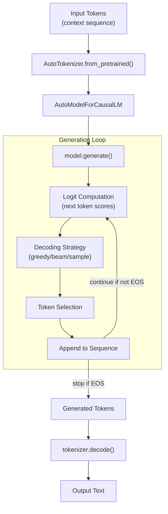
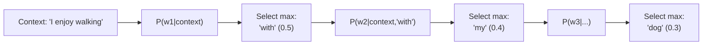
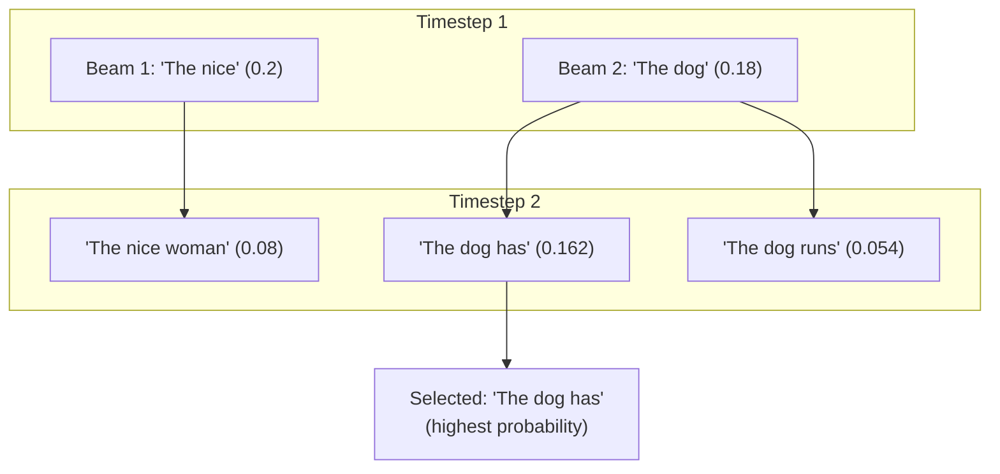
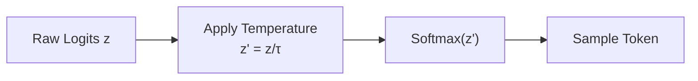
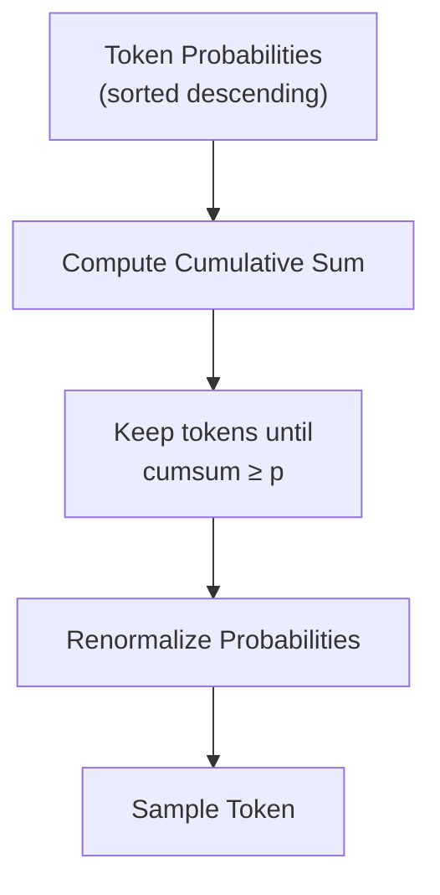
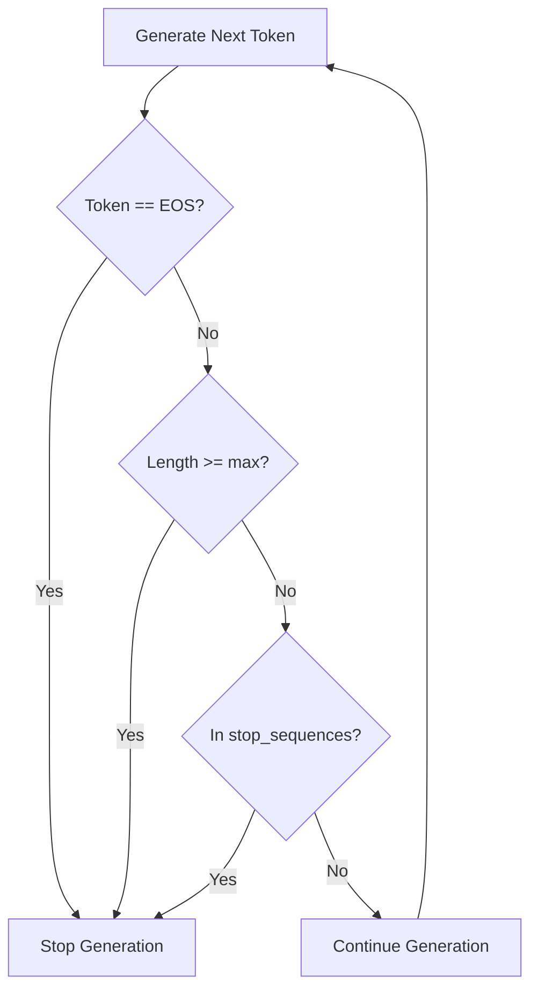
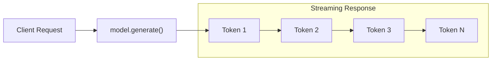
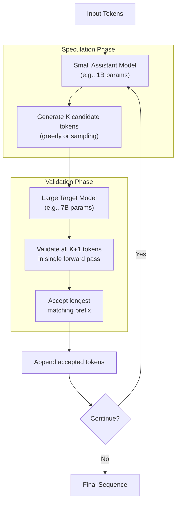
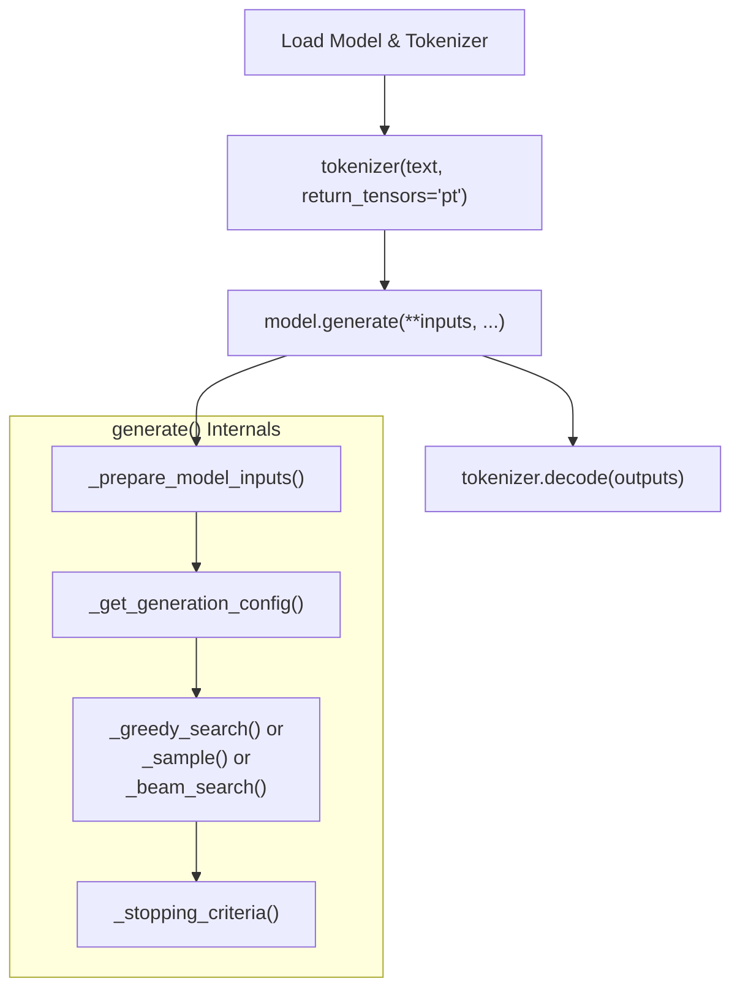

<!-- source: DeepWiki mcp.deepwiki.com · repo huggingface/blog · page 2.4 Text Generation and Decoding · fetched 2026-10-26 -->

# Text Generation and Decoding

<details>
<summary>Relevant source files</summary>

The following files were used as context for generating this wiki page:

- [4bit-transformers-bitsandbytes.md](4bit-transformers-bitsandbytes.md)
- [_events.yml](_events.yml)
- [accelerate-deepspeed.md](accelerate-deepspeed.md)
- [assets/03_reformer/thumbnail.png](assets/03_reformer/thumbnail.png)
- [assets/04_pytorch_block_sparse/thumbnail.png](assets/04_pytorch_block_sparse/thumbnail.png)
- [assets/05_encoder_decoder/thumbnail.png](assets/05_encoder_decoder/thumbnail.png)
- [assets/07_porting_fsmt/thumbnail.png](assets/07_porting_fsmt/thumbnail.png)
- [assets/08_warm_starting_encoder_decoder/thumbnail.png](assets/08_warm_starting_encoder_decoder/thumbnail.png)
- [assets/138_stackllama/thumbnail.png](assets/138_stackllama/thumbnail.png)
- [assets/147_falcon/falcon_thumbnail.jpg](assets/147_falcon/falcon_thumbnail.jpg)
- [assets/83_accelerate_deepspeed/chatbot.png](assets/83_accelerate_deepspeed/chatbot.png)
- [assets/83_accelerate_deepspeed/cls_run.png](assets/83_accelerate_deepspeed/cls_run.png)
- [assets/83_accelerate_deepspeed/deepspeed-thumbnail.png](assets/83_accelerate_deepspeed/deepspeed-thumbnail.png)
- [assets/98_spaces_3dmoljs/thumbnail.png](assets/98_spaces_3dmoljs/thumbnail.png)
- [assets/assisted-generation/thumbnail.png](assets/assisted-generation/thumbnail.png)
- [assets/diffusion-models-event/thumbnail.png](assets/diffusion-models-event/thumbnail.png)
- [assets/inference_pro/thumbnail.png](assets/inference_pro/thumbnail.png)
- [assets/instruction_tuning_sd/thumbnail.png](assets/instruction_tuning_sd/thumbnail.png)
- [assets/llama2/thumbnail.jpg](assets/llama2/thumbnail.jpg)
- [assisted-generation.md](assisted-generation.md)
- [diffusion-models-event.md](diffusion-models-event.md)
- [encoder-decoder.md](encoder-decoder.md)
- [falcon.md](falcon.md)
- [how-to-generate.md](how-to-generate.md)
- [how-to-train.md](how-to-train.md)
- [inference-pro.md](inference-pro.md)
- [instruction-tuning-sd.md](instruction-tuning-sd.md)
- [llama2.md](llama2.md)
- [notebooks/03_reformer.ipynb](notebooks/03_reformer.ipynb)
- [notebooks/05_encoder_decoder.ipynb](notebooks/05_encoder_decoder.ipynb)
- [notebooks/08_warm_starting_encoder_decoder.ipynb](notebooks/08_warm_starting_encoder_decoder.ipynb)
- [pytorch_block_sparse.md](pytorch_block_sparse.md)
- [reformer.md](reformer.md)
- [spaces_3dmoljs.md](spaces_3dmoljs.md)
- [stackllama.md](stackllama.md)
- [warm-starting-encoder-decoder.md](warm-starting-encoder-decoder.md)

</details>


## Purpose and Scope

This document covers the theory and practical implementation of text generation and decoding methods in transformer-based language models. It explains the core strategies for converting model predictions into output text sequences, including greedy search, beam search, sampling methods, and advanced techniques like assisted generation.

For information about training language models from scratch, see [Training and Fine-tuning LLMs](#2.2). For model-specific deployment and optimization, see [LLM Optimization and Quantization](#2.3).

## Auto-regressive Generation Fundamentals

Auto-regressive language generation operates on the principle that a word sequence probability distribution can be decomposed into conditional next-word distributions:

$$ P(w_{1:T} | W_0 ) = \prod_{t=1}^T P(w_{t} | w_{1: t-1}, W_0) $$

where \\(W_0\\) is the initial context and the sequence length \\(T\\) is determined on-the-fly, typically ending when an EOS (end-of-sequence) token is generated.

### Generation Pipeline Architecture



**Sources:** [how-to-generate.md:36-46](), [encoder-decoder.md:117-145]()

## Decoding Strategies

### Greedy Search

Greedy search selects the highest probability token at each timestep: \\(w_t = \arg\max_{w}P(w | w_{1:t-1})\\). This is the simplest decoding method but suffers from repetition and missing high-probability sequences hidden behind lower-probability tokens.



**Implementation:**

The `generate()` method uses greedy decoding by default when `do_sample=False` and `num_beams=1`.

**Sources:** [how-to-generate.md:73-133]()

### Beam Search

Beam search maintains the top `num_beams` hypotheses at each step, reducing the risk of missing high-probability sequences. It computes:

For each beam, expand with all possible next tokens and keep the top `num_beams` combined sequences by cumulative probability.



**Key Parameters:**

| Parameter | Type | Description |
|-----------|------|-------------|
| `num_beams` | int | Number of beams to keep (default: 1) |
| `early_stopping` | bool | Stop when all beams reach EOS |
| `no_repeat_ngram_size` | int | Prevent n-gram repetition |
| `num_return_sequences` | int | Number of sequences to return (≤ num_beams) |

**Sources:** [how-to-generate.md:137-282](), [inference-pro.md:240-256]()

### Sampling Methods

Sampling introduces randomness by selecting tokens according to their probability distribution rather than deterministically choosing the most likely token.

#### Basic Sampling

With `do_sample=True`, tokens are sampled from:

$$ w_t \sim P(w|w_{1:t-1}) $$

#### Temperature Scaling

Temperature \\(\tau\\) controls the sharpness of the probability distribution:

$$ P'(w_i) = \frac{\exp(z_i/\tau)}{\sum_j \exp(z_j/\tau)} $$

- \\(\tau < 1\\): Sharper distribution (more deterministic)
- \\(\tau > 1\\): Flatter distribution (more random)
- \\(\tau \to 0\\): Equivalent to greedy search



**Sources:** [how-to-generate.md:315-421]()

#### Top-K Sampling

Top-K sampling filters the \\(K\\) most likely tokens and redistributes probability mass among them:

```python
# Conceptual implementation
top_k_logits, top_k_indices = torch.topk(logits, k=50)
filtered_probs = softmax(top_k_logits)
next_token = sample(filtered_probs)
```

This prevents sampling from very low-probability tokens that may produce incoherent text.

**Sources:** [how-to-generate.md:425-491]()

#### Top-p (Nucleus) Sampling

Top-p sampling dynamically selects the smallest set of tokens whose cumulative probability exceeds \\(p\\):

$$ V_{top-p} = \arg\min_{V} \left\{ V : \sum_{w \in V} P(w|context) \geq p \right\} $$

This adapts the vocabulary size based on the probability distribution's shape.



**Sources:** [how-to-generate.md:495-554]()

## Generation Parameters and Control

### Core Parameters

The `generate()` method and `text_generation()` pipeline support extensive parameterization:

| Parameter | Default | Effect |
|-----------|---------|--------|
| `max_new_tokens` | 20 | Maximum tokens to generate |
| `max_length` | model_max_length | Total sequence length limit |
| `do_sample` | False | Enable sampling vs. greedy |
| `temperature` | 1.0 | Sampling temperature |
| `top_k` | 50 | Top-K sampling parameter |
| `top_p` | 1.0 | Nucleus sampling threshold |
| `repetition_penalty` | 1.0 | Penalty for repeated tokens |
| `num_beams` | 1 | Beam search width |
| `num_return_sequences` | 1 | Number of sequences to return |

### Stopping Criteria



**Configuration Parameters:**

- `eos_token_id`: Token ID that triggers sequence termination
- `max_new_tokens`: Hard limit on generation length
- `stop_sequences`: List of strings that trigger early stopping
- `early_stopping` (beam search): Stop when all beams complete

**Sources:** [how-to-generate.md:56-103](), [inference-pro.md:240-256]()

### Practical Parameter Combinations

**Conservative (factual) generation:**
```python
generate(
    do_sample=False,          # Greedy decoding
    repetition_penalty=1.2,   # Reduce repetition
    max_new_tokens=256
)
```

**Creative generation:**
```python
generate(
    do_sample=True,
    temperature=0.8,
    top_p=0.95,
    top_k=50,
    max_new_tokens=512
)
```

**Code completion:**
```python
generate(
    do_sample=True,
    temperature=0.2,          # Low temperature for consistency
    top_p=0.95,
    max_new_tokens=100
)
```

**Sources:** [how-to-generate.md:390-420](), [llama2.md:94-135](), [inference-pro.md:240-256]()

## Advanced Techniques

### Streaming Generation

Token streaming returns generated tokens progressively rather than waiting for the complete sequence. This dramatically improves perceived latency for long generations.



**Implementation with `InferenceClient`:**

```python
# Example usage pattern from inference-pro.md:298-313
for token in client.text_generation(
    "How do you make cheese?",
    max_new_tokens=12,
    stream=True
):
    print(token)
```

**Sources:** [inference-pro.md:283-323](), [how-to-generate.md:629-631]()

### Assisted Generation

Assisted generation uses a smaller "assistant" model to speculate multiple tokens ahead, which are then validated by the larger "target" model in parallel. This exploits the memory bandwidth bottleneck: loading model weights is expensive, but computing multiple tokens in parallel is nearly free.



**Performance Characteristics:**

- **Speedup**: 2-3x on commodity hardware, up to 10x in optimal conditions
- **Quality**: Identical output distribution to standard generation
- **Memory**: Requires both models in memory simultaneously
- **Best for**: Batch size = 1, greedy or low-temperature sampling

**Key Insight:** The target model can validate K speculated tokens in approximately the same time as generating 1 token autoregressively, because the bottleneck is memory bandwidth (loading weights) not computation.

**Sources:** [assisted-generation.md:1-47](), [assisted-generation.md:103-180]()

### Caching Considerations

The Inference API caches recent results by default. To force fresh generation:

```python
client = InferenceClient(model="...", token=TOKEN)
client.headers["x-use-cache"] = "0"
```

**Sources:** [inference-pro.md:268-280]()

## Implementation in Transformers

### Basic Usage Pattern



### Pipeline Integration

The `text-generation` pipeline provides a high-level interface:

```python
from transformers import pipeline

generator = pipeline(
    "text-generation",
    model="gpt2",
    device_map="auto"
)

outputs = generator(
    "The future of AI is",
    max_new_tokens=50,
    do_sample=True,
    top_k=50,
    top_p=0.95,
    num_return_sequences=3
)
```

**Sources:** [how-to-generate.md:56-70](), [llama2.md:102-126](), [falcon.md:96-128]()

### Generation Config

Generation behavior can be configured via:

1. **Method arguments:** `model.generate(max_new_tokens=100, ...)`
2. **GenerationConfig object:** Saved with model for defaults
3. **Model config:** `config.max_position_embeddings` etc.

Priority: method arguments > GenerationConfig > model config

**Sources:** [how-to-generate.md:629-633]()

## Comparison of Decoding Methods

| Method | Deterministic | Quality | Speed | Use Case |
|--------|---------------|---------|-------|----------|
| Greedy | Yes | Moderate | Fastest | Quick responses, factual QA |
| Beam Search | Yes | High | Slow | Translation, summarization |
| Sampling (high temp) | No | Variable | Fast | Creative writing |
| Top-K | No | Good | Fast | Balanced generation |
| Top-p | No | Good | Fast | Most versatile |
| Top-p + Top-K | No | Very Good | Fast | Current best practice |
| Assisted | Configurable | Same as base | 2-10x faster | Latency-critical applications |

**Sources:** [how-to-generate.md:284-312](), [how-to-generate.md:594-620](), [assisted-generation.md:1-16]()

## Common Pitfalls and Solutions

### Repetition

**Problem:** Models repeat the same phrases or get stuck in loops.

**Solutions:**
- Use `no_repeat_ngram_size=2` or higher (beam search)
- Increase `repetition_penalty` (1.0-1.5)
- Use sampling instead of greedy/beam search
- Reduce `temperature` if using very high values

**Sources:** [how-to-generate.md:117-121](), [how-to-generate.md:189-229]()

### Incoherence with Sampling

**Problem:** Sampled text is random gibberish.

**Solutions:**
- Lower `temperature` (try 0.7-0.8)
- Use Top-p (0.9-0.95) and/or Top-K (40-50)
- Combine multiple constraints: `top_p=0.95, top_k=50, temperature=0.8`

**Sources:** [how-to-generate.md:363-421]()

### Length Control

**Problem:** Generated text too short or too long.

**Solutions:**
- Set `max_new_tokens` explicitly
- Use `stop_sequences` for semantic stopping
- Adjust `eos_token_id` if needed
- For minimum length: use `min_length` parameter

**Sources:** [inference-pro.md:240-256]()

---

