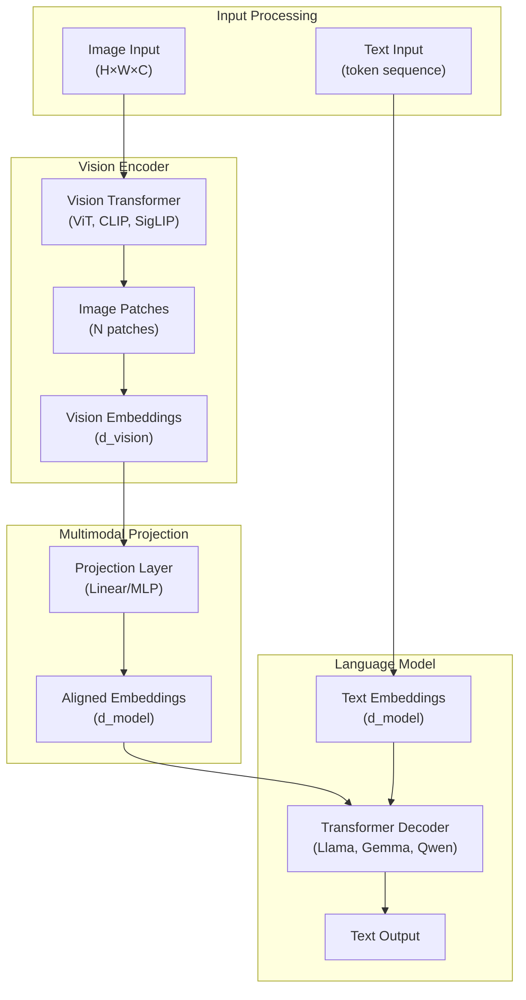
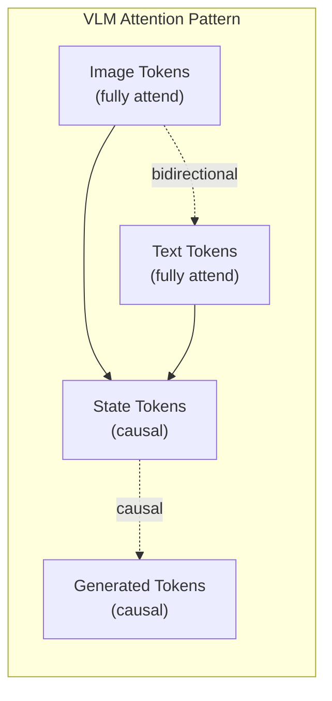
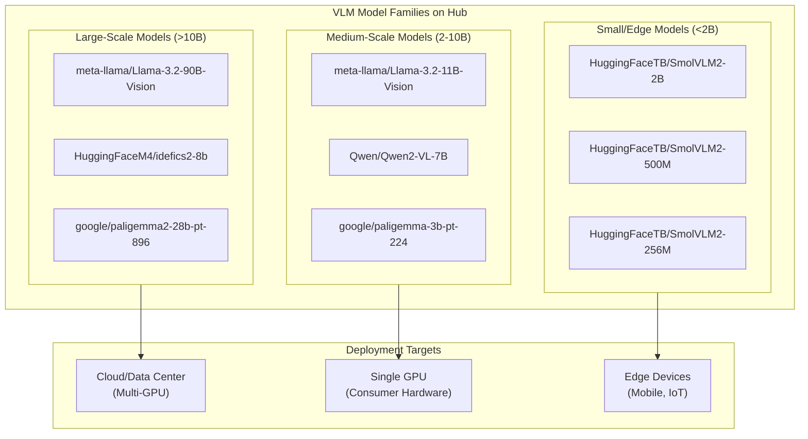
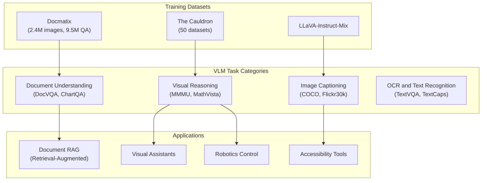
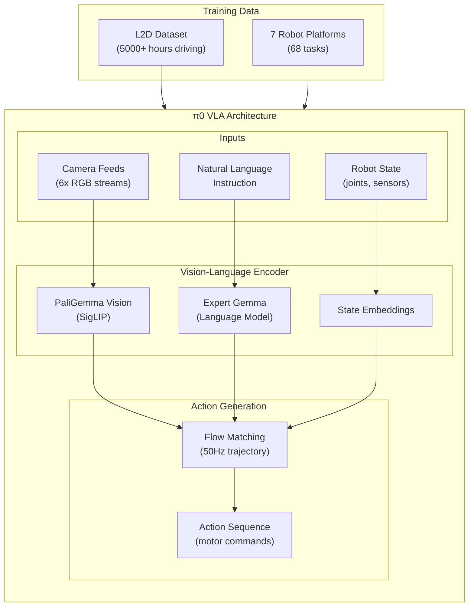
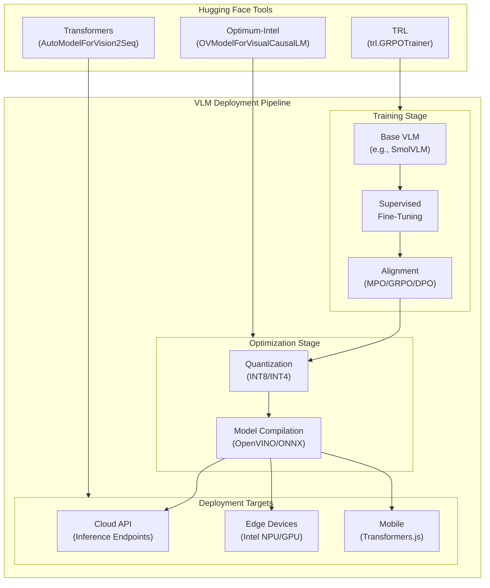

<!-- source: DeepWiki mcp.deepwiki.com · repo huggingface/blog · page 3 Vision Language Models · fetched 2026-10-26 -->

# Vision Language Models

<details>
<summary>Relevant source files</summary>

The following files were used as context for generating this wiki page:

- [1_58_llm_extreme_quantization.md](1_58_llm_extreme_quantization.md)
- [_blog.yml](_blog.yml)
- [_tags.yml](_tags.yml)
- [assets/192_pi0/new_thumbnail_pi0.001.png](assets/192_pi0/new_thumbnail_pi0.001.png)
- [assets/193_l2d/lerobot-driver.gif](assets/193_l2d/lerobot-driver.gif)
- [assets/1_58_llm_extreme_quantization/thumbnail.png](assets/1_58_llm_extreme_quantization/thumbnail.png)
- [assets/inference-providers/welcome-featherless.jpg](assets/inference-providers/welcome-featherless.jpg)
- [assets/optimum_intel/optimum_openvino_thumbnail.png](assets/optimum_intel/optimum_openvino_thumbnail.png)
- [assets/sd_dreambooth_training/thumbnail.jpg](assets/sd_dreambooth_training/thumbnail.jpg)
- [assets/streaming_datasets/streaming_datasets.png](assets/streaming_datasets/streaming_datasets.png)
- [assets/textquests/thumbnail.gif](assets/textquests/thumbnail.gif)
- [assets/trl_vlm/thumbnail.png](assets/trl_vlm/thumbnail.png)
- [assets/virustotal/thumbnail.png](assets/virustotal/thumbnail.png)
- [assets/wuerstchen/thumbnail.jpg](assets/wuerstchen/thumbnail.jpg)
- [dreambooth.md](dreambooth.md)
- [inference-providers-featherless.md](inference-providers-featherless.md)
- [lerobot-goes-to-driving-school.md](lerobot-goes-to-driving-school.md)
- [openvino-vlm.md](openvino-vlm.md)
- [pi0.md](pi0.md)
- [streaming-datasets.md](streaming-datasets.md)
- [textquests.md](textquests.md)
- [trl-vlm-alignment.md](trl-vlm-alignment.md)
- [virustotal.md](virustotal.md)
- [zh/_blog.yml](zh/_blog.yml)
- [zh/asr-diarization.md](zh/asr-diarization.md)
- [zh/big-bird.md](zh/big-bird.md)
- [zh/docmatix.md](zh/docmatix.md)
- [zh/dynamic_speculation_lookahead.md](zh/dynamic_speculation_lookahead.md)
- [zh/fine-video.md](zh/fine-video.md)
- [zh/infini-attention.md](zh/infini-attention.md)
- [zh/kv-cache-quantization.md](zh/kv-cache-quantization.md)
- [zh/llama32.md](zh/llama32.md)
- [zh/pytorch-fsdp.md](zh/pytorch-fsdp.md)
- [zh/train-sentence-transformers.md](zh/train-sentence-transformers.md)
- [zh/vertex-colored-to-textured-mesh.md](zh/vertex-colored-to-textured-mesh.md)
- [zh/zero-shot-vqa-docmatix.md](zh/zero-shot-vqa-docmatix.md)

</details>


## Purpose and Scope

Vision Language Models (VLMs) are multimodal neural networks that process both visual and textual inputs to perform tasks requiring joint understanding of images and language. This document provides an overview of VLM architectures, key models available in the Hugging Face ecosystem, and their core capabilities. 

For detailed information on specific aspects:
- VLM training and alignment techniques, see [VLM Training and Alignment](#3.1)
- Specific VLM architectures and implementations, see [Vision Language Models Overview](#3.2)  
- Extension to robotic control with Vision-Language-Action models, see [Vision-Language-Action Models](#3.3)
- Optimization and deployment strategies, see [VLM Optimization](#3.4)

## VLM Architecture Fundamentals

VLMs extend traditional language models by incorporating visual understanding through a vision encoder component. The fundamental architecture combines three key elements: a vision encoder that processes images into embeddings, a language model that processes text, and a projection layer that aligns the vision and language representations.



**Token Representation and Attention**

VLMs treat image patches as visual tokens that are processed alongside text tokens. The key innovation is in how attention is computed across modalities. As described in [trl-vlm-alignment.md:93-121](), VLMs use specialized attention mechanisms:

- **Prefix Tokens**: Image and text tokens form a "prefix" that attends fully to each other (non-causal attention)
- **State Tokens**: Represent the model's internal state and can attend to prefix tokens triangularly
- **Cross-Modal Attention**: Enables the language model to condition its outputs on visual information



Sources: [trl-vlm-alignment.md:89-175](), [pi0.md:89-121]()

## Key VLM Models in the Ecosystem

The Hugging Face Hub hosts several prominent VLM families, each with distinct architectural choices and optimization strategies.

| Model Family | Vision Encoder | Language Model | Key Features | Sizes Available |
|--------------|----------------|----------------|--------------|-----------------|
| **Idefics2** | SigLIP | Mistral | Improved training, better performance | 8B |
| **PaliGemma** | SigLIP-So400m | Gemma | Joint vision-language pretraining | 3B, 10B, 28B |
| **Llama 3.2 Vision** | Custom ViT | Llama 3 | State-of-art reasoning, cross-attention | 11B, 90B |
| **SmolVLM** | SigLIP-So400m | SmolLM2 | Efficient, on-device deployment | 256M, 500M, 2B |
| **Florence-2** | DaViT | BART | Document understanding, fine-grained tasks | Base, Large |
| **Qwen2-VL** | Custom ViT | Qwen2 | Dynamic resolution, multilingual | 2B, 7B, 72B |



**Model Implementation in Transformers**

VLMs in the `transformers` library follow a consistent API pattern. The core classes include:

- `OVModelForVisualCausalLM`: OpenVINO-optimized vision models [openvino-vlm.md:48-53]()
- `Pi0Policy`: Vision-Language-Action policy models [pi0.md:86-87]()
- Processor classes that handle both image and text preprocessing

Sources: [openvino-vlm.md:18-53](), [pi0.md:12-87](), [trl-vlm-alignment.md:1-300]()

## Core Capabilities and Tasks

VLMs excel at tasks requiring joint visual and linguistic understanding:

**Document Visual Question Answering (DocVQA)**

DocVQA is a primary application where models analyze document images and answer questions about their content. The [Docmatix dataset](https://huggingface.co/datasets/HuggingFaceM4/Docmatix) contains 2.4M images with 9.5M question-answer pairs from 1.3M PDF documents, enabling large-scale DocVQA training.

**Visual Reasoning and Captioning**

VLMs perform multi-step reasoning over images, as demonstrated in the MPO (Mixed Preference Optimization) approach which combines reasoning tasks with preference learning [trl-vlm-alignment.md:63-90]().

**Task Performance by Model**

Common benchmarks include:
- **DocVQA**: Document understanding accuracy
- **VQAv2**: General visual question answering
- **TextVQA**: Text-heavy image questions
- **ChartQA**: Chart and graph interpretation
- **MMMU**: Massive multi-discipline multimodal understanding



Sources: [trl-vlm-alignment.md:55-66](), [zh/docmatix.md:1-50]()

## From VLMs to VLAs

Vision-Language-Action (VLA) models extend VLMs by adding action tokens that represent motor commands for robotic control. This transforms a VLM from a passive observer to an active agent.

**Key Architectural Differences**

The main distinction between VLMs and VLAs lies in action representation [pi0.md:89-120]():

- **VLMs**: Process (image, text) → generate text
- **VLAs**: Process (image, text, state) → generate actions

VLAs introduce additional token types:
- **State Tokens**: Represent robot's current configuration (joint angles, sensor values)
- **Action Tokens**: Represent motor command sequences (continuous or discrete)
- **Time Embeddings**: Encode temporal information for sequential actions

**π0 Model Architecture**

The π0 model exemplifies VLA design with flow matching for action generation [pi0.md:40-50]():



**Usage Example**

Loading and using a π0 policy [pi0.md:58-87]():

```python
from lerobot.common.policies.pi0 import Pi0Policy

# Load pretrained π0 model
policy = Pi0Policy.from_pretrained("lerobot/pi0")

# Fine-tune on custom dataset
python lerobot/scripts/train.py \
    --policy.path=lerobot/pi0 \
    --dataset.repo_id=your_dataset
```

Sources: [pi0.md:1-120](), [lerobot-goes-to-driving-school.md:1-100]()

## Training and Deployment Pipeline

### Training Approaches

VLM training follows a multi-stage process:

1. **Supervised Fine-Tuning (SFT)**: Basic instruction following [trl-vlm-alignment.md:241-260]()
2. **Alignment Methods**: Advanced preference optimization
   - MPO (Mixed Preference Optimization): Combines DPO, BCO, and SFT losses
   - GRPO (Group Relative Policy Optimization): Batch-based policy updates
   - GSPO (Group Sequence Policy Optimization): Sequence-level importance sampling

**Training with TRL**

The TRL library provides trainers for VLM alignment [trl-vlm-alignment.md:134-151]():

```python
from trl import GRPOConfig, GRPOTrainer

training_args = GRPOConfig(
    learning_rate=1e-5,
    max_prompt_length=None,
)

trainer = GRPOTrainer(
    model=model_id,
    reward_funcs=[format_reward, accuracy_reward],
    args=training_args,
    train_dataset=train_dataset,
)
trainer.train()
```

### Optimization and Deployment

**Quantization Strategies** [openvino-vlm.md:54-114]()

Three main quantization approaches are available:

| Method | Weights | Activations | Use Case | Speedup |
|--------|---------|-------------|----------|---------|
| **Weight-Only (WOQ)** | INT8/INT4 | FP16 | Memory-constrained | Moderate |
| **Static Quantization** | INT8 | INT8 | Maximum performance | High |
| **Mixed Quantization** | INT8 vision + INT8 LM | Varies | Balanced | Medium-High |

**OpenVINO Deployment**

Convert and optimize VLMs for CPU inference [openvino-vlm.md:36-53]():

```python
from optimum.intel import OVModelForVisualCausalLM, OVWeightQuantizationConfig

# Weight-only quantization
q_config = OVWeightQuantizationConfig(bits=8)
q_model = OVModelForVisualCausalLM.from_pretrained(
    model_id, 
    quantization_config=q_config
)
q_model.save_pretrained("smolvlm_int8")

# Deploy on GPU
model = OVModelForVisualCausalLM.from_pretrained(
    model_id, 
    device="gpu"
)
```

**Performance Benchmarks**

On Intel Core Ultra 7 265K CPU [openvino-vlm.md:142-159]():

| Configuration | TTFT (s) | TPOT (s) | Throughput (tok/s) | Speedup |
|---------------|----------|----------|-------------------|---------|
| PyTorch | 5.150 | 1.385 | 0.722 | 1x |
| OpenVINO | 0.420 | 0.021 | 47.237 | 65x |
| OpenVINO INT8 | 0.247 | 0.016 | 63.928 | 88x |



Sources: [trl-vlm-alignment.md:69-151](), [openvino-vlm.md:25-180](), [pi0.md:49-87]()

---

