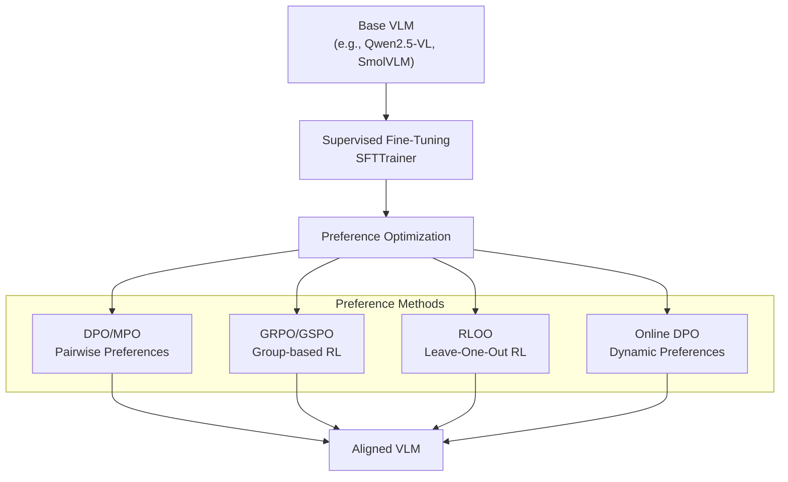
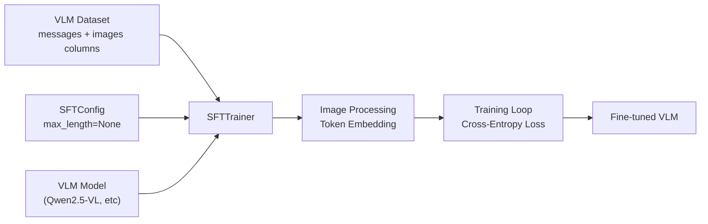
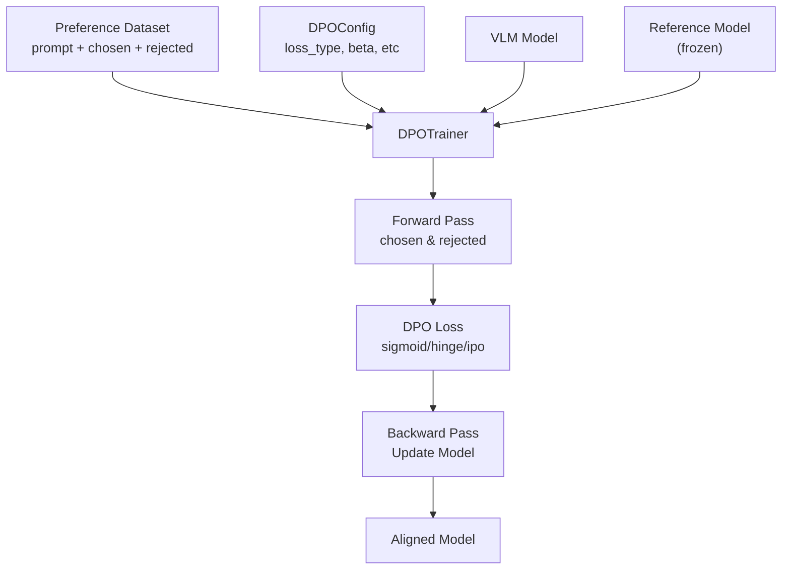
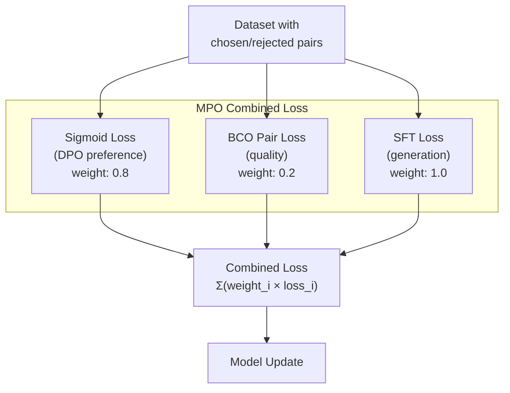
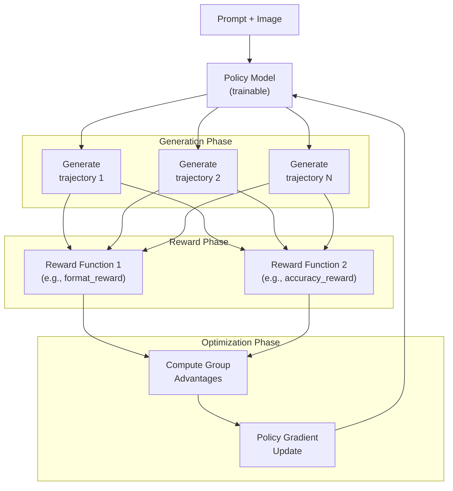
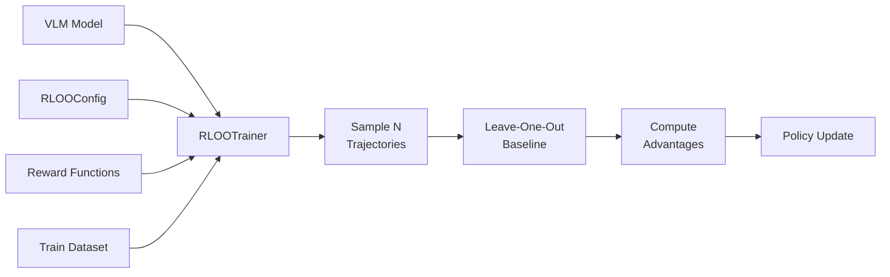
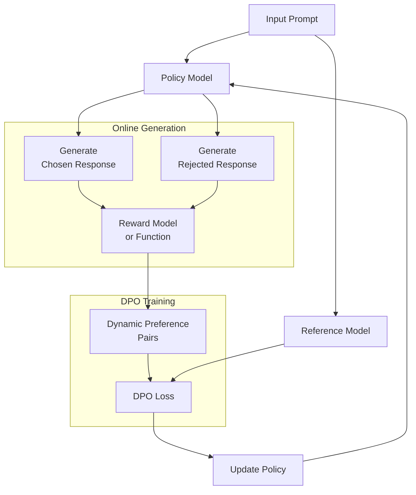
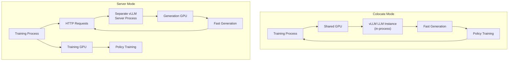
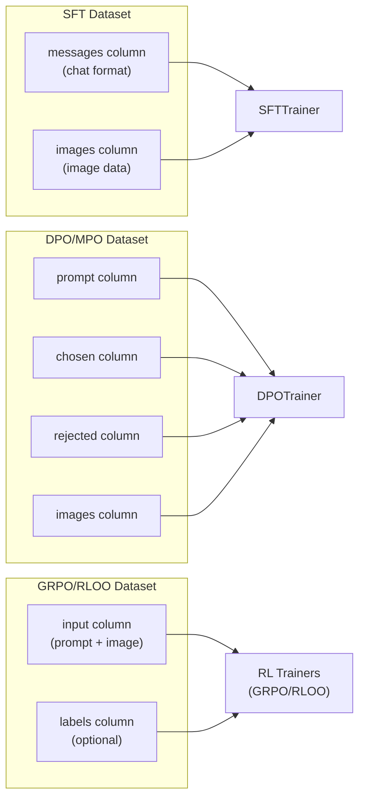

<!-- source: DeepWiki mcp.deepwiki.com · repo huggingface/blog · page 3.1 VLM Training and Alignment · fetched 2026-10-26 -->

# VLM Training and Alignment

<details>
<summary>Relevant source files</summary>

The following files were used as context for generating this wiki page:

- [1_58_llm_extreme_quantization.md](1_58_llm_extreme_quantization.md)
- [_blog.yml](_blog.yml)
- [_tags.yml](_tags.yml)
- [assets/192_pi0/new_thumbnail_pi0.001.png](assets/192_pi0/new_thumbnail_pi0.001.png)
- [assets/193_l2d/lerobot-driver.gif](assets/193_l2d/lerobot-driver.gif)
- [assets/1_58_llm_extreme_quantization/thumbnail.png](assets/1_58_llm_extreme_quantization/thumbnail.png)
- [assets/inference-providers/welcome-featherless.jpg](assets/inference-providers/welcome-featherless.jpg)
- [assets/optimum_intel/optimum_openvino_thumbnail.png](assets/optimum_intel/optimum_openvino_thumbnail.png)
- [assets/sd_dreambooth_training/thumbnail.jpg](assets/sd_dreambooth_training/thumbnail.jpg)
- [assets/streaming_datasets/streaming_datasets.png](assets/streaming_datasets/streaming_datasets.png)
- [assets/textquests/thumbnail.gif](assets/textquests/thumbnail.gif)
- [assets/trl_vlm/thumbnail.png](assets/trl_vlm/thumbnail.png)
- [assets/virustotal/thumbnail.png](assets/virustotal/thumbnail.png)
- [assets/wuerstchen/thumbnail.jpg](assets/wuerstchen/thumbnail.jpg)
- [dreambooth.md](dreambooth.md)
- [inference-providers-featherless.md](inference-providers-featherless.md)
- [lerobot-goes-to-driving-school.md](lerobot-goes-to-driving-school.md)
- [openvino-vlm.md](openvino-vlm.md)
- [pi0.md](pi0.md)
- [streaming-datasets.md](streaming-datasets.md)
- [textquests.md](textquests.md)
- [trl-vlm-alignment.md](trl-vlm-alignment.md)
- [virustotal.md](virustotal.md)

</details>


This page documents the training and alignment methods for Vision Language Models (VLMs) available in the TRL (Transformer Reinforcement Learning) library. It covers supervised fine-tuning, preference optimization techniques (DPO, MPO), policy gradient methods (GRPO, GSPO, RLOO, Online DPO), and vLLM integration for efficient training.

For general VLM architectures and model overviews, see [Vision Language Models Overview](#3.2). For VLM optimization and quantization techniques, see [VLM Optimization](#3.4). For Vision-Language-Action models in robotics, see [Vision-Language-Action Models](#3.3).

## VLM Alignment Overview

VLM alignment extends language model alignment techniques to multimodal models that process both images and text. The alignment pipeline typically follows a three-stage process: base model training, supervised fine-tuning (SFT) to follow instructions, and preference optimization to align with human preferences.



Sources: [trl-vlm-alignment.md:1-298]()

## Supervised Fine-Tuning (SFT)

The `SFTTrainer` provides native support for VLM supervised fine-tuning with standardized transformers APIs. The trainer handles vision datasets with an `images` column containing image data alongside text prompts and responses.

### SFTTrainer Architecture



### Usage Example

The `SFTTrainer` is initialized with a VLM model path and dataset. Setting `max_length=None` prevents truncation of image tokens during training:

```python
from trl import SFTConfig, SFTTrainer
from datasets import load_dataset

trainer = SFTTrainer(
    model="Qwen/Qwen2.5-VL-3B-Instruct",
    args=SFTConfig(max_length=None),
    train_dataset=load_dataset("trl-lib/llava-instruct-mix", split="train"),
)
trainer.train()
```

The training script `sft_vlm.py` provides a complete implementation supporting various VLM architectures from transformers.

Sources: [trl-vlm-alignment.md:241-260](), [sft_vlm.py]()

## Direct Preference Optimization (DPO)

DPO aligns VLMs using pairwise preference data by optimizing a contrastive loss between chosen and rejected responses. The method trains the model to increase the likelihood of preferred responses while decreasing the likelihood of rejected ones.

### DPO Components



### DPO Loss Functions

The `DPOTrainer` supports multiple loss types configured via `DPOConfig.loss_type`:

| Loss Type | Formula | Use Case |
|-----------|---------|----------|
| `sigmoid` | Standard DPO contrastive loss | Default preference optimization |
| `hinge` | Margin-based loss | When preferences have confidence scores |
| `ipo` | Identity Preference Optimization | More stable training |
| `bco_pair` | Binary Classifier Optimization | Quality assessment |

Sources: [trl-vlm-alignment.md:55-90]()

## Mixed Preference Optimization (MPO)

MPO extends DPO with a combined loss function incorporating preference learning (DPO sigmoid loss), quality assessment (BCO loss), and supervised learning (SFT loss). This multi-objective approach addresses distribution shift and improves reasoning coherence in VLMs.

### MPO Loss Architecture



### MPO Configuration

MPO is configured by specifying multiple loss types and their corresponding weights in `DPOConfig`:

```python
mpo_config = DPOConfig(
    loss_type=["sigmoid", "bco_pair", "sft"],
    loss_weights=[0.8, 0.2, 1.0],
)

mpo_trainer = DPOTrainer(
    model=model_id,
    args=mpo_config,
    processing_class=tokenizer,
    train_dataset=dataset,
)
```

The combined loss approach yields significant improvements, with the paper reporting 6.2 point gains on MathVista benchmarks.

Sources: [trl-vlm-alignment.md:63-90]()

## Group Relative Policy Optimization (GRPO)

GRPO is a policy gradient method that updates policies over batches of trajectories (groups) rather than individual samples. This approach averages out reward noise and learns broader patterns of good responses, making it more robust and performant than traditional PPO.

### GRPO Training Flow



### GRPO Reward Functions

GRPO uses multiple reward functions to assess generation quality. The reward functions are Python callables that take completions and optional keyword arguments:

```python
def format_reward(completions, **kwargs):
    """Check if completion matches expected format"""
    pattern = r"^\s*<answer>.*?</answer>$"
    matches = [re.match(pattern, content) for content in completions]
    return [1.0 if match else 0.0 for match in matches]

def accuracy_reward(completions, **kwargs):
    """Check if completion matches ground truth"""
    solutions = kwargs['solution']
    # Parse and verify answers
    # Return list of float rewards
```

The trainer is initialized with reward functions and configuration:

```python
training_args = GRPOConfig(
    learning_rate=1e-5,
    max_prompt_length=None,
)

trainer = GRPOTrainer(
    model=model_id,
    reward_funcs=[format_reward, accuracy_reward],
    args=training_args,
    train_dataset=train_dataset,
)
```

Sources: [trl-vlm-alignment.md:92-153]()

## Group Sequence Policy Optimization (GSPO)

GSPO is a variant of GRPO that computes importance sampling weights at the sequence level instead of per-token. This achieves more stable training, particularly beneficial for Mixture-of-Experts (MoE) style models.

### GSPO vs GRPO Comparison

| Aspect | GRPO | GSPO |
|--------|------|------|
| Importance Sampling | Per-token level | Sequence level |
| Stability | Good | Better for MoE models |
| Configuration | `importance_sampling_level="token"` | `importance_sampling_level="sequence"` |
| Use Case | General VLM training | MoE architecture training |

### GSPO Configuration

GSPO shares the `GRPOTrainer` implementation but requires specific configuration parameters:

```python
training_args = GRPOConfig(
    importance_sampling_level="sequence",
    epsilon=3e-4,
    epsilon_high=4e-4,
    beta=0.0,
    loss_type="grpo",
    steps_per_generation=1,
)

trainer = GRPOTrainer(
    model=model_id,
    reward_funcs=[format_reward, accuracy_reward],
    args=training_args,
    train_dataset=train_dataset,
)
```

Sources: [trl-vlm-alignment.md:155-174]()

## Reinforce Leave One Out (RLOO)

RLOO is a policy gradient method that uses leave-one-out baselines to reduce variance in advantage estimation. Each trajectory's reward is compared against the average of all other trajectories in the batch, providing more stable gradient estimates.

### RLOO Trainer Setup



The `RLOOTrainer` is initialized similarly to `GRPOTrainer`:

```python
trainer = RLOOTrainer(
    model=model_name,
    args=training_args,
    reward_funcs=[think_format_reward, accuracy_reward],
    train_dataset=train_dataset,
    eval_dataset=eval_dataset,
)
```

Training can be launched via the example script:

```bash
CUDA_VISIBLE_DEVICES=1,2 python3 examples/scripts/rloo_vlm.py \
    --model_name_or_path Qwen/Qwen2.5-VL-3B-Instruct
```

Sources: [trl-vlm-alignment.md:199-225]()

## Online Direct Preference Optimization

Online DPO extends DPO by generating preference pairs dynamically during training rather than using a fixed dataset. This allows the model to continuously adapt to its changing policy and explore new regions of the output space.

### Online DPO Architecture



### Online DPO Usage

Online DPO supports vLLM for efficient generation during training:

```bash
CUDA_VISIBLE_DEVICES=1,2 python3 examples/scripts/online_dpo_vlm.py \
    --model_name_or_path Qwen/Qwen2.5-VL-3B-Instruct \
    --use_vllm --vllm_mode server
```

The trainer generates preference pairs on-the-fly and updates the policy using DPO loss.

Sources: [trl-vlm-alignment.md:227-239]()

## vLLM Integration

vLLM integration enables efficient online generation during RL-based training methods (GRPO, GSPO, RLOO, Online DPO). It provides two modes: `colocate` and `server`, offering flexibility for different hardware setups.

### vLLM Modes



### vLLM Configuration

**Colocate Mode**: Runs vLLM in the same process as training, sharing GPU memory:

```bash
CUDA_VISIBLE_DEVICES=1,2 python3 examples/scripts/grpo_vlm.py \
    --model_name_or_path Qwen/Qwen2.5-VL-3B-Instruct \
    --use_vllm --vllm_mode colocate
```

**Server Mode**: Runs vLLM in a separate process. First, start the vLLM server:

```bash
trl vllm-serve --model Qwen/Qwen2.5-VL-3B-Instruct \
    --tensor-parallel-size 1
```

Then run training with server mode:

```bash
CUDA_VISIBLE_DEVICES=1,2 python3 examples/scripts/grpo_vlm.py \
    --model_name_or_path Qwen/Qwen2.5-VL-3B-Instruct \
    --use_vllm --vllm_mode server
```

### Transformers Backend

vLLM can be configured to use the transformers backend for compatibility:

```bash
--vllm_model_impl transformers
```

This flag works with both colocate and server modes.

Sources: [trl-vlm-alignment.md:261-283]()

## Training Scripts Overview

TRL provides example scripts for all alignment methods in the `examples/scripts/` directory:

| Script | Method | Usage |
|--------|--------|-------|
| `sft_vlm.py` | Supervised Fine-Tuning | `python examples/scripts/sft_vlm.py` |
| `online_dpo_vlm.py` | Online DPO | `python examples/scripts/online_dpo_vlm.py --use_vllm` |
| `rloo_vlm.py` | RLOO | `python examples/scripts/rloo_vlm.py` |
| `grpo_vlm.py` | GRPO/GSPO | `python examples/scripts/grpo_vlm.py --use_vllm` |

All scripts support VLM models from transformers and can be customized via command-line arguments. The scripts handle multimodal dataset loading, image processing, and training loop orchestration.

Sources: [trl-vlm-alignment.md:205-279]()

## Dataset Format Requirements

VLM training requires datasets with specific column structures:



Example datasets:
- SFT: `trl-lib/llava-instruct-mix`
- DPO: Vision datasets with `chosen`/`rejected` pairs
- GRPO: Task-specific datasets with reward signals

Sources: [trl-vlm-alignment.md:241-260]()

## Performance Comparison

The document provides comparison results for different alignment methods on Qwen2.5-VL-3B:

| Method | Dataset | Training | Key Benefit |
|--------|---------|----------|-------------|
| Base Model | - | Pre-training only | Baseline performance |
| MPO | Preference pairs | Combined loss | +6.2 pts on MathVista |
| GRPO | Math problems | Group RL | Better reasoning coherence |
| GSPO | Math problems | Sequence-level IS | More stable for MoE |

The alignment methods show progressive improvements over the base model, with GRPO and GSPO producing more coherent reasoning traces in mathematical problem-solving tasks.

Sources: [trl-vlm-alignment.md:176-197]()

---

