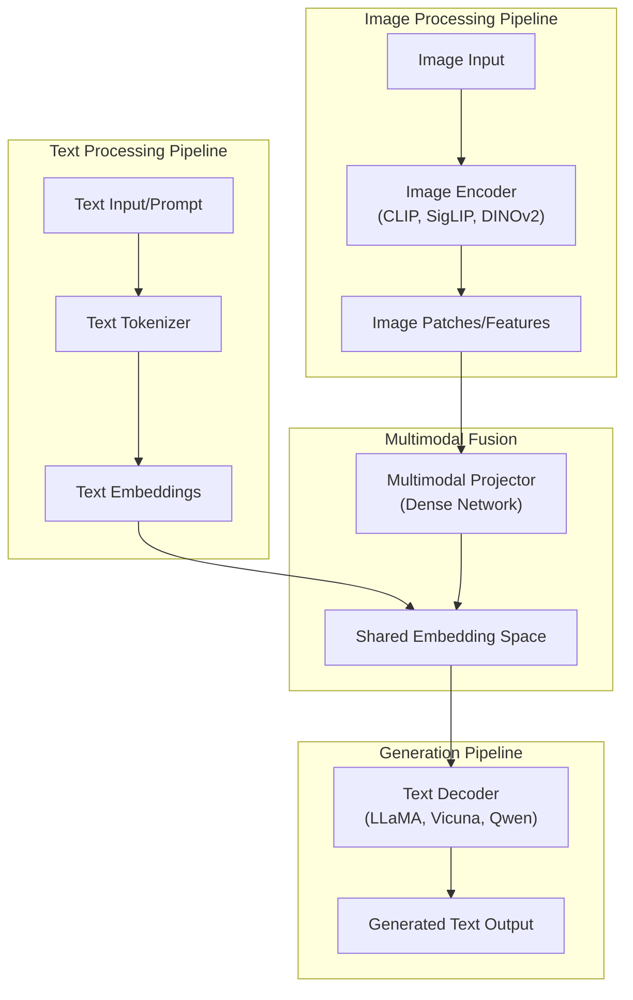
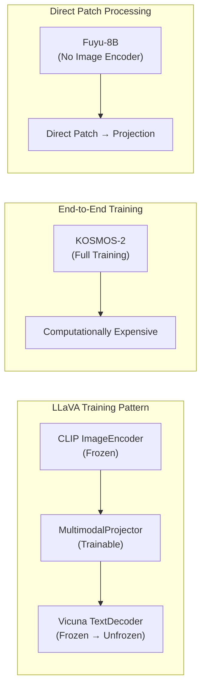
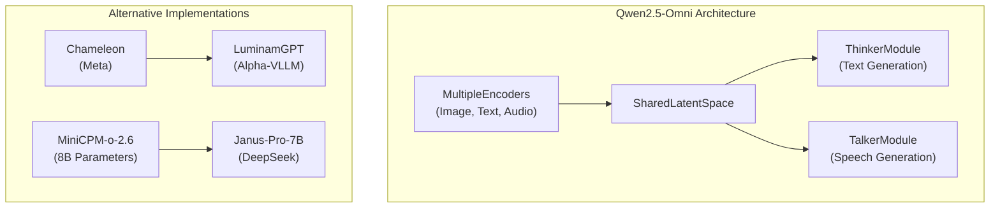
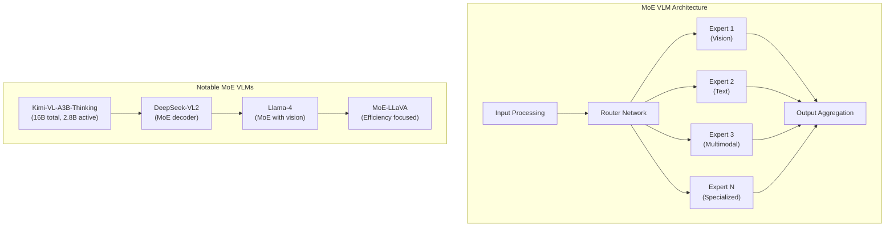
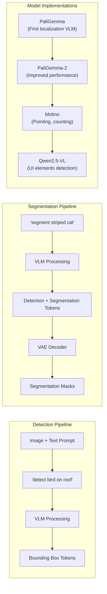
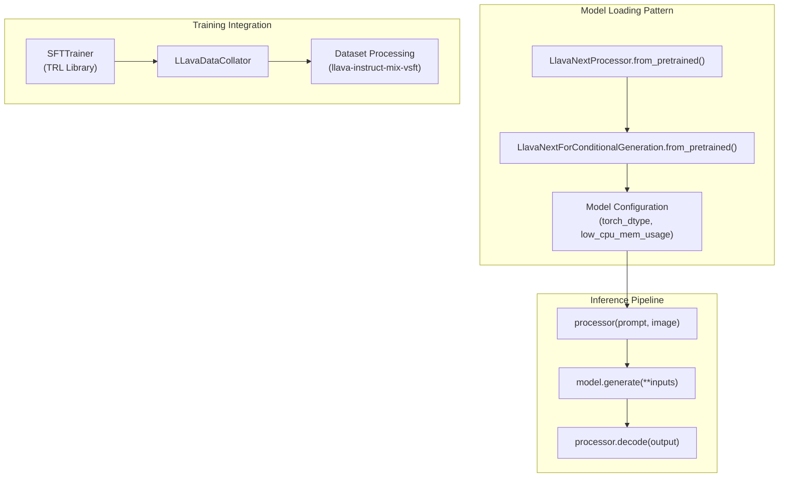
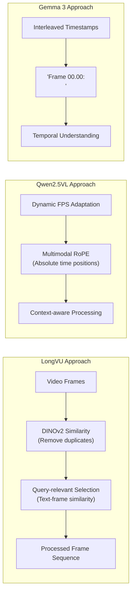
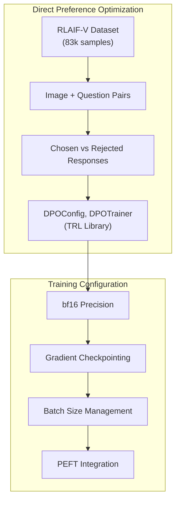

<!-- source: DeepWiki mcp.deepwiki.com · repo huggingface/blog · page 3.2 Vision Language Models Overview · fetched 2026-10-26 -->

# Vision Language Models Overview

Relevant source files

The following files were used as context for generating this wiki page:

- [1_58_llm_extreme_quantization.md](1_58_llm_extreme_quantization.md)
- [_blog.yml](_blog.yml)
- [_tags.yml](_tags.yml)
- [assets/192_pi0/new_thumbnail_pi0.001.png](assets/192_pi0/new_thumbnail_pi0.001.png)
- [assets/193_l2d/lerobot-driver.gif](assets/193_l2d/lerobot-driver.gif)
- [assets/1_58_llm_extreme_quantization/thumbnail.png](assets/1_58_llm_extreme_quantization/thumbnail.png)
- [assets/63_deep_rl_intro/tasks.jpg](assets/63_deep_rl_intro/tasks.jpg)
- [assets/70_deep_rl_q_part1/bellman6.jpg](assets/70_deep_rl_q_part1/bellman6.jpg)
- [assets/78_ml_director_insights/witty-works.png](assets/78_ml_director_insights/witty-works.png)
- [assets/86_bloom/bloom-examples.jpg](assets/86_bloom/bloom-examples.jpg)
- [assets/controlnet/thumbnail.png](assets/controlnet/thumbnail.png)
- [assets/cosmopedia/thumbnail.png](assets/cosmopedia/thumbnail.png)
- [assets/inference-providers/welcome-featherless.jpg](assets/inference-providers/welcome-featherless.jpg)
- [assets/optimum_intel/optimum_openvino_thumbnail.png](assets/optimum_intel/optimum_openvino_thumbnail.png)
- [assets/sd_dreambooth_training/thumbnail.jpg](assets/sd_dreambooth_training/thumbnail.jpg)
- [assets/streaming_datasets/streaming_datasets.png](assets/streaming_datasets/streaming_datasets.png)
- [assets/textquests/thumbnail.gif](assets/textquests/thumbnail.gif)
- [assets/trl_vlm/thumbnail.png](assets/trl_vlm/thumbnail.png)
- [assets/virustotal/thumbnail.png](assets/virustotal/thumbnail.png)
- [assets/wuerstchen/thumbnail.jpg](assets/wuerstchen/thumbnail.jpg)
- [bloom.md](bloom.md)
- [classification-use-cases.md](classification-use-cases.md)
- [controlnet.md](controlnet.md)
- [cosmopedia.md](cosmopedia.md)
- [deep-rl-a2c.md](deep-rl-a2c.md)
- [deep-rl-dqn.md](deep-rl-dqn.md)
- [deep-rl-intro.md](deep-rl-intro.md)
- [deep-rl-pg.md](deep-rl-pg.md)
- [deep-rl-ppo.md](deep-rl-ppo.md)
- [deep-rl-q-part1.md](deep-rl-q-part1.md)
- [deep-rl-q-part2.md](deep-rl-q-part2.md)
- [dreambooth.md](dreambooth.md)
- [inference-providers-featherless.md](inference-providers-featherless.md)
- [lerobot-goes-to-driving-school.md](lerobot-goes-to-driving-school.md)
- [ml-director-insights-2.md](ml-director-insights-2.md)
- [openvino-vlm.md](openvino-vlm.md)
- [pi0.md](pi0.md)
- [streaming-datasets.md](streaming-datasets.md)
- [textquests.md](textquests.md)
- [trl-vlm-alignment.md](trl-vlm-alignment.md)
- [virustotal.md](virustotal.md)
- [zh/_blog.yml](zh/_blog.yml)
- [zh/asr-diarization.md](zh/asr-diarization.md)
- [zh/big-bird.md](zh/big-bird.md)
- [zh/docmatix.md](zh/docmatix.md)
- [zh/dynamic_speculation_lookahead.md](zh/dynamic_speculation_lookahead.md)
- [zh/fine-video.md](zh/fine-video.md)
- [zh/infini-attention.md](zh/infini-attention.md)
- [zh/kv-cache-quantization.md](zh/kv-cache-quantization.md)
- [zh/llama32.md](zh/llama32.md)
- [zh/pytorch-fsdp.md](zh/pytorch-fsdp.md)
- [zh/train-sentence-transformers.md](zh/train-sentence-transformers.md)
- [zh/vertex-colored-to-textured-mesh.md](zh/vertex-colored-to-textured-mesh.md)
- [zh/zero-shot-vqa-docmatix.md](zh/zero-shot-vqa-docmatix.md)

## Purpose and Scope

This document provides a comprehensive overview of Vision Language Models (VLMs) as covered in the Hugging Face blog repository, focusing on architectural patterns, model trends, and capabilities emerging in 2025. VLMs are multimodal models that process both visual and textual inputs to generate text outputs, enabling applications from image captioning to visual question answering.

For specific VLM implementations, see [SmolVLM Family](#3.1). For vision-language-action models that extend VLMs with robotic capabilities, see [Vision-Language-Action Models](#3.3). For training techniques applicable to VLMs, see [Reinforcement Learning from Human Feedback](#4.2) and [LLM Optimization](#4.3).

## VLM Architecture Overview

### Core Architecture Components

**Sources:** [vlms-2025.md:85-101](), [vlms.md:85-101]()

### Training Strategies and Implementation Patterns

VLMs employ different training strategies based on computational constraints and target capabilities. The most common approach involves frozen encoders with trainable projection layers.

**Sources:** [vlms.md:87-101](), [vlms-2025.md:52-58]()

## Model Trends and Categories

### Any-to-Any Models

Any-to-any models represent the latest evolution in multimodal architectures, capable of processing and generating content across multiple modalities.

**Sources:** [vlms-2025.md:48-60]()

### Small Vision Language Models

Small VLMs focus on efficiency and deployment in resource-constrained environments while maintaining competitive performance.

| Model Family | Parameter Range | Key Features |
|-------------|----------------|--------------|
| `SmolVLM` | 256M, 500M, 2.2B | Video understanding, consumer device deployment |
| `gemma-3-4b-it` | 4B | 128k context window, 140+ languages |
| `Qwen2.5-VL-3B-Instruct` | 3B | Object detection, document understanding, 32k context |
| `moondream2` | ~2B | Early small VLM implementation |
| `Florence-2` | Various | Microsoft's compact VLM suite |

**Sources:** [vlms-2025.md:75-103]()

### Mixture-of-Experts VLMs

MoE architectures in VLMs provide enhanced performance through selective expert activation while maintaining computational efficiency.

**Sources:** [vlms-2025.md:106-117]()

## Specialized Capabilities

### Object Detection and Localization

VLMs extend traditional computer vision tasks through structured text output with localization tokens.

**Sources:** [vlms-2025.md:137-156]()

### Multimodal Safety Models

Safety models filter VLM inputs and outputs to prevent harmful content and ensure compliance.

| Model | Architecture | Capabilities |
|-------|-------------|-------------|
| `ShieldGemma-2-4b-it` | Built on `ShieldGemma` | Image policy compliance checking |
| `Llama-Guard-4` | Pruned from `Llama-4-Scout` | Multimodal, multilingual safety filtering |

**Sources:** [vlms-2025.md:158-170]()

### Multimodal RAG Systems

Multimodal Retrieval Augmented Generation bypasses traditional document parsing through direct image-based retrieval.

```mermaid
graph TB
    subgraph "Traditional RAG Pipeline"
        A["PDF Documents"]
        B["Complex Parsing<br/>(Layout, Tables, Images)"]
        C["Markdown Conversion"]
        D["Text Retriever"]
        E["LLM Generation"]
    end
    
    subgraph "Multimodal RAG Pipeline"
        F["PDF Pages as Images"]
        G["Multimodal Retriever<br/>(ColPali, DSE)"]
        H["Relevant Page Selection"]
        I["VLM Generation"]
    end
    
    subgraph "Retriever Architectures"
        J["DSE Models<br/>(Single vector per passage)"]
        K["ColBERT-like Models<br/>(Multiple vectors, MaxSim)"]
        L["ColPali<br/>(VLM + LLM encoders)"]
        M["ColQwen2, ColSmolVLM<br/>(Variants)"]
    end
    
    A --> B
    B --> C
    C --> D
    D --> E
    
    F --> G
    G --> H
    H --> I
    
    J --> K
    K --> L
    L --> M
```

**Sources:** [vlms-2025.md:172-209]()

## Technical Implementation Patterns

### Transformers Integration

VLM implementations in the Hugging Face ecosystem follow standardized patterns using the `transformers` library.

**Sources:** [vlms.md:106-244]()

### Video Understanding Extensions

Video language models handle temporal sequences through frame selection and temporal encoding strategies.

**Sources:** [vlms-2025.md:262-273]()

## Evaluation and Benchmarks

### Benchmark Evolution

VLM evaluation has evolved from general-purpose benchmarks to specialized capability assessments.

| Benchmark | Focus | Key Features |
|-----------|-------|-------------|
| `MMT-Bench` | Expert knowledge, reasoning | 31,325 questions, 32 meta-tasks, multimodal scenarios |
| `MMMU-Pro` | Advanced understanding | Vision-only input, 10 candidate options, real-world simulation |
| `ViDoRe` | Document retrieval | English/French documents, contrastive pre-training |
| `Vision Arena` | Human preferences | Anonymous voting, continuous updates |
| `Open VLM Leaderboard` | Standardized metrics | Model filtering, comparative analysis |

**Sources:** [vlms-2025.md:339-354](), [vlms.md:48-83]()

### Training and Alignment Techniques

Modern VLM training incorporates preference optimization methods adapted from language model alignment.

**Sources:** [vlms-2025.md:275-336]()

---

