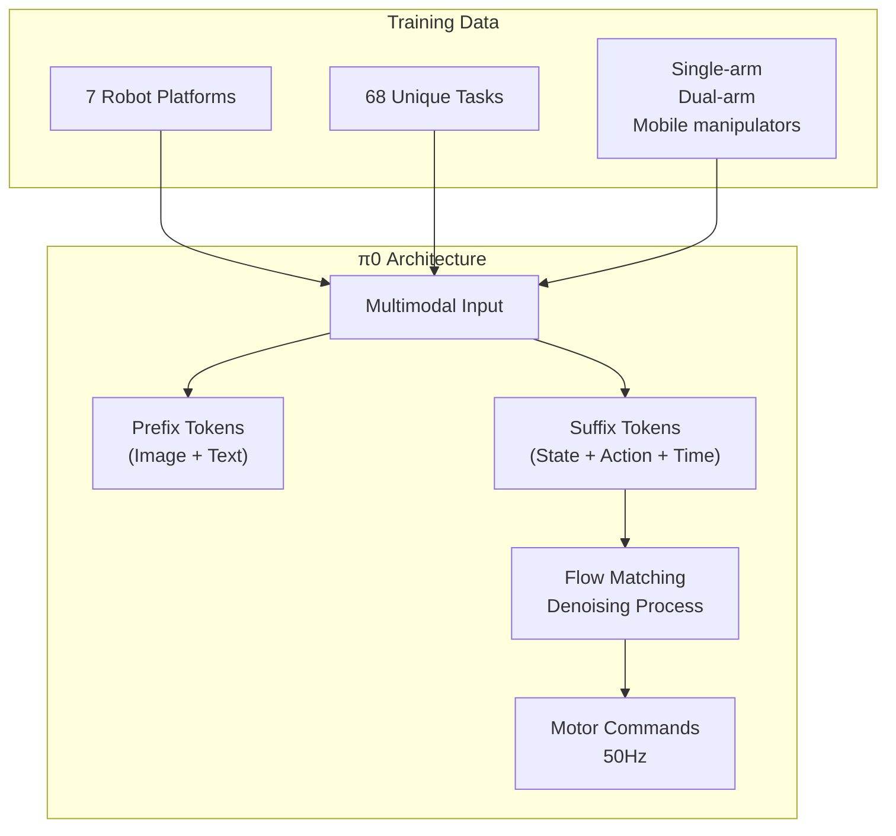
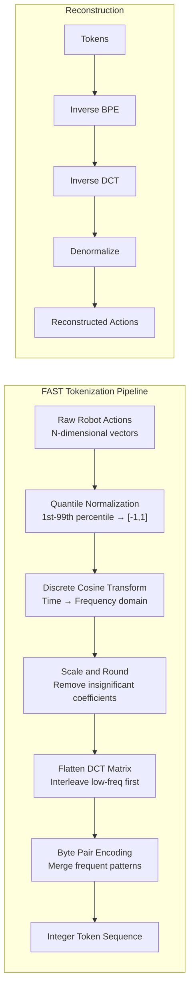
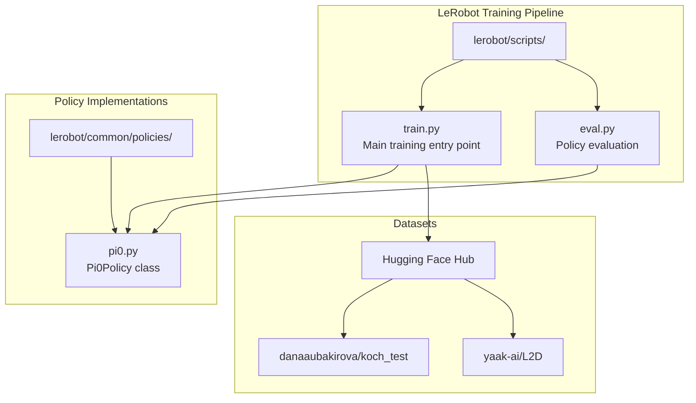
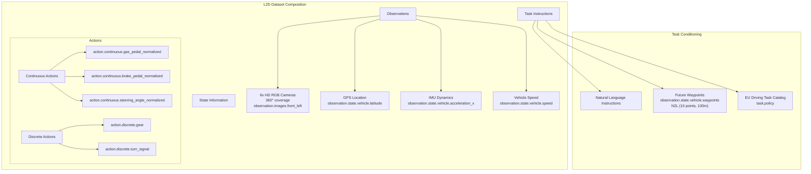
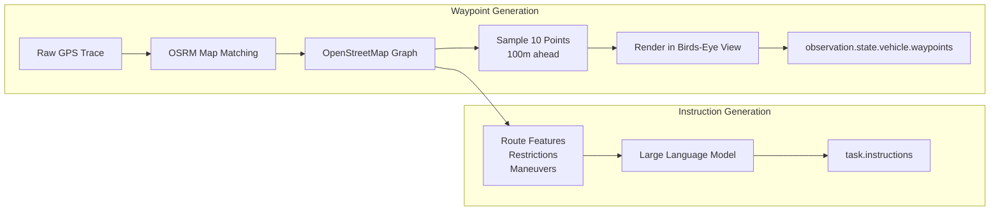
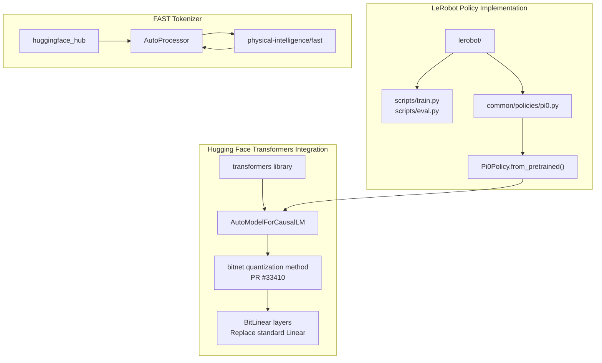

<!-- source: DeepWiki mcp.deepwiki.com · repo huggingface/blog · page 3.3 Vision-Language-Action Models · fetched 2026-10-26 -->

# Vision-Language-Action Models

<details>
<summary>Relevant source files</summary>

The following files were used as context for generating this wiki page:

- [1_58_llm_extreme_quantization.md](1_58_llm_extreme_quantization.md)
- [_blog.yml](_blog.yml)
- [_tags.yml](_tags.yml)
- [assets/192_pi0/new_thumbnail_pi0.001.png](assets/192_pi0/new_thumbnail_pi0.001.png)
- [assets/193_l2d/lerobot-driver.gif](assets/193_l2d/lerobot-driver.gif)
- [assets/1_58_llm_extreme_quantization/thumbnail.png](assets/1_58_llm_extreme_quantization/thumbnail.png)
- [assets/inference-providers/welcome-featherless.jpg](assets/inference-providers/welcome-featherless.jpg)
- [assets/optimum_intel/optimum_openvino_thumbnail.png](assets/optimum_intel/optimum_openvino_thumbnail.png)
- [assets/sd_dreambooth_training/thumbnail.jpg](assets/sd_dreambooth_training/thumbnail.jpg)
- [assets/streaming_datasets/streaming_datasets.png](assets/streaming_datasets/streaming_datasets.png)
- [assets/textquests/thumbnail.gif](assets/textquests/thumbnail.gif)
- [assets/trl_vlm/thumbnail.png](assets/trl_vlm/thumbnail.png)
- [assets/virustotal/thumbnail.png](assets/virustotal/thumbnail.png)
- [assets/wuerstchen/thumbnail.jpg](assets/wuerstchen/thumbnail.jpg)
- [dreambooth.md](dreambooth.md)
- [inference-providers-featherless.md](inference-providers-featherless.md)
- [lerobot-goes-to-driving-school.md](lerobot-goes-to-driving-school.md)
- [openvino-vlm.md](openvino-vlm.md)
- [pi0.md](pi0.md)
- [streaming-datasets.md](streaming-datasets.md)
- [textquests.md](textquests.md)
- [trl-vlm-alignment.md](trl-vlm-alignment.md)
- [virustotal.md](virustotal.md)

</details>


## Purpose and Scope

This page documents Vision-Language-Action (VLA) models, a class of foundation models that extend Vision-Language Models (VLMs) with physical action capabilities for robotic control. The focus is on the **π0** and **π0-FAST** models developed by Physical Intelligence, their integration with the **LeRobot** robotics framework, action representation techniques including **FAST (Frequency-space Action Sequence Tokenization)**, and the **L2D (Learning to Drive)** dataset for autonomous vehicle control.

For VLM training and alignment techniques (MPO, GRPO, GSPO), see [VLM Training and Alignment](#3.1). For general VLM architectures and vision-language understanding, see [Vision Language Models Overview](#3.2).

---

## VLA Models vs VLMs: Architecture and Capabilities

Vision-Language-Action Models extend VLMs by incorporating **action and observation state tokens** in addition to image and text tokens. While VLMs process and generate multimodal representations (images and text), VLAs produce sequences of motor commands for physical robots.

### Key Architectural Differences

| Aspect | VLMs | VLAs |
|--------|------|------|
| **Output** | Text tokens | Action tokens + state tokens |
| **Training Data** | Image-text pairs | Robot trajectories (observations + actions) |
| **Attention Mechanism** | Standard causal/bidirectional | Specialized block-sparse patterns |
| **Token Types** | Image + Text | Image + Text + State + Action + Time |
| **Applications** | Visual question answering, captioning | Robot control, manipulation, navigation |

Sources: [pi0.md:12-92]()

---

## π0: Vision-Language-Action Foundation Model

### Model Overview

**π0 (Pi-Zero)** is a generalist robot control model trained on data from **7 robotic platforms** and **68 unique tasks**. It employs **flow matching-based action generation** to produce smooth, real-time action trajectories at **50Hz**.



**Diagram: π0 Model Architecture and Training Data Sources**

Sources: [pi0.md:39-45]()

### Token Types and Attention Masks

The model processes four distinct token types with specialized attention patterns:

| Token Type | Description | Attention Pattern |
|------------|-------------|-------------------|
| **Prefix Tokens** | Full scene (images + text) | Full bidirectional attention (like PaliGemma) |
| **State Tokens** | Robot's current environment state (joint angles, sensors) | Attends to prefix + previous states (triangular) |
| **Action Tokens** | Motor command sequences | Full visibility over all non-padding tokens |
| **Time Embeddings** | Temporal step index | Appended to suffix portion |

The resulting **2D causal mask** exhibits strong **block sparsity**. The implementation uses **FlexAttention** with precomputed masks for efficient computation:

```python
# Example from implementation
def precomputed_mask_factory(precomputed_mask: torch.Tensor):
    def mask_mod(b, h, q_idx, kv_idx):
        return precomputed_mask[b][h][q_idx][kv_idx]
    return mask_mod

mask_mod = precomputed_mask_factory(causal_mask)
block_mask = create_block_mask(mask_mod=mask_mod)
attn_output, attention_weights = flex_attention(
    query, key, value, block_mask=block_mask
)
```

Sources: [pi0.md:93-177](), [_blog.yml:1-100]()

### Usage with LeRobot

The π0 models are integrated into the **LeRobot** repository and accessible via standard Hugging Face APIs:

**Loading a pretrained model:**
```python
from lerobot.common.policies.pi0 import Pi0Policy

policy = Pi0Policy.from_pretrained("lerobot/pi0")
```

**Fine-tuning on custom data:**
```bash
python lerobot/scripts/train.py \
  --policy.path=lerobot/pi0 \
  --dataset.repo_id=danaaubakirova/koch_test
```

**Evaluation:**
```bash
python lerobot/scripts/eval.py \
  --pretrained_policy.path=/path/to/pretrained/pi0
```

Sources: [pi0.md:49-88]()

---

## π0-FAST: Frequency-Space Action Tokenization

### Motivation and Architecture

**π0-FAST** is an autoregressive variant of π0 that introduces **FAST (Frequency-space Action Sequence Tokenization)**, addressing limitations in discrete action tokenization:

**Problems with traditional tokenization:**
- Per-dimension, per-timestep binning creates lossy representations
- Inefficient for high-frequency control tasks
- Vector Quantization (VQ) is sensitive to hyperparameters

**FAST advantages:**
- **5x faster training** compared to diffusion-based VLAs
- Improved action representation via DCT compression
- Stronger generalization across embodiments



**Diagram: FAST Action Tokenization and Reconstruction Pipeline**

Sources: [pi0.md:194-229]()

### FAST Tokenizer Implementation

The tokenizer is available as a Hugging Face `AutoProcessor` and can be used standalone:

**Using the pretrained FAST+ tokenizer:**
```python
from transformers import AutoProcessor

# Load universal FAST+ tokenizer (trained on 1M action sequences)
processor = AutoProcessor.from_pretrained("physical-intelligence/fast")

# Tokenize action sequences (should be quantile-normalized to [-1,1])
tokens = processor(actions=normalized_actions)

# Decode back to actions
reconstructed_actions = processor.decode(tokens)
```

**Training a custom FAST tokenizer:**
Users can train domain-specific tokenizers on their own datasets. The tokenizer has only two hyperparameters:
- **Scaling coefficient** applied before rounding
- **BPE vocabulary size**

Both parameters remain robust across different datasets.

Sources: [pi0.md:227-233]()

---

## LeRobot Ecosystem Integration

### Repository Structure and Training Scripts



**Diagram: LeRobot Training Infrastructure and Components**

### Model Collections

The π0 models are organized in Hugging Face collections:

- **Pi0 models**: `lerobot/pi0-models-67a0f92dc62e52ace7220eba`
- **Pi0+FAST models**: `lerobot/pi0fast-models-67eab97cc139d6f20513ff4a`

Both base models and fine-tuned variants are available, compatible with cross-embodiment training across single-arm, bimanual, and mobile manipulation robots.

Sources: [pi0.md:14-16](), [pi0.md:67-82]()

---

## L2D Dataset: Learning to Drive

### Dataset Overview

**L2D (Learning to Drive)** is the world's largest open-source self-driving dataset, specifically designed for training end-to-end Vision-Language-Action models for autonomous vehicles.

**Key Statistics:**
- **Size**: 90+ TeraBytes of multimodal data
- **Duration**: 5000+ hours of driving
- **Episodes**: 1,000,000
- **Cities**: 30 German cities
- **Vehicles**: 60 EVs with identical sensor suites
- **Policy Types**: Expert (driving instructors) and Student (learner drivers)



**Diagram: L2D Dataset Modality Types and Structure**

Sources: [lerobot-goes-to-driving-school.md:16-26](), [lerobot-goes-to-driving-school.md:106-144]()

### Sensor Suite and Synchronization

All modalities are synchronized to the front-left camera (`observation.images.front_left`) using unix epoch timestamps at **10Hz sampling rate**:

| Modality | LeRobotDataset v3.0 Key | Shape | Alignment Strategy |
|----------|------------------------|-------|-------------------|
| Images (6x) | `observation.images.front_left` [left_forward, ...] | N3HW | asof[20ms][nearest] |
| Speed | `observation.state.vehicle.speed` | N1 | interpolate |
| Heading | `observation.state.vehicle.heading` [heading_error] | N1 | asof[50ms][nearest] |
| GPS | `observation.state.vehicle.latitude` [longitude/altitude] | N1 | asof[50ms][nearest] |
| IMU | `observation.state.vehicle.acceleration_x` [y] | N1 | interpolate |
| Waypoints | `observation.state.vehicle.waypoints` | N2L | asof[10m][nearest] |
| Gas | `action.continuous.gas_pedal_normalized` | N1 | interpolate |
| Brake | `action.continuous.brake_pedal_normalized` | N1 | interpolate |
| Steering | `action.continuous.steering_angle_normalized` | N1 | interpolate |
| Turn Signal | `action.discrete.turn_signal` | N1 | asof[100ms][nearest] |
| Gear | `action.discrete.gear` | N1 | asof[100ms][nearest] |
| Instructions | `task.instructions` | N1 | — |
| Policy Type | `task.policy` | N1 | — |

Sources: [lerobot-goes-to-driving-school.md:118-141]()

### Task Catalog and Language Conditioning

L2D follows the official German driving task catalog with unique Task IDs and natural language instructions for each episode. The LeRobot task is universally set to:

> "Follow the waypoints while adhering to traffic rules and regulations"

**Example episode annotations:**

| Episode | Instructions | Task | Sub-task | Task ID |
|---------|-------------|------|----------|---------|
| [18](https://huggingface.co/spaces/lerobot/visualize_dataset?dataset=yaak-ai%2FL2D&episode=18) | "Drive straight through going around the parked delivery truck and yield to the incoming traffic" | Passing, overtaking | Passing obstacles and narrow spots | 3.1.1.3a |
| [14](https://huggingface.co/spaces/lerobot/visualize_dataset?dataset=yaak-ai%2FL2D&episode=14) | "Drive through the unprotected left turn yielding to through traffic" | Intersections, junctions | Crossing intersections & junctions | 4.1.1.3a |
| [0](https://huggingface.co/spaces/lerobot/visualize_dataset?dataset=yaak-ai%2FL2D&episode=0) | "Drive straight up to the yield sign and take first exit from the roundabout" | Roundabouts | Roundabouts | 5.1.1.3a |

Sources: [lerobot-goes-to-driving-school.md:145-162]()

### Waypoint Generation Pipeline

Waypoints are automatically generated using:
- Vehicle GPS position
- **Open-Source Routing Machine (OSRM)** for map-matching
- **OpenStreetMap (OSM)** graph data
- Large Language Model for natural language instruction generation

The system computes **10 equidistant points** spanning **100 meters** from the vehicle's current location, snapped to the OSM graph. These serve as drive-by-waypoints for the model.



**Diagram: L2D Waypoint and Instruction Generation Using OSM and OSRM**

Sources: [lerobot-goes-to-driving-school.md:164-181](), [lerobot-goes-to-driving-school.md:198-211]()

---

## Training and Fine-tuning Approaches

### Pre-training vs Fine-tuning

**Traditional BitNet approach:**
- Requires training from scratch
- Uses extreme quantization (1.58 bits: -1, 0, 1)
- High computational cost

**π0 Fine-tuning approach:**
- Start from pretrained VLM (PaliGemma + Expert Gemma)
- Fine-tune on robotic data
- Enables cross-embodiment transfer

### Training Configurations

**Fine-tuning the π0 base checkpoint:**
```bash
python lerobot/scripts/train.py \
  --policy.path=lerobot/pi0 \
  --dataset.repo_id=danaaubakirova/koch_test
```

**Training with VLM defaults + π0 fine-tuning:**
```bash
python lerobot/scripts/train.py \
  --policy.type=pi0 \
  --dataset.repo_id=danaaubakirova/koch_test
```

**Key hyperparameters:**
- Batch size typically 2-4
- Low learning rates (1e-6 to 5e-6)
- 400-1200 training steps depending on task
- 8-bit Adam, fp16 training, or gradient accumulation for 16GB GPUs

Sources: [pi0.md:66-82]()

### L2D Training Setup

The L2D dataset supports training with two policy groups:

**Expert Policies (Driving Instructors):**
- 10K+ hours of experience
- Zero driving mistakes
- Considered optimal trajectories

**Student Policies (Learner Drivers):**
- 10-50 hours of experience
- Contains suboptimal behavior
- Natural mistakes for robust training

Both groups are collected with **identical sensor suites** on **60 KIA E-niro vehicles** operating in **30 German cities**. Future releases (R3+) will include natural language reasoning for suboptimal student actions.

Sources: [lerobot-goes-to-driving-school.md:62-94]()

---

## Robotic Control Applications

### Task Categories Covered by π0

The π0 model demonstrates zero-shot and fine-tuned performance on:

**Manipulation Tasks:**
- Laundry folding
- Table bussing
- Grocery bagging
- Box assembly
- Object retrieval

**Cross-Embodiment Support:**
- Single-arm manipulators
- Dual-arm (bimanual) systems
- Mobile manipulators

The **FAST+ universal tokenizer** is trained on **1 million action sequences** across these diverse embodiments, enabling generalization.

Sources: [pi0.md:39-45](), [pi0.md:226-229]()

### Autonomous Driving Tasks (L2D)

L2D covers all **EU-mandated driving tasks** required for obtaining a driving license:

**Task Categories:**
1. Passing and overtaking (navigating obstacles)
2. Intersections and junctions (right-of-way rules)
3. Roundabouts (correct lane positioning)
4. Train crossings
5. Yield signs and stop signs
6. Merging with moving traffic
7. Unprotected turns
8. Lane changes on highways
9. Pedestrian zones

**Environment Conditions:**
- Diverse weather: Snow, Rain, Clear
- Lighting: Dawn, Day, Dusk
- Road surfaces: Asphalt, Cobbled, Sett
- Special scenarios: Construction zones, sensor failures, non-functioning signals

Sources: [lerobot-goes-to-driving-school.md:102-105](), [lerobot-goes-to-driving-school.md:145-162]()

---

## Comparison with Other Datasets

### Autonomous Driving Datasets

| Dataset | RGB Cameras | State | Actions | Instructions | Episodes | Duration (hr) | Size (TB) |
|---------|-------------|-------|---------|--------------|----------|---------------|-----------|
| WAYMO | 5x | — | — | — | 2,030 | 11.3 | 0.5* |
| NuScenes | 6x | GPS/IMU | — | — | 1,000 | 5.5 | 0.67* |
| MAN | 4x | GPS/IMU | — | — | 747 | 4.15 | 0.17* |
| ZOD | 1x | GPS/IMU/CAN | ✓ | — | 1,473 | 8.2 | 0.32* |
| COMMA | 1x | GPS/IMU/CAN | ✓ | — | 2,019 | 33 | 0.1 |
| **L2D** | **6x** | **GPS/IMU/CAN** | ✓ | ✓ | **1,000,000** | **5,000+** | **90+** |

*\* Excluding lidar and radar data*

L2D is the only large-scale dataset combining:
- Multi-camera observations (360° coverage)
- Complete vehicle state and control signals
- Natural language task instructions
- Expert and student policies
- Waypoint-based navigation conditioning

Sources: [lerobot-goes-to-driving-school.md:46-54]()

---

## Implementation Details

### Code Organization



**Diagram: Code Architecture Mapping VLA Components to Implementation Classes**

### Loading and Inference Example

```python
from transformers import AutoModelForCausalLM, AutoTokenizer
import torch

# Load model with bitnet quantization (handled automatically)
model = AutoModelForCausalLM.from_pretrained(
    "HF1BitLLM/Llama3-8B-1.58-100B-tokens",
    device_map="cuda",
    torch_dtype=torch.bfloat16
)

tokenizer = AutoTokenizer.from_pretrained("meta-llama/Meta-Llama-3-8B-Instruct")

# Example robotic instruction
input_text = "Pick up the red block and place it in the box"
input_ids = tokenizer.encode(input_text, return_tensors="pt").cuda()

# Generate action sequence
output = model.generate(input_ids, max_new_tokens=100)
generated_text = tokenizer.decode(output[0], skip_special_tokens=True)
```

The API remains unchanged from standard Hugging Face models - all VLA-specific processing (action tokenization, state handling, flow matching) is handled internally.

Sources: [pi0.md:49-88](), [1_58_llm_extreme_quantization.md:48-68]()

---

## Dataset Access and Visualization

### Hugging Face Hub Integration

**L2D Dataset:**
- Repository: `yaak-ai/L2D`
- Visualization: `lerobot/visualize_dataset` Space
- Format: LeRobotDataset v3.0

**Loading L2D:**
```python
from datasets import load_dataset

dataset = load_dataset("yaak-ai/L2D", split="train", streaming=True)
```

**Episode visualization links:**
- [Episode 18 - Passing obstacles](https://huggingface.co/spaces/lerobot/visualize_dataset?dataset=yaak-ai%2FL2D&episode=18)
- [Episode 82 - Roundabout with train crossing](https://huggingface.co/spaces/lerobot/visualize_dataset?dataset=yaak-ai%2FL2D&episode=82)
- [Episode 57 - Construction zone](https://huggingface.co/spaces/lerobot/visualize_dataset?dataset=yaak-ai%2FL2D&episode=57)

### Search and Curation Tools

The dataset includes **Nutron** visualization and search interface:
- Multimodal search using LLM-powered natural language queries
- Semantic spatiotemporal indexing
- GPS trace visualization on interactive maps
- Episode discovery across 1+ PetaBytes of raw data

Sources: [lerobot-goes-to-driving-school.md:183-237]()

---

## Performance and Benchmarks

### π0-FAST Training Efficiency

| Metric | Improvement |
|--------|-------------|
| Training Speed | 5x faster than diffusion VLAs |
| Action Fidelity | Lossless reconstruction via DCT |
| Generalization | Stronger cross-embodiment transfer |
| Hyperparameter Sensitivity | Robust with only 2 parameters |

### Hardware Requirements

**Minimum (16GB GPU):**
- Use 8-bit Adam optimizer
- Enable fp16 training
- Apply gradient accumulation

**Recommended (24GB+ GPU):**
- Full precision training
- Larger batch sizes (4+)
- Concurrent text encoder fine-tuning

The models support standard PyTorch distributed training and are compatible with Google Colab and Kaggle environments.

Sources: [pi0.md:194-206](), [dreambooth.md:26-45]()

---

## Future Directions and Extensions

### Planned L2D Releases

**Release R3+:**
- Natural language reasoning for suboptimal student policies
- Example: "incorrect/jerky handling of the steering wheel in the proximity of in-coming traffic"

**Release R5+:**
- Community-contributed episodes from 1+ PetaBytes archive
- Version control-inspired dataset curation workflow
- Search and discovery tools for novel driving scenarios

**FAST+ Universal Tokenizer:**
- Trained on 1M action sequences
- Supports single-arm, bimanual, and mobile manipulation
- Available as `physical-intelligence/fast` on Hugging Face Hub

### Cross-Embodiment Training

VLA models enable training across diverse robot morphologies by:
- Combining multimodal datasets from different platforms
- Using shared action representations (FAST tokenization)
- Leveraging transfer learning from foundation models

This approach addresses the challenge of limited data per robot type while maintaining action fidelity across different control spaces.

Sources: [pi0.md:23-32](), [lerobot-goes-to-driving-school.md:237-245]()

---

Sources: [pi0.md](), [lerobot-goes-to-driving-school.md](), [trl-vlm-alignment.md](), [_blog.yml:1-100](), [1_58_llm_extreme_quantization.md]()

---

