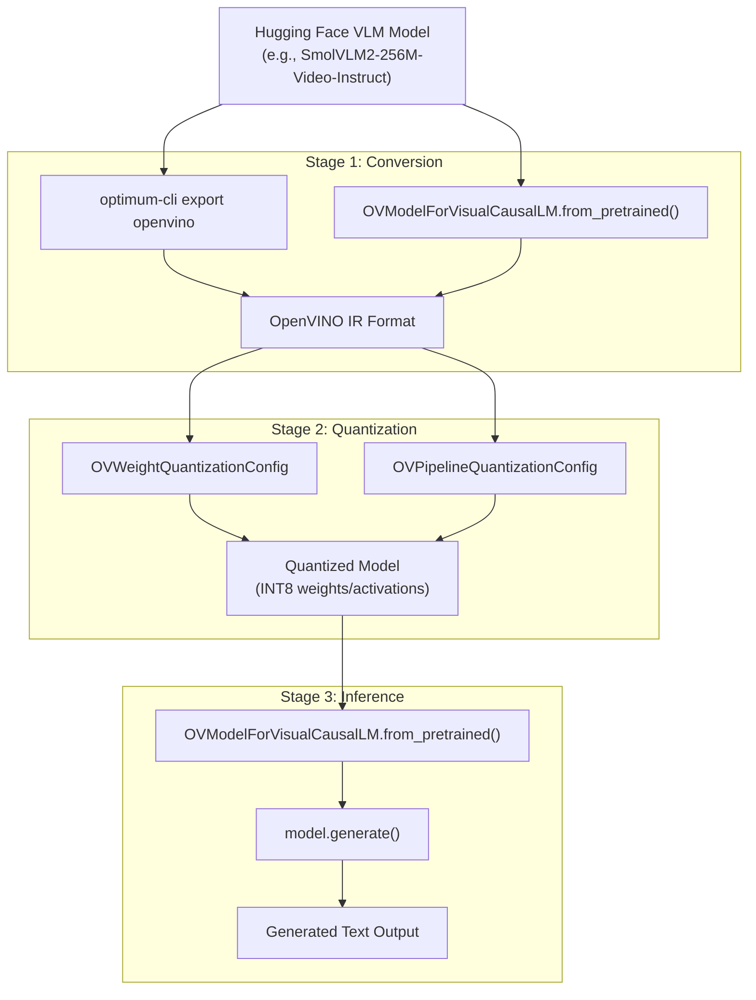
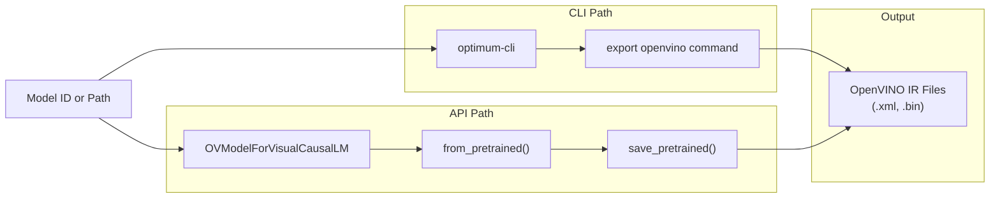
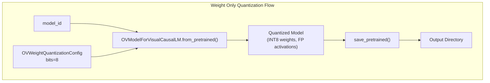
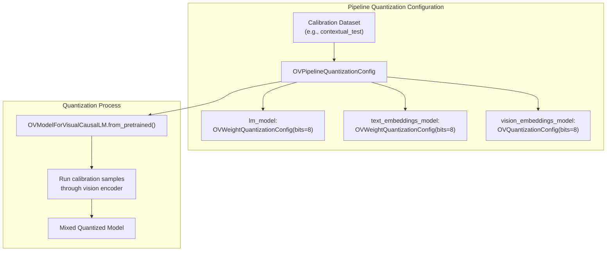
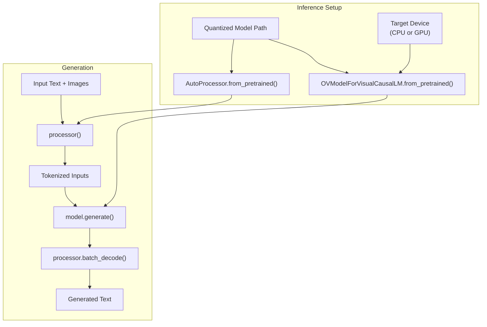
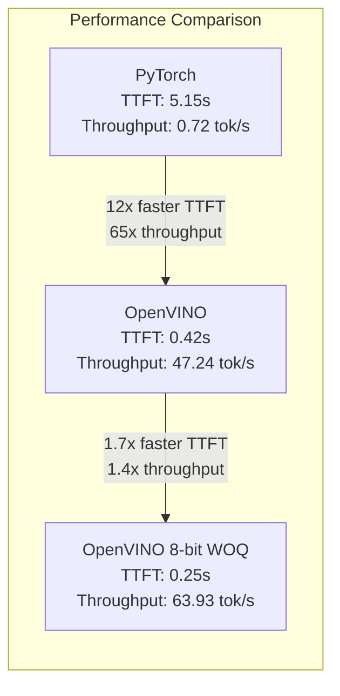
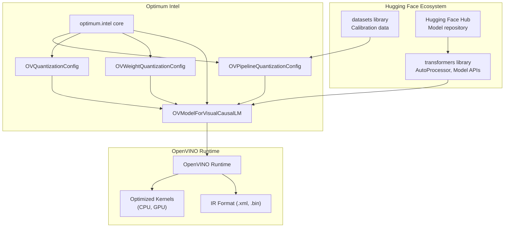
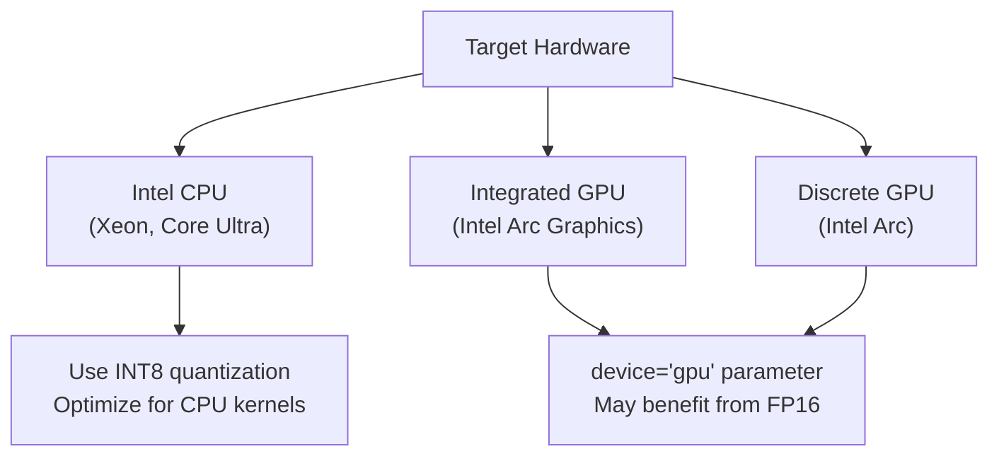

<!-- source: DeepWiki mcp.deepwiki.com · repo huggingface/blog · page 3.4 VLM Optimization · fetched 2026-10-26 -->

# VLM Optimization

<details>
<summary>Relevant source files</summary>

The following files were used as context for generating this wiki page:

- [1_58_llm_extreme_quantization.md](1_58_llm_extreme_quantization.md)
- [_blog.yml](_blog.yml)
- [_tags.yml](_tags.yml)
- [assets/192_pi0/new_thumbnail_pi0.001.png](assets/192_pi0/new_thumbnail_pi0.001.png)
- [assets/193_l2d/lerobot-driver.gif](assets/193_l2d/lerobot-driver.gif)
- [assets/1_58_llm_extreme_quantization/thumbnail.png](assets/1_58_llm_extreme_quantization/thumbnail.png)
- [assets/inference-providers/welcome-featherless.jpg](assets/inference-providers/welcome-featherless.jpg)
- [assets/optimum_intel/optimum_openvino_thumbnail.png](assets/optimum_intel/optimum_openvino_thumbnail.png)
- [assets/sd_dreambooth_training/thumbnail.jpg](assets/sd_dreambooth_training/thumbnail.jpg)
- [assets/streaming_datasets/streaming_datasets.png](assets/streaming_datasets/streaming_datasets.png)
- [assets/textquests/thumbnail.gif](assets/textquests/thumbnail.gif)
- [assets/trl_vlm/thumbnail.png](assets/trl_vlm/thumbnail.png)
- [assets/virustotal/thumbnail.png](assets/virustotal/thumbnail.png)
- [assets/wuerstchen/thumbnail.jpg](assets/wuerstchen/thumbnail.jpg)
- [dreambooth.md](dreambooth.md)
- [inference-providers-featherless.md](inference-providers-featherless.md)
- [lerobot-goes-to-driving-school.md](lerobot-goes-to-driving-school.md)
- [openvino-vlm.md](openvino-vlm.md)
- [pi0.md](pi0.md)
- [streaming-datasets.md](streaming-datasets.md)
- [textquests.md](textquests.md)
- [trl-vlm-alignment.md](trl-vlm-alignment.md)
- [virustotal.md](virustotal.md)

</details>


## Purpose and Scope

This page covers optimization techniques for Vision Language Models (VLMs), focusing on model conversion, quantization, and deployment strategies for efficient inference on resource-constrained hardware. The primary approach documented here uses OpenVINO and Optimum Intel to optimize VLMs for deployment on Intel CPUs and GPUs, achieving significant speedups and memory reduction while maintaining acceptable accuracy.

For information about VLM training and alignment, see [VLM Training and Alignment](#3.1). For general VLM architecture details, see [Vision Language Models Overview](#3.2).

Sources: [openvino-vlm.md:1-30]()

## Overview: Optimization Pipeline

The VLM optimization process consists of three main stages: model conversion to an optimized intermediate representation, quantization to reduce precision and memory footprint, and inference execution with optimized kernels.



Sources: [openvino-vlm.md:35-130]()

## Model Conversion to OpenVINO IR

Converting a VLM from standard PyTorch/Transformers format to OpenVINO Intermediate Representation (IR) format is the first step in the optimization pipeline. This conversion enables the use of OpenVINO's inference optimizations.

### Conversion Methods

There are two primary methods for converting models:

**Method 1: CLI-based Conversion**

```bash
optimum-cli export openvino -m HuggingFaceTB/SmolVLM2-256M-Video-Instruct smolvlm_ov/
```

**Method 2: Programmatic Conversion**

```python
from optimum.intel import OVModelForVisualCausalLM

model_id = "HuggingFaceTB/SmolVLM2-256M-Video-Instruct"
model = OVModelForVisualCausalLM.from_pretrained(model_id)
model.save_pretrained("smolvlm_ov")
```



The `OVModelForVisualCausalLM` class handles the conversion automatically when called with `from_pretrained()` on a Hugging Face model ID. The resulting OpenVINO IR files are saved in the specified directory and can be loaded for quantization or inference.

Sources: [openvino-vlm.md:35-53]()

## Quantization Techniques

Quantization reduces the precision of model weights and/or activations, decreasing model size and improving inference speed. Optimum Intel supports two main quantization approaches for VLMs.

### Weight Only Quantization (WOQ)

Weight Only Quantization reduces only the weights to lower precision (typically INT8) while keeping activations in their original precision. This approach:

- Reduces model size and memory usage
- Improves loading times
- Has minimal accuracy degradation
- Provides limited inference speedup (activations still in FP32/FP16)

**Note:** Since OpenVINO 2024.3, quantized weights trigger runtime quantization of corresponding activations, providing additional speedup.



**Implementation Example:**

```python
from optimum.intel import OVModelForVisualCausalLM, OVWeightQuantizationConfig

q_config = OVWeightQuantizationConfig(bits=8)
q_model = OVModelForVisualCausalLM.from_pretrained(
    model_id, 
    quantization_config=q_config
)
q_model.save_pretrained("smolvlm_int8")
```

**CLI Alternative:**

```bash
optimum-cli export openvino -m HuggingFaceTB/SmolVLM2-256M-Video-Instruct \
  --weight-format int8 smolvlm_int8/
```

Sources: [openvino-vlm.md:70-92]()

### Static Quantization

Static Quantization quantizes both weights and activations before inference, requiring a calibration step with representative data. This approach:

- Provides greater performance improvements than WOQ
- Reduces both model size and inference latency
- Requires a calibration dataset
- May have more accuracy degradation than WOQ

The recommended strategy applies static quantization to the vision encoder while using weight-only quantization for other model components (language model, text embeddings).



**Implementation Example:**

```python
from optimum.intel import (
    OVModelForVisualCausalLM, 
    OVPipelineQuantizationConfig,
    OVQuantizationConfig, 
    OVWeightQuantizationConfig
)

q_config = OVPipelineQuantizationConfig(
    quantization_configs={
        "lm_model": OVWeightQuantizationConfig(bits=8),
        "text_embeddings_model": OVWeightQuantizationConfig(bits=8),
        "vision_embeddings_model": OVQuantizationConfig(bits=8),
    },
    dataset=dataset,
    num_samples=num_samples,
)
q_model = OVModelForVisualCausalLM.from_pretrained(
    model_id, 
    quantization_config=q_config
)
q_model.save_pretrained("smolvlm_static_int8")
```

The vision encoder is called only once per generation, so static quantization on this component provides noticeable improvement without significantly affecting overall throughput. This is particularly beneficial for scenarios with short answers or multiple images as input.

Sources: [openvino-vlm.md:94-114]()

## Inference Execution

Once a model is converted and quantized, it can be loaded and used for inference with the standard Transformers API. The optimized models integrate seamlessly with existing code.



**Basic Inference Example:**

```python
from optimum.intel import OVModelForVisualCausalLM

# Load quantized model
q_model = OVModelForVisualCausalLM.from_pretrained(
    "smolvlm_static_int8"
)

# Generate
generated_ids = q_model.generate(**inputs, max_new_tokens=100)
generated_texts = processor.batch_decode(generated_ids, skip_special_tokens=True)
```

**GPU Inference:**

For Intel integrated GPUs, discrete GPUs, or AI PCs, models can be loaded on GPU:

```python
model = OVModelForVisualCausalLM.from_pretrained(
    model_id, 
    device="gpu"
)
```

Sources: [openvino-vlm.md:116-131]()

## Performance Benchmarks

Performance measurements on SmolVLM2-256M-Video-Instruct demonstrate the impact of optimization techniques. The benchmark used a single image input and measured key metrics across PyTorch, OpenVINO, and OpenVINO with 8-bit WOQ configurations.

### Benchmark Metrics

| Metric | Description |
|--------|-------------|
| **Time To First Token (TTFT)** | Latency before the first output token is generated |
| **Time Per Output Token (TPOT)** | Average time to generate each subsequent token |
| **End-to-End Latency** | Total time to generate all output tokens |
| **Decoding Throughput** | Tokens generated per second during decoding |

### Results on Intel Core Ultra 7 265K

| Configuration | TTFT (s) | TPOT (s) | End-to-End Latency (s) | Throughput (tokens/s) |
|---------------|----------|----------|------------------------|----------------------|
| PyTorch | 5.150 | 1.385 | 25.927 | 0.722 |
| OpenVINO | 0.420 | 0.021 | 0.738 | 47.237 |
| OpenVINO 8-bit WOQ | 0.247 | 0.016 | 0.482 | 63.928 |



**Key Findings:**

- OpenVINO conversion alone provides **12x speedup in TTFT** and **65x throughput improvement** over PyTorch
- Adding 8-bit weight-only quantization provides an additional **1.7x speedup in TTFT** and **1.4x throughput improvement**
- Model size reduction enables efficient deployment on CPU-only systems
- No GPU required for production-grade inference performance

### Platform Configuration

Tests were conducted on:
- **CPU:** Intel Core Ultra 7 265K
- **Memory:** 64 GB DDR5 @ 6400 MHz
- **OS:** Ubuntu 24.10
- **OpenVINO:** 2025.2.0
- **Software:** torch 2.8.0, transformers 4.53.3, optimum-intel 1.25.2

Sources: [openvino-vlm.md:140-183]()

## Integration Architecture

The optimization pipeline integrates several libraries and components to enable efficient VLM deployment.



**Component Responsibilities:**

- `transformers`: Provides base model architectures and processor classes
- `optimum.intel`: Bridges Transformers and OpenVINO, providing conversion and quantization
- `OVModelForVisualCausalLM`: Main class for VLM conversion, quantization, and inference
- `OVWeightQuantizationConfig`: Configuration for weight-only quantization
- `OVQuantizationConfig`: Configuration for full (static) quantization
- `OVPipelineQuantizationConfig`: Configuration for mixed quantization across model components
- OpenVINO Runtime: Executes optimized models with hardware-specific kernels

Sources: [openvino-vlm.md:1-191]()

## Best Practices

### Quantization Strategy Selection

| Use Case | Recommended Approach | Rationale |
|----------|---------------------|-----------|
| General inference | 8-bit Weight Only Quantization | Best balance of speed, size, and accuracy |
| Memory-constrained deployment | 8-bit Weight Only Quantization | Significant size reduction with minimal accuracy loss |
| Latency-critical applications | Mixed static + WOQ quantization | Maximum throughput improvement |
| Short-answer scenarios | Static quantization on vision encoder | Vision encoder overhead is proportionally larger |
| Multi-image input | Static quantization on vision encoder | Vision encoder called multiple times |

### Hardware Considerations



- **CPU Deployment:** INT8 quantization provides best performance
- **GPU Deployment:** Use `device="gpu"` parameter; may benefit from different precision strategies
- **Memory Requirements:** 8-bit WOQ reduces model size by ~4x compared to FP32

Sources: [openvino-vlm.md:55-183]()

## Related Optimization Topics

For additional VLM optimization and deployment information:

- VLM training optimization techniques: See [VLM Training and Alignment](#3.1)
- General model quantization for LLMs: See [LLM Optimization and Quantization](#2.3)
- Hardware acceleration strategies: See [Hardware Acceleration](#5.2)
- Cloud deployment of optimized models: See [Cloud Provider Integrations](#5.1)

Sources: [openvino-vlm.md:1-191](), [_blog.yml:1-100]()

---

