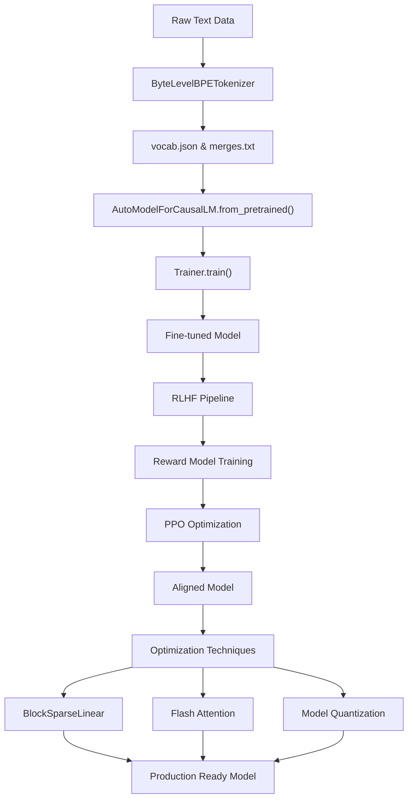
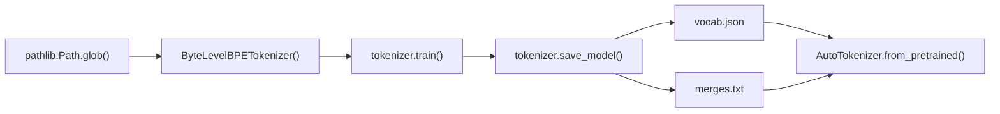
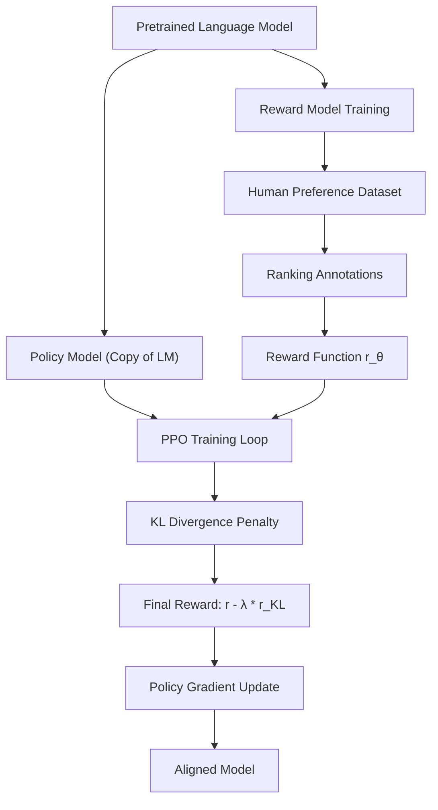
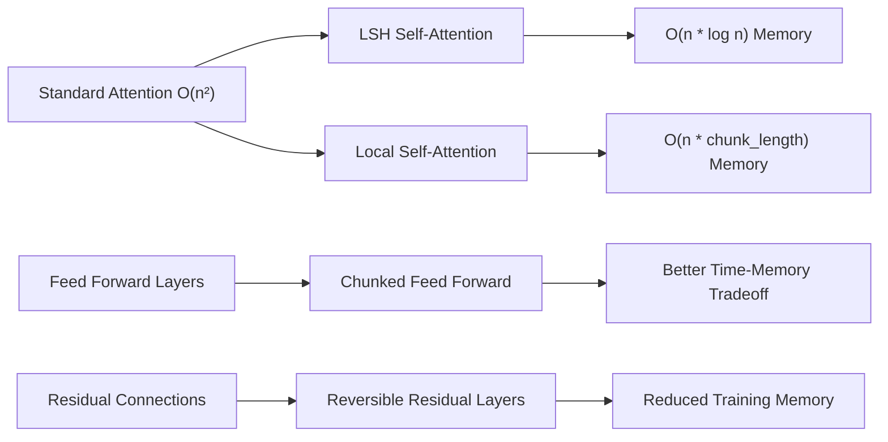
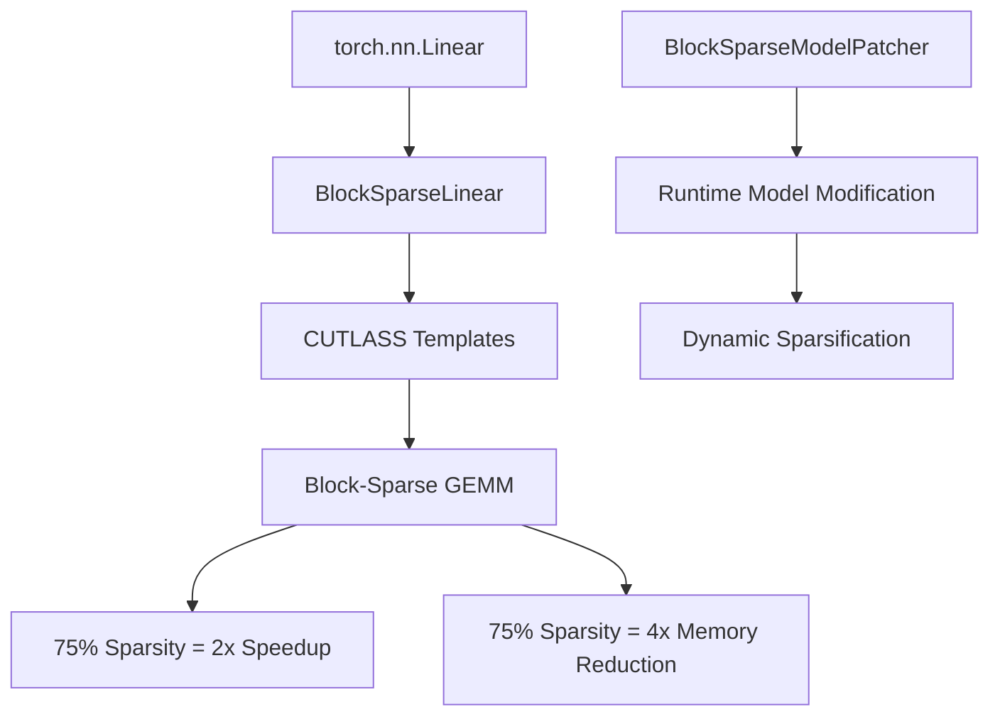
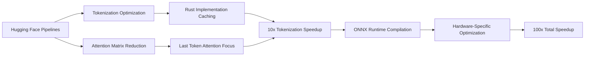
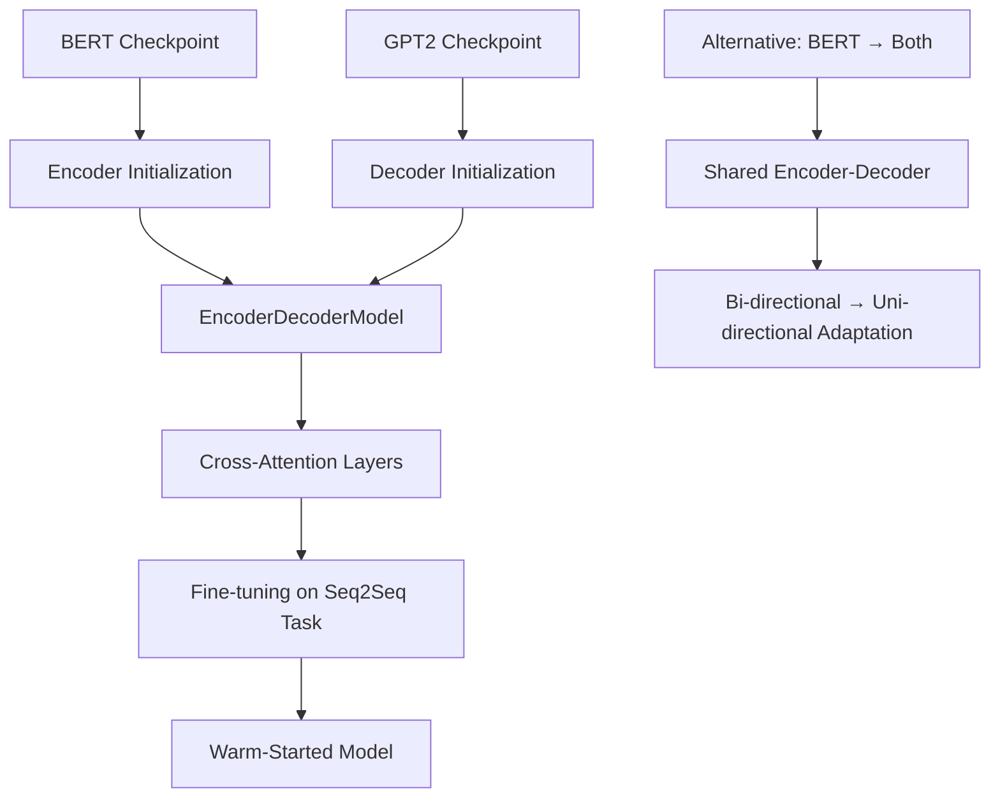
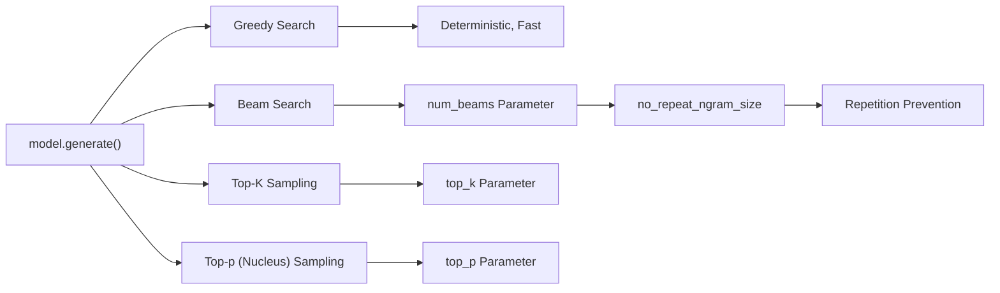
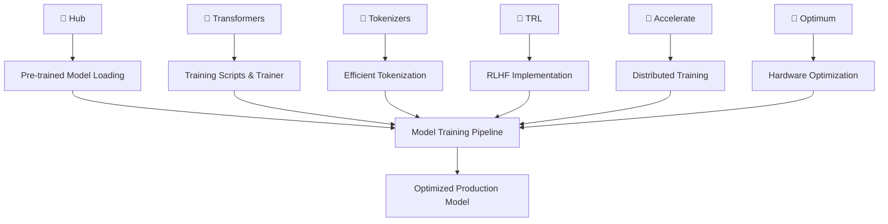

<!-- source: DeepWiki mcp.deepwiki.com · repo huggingface/blog · page 4 Model Training and Optimization · fetched 2026-10-26 -->

# Model Training and Optimization

Relevant source files

The following files were used as context for generating this wiki page:

- [assets/03_reformer/thumbnail.png](assets/03_reformer/thumbnail.png)
- [assets/04_pytorch_block_sparse/thumbnail.png](assets/04_pytorch_block_sparse/thumbnail.png)
- [assets/05_encoder_decoder/thumbnail.png](assets/05_encoder_decoder/thumbnail.png)
- [assets/07_porting_fsmt/thumbnail.png](assets/07_porting_fsmt/thumbnail.png)
- [assets/08_warm_starting_encoder_decoder/thumbnail.png](assets/08_warm_starting_encoder_decoder/thumbnail.png)
- [assets/63_deep_rl_intro/tasks.jpg](assets/63_deep_rl_intro/tasks.jpg)
- [assets/70_deep_rl_q_part1/bellman6.jpg](assets/70_deep_rl_q_part1/bellman6.jpg)
- [assets/78_ml_director_insights/witty-works.png](assets/78_ml_director_insights/witty-works.png)
- [assets/86_bloom/bloom-examples.jpg](assets/86_bloom/bloom-examples.jpg)
- [assets/controlnet/thumbnail.png](assets/controlnet/thumbnail.png)
- [assets/cosmopedia/thumbnail.png](assets/cosmopedia/thumbnail.png)
- [bloom.md](bloom.md)
- [classification-use-cases.md](classification-use-cases.md)
- [controlnet.md](controlnet.md)
- [cosmopedia.md](cosmopedia.md)
- [deep-rl-a2c.md](deep-rl-a2c.md)
- [deep-rl-dqn.md](deep-rl-dqn.md)
- [deep-rl-intro.md](deep-rl-intro.md)
- [deep-rl-pg.md](deep-rl-pg.md)
- [deep-rl-ppo.md](deep-rl-ppo.md)
- [deep-rl-q-part1.md](deep-rl-q-part1.md)
- [deep-rl-q-part2.md](deep-rl-q-part2.md)
- [encoder-decoder.md](encoder-decoder.md)
- [how-to-generate.md](how-to-generate.md)
- [how-to-train.md](how-to-train.md)
- [ml-director-insights-2.md](ml-director-insights-2.md)
- [notebooks/03_reformer.ipynb](notebooks/03_reformer.ipynb)
- [notebooks/05_encoder_decoder.ipynb](notebooks/05_encoder_decoder.ipynb)
- [notebooks/08_warm_starting_encoder_decoder.ipynb](notebooks/08_warm_starting_encoder_decoder.ipynb)
- [pytorch_block_sparse.md](pytorch_block_sparse.md)
- [reformer.md](reformer.md)
- [warm-starting-encoder-decoder.md](warm-starting-encoder-decoder.md)

This page covers comprehensive techniques for training transformer models and optimizing their performance. It encompasses fundamental training approaches including tokenizer creation and model pretraining, advanced optimization strategies like reinforcement learning from human feedback (RLHF), memory optimization techniques, and performance improvements for both training and inference.

For information about specific model architectures and their implementations, see [Large Language Models](#2). For deployment and inference optimization in production environments, see [Model Deployment](#5).

## Training Pipeline Overview

The model training and optimization process in the Hugging Face ecosystem follows a structured pipeline from data preparation through deployment optimization.

Sources: [how-to-train.md:1-356], [rlhf.md:1-168], [pytorch_block_sparse.md:1-89]

## Basic Training Techniques

### Tokenizer Training

The foundation of any language model training begins with tokenizer creation. The `ByteLevelBPETokenizer` from the tokenizers library provides efficient subword tokenization.

The training process involves several key parameters:
- `vocab_size`: Typically 52,000 for balanced performance
- `min_frequency`: Usually set to 2 to avoid rare token inclusion  
- `special_tokens`: Essential tokens like `<s>`, `<pad>`, `</s>`, `<unk>`, `<mask>`

Sources: [how-to-train.md:42-71]

### Model Pretraining

Model training utilizes the `run_language_modeling.py` script and the `Trainer` class for masked language modeling objectives.

| Component | Class/Function | Purpose |
|-----------|----------------|---------|
| Data Loading | `EsperantoDataset(Dataset)` | Custom dataset implementation |
| Model Architecture | `AutoModelForCausalLM` | Auto-loading of model architectures |
| Training Loop | `Trainer` | Handles training, evaluation, and checkpointing |
| Tokenization | `BertProcessing` | Post-processing for special tokens |

The training configuration involves critical hyperparameters:
- `learning_rate`: 1e-4 for stable convergence
- `per_gpu_train_batch_size`: 16 (adjust based on GPU memory)
- `num_train_epochs`: 5 for complete training cycles
- `save_steps`: 2000 for regular checkpointing

Sources: [how-to-train.md:139-208]

## Reinforcement Learning from Human Feedback

RLHF represents a sophisticated training paradigm that aligns language models with human preferences through a multi-stage process.

### RLHF Architecture

### Training Components

The RLHF pipeline consists of three distinct phases:

1. **Reward Model Training**: Using `preference model pretraining (PMP)` on human-ranked outputs
2. **Policy Optimization**: Implementing `Proximal Policy Optimization (PPO)` for stable updates  
3. **KL Regularization**: Preventing drift from the original model distribution

Key libraries supporting RLHF include:
- `TRL` (Transformers Reinforcement Learning): Basic PPO fine-tuning
- `TRLX`: Scalable RL training for large models
- `RL4LMs`: Comprehensive RL algorithms for language models

Sources: [rlhf.md:30-108]

## LLM Optimization Techniques

### Memory-Efficient Architectures

The Reformer model introduces several innovations to reduce memory consumption while maintaining performance:

#### LSH Self-Attention Implementation

The `LSH self-attention` mechanism clusters query vectors using locality-sensitive hashing:

- `config.num_buckets`: Controls hashing granularity
- `config.lsh_chunk_length`: Defines processing chunk size
- `config.num_hashes`: Multiple hash rounds for improved accuracy

#### Local Self-Attention Configuration

Local attention parameters optimize context access:
- `config.local_chunk_length`: Local context window size
- `config.local_num_chunks_before`: Previous chunks to include
- `config.local_num_chunks_after`: Following chunks to include

Sources: [reformer.md:37-184]

### Block Sparse Matrices

The `pytorch_block_sparse` extension provides efficient sparse linear layer implementations:

Key implementation details:
- `BlockSparseLinear(in_features, out_features, density=0.1)`: Drop-in replacement
- `BlockSparseModelPatcher`: Modifies existing models without code changes
- Performance scales with sparsity level

Sources: [pytorch_block_sparse.md:34-88]

### Inference Optimization

Accelerated inference combines multiple optimization techniques:

| Technique | Implementation | Performance Gain |
|-----------|----------------|------------------|
| Graph Optimization | ONNX Runtime | 10x speedup |
| Layer Fusion | CPU-specific instructions | Architecture dependent |
| Quantization | INT8/FP16 operations | 2-4x speedup |
| Attention Optimization | Reduced dimensionality | Context dependent |

Sources: [accelerated-inference.md:18-48]

## Advanced Training Strategies

### Warm-Starting Encoder-Decoder Models

Warm-starting leverages pre-trained checkpoints to initialize encoder-decoder architectures:

The `EncoderDecoderModel` framework enables flexible combinations:
- BERT encoder + GPT2 decoder for translation tasks
- Shared BERT initialization for summarization
- Architecture-specific adaptations for cross-attention

Sources: [warm-starting-encoder-decoder.md:347-516]

### Text Generation Optimization

Decoding strategies significantly impact generation quality and speed:

Generation parameters control output characteristics:
- `max_new_tokens`: Output length limit
- `temperature`: Probability distribution sharpening  
- `do_sample`: Enable stochastic generation
- `early_stopping`: Terminate on EOS token

Sources: [how-to-generate.md:73-640]

## Integration with Hugging Face Ecosystem

The training and optimization techniques integrate seamlessly with the broader Hugging Face platform:

This ecosystem provides end-to-end support from initial training through production deployment, with each component designed for interoperability and scalability.

Sources: [how-to-train.md:330-356], [rlhf.md:97-108], [accelerated-inference.md:43-51]

---

