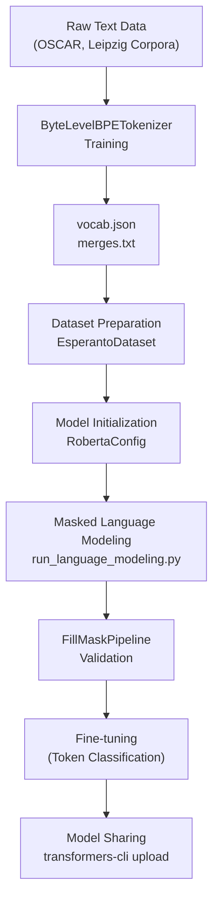
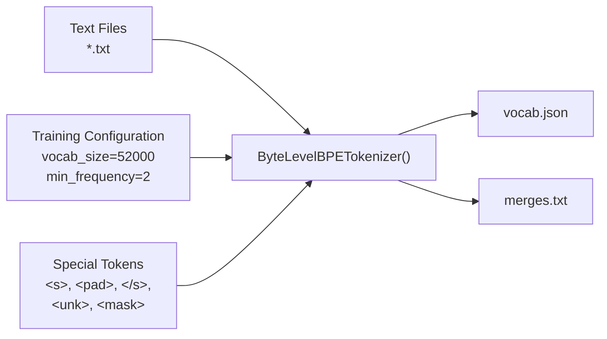
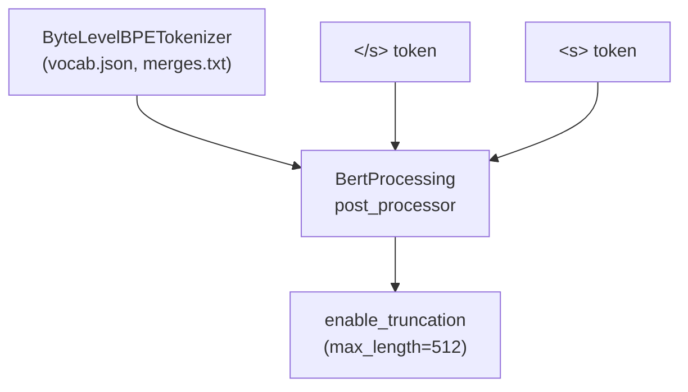
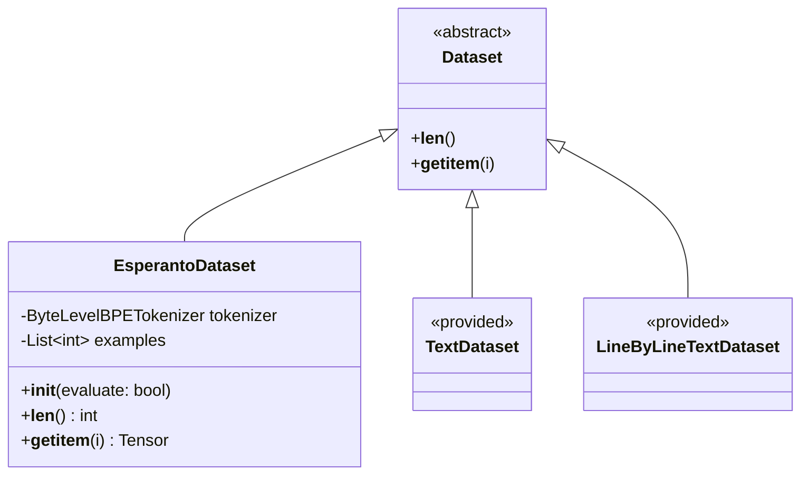
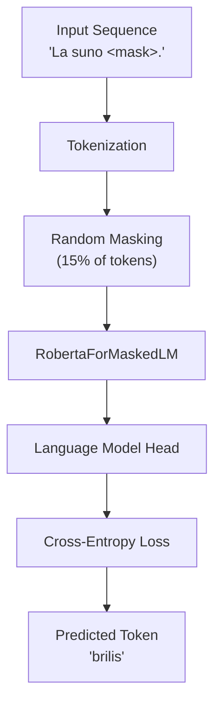
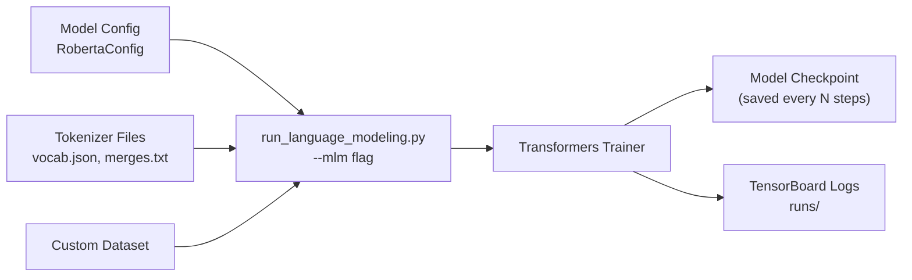
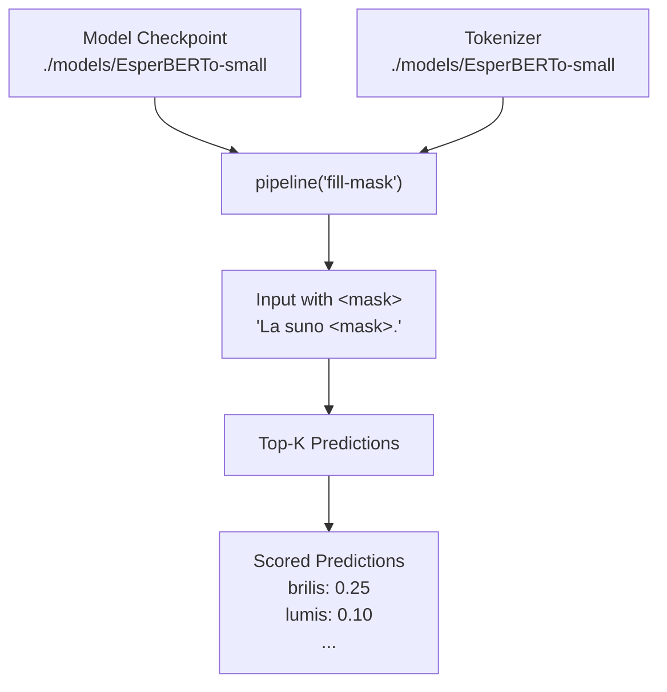
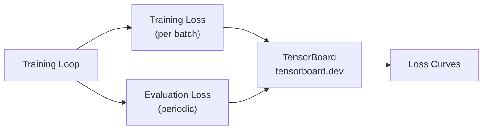
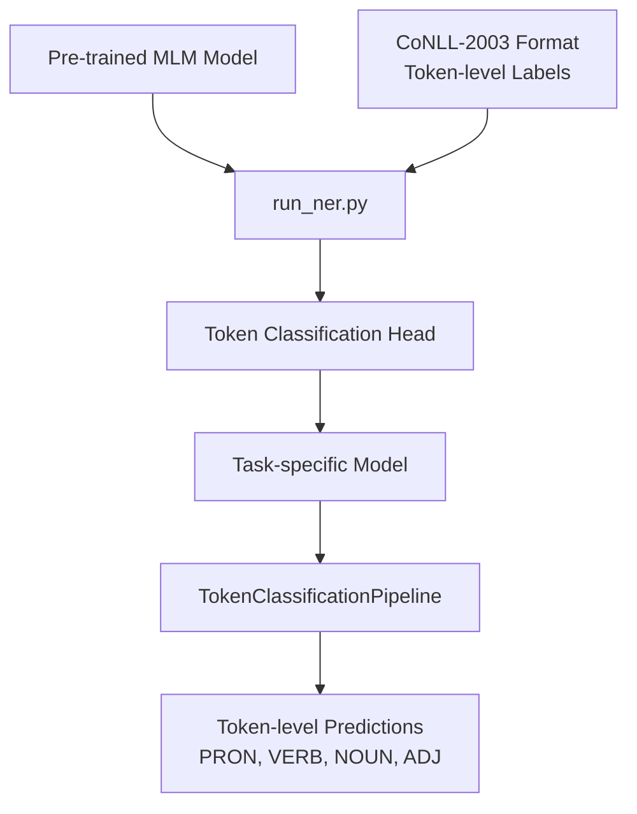
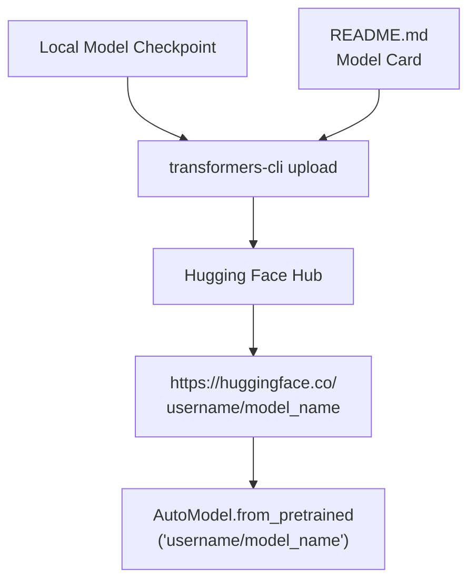

<!-- source: DeepWiki mcp.deepwiki.com · repo huggingface/blog · page 4.1 Basic Training Techniques · fetched 2026-10-26 -->

# Basic Training Techniques

Relevant source files

The following files were used as context for generating this wiki page:

- [assets/03_reformer/thumbnail.png](assets/03_reformer/thumbnail.png)
- [assets/04_pytorch_block_sparse/thumbnail.png](assets/04_pytorch_block_sparse/thumbnail.png)
- [assets/05_encoder_decoder/thumbnail.png](assets/05_encoder_decoder/thumbnail.png)
- [assets/07_porting_fsmt/thumbnail.png](assets/07_porting_fsmt/thumbnail.png)
- [assets/08_warm_starting_encoder_decoder/thumbnail.png](assets/08_warm_starting_encoder_decoder/thumbnail.png)
- [encoder-decoder.md](encoder-decoder.md)
- [how-to-generate.md](how-to-generate.md)
- [how-to-train.md](how-to-train.md)
- [notebooks/03_reformer.ipynb](notebooks/03_reformer.ipynb)
- [notebooks/05_encoder_decoder.ipynb](notebooks/05_encoder_decoder.ipynb)
- [notebooks/08_warm_starting_encoder_decoder.ipynb](notebooks/08_warm_starting_encoder_decoder.ipynb)
- [pytorch_block_sparse.md](pytorch_block_sparse.md)
- [reformer.md](reformer.md)
- [warm-starting-encoder-decoder.md](warm-starting-encoder-decoder.md)

## Purpose and Scope

This document covers fundamental techniques for training transformer-based language models from scratch, including tokenizer training, dataset preparation, masked language modeling, and basic training loops. The content focuses on the practical aspects of training small to medium-sized models using the 🤗Transformers library.

For advanced distributed training strategies across multiple GPUs, see [Distributed Training](#4.4). For memory optimization techniques like gradient checkpointing, see [Memory Optimization](#4.5). For reinforcement learning-based fine-tuning methods, see [Reinforcement Learning from Human Feedback](#4.3).

## Training Pipeline Overview

The complete training pipeline for a language model involves several sequential stages:

Sources: [how-to-train.md:1-356]()

## Tokenizer Training

### ByteLevelBPETokenizer Configuration

Training a custom tokenizer is the first step in creating a language model. The `ByteLevelBPETokenizer` from the tokenizers library provides an efficient implementation of byte-level Byte-Pair Encoding.

The tokenizer training process involves:

1. **Initialization**: Create a `ByteLevelBPETokenizer` instance
2. **File Discovery**: Collect all training text files
3. **Training**: Execute the `.train()` method with configuration parameters
4. **Saving**: Persist vocabulary and merge files to disk

Key configuration parameters:

| Parameter | Typical Value | Description |
|-----------|---------------|-------------|
| `vocab_size` | 52,000 | Total number of tokens in vocabulary |
| `min_frequency` | 2 | Minimum frequency for token inclusion |
| `special_tokens` | `["<s>", "<pad>", "</s>", "<unk>", "<mask>"]` | RoBERTa-style special tokens |

The byte-level approach ensures that all words can be decomposed into tokens, eliminating `<unk>` tokens for unknown words. Training on a 3GB corpus typically completes in approximately 5 minutes.

Sources: [how-to-train.md:42-111]()

### Post-Processing Configuration

After training, the tokenizer requires post-processing setup to handle special tokens correctly:

The `BertProcessing` post-processor adds appropriate beginning-of-sentence (`<s>`) and end-of-sentence (`</s>`) tokens to encoded sequences, following the RoBERTa tokenization scheme.

Sources: [how-to-train.md:115-137]()

## Dataset Preparation

### Custom Dataset Implementation

Dataset preparation involves creating a custom `Dataset` subclass that loads and tokenizes text data:

The custom dataset implementation follows this pattern:

1. **Tokenizer Initialization**: Load the trained tokenizer with post-processing
2. **File Processing**: Iterate through training/evaluation text files
3. **Encoding**: Batch encode all lines using `tokenizer.encode_batch()`
4. **Storage**: Store token IDs in a list for efficient access

Key considerations:
- **On-the-fly vs. Pre-processing**: For large datasets, tokenization can occur during `__getitem__()` rather than in `__init__()`
- **Batch-level Padding**: Padding is deferred to batch collation for efficiency
- **File Splitting**: Separate `-train.txt` and `-eval.txt` files enable train/eval split

Sources: [how-to-train.md:155-189]()

## Masked Language Modeling

### Training Architecture

Masked Language Modeling (MLM) is the pre-training objective where the model learns to predict randomly masked tokens:

The MLM training process involves:

1. **Input Processing**: Tokenize input text sequences
2. **Masking**: Randomly mask 15% of tokens with `<mask>` token
3. **Forward Pass**: Process through RoBERTa model architecture
4. **Prediction**: Generate probability distribution over vocabulary
5. **Loss Calculation**: Compute cross-entropy loss for masked positions only

### Model Configuration

RoBERTa-style models are initialized with specific architectural parameters:

| Configuration Parameter | Example Value | Description |
|-------------------------|---------------|-------------|
| `model_type` | `"roberta"` | Model architecture type |
| `vocab_size` | 52,000 | Size of vocabulary |
| `hidden_size` | 768 | Dimension of hidden layers |
| `num_hidden_layers` | 6 | Number of transformer blocks |
| `num_attention_heads` | 12 | Number of attention heads per layer |
| `intermediate_size` | 3,072 | Feed-forward layer dimension |

Sources: [how-to-train.md:139-153](), [how-to-train.md:194-208]()

### Training Script Integration

The training process uses the `run_language_modeling.py` script (now `run_mlm.py` in current versions):

Key script arguments:

| Argument | Purpose |
|----------|---------|
| `--output_dir` | Directory for saved checkpoints |
| `--model_type` | Specify architecture (e.g., `roberta`) |
| `--mlm` | Enable masked language modeling |
| `--config_name` | Path to model configuration |
| `--tokenizer_name` | Path to tokenizer files |
| `--do_train` | Enable training mode |
| `--do_eval` | Enable evaluation during training |
| `--evaluate_during_training` | Periodic evaluation on eval set |

Sources: [how-to-train.md:191-208]()

## Training Hyperparameters

### Core Training Parameters

Hyperparameter selection significantly impacts training convergence and model quality:

| Hyperparameter | Example Value | Considerations |
|----------------|---------------|----------------|
| `learning_rate` | `1e-4` | Lower rates for stable convergence |
| `num_train_epochs` | 5 | Balance between training time and convergence |
| `per_gpu_train_batch_size` | 16 | Maximize based on GPU memory |
| `save_steps` | 2,000 | Checkpoint frequency |
| `save_total_limit` | 2 | Limit disk usage for checkpoints |
| `seed` | 42 | Reproducibility |

**Batch Size Guidelines**: Select the largest batch size that fits in GPU memory. Larger batches provide more stable gradients but require more memory.

**Learning Rate Scheduling**: The default scheduler typically uses linear warmup followed by linear decay. The warmup period prevents large gradient updates early in training.

**Checkpoint Strategy**: Regular checkpointing enables recovery from failures and evaluation of intermediate models. The `save_total_limit` parameter prevents unbounded disk usage by maintaining only the N most recent checkpoints.

Sources: [how-to-train.md:191-208]()

## Validation and Model Testing

### FillMaskPipeline for Qualitative Evaluation

The `FillMaskPipeline` provides a convenient interface for validating learned language representations:

The pipeline returns predictions ranked by probability, enabling qualitative assessment of:
- **Syntactic Understanding**: Does the model predict grammatically correct words?
- **Semantic Coherence**: Are predictions semantically appropriate for context?
- **Domain Knowledge**: Does the model capture domain-specific vocabulary?

Example validation patterns:

1. **Simple Grammar**: `"La suno <mask>."` → Tests verb prediction
2. **Semantic Context**: `"Jen la komenco de bela <mask>."` → Tests contextual understanding
3. **Long-range Dependencies**: Sequences requiring attention to distant tokens

Sources: [how-to-train.md:220-285]()

### Quantitative Evaluation Metrics

Training and evaluation losses are logged to TensorBoard for quantitative analysis:

TensorBoard visualization enables monitoring:
- **Training Loss Convergence**: Decreasing trend indicates learning
- **Evaluation Loss**: Guards against overfitting
- **Loss Divergence**: Gap between train/eval indicates generalization

The `--evaluate_during_training` flag triggers periodic evaluation, with results logged alongside training metrics. TensorBoard can be uploaded to `tensorboard.dev` for sharing and remote viewing.

Sources: [how-to-train.md:210-218]()

## Fine-tuning for Downstream Tasks

### Token Classification Pipeline

After pre-training, models can be fine-tuned for specific tasks like Part-of-Speech (POS) tagging:

The `run_ner.py` script (or `run_token_classification.py`) handles:
- **Label Alignment**: Mapping tokens to labels in CoNLL format
- **Head Initialization**: Adding classification layer for tag prediction
- **Fine-tuning**: Training only on labeled downstream data

**POS Tagging as Token Classification**: Part-of-speech tagging is structurally identical to Named Entity Recognition (NER), differing only in the label set. Both use the same script and architecture.

Fine-tuning configuration typically uses:
- **Smaller Learning Rate**: `1e-5` to `5e-5` to avoid catastrophic forgetting
- **Fewer Epochs**: 3-5 epochs usually sufficient
- **Larger Batch Size**: Task-specific data is typically smaller

Sources: [how-to-train.md:287-328]()

### TokenClassificationPipeline Usage

The fine-tuned model can be deployed using the `TokenClassificationPipeline`:

The pipeline automatically handles:
- **Tokenization**: Using the model's associated tokenizer
- **Model Inference**: Forward pass through fine-tuned model
- **Post-processing**: Mapping logits to label predictions
- **Token Alignment**: Handling sub-word tokenization

Sources: [how-to-train.md:301-323]()

## Model Sharing and Distribution

### Hugging Face Hub Integration

Trained models can be shared via the Hugging Face Hub for community use:

Model card components:
- **Model Description**: Architecture and training details
- **Training Parameters**: Dataset, preprocessing, hyperparameters
- **Evaluation Results**: Performance metrics on validation/test sets
- **Intended Uses**: Recommended applications
- **Limitations**: Known issues or constraints

Once uploaded, models become accessible via `AutoModel.from_pretrained("username/model_name")`, enabling one-line loading for downstream users.

Sources: [how-to-train.md:329-351]()

---

Sources: [how-to-train.md:1-356](), [how-to-generate.md:1-640](), [encoder-decoder.md:1-932]()

---

