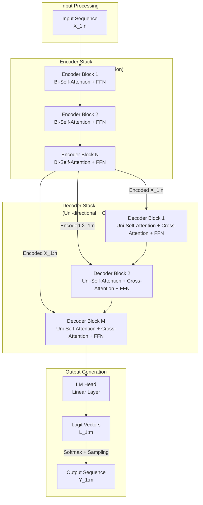
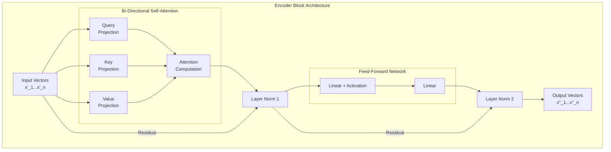
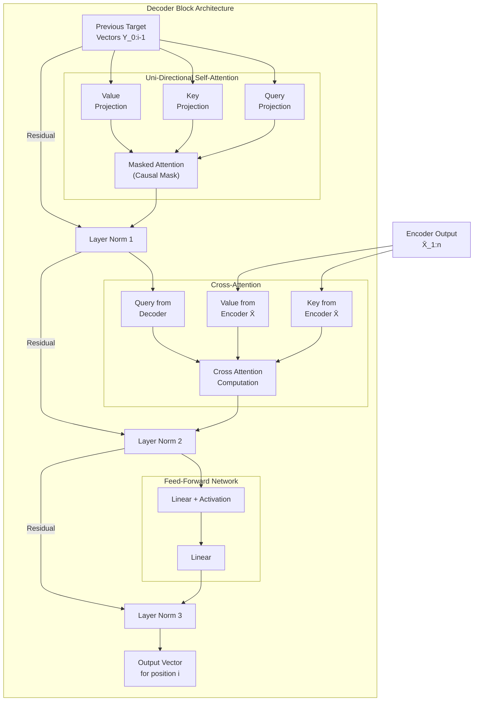
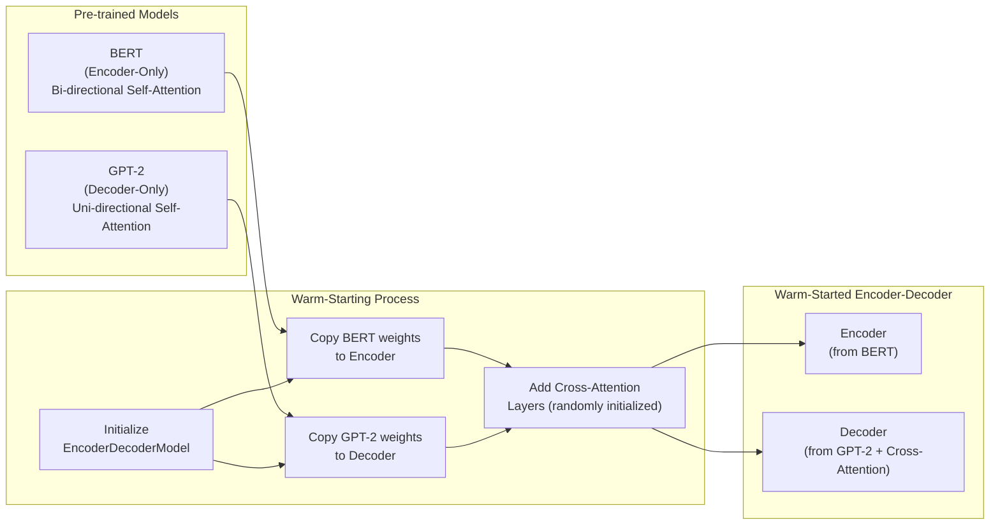
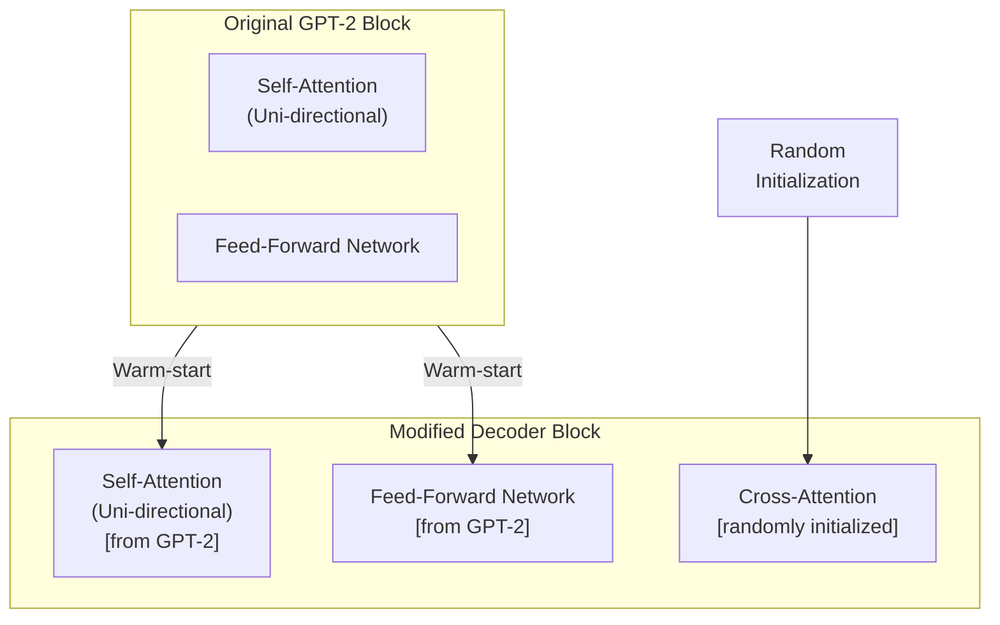
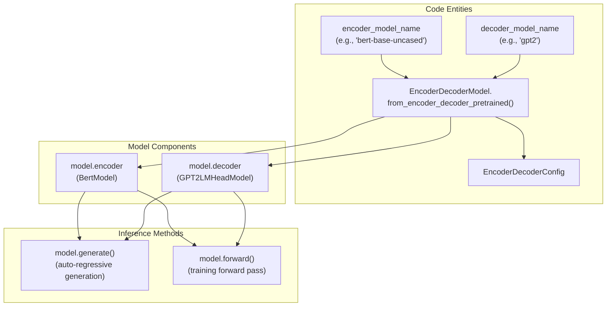

<!-- source: DeepWiki mcp.deepwiki.com · repo huggingface/blog · page 4.2 Encoder-Decoder Architectures · fetched 2026-10-26 -->

# Encoder-Decoder Architectures

Relevant source files

The following files were used as context for generating this wiki page:

- [assets/03_reformer/thumbnail.png](assets/03_reformer/thumbnail.png)
- [assets/04_pytorch_block_sparse/thumbnail.png](assets/04_pytorch_block_sparse/thumbnail.png)
- [assets/05_encoder_decoder/thumbnail.png](assets/05_encoder_decoder/thumbnail.png)
- [assets/07_porting_fsmt/thumbnail.png](assets/07_porting_fsmt/thumbnail.png)
- [assets/08_warm_starting_encoder_decoder/thumbnail.png](assets/08_warm_starting_encoder_decoder/thumbnail.png)
- [encoder-decoder.md](encoder-decoder.md)
- [how-to-generate.md](how-to-generate.md)
- [how-to-train.md](how-to-train.md)
- [notebooks/03_reformer.ipynb](notebooks/03_reformer.ipynb)
- [notebooks/05_encoder_decoder.ipynb](notebooks/05_encoder_decoder.ipynb)
- [notebooks/08_warm_starting_encoder_decoder.ipynb](notebooks/08_warm_starting_encoder_decoder.ipynb)
- [pytorch_block_sparse.md](pytorch_block_sparse.md)
- [reformer.md](reformer.md)
- [warm-starting-encoder-decoder.md](warm-starting-encoder-decoder.md)

## Purpose and Scope

This page explains transformer-based encoder-decoder architectures for sequence-to-sequence tasks in natural language processing. It covers the mathematical formulation, architectural components (encoder and decoder), attention mechanisms (bi-directional self-attention, uni-directional self-attention, and cross-attention), and warm-starting techniques using pre-trained checkpoints.

For text generation and decoding strategies, see [Text Generation and Decoding](#2.4). For training encoder-decoder models from scratch, see [Basic Training Techniques](#4.1). For RLHF and alignment of encoder-decoder models, see [Reinforcement Learning from Human Feedback](#4.3).

## Architecture Overview

### Mathematical Formulation

Encoder-decoder models solve sequence-to-sequence problems by mapping an input sequence $\mathbf{X}_{1:n}$ of $n$ vectors to an output sequence $\mathbf{Y}_{1:m}$ of $m$ vectors, where $m$ is determined dynamically:

$$f: \mathbf{X}_{1:n} \to \mathbf{Y}_{1:m}$$

The model factorizes the conditional probability distribution as:

$$p_{\theta_{enc}, \theta_{dec}}(\mathbf{Y}_{1:m} | \mathbf{X}_{1:n}) = \prod_{i=1}^{m} p_{\theta_{dec}}(\mathbf{y}_i | \mathbf{Y}_{0:i-1}, \mathbf{\overline{X}}_{1:n})$$

where $\mathbf{\overline{X}}_{1:n} = f_{\theta_{enc}}(\mathbf{X}_{1:n})$ is the contextualized encoding sequence.

**Sources:** [encoder-decoder.md:331-381]()

### High-Level Architecture

**Sources:** [encoder-decoder.md:331-465]()

## Encoder Component

### Bi-Directional Self-Attention

The encoder maps the input sequence $\mathbf{X}_{1:n}$ to a contextualized encoding sequence $\mathbf{\overline{X}}_{1:n}$ using stacked encoder blocks. Each encoder block contains:

1. **Bi-directional self-attention layer** - allows each position to attend to all positions in the input
2. **Feed-forward layers** - two position-wise feed-forward networks

The bi-directional self-attention mechanism computes:

$$\text{Attention}(\mathbf{Q}, \mathbf{K}, \mathbf{V}) = \text{softmax}\left(\frac{\mathbf{Q}\mathbf{K}^T}{\sqrt{d_k}}\right)\mathbf{V}$$

where $\mathbf{Q}$, $\mathbf{K}$, and $\mathbf{V}$ are query, key, and value matrices derived from the input.

**Sources:** [encoder-decoder.md:539-627]()

### Encoder Block Architecture

**Key Characteristics:**
- Each position attends to **all positions** in the sequence
- Parallel processing of all positions (no sequential dependency)
- Captures bidirectional context

| Component | Purpose | Mathematical Operation |
|-----------|---------|----------------------|
| Self-Attention | Capture dependencies between all input positions | $\text{softmax}(\mathbf{Q}\mathbf{K}^T)\mathbf{V}$ |
| Feed-Forward | Apply non-linear transformations | $\text{FFN}(x) = \max(0, xW_1 + b_1)W_2 + b_2$ |
| Layer Normalization | Stabilize training | $\text{LayerNorm}(x) = \gamma \frac{x - \mu}{\sigma} + \beta$ |
| Residual Connections | Enable gradient flow | $\text{Output} = \text{Sublayer}(x) + x$ |

**Sources:** [encoder-decoder.md:539-627](), [how-to-train.md:139-155]()

## Decoder Component

### Uni-Directional Self-Attention and Cross-Attention

The decoder generates the output sequence auto-regressively using three key mechanisms:

1. **Uni-directional (causal) self-attention** - ensures position $i$ only attends to positions $< i$
2. **Cross-attention** - attends to the encoder's output $\mathbf{\overline{X}}_{1:n}$
3. **Feed-forward layers** - position-wise transformations

### Attention Mechanism Comparison

| Attention Type | Location | Query Source | Key/Value Source | Masking |
|----------------|----------|--------------|------------------|---------|
| Bi-directional Self-Attention | Encoder | Input sequence | Input sequence | None (full attention) |
| Uni-directional Self-Attention | Decoder | Previous targets | Previous targets | Causal mask (position $i$ sees only $< i$) |
| Cross-Attention | Decoder | Previous targets | Encoder output | None (full attention to encoder) |

**Sources:** [encoder-decoder.md:628-972](), [encoder-decoder.md:331-465]()

### Auto-Regressive Generation Process

During inference, the decoder generates tokens one at a time:

1. Initialize with BOS (beginning-of-sequence) token: $\mathbf{y}_0 = \text{BOS}$
2. For each step $i$:
   - Compute logits: $\mathbf{l}_i = f_{\theta_{dec}}(\mathbf{Y}_{0:i-1}, \mathbf{\overline{X}}_{1:n})$
   - Sample next token: $\mathbf{y}_i \sim \text{softmax}(\mathbf{l}_i)$
   - Append to sequence: $\mathbf{Y}_{0:i} = [\mathbf{Y}_{0:i-1}, \mathbf{y}_i]$
3. Stop when EOS (end-of-sequence) token is generated

**Sources:** [encoder-decoder.md:401-449](), [how-to-generate.md:35-47]()

## Warm-Starting Encoder-Decoder Models

### Motivation and Approach

Training encoder-decoder models from scratch is computationally expensive. Warm-starting leverages pre-trained encoder-only (e.g., BERT) and decoder-only (e.g., GPT-2) checkpoints to initialize encoder-decoder models, significantly reducing training costs while maintaining competitive performance.

### Warm-Starting Strategies

| Strategy | Encoder Source | Decoder Source | Use Case |
|----------|---------------|----------------|----------|
| BERT→BERT | BERT checkpoint | BERT checkpoint | General sequence-to-sequence |
| BERT→GPT-2 | BERT checkpoint | GPT-2 checkpoint | Leveraging both model types |
| BERT→Random | BERT checkpoint | Random initialization | Encoder-focused tasks |
| Random→GPT-2 | Random initialization | GPT-2 checkpoint | Decoder-focused tasks |

**Sources:** [warm-starting-encoder-decoder.md:338-402]()

### EncoderDecoderModel Class

The `EncoderDecoderModel` class in 🤗Transformers provides a framework for creating and warm-starting encoder-decoder models.

**Key Components:**
- `EncoderDecoderModel.from_encoder_decoder_pretrained()` - factory method for warm-starting
- `encoder` - encoder module (e.g., BERT)
- `decoder` - decoder module (e.g., GPT-2 with added cross-attention)
- `config` - `EncoderDecoderConfig` combining encoder and decoder configurations

**Sources:** [warm-starting-encoder-decoder.md:471-546]()

### Cross-Attention Layer Initialization

When warm-starting with a decoder-only model like GPT-2, cross-attention layers must be added since GPT-2 only has self-attention:

The cross-attention layers are initialized randomly and learn to attend to encoder outputs during fine-tuning.

**Sources:** [warm-starting-encoder-decoder.md:403-506]()

## Practical Usage with Transformers

### Creating Warm-Started Models

The following code pattern is used to create warm-started encoder-decoder models (referenced from examples, not new code):

**From Pre-trained Checkpoints:**
- Uses `EncoderDecoderModel.from_encoder_decoder_pretrained(encoder_model, decoder_model)`
- Encoder model: typically `bert-base-uncased` or similar BERT variants
- Decoder model: typically `gpt2` or similar GPT-2 variants

**Configuration:**
- `EncoderDecoderConfig` combines encoder and decoder configurations
- Special tokens: `bos_token_id`, `eos_token_id`, `pad_token_id`, `decoder_start_token_id`
- Generation parameters: `max_length`, `num_beams`, etc.

**Sources:** [warm-starting-encoder-decoder.md:471-546](), [encoder-decoder.md:467-506]()

### Model Instantiation Pattern

**Sources:** [encoder-decoder.md:467-506](), [warm-starting-encoder-decoder.md:471-546]()

### Sequence-to-Sequence Tasks

Encoder-decoder models are used for various NLG tasks:

| Task | Input | Output | Example Models |
|------|-------|--------|----------------|
| Translation | Text in source language | Text in target language | MarianMT, mBART |
| Summarization | Long document | Short summary | BART, Pegasus, T5 |
| Question Answering | Context + Question | Answer | T5 |
| Text-to-Text | Task-specific input | Task-specific output | T5, BART |

**Key Models in 🤗Transformers:**
- `T5Model` / `T5ForConditionalGeneration`
- `BartModel` / `BartForConditionalGeneration`
- `MarianMTModel`
- `PegasusModel` / `PegasusForConditionalGeneration`
- `EncoderDecoderModel` (generic warm-started model)

**Sources:** [encoder-decoder.md:54-58](), [warm-starting-encoder-decoder.md:1-73]()

### Training Considerations

**Memory Optimization:**
- Encoder-decoder models require more memory than encoder-only or decoder-only models
- The encoder processes the full input sequence simultaneously
- The decoder processes sequentially but needs to store encoder outputs
- Gradient checkpointing can reduce memory usage during training

**Fine-tuning Process:**
1. Load warm-started model
2. Prepare sequence-to-sequence dataset (input-output pairs)
3. Fine-tune on task-specific data
4. Cross-attention layers learn to bridge encoder and decoder
5. Pre-trained weights adapt to the specific task

**Sources:** [warm-starting-encoder-decoder.md:34-73](), [how-to-train.md:139-209]()

## Architecture Comparison

### Encoder-Only vs Decoder-Only vs Encoder-Decoder

| Aspect | Encoder-Only (BERT) | Decoder-Only (GPT-2) | Encoder-Decoder |
|--------|---------------------|----------------------|-----------------|
| Attention Type | Bi-directional self-attention | Uni-directional self-attention | Both + cross-attention |
| Input Processing | Full context | Left-to-right context | Encoder: full, Decoder: causal |
| Output Length | Fixed (input length) | Variable (auto-regressive) | Variable (auto-regressive) |
| Typical Tasks | Classification, NER, extraction | Text generation, completion | Translation, summarization, seq2seq |
| Example Models | BERT, RoBERTa, ELECTRA | GPT-2, GPT-3 | T5, BART, MarianMT, Pegasus |

**Sources:** [encoder-decoder.md:75-274](), [warm-starting-encoder-decoder.md:75-296]()

---

**Sources:** [encoder-decoder.md:1-972](), [warm-starting-encoder-decoder.md:1-546](), [how-to-train.md:1-355](), [how-to-generate.md:1-640]()

---

