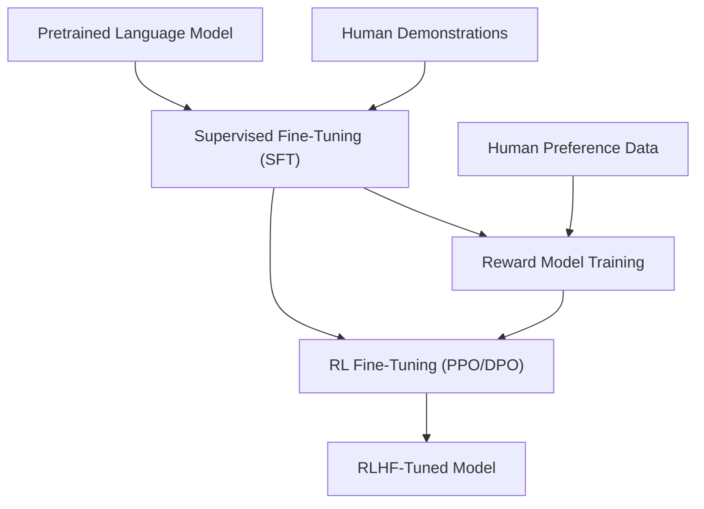
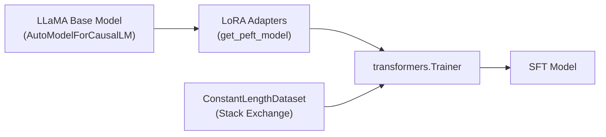
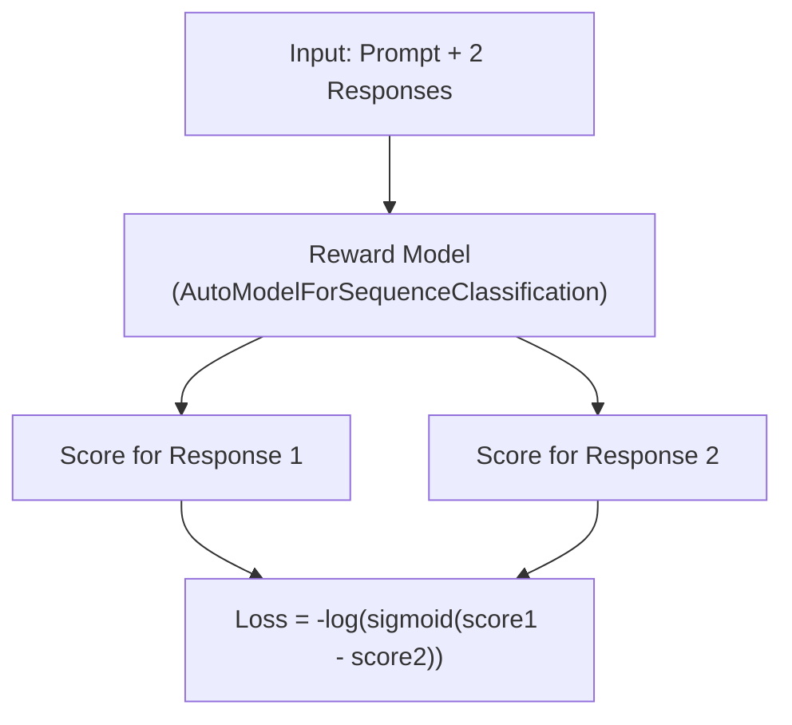
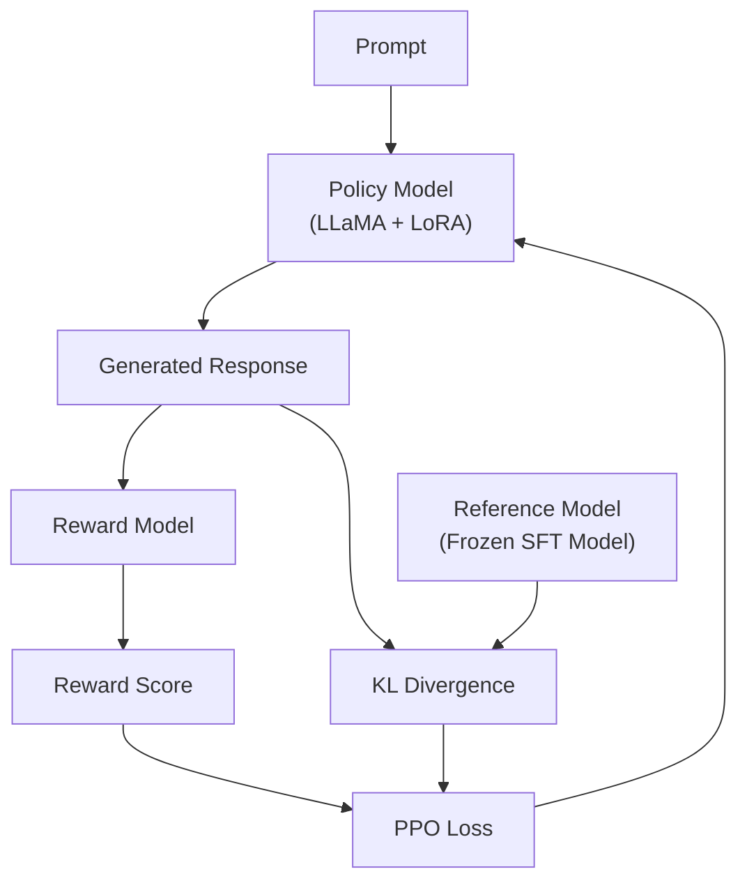
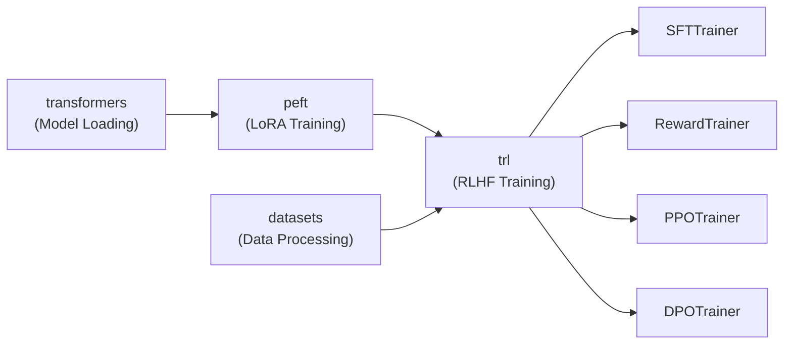
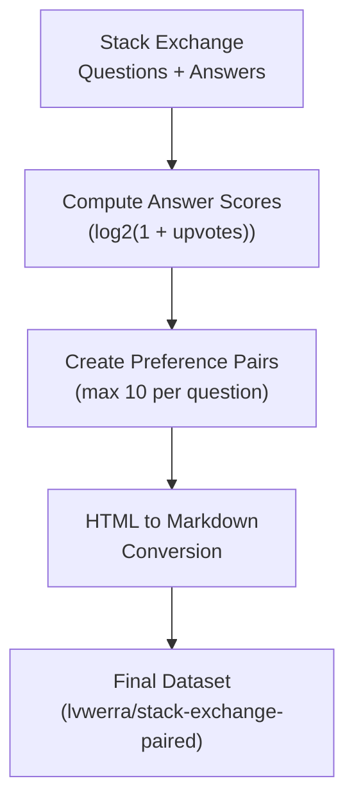
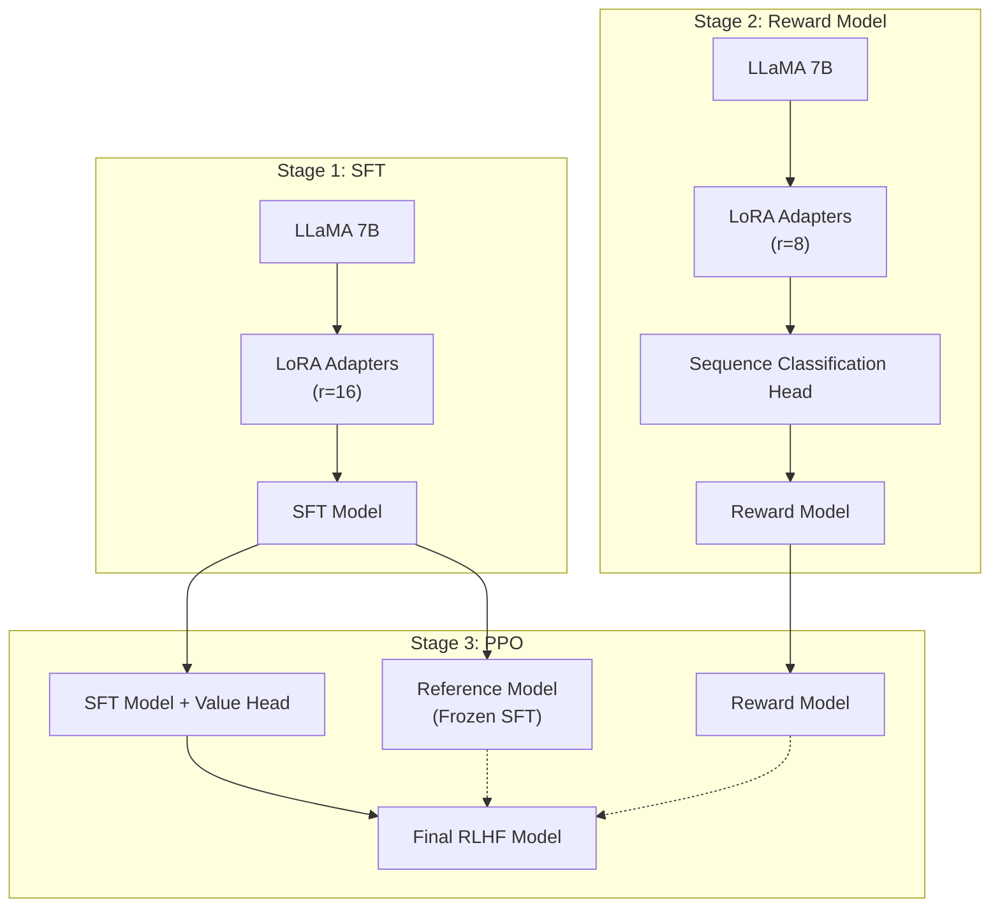
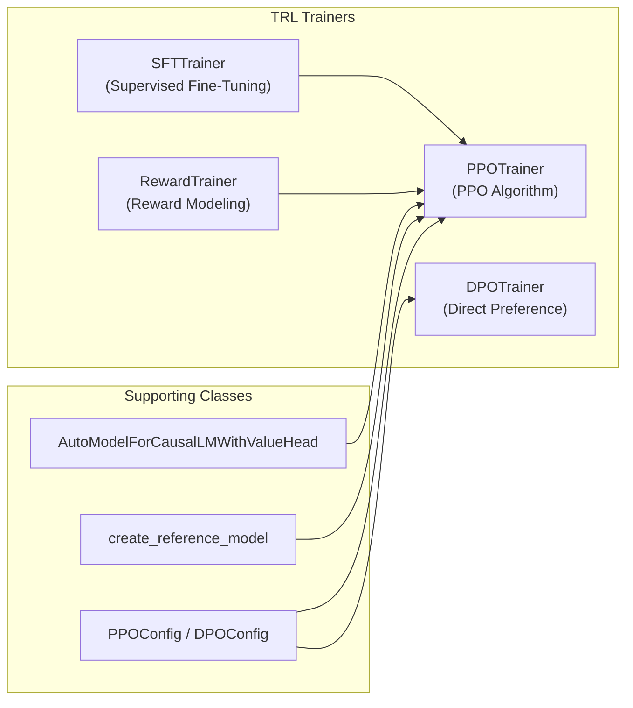

<!-- source: DeepWiki mcp.deepwiki.com · repo huggingface/blog · page 4.3 Reinforcement Learning from Human Feedback · fetched 2026-10-26 -->

# Reinforcement Learning from Human Feedback

<details>
<summary>Relevant source files</summary>

The following files were used as context for generating this wiki page:

- [4bit-transformers-bitsandbytes.md](4bit-transformers-bitsandbytes.md)
- [_events.yml](_events.yml)
- [accelerate-deepspeed.md](accelerate-deepspeed.md)
- [assets/138_stackllama/thumbnail.png](assets/138_stackllama/thumbnail.png)
- [assets/147_falcon/falcon_thumbnail.jpg](assets/147_falcon/falcon_thumbnail.jpg)
- [assets/63_deep_rl_intro/tasks.jpg](assets/63_deep_rl_intro/tasks.jpg)
- [assets/70_deep_rl_q_part1/bellman6.jpg](assets/70_deep_rl_q_part1/bellman6.jpg)
- [assets/78_ml_director_insights/witty-works.png](assets/78_ml_director_insights/witty-works.png)
- [assets/83_accelerate_deepspeed/chatbot.png](assets/83_accelerate_deepspeed/chatbot.png)
- [assets/83_accelerate_deepspeed/cls_run.png](assets/83_accelerate_deepspeed/cls_run.png)
- [assets/83_accelerate_deepspeed/deepspeed-thumbnail.png](assets/83_accelerate_deepspeed/deepspeed-thumbnail.png)
- [assets/86_bloom/bloom-examples.jpg](assets/86_bloom/bloom-examples.jpg)
- [assets/98_spaces_3dmoljs/thumbnail.png](assets/98_spaces_3dmoljs/thumbnail.png)
- [assets/assisted-generation/thumbnail.png](assets/assisted-generation/thumbnail.png)
- [assets/controlnet/thumbnail.png](assets/controlnet/thumbnail.png)
- [assets/cosmopedia/thumbnail.png](assets/cosmopedia/thumbnail.png)
- [assets/diffusion-models-event/thumbnail.png](assets/diffusion-models-event/thumbnail.png)
- [assets/inference_pro/thumbnail.png](assets/inference_pro/thumbnail.png)
- [assets/instruction_tuning_sd/thumbnail.png](assets/instruction_tuning_sd/thumbnail.png)
- [assets/llama2/thumbnail.jpg](assets/llama2/thumbnail.jpg)
- [assisted-generation.md](assisted-generation.md)
- [bloom.md](bloom.md)
- [classification-use-cases.md](classification-use-cases.md)
- [controlnet.md](controlnet.md)
- [cosmopedia.md](cosmopedia.md)
- [deep-rl-a2c.md](deep-rl-a2c.md)
- [deep-rl-dqn.md](deep-rl-dqn.md)
- [deep-rl-intro.md](deep-rl-intro.md)
- [deep-rl-pg.md](deep-rl-pg.md)
- [deep-rl-ppo.md](deep-rl-ppo.md)
- [deep-rl-q-part1.md](deep-rl-q-part1.md)
- [deep-rl-q-part2.md](deep-rl-q-part2.md)
- [diffusion-models-event.md](diffusion-models-event.md)
- [falcon.md](falcon.md)
- [inference-pro.md](inference-pro.md)
- [instruction-tuning-sd.md](instruction-tuning-sd.md)
- [llama2.md](llama2.md)
- [ml-director-insights-2.md](ml-director-insights-2.md)
- [spaces_3dmoljs.md](spaces_3dmoljs.md)
- [stackllama.md](stackllama.md)

</details>


## Purpose and Scope

This document describes Reinforcement Learning from Human Feedback (RLHF), a technique for fine-tuning large language models to align with human preferences and expectations. RLHF combines supervised learning, reward modeling, and reinforcement learning to improve model behavior beyond what standard pre-training and supervised fine-tuning can achieve.

For general deep reinforcement learning concepts, see [Deep Reinforcement Learning](#7). For policy gradient methods used in RLHF, see [Policy Gradient Methods](#7.2).

## Overview

RLHF enables models like ChatGPT, GPT-4, Claude, and Llama 2 to produce responses that better align with how humans expect them to behave. The technique addresses the challenge that models trained purely on next-token prediction may generate technically correct but undesirable outputs.

The key innovation is using human feedback to train a reward model that captures human preferences, then optimizing the language model policy using reinforcement learning to maximize rewards from this learned reward model.



**RLHF Training Pipeline**

Sources: [llama2.md:17-26](), [stackllama.md:16-23]()

## Three-Stage RLHF Pipeline

### Stage 1: Supervised Fine-Tuning

The first stage takes a capable pretrained model and fine-tunes it on high-quality human demonstrations. This bootstraps the model to generate outputs in the desired format and domain.

For StackLLaMA, this involves:
- Starting with a pretrained LLaMA model
- Fine-tuning on the Stack Exchange dataset with packing for efficiency
- Using LoRA (Low-Rank Adaptation) for memory-efficient training



**Supervised Fine-Tuning Architecture**

The implementation uses efficient training strategies:
- 8-bit model loading via `load_in_8bit=True`
- LoRA configuration with `r=16`, `lora_alpha=32`
- Packing multiple texts into fixed-length sequences for efficiency

Sources: [stackllama.md:78-111](), [llama2.md:153-177]()

### Stage 2: Reward Model Training

The reward model learns to predict which outputs humans prefer. It takes a prompt and two candidate responses, outputting a scalar score for each. The model is trained to assign higher scores to preferred responses.



**Reward Model Training Process**

The custom loss function is implemented in `RewardTrainer`:

```python
class RewardTrainer(Trainer):
    def compute_loss(self, model, inputs, return_outputs=False):
        rewards_j = model(input_ids=inputs["input_ids_j"], 
                         attention_mask=inputs["attention_mask_j"])[0]
        rewards_k = model(input_ids=inputs["input_ids_k"], 
                         attention_mask=inputs["attention_mask_k"])[0]
        loss = -nn.functional.logsigmoid(rewards_j - rewards_k).mean()
```

Key implementation details:
- Uses pairwise ranking loss
- Processes pairs of (chosen, rejected) responses
- Outputs single scalar value per response
- Trained with LoRA for efficiency (`r=8`, `lora_alpha=32`)

Sources: [stackllama.md:117-150]()

### Stage 3: Reinforcement Learning Fine-Tuning

The final stage uses the reward model to optimize the language model policy. Two main approaches exist:

**PPO (Proximal Policy Optimization):**
- Treats text generation as a sequential decision problem
- Uses the reward model to score complete responses
- Applies policy gradient updates with a clipped objective
- Maintains a reference model to prevent drift

**DPO (Direct Preference Optimization):**
- Directly optimizes the policy from preference data
- Skips explicit reward model inference during training
- Uses a simpler loss function based on preference pairs



**RL Training Loop with PPO**

The PPO implementation uses the TRL (Transformer Reinforcement Learning) library:

| Component | Implementation | Purpose |
|-----------|----------------|---------|
| Policy Model | `AutoModelForCausalLMWithValueHead` | Generates responses and estimates values |
| Reference Model | Frozen copy of SFT model | Prevents policy drift via KL penalty |
| Reward Model | `AutoModelForSequenceClassification` | Scores generated responses |
| Optimizer | `PPOTrainer` | Manages the PPO training loop |

The PPO objective balances reward maximization with staying close to the reference policy:

```
Loss = -E[reward(response)] + β * KL(policy || reference)
```

Sources: [stackllama.md:152-205](), [llama2.md:40-46]()

## Implementation in Hugging Face Ecosystem

### Core Libraries



**RLHF Library Ecosystem**

Key classes and their roles:

- `AutoModelForCausalLM` - Loads base language models
- `AutoModelForSequenceClassification` - Used for reward models
- `LoraConfig` / `get_peft_model` - Enables efficient fine-tuning
- `SFTTrainer` - Handles supervised fine-tuning with packing
- `RewardTrainer` - Custom trainer for reward model training
- `PPOTrainer` - Implements PPO algorithm for RL fine-tuning
- `DPOTrainer` - Implements Direct Preference Optimization

Sources: [stackllama.md:88-109](), [llama2.md:153-177]()

### Memory Optimization Strategies

RLHF training requires significant memory. The following techniques enable training large models:

| Technique | Description | Memory Savings |
|-----------|-------------|----------------|
| 8-bit Loading | `load_in_8bit=True` | ~50% reduction |
| LoRA | Low-rank adapter layers | Train only ~0.1% of parameters |
| Gradient Checkpointing | Recompute activations | Trade compute for memory |
| CPU Offloading | `device_map="auto"` | Use CPU RAM for overflow |

Example configuration for 7B model:

```python
model = AutoModelForCausalLM.from_pretrained(
    "meta-llama/Llama-2-7b-hf",
    load_in_8bit=True,
    device_map={"": Accelerator().local_process_index}
)

lora_config = LoraConfig(
    r=16,
    lora_alpha=32,
    lora_dropout=0.05,
    bias="none",
    task_type="CAUSAL_LM"
)
```

Sources: [stackllama.md:52-66](), [llama2.md:153-159]()

## Dataset Preparation

### Stack Exchange Dataset

The Stack Exchange dataset provides a rich source of preference data without requiring new human annotations. Answers are ranked using upvotes and acceptance status:

```
score = log2(1 + upvotes) + (1 if accepted else 0)
```

For reward modeling:
- Sample up to 10 answer pairs per question
- Convert HTML to Markdown for cleaner outputs
- Create (chosen, rejected) pairs based on scores



**Dataset Processing Pipeline**

Sources: [stackllama.md:41-49]()

### Preference Data Format

For reward model training, each sample contains:

- `prompt` - The question or instruction
- `chosen` - The preferred response
- `rejected` - The less preferred response

The reward trainer processes these into paired inputs:

```python
{
    "input_ids_j": tokens_for_chosen,
    "attention_mask_j": mask_for_chosen,
    "input_ids_k": tokens_for_rejected,
    "attention_mask_k": mask_for_rejected
}
```

Sources: [stackllama.md:133-141]()

## Case Study: StackLLaMA

StackLLaMA demonstrates the complete RLHF pipeline for training a model to answer Stack Exchange questions.

### Training Configuration

| Stage | Model | Dataset | Training Time |
|-------|-------|---------|---------------|
| SFT | LLaMA 7B | Stack Exchange | Few thousand steps |
| Reward Model | LLaMA 7B | 100K preference pairs | 1 epoch |
| PPO | SFT Model | Validation set | Multiple epochs |

### Model Architecture



**StackLLaMA Three-Stage Architecture**

Sources: [stackllama.md:1-34](), [stackllama.md:78-205]()

## Case Study: Llama 2 Chat

Llama 2 Chat models demonstrate state-of-the-art RLHF results, achieving performance comparable to ChatGPT.

### Key Features

- Multiple model sizes: 7B, 13B, 70B parameters
- Trained on 2 trillion tokens (base models)
- RLHF optimization for dialogue applications
- Custom prompt format for multi-turn conversations

### Prompt Format

Llama 2 Chat uses a specific template for conversations:

```
<s>[INST] <<SYS>>
{system_prompt}
<</SYS>>

{user_message} [/INST] {model_response} </s><s>[INST] {next_user_message} [/INST]
```

This format enables:
- System-level instructions for behavior control
- Multi-turn conversation tracking
- Clear separation between user and assistant turns

Example usage:

```python
prompt = """<s>[INST] <<SYS>>
You are a helpful, respectful and honest assistant.
<</SYS>>

What is RLHF? [/INST]"""

pipeline = transformers.pipeline(
    "text-generation",
    model="meta-llama/Llama-2-7b-chat-hf",
    torch_dtype=torch.float16,
    device_map="auto"
)
response = pipeline(prompt, max_new_tokens=200)
```

Sources: [llama2.md:178-227]()

### RLHF Training Details

The Llama 2 paper reports:
- Iterative RLHF with multiple rounds
- Rejection sampling for improved data quality
- PPO with adaptive KL penalty
- Careful reward model calibration

Performance benchmarks show Llama 2 Chat models outperform most open models on helpfulness and safety metrics.

Sources: [llama2.md:38-46]()

## Training Tools and Scripts

### TRL Library Components

The `trl` library provides production-ready RLHF implementations:



**TRL Library Architecture**

### Example Training Scripts

For supervised fine-tuning with packing:

```python
from trl import SFTTrainer
from transformers import AutoModelForCausalLM

model = AutoModelForCausalLM.from_pretrained(
    "meta-llama/Llama-2-7b-hf",
    load_in_8bit=True
)

trainer = SFTTrainer(
    model=model,
    train_dataset=dataset,
    packing=True,
    max_seq_length=2048
)
trainer.train()
```

For PPO training:

```python
from trl import PPOTrainer, PPOConfig

ppo_config = PPOConfig(
    learning_rate=1.41e-5,
    batch_size=4,
    mini_batch_size=1
)

ppo_trainer = PPOTrainer(
    config=ppo_config,
    model=policy_model,
    ref_model=reference_model,
    reward_model=reward_model
)
```

Sources: [stackllama.md:152-205](), [llama2.md:153-177]()

## Evaluation and Metrics

### Human Evaluation

RLHF models are typically evaluated through:
- Human preference ratings on test prompts
- Comparison against baseline models (GPT-4, ChatGPT)
- Safety and helpfulness benchmarks
- Domain-specific task performance

### Automated Benchmarks

Common evaluation datasets:
- Vicuna benchmark (conversational ability)
- TruthfulQA (factual accuracy)
- HumanEval (code generation)
- MMLU (multi-task understanding)

Llama 2 Chat achieves 99.3% of ChatGPT performance on Vicuna benchmark according to GPT-4 evaluations.

Sources: [stackllama.md:19-21](), [llama2.md:40-46]()

## Best Practices

### Model Selection

- Start with a capable base model (7B+ parameters recommended)
- Ensure the model has good in-domain performance before RLHF
- Consider using models already fine-tuned on instructions

### Data Quality

- High-quality SFT data is critical for good baseline performance
- Diverse preference data improves reward model generalization
- 50K-100K preference pairs typically sufficient for reward modeling

### Hyperparameter Tuning

Key parameters to tune:

| Parameter | Typical Range | Purpose |
|-----------|---------------|---------|
| Learning Rate | 1e-6 to 1e-5 | Controls update step size |
| KL Coefficient (β) | 0.01 to 0.1 | Balances reward vs. reference policy |
| PPO Clip Range (ε) | 0.1 to 0.3 | Limits policy updates |
| Batch Size | 4 to 64 | Trade-off between stability and speed |

### Common Pitfalls

- **Reward Hacking**: Model exploits reward model weaknesses
  - Solution: Use KL penalty, iterative RLHF rounds
- **Mode Collapse**: Model generates repetitive outputs
  - Solution: Adjust temperature, use diverse prompts
- **Forgetting**: Model loses capabilities from pretraining
  - Solution: Lower learning rate, stronger KL penalty

Sources: [stackllama.md:52-66](), [llama2.md:153-177]()

## Resources and References

### Official Implementations

- TRL library: [github.com/huggingface/trl](https://github.com/lvwerra/trl)
- StackLLaMA repository: Code for reproducing results
- Llama 2 models: Available on Hugging Face Hub

### Key Papers

- InstructGPT: "Training language models to follow instructions with human feedback"
- QLoRA: "Efficient Finetuning of Quantized LLMs"
- Llama 2: "Open Foundation and Fine-Tuned Chat Models"

### Training Examples

- Basic SFT script: [trl/examples/scripts/sft_trainer.py]()
- Reward modeling: Custom `RewardTrainer` implementation
- PPO training: [stackllama.md:152-205]()

Sources: [stackllama.md:25-34](), [llama2.md:229-237](), [_events.yml:116-119]()

---

