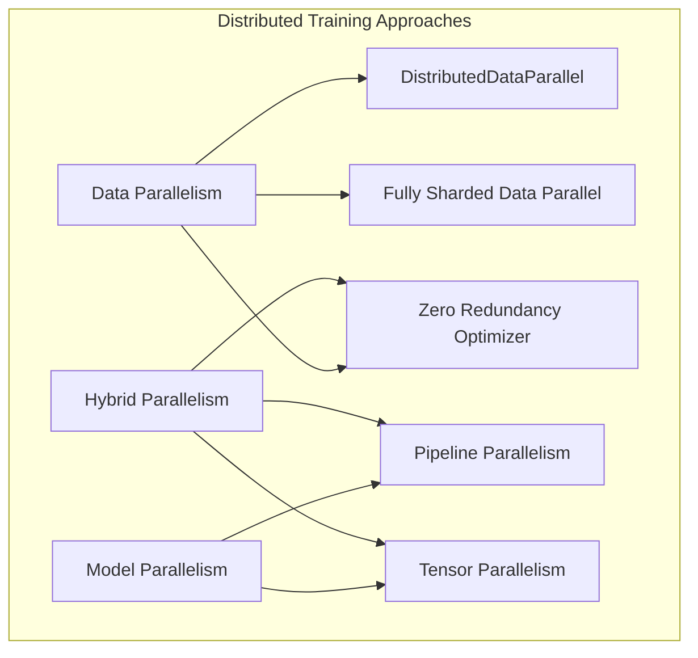
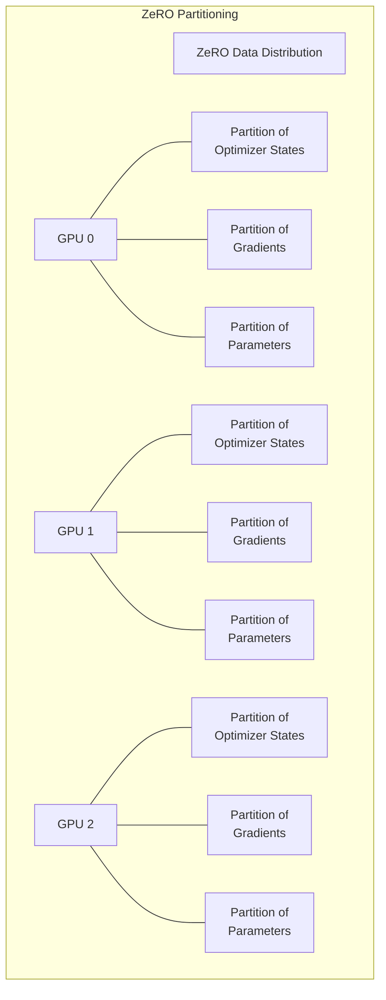
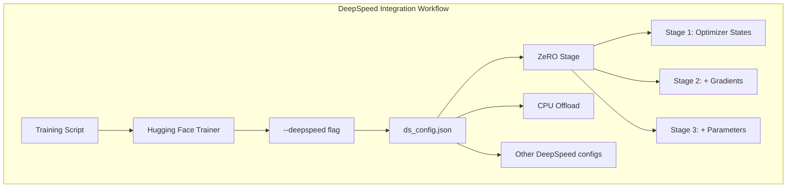
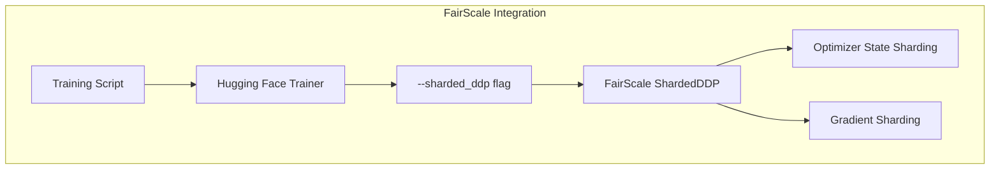
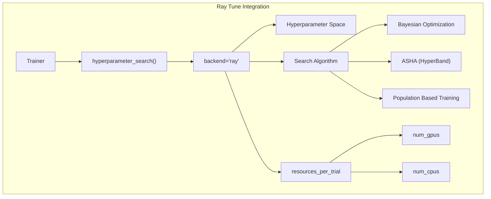
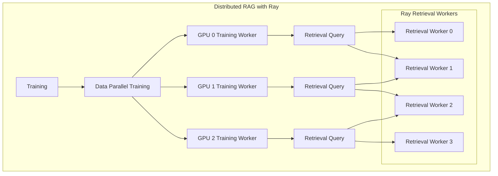

<!-- source: DeepWiki mcp.deepwiki.com · repo huggingface/blog · page 4.4 Distributed Training · fetched 2026-10-26 -->

# Distributed Training

<details>
<summary>Relevant source files</summary>

The following files were used as context for generating this wiki page:

- [4bit-transformers-bitsandbytes.md](4bit-transformers-bitsandbytes.md)
- [_events.yml](_events.yml)
- [accelerate-deepspeed.md](accelerate-deepspeed.md)
- [assets/138_stackllama/thumbnail.png](assets/138_stackllama/thumbnail.png)
- [assets/147_falcon/falcon_thumbnail.jpg](assets/147_falcon/falcon_thumbnail.jpg)
- [assets/83_accelerate_deepspeed/chatbot.png](assets/83_accelerate_deepspeed/chatbot.png)
- [assets/83_accelerate_deepspeed/cls_run.png](assets/83_accelerate_deepspeed/cls_run.png)
- [assets/83_accelerate_deepspeed/deepspeed-thumbnail.png](assets/83_accelerate_deepspeed/deepspeed-thumbnail.png)
- [assets/98_spaces_3dmoljs/thumbnail.png](assets/98_spaces_3dmoljs/thumbnail.png)
- [assets/assisted-generation/thumbnail.png](assets/assisted-generation/thumbnail.png)
- [assets/diffusion-models-event/thumbnail.png](assets/diffusion-models-event/thumbnail.png)
- [assets/inference_pro/thumbnail.png](assets/inference_pro/thumbnail.png)
- [assets/instruction_tuning_sd/thumbnail.png](assets/instruction_tuning_sd/thumbnail.png)
- [assets/llama2/thumbnail.jpg](assets/llama2/thumbnail.jpg)
- [assisted-generation.md](assisted-generation.md)
- [diffusion-models-event.md](diffusion-models-event.md)
- [falcon.md](falcon.md)
- [inference-pro.md](inference-pro.md)
- [instruction-tuning-sd.md](instruction-tuning-sd.md)
- [llama2.md](llama2.md)
- [spaces_3dmoljs.md](spaces_3dmoljs.md)
- [stackllama.md](stackllama.md)
- [zh/_blog.yml](zh/_blog.yml)
- [zh/asr-diarization.md](zh/asr-diarization.md)
- [zh/big-bird.md](zh/big-bird.md)
- [zh/docmatix.md](zh/docmatix.md)
- [zh/dynamic_speculation_lookahead.md](zh/dynamic_speculation_lookahead.md)
- [zh/fine-video.md](zh/fine-video.md)
- [zh/infini-attention.md](zh/infini-attention.md)
- [zh/kv-cache-quantization.md](zh/kv-cache-quantization.md)
- [zh/llama32.md](zh/llama32.md)
- [zh/pytorch-fsdp.md](zh/pytorch-fsdp.md)
- [zh/train-sentence-transformers.md](zh/train-sentence-transformers.md)
- [zh/vertex-colored-to-textured-mesh.md](zh/vertex-colored-to-textured-mesh.md)
- [zh/zero-shot-vqa-docmatix.md](zh/zero-shot-vqa-docmatix.md)

</details>


This page explains techniques for training models across multiple GPUs and nodes in the Hugging Face ecosystem. It covers data parallel training, advanced optimizations like ZeRO (Zero Redundancy Optimizer), and integrations with libraries like DeepSpeed, FairScale, and Ray. For information about basic training techniques, see [Basic Training Techniques](#4.1), and for LLM optimization for inference, see [LLM Optimization](#4.3).

## Overview of Distributed Training Approaches

Distributed training becomes essential as model sizes grow beyond what fits on a single GPU. The Hugging Face ecosystem supports several approaches to distribute the training workload:



Sources: [zero-deepspeed-fairscale.md:19-20]()

### Data Parallelism

In data parallel training, identical copies of the model run on multiple GPUs, each processing different batches of data. Gradients are synchronized across devices to update the model. This is the simplest form of distributed training and works well when the model fits on a single GPU.

**Standard Data Parallel**: Implemented in PyTorch through `DistributedDataParallel` (DDP), this approach replicates the model, gradients, and optimizer states on each GPU, which limits the maximum model size.

**Fully Sharded Data Parallel**: A more memory-efficient version where model parameters, gradients, and optimizer states are sharded across GPUs.

### Zero Redundancy Optimizer (ZeRO)

ZeRO is an optimization technology that dramatically reduces memory requirements by partitioning model states across GPUs and only gathering them when needed.



Sources: [zero-deepspeed-fairscale.md:139-141]()

ZeRO comes in three optimization stages:
- **Stage 1**: Optimizer state partitioning
- **Stage 2**: Gradient partitioning + Stage 1
- **Stage 3**: Parameter partitioning + Stage 1 & 2

### Model Parallelism

When a model is too large to fit on a single GPU even with data parallelism optimizations, model parallelism splits the model across multiple GPUs:

- **Pipeline Parallelism**: Divides the model layers across GPUs
- **Tensor Parallelism**: Splits individual layers across GPUs

## DeepSpeed Integration

DeepSpeed is a deep learning optimization library from Microsoft that implements ZeRO and can be integrated with the Hugging Face Trainer.



Sources: [zero-deepspeed-fairscale.md:101-105](), [zero-deepspeed-fairscale.md:154-155]()

### Example Performance Gains

DeepSpeed enables significant performance improvements in both multi-GPU and single-GPU settings:

| Method | Max Batch Size | Train Time (s) | Eval Time (s) |
|--------|---------------|----------------|---------------|
| Baseline (DDP) | 16 | 30.95 | 56.33 |
| DeepSpeed w/o CPU offload | 40 | 10.40 | 34.93 |
| DeepSpeed w/ CPU offload | 50 | 20.97 | 32.14 |

*Results for T5-large model fine-tuning on 2x 24GB GPUs*

Sources: [zero-deepspeed-fairscale.md:68-70]()

### Single-GPU Large Model Training

DeepSpeed's ZeRO-Offload can enable training of models that wouldn't otherwise fit on a single GPU:

```
# Training T5-3B (3 billion parameters) on a single 24GB GPU
# Without DeepSpeed:
CUDA_VISIBLE_DEVICES=0 ./finetune_trainer.py --model_name_or_path t5-3b --fp16 --per_device_train_batch_size 1
# Result: CUDA out of memory error even with batch size 1

# With DeepSpeed:
CUDA_VISIBLE_DEVICES=0 deepspeed --num_gpus=1 ./finetune_trainer.py --model_name_or_path t5-3b --fp16 --per_device_train_batch_size 20 --deepspeed ds_config_1gpu.json
# Result: Successfully trains with batch size 20
```

Sources: [zero-deepspeed-fairscale.md:107-112]()

### Configuring DeepSpeed

DeepSpeed requires a JSON configuration file that specifies options like ZeRO stage and CPU offloading:

```json
{
  "zero_optimization": {
    "stage": 2,
    "offload_optimizer": {
      "device": "cpu",
      "pin_memory": true
    },
    "contiguous_gradients": true,
    "overlap_comm": true
  },
  "fp16": {
    "enabled": true
  }
}
```

To use DeepSpeed with the Hugging Face Trainer:

```bash
python -m transformers.trainer \
  --deepspeed ds_config.json \
  [other training arguments]
```

Sources: [zero-deepspeed-fairscale.md:171-176]()

## FairScale Integration

FairScale is a PyTorch extension from Facebook for large-scale training. It also implements ZeRO-like optimizations through Sharded Data Parallel.



FairScale is easier to deploy than DeepSpeed but currently implements fewer optimizations. It's a good starting point for distributed training.

| Method | Max Batch Size | Train Time (s) | Eval Time (s) |
|--------|---------------|----------------|---------------|
| Baseline (DDP) | 16 | 30.95 | 56.33 |
| sharded_ddp | 30 | 25.91 | 47.56 |
| sharded_ddp+fp16 | 30 | 17.38 | 45.66 |

*Results for T5-large model fine-tuning on 2x 24GB GPUs*

Sources: [zero-deepspeed-fairscale.md:66-67]()

To use FairScale with the Hugging Face Trainer:

```bash
python -m transformers.trainer \
  --sharded_ddp simple \
  [other training arguments]
```

Sources: [zero-deepspeed-fairscale.md:21-22]()

## Ray for Distributed Hyperparameter Tuning

Ray Tune enables distributed hyperparameter optimization, allowing you to leverage multiple GPUs for finding optimal training configurations.



Sources: [ray-tune.md:143-147]()

### Ray Tune Integration Example

```python
from ray.tune.suggest.hyperopt import HyperOptSearch
from ray.tune.schedulers import ASHAScheduler

trainer = Trainer(
    args=training_args,
    model_init=model_init,
    compute_metrics=compute_metrics,
)

best_trial = trainer.hyperparameter_search(
    direction="maximize",
    backend="ray",
    search_alg=HyperOptSearch(metric="objective", mode="max"),
    scheduler=ASHAScheduler(metric="objective", mode="max"),
    n_trials=10,
    resources_per_trial={"gpu": 1}
)
```

Sources: [ray-tune.md:147-169]()

### Hyperparameter Tuning Performance

Different search algorithms can significantly impact performance:

| Algorithm | Best Val Acc | Best Test Acc | Total GPU min | Cost |
|-----------|--------------|---------------|---------------|------|
| Grid Search | 74% | 65.4% | 45 min | $2.30 |
| Bayesian Optimization + Early Stop | 77% | 66.9% | 104 min | $5.30 |
| Population-based Training | 78% | 70.5% | 48 min | $2.45 |

*Results for BERT model fine-tuning on RTE dataset*

Sources: [ray-tune.md:34-70]()

## Distributed Retrieval for RAG Models

For Retrieval Augmented Generation (RAG) models, Ray can also be used to distribute the document retrieval process across multiple workers, improving training efficiency.



Sources: [ray-rag.md:52-54]()

Using Ray for distributed retrieval in RAG provides up to 2x faster retrieval compared to torch.distributed, with better scaling as the number of GPUs increases:

| Method | 2 GPU | 3 GPU | 4 GPU |
|--------|-------|-------|-------|
| torch.distributed | 2.12 sec/retrieval | 2.62 sec/retrieve | 3.438 sec/retrieve |
| Ray 2 retrieval processes | 1.49 sec/retrieve | 1.539 sec/retrieve | 2.029 sec/retrieve |
| Ray 4 retrieval processes | 1.145 sec/retrieve | 1.484 sec/retrieve | 1.66 sec/retrieve |

Sources: [ray-rag.md:88-102]()

## Best Practices and Considerations

When implementing distributed training:

1. **Start Simple**: Begin with `--sharded_ddp` as it's the easiest to implement with minimal changes
2. **Memory vs Speed**: ZeRO Stage 3 offers maximum memory efficiency but with some computational overhead
3. **GPU Communication**: Ensure high-bandwidth connections between GPUs for efficient gradient synchronization
4. **Batch Size Scaling**: Increase batch size proportionally with the number of GPUs
5. **Memory Fragmentation**: DeepSpeed addresses GPU memory fragmentation issues that often cause OOM errors
6. **Mixed Precision**: Combining distributed training with fp16 or bf16 provides additional memory savings and speed

Sources: [zero-deepspeed-fairscale.md:154-157]()

## Integration Paths

### Using with Hugging Face Trainer

The simplest way to use distributed training is through the Hugging Face Trainer class:

```python
from transformers import Trainer, TrainingArguments

training_args = TrainingArguments(
    output_dir="./output",
    per_device_train_batch_size=8,
    # DeepSpeed integration
    deepspeed="ds_config.json",  # Alternatively: sharded_ddp=True
)

trainer = Trainer(
    model=model,
    args=training_args,
    train_dataset=train_dataset,
)

trainer.train()
```

Sources: [zero-deepspeed-fairscale.md:119-121]()

### Custom Training Loops

For custom training loops outside of the Trainer class, you can directly use DeepSpeed's or FairScale's APIs. Generally, this involves:

1. Initializing the distributed environment
2. Wrapping your model with the appropriate sharding wrapper
3. Handling gradient synchronization in your training loop

Sources: [zero-deepspeed-fairscale.md:169-177]()

## Future Developments

The distributed training landscape continues to evolve rapidly:

- **Model Parameters Sharding**: Both DeepSpeed and FairScale are working on full parameter sharding (ZeRO Stage 3)
- **DeepSpeed Sparse Attention**: Coming improvements for efficient attention mechanisms
- **1-bit Adam**: Reducing communication overhead for distributed optimization
- **PyTorch Integration**: ZeRO is being integrated directly into PyTorch

Sources: [zero-deepspeed-fairscale.md:162-167]()

## Conclusion

Distributed training techniques like ZeRO are essential for working with modern large-scale models. They enable training models that would otherwise be impossible on available hardware and can significantly reduce training time. The Hugging Face ecosystem provides easy access to these advanced techniques through integrations with DeepSpeed, FairScale, and Ray, making state-of-the-art distributed training accessible to all users.

---

