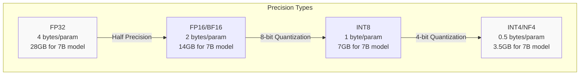
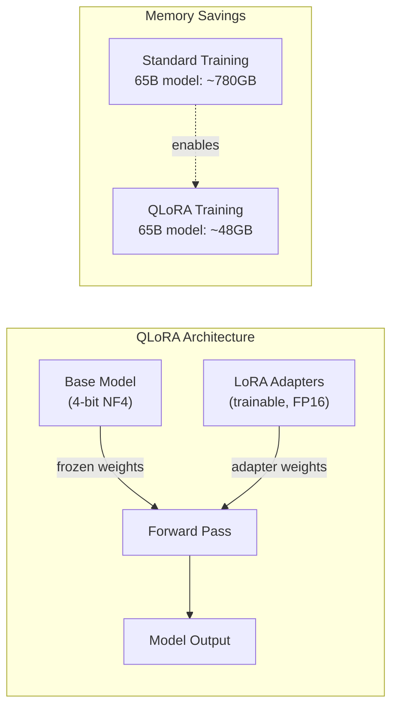
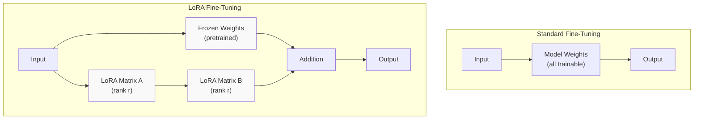
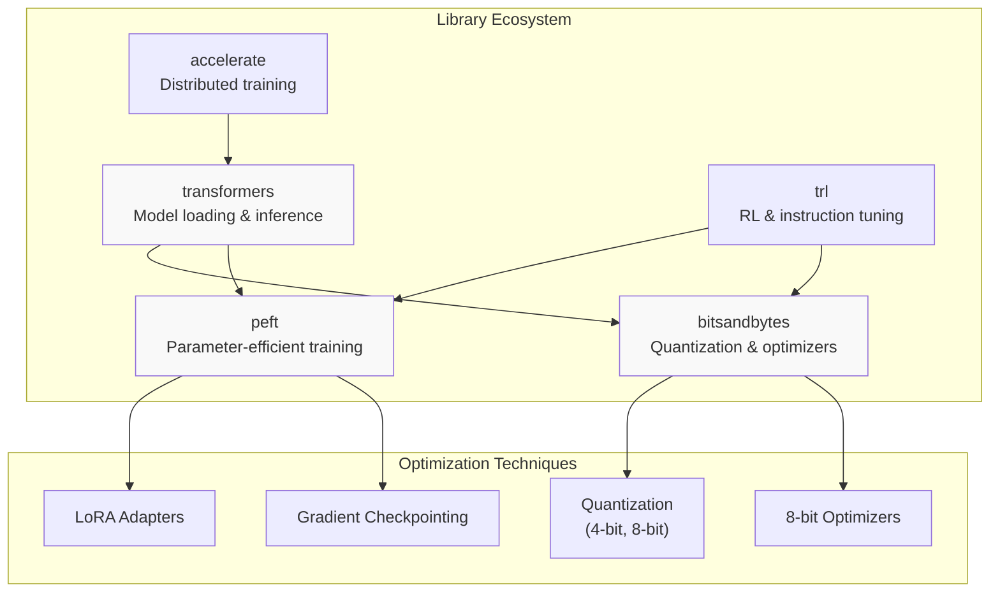

<!-- source: DeepWiki mcp.deepwiki.com · repo huggingface/blog · page 4.5 Memory Optimization · fetched 2026-10-26 -->

# Memory Optimization

<details>
<summary>Relevant source files</summary>

The following files were used as context for generating this wiki page:

- [1_58_llm_extreme_quantization.md](1_58_llm_extreme_quantization.md)
- [4bit-transformers-bitsandbytes.md](4bit-transformers-bitsandbytes.md)
- [_blog.yml](_blog.yml)
- [_events.yml](_events.yml)
- [_tags.yml](_tags.yml)
- [accelerate-deepspeed.md](accelerate-deepspeed.md)
- [assets/138_stackllama/thumbnail.png](assets/138_stackllama/thumbnail.png)
- [assets/147_falcon/falcon_thumbnail.jpg](assets/147_falcon/falcon_thumbnail.jpg)
- [assets/192_pi0/new_thumbnail_pi0.001.png](assets/192_pi0/new_thumbnail_pi0.001.png)
- [assets/193_l2d/lerobot-driver.gif](assets/193_l2d/lerobot-driver.gif)
- [assets/1_58_llm_extreme_quantization/thumbnail.png](assets/1_58_llm_extreme_quantization/thumbnail.png)
- [assets/83_accelerate_deepspeed/chatbot.png](assets/83_accelerate_deepspeed/chatbot.png)
- [assets/83_accelerate_deepspeed/cls_run.png](assets/83_accelerate_deepspeed/cls_run.png)
- [assets/83_accelerate_deepspeed/deepspeed-thumbnail.png](assets/83_accelerate_deepspeed/deepspeed-thumbnail.png)
- [assets/98_spaces_3dmoljs/thumbnail.png](assets/98_spaces_3dmoljs/thumbnail.png)
- [assets/assisted-generation/thumbnail.png](assets/assisted-generation/thumbnail.png)
- [assets/diffusion-models-event/thumbnail.png](assets/diffusion-models-event/thumbnail.png)
- [assets/inference-providers/welcome-featherless.jpg](assets/inference-providers/welcome-featherless.jpg)
- [assets/inference_pro/thumbnail.png](assets/inference_pro/thumbnail.png)
- [assets/instruction_tuning_sd/thumbnail.png](assets/instruction_tuning_sd/thumbnail.png)
- [assets/llama2/thumbnail.jpg](assets/llama2/thumbnail.jpg)
- [assets/optimum_intel/optimum_openvino_thumbnail.png](assets/optimum_intel/optimum_openvino_thumbnail.png)
- [assets/sd_dreambooth_training/thumbnail.jpg](assets/sd_dreambooth_training/thumbnail.jpg)
- [assets/streaming_datasets/streaming_datasets.png](assets/streaming_datasets/streaming_datasets.png)
- [assets/textquests/thumbnail.gif](assets/textquests/thumbnail.gif)
- [assets/trl_vlm/thumbnail.png](assets/trl_vlm/thumbnail.png)
- [assets/virustotal/thumbnail.png](assets/virustotal/thumbnail.png)
- [assets/wuerstchen/thumbnail.jpg](assets/wuerstchen/thumbnail.jpg)
- [assisted-generation.md](assisted-generation.md)
- [diffusion-models-event.md](diffusion-models-event.md)
- [dreambooth.md](dreambooth.md)
- [falcon.md](falcon.md)
- [inference-pro.md](inference-pro.md)
- [inference-providers-featherless.md](inference-providers-featherless.md)
- [instruction-tuning-sd.md](instruction-tuning-sd.md)
- [lerobot-goes-to-driving-school.md](lerobot-goes-to-driving-school.md)
- [llama2.md](llama2.md)
- [openvino-vlm.md](openvino-vlm.md)
- [pi0.md](pi0.md)
- [spaces_3dmoljs.md](spaces_3dmoljs.md)
- [stackllama.md](stackllama.md)
- [streaming-datasets.md](streaming-datasets.md)
- [textquests.md](textquests.md)
- [trl-vlm-alignment.md](trl-vlm-alignment.md)
- [virustotal.md](virustotal.md)

</details>


## Purpose and Scope

This document covers memory optimization techniques for training and deploying large language models and other transformer-based architectures. The content focuses on practical methods to reduce GPU memory consumption, including quantization, parameter-efficient fine-tuning (PEFT), gradient checkpointing, and memory-efficient optimizers. These techniques enable training models that would otherwise be impossible to fit in available hardware.

For distributed training strategies that complement memory optimization, see [Distributed Training](#4.4). For basic training setup and tokenization, see [Basic Training Techniques](#4.1). For RLHF-specific optimization, see [Reinforcement Learning from Human Feedback](#4.3).

## Memory Requirements of Large Models

Training large language models requires substantial GPU memory. The total memory footprint consists of several components:

**Memory Breakdown:**
- **Model Parameters**: 2 bytes per parameter (bfloat16/float16) or 4 bytes (float32)
- **Optimizer States**: 8 bytes per parameter for Adam (momentum and variance)
- **Gradients**: Same size as parameters (2-4 bytes per parameter)
- **Activations**: Varies by batch size, sequence length, and model architecture
- **Temporary Buffers**: For intermediate computations

For a 7B parameter model in bfloat16 with Adam optimizer:
```
Parameters: 7B × 2 bytes = 14GB
Optimizer: 7B × 8 bytes = 56GB
Gradients: 7B × 2 bytes = 14GB
Total (before activations): ~84GB
```

This exceeds the capacity of consumer GPUs and even many datacenter GPUs, making memory optimization essential.

Sources: [stackllama.md:52-54](), [falcon.md:52-64]()

## Quantization Techniques

Quantization reduces memory by representing model weights and/or activations with lower precision data types. The Hugging Face ecosystem supports several quantization methods through the `bitsandbytes` library and `transformers` integration.

### Memory Footprint Comparison



Sources: [4bit-transformers-bitsandbytes.md:36-48](), [falcon.md:44]()

### 8-bit Quantization

The `bitsandbytes` library enables loading models in 8-bit precision through the `load_in_8bit` parameter. This technique from the LLM.int8() paper reduces memory requirements by 50% while maintaining model quality.

**Implementation in Transformers:**

```python
from transformers import AutoModelForCausalLM

model = AutoModelForCausalLM.from_pretrained(
    "model_name",
    load_in_8bit=True,
    device_map="auto"
)
```

The 8-bit loading process:
1. Loads model weights in 8-bit integer format
2. Converts to float16 during forward pass for computation
3. Handles outlier features with mixed precision
4. Reduces memory by ~50% vs float16

**Memory Impact:**
- 40B parameter model: ~45GB (vs ~90GB in bfloat16)
- Fits in single A6000 (48GB) or large consumer GPUs

Sources: [falcon.md:142-169](), [llama2.md:147]()

### 4-bit Quantization and QLoRA

4-bit quantization, introduced in the QLoRA paper, further reduces memory through the NormalFloat (NF4) data type and double quantization.

**Key Innovations:**
- **NF4 (4-bit NormalFloat)**: Information-theoretically optimal for normally distributed weights
- **Double Quantization**: Quantizes the quantization constants themselves
- **Paged Optimizers**: Manages memory spikes during training



**Loading 4-bit Models:**

The `transformers` library supports 4-bit loading through the `BitsAndBytesConfig`:

```python
from transformers import AutoModelForCausalLM, BitsAndBytesConfig

bnb_config = BitsAndBytesConfig(
    load_in_4bit=True,
    bnb_4bit_quant_type="nf4",
    bnb_4bit_compute_dtype=torch.bfloat16,
    bnb_4bit_use_double_quant=True
)

model = AutoModelForCausalLM.from_pretrained(
    "meta-llama/Llama-2-7b-hf",
    quantization_config=bnb_config,
    device_map="auto"
)
```

**Configuration Parameters:**
- `load_in_4bit`: Enable 4-bit quantization
- `bnb_4bit_quant_type`: Quantization data type ("fp4" or "nf4")
- `bnb_4bit_compute_dtype`: Computation precision (bfloat16 recommended)
- `bnb_4bit_use_double_quant`: Enable double quantization for additional savings

**Memory Comparison for Different Model Sizes:**

| Model Size | FP16 | 8-bit | 4-bit |
|------------|------|-------|-------|
| 7B | 14GB | 7GB | 3.5GB |
| 13B | 26GB | 13GB | 6.5GB |
| 33B | 66GB | 33GB | 16.5GB |
| 65B | 130GB | 65GB | 32.5GB |

Sources: [4bit-transformers-bitsandbytes.md:1-20](), [falcon.md:172](), [llama2.md:155-156]()

### Extreme Quantization (1.58-bit)

Recent research has pushed quantization even further to 1.58-bit precision, dramatically reducing memory and computational requirements while maintaining reasonable performance.

**Ternary Weights:**
The 1.58-bit approach uses ternary weights {-1, 0, +1}, requiring only ~1.58 bits per parameter in practice.

**Trade-offs:**
- Massive memory reduction (>10x vs FP16)
- Requires specialized training procedures
- May need quality recovery through fine-tuning
- Suitable for deployment scenarios prioritizing efficiency

Sources: [1_58_llm_extreme_quantization.md]()

## Parameter-Efficient Fine-Tuning (PEFT)

PEFT techniques reduce memory by training only a small subset of parameters while keeping the base model frozen. The `peft` library provides a unified interface for multiple PEFT methods.

### Low-Rank Adaptation (LoRA)

LoRA adds trainable low-rank decomposition matrices to model layers, drastically reducing trainable parameters and memory requirements.



**LoRA Configuration:**

```python
from peft import LoraConfig, get_peft_model

lora_config = LoraConfig(
    r=16,                # Rank of decomposition
    lora_alpha=32,       # Scaling factor
    lora_dropout=0.05,   # Dropout probability
    bias="none",         # Bias training strategy
    task_type="CAUSAL_LM"
)

model = get_peft_model(model, lora_config)
```

**Key Parameters:**
- `r`: Rank of low-rank matrices (typically 8-64)
- `lora_alpha`: Scaling parameter (often 2×r)
- `target_modules`: Which layers to adapt (defaults to attention layers)
- `lora_dropout`: Regularization

**Trainable Parameters Reduction:**

For a 7B model with LoRA (r=16):
- Original parameters: 7B
- LoRA parameters: ~4M (0.05%)
- Memory for gradients/optimizer: ~40MB vs ~56GB

Sources: [stackllama.md:56-111](), [falcon.md:240-303]()

### Integration with Quantization (QLoRA)

QLoRA combines 4-bit quantization with LoRA for extreme memory efficiency. The base model is loaded in 4-bit while LoRA adapters remain in higher precision.

```python
from transformers import AutoModelForCausalLM, BitsAndBytesConfig
from peft import prepare_model_for_kbit_training, LoraConfig, get_peft_model

# Load base model in 4-bit
bnb_config = BitsAndBytesConfig(
    load_in_4bit=True,
    bnb_4bit_quant_type="nf4",
    bnb_4bit_compute_dtype=torch.bfloat16
)

model = AutoModelForCausalLM.from_pretrained(
    "meta-llama/Llama-2-7b-hf",
    quantization_config=bnb_config,
    device_map="auto"
)

# Prepare for training
model = prepare_model_for_kbit_training(model)

# Add LoRA adapters
lora_config = LoraConfig(
    r=16,
    lora_alpha=32,
    target_modules=["q_proj", "v_proj"],
    lora_dropout=0.05,
    bias="none",
    task_type="CAUSAL_LM"
)

model = get_peft_model(model, lora_config)
```

**Training Example:**

The workflow combines model loading, adapter configuration, and training:

1. Load base model in 4-bit
2. Prepare for k-bit training (enables gradient checkpointing)
3. Add LoRA adapters
4. Train with standard `Trainer`

Sources: [stackllama.md:88-111](), [falcon.md:260-303](), [llama2.md:153-176]()

## Gradient Checkpointing

Gradient checkpointing (also called activation checkpointing) trades computation for memory by not storing all intermediate activations during the forward pass. Instead, activations are recomputed during the backward pass when needed.

**Memory Savings:**
- Reduces activation memory from O(n) to O(√n) for n layers
- Increases training time by ~20-30%
- Essential for training with long sequences or large batch sizes

**Activation with peft:**

```python
from peft import prepare_model_for_kbit_training

# Automatically enables gradient checkpointing for quantized models
model = prepare_model_for_kbit_training(model)
```

**Manual Activation:**

```python
model.gradient_checkpointing_enable()
```

The technique is particularly effective when combined with quantization and LoRA, enabling training of models like 65B Llama on a single 48GB GPU.

Sources: [stackllama.md:88](), [falcon.md:245]()

## Memory-Efficient Optimizers

Standard optimizers like Adam store momentum and variance for each parameter, requiring 8 bytes per parameter. Memory-efficient alternatives reduce this overhead.

### 8-bit Adam Optimizer

The `bitsandbytes` library provides 8-bit Adam (`AdamW8bit`) which quantizes optimizer states:

```python
import bitsandbytes as bnb

optimizer = bnb.optim.AdamW8bit(
    model.parameters(),
    lr=1e-4,
    betas=(0.9, 0.999)
)
```

**Memory Savings:**
- Standard Adam: 8 bytes per parameter
- 8-bit Adam: ~2 bytes per parameter
- For 7B model: 56GB → 14GB optimizer state

### Paged Optimizers

QLoRA introduces paged optimizers that handle memory spikes by using unified memory with automatic page-to-page transfers between CPU and GPU:

```python
from bitsandbytes.optim import PagedAdamW8bit

optimizer = PagedAdamW8bit(
    model.parameters(),
    lr=1e-4
)
```

This prevents out-of-memory errors during gradient accumulation or when processing variable-length sequences.

Sources: [stackllama.md:52-54](), [4bit-transformers-bitsandbytes.md:19-20]()

## Hugging Face Ecosystem Integration

Memory optimization techniques are integrated across multiple Hugging Face libraries, providing a cohesive workflow.



### Training Pipeline Example

Complete training setup combining multiple memory optimization techniques:

```python
from transformers import AutoModelForCausalLM, BitsAndBytesConfig, TrainingArguments
from peft import prepare_model_for_kbit_training, LoraConfig, get_peft_model
from trl import SFTTrainer

# 1. Quantization config
bnb_config = BitsAndBytesConfig(
    load_in_4bit=True,
    bnb_4bit_quant_type="nf4",
    bnb_4bit_compute_dtype=torch.bfloat16,
    bnb_4bit_use_double_quant=True
)

# 2. Load model in 4-bit
model = AutoModelForCausalLM.from_pretrained(
    "meta-llama/Llama-2-7b-hf",
    quantization_config=bnb_config,
    device_map="auto"
)

# 3. Prepare for k-bit training (enables gradient checkpointing)
model = prepare_model_for_kbit_training(model)

# 4. Configure LoRA
lora_config = LoraConfig(
    r=16,
    lora_alpha=32,
    target_modules=["q_proj", "k_proj", "v_proj", "o_proj"],
    lora_dropout=0.05,
    bias="none",
    task_type="CAUSAL_LM"
)

# 5. Add LoRA adapters
model = get_peft_model(model, lora_config)

# 6. Training arguments with memory optimizations
training_args = TrainingArguments(
    output_dir="./results",
    per_device_train_batch_size=4,
    gradient_accumulation_steps=4,
    optim="paged_adamw_8bit",  # Memory-efficient optimizer
    fp16=True,
    max_grad_norm=0.3,
    warmup_ratio=0.03,
    lr_scheduler_type="constant"
)

# 7. Train
trainer = SFTTrainer(
    model=model,
    args=training_args,
    train_dataset=dataset
)

trainer.train()
```

**Memory Breakdown for 7B Model:**
- Base model (4-bit): ~3.5GB
- LoRA adapters: ~40MB
- Optimizer state (8-bit): ~40MB
- Gradients: ~40MB
- Activations (with checkpointing): ~2-4GB
- **Total: ~6-8GB** (vs ~84GB without optimizations)

This enables training on consumer GPUs like RTX 3090 (24GB) or even Google Colab free tier.

Sources: [falcon.md:260-303](), [llama2.md:153-176](), [stackllama.md:56-111]()

### Inference Optimizations

Memory optimization for inference follows similar principles but with different trade-offs:

```python
# Inference with 4-bit quantization
model = AutoModelForCausalLM.from_pretrained(
    "meta-llama/Llama-2-7b-hf",
    load_in_4bit=True,
    device_map="auto"
)

# Generate with reduced memory
outputs = model.generate(
    inputs,
    max_new_tokens=200,
    use_cache=True,  # KV cache for faster generation
    do_sample=True
)
```

**KV Cache Considerations:**
- Standard attention: Stores K,V for all tokens (large memory)
- Multi-query attention (Falcon): Shares K,V across heads (10-100x smaller cache)
- For Falcon-7B: ~20MB vs ~1,100MB for standard attention

Sources: [falcon.md:50-56](), [llama2.md:77-152]()

## Best Practices and Recommendations

### Choosing Quantization Level

| Scenario | Recommendation | Memory Savings | Quality Impact |
|----------|---------------|----------------|----------------|
| Inference only, quality critical | 8-bit or FP16 | 50% | Minimal |
| Inference, memory constrained | 4-bit NF4 | 75% | Small |
| Fine-tuning, large model | 4-bit + QLoRA | 75%+ | Minimal with proper tuning |
| Research/experimentation | FP16/BF16 | None | None |
| Extreme deployment constraints | 1.58-bit | 90%+ | Moderate, needs fine-tuning |

### Training Configuration Guidelines

1. **Start with 8-bit** for initial experiments
2. **Use 4-bit + LoRA** for production fine-tuning of large models
3. **Enable gradient checkpointing** when training with long sequences
4. **Use paged optimizers** to handle memory spikes
5. **Monitor GPU memory** with `torch.cuda.max_memory_allocated()`

### Common Pitfalls

- **Mixing precisions incorrectly**: Ensure compute dtype matches model requirements
- **Insufficient LoRA rank**: Start with r=16, increase if underfitting
- **Forgetting device_map**: Use `device_map="auto"` for multi-GPU setups
- **Cache mismanagement**: Clear GPU cache between runs in notebooks

Sources: [falcon.md:240-303](), [4bit-transformers-bitsandbytes.md]()

## Performance Benchmarks

Comparative training speeds and memory usage across configurations:

| Configuration | 7B Model Memory | Training Speed | Quality |
|---------------|----------------|----------------|---------|
| FP16 Full Fine-tune | 84GB+ | 1.0x (baseline) | 100% |
| 8-bit Full Fine-tune | 45GB | 0.95x | 99.5% |
| 4-bit + LoRA (QLoRA) | 6-8GB | 0.85x | 99%+ |
| 8-bit + LoRA | 10-12GB | 0.90x | 99%+ |

*Speed measurements relative to FP16 baseline; actual performance varies by hardware*

The memory savings enable previously impossible configurations, such as:
- 65B model training on single 48GB GPU
- 7B model training on Google Colab free tier (16GB)
- 33B model fine-tuning on consumer GPUs (24GB)

Sources: [stackllama.md](), [falcon.md](), [4bit-transformers-bitsandbytes.md]()

---

