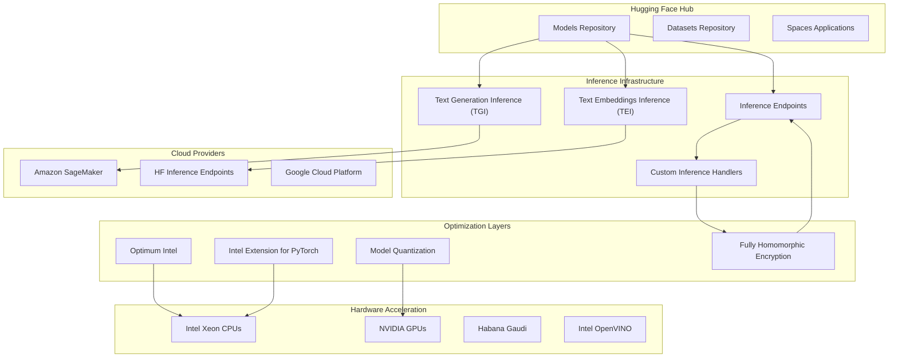
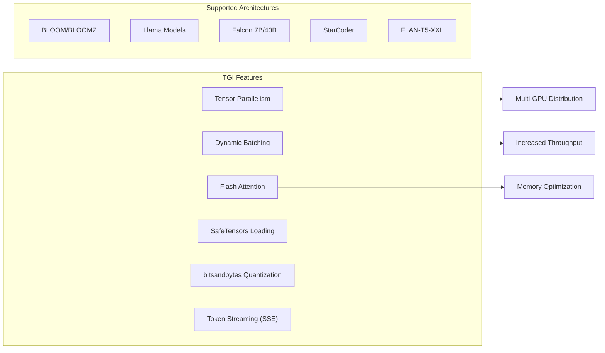
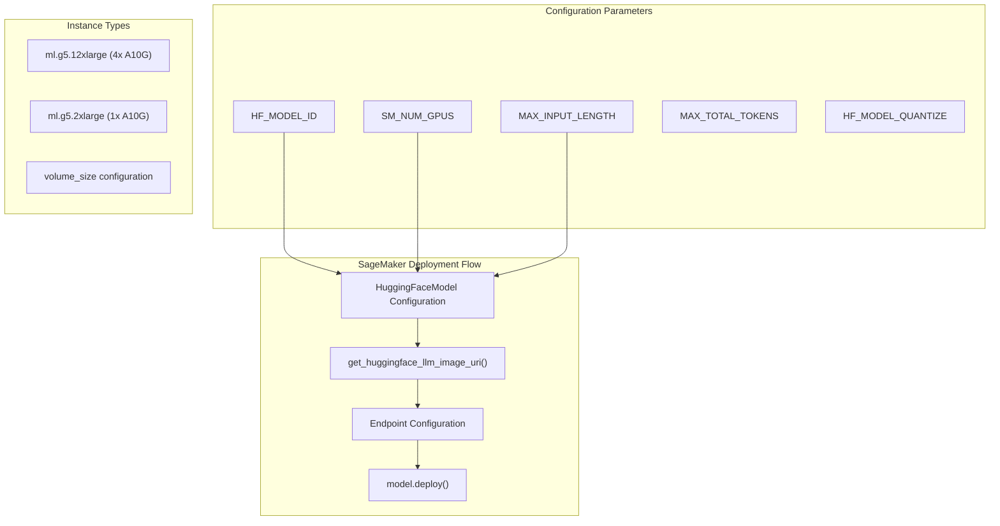
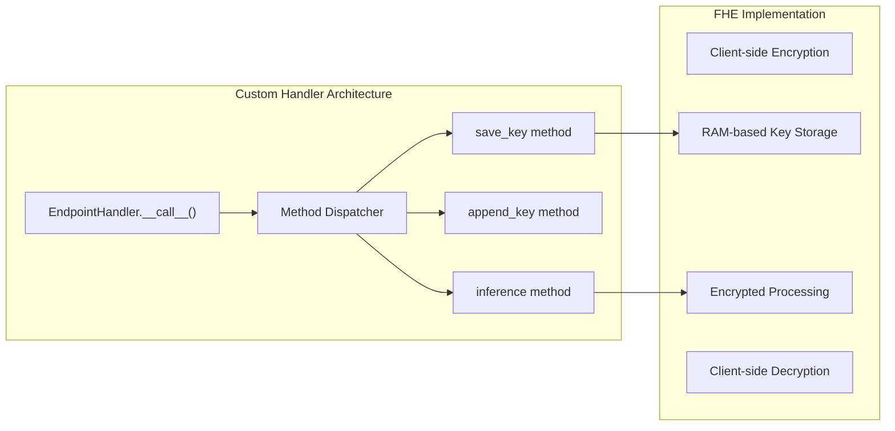
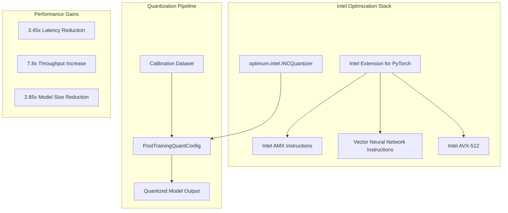
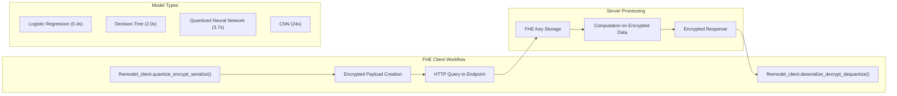
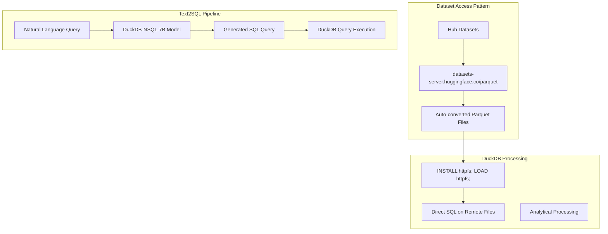
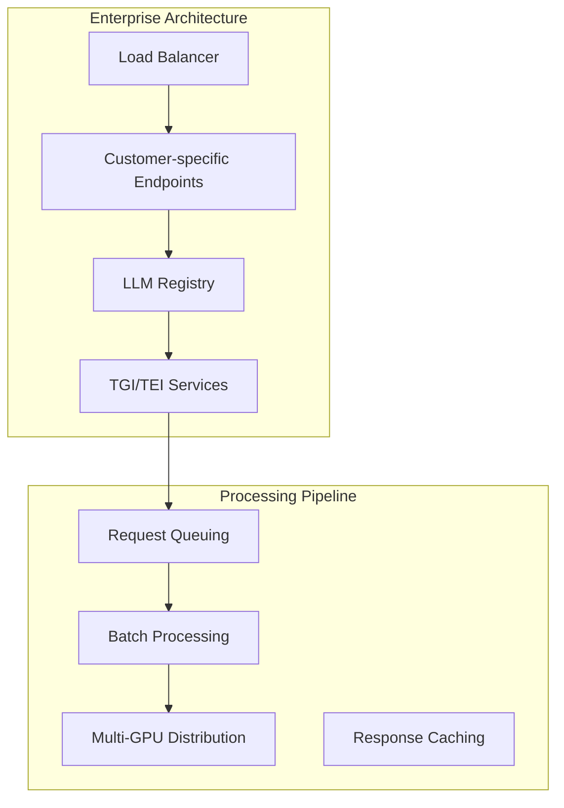

<!-- source: DeepWiki mcp.deepwiki.com · repo huggingface/blog · page 5 Model Deployment and Inference · fetched 2026-10-26 -->

# Model Deployment

Relevant source files

The following files were used as context for generating this wiki page:

- [1b-sentence-embeddings.md](1b-sentence-embeddings.md)
- [README.md](README.md)
- [accelerated-inference.md](accelerated-inference.md)
- [assets/114_pricing-update/thumbnail.png](assets/114_pricing-update/thumbnail.png)
- [assets/17_the_partnership_amazon_sagemaker_and_hugging_face/cover.png](assets/17_the_partnership_amazon_sagemaker_and_hugging_face/cover.png)
- [assets/17_the_partnership_amazon_sagemaker_and_hugging_face/thumbnail.png](assets/17_the_partnership_amazon_sagemaker_and_hugging_face/thumbnail.png)
- [assets/25_hardware_partners_program/carbon_inc_quantizer.png](assets/25_hardware_partners_program/carbon_inc_quantizer.png)
- [assets/45_gptj_sagemaker/model_load_time.png](assets/45_gptj_sagemaker/model_load_time.png)
- [assets/45_gptj_sagemaker/thumbnail.png](assets/45_gptj_sagemaker/thumbnail.png)
- [assets/46_infinity_cpu_performance/latency.png](assets/46_infinity_cpu_performance/latency.png)
- [assets/46_infinity_cpu_performance/overview.png](assets/46_infinity_cpu_performance/overview.png)
- [assets/46_infinity_cpu_performance/pipeline.png](assets/46_infinity_cpu_performance/pipeline.png)
- [assets/46_infinity_cpu_performance/throughput.png](assets/46_infinity_cpu_performance/throughput.png)
- [assets/46_infinity_cpu_performance/thumbnail.png](assets/46_infinity_cpu_performance/thumbnail.png)
- [assets/deploy-with-openvino/demo.gif](assets/deploy-with-openvino/demo.gif)
- [assets/deploy-with-openvino/openvino_genai_workflow.png](assets/deploy-with-openvino/openvino_genai_workflow.png)
- [assets/galore_introduction/thumbnail.png](assets/galore_introduction/thumbnail.png)
- [assets/leaderboards-on-the-hub/thumbnail_flageval.png](assets/leaderboards-on-the-hub/thumbnail_flageval.png)
- [assets/thumbnail-template.svg](assets/thumbnail-template.svg)
- [bert-cpu-scaling-part-2.md](bert-cpu-scaling-part-2.md)
- [community-update.md](community-update.md)
- [debate.md](debate.md)
- [deploy-hugging-face-models-easily-with-amazon-sagemaker.md](deploy-hugging-face-models-easily-with-amazon-sagemaker.md)
- [deploy-with-openvino.md](deploy-with-openvino.md)
- [few-shot-learning-gpt-neo-and-inference-api.md](few-shot-learning-gpt-neo-and-inference-api.md)
- [fr/_blog.yml](fr/_blog.yml)
- [galore.md](galore.md)
- [gptj-sagemaker.md](gptj-sagemaker.md)
- [hardware-partners-program.md](hardware-partners-program.md)
- [infinity-cpu-performance.md](infinity-cpu-performance.md)
- [pricing-update.md](pricing-update.md)
- [sentence-transformers-in-the-hub.md](sentence-transformers-in-the-hub.md)
- [the-partnership-amazon-sagemaker-and-hugging-face.md](the-partnership-amazon-sagemaker-and-hugging-face.md)

This document covers the comprehensive model deployment infrastructure and strategies utilized in the Hugging Face ecosystem, as documented through various blog posts and tutorials. It focuses on production-ready deployment patterns, optimization techniques, and integration approaches for deploying machine learning models at scale.

For information about model training and optimization prior to deployment, see [Model Training and Optimization](#4). For details about specialized models and their deployment considerations, see [Specialized Models](#6).

## Deployment Architecture Overview

The Hugging Face ecosystem provides multiple deployment pathways, each optimized for different use cases and infrastructure requirements. The architecture spans cloud providers, specialized hardware, and privacy-preserving inference methods.

Sources: [sagemaker-huggingface-llm.md:24-51](), [fhe-endpoints.md:14-18](), [setfit-optimum-intel.md:39-43]()

## Core Inference Components

The deployment ecosystem is built around several key inference components that provide the foundation for model serving across different environments.

### Text Generation Inference (TGI)

`TGI` serves as the primary engine for deploying Large Language Models with optimized performance characteristics:

Sources: [sagemaker-huggingface-llm.md:26-50]()

### Text Embeddings Inference (TEI)

`TEI` provides optimized serving for embedding models with specific focus on performance and scalability:

- Faster inference speeds compared to proprietary alternatives
- Support for fine-tuned embedding models
- Elimination of rate limiting concerns
- Integration with retrieval-augmented generation (RAG) systems

Sources: [ryght-case-study.md:52-53]()

## Cloud Deployment Patterns

### Amazon SageMaker Integration

The `HuggingFaceModel` class provides the primary interface for deploying models to SageMaker using the Hugging Face LLM Deep Learning Container (DLC).

Sources: [sagemaker-huggingface-llm.md:91-151]()

### Inference Endpoints with Custom Handlers

Custom inference handlers enable specialized deployment patterns, particularly for privacy-preserving and domain-specific inference.

Sources: [fhe-endpoints.md:166-167]()

## Hardware Optimization and Acceleration

### Intel CPU Optimizations

The `Optimum Intel` library provides comprehensive CPU optimization through multiple layers:

Sources: [setfit-optimum-intel.md:82-96](), [setfit-optimum-intel.md:175-190]()

### Quantization Workflow

The quantization process follows a structured pipeline for model optimization:

1. **Calibration Dataset Preparation**: Load representative samples using `datasets.load_dataset()`
2. **Tokenization**: Apply model tokenizer with padding and truncation
3. **Quantization Configuration**: Define `PostTrainingQuantConfig` with static approach
4. **Model Processing**: Execute `quantizer.quantize()` with calibration data
5. **Performance Validation**: Benchmark against baseline using `PerformanceBenchmark`

Sources: [setfit-optimum-intel.md:67-96]()

## Security and Privacy-Preserving Deployment

### Fully Homomorphic Encryption (FHE)

FHE deployment enables computation on encrypted data without revealing the underlying information:

Sources: [fhe-endpoints.md:122-159](), [fhe-endpoints.md:190-196]()

## Data Integration and Analysis Deployment

### DuckDB Integration

DuckDB provides analytical capabilities directly on Hub datasets through parquet file access:

Sources: [hub-duckdb.md:24-33](), [duckdb-nsql-7b.md:118-184]()

## Enterprise Deployment Considerations

### Production Architecture Patterns

Enterprise deployments require specific architectural considerations for scalability, security, and multi-tenancy:

- **Multi-customer isolation**: Customer-specific inference endpoints
- **High-volume processing**: Batching, queuing, and GPU distribution
- **Security requirements**: Private model hosting and data isolation
- **Performance optimization**: Low-latency inference with high throughput

Sources: [ryght-case-study.md:46-55]()

## Performance Benchmarking and Monitoring

Deployment performance is measured across multiple dimensions using structured benchmarking approaches:

| Metric | Measurement Approach | Tools Used |
|--------|---------------------|------------|
| Latency | Single request response time | `PerformanceBenchmark` class |
| Throughput | Requests per second at various batch sizes | Batch processing analysis |
| Model Size | Memory footprint reduction | Model compression metrics |
| Accuracy | Inference quality preservation | Dataset-specific evaluation |

The `PerformanceBenchmark` class provides standardized measurement capabilities across different optimization approaches, enabling direct comparison between baseline and optimized deployments.

Sources: [setfit-optimum-intel.md:103-164]()

---

