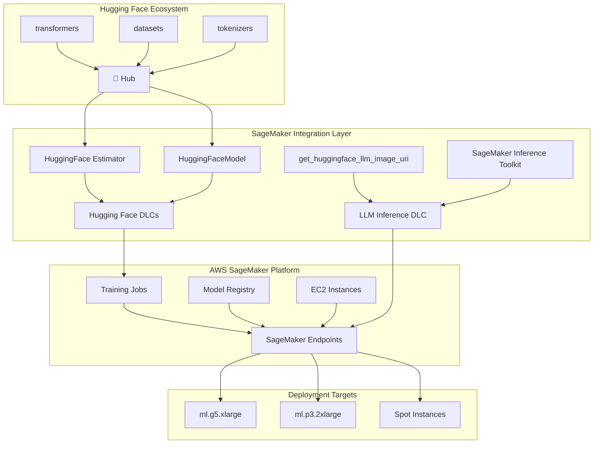
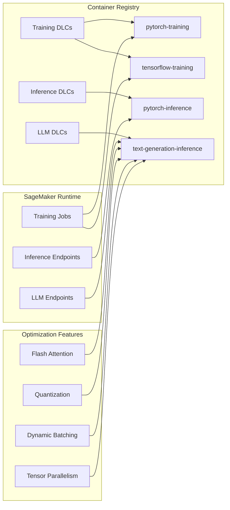
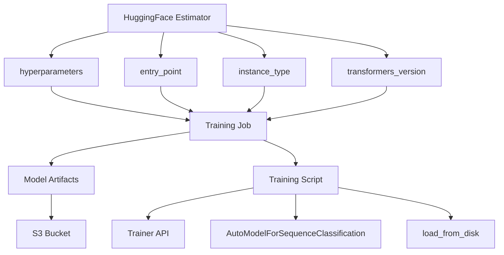
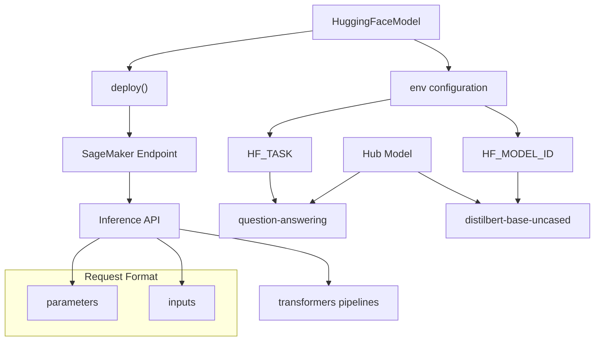
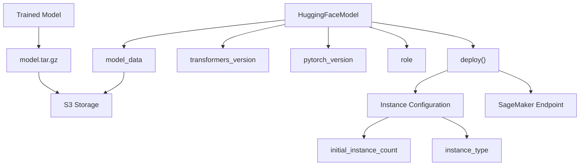
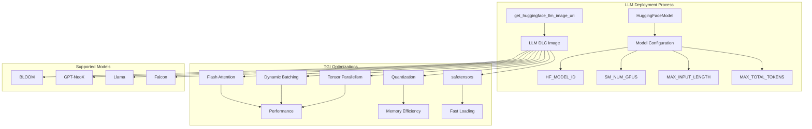
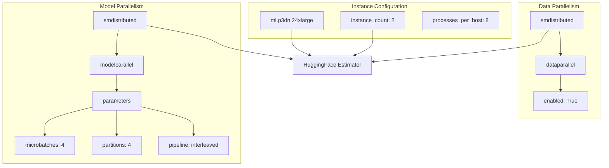
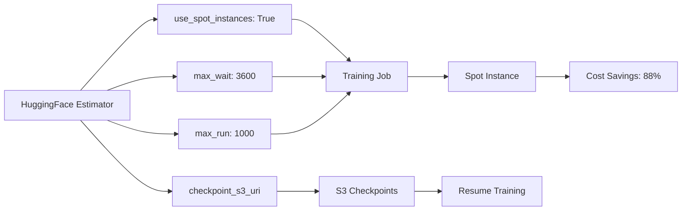
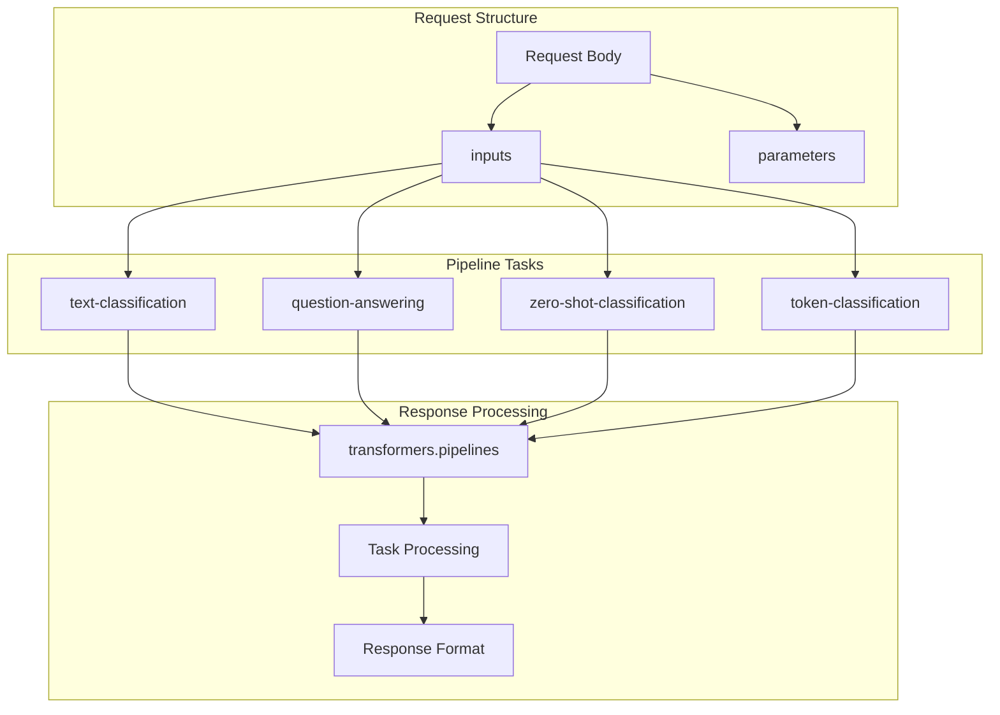

<!-- source: DeepWiki mcp.deepwiki.com · repo huggingface/blog · page 5.1 Cloud Provider Integrations · fetched 2026-10-26 -->

# Cloud Provider Integrations

Relevant source files

The following files were used as context for generating this wiki page:

- [1b-sentence-embeddings.md](1b-sentence-embeddings.md)
- [accelerated-inference.md](accelerated-inference.md)
- [assets/17_the_partnership_amazon_sagemaker_and_hugging_face/cover.png](assets/17_the_partnership_amazon_sagemaker_and_hugging_face/cover.png)
- [assets/17_the_partnership_amazon_sagemaker_and_hugging_face/thumbnail.png](assets/17_the_partnership_amazon_sagemaker_and_hugging_face/thumbnail.png)
- [assets/25_hardware_partners_program/carbon_inc_quantizer.png](assets/25_hardware_partners_program/carbon_inc_quantizer.png)
- [assets/deploy-with-openvino/demo.gif](assets/deploy-with-openvino/demo.gif)
- [assets/deploy-with-openvino/openvino_genai_workflow.png](assets/deploy-with-openvino/openvino_genai_workflow.png)
- [assets/galore_introduction/thumbnail.png](assets/galore_introduction/thumbnail.png)
- [assets/gemma/Gemma-logo-small.png](assets/gemma/Gemma-logo-small.png)
- [assets/gemma/gcp-deploy.png](assets/gemma/gcp-deploy.png)
- [assets/gemma/gcp-train-gemma.png](assets/gemma/gcp-train-gemma.png)
- [assets/gemma/thumbnail.jpg](assets/gemma/thumbnail.jpg)
- [assets/leaderboards-on-the-hub/thumbnail_flageval.png](assets/leaderboards-on-the-hub/thumbnail_flageval.png)
- [assets/llama3/thumbnail.jpg](assets/llama3/thumbnail.jpg)
- [assets/mixtral/thumbnail.jpg](assets/mixtral/thumbnail.jpg)
- [bert-cpu-scaling-part-2.md](bert-cpu-scaling-part-2.md)
- [community-update.md](community-update.md)
- [debate.md](debate.md)
- [deploy-hugging-face-models-easily-with-amazon-sagemaker.md](deploy-hugging-face-models-easily-with-amazon-sagemaker.md)
- [deploy-with-openvino.md](deploy-with-openvino.md)
- [few-shot-learning-gpt-neo-and-inference-api.md](few-shot-learning-gpt-neo-and-inference-api.md)
- [fr/_blog.yml](fr/_blog.yml)
- [galore.md](galore.md)
- [gemma.md](gemma.md)
- [hardware-partners-program.md](hardware-partners-program.md)
- [llama3.md](llama3.md)
- [mixtral.md](mixtral.md)
- [sentence-transformers-in-the-hub.md](sentence-transformers-in-the-hub.md)
- [the-partnership-amazon-sagemaker-and-hugging-face.md](the-partnership-amazon-sagemaker-and-hugging-face.md)
- [zh/Llama2-for-non-engineers.md](zh/Llama2-for-non-engineers.md)
- [zh/gemma.md](zh/gemma.md)
- [zh/huggy-lingo.md](zh/huggy-lingo.md)
- [zh/llama3.md](zh/llama3.md)
- [zh/mixtral.md](zh/mixtral.md)

This document covers the integration patterns and deployment architectures for deploying Hugging Face models on major cloud platforms. The primary focus is on Amazon Web Services (AWS) SageMaker integration, which represents the most comprehensive cloud provider partnership in the Hugging Face ecosystem.

For information about model training optimization techniques, see [Model Training and Optimization](#4). For hardware-specific acceleration, see [Hardware Acceleration](#5.3).

## Amazon SageMaker Integration Architecture

The Hugging Face-SageMaker integration provides a comprehensive platform for both training and inference of transformer models through specialized Deep Learning Containers (DLCs) and SDK extensions.

### Core Integration Components

**Sources:** [sagemaker-huggingface-llm.md:89-104](), [the-partnership-amazon-sagemaker-and-hugging-face.md:16-17](), [deploy-hugging-face-models-easily-with-amazon-sagemaker.md:63-68]()

### Hugging Face Deep Learning Containers

The integration utilizes specialized container images optimized for different frameworks and use cases:

| Container Type | Framework | Use Case | Key Features |
|---|---|---|---|
| Training DLC | PyTorch/TensorFlow | Model Training | Distributed training, automatic scaling |
| Inference DLC | PyTorch | Model Serving | TGI optimization, batching |
| LLM Inference DLC | PyTorch | Large Model Serving | Text Generation Inference, quantization |

**Sources:** [sagemaker-huggingface-llm.md:24-38](), [the-partnership-amazon-sagemaker-and-hugging-face.md:42-43]()

## Deployment Workflows

### Model Training Integration

The `HuggingFace` estimator class provides the primary interface for training Hugging Face models on SageMaker:

**Sources:** [the-partnership-amazon-sagemaker-and-hugging-face.md:138-146](), [the-partnership-amazon-sagemaker-and-hugging-face.md:299-331]()

### Model Inference Deployment

The deployment process utilizes the `HuggingFaceModel` class for both Hub models and custom trained models:

#### Hub Model Deployment

**Sources:** [deploy-hugging-face-models-easily-with-amazon-sagemaker.md:220-258](), [deploy-hugging-face-models-easily-with-amazon-sagemaker.md:70-98]()

#### Custom Model Deployment

**Sources:** [deploy-hugging-face-models-easily-with-amazon-sagemaker.md:183-206]()

## Large Language Model Inference

### LLM Container Architecture

The specialized LLM inference container is powered by Text Generation Inference (TGI) and provides optimized serving for large language models:

**Sources:** [sagemaker-huggingface-llm.md:89-104](), [sagemaker-huggingface-llm.md:124-139]()

### LLM Configuration Parameters

The LLM deployment supports extensive configuration through environment variables:

| Parameter | Purpose | Example Value |
|---|---|---|
| `HF_MODEL_ID` | Model identifier from Hub | `"OpenAssistant/pythia-12b-sft-v8-7k-steps"` |
| `SM_NUM_GPUS` | GPU count for tensor parallelism | `json.dumps(4)` |
| `MAX_INPUT_LENGTH` | Maximum input token length | `json.dumps(1024)` |
| `MAX_TOTAL_TOKENS` | Maximum generation length | `json.dumps(2048)` |
| `HF_MODEL_QUANTIZE` | Quantization method | `"bitsandbytes"` |

**Sources:** [sagemaker-huggingface-llm.md:124-131]()

## Advanced Integration Features

### Distributed Training Support

**Sources:** [the-partnership-amazon-sagemaker-and-hugging-face.md:346-370](), [the-partnership-amazon-sagemaker-and-hugging-face.md:384-421]()

### Spot Instance Integration

Cost optimization through managed spot training with checkpointing support:

**Sources:** [the-partnership-amazon-sagemaker-and-hugging-face.md:423-461]()

### Inference API Specification

The inference toolkit provides a unified API compatible with Hugging Face pipelines:

**Sources:** [deploy-hugging-face-models-easily-with-amazon-sagemaker.md:70-98]()

This integration architecture enables seamless deployment of Hugging Face models on AWS infrastructure while maintaining compatibility with the broader Hugging Face ecosystem and providing enterprise-grade features for production workloads.

---

