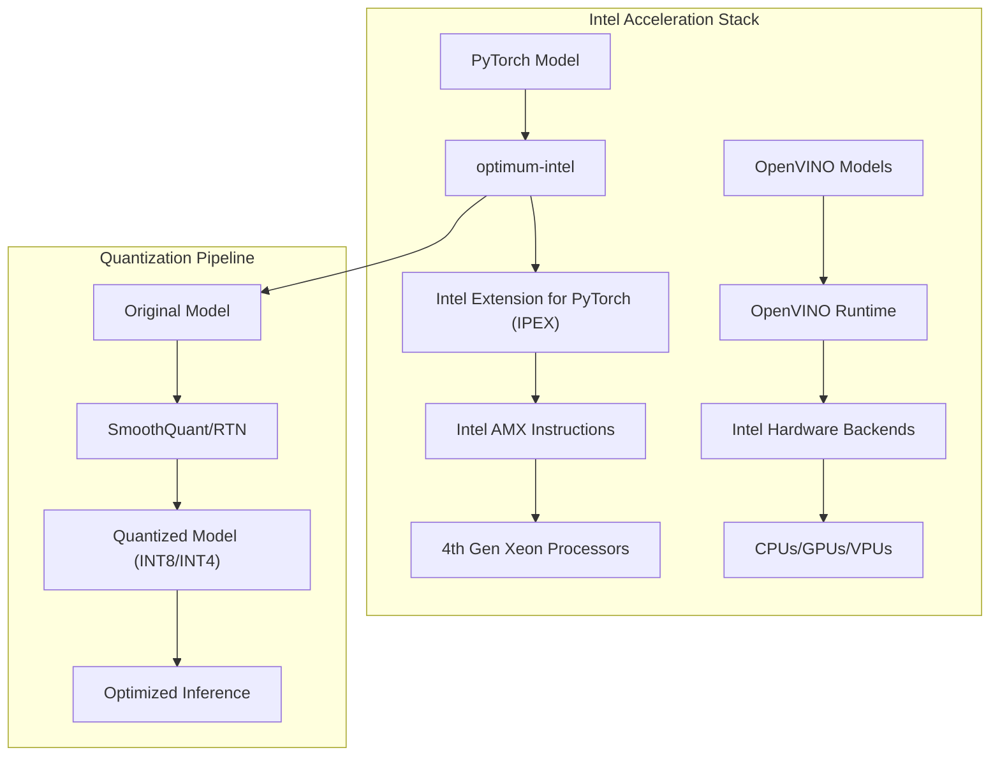
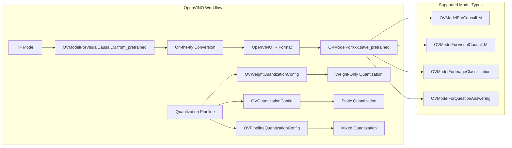
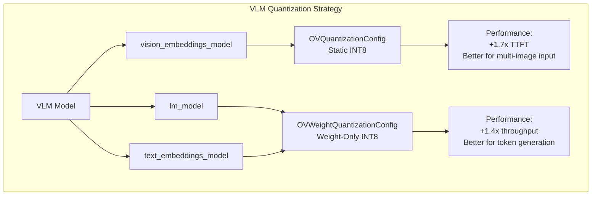
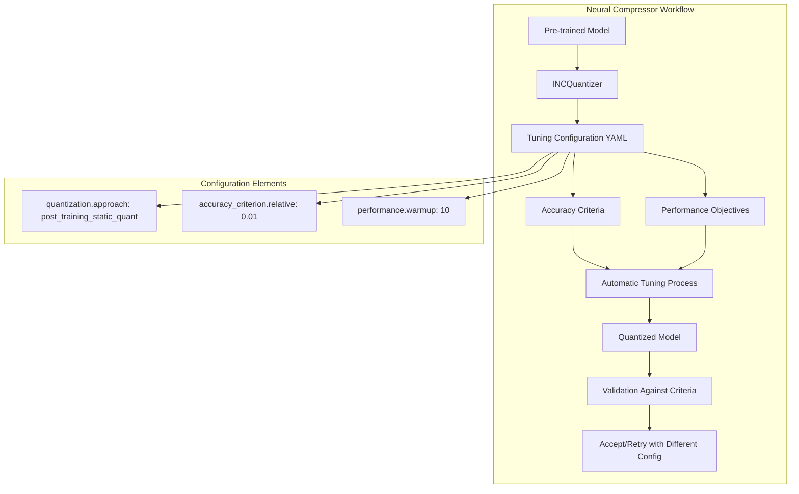
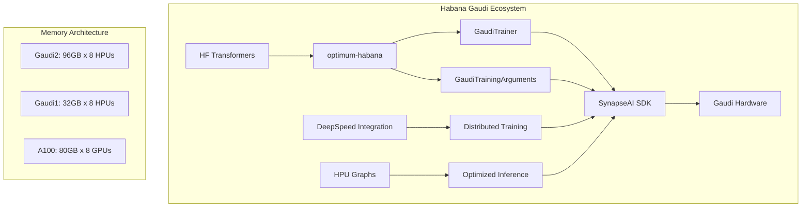
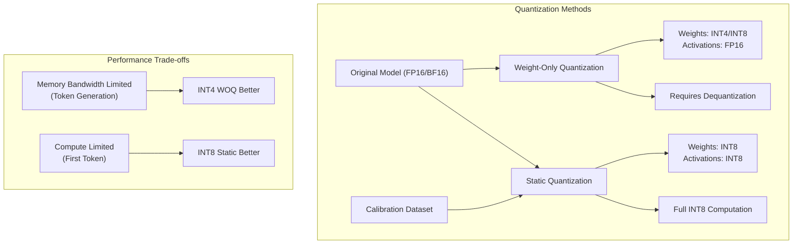
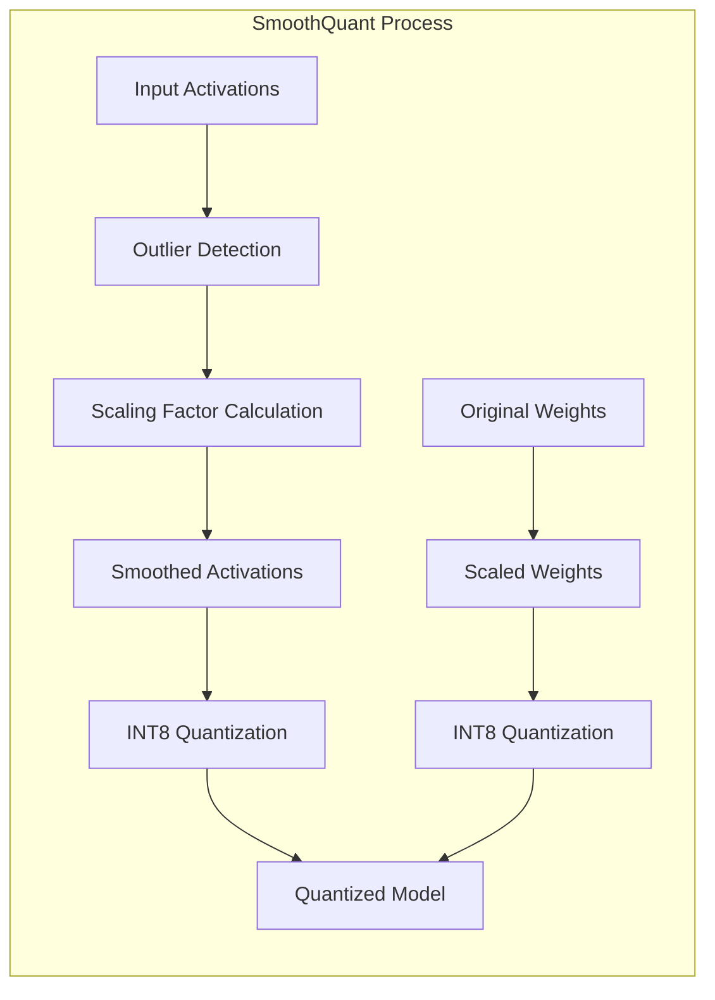
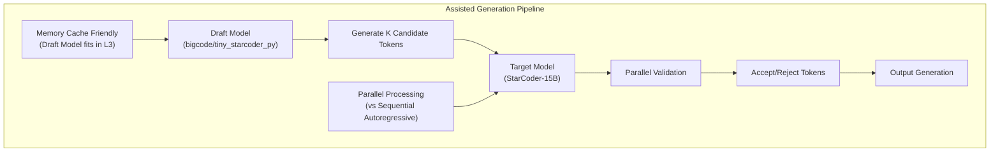
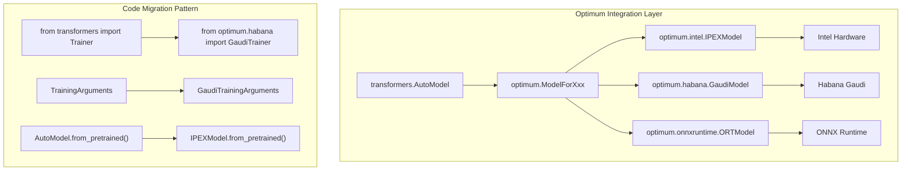

<!-- source: DeepWiki mcp.deepwiki.com · repo huggingface/blog · page 5.2 Hardware Acceleration · fetched 2026-10-26 -->

# Hardware Acceleration

<details>
<summary>Relevant source files</summary>

The following files were used as context for generating this wiki page:

- [1_58_llm_extreme_quantization.md](1_58_llm_extreme_quantization.md)
- [1b-sentence-embeddings.md](1b-sentence-embeddings.md)
- [_blog.yml](_blog.yml)
- [_tags.yml](_tags.yml)
- [accelerated-inference.md](accelerated-inference.md)
- [assets/17_the_partnership_amazon_sagemaker_and_hugging_face/cover.png](assets/17_the_partnership_amazon_sagemaker_and_hugging_face/cover.png)
- [assets/17_the_partnership_amazon_sagemaker_and_hugging_face/thumbnail.png](assets/17_the_partnership_amazon_sagemaker_and_hugging_face/thumbnail.png)
- [assets/192_pi0/new_thumbnail_pi0.001.png](assets/192_pi0/new_thumbnail_pi0.001.png)
- [assets/193_l2d/lerobot-driver.gif](assets/193_l2d/lerobot-driver.gif)
- [assets/1_58_llm_extreme_quantization/thumbnail.png](assets/1_58_llm_extreme_quantization/thumbnail.png)
- [assets/25_hardware_partners_program/carbon_inc_quantizer.png](assets/25_hardware_partners_program/carbon_inc_quantizer.png)
- [assets/deploy-with-openvino/demo.gif](assets/deploy-with-openvino/demo.gif)
- [assets/deploy-with-openvino/openvino_genai_workflow.png](assets/deploy-with-openvino/openvino_genai_workflow.png)
- [assets/galore_introduction/thumbnail.png](assets/galore_introduction/thumbnail.png)
- [assets/inference-providers/welcome-featherless.jpg](assets/inference-providers/welcome-featherless.jpg)
- [assets/leaderboards-on-the-hub/thumbnail_flageval.png](assets/leaderboards-on-the-hub/thumbnail_flageval.png)
- [assets/optimum_intel/optimum_openvino_thumbnail.png](assets/optimum_intel/optimum_openvino_thumbnail.png)
- [assets/sd_dreambooth_training/thumbnail.jpg](assets/sd_dreambooth_training/thumbnail.jpg)
- [assets/streaming_datasets/streaming_datasets.png](assets/streaming_datasets/streaming_datasets.png)
- [assets/textquests/thumbnail.gif](assets/textquests/thumbnail.gif)
- [assets/trl_vlm/thumbnail.png](assets/trl_vlm/thumbnail.png)
- [assets/virustotal/thumbnail.png](assets/virustotal/thumbnail.png)
- [assets/wuerstchen/thumbnail.jpg](assets/wuerstchen/thumbnail.jpg)
- [bert-cpu-scaling-part-2.md](bert-cpu-scaling-part-2.md)
- [community-update.md](community-update.md)
- [debate.md](debate.md)
- [deploy-hugging-face-models-easily-with-amazon-sagemaker.md](deploy-hugging-face-models-easily-with-amazon-sagemaker.md)
- [deploy-with-openvino.md](deploy-with-openvino.md)
- [dreambooth.md](dreambooth.md)
- [few-shot-learning-gpt-neo-and-inference-api.md](few-shot-learning-gpt-neo-and-inference-api.md)
- [fr/_blog.yml](fr/_blog.yml)
- [galore.md](galore.md)
- [hardware-partners-program.md](hardware-partners-program.md)
- [inference-providers-featherless.md](inference-providers-featherless.md)
- [lerobot-goes-to-driving-school.md](lerobot-goes-to-driving-school.md)
- [openvino-vlm.md](openvino-vlm.md)
- [pi0.md](pi0.md)
- [sentence-transformers-in-the-hub.md](sentence-transformers-in-the-hub.md)
- [streaming-datasets.md](streaming-datasets.md)
- [textquests.md](textquests.md)
- [the-partnership-amazon-sagemaker-and-hugging-face.md](the-partnership-amazon-sagemaker-and-hugging-face.md)
- [trl-vlm-alignment.md](trl-vlm-alignment.md)
- [virustotal.md](virustotal.md)

</details>


This section covers hardware acceleration techniques and platforms integrated with the Hugging Face ecosystem for optimizing model training and inference. The content focuses on specialized hardware solutions including Intel processors with optimization libraries, Habana Gaudi accelerators, and various quantization techniques to improve model performance and reduce computational costs.

For information about cloud deployment and general model deployment strategies, see [Cloud Provider Integrations](#5.1). For broader model optimization techniques beyond hardware-specific acceleration, see [LLM Optimization](#4.3).

## Intel Hardware Acceleration

The Hugging Face ecosystem provides extensive support for Intel hardware acceleration through the `optimum-intel` library, which integrates with Intel Extension for PyTorch (IPEX) and OpenVINO toolkit.

### Intel Xeon Processors with IPEX

Intel 4th generation Xeon processors feature AI-accelerated capabilities through Intel Advanced Matrix Extensions (AMX), providing built-in BFloat16 and Int8 GEMM accelerators. The acceleration is achieved through PyTorch 2.0 and Intel Extension for PyTorch integration.



**Intel Hardware Acceleration Architecture**

The `IPEXModelForCausalLM` class provides seamless integration for loading and running optimized models on Intel hardware. Models can be quantized using various techniques including SmoothQuant for INT8 quantization and Round-to-Nearest (RTN) for INT4 weight-only quantization.

Sources: [intel-starcoder-quantization.md:1-164](), [openvino.md:1-184]()

### OpenVINO Integration

OpenVINO provides cross-platform inference optimization with support for multiple Intel devices including CPUs, integrated GPUs, and discrete GPUs. The integration allows for post-training quantization and quantization-aware training through the Neural Network Compression Framework (NNCF).



**OpenVINO Model Optimization Pipeline**

#### Converting Models to OpenVINO

Models can be converted to OpenVINO Intermediate Representation (IR) format using two methods:

1. **Optimum CLI**: `optimum-cli export openvino -m HuggingFaceTB/SmolVLM2-256M-Video-Instruct smolvlm_ov/`
2. **Python API**: Using `OVModelForVisualCausalLM.from_pretrained()` with automatic conversion on the fly

[openvino-vlm.md:40-53]()

#### Quantization Options for OpenVINO

**Weight-Only Quantization (WOQ)**: Quantizes weights to INT8 while keeping activations in original precision. Since OpenVINO 2024.3, activations are quantized at runtime when weights are quantized, providing additional speedup. Configuration uses `OVWeightQuantizationConfig(bits=8)`.

**Static Quantization**: Quantizes both weights and activations to INT8 before inference using a calibration dataset. Requires `OVQuantizationConfig(bits=8)` with dataset and num_samples parameters.

**Pipeline Quantization**: Applies different quantization strategies to different model components. For VLMs, `OVPipelineQuantizationConfig` can apply static quantization to vision encoders and weight-only to language models.

[openvino-vlm.md:70-113]()

#### VLM-Specific Optimization

For Vision-Language Models, the vision encoder can benefit from static quantization as it's called once per generation, while the language model benefits more from weight-only quantization for token generation:



**VLM Component-Specific Quantization**

The `OVPipelineQuantizationConfig` enables mixed quantization where different model components use different quantization strategies optimized for their specific computation patterns.

[openvino-vlm.md:94-113]()

#### Running Inference

Models can be loaded for inference with `device="cpu"` (default) or `device="gpu"` for Intel integrated/discrete GPUs. The `OVModelForVisualCausalLM` class provides a unified interface for VLM inference on Intel hardware.

[openvino-vlm.md:115-130]()

Sources: [openvino.md:22-184](), [openvino-vlm.md:1-197]()

### Intel Neural Compressor

Intel Neural Compressor (formerly LPOT) is an open-source quantization tool designed for deep learning models, providing automated quantization with minimal accuracy loss. It supports post-training quantization, quantization-aware training, and dynamic quantization.



**Intel Neural Compressor Tuning Pipeline**

The quantization process is controlled through a YAML configuration file specifying:
- Quantization approach (post-training static/dynamic, quantization-aware training)
- Accuracy criteria (acceptable accuracy degradation)
- Performance objectives (warmup iterations, number of iterations)

The `INCQuantizer` automatically searches for optimal quantization parameters to meet the specified objectives.

[hardware-partners-program.md:93-105]()

#### Neural Compressor Integration Example

Automatic quantization with Hugging Face models:

```python
from optimum.intel import INCQuantizer
# Configuration loaded from YAML file
# Automatic tuning to find optimal quantization settings
# while maintaining accuracy within specified tolerance
```

The configuration can be hosted on the Hugging Face Model Hub or provided as a local file path, enabling reproducible quantization workflows.

[hardware-partners-program.md:95-105]()

Sources: [hardware-partners-program.md:93-128]()

## Habana Gaudi Acceleration

Habana Gaudi processors provide specialized AI acceleration with significant performance improvements over traditional GPU architectures. The integration uses `optimum-habana` library with `GaudiTrainer` and `GaudiTrainingArguments`.

### Gaudi Architecture Benefits

Habana Gaudi2 features 8 accelerator devices with 96GB memory each, enabling training of larger models with better memory utilization compared to first-generation Gaudi (32GB) and A100 80GB.



**Habana Gaudi Integration Architecture**

The `GaudiTrainer` replaces the standard `Trainer` class, requiring minimal code changes while providing access to Habana-specific optimizations including lazy mode execution and custom Gaudi configurations.

Sources: [habana-gaudi-2-benchmark.md:1-141](), [habana-gaudi-2-bloom.md:1-145](), [pretraining-bert.md:1-351]()

### Performance Characteristics

Benchmark results demonstrate significant performance improvements:

| Model | Task | Gaudi2 vs A100 Speedup | Memory Efficiency |
|-------|------|------------------------|------------------|
| BERT Pre-training | Training | 1.8x | Higher batch sizes supported |
| Stable Diffusion | Inference | 2.84x | Batch processing optimized |
| T5-3B | Fine-tuning | 2.44x | 96GB enables larger models |
| BLOOMZ-176B | Inference | 1.42x | Distributed across 8 HPUs |

Sources: [habana-gaudi-2-benchmark.md:54-120](), [habana-gaudi-2-bloom.md:36-68]()

## Quantization Techniques

Quantization reduces model memory footprint and improves inference speed through precision reduction while maintaining model accuracy.

### Weight-Only Quantization vs Static Quantization



**Quantization Strategy Selection**

The choice between quantization methods depends on the computational bottleneck. For autoregressive token generation (memory bandwidth limited), INT4 weight-only quantization performs better. For parallel processing (compute limited), INT8 static quantization is preferred.

### SmoothQuant Implementation

SmoothQuant addresses the challenge of quantizing large language models by smoothing activation outliers through per-channel scaling factors applied to both weights and activations.



**SmoothQuant Optimization Pipeline**

Sources: [intel-starcoder-quantization.md:62-102]()

## Speculative Decoding and Assisted Generation

Assisted Generation implements speculative decoding to accelerate inference by using a smaller draft model to generate candidate tokens that are then validated by the target model in parallel.



**Speculative Decoding Architecture**

The draft model (164M parameters, ~95x smaller than StarCoder-15B) generates candidate tokens quickly, with the target model performing parallel validation, achieving up to 7.3x speedup in token generation.

Sources: [intel-starcoder-quantization.md:115-142]()

## Integration Patterns

### Optimum Library Integration

The `optimum` library provides hardware-agnostic interfaces that automatically adapt to available acceleration platforms:



**Hardware Abstraction Pattern**

Sources: [intel-starcoder-quantization.md:146-164](), [pretraining-bert.md:240-263](), [openvino.md:122-171]()

This hardware acceleration ecosystem enables significant performance improvements while maintaining compatibility with the broader Hugging Face model ecosystem through standardized interfaces and minimal code changes.

---

