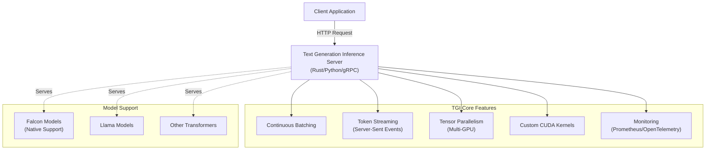
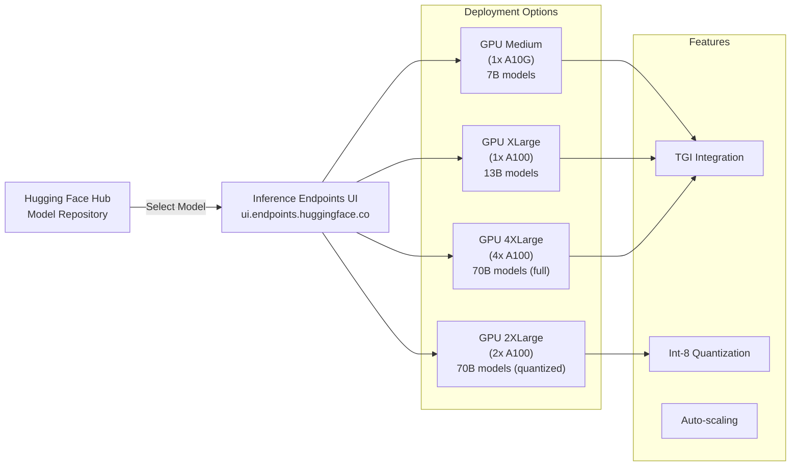
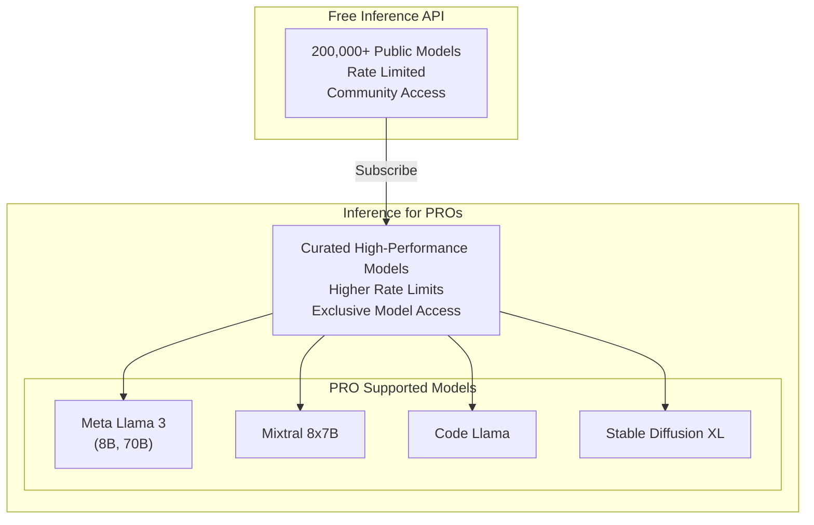
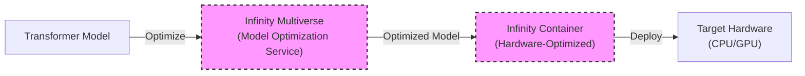
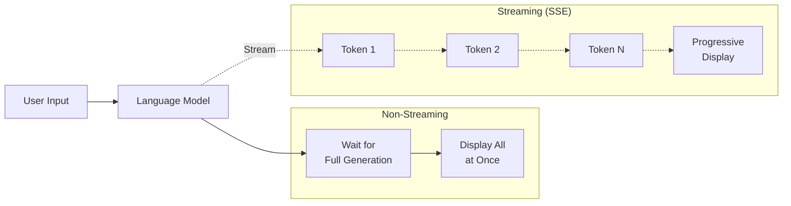
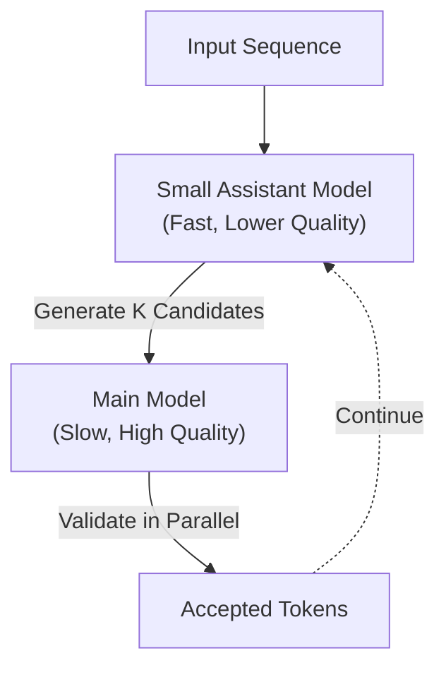
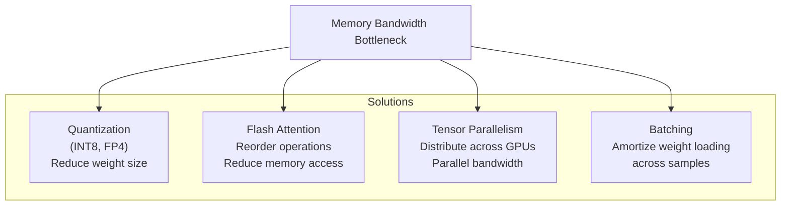

<!-- source: DeepWiki mcp.deepwiki.com · repo huggingface/blog · page 5.3 Inference Optimization · fetched 2026-10-26 -->

# Inference Optimization

<details>
<summary>Relevant source files</summary>

The following files were used as context for generating this wiki page:

- [1b-sentence-embeddings.md](1b-sentence-embeddings.md)
- [4bit-transformers-bitsandbytes.md](4bit-transformers-bitsandbytes.md)
- [README.md](README.md)
- [_events.yml](_events.yml)
- [accelerate-deepspeed.md](accelerate-deepspeed.md)
- [accelerated-inference.md](accelerated-inference.md)
- [assets/114_pricing-update/thumbnail.png](assets/114_pricing-update/thumbnail.png)
- [assets/138_stackllama/thumbnail.png](assets/138_stackllama/thumbnail.png)
- [assets/147_falcon/falcon_thumbnail.jpg](assets/147_falcon/falcon_thumbnail.jpg)
- [assets/17_the_partnership_amazon_sagemaker_and_hugging_face/cover.png](assets/17_the_partnership_amazon_sagemaker_and_hugging_face/cover.png)
- [assets/17_the_partnership_amazon_sagemaker_and_hugging_face/thumbnail.png](assets/17_the_partnership_amazon_sagemaker_and_hugging_face/thumbnail.png)
- [assets/25_hardware_partners_program/carbon_inc_quantizer.png](assets/25_hardware_partners_program/carbon_inc_quantizer.png)
- [assets/45_gptj_sagemaker/model_load_time.png](assets/45_gptj_sagemaker/model_load_time.png)
- [assets/45_gptj_sagemaker/thumbnail.png](assets/45_gptj_sagemaker/thumbnail.png)
- [assets/46_infinity_cpu_performance/latency.png](assets/46_infinity_cpu_performance/latency.png)
- [assets/46_infinity_cpu_performance/overview.png](assets/46_infinity_cpu_performance/overview.png)
- [assets/46_infinity_cpu_performance/pipeline.png](assets/46_infinity_cpu_performance/pipeline.png)
- [assets/46_infinity_cpu_performance/throughput.png](assets/46_infinity_cpu_performance/throughput.png)
- [assets/46_infinity_cpu_performance/thumbnail.png](assets/46_infinity_cpu_performance/thumbnail.png)
- [assets/83_accelerate_deepspeed/chatbot.png](assets/83_accelerate_deepspeed/chatbot.png)
- [assets/83_accelerate_deepspeed/cls_run.png](assets/83_accelerate_deepspeed/cls_run.png)
- [assets/83_accelerate_deepspeed/deepspeed-thumbnail.png](assets/83_accelerate_deepspeed/deepspeed-thumbnail.png)
- [assets/98_spaces_3dmoljs/thumbnail.png](assets/98_spaces_3dmoljs/thumbnail.png)
- [assets/assisted-generation/thumbnail.png](assets/assisted-generation/thumbnail.png)
- [assets/deploy-with-openvino/demo.gif](assets/deploy-with-openvino/demo.gif)
- [assets/deploy-with-openvino/openvino_genai_workflow.png](assets/deploy-with-openvino/openvino_genai_workflow.png)
- [assets/diffusion-models-event/thumbnail.png](assets/diffusion-models-event/thumbnail.png)
- [assets/galore_introduction/thumbnail.png](assets/galore_introduction/thumbnail.png)
- [assets/inference_pro/thumbnail.png](assets/inference_pro/thumbnail.png)
- [assets/instruction_tuning_sd/thumbnail.png](assets/instruction_tuning_sd/thumbnail.png)
- [assets/leaderboards-on-the-hub/thumbnail_flageval.png](assets/leaderboards-on-the-hub/thumbnail_flageval.png)
- [assets/llama2/thumbnail.jpg](assets/llama2/thumbnail.jpg)
- [assets/thumbnail-template.svg](assets/thumbnail-template.svg)
- [assisted-generation.md](assisted-generation.md)
- [bert-cpu-scaling-part-2.md](bert-cpu-scaling-part-2.md)
- [community-update.md](community-update.md)
- [debate.md](debate.md)
- [deploy-hugging-face-models-easily-with-amazon-sagemaker.md](deploy-hugging-face-models-easily-with-amazon-sagemaker.md)
- [deploy-with-openvino.md](deploy-with-openvino.md)
- [diffusion-models-event.md](diffusion-models-event.md)
- [falcon.md](falcon.md)
- [few-shot-learning-gpt-neo-and-inference-api.md](few-shot-learning-gpt-neo-and-inference-api.md)
- [fr/_blog.yml](fr/_blog.yml)
- [galore.md](galore.md)
- [gptj-sagemaker.md](gptj-sagemaker.md)
- [hardware-partners-program.md](hardware-partners-program.md)
- [inference-pro.md](inference-pro.md)
- [infinity-cpu-performance.md](infinity-cpu-performance.md)
- [instruction-tuning-sd.md](instruction-tuning-sd.md)
- [llama2.md](llama2.md)
- [pricing-update.md](pricing-update.md)
- [sentence-transformers-in-the-hub.md](sentence-transformers-in-the-hub.md)
- [spaces_3dmoljs.md](spaces_3dmoljs.md)
- [stackllama.md](stackllama.md)
- [the-partnership-amazon-sagemaker-and-hugging-face.md](the-partnership-amazon-sagemaker-and-hugging-face.md)

</details>


## Purpose and Scope

This document covers inference optimization techniques and infrastructure for deploying Hugging Face models in production environments. It focuses on solutions and techniques for achieving low-latency, high-throughput inference, including Text Generation Inference (TGI), Inference Endpoints, the Inference API, and various optimization strategies.

For cloud-specific deployment options, see [Cloud Provider Integrations](#5.1). For hardware-specific optimizations, see [Hardware Acceleration](#5.2).

Sources: [inference-pro.md:1-18](), [llama2.md:139-152](), [falcon.md:174-203]()

## Text Generation Inference (TGI)

Text Generation Inference is a production-ready inference container developed by Hugging Face for deploying large language models. It provides a Rust, Python, and gRPC-based server optimized for fast and efficient text generation.

### Architecture and Features



**Key Features:**

- **Continuous Batching**: Dynamically batches incoming requests to maximize throughput
- **Token Streaming**: Enables streaming responses using Server-Sent Events (SSE)
- **Tensor Parallelism**: Distributes model layers across multiple GPUs for faster inference
- **Optimized Kernels**: Custom CUDA kernels for improved performance
- **Production Monitoring**: Built-in logging, monitoring, and tracing with Prometheus and OpenTelemetry

Sources: [llama2.md:141-145](), [falcon.md:176-186]()

### Native Model Support

TGI provides native implementations for specific model architectures, eliminating the need for Transformers' "trust remote code" feature. This allows for more secure and optimized deployments.

```python
# TGI native support means no trust_remote_code needed
# Models like Falcon are natively supported since v0.8.2
# with custom CUDA kernels for reduced latency
```

Sources: [falcon.md:187-190]()

### Deployment Example

TGI powers production inference services including HuggingChat and can be deployed standalone or through Inference Endpoints.

```python
# Example: Using TGI via Python client
from huggingface_hub import InferenceClient

client = InferenceClient(model="meta-llama/Llama-2-7b-chat-hf", token=YOUR_TOKEN)

# Generate with streaming
for token in client.text_generation("Tell me a story", max_new_tokens=100, stream=True):
    print(token, end="")
```

Sources: [llama2.md:139-152](), [inference-pro.md:17-18]()

## Inference Endpoints

Inference Endpoints is a managed service that allows you to deploy models from the Hub or your own custom models on dedicated infrastructure managed by Hugging Face.

### Deployment Workflow



**Hardware Recommendations:**

| Model Size | Instance Type | Notes |
|------------|--------------|-------|
| 7B params | GPU [medium] - 1x NVIDIA A10G | Standard deployment |
| 13B params | GPU [xlarge] - 1x NVIDIA A100 | Standard deployment |
| 40B params | GPU [xlarge] - 1x NVIDIA A100 | With Int-8 quantization |
| 70B params | GPU [2xlarge] - 2x NVIDIA A100 | With bitsandbytes quantization |
| 70B params | GPU [4xlarge] - 4x NVIDIA A100 | Full precision |

Sources: [llama2.md:143-151](), [falcon.md:195-203]()

### Integration with TGI

Inference Endpoints integrates TGI since version 0.8.2, providing optimized inference with native model support and custom kernels.

```python
# Deploy via UI at ui.endpoints.huggingface.co
# Or programmatically:
from huggingface_hub import create_inference_endpoint

endpoint = create_inference_endpoint(
    "my-llama-endpoint",
    repository="meta-llama/Llama-2-7b-hf",
    framework="pytorch",
    task="text-generation",
    accelerator="gpu",
    instance_size="medium",
    instance_type="nvidia-a10g",
    region="us-east-1",
)
```

Sources: [falcon.md:191-203](), [llama2.md:142-151]()

## Inference API

The Inference API provides both free and PRO tiers for running inference on models from the Hugging Face Hub.

### Service Tiers



Sources: [inference-pro.md:15-53]()

### API Usage Patterns

The Inference API provides multiple interfaces for different use cases:

```python
# Using InferenceClient from huggingface_hub
from huggingface_hub import InferenceClient

client = InferenceClient(model="meta-llama/Meta-Llama-3-8b-Instruct", token=YOUR_TOKEN)

# Text generation with parameters
output = client.text_generation(
    "In a surprising turn of events,",
    temperature=0.7,
    max_new_tokens=100
)

# Streaming response
for token in client.text_generation(
    "How do you make cheese?",
    max_new_tokens=12,
    stream=True
):
    print(token)
```

Sources: [inference-pro.md:90-110](), [inference-pro.md:297-323]()

### Messages API Compatibility

The Inference API supports OpenAI-compatible Messages API, enabling use with standard client libraries:

```python
from openai import OpenAI
import huggingface_hub

# Use OpenAI client with Hugging Face endpoint
client = OpenAI(
    base_url="https://api-inference.huggingface.co/v1/",
    api_key=huggingface_hub.get_token(),
)

chat_completion = client.chat.completions.create(
    model="meta-llama/Meta-Llama-3.1-70B-Instruct",
    messages=[
        {"role": "system", "content": "You are a helpful programming assistant."},
        {"role": "user", "content": "Is Rust better than Python?"},
    ],
    stream=True,
    max_tokens=500
)
```

Sources: [inference-pro.md:208-236]()

## Infinity (Deprecated)

Infinity was a containerized solution for deploying optimized inference pipelines for Transformer models. As of December 2022, it is no longer offered as a commercial solution.

### Historical Context

Infinity provided:
- Hardware-optimized inference containers delivered as Docker containers
- Model Optimization Service (Infinity Multiverse) for target hardware optimization
- End-to-end optimized pipelines including pre-processing, prediction, and post-processing



Sources: [infinity-cpu-performance.md:15-23](), [infinity-cpu-performance.md:36-51]()

### Replacement Solutions

**Current Alternatives:**

1. **Inference Endpoints**: Managed deployment on dedicated infrastructure
2. **🤗 Optimum Intel**: Open-source optimization for Intel hardware
3. **🤗 Optimum ONNX Runtime**: Optimization with ONNX Runtime
4. **Expert Acceleration Program**: Commercial support for custom optimization

Sources: [infinity-cpu-performance.md:15-23]()

### Performance Achievements

Infinity demonstrated significant performance improvements:
- **100x speedup** compared to out-of-box Transformers deployment
- Millisecond latency on modern CPUs (Intel Xeon)
- End-to-end pipeline optimization including tokenization

Sources: [infinity-cpu-performance.md:26-32](), [accelerated-inference.md:1-8]()

## Optimization Techniques

### Text Generation Parameters

Text generation performance and quality can be controlled through various parameters:

**Sampling Parameters:**

| Parameter | Description | Impact |
|-----------|-------------|--------|
| `do_sample` | Enable sampling vs greedy | False = deterministic, True = varied |
| `temperature` | Randomness control | Lower = focused, Higher = creative |
| `top_k` | Top-K sampling | Consider K most probable tokens |
| `top_p` | Nucleus sampling | Consider tokens up to cumulative probability p |
| `repetition_penalty` | Avoid repetition | Penalizes repeated tokens |
| `seed` | Random seed | For reproducible sampling |

**Generation Control:**

| Parameter | Description | Default |
|-----------|-------------|---------|
| `max_new_tokens` | Maximum tokens to generate | 20 |
| `return_full_text` | Include input in output | API: True, Client: False |
| `stop_sequences` | Stop generation on sequence | None |

Sources: [inference-pro.md:239-256]()

### Caching

The Inference API caches recent results to reduce latency for repeated requests. This can be controlled via HTTP headers:

```python
from huggingface_hub import InferenceClient

client = InferenceClient(model="meta-llama/Meta-Llama-3-8b-Instruct", token=YOUR_TOKEN)

# Disable cache for non-deterministic results
client.headers["x-use-cache"] = "0"

output = client.text_generation("Generate a story", do_sample=True)
```

Sources: [inference-pro.md:268-280]()

### Token Streaming

Streaming enables progressive display of generated tokens, reducing perceived latency:



**Implementation:**

```python
# Streaming with InferenceClient
for token in client.text_generation(
    "How do you make cheese?",
    max_new_tokens=12,
    stream=True
):
    print(token, end="")

# Using curl with streaming
curl -N https://api-inference.huggingface.co/models/meta-llama/Meta-Llama-3-8b-Instruct \
    -X POST \
    -d '{"inputs": "Tell me a story", "parameters": {"max_new_tokens": 100}}' \
    -H "Content-Type: application/json" \
    -H "Authorization: Bearer <YOUR_TOKEN>"
```

Sources: [inference-pro.md:282-323]()

### Quantization for Inference

Quantization reduces model memory footprint and can improve inference speed:

**4-bit Quantization:**

```python
from transformers import AutoModelForCausalLM
import torch

# Load model in 4-bit for inference
model = AutoModelForCausalLM.from_pretrained(
    "meta-llama/Llama-2-7b-hf",
    load_in_4bit=True,
    device_map="auto"
)

# 7B model requires ~27GB in 4-bit vs ~90GB in fp16
```

**8-bit Quantization:**

```python
# Load in 8-bit mode
model = AutoModelForCausalLM.from_pretrained(
    "tiiuae/falcon-40b-instruct",
    load_in_8bit=True,
    device_map="auto",
    torch_dtype=torch.bfloat16
)

# 40B model fits in ~45GB vs ~80GB in bf16
```

Sources: [falcon.md:143-173](), [4bit-transformers-bitsandbytes.md:97-106]()

### Batching

Batching multiple requests increases throughput with minimal latency impact:

```python
from transformers import AutoModelForCausalLM, AutoTokenizer
import time

tokenizer = AutoTokenizer.from_pretrained("distilgpt2")
model = AutoModelForCausalLM.from_pretrained("distilgpt2").to("cuda")
inputs = tokenizer(["Hello world"], return_tensors="pt").to("cuda")

# Single request
model.generate(**inputs, max_new_tokens=100, num_return_sequences=1)
# Tokens per second: 418.3

# Batched requests (64x)
model.generate(**inputs, max_new_tokens=100, num_return_sequences=64)
# Tokens per second: 16266.2 (~39x more tokens/second)
```

Sources: [assisted-generation.md:43-73]()

### Assisted Generation

Assisted generation uses a smaller "assistant" model to speculate future tokens, which are then validated by the main model in parallel:



**Performance:**

- Up to **10x latency reduction** on commodity hardware
- No quality degradation (same output as standard generation)
- Particularly effective for long sequences

**Usage:**

```python
from transformers import AutoModelForCausalLM, AutoTokenizer

model = AutoModelForCausalLM.from_pretrained("meta-llama/Llama-2-13b-hf")
assistant = AutoModelForCausalLM.from_pretrained("meta-llama/Llama-2-7b-hf")
tokenizer = AutoTokenizer.from_pretrained("meta-llama/Llama-2-13b-hf")

inputs = tokenizer("A sequence", return_tensors="pt")

# Standard generation
outputs = model.generate(**inputs, max_new_tokens=100)

# Assisted generation (faster, same quality)
outputs = model.generate(**inputs, assistant_model=assistant, max_new_tokens=100)
```

Sources: [assisted-generation.md:1-14](), [assisted-generation.md:79-end]()

### Memory Bandwidth Optimization

Inference latency is primarily limited by memory bandwidth rather than compute:

**Bottleneck Analysis:**

1. **Loading Weights**: Transferring model parameters from RAM/VRAM to compute cores dominates latency
2. **Computation**: Matrix multiplications are fast once data is loaded
3. **Key-Value Cache**: Attention caching reduces redundant computation but increases memory usage

**Optimization Strategies:**



Sources: [assisted-generation.md:16-41]()

### Multi-Query Attention (MQA)

MQA reduces memory requirements for the key-value cache during inference:

**Standard Multi-Head Attention:**
- Separate key and value for each attention head
- Large cache size: `num_heads * hidden_dim * sequence_length`

**Multi-Query Attention:**
- Shared key and value across all heads
- Reduced cache: `1 * hidden_dim * sequence_length`

**Performance Impact:**

| Model | Cache Size (2048 context) |
|-------|---------------------------|
| Falcon-7B (MQA) | 20 MB |
| LLaMA-7B (Standard) | 1,100 MB |
| Falcon-40B (MQA) | 240 MB |
| LLaMA-65B (Standard) | 5,400 MB |

Sources: [falcon.md:50-67]()

### Hardware-Specific Optimizations

Different hardware platforms benefit from specific optimization techniques. See [Hardware Acceleration](#5.2) for details on:

- Intel optimizations (OpenVINO, Neural Compressor)
- NVIDIA optimizations (TensorRT, Flash Attention)
- AMD optimizations (ROCm)
- Custom accelerators (Gaudi, Inferentia)

Sources: [deploy-with-openvino.md:1-47]()

---

