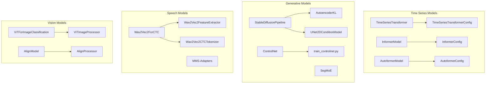
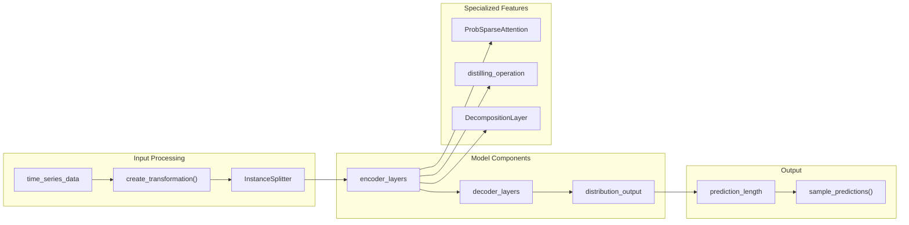
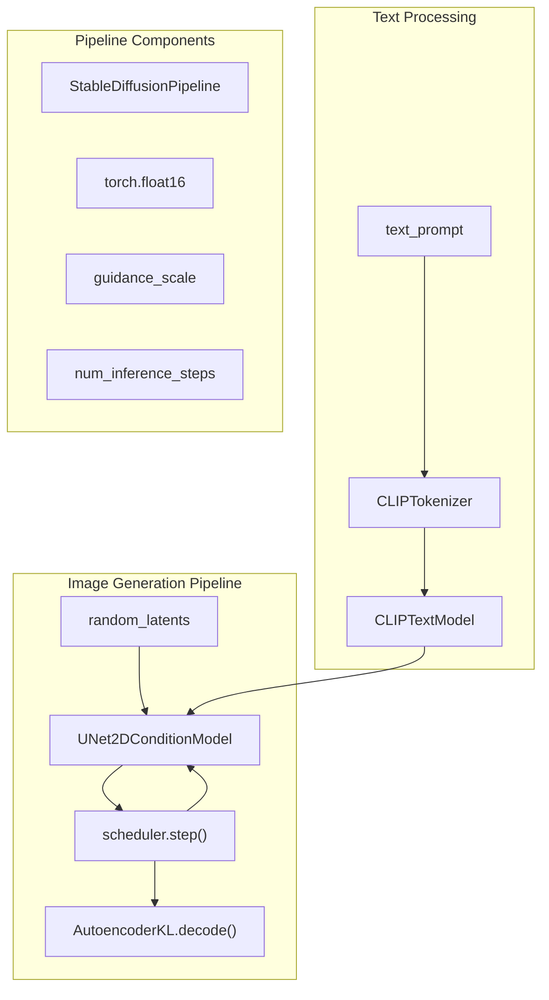
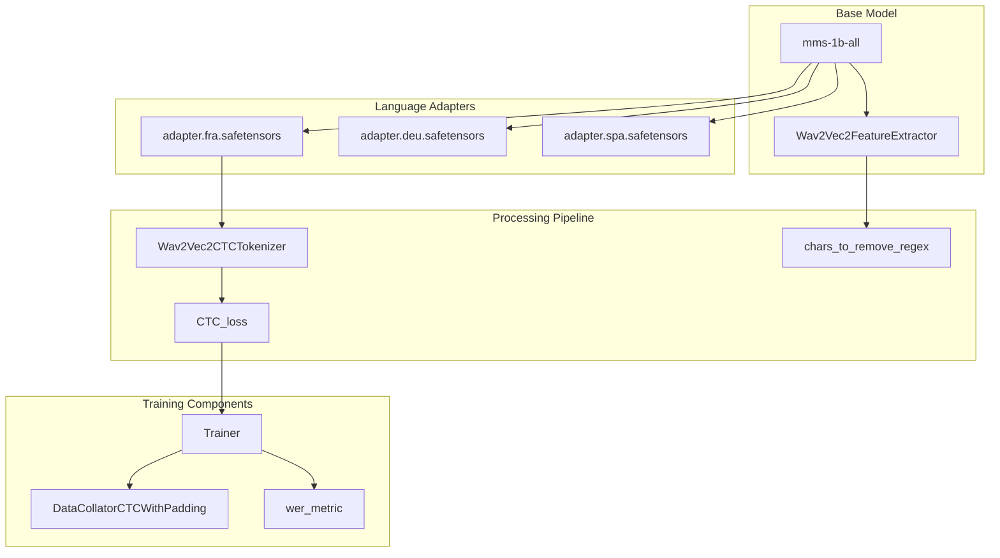
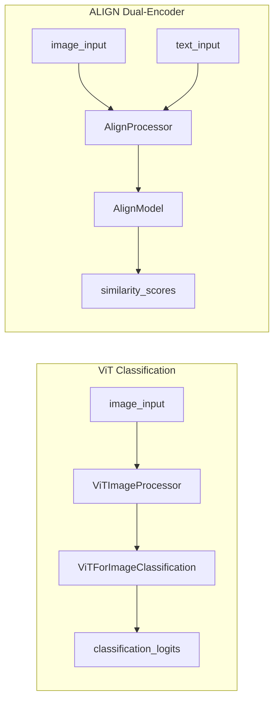

<!-- source: DeepWiki mcp.deepwiki.com · repo huggingface/blog · page 6 Specialized Model Types · fetched 2026-10-26 -->

# Specialized Models

Relevant source files

The following files were used as context for generating this wiki page:

- [assets/118_time-series-transformers/thumbnail.png](assets/118_time-series-transformers/thumbnail.png)
- [assets/132_vit_align/thumbnail.png](assets/132_vit_align/thumbnail.png)
- [assets/134_informer/thumbnail.png](assets/134_informer/thumbnail.png)
- [assets/136_train-your-controlnet/thumbnail.png](assets/136_train-your-controlnet/thumbnail.png)
- [assets/150_autoformer/thumbnail.png](assets/150_autoformer/thumbnail.png)
- [assets/151_mms/mms_map.png](assets/151_mms/mms_map.png)
- [assets/175_constitutional_ai/thumbnail.png](assets/175_constitutional_ai/thumbnail.png)
- [assets/segmoe/thumbnail.png](assets/segmoe/thumbnail.png)
- [assets/textgen-pipe-gaudi/thumbnail.png](assets/textgen-pipe-gaudi/thumbnail.png)
- [assets/xlsr_wav2vec2.png](assets/xlsr_wav2vec2.png)
- [autoformer.md](autoformer.md)
- [big-bird.md](big-bird.md)
- [constitutional_ai.md](constitutional_ai.md)
- [fine-tune-wav2vec2-english.md](fine-tune-wav2vec2-english.md)
- [fine-tune-xlsr-wav2vec2.md](fine-tune-xlsr-wav2vec2.md)
- [hf-bitsandbytes-integration.md](hf-bitsandbytes-integration.md)
- [informer.md](informer.md)
- [mms_adapters.md](mms_adapters.md)
- [notebooks/17_fine_tune_wav2vec2_for_english_asr.ipynb](notebooks/17_fine_tune_wav2vec2_for_english_asr.ipynb)
- [notebooks/18_fine_tune_xlsr_wav2vec2_asr.ipynb](notebooks/18_fine_tune_xlsr_wav2vec2_asr.ipynb)
- [segmoe.md](segmoe.md)
- [stable_diffusion.md](stable_diffusion.md)
- [textgen-pipe-gaudi.md](textgen-pipe-gaudi.md)
- [time-series-transformers.md](time-series-transformers.md)
- [train-your-controlnet.md](train-your-controlnet.md)
- [vit-align.md](vit-align.md)
- [zh/informer.md](zh/informer.md)
- [zh/time-series-transformers.md](zh/time-series-transformers.md)

This page covers domain-specific and specialized model architectures beyond general large language models (LLMs). These models are designed for specific tasks such as time series forecasting, image generation, speech recognition, and vision-language understanding. For information about LLM deployment and optimization, see [Model Deployment](#5). For training techniques that apply to these specialized models, see [Model Training and Optimization](#4).

## Model Architecture Categories

The Hugging Face blog repository documents several categories of specialized models, each with distinct architectures, training procedures, and deployment considerations:

Sources: [stable_diffusion.md:1-490](), [informer.md:1-760](), [autoformer.md:1-600](), [time-series-transformers.md:1-800](), [mms_adapters.md:1-600](), [vit-align.md:1-400]()

## Time Series Forecasting Models

Time series models in the ecosystem include the vanilla `TimeSeriesTransformer`, the efficiency-focused `InformerModel`, and the decomposition-based `AutoformerModel`. These models implement probabilistic forecasting using distribution heads rather than simple regression outputs.

### Model Architecture Pipeline

The `InformerModel` implements `ProbSparseAttention` to reduce computational complexity from O(T²) to O(T log T), while `AutoformerModel` uses a `DecompositionLayer` to separate trend and seasonal components.

Sources: [informer.md:84-167](), [autoformer.md:83-218](), [time-series-transformers.md:266-290]()

### Training Configuration

Time series models use specialized configurations that differ significantly from NLP transformers:

- `prediction_length`: forecast horizon length
- `context_length`: input sequence length
- `lags_sequence`: lookback windows for feature creation
- `num_time_features`: temporal features like hour_of_day, day_of_week
- `distribution_output`: probabilistic distribution type (student_t, normal, etc.)

Sources: [informer.md:418-440](), [time-series-transformers.md:267-288]()

## Generative Diffusion Models

The repository extensively covers diffusion models for image generation, including Stable Diffusion, ControlNet, and mixture-of-experts variants like SegMoE.

### Stable Diffusion Architecture

The `StableDiffusionPipeline.from_pretrained()` method loads the complete pipeline, while individual components can be accessed via subfolders like `"unet"`, `"vae"`, and `"text_encoder"`.

Sources: [stable_diffusion.md:57-96](), [stable_diffusion.md:318-331]()

### ControlNet Training

ControlNet extends Stable Diffusion with additional conditioning inputs through a trainable copy of the UNet encoder:

- Training script: `train_controlnet.py`
- Key parameters: `conditioning_image_column`, `image_column`, `caption_column`
- Memory optimization: `gradient_checkpointing`, `use_8bit_adam`
- Validation: `validation_image`, `validation_prompt`, `validation_steps`

Sources: [train-your-controlnet.md:89-110](), [train-your-controlnet.md:131-152]()

## Speech Recognition Models

The MMS (Massive Multilingual Speech) framework provides ASR capabilities for 1000+ languages through adapter-based architecture.

### MMS Adapter Architecture

Each adapter contains approximately 2.5M parameters consisting of small linear projection layers and language-specific vocabulary output layers.

Sources: [mms_adapters.md:53-71](), [mms_adapters.md:286-314]()

### Training Setup

MMS models use Connectionist Temporal Classification (CTC) for sequence-to-sequence learning:

- Feature extractor: `Wav2Vec2FeatureExtractor.from_pretrained()`
- Tokenizer creation: `Wav2Vec2CTCTokenizer` with custom vocabulary
- Data preprocessing: `remove_special_characters()`, `normalize_text()`
- Metrics: Word Error Rate (WER) via `jiwer`

Sources: [mms_adapters.md:115-200](), [mms_adapters.md:300-350]()

## Vision-Language Models

The repository covers ViT for image classification and ALIGN for vision-language understanding, both trained on large-scale datasets.

### Model Pipeline Comparison

ALIGN uses a dual-encoder architecture trained with contrastive loss on noisy image-text pairs, while ViT uses supervised classification on ImageNet labels.

Sources: [vit-align.md:117-151](), [vit-align.md:200-240]()

### Data Processing

Both models require specific preprocessing:

- ViT: `ViTImageProcessor.from_pretrained()` handles image normalization and resizing
- ALIGN: `AlignProcessor` handles both image and text inputs simultaneously
- Training data: COYO-700M dataset provides 700M image-text pairs with metadata

Sources: [vit-align.md:124-144](), [vit-align.md:94-112]()

## Constitutional AI Models

Constitutional AI implements self-critique and revision for model alignment using a constitutional framework.

### CAI Training Pipeline

The Constitutional AI process involves generating critique-revision pairs:

1. Initial response generation
2. Self-critique using constitutional principles  
3. Response revision based on critique
4. Training data creation for SFT and DPO

Key components include `llm-swarm` for distributed generation and constitutional principles encoded as prompts.

Sources: [constitutional_ai.md:36-74](), [constitutional_ai.md:101-163]()

## Hardware Optimization

Specialized models support various hardware optimization techniques:

### OpenVINO Integration

Models can be optimized for Intel hardware using OpenVINO:

- Export: `optimum-cli export openvino`
- Quantization: INT8 optimization for inference
- GenAI API: C++ deployment with minimal dependencies

Sources: [deploy-with-openvino.md:25-57]()

### Intel Gaudi Support

Text generation models support Intel Gaudi accelerators through Optimum Habana:

- Custom pipeline classes for Llama 2 variants
- Flexible batch processing and generation parameters
- Integration with LangChain for application development

Sources: [textgen-pipe-gaudi.md:10-17]()

---

