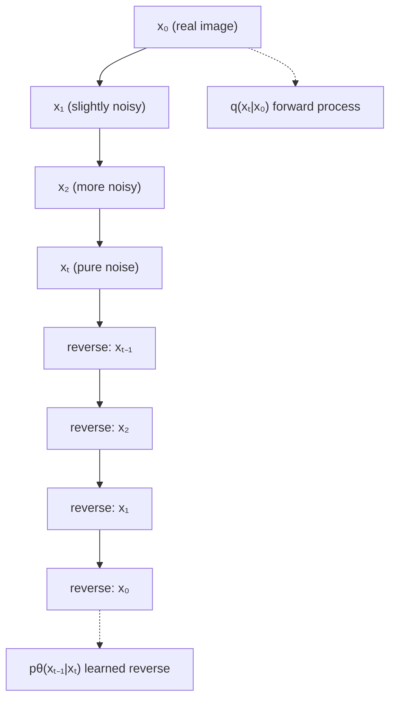
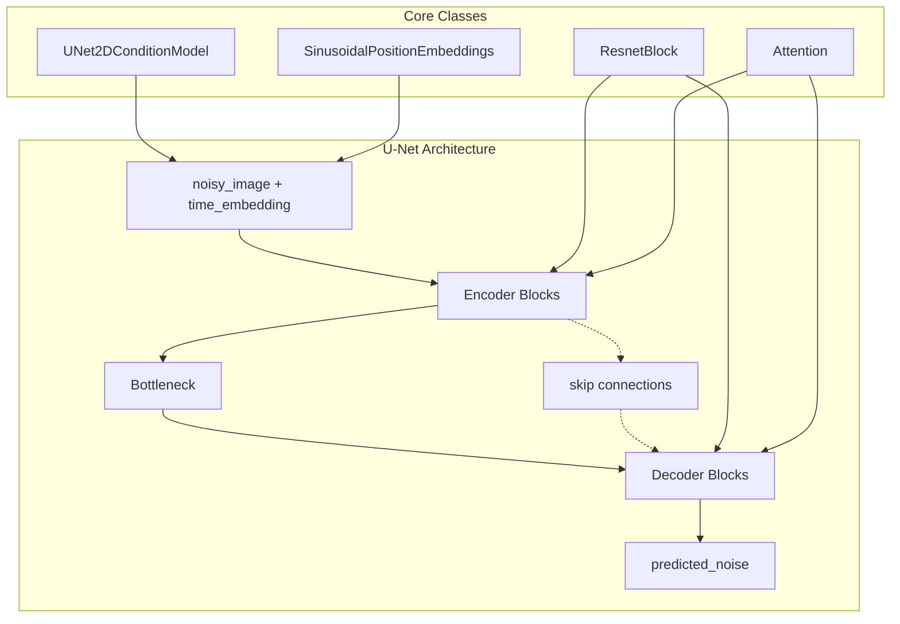
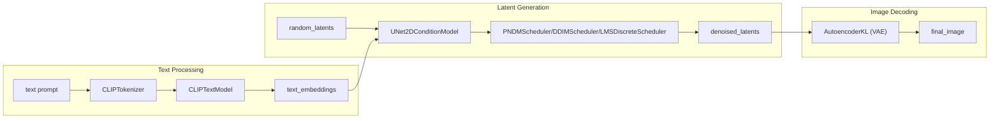
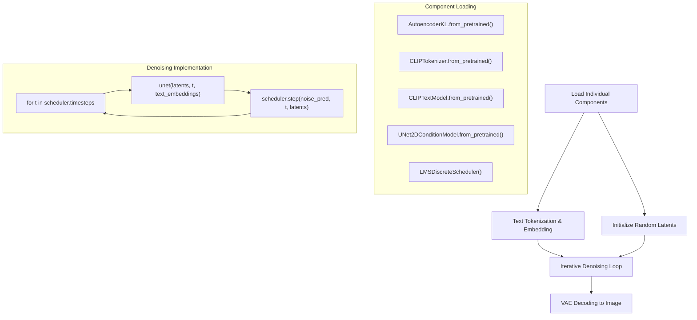
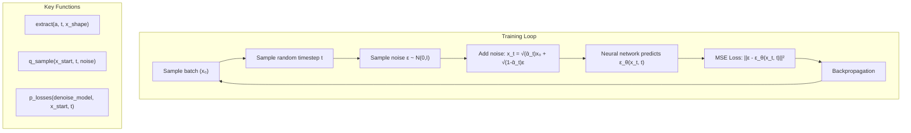
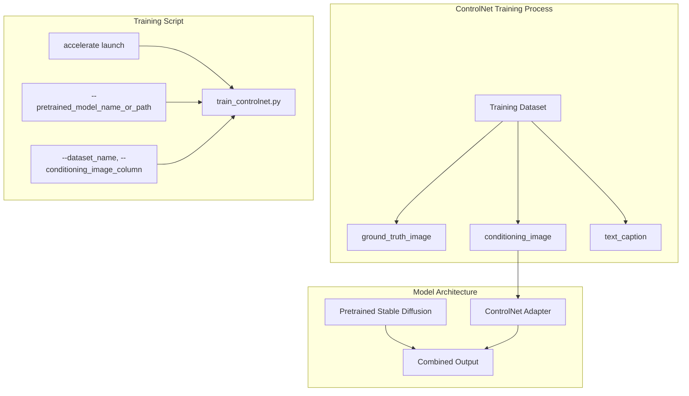
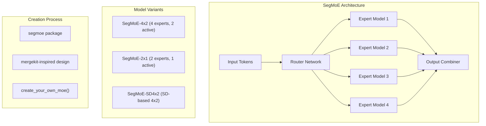
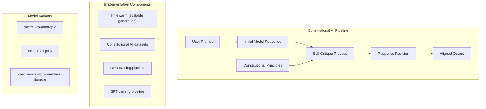
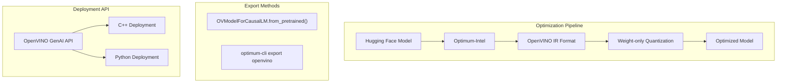
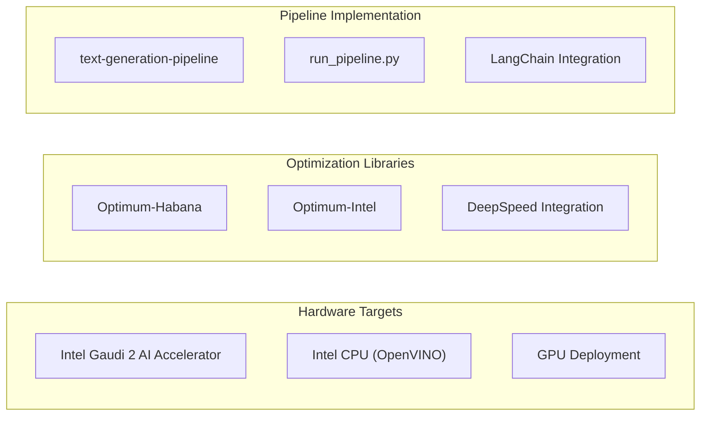

<!-- source: DeepWiki mcp.deepwiki.com · repo huggingface/blog · page 6.1 Diffusion Models · fetched 2026-10-26 -->

# Generative Models

Relevant source files

The following files were used as context for generating this wiki page:

- [assets/132_vit_align/thumbnail.png](assets/132_vit_align/thumbnail.png)
- [assets/136_train-your-controlnet/thumbnail.png](assets/136_train-your-controlnet/thumbnail.png)
- [assets/151_mms/mms_map.png](assets/151_mms/mms_map.png)
- [assets/175_constitutional_ai/thumbnail.png](assets/175_constitutional_ai/thumbnail.png)
- [assets/63_deep_rl_intro/tasks.jpg](assets/63_deep_rl_intro/tasks.jpg)
- [assets/70_deep_rl_q_part1/bellman6.jpg](assets/70_deep_rl_q_part1/bellman6.jpg)
- [assets/78_ml_director_insights/witty-works.png](assets/78_ml_director_insights/witty-works.png)
- [assets/86_bloom/bloom-examples.jpg](assets/86_bloom/bloom-examples.jpg)
- [assets/controlnet/thumbnail.png](assets/controlnet/thumbnail.png)
- [assets/cosmopedia/thumbnail.png](assets/cosmopedia/thumbnail.png)
- [assets/segmoe/thumbnail.png](assets/segmoe/thumbnail.png)
- [assets/textgen-pipe-gaudi/thumbnail.png](assets/textgen-pipe-gaudi/thumbnail.png)
- [bloom.md](bloom.md)
- [classification-use-cases.md](classification-use-cases.md)
- [constitutional_ai.md](constitutional_ai.md)
- [controlnet.md](controlnet.md)
- [cosmopedia.md](cosmopedia.md)
- [deep-rl-a2c.md](deep-rl-a2c.md)
- [deep-rl-dqn.md](deep-rl-dqn.md)
- [deep-rl-intro.md](deep-rl-intro.md)
- [deep-rl-pg.md](deep-rl-pg.md)
- [deep-rl-ppo.md](deep-rl-ppo.md)
- [deep-rl-q-part1.md](deep-rl-q-part1.md)
- [deep-rl-q-part2.md](deep-rl-q-part2.md)
- [ml-director-insights-2.md](ml-director-insights-2.md)
- [mms_adapters.md](mms_adapters.md)
- [segmoe.md](segmoe.md)
- [stable_diffusion.md](stable_diffusion.md)
- [textgen-pipe-gaudi.md](textgen-pipe-gaudi.md)
- [train-your-controlnet.md](train-your-controlnet.md)
- [vit-align.md](vit-align.md)

This document covers generative AI models featured in the Hugging Face blog, with a focus on diffusion-based image generation models including Stable Diffusion, ControlNet, and advanced architectures like SegMoE. The content primarily addresses text-to-image generation, model training techniques, and architectural innovations in the generative modeling space.

For time series forecasting models, see [Time Series Models](#6.1). For reinforcement learning-based generative approaches, see [Reinforcement Learning Models](#6.3). For generative embedding techniques, see [Embedding Models](#6.5).

## Diffusion Model Architecture

Diffusion models represent a class of generative models that learn to gradually denoise random Gaussian noise to produce samples. The blog extensively covers Denoising Diffusion Probabilistic Models (DDPMs) and their implementation.

### Core Mathematical Framework

The diffusion process consists of two key components: a forward diffusion process that gradually adds noise to data, and a learned reverse denoising process that reconstructs data from noise.

The forward process follows the equation: `q(x_t | x_{t-1}) = N(x_t; √(1-β_t) x_{t-1}, β_t I)` where `β_t` represents the variance schedule.

### Neural Network Architecture Components

Diffusion models typically employ a U-Net architecture for the denoising process, consisting of several key components implemented in the codebase.

Sources: [annotated-diffusion.md:399-522](), [stable_diffusion.md:255-263]()

## Stable Diffusion Implementation

Stable Diffusion operates in latent space rather than pixel space, making it computationally efficient while maintaining high-quality generation capabilities.

### Pipeline Components

The `StableDiffusionPipeline` integrates three main components to enable text-to-image generation.

The VAE encoder compresses images from pixel space `(3, 512, 512)` to latent space `(4, 64, 64)`, achieving a spatial compression ratio of 64x.

### Custom Pipeline Implementation

The blog demonstrates how to build custom inference pipelines by manually orchestrating the components rather than using the pre-built `StableDiffusionPipeline`.

Sources: [stable_diffusion.md:300-481](), [stable_diffusion.md:57-95]()

## Training and Customization

### Basic Diffusion Model Training

The training process involves learning to predict noise added to images at various timesteps. The loss function is a simple MSE between predicted and actual noise.

### ControlNet Training Architecture

ControlNet enables fine-grained control over diffusion models by adding conditioning through adapter networks that preserve the original model's knowledge.

The training command structure follows the pattern: `accelerate launch train_controlnet.py --pretrained_model_name_or_path="model" --dataset_name=dataset --conditioning_image_column=column_name`.

Sources: [train-your-controlnet.md:89-110](), [train-your-controlnet.md:20-67]()

## Advanced Generative Model Techniques

### SegMoE: Mixture of Diffusion Experts

SegMoE implements Mixture-of-Experts (MoE) architectures for diffusion models, replacing some feed-forward layers with sparse MoE layers that route tokens to specialized expert networks.

### Constitutional AI Integration

The blog also covers Constitutional AI techniques for generative models, implementing self-critique and revision capabilities to align model outputs with specified principles.

Sources: [segmoe.md:36-49](), [constitutional_ai.md:36-74]()

## Model Deployment and Optimization

### OpenVINO Integration

The blog demonstrates optimization and deployment of generative models using Optimum-Intel and OpenVINO GenAI for edge deployment scenarios.

### Hardware Acceleration

The repository covers deployment on various hardware accelerators including Intel Gaudi accelerators for text generation pipelines.

Sources: [deploy-with-openvino.md:62-83](), [textgen-pipe-gaudi.md:38-52]()

---

