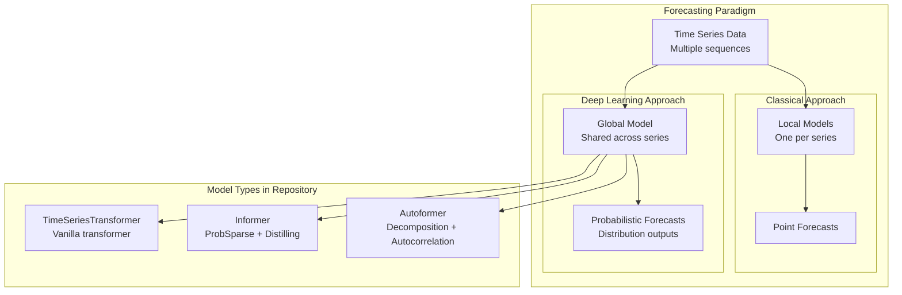
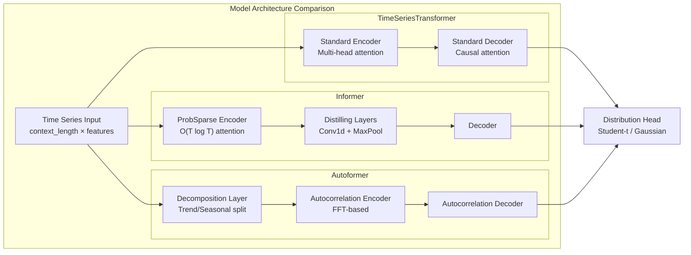
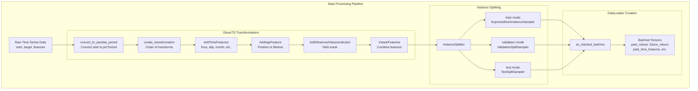
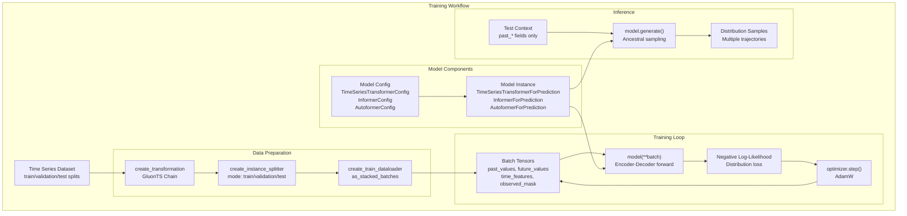

<!-- source: DeepWiki mcp.deepwiki.com · repo huggingface/blog · page 6.2 Time Series Models · fetched 2026-10-26 -->

# Time Series Models

<details>
<summary>Relevant source files</summary>

The following files were used as context for generating this wiki page:

- [assets/118_time-series-transformers/thumbnail.png](assets/118_time-series-transformers/thumbnail.png)
- [assets/134_informer/thumbnail.png](assets/134_informer/thumbnail.png)
- [assets/150_autoformer/thumbnail.png](assets/150_autoformer/thumbnail.png)
- [autoformer.md](autoformer.md)
- [informer.md](informer.md)
- [time-series-transformers.md](time-series-transformers.md)
- [zh/informer.md](zh/informer.md)
- [zh/time-series-transformers.md](zh/time-series-transformers.md)

</details>


## Purpose and Scope

This document covers the time series forecasting models available in the Hugging Face blog repository, specifically the **TimeSeriesTransformer**, **Informer**, and **Autoformer** architectures. These models implement probabilistic forecasting using transformer-based approaches for both univariate and multivariate time series prediction tasks.

For reinforcement learning applications in time series, see [Deep Reinforcement Learning](#7). For deployment of time series models to cloud platforms, see [Cloud Provider Integrations](#5.1). For general transformer architecture concepts, see [Model Training and Optimization](#4).

## Overview of Time Series Forecasting

Time series forecasting in this repository differs from classical statistical methods (ARIMA, etc.) by employing **global probabilistic models** that learn from multiple time series simultaneously. The key characteristics are:

| Characteristic | Classical Methods | Deep Learning Methods |
|---------------|------------------|----------------------|
| Training Scope | Local (per series) | Global (all series) |
| Output Type | Point values | Probability distributions |
| Uncertainty | Not modeled | Explicitly modeled |
| Context | Limited lookback | Configurable windows |

The models predict probability distributions (Student-t, Gaussian, etc.) rather than single point values, enabling uncertainty quantification. This is implemented through distribution heads that output distribution parameters.

**Sources:** [time-series-transformers.md:20-46](), [informer.md:20-28]()



**Sources:** [time-series-transformers.md:20-46](), [autoformer.md:22-26]()

## Available Models

### TimeSeriesTransformer

The vanilla Time Series Transformer applies the standard encoder-decoder architecture from [Vaswani et al., 2017] to time series forecasting. It is the simplest of the three models and serves as a baseline.

**Key features:**
- Standard multi-head self-attention
- Configurable context and prediction lengths
- Support for static categorical/real features
- Time-based positional encodings via GluonTS time features

**Configuration parameters:**
- `prediction_length`: Forecast horizon
- `context_length`: Historical context window (defaults to `prediction_length` if not specified)
- `lags_sequence`: Lookback indices for autoregressive features
- `num_time_features`: Count of temporal features (e.g., month, day, age)
- `d_model`, `encoder_layers`, `decoder_layers`: Transformer architecture parameters

**Sources:** [time-series-transformers.md:32-46](), [time-series-transformers.md:219-291]()

### Informer

The Informer model (AAAI 2021 Best Paper) addresses the quadratic complexity of vanilla transformers for long sequence time series forecasting (LSTF). It introduces two key innovations:

**1. ProbSparse Attention:** Reduces attention complexity from O(T²D) to O(T log T) by selecting only "active" queries that contribute meaningful attention scores.

**2. Distilling Operation:** Progressively reduces encoder layer inputs by half using 1D convolution and max pooling, reducing memory from O(N·T²) to O(N·T log T).

**Model class:** `InformerForPrediction`

**Sources:** [informer.md:30-36](), [informer.md:358-441]()

### Autoformer

The Autoformer model (NeurIPS 2021) incorporates decomposition-based time series analysis into the transformer architecture:

**1. Decomposition Layer:** Separates time series into trend-cyclical and seasonal components using moving average pooling.

**2. Autocorrelation Mechanism:** Replaces self-attention with autocorrelation computed in frequency domain via FFT, aggregating values by time delay rather than point-wise.

**Model class:** `AutoformerModel` / `AutoformerForPrediction`

**Sources:** [autoformer.md:48-52](), [autoformer.md:54-109]()



**Sources:** [time-series-transformers.md:219-291](), [informer.md:358-441](), [autoformer.md:48-109]()

## Key Architectural Components

### ProbSparse Attention (Informer)

ProbSparse attention selects only the most "active" queries to compute attention, dramatically reducing computational cost for long sequences.

**Query Sparsity Measurement:**

The measurement M(qᵢ, K) identifies queries that deviate from uniform distribution:

```
M(qᵢ, K) = max_j(qᵢkⱼᵀ/√d) - (1/Lₖ)∑ⱼ(qᵢkⱼᵀ/√d)
```

**Implementation approach:**
1. Sample subset of keys: `K_sample` with U_part = min(sampling_factor × L_Q × log(L_K), L_K)
2. Compute Q_K_sample = queries × K_sample.T
3. Calculate sparsity measurement M
4. Select top-u queries where u = sampling_factor × log(L_Q)
5. Form Q_reduce from top-u queries
6. Compute attention: softmax(Q_reduce × K.T / √d_k) × V

**Code implementation:** [informer.md:86-131]()

**Sources:** [informer.md:39-82](), [informer.md:86-134]()

### Decomposition Layer (Autoformer)

The decomposition layer separates time series into trend and seasonal components using a moving average kernel:

```
X_trend = AvgPool(Padding(X))
X_seasonal = X - X_trend
```

**PyTorch implementation structure:**
- `DecompositionLayer` class with configurable `kernel_size`
- Padding: Replicates first and last values (kernel_size-1)/2 times
- Moving average via `nn.AvgPool1d`
- Returns both seasonal and trend components

This layer is applied progressively throughout the encoder and decoder to refine the decomposition.

**Code reference:** [autoformer.md:83-109]()

**Sources:** [autoformer.md:54-109]()

### Autocorrelation Mechanism (Autoformer)

Instead of computing attention in the time domain, Autoformer computes autocorrelations in the frequency domain and aggregates by time delay.

**Frequency Domain Computation:**
```python
# Compute autocorrelation using FFT
Q_fft = torch.fft.rfft(query_states, dim=1)
K_fft = torch.fft.rfft(key_states, dim=1)
attn_weights = Q_fft * torch.conj(K_fft)
attn_weights = torch.fft.irfft(attn_weights, dim=1)
```

**Time Delay Aggregation:**
1. Find top-k delays from autocorrelations: τ₁, τ₂, ..., τₖ
2. Apply softmax to autocorrelations at these delays
3. Roll value states by each delay
4. Aggregate: ∑ᵢ Roll(V, τᵢ) · R̂(Q,K)(τᵢ)

**Code reference:** [autoformer.md:141-218]()

**Sources:** [autoformer.md:113-218]()

```mermaid
graph TB
    subgraph "Informer: ProbSparse Attention"
        Q1["Query Matrix Q<br/>L_Q × d"]
        K1["Key Matrix K<br/>L_K × d"]
        Sample["Random Sample K<br/>U_part keys"]
        Measure["Compute M(q_i, K)<br/>Sparsity measurement"]
        TopU["Select Top-u Queries<br/>Q_reduce"]
        Attn1["softmax(Q_reduce K^T) V<br/>O(T log T)"]
    end
    
    subgraph "Autoformer: Decomposition"
        Input2["Input X"]
        Pad["Padding<br/>Replicate edges"]
        AvgPool["AvgPool1d<br/>Moving average"]
        Trend["X_trend"]
        Seasonal["X_seasonal = X - X_trend"]
    end
    
    subgraph "Autoformer: Autocorrelation"
        Q3["Query Q"]
        K3["Key K"]
        FFT["FFT to frequency<br/>rfft"]
        Multiply["Q_fft * conj(K_fft)"]
        IFFT["IFFT back<br/>irfft"]
        TopK["Top-k delays"]
        Roll["Roll values by delay"]
        Agg["Weighted aggregation"]
    end
    
    Q1 --> Sample
    K1 --> Sample
    Sample --> Measure
    Measure --> TopU
    TopU --> Attn1
    
    Input2 --> Pad
    Pad --> AvgPool
    AvgPool --> Trend
    Input2 --> Seasonal
    Trend --> Seasonal
    
    Q3 --> FFT
    K3 --> FFT
    FFT --> Multiply
    Multiply --> IFFT
    IFFT --> TopK
    TopK --> Roll
    Roll --> Agg
```



**Sources:** [informer.md:39-134](), [autoformer.md:54-218]()

## Data Processing Pipeline

### GluonTS Integration

All three models use the GluonTS library for data transformations and batch creation. The transformation pipeline converts raw time series data into model-ready inputs.

**Core transformation chain:**
1. Remove unused fields (static/dynamic features if not configured)
2. Convert data to NumPy arrays
3. Add observed values indicator (mask for NaN handling)
4. Add time features based on frequency
5. Add age feature (position in series lifetime)
6. Stack temporal features vertically
7. Rename fields to HuggingFace conventions

**Key GluonTS classes used:**
- `Chain`: Compose multiple transformations
- `RemoveFields`, `AsNumpyArray`, `AddObservedValuesIndicator`
- `AddTimeFeatures`, `AddAgeFeature`, `VstackFeatures`
- `RenameFields`: Maps to `past_values`, `future_values`, `time_features`, etc.

**Code references:** [time-series-transformers.md:310-433](), [informer.md:459-578](), [autoformer.md:317-437]()

**Sources:** [time-series-transformers.md:303-337](), [informer.md:452-578]()

### Time Features and Lags

**Time Features:** Derived from timestamp frequency (e.g., for hourly data: hour_of_day, day_of_week, day_of_month, day_of_year). Values are normalized to [-0.5, 0.5].

**Lags Sequence:** Specifies historical lookback points to include as features. For example:
- Hourly frequency: `[1, 2, 3, ..., 24, 25, ..., 168, 169, ...]` (1 hour, 1 day, 1 week, etc.)
- Monthly frequency: `[1, 2, 3, ..., 12, 13, ..., 24, 25, ...]`

**Helper functions:**
- `get_lags_for_frequency(freq)`: Returns default lags for a frequency
- `time_features_from_frequency_str(freq)`: Returns time feature functions

**Code references:** [time-series-transformers.md:233-262](), [informer.md:368-413]()

**Sources:** [time-series-transformers.md:233-262](), [informer.md:368-413]()

### Instance Splitter

The `InstanceSplitter` samples windows from time series for training, validation, and testing. It creates `past_*` and `future_*` fields for encoder and decoder inputs respectively.

**Three modes:**

| Mode | Sampling Strategy | Use Case |
|------|------------------|----------|
| `train` | Random windows | Training with SGD |
| `validation` | Last context + prediction window | Backtesting |
| `test` | Last context window only | Production inference |

**Parameters:**
- `past_length`: context_length + max(lags_sequence)
- `future_length`: prediction_length
- `time_series_fields`: Fields to split (e.g., "time_features", "observed_mask")

**Sampler classes:**
- `ExpectedNumInstanceSampler`: For training (random sampling)
- `ValidationSplitSampler`: For validation (deterministic)
- `TestSplitSampler`: For testing (deterministic)

**Code reference:** [time-series-transformers.md:445-477](), [informer.md:580-623]()

**Sources:** [time-series-transformers.md:435-477](), [informer.md:580-623]()



**Sources:** [time-series-transformers.md:190-217](), [time-series-transformers.md:303-477](), [informer.md:298-623]()

## Model Configuration

### Configuration Parameters

All three models share common configuration parameters defined in their respective config classes: `TimeSeriesTransformerConfig`, `InformerConfig`, `AutoformerConfig`.

**Essential parameters:**

| Parameter | Description | Example Values |
|-----------|-------------|----------------|
| `input_size` | Number of variates (1 for univariate, N for multivariate) | 1, 862 |
| `prediction_length` | Forecast horizon | 24, 48 |
| `context_length` | Historical window (defaults to 2×prediction_length) | 48, 96 |
| `lags_sequence` | Autoregressive lookback indices | [1, 2, 3, 24, 25] |
| `num_time_features` | Count of temporal features | 2, 5 |
| `num_static_categorical_features` | Count of categorical features | 0, 1 |
| `num_static_real_features` | Count of real-valued static features | 0 |
| `cardinality` | List of categorical feature value counts | [366] |
| `embedding_dimension` | List of embedding sizes for categoricals | [2], [3] |

**Transformer architecture parameters:**
- `d_model`: Hidden dimension size (e.g., 32, 64)
- `encoder_layers`, `decoder_layers`: Number of layers (e.g., 4, 6)
- `encoder_attention_heads`, `decoder_attention_heads`: Multi-head attention
- `dropout`: Dropout rate

**Informer-specific:**
- `sampling_factor`: For ProbSparse attention (default 5)
- `distil`: Whether to use distilling (default True)

**Autoformer-specific:**
- `autocorrelation_factor`: For selecting top-k delays (default 2)
- `moving_average`: Kernel size for decomposition (default 25)

**Code references:** [time-series-transformers.md:267-291](), [informer.md:418-441](), [autoformer.md:256-264]()

**Sources:** [time-series-transformers.md:219-291](), [informer.md:358-450]()

### Distribution Outputs

Models predict parameters of probability distributions rather than point values. The distribution is configurable via `distribution_output`.

**Available distributions:**

| Distribution | Parameters Predicted | Use Case |
|-------------|---------------------|----------|
| `student_t` (default) | df, loc, scale | Heavy-tailed data |
| `normal` | loc, scale | Gaussian noise |
| `negative_binomial` | mean, alpha | Count data |
| `beta` | concentration0, concentration1 | Bounded [0,1] data |

The distribution head projects the decoder's hidden states to distribution parameters, which are then used to compute negative log-likelihood loss during training and to sample predictions during inference.

**Code reference:** [time-series-transformers.md:293-300](), [informer.md:443-450]()

**Sources:** [time-series-transformers.md:292-302](), [informer.md:443-450]()

## Training Workflow

### DataLoader Creation

Three helper functions create PyTorch-compatible data loaders:

1. **`create_train_dataloader`:** Creates batches with both `past_*` and `future_*` fields for teacher forcing
2. **`create_backtest_dataloader`:** For validation, samples last windows deterministically
3. **`create_test_dataloader`:** For inference, provides only past context

**Batch contents:**
- `past_values`: Historical target values (batch_size × context_length × input_size)
- `past_time_features`: Time features for context (batch_size × context_length × num_time_features)
- `past_observed_mask`: Mask for NaN values (batch_size × context_length × input_size)
- `future_time_features`: Time features for prediction window
- `future_values`: Ground truth for training (batch_size × prediction_length × input_size)
- `future_observed_mask`: Mask for future values
- `static_categorical_features`: If configured (batch_size × num_static_categorical_features)

**Code references:** [time-series-transformers.md:484-620](), [informer.md:630-762]()

**Sources:** [time-series-transformers.md:479-656](), [informer.md:625-782]()

### Forward Pass and Loss

The model's forward pass differs from NLP models:

**Encoder inputs:**
- `past_values`, `past_time_features`, `past_observed_mask`
- `static_categorical_features`, `static_real_features` (if configured)

**Decoder inputs:**
- `future_values`, `future_time_features`, `future_observed_mask`

The decoder automatically shifts `future_values` one position to the right to create labels, enabling teacher forcing during training. The model outputs a loss based on negative log-likelihood of the predicted distribution with respect to ground truth.

**Causal masking:** The decoder uses causal attention to prevent looking into the future during training.

**Code example structure:** [time-series-transformers.md:664-695](), [informer.md:806-839]()

**Sources:** [time-series-transformers.md:657-695](), [informer.md:799-839]()

### Training Loop

Standard PyTorch training loop with 🤗 Accelerate:

```python
from accelerate import Accelerator
from torch.optim import AdamW

accelerator = Accelerator()
model.to(device)
optimizer = AdamW(model.parameters(), lr=6e-4, betas=(0.9, 0.95), weight_decay=1e-1)

model, optimizer, train_dataloader = accelerator.prepare(model, optimizer, train_dataloader)

model.train()
for epoch in range(epochs):
    for batch in train_dataloader:
        optimizer.zero_grad()
        outputs = model(**batch)
        loss = outputs.loss
        accelerator.backward(loss)
        optimizer.step()
```

**Typical hyperparameters:**
- Learning rate: 6e-4
- Optimizer: AdamW with betas=(0.9, 0.95), weight_decay=1e-1
- Epochs: 25-50
- Batch size: 128-256

**Code references:** [time-series-transformers.md:704-781](), [informer.md:847-928]()

**Sources:** [time-series-transformers.md:697-790](), [informer.md:841-896]()



**Sources:** [time-series-transformers.md:479-790](), [informer.md:625-928]()

## Datasets

### Monash Time Series Forecasting Repository

The examples use datasets from the Monash Time Series Forecasting repository, available on Hugging Face Hub under the `monash_tsf` dataset name.

**Common datasets used:**

| Dataset Name | Domain | Frequency | Num Series | Prediction Length |
|-------------|--------|-----------|------------|------------------|
| `tourism_monthly` | Tourism | Monthly | 366 | 24 |
| `traffic_hourly` | Transportation | Hourly | 862 | 48 |
| `electricity_hourly` | Energy | Hourly | 370 | 24 |
| `exchange_rate_nips` | Finance | Daily | 8 | 30 |

**Dataset structure:**
- `start`: Timestamp as datetime or string
- `target`: List of float values (the time series)
- `feat_static_cat`: Static categorical features (optional)
- `feat_dynamic_real`: Dynamic real-valued features (optional)
- `item_id`: Identifier for the time series

**Loading example:**
```python
from datasets import load_dataset
dataset = load_dataset("monash_tsf", "traffic_hourly")
# Returns DatasetDict with train/validation/test splits
```

**Split structure:**
- Train: Historical data up to some cutoff
- Validation: Train data + prediction_length additional points
- Test: Validation data + prediction_length additional points

**Code references:** [time-series-transformers.md:68-188](), [informer.md:186-296](), [autoformer.md:268-315]()

**Sources:** [time-series-transformers.md:68-188](), [informer.md:186-296](), [autoformer.md:241-315]()

### Multivariate Grouping

For multivariate forecasting with Informer, the `MultivariateGrouper` from GluonTS converts individual univariate series into a single multivariate series:

```python
from gluonts.dataset.multivariate_grouper import MultivariateGrouper

num_of_variates = len(train_dataset)
train_grouper = MultivariateGrouper(max_target_dim=num_of_variates)
multi_variate_train_dataset = train_grouper(train_dataset)
```

This transforms the target from shape (time,) to (num_variates, time), allowing the model to learn dependencies across related time series.

**Code reference:** [informer.md:330-356]()

**Sources:** [informer.md:330-356]()

## Model Comparison and Benchmarking

### Performance Comparison

The Autoformer blog post presents a comparison between transformer-based models and the DLinear baseline on univariate forecasting:

| Dataset | Autoformer MASE | DLinear MASE | Winner |
|---------|----------------|--------------|--------|
| Traffic | 0.910 | 0.965 | Autoformer |
| Exchange-Rate | 1.087 | 1.690 | Autoformer |
| Electricity | 0.751 | 0.831 | Autoformer |

The results demonstrate that transformer-based models are effective for time series forecasting when properly configured. The key factors are:
1. Equivalent model capacity (similar parameter counts)
2. Proper time feature engineering
3. Appropriate context and prediction lengths

**Sources:** [autoformer.md:29-46]()

### DLinear Model

DLinear is a simple baseline that uses Autoformer's `DecompositionLayer` followed by separate linear projections for trend and seasonal components:

```python
def forward(self, context):
    seasonal, trend = self.decomposition(context)
    seasonal_output = self.linear_seasonal(seasonal)
    trend_output = self.linear_trend(trend)
    return seasonal_output + trend_output
```

While simpler than transformers, DLinear lacks the capacity to incorporate covariates (time features, static features) compared to transformer models in the multivariate setting.

**Code reference:** [autoformer.md:224-239]()

**Sources:** [autoformer.md:224-239]()

---

**Key File References:**
- [informer.md:1-1709]() - Informer model documentation and examples
- [time-series-transformers.md:1-1385]() - TimeSeriesTransformer documentation and examples  
- [autoformer.md:1-1201]() - Autoformer model documentation and comparison with DLinear

---

