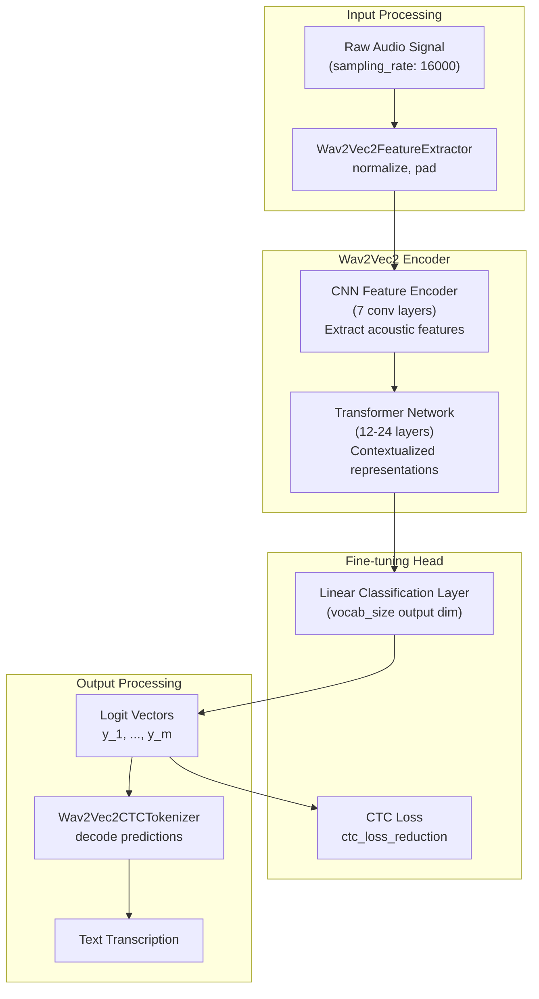
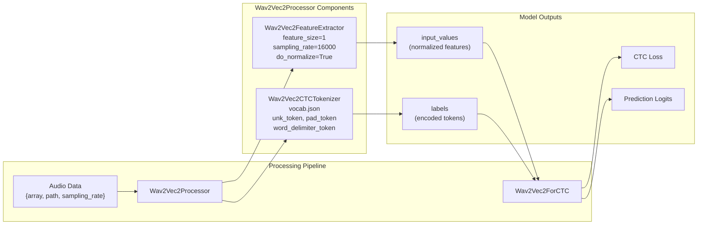
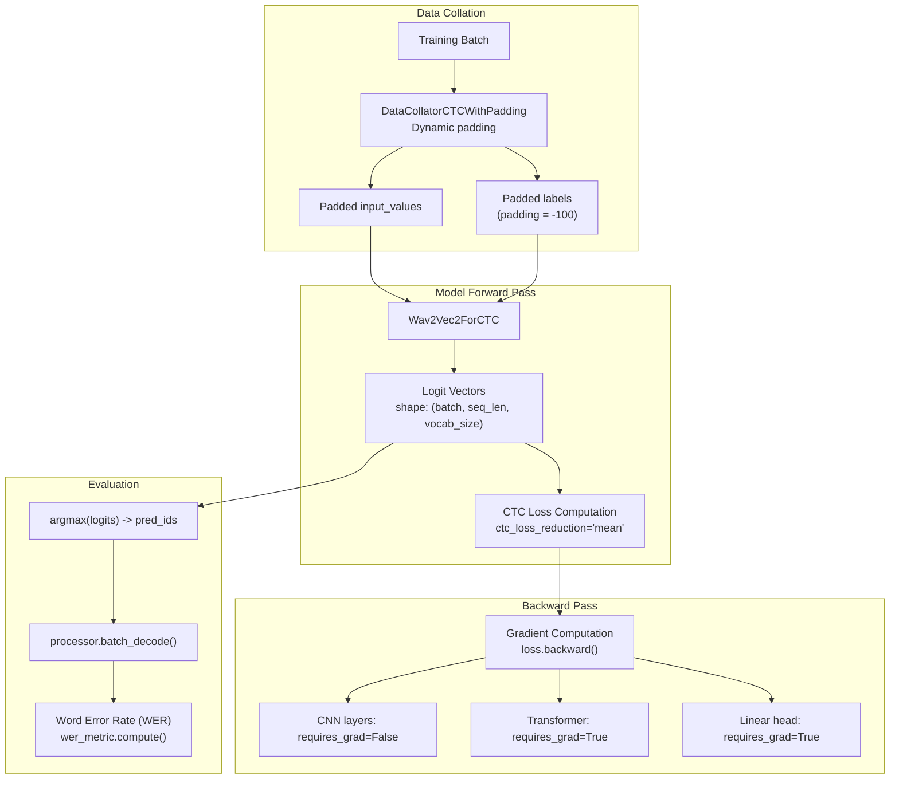

<!-- source: DeepWiki mcp.deepwiki.com · repo huggingface/blog · page 6.3 Speech Recognition Models · fetched 2026-10-26 -->

# Speech Recognition Models

<details>
<summary>Relevant source files</summary>

The following files were used as context for generating this wiki page:

- [assets/xlsr_wav2vec2.png](assets/xlsr_wav2vec2.png)
- [big-bird.md](big-bird.md)
- [fine-tune-wav2vec2-english.md](fine-tune-wav2vec2-english.md)
- [fine-tune-xlsr-wav2vec2.md](fine-tune-xlsr-wav2vec2.md)
- [hf-bitsandbytes-integration.md](hf-bitsandbytes-integration.md)
- [notebooks/17_fine_tune_wav2vec2_for_english_asr.ipynb](notebooks/17_fine_tune_wav2vec2_for_english_asr.ipynb)
- [notebooks/18_fine_tune_xlsr_wav2vec2_asr.ipynb](notebooks/18_fine_tune_xlsr_wav2vec2_asr.ipynb)

</details>


## Purpose and Scope

This page documents speech recognition models covered in the Hugging Face blog, specifically Wav2Vec2-based architectures for Automatic Speech Recognition (ASR). It covers model architecture, data preparation, fine-tuning workflows, and evaluation methodologies for ASR tasks.

**Primary focus areas:**
- Wav2Vec2 and XLS-R (XLSR-Wav2Vec2) model architectures
- Connectionist Temporal Classification (CTC) training
- ASR fine-tuning on low-resource and high-resource datasets
- Data processing pipelines for audio inputs

For general model training techniques, see [Basic Training Techniques](#4.1). For model deployment and optimization, see [Inference Optimization](#5.3). For quantization approaches that can be applied to speech models, see [LLM Optimization and Quantization](#2.3).

## Model Architecture

### Wav2Vec2 Overview

Wav2Vec2 is a pretrained transformer-based model for ASR released by Facebook AI. It uses a self-supervised contrastive pretraining objective similar to BERT's masked language modeling but applied to speech signals.

**Architecture Diagram: Wav2Vec2 Structure**



Sources: [fine-tune-wav2vec2-english.md:19-28](), [fine-tune-xlsr-wav2vec2.md:44-56]()

**Key architectural components:**

| Component | Description | Trainable During Fine-tuning |
|-----------|-------------|------------------------------|
| **CNN Feature Encoder** | 7 convolutional layers extracting acoustic features from raw waveform | No (frozen via `freeze_feature_extractor()`) |
| **Transformer Network** | 12 layers (base) or 24 layers (large) for contextualized representations | Yes |
| **Linear Head** | Classification layer mapping to vocabulary tokens | Yes (randomly initialized) |

Sources: [fine-tune-xlsr-wav2vec2.md:908-918](), [fine-tune-wav2vec2-english.md:732-747]()

### XLS-R (Cross-Lingual Speech Representations)

XLS-R is Wav2Vec2's multilingual successor, pretrained on ~500,000 hours of audio data in 128 languages. It comes in three sizes:

- **Wav2Vec2-XLS-R-300M**: 300 million parameters
- **Wav2Vec2-XLS-R-1B**: 1 billion parameters  
- **Wav2Vec2-XLS-R-2B**: 2 billion parameters

Sources: [fine-tune-xlsr-wav2vec2.md:31-42](), [fine-tune-xlsr-wav2vec2.md:65-67]()

## Core Components

**Component Architecture Diagram**



Sources: [fine-tune-wav2vec2-english.md:430-471](), [fine-tune-xlsr-wav2vec2.md:521-554]()

### Wav2Vec2CTCTokenizer

The tokenizer maps model outputs (logit vectors) to text transcriptions. It is created from a vocabulary dictionary that maps characters to integer IDs.

**Key configuration parameters:**

```python
# Vocabulary structure
vocab_dict = {
    ' ': 0,  # Space character
    'a': 1, 'b': 2, ..., 'z': 26,
    '|': 0,  # Word delimiter (mapped to space)
    '[UNK]': len(vocab_dict),  # Unknown token
    '[PAD]': len(vocab_dict) + 1  # Padding token (CTC blank token)
}
```

Sources: [fine-tune-wav2vec2-english.md:287-360](), [fine-tune-xlsr-wav2vec2.md:360-450]()

**Initialization:**

```python
# From vocab.json file
tokenizer = Wav2Vec2CTCTokenizer(
    "./vocab.json",
    unk_token="[UNK]",
    pad_token="[PAD]",
    word_delimiter_token="|"
)
```

Sources: [fine-tune-wav2vec2-english.md:381-385](), [fine-tune-xlsr-wav2vec2.md:467-471]()

### Wav2Vec2FeatureExtractor

Handles audio preprocessing, including normalization and padding. Operates on raw speech signals sampled at 16kHz.

**Configuration parameters:**

| Parameter | Value | Purpose |
|-----------|-------|---------|
| `feature_size` | 1 | Raw waveform (not spectral features) |
| `sampling_rate` | 16000 | Expected audio sampling rate |
| `padding_value` | 0.0 | Value for padding shorter sequences |
| `do_normalize` | True | Zero-mean unit-variance normalization |
| `return_attention_mask` | True (XLS-R) / False (base) | Mask for padded tokens |

Sources: [fine-tune-wav2vec2-english.md:430-459](), [fine-tune-xlsr-wav2vec2.md:521-542]()

### Wav2Vec2Processor

Wraps both `Wav2Vec2FeatureExtractor` and `Wav2Vec2CTCTokenizer` for convenient processing.

```python
processor = Wav2Vec2Processor(
    feature_extractor=feature_extractor,
    tokenizer=tokenizer
)

# Processing audio (feature extraction)
batch["input_values"] = processor(
    audio["array"],
    sampling_rate=audio["sampling_rate"]
).input_values[0]

# Processing text (tokenization) using context manager
with processor.as_target_processor():
    batch["labels"] = processor(batch["text"]).input_ids
```

Sources: [fine-tune-wav2vec2-english.md:467-471](), [fine-tune-xlsr-wav2vec2.md:550-554](), [fine-tune-xlsr-wav2vec2.md:689-699]()

### Wav2Vec2ForCTC

The model class for CTC-based ASR training. Key initialization parameters:

```python
model = Wav2Vec2ForCTC.from_pretrained(
    "facebook/wav2vec2-base",  # or "facebook/wav2vec2-xls-r-300m"
    attention_dropout=0.0,
    hidden_dropout=0.0,
    feat_proj_dropout=0.0,
    mask_time_prob=0.05,  # SpecAugment masking
    layerdrop=0.0,
    ctc_loss_reduction="mean",
    pad_token_id=processor.tokenizer.pad_token_id,
    vocab_size=len(processor.tokenizer)
)

# Freeze CNN feature encoder
model.freeze_feature_extractor()
```

Sources: [fine-tune-wav2vec2-english.md:740-747](), [fine-tune-xlsr-wav2vec2.md:892-918]()

## Data Processing Pipeline

**Data Processing Flow Diagram**

```mermaid
graph TB
    subgraph "Dataset Loading"
        Dataset["Common Voice / LibriSpeech / Timit<br/>load_dataset()"]
        Columns["Columns:<br/>path, audio, text/sentence"]
    end
    
    subgraph "Text Preprocessing"
        RemoveSpecial["remove_special_characters()<br/>regex: [,?.!-;:\"\"]"]
        Lowercase["Convert to lowercase"]
        ReplaceHat["replace_hatted_characters()<br/>(language-specific)"]
        ExtractVocab["extract_all_chars()<br/>Build vocabulary"]
    end
    
    subgraph "Audio Processing"
        LoadAudio["Audio Feature<br/>Auto-load via datasets"]
        CastColumn["cast_column(Audio(16000))<br/>Resample to 16kHz"]
        Normalize["Feature Extractor<br/>Zero-mean normalization"]
    end
    
    subgraph "Tokenization"
        CreateTokenizer["Wav2Vec2CTCTokenizer<br/>from vocab.json"]
        EncodeLabels["Encode text to label IDs"]
    end
    
    subgraph "Final Output"
        InputValues["input_values<br/>(normalized audio)"]
        Labels["labels<br/>(token IDs)"]
        InputLength["input_length<br/>(sequence length)"]
    end
    
    Dataset --> Columns
    Columns --> RemoveSpecial
    RemoveSpecial --> Lowercase
    Lowercase --> ReplaceHat
    ReplaceHat --> ExtractVocab
    ExtractVocab --> CreateTokenizer
    
    Columns --> LoadAudio
    LoadAudio --> CastColumn
    CastColumn --> Normalize
    
    Normalize --> InputValues
    CreateTokenizer --> EncodeLabels
    EncodeLabels --> Labels
    InputValues --> InputLength
```

Sources: [fine-tune-xlsr-wav2vec2.md:192-354](), [fine-tune-wav2vec2-english.md:229-281]()

### Audio Loading and Resampling

The `datasets` library automatically loads and resamples audio using the `Audio` feature:

```python
# Cast audio column to desired sampling rate
common_voice_train = common_voice_train.cast_column(
    "audio",
    Audio(sampling_rate=16_000)
)

# Audio is loaded as:
# {
#   'array': np.array(...),
#   'path': '/path/to/file.mp3',
#   'sampling_rate': 16000
# }
```

Sources: [fine-tune-xlsr-wav2vec2.md:597-614](), [fine-tune-wav2vec2-english.md:486-502]()

### Text Normalization

**Character removal and normalization steps:**

1. **Remove special characters** - punctuation that doesn't represent sound units
2. **Convert to lowercase** - reduce vocabulary size
3. **Language-specific normalization** - e.g., remove diacritics for certain languages

```python
import re

chars_to_remove_regex = '[\,\?\.\!\-\;\:\"\"\%\'\"\�\']'

def remove_special_characters(batch):
    batch["sentence"] = re.sub(
        chars_to_remove_regex,
        '',
        batch["sentence"]
    ).lower()
    return batch

# Language-specific: Turkish hatted characters
def replace_hatted_characters(batch):
    batch["sentence"] = re.sub('[â]', 'a', batch["sentence"])
    batch["sentence"] = re.sub('[î]', 'i', batch["sentence"])
    # ...
    return batch
```

Sources: [fine-tune-xlsr-wav2vec2.md:267-332](), [fine-tune-wav2vec2-english.md:229-238]()

### Vocabulary Creation

Extract all unique characters from the dataset to build the vocabulary:

```python
def extract_all_chars(batch):
    all_text = " ".join(batch["sentence"])
    vocab = list(set(all_text))
    return {"vocab": [vocab], "all_text": [all_text]}

# Apply with batched=True to access all transcriptions
vocab_train = dataset.map(
    extract_all_chars,
    batched=True,
    batch_size=-1,
    keep_in_memory=True
)

# Create vocabulary dictionary
vocab_list = list(set(vocab_train["vocab"][0]) | set(vocab_test["vocab"][0]))
vocab_dict = {v: k for k, v in enumerate(sorted(vocab_list))}

# Add special tokens
vocab_dict["|"] = vocab_dict[" "]  # Word delimiter
del vocab_dict[" "]
vocab_dict["[UNK]"] = len(vocab_dict)
vocab_dict["[PAD]"] = len(vocab_dict)
```

Sources: [fine-tune-xlsr-wav2vec2.md:344-450](), [fine-tune-wav2vec2-english.md:274-360]()

### Dataset Preparation Function

The final preparation function combines audio and text processing:

```python
def prepare_dataset(batch):
    audio = batch["audio"]
    
    # Process audio to input_values
    batch["input_values"] = processor(
        audio["array"],
        sampling_rate=audio["sampling_rate"]
    ).input_values[0]
    
    batch["input_length"] = len(batch["input_values"])
    
    # Encode text to labels
    with processor.as_target_processor():
        batch["labels"] = processor(batch["sentence"]).input_ids
    
    return batch

# Apply to dataset
dataset = dataset.map(
    prepare_dataset,
    remove_columns=dataset.column_names
)
```

Sources: [fine-tune-xlsr-wav2vec2.md:689-707](), [fine-tune-wav2vec2-english.md:551-567]()

## Fine-tuning Workflow

### CTC Training Overview

Connectionist Temporal Classification (CTC) is an algorithm for sequence-to-sequence problems where input and output lengths differ (n >> m for ASR). It handles alignment between audio frames and text tokens automatically.

**Key CTC characteristics:**
- Introduces a blank token for repeated characters and silence
- No explicit alignment required between audio and text
- Output length is much shorter than input length
- Uses dynamic programming for efficient computation

Sources: [fine-tune-xlsr-wav2vec2.md:74-80](), [fine-tune-wav2vec2-english.md:48-55]()

**Training Workflow Diagram**



Sources: [fine-tune-xlsr-wav2vec2.md:731-918](), [fine-tune-wav2vec2-english.md:572-747]()

### DataCollatorCTCWithPadding

Custom data collator that handles different padding strategies for audio inputs vs. text labels:

```python
@dataclass
class DataCollatorCTCWithPadding:
    """
    Data collator for CTC with dynamic padding.
    Pads input_values and labels separately.
    """
    processor: Wav2Vec2Processor
    padding: Union[bool, str] = True
    
    def __call__(self, features: List[Dict[str, Union[List[int], torch.Tensor]]]):
        # Split inputs and labels
        input_features = [
            {"input_values": feature["input_values"]} 
            for feature in features
        ]
        label_features = [
            {"input_ids": feature["labels"]} 
            for feature in features
        ]
        
        # Pad inputs
        batch = self.processor.pad(
            input_features,
            padding=self.padding,
            return_tensors="pt"
        )
        
        # Pad labels
        with self.processor.as_target_processor():
            labels_batch = self.processor.pad(
                label_features,
                padding=self.padding,
                return_tensors="pt"
            )
        
        # Replace padding with -100 for loss computation
        labels = labels_batch["input_ids"].masked_fill(
            labels_batch.attention_mask.ne(1),
            -100
        )
        
        batch["labels"] = labels
        return batch
```

Sources: [fine-tune-xlsr-wav2vec2.md:777-828](), [fine-tune-wav2vec2-english.md:624-685]()

### Metrics Computation

Word Error Rate (WER) is the standard metric for ASR evaluation:

```python
wer_metric = load_metric("wer")

def compute_metrics(pred):
    pred_logits = pred.predictions
    pred_ids = np.argmax(pred_logits, axis=-1)
    
    # Replace -100 padding with pad_token_id
    pred.label_ids[pred.label_ids == -100] = processor.tokenizer.pad_token_id
    
    # Decode predictions and references
    pred_str = processor.batch_decode(pred_ids)
    label_str = processor.batch_decode(
        pred.label_ids,
        group_tokens=False  # Don't group consecutive tokens
    )
    
    wer = wer_metric.compute(predictions=pred_str, references=label_str)
    return {"wer": wer}
```

**Note:** The `group_tokens=False` parameter is important for CTC decoding to avoid grouping consecutive identical tokens into a single token.

Sources: [fine-tune-xlsr-wav2vec2.md:855-869](), [fine-tune-wav2vec2-english.md:716-730]()

### Training Configuration

Typical training arguments for fine-tuning:

| Parameter | Value | Purpose |
|-----------|-------|---------|
| `group_by_length` | True | Batch similar-length sequences for efficiency |
| `learning_rate` | 1e-4 | Requires tuning per dataset |
| `warmup_steps` | 500 | Gradual learning rate warmup |
| `save_steps` | 400 | Checkpoint frequency |
| `eval_steps` | 400 | Evaluation frequency |
| `logging_steps` | 400 | Logging frequency |
| `save_total_limit` | 2 | Keep only recent checkpoints |
| `gradient_checkpointing` | True | Reduce memory usage |

Sources: [fine-tune-xlsr-wav2vec2.md:920-931]()

## Common Datasets

### Common Voice

Mozilla's multilingual read speech corpus with crowd-sourced recordings. Available in 100+ languages.

**Dataset structure:**
- `train`, `validation`, `test` splits (also `invalidated`, `other` splits)
- Audio files in MP3 format
- Metadata: accent, age, gender, locale, etc.
- Typical training size: 4-10 hours per language (low-resource), up to 100+ hours (high-resource)

```python
from datasets import load_dataset

# Load specific language
common_voice = load_dataset("common_voice", "tr", split="train+validation")
common_voice_test = load_dataset("common_voice", "tr", split="test")

# Remove unnecessary columns
common_voice = common_voice.remove_columns([
    "accent", "age", "client_id", "down_votes",
    "gender", "locale", "segment", "up_votes"
])
```

Sources: [fine-tune-xlsr-wav2vec2.md:169-208]()

### LibriSpeech

English read speech corpus with ~1000 hours of audiobook recordings. Wav2Vec2's pretraining dataset.

**Characteristics:**
- Clean and other (noisy) subsets
- High-quality 16kHz recordings
- Standard ASR benchmark dataset

Sources: [fine-tune-wav2vec2-english.md:33-35](), [fine-tune-wav2vec2-english.md:421-424]()

### Timit

Small English corpus with ~5 hours of phonetically-rich speech. Often used for phoneme recognition.

**Characteristics:**
- Multiple speakers with diverse dialects
- Phonetically balanced sentences
- Both phonetic and word-level transcriptions available

```python
timit = load_dataset("timit_asr")
# Features: file, audio, text, phonetic_detail, word_detail,
#           dialect_region, sentence_type, speaker_id, id
```

Sources: [fine-tune-wav2vec2-english.md:137-171]()

## Evaluation Metrics

### Word Error Rate (WER)

The primary metric for ASR evaluation, calculated as:

```
WER = (Substitutions + Deletions + Insertions) / Total Words in Reference
```

Lower WER indicates better performance. State-of-the-art models achieve:
- Clean LibriSpeech: < 5% WER
- Other LibriSpeech: < 10% WER

```python
from datasets import load_metric

wer_metric = load_metric("wer")
wer = wer_metric.compute(predictions=pred_str, references=label_str)
```

Sources: [fine-tune-wav2vec2-english.md:58-60](), [fine-tune-xlsr-wav2vec2.md:84-86]()

### Phoneme Error Rate (PER)

Alternative metric measuring phoneme-level accuracy. Used when evaluating phoneme classification tasks.

Sources: [fine-tune-wav2vec2-english.md:97-100]()

## Model Checkpoints

### Available Pretrained Models

| Checkpoint | Parameters | Languages | Pretraining Data |
|------------|------------|-----------|------------------|
| `facebook/wav2vec2-base` | 95M | English | LibriSpeech 960h |
| `facebook/wav2vec2-large-lv60` | 317M | English | Libri-Light 60k hours |
| `facebook/wav2vec2-xls-r-300m` | 300M | 128 languages | ~500k hours multilingual |
| `facebook/wav2vec2-xls-r-1b` | 1B | 128 languages | ~500k hours multilingual |
| `facebook/wav2vec2-xls-r-2b` | 2B | 128 languages | ~500k hours multilingual |

Sources: [fine-tune-wav2vec2-english.md:43-46](), [fine-tune-xlsr-wav2vec2.md:37-42]()

### Loading Models

```python
from transformers import Wav2Vec2ForCTC, Wav2Vec2Processor

# Load pretrained model
model = Wav2Vec2ForCTC.from_pretrained("facebook/wav2vec2-xls-r-300m")

# Load from fine-tuned checkpoint
model = Wav2Vec2ForCTC.from_pretrained("your-username/model-name")
```

Sources: [fine-tune-xlsr-wav2vec2.md:892-906]()

### Pushing to Hub

```python
# Save locally
model.save_pretrained("./model")
tokenizer.save_pretrained("./model")

# Push to Hugging Face Hub
tokenizer.push_to_hub("wav2vec2-large-xls-r-300m-tr")
processor.push_to_hub("wav2vec2-large-xls-r-300m-tr")
model.push_to_hub("wav2vec2-large-xls-r-300m-tr")
```

Sources: [fine-tune-xlsr-wav2vec2.md:473-486](), [fine-tune-wav2vec2-english.md:387-398]()

## Training Considerations

### Memory Management

For long sequences, memory usage can become problematic due to quadratic attention complexity. Strategies include:

1. **Filter long sequences** - Remove sequences exceeding maximum length
2. **Gradient checkpointing** - Trade compute for memory
3. **Sequence length limits** - Enforce maximum input length

```python
# Filter sequences longer than 5 seconds
max_input_length_in_sec = 5.0
dataset = dataset.filter(
    lambda x: x < max_input_length_in_sec * 16000,
    input_columns=["input_length"]
)
```

Sources: [fine-tune-xlsr-wav2vec2.md:716-727]()

### Hyperparameter Tuning

Key hyperparameters requiring adjustment per dataset:

- **Dropout rates** - `attention_dropout`, `hidden_dropout`, `feat_proj_dropout`
- **SpecAugment** - `mask_time_prob` for time masking
- **Layer dropout** - `layerdrop` for layer-wise dropout
- **Learning rate** - Typically 1e-4 to 3e-4
- **Weight decay** - For regularization

Small/noisy datasets like Common Voice often require careful tuning.

Sources: [fine-tune-xlsr-wav2vec2.md:879-891]()

### Feature Encoder Freezing

The CNN feature encoder is always frozen during fine-tuning as it has already learned robust acoustic features during pretraining:

```python
model.freeze_feature_extractor()
```

This significantly reduces trainable parameters and prevents overfitting on small datasets.

Sources: [fine-tune-xlsr-wav2vec2.md:908-918](), [fine-tune-wav2vec2-english.md:732-747]()

---

