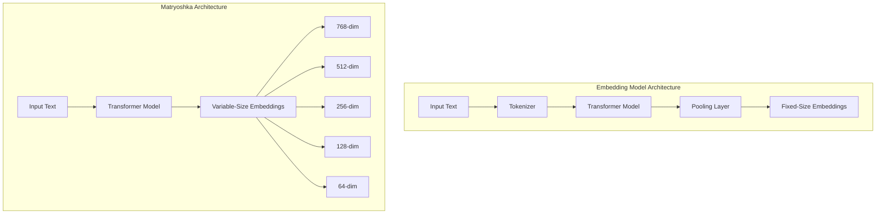
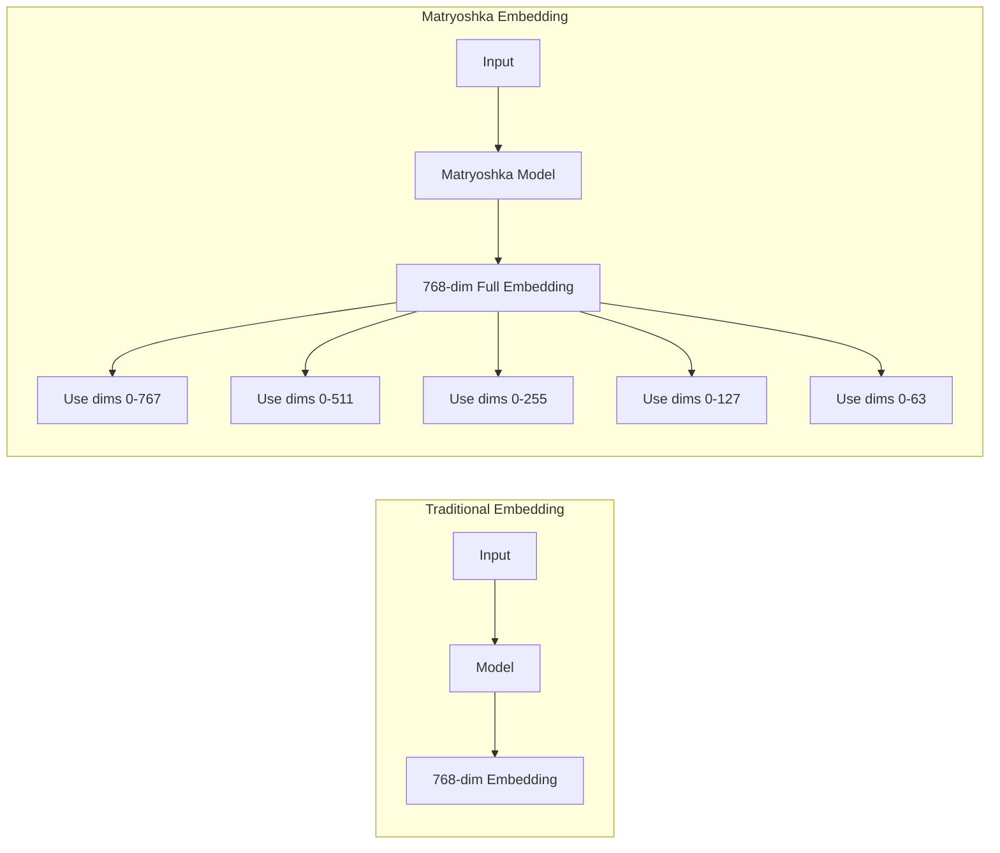
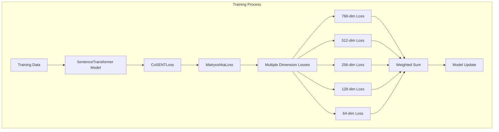
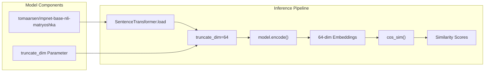
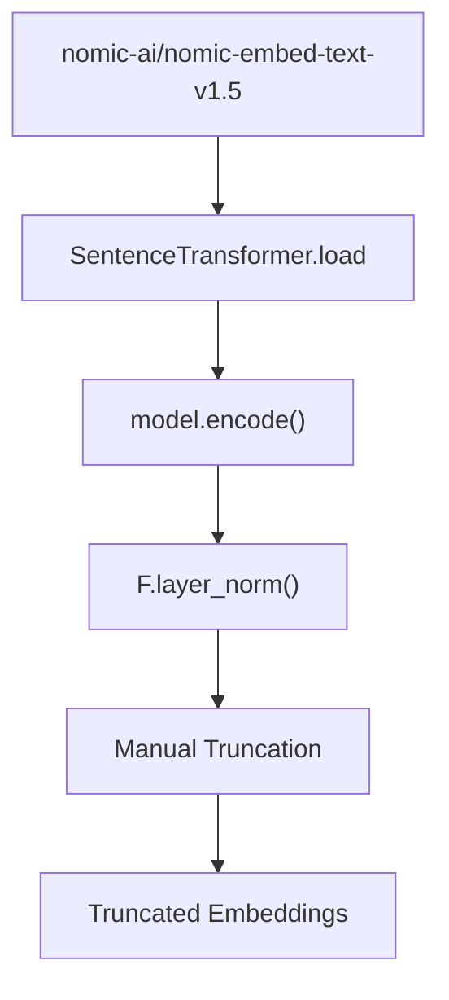
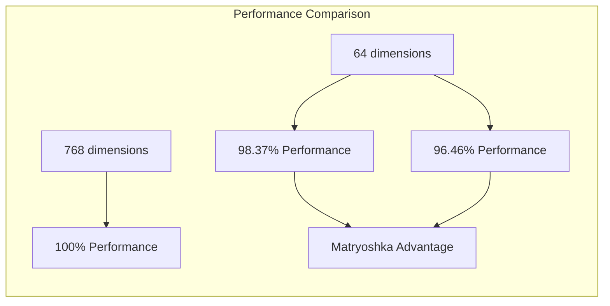
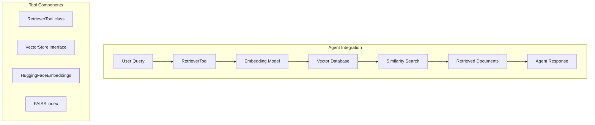

<!-- source: DeepWiki mcp.deepwiki.com · repo huggingface/blog · page 6.4 Embedding Models · fetched 2026-10-26 -->

# Embedding Models

Relevant source files

The following files were used as context for generating this wiki page:

- [1b-sentence-embeddings.md](1b-sentence-embeddings.md)
- [accelerated-inference.md](accelerated-inference.md)
- [assets/17_the_partnership_amazon_sagemaker_and_hugging_face/cover.png](assets/17_the_partnership_amazon_sagemaker_and_hugging_face/cover.png)
- [assets/17_the_partnership_amazon_sagemaker_and_hugging_face/thumbnail.png](assets/17_the_partnership_amazon_sagemaker_and_hugging_face/thumbnail.png)
- [assets/25_hardware_partners_program/carbon_inc_quantizer.png](assets/25_hardware_partners_program/carbon_inc_quantizer.png)
- [assets/deploy-with-openvino/demo.gif](assets/deploy-with-openvino/demo.gif)
- [assets/deploy-with-openvino/openvino_genai_workflow.png](assets/deploy-with-openvino/openvino_genai_workflow.png)
- [assets/galore_introduction/thumbnail.png](assets/galore_introduction/thumbnail.png)
- [assets/leaderboards-on-the-hub/thumbnail_flageval.png](assets/leaderboards-on-the-hub/thumbnail_flageval.png)
- [bert-cpu-scaling-part-2.md](bert-cpu-scaling-part-2.md)
- [community-update.md](community-update.md)
- [debate.md](debate.md)
- [deploy-hugging-face-models-easily-with-amazon-sagemaker.md](deploy-hugging-face-models-easily-with-amazon-sagemaker.md)
- [deploy-with-openvino.md](deploy-with-openvino.md)
- [few-shot-learning-gpt-neo-and-inference-api.md](few-shot-learning-gpt-neo-and-inference-api.md)
- [fr/_blog.yml](fr/_blog.yml)
- [galore.md](galore.md)
- [hardware-partners-program.md](hardware-partners-program.md)
- [sentence-transformers-in-the-hub.md](sentence-transformers-in-the-hub.md)
- [the-partnership-amazon-sagemaker-and-hugging-face.md](the-partnership-amazon-sagemaker-and-hugging-face.md)

This document covers the embedding model architectures and implementations featured in the Hugging Face blog, with particular emphasis on Matryoshka embedding models and their integration with the Sentence Transformers framework. The content focuses on training methodologies, usage patterns, and performance characteristics of modern embedding architectures.

For information about large language models and their embeddings, see [Large Language Models](#2). For vision-language model embeddings, see [Vision Language Models](#3).

## Overview of Embedding Models

Embedding models transform complex objects like text, images, or audio into numerical vector representations that capture semantic meaning. These models serve as the foundation for various downstream tasks including similarity search, retrieval systems, classification, and clustering applications.

The blog content demonstrates embedding models primarily through the lens of text embeddings using the Sentence Transformers framework, with specific focus on innovative architectures like Matryoshka embeddings that enable variable-dimension representations.

**Sources:** [matryoshka.md:32-51]()

## Matryoshka Embedding Models

Matryoshka embedding models represent a significant advancement in embedding architecture, enabling the generation of useful embeddings at multiple dimensionalities from a single model. These models are trained to frontload the most important information in earlier dimensions while placing less critical information in later dimensions.

### Core Architecture

The Matryoshka approach addresses the efficiency-performance trade-off inherent in traditional embedding models. Instead of being constrained to a single fixed output dimension, these models can produce meaningful representations when truncated to various smaller sizes.

**Sources:** [matryoshka.md:43-58]()

### Training Implementation

Matryoshka embeddings utilize the `MatryoshkaLoss` class within the Sentence Transformers framework. The training process applies loss functions across multiple embedding dimensions simultaneously, encouraging the model to learn hierarchical representations.

The training configuration demonstrates the integration of multiple loss components:

- `CoSENTLoss`: Base loss function for sentence similarity
- `MatryoshkaLoss`: Wrapper that applies the base loss across multiple dimensions
- `matryoshka_dims`: List of target dimensions `[768, 512, 256, 128, 64]`
- `matryoshka_weight`: Weights for each dimension loss `[1, 1, 1, 1, 1]`

**Sources:** [matryoshka.md:82-100](), [matryoshka.md:104-117]()

## Model Usage and Inference

### Standard Usage Pattern

Matryoshka embedding models can be loaded and used through the standard Sentence Transformers interface with the addition of the `truncate_dim` parameter for dimension specification.

**Sources:** [matryoshka.md:134-155]()

### Specialized Model Handling

Certain models like `nomic-ai/nomic-embed-text-v1.5` require custom preprocessing with layer normalization before truncation:

**Sources:** [matryoshka.md:168-199]()

## Performance Characteristics

### Efficiency Benefits

Matryoshka embedding models provide significant advantages in both computational efficiency and storage requirements. The models enable dynamic trade-offs between performance and resource consumption.

| Dimension | Performance Retention | Storage Reduction | Use Case |
|-----------|---------------------|------------------|----------|
| 768 | 100% | 0% | Full accuracy needed |
| 512 | ~99% | 33% reduction | Balanced performance |
| 256 | ~98% | 67% reduction | Fast similarity search |
| 128 | ~97% | 83% reduction | Real-time applications |
| 64 | ~96% | 92% reduction | Memory-constrained systems |

### Benchmarking Results

The performance evaluation demonstrates that Matryoshka models maintain high performance across dimensional reductions. At 8.3% of the original embedding size (64 out of 768 dimensions), the Matryoshka model preserves 98.37% of performance compared to 96.46% for standard models.

**Sources:** [matryoshka.md:201-217]()

## Integration with Agents and Applications

Embedding models serve as crucial components in agentic systems, particularly for retrieval-augmented generation (RAG) and semantic search applications. The blog demonstrates integration patterns through agent tooling systems.

The `RetrieverTool` implementation demonstrates practical embedding usage within agent frameworks, utilizing `HuggingFaceEmbeddings` with models like `"thenlper/gte-small"` for document similarity search.

**Sources:** [agents.md:171-213]()

## Training Scripts and Examples

The blog references multiple training scripts that demonstrate Matryoshka embedding training in practice:

- `matryoshka_nli.py`: Training with Natural Language Inference data using `MultipleNegativesRankingLoss`
- `matryoshka_nli_reduced_dim.py`: Training with reduced maximum dimensions (256)
- `matryoshka_sts.py`: Training on STSBenchmark dataset using `CoSENTLoss`

These scripts provide complete implementations of the training pipeline, including data preprocessing, loss configuration, and model evaluation components.

**Sources:** [matryoshka.md:114-117]()

---

