<!-- source: DeepWiki mcp.deepwiki.com · repo huggingface/blog · page 6.5 Efficient Architectures · fetched 2026-10-26 -->

# Efficient Architectures

<details>
<summary>Relevant source files</summary>

The following files were used as context for generating this wiki page:

- [assets/03_reformer/thumbnail.png](assets/03_reformer/thumbnail.png)
- [assets/04_pytorch_block_sparse/thumbnail.png](assets/04_pytorch_block_sparse/thumbnail.png)
- [assets/05_encoder_decoder/thumbnail.png](assets/05_encoder_decoder/thumbnail.png)
- [assets/07_porting_fsmt/thumbnail.png](assets/07_porting_fsmt/thumbnail.png)
- [assets/08_warm_starting_encoder_decoder/thumbnail.png](assets/08_warm_starting_encoder_decoder/thumbnail.png)
- [assets/xlsr_wav2vec2.png](assets/xlsr_wav2vec2.png)
- [big-bird.md](big-bird.md)
- [encoder-decoder.md](encoder-decoder.md)
- [fine-tune-wav2vec2-english.md](fine-tune-wav2vec2-english.md)
- [fine-tune-xlsr-wav2vec2.md](fine-tune-xlsr-wav2vec2.md)
- [hf-bitsandbytes-integration.md](hf-bitsandbytes-integration.md)
- [how-to-generate.md](how-to-generate.md)
- [how-to-train.md](how-to-train.md)
- [notebooks/03_reformer.ipynb](notebooks/03_reformer.ipynb)
- [notebooks/05_encoder_decoder.ipynb](notebooks/05_encoder_decoder.ipynb)
- [notebooks/08_warm_starting_encoder_decoder.ipynb](notebooks/08_warm_starting_encoder_decoder.ipynb)
- [notebooks/17_fine_tune_wav2vec2_for_english_asr.ipynb](notebooks/17_fine_tune_wav2vec2_for_english_asr.ipynb)
- [notebooks/18_fine_tune_xlsr_wav2vec2_asr.ipynb](notebooks/18_fine_tune_xlsr_wav2vec2_asr.ipynb)
- [pytorch_block_sparse.md](pytorch_block_sparse.md)
- [reformer.md](reformer.md)
- [warm-starting-encoder-decoder.md](warm-starting-encoder-decoder.md)

</details>


## Purpose and Scope

This document covers memory-efficient transformer architectures that address the quadratic complexity bottleneck of standard self-attention. It focuses on **Reformer** and **BigBird**, two architectures that enable processing of extremely long sequences (up to 500,000 tokens for Reformer and 4,096 tokens for BigBird) through innovative attention mechanisms and memory optimization techniques.

For general transformer training techniques, see [Basic Training Techniques](#4.1). For quantization-based memory optimization, see [LLM Optimization and Quantization](#2.3). For distributed training approaches, see [Distributed Training](#4.4).

---

## The Quadratic Complexity Problem

Standard transformer self-attention has an asymptotic memory complexity of O(n²) where n is the sequence length. This occurs because each token attends to all other tokens, requiring computation and storage of an n×n attention matrix.

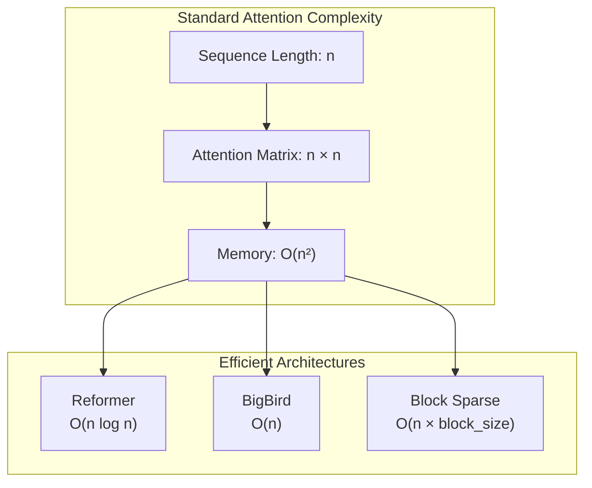

**Sources:** [reformer.md:1-30](), [big-bird.md:1-20]()

| Model | Max Sequence | Memory Complexity | Key Innovation |
|-------|--------------|-------------------|----------------|
| BERT | 512 | O(n²) | Full attention |
| Reformer | 500,000 | O(n log n) | LSH + reversible layers |
| BigBird | 4,096 | O(n) | Block sparse attention |

**Sources:** [reformer.md:14-22](), [big-bird.md:13-16]()

---

## Reformer Architecture

Reformer introduces four key features to reduce memory requirements while maintaining model performance:

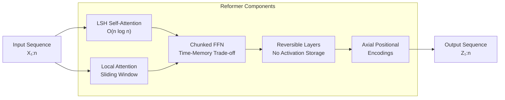

**Sources:** [reformer.md:23-34]()

### LSH Self-Attention

Locality Sensitive Hashing (LSH) attention clusters query vectors into buckets based on cosine similarity, allowing each query to attend only to keys in the same bucket rather than all keys.

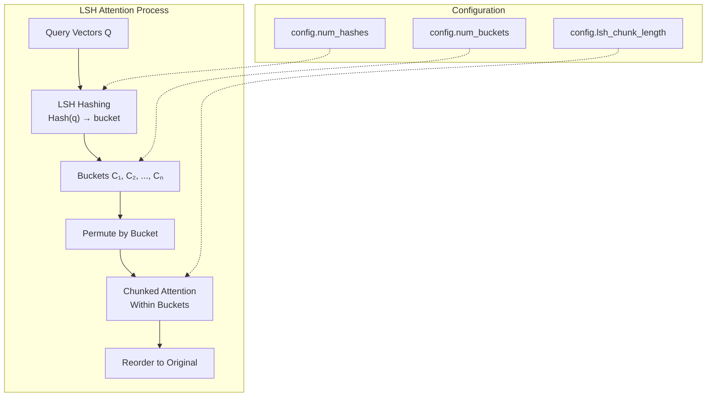

**Key parameters:**
- `config.num_buckets` (n_b): Number of hash buckets
- `config.num_hashes` (n_h): Number of hashing rounds for improved accuracy
- `config.lsh_chunk_length` (l_c): Chunk size for batched processing
- `config.lsh_num_chunks_before`: Number of previous chunks to attend to

**Sources:** [reformer.md:118-183]()

### Local Self-Attention

Local attention restricts each token to attend only to a fixed-size window of neighboring tokens, drastically reducing memory requirements.

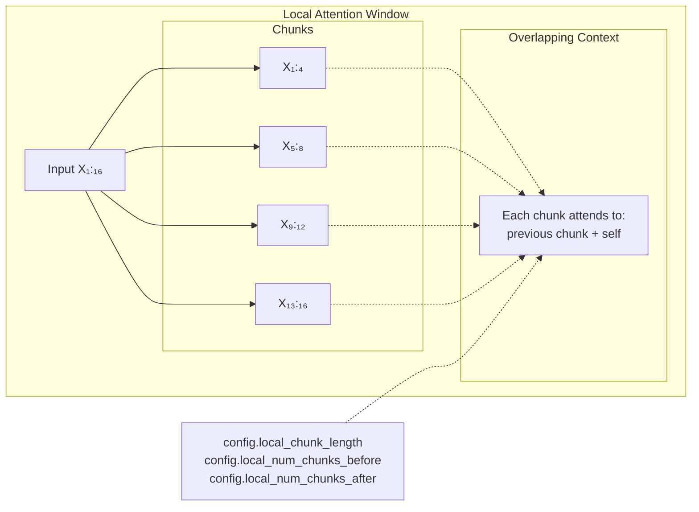

**Configuration:**
- `config.local_chunk_length` (l_c): Size of each chunk
- `config.local_num_chunks_before` (n_p): Number of previous chunks in context
- `config.local_num_chunks_after` (n_a): Number of following chunks in context

Memory complexity: O(n_c × l_c²) = O(n × l_c) where n_c is the number of chunks.

**Sources:** [reformer.md:65-106]()

### Chunked Feed Forward Layers

Chunked feed-forward layers process the sequence in chunks to trade computation time for memory savings:

```mermaid
graph TB
    subgraph "Standard FFN"
        Input1["Input: n × d_h"]
        FFN1["FFN: n × d_ff"]
        Output1["Output: n × d_h"]
        Memory1["Memory: O(n × d_ff)"]
        
        Input1 --> FFN1
        FFN1 --> Output1
        Output1 --> Memory1
    end
    
    subgraph "Chunked FFN"
        Input2["Input: n × d_h"]
        Split["Split into chunks"]
        Process["Process each chunk<br/>sequentially"]
        Concat["Concatenate"]
        Output2["Output: n × d_h"]
        Memory2["Memory: O(chunk_size × d_ff)"]
        
        Input2 --> Split
        Split --> Process
        Process --> Concat
        Concat --> Output2
        Output2 --> Memory2
    end
```

**Sources:** [reformer.md:185-220]()

### Reversible Residual Layers

Reversible layers eliminate the need to store activations during training by computing them on-the-fly during the backward pass:

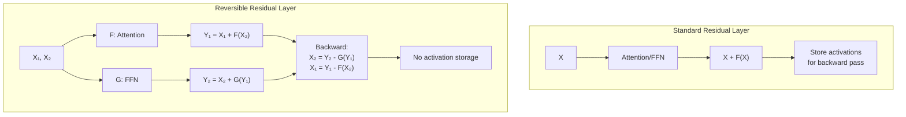

Reversible layers reduce memory consumption to O(1) with respect to the number of layers during training.

**Sources:** [reformer.md:222-275]()

### Axial Positional Encodings

For very long sequences, standard positional encodings become a memory bottleneck. Axial positional encodings factorize the position encoding into multiple dimensions:

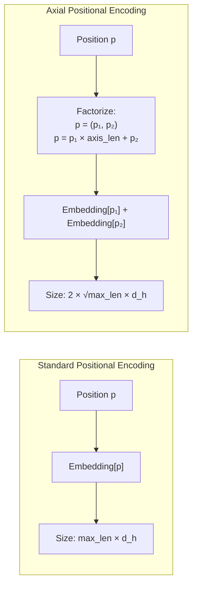

**Configuration:**
- `config.axial_pos_shape`: Factorization shape (e.g., [64, 64] for 4096 positions)
- `config.axial_pos_embds_dim`: Dimension allocated to each axis

**Sources:** [reformer.md:277-350]()

---

## BigBird Architecture

BigBird uses block sparse attention combining three attention patterns: **sliding** (local), **global**, and **random** attention to approximate full attention while maintaining O(n) complexity.

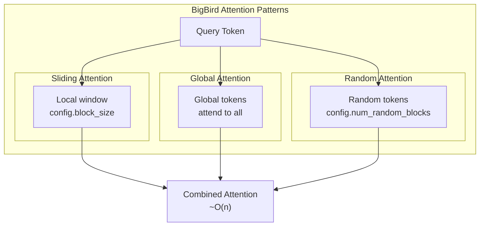

**Sources:** [big-bird.md:32-97]()

### Attention Pattern Components

**Sliding Attention (Local):**
- Each token attends to `w` neighboring tokens (window size)
- Captures local dependencies
- Similar to Reformer's local attention

**Global Attention:**
- Special tokens attend to all positions and are attended by all
- Enables long-range information propagation
- Typically first and last tokens

**Random Attention:**
- Each block attends to `r` randomly selected blocks
- Reduces information travel distance
- Parameter: `config.num_random_blocks`

**Sources:** [big-bird.md:54-97]()

### Block Sparse Implementation

BigBird organizes the sequence into blocks and computes attention using a sparse pattern:

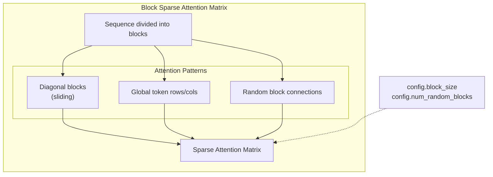

**Key parameters:**
- `config.block_size`: Size of each attention block (typically 64)
- `config.num_random_blocks`: Number of random blocks to attend to (typically 3)

**Sources:** [big-bird.md:99-180]()

### Attention Pattern Graph Representation

The combination of sliding, global, and random attention creates efficient information flow:

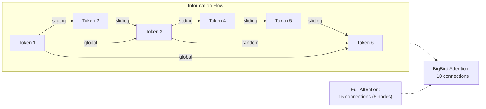

**Sources:** [big-bird.md:99-114]()

---

## Block Sparse Linear Layers

The `pytorch_block_sparse` extension provides efficient CUDA kernels for block sparse matrix multiplication, enabling practical use of sparse architectures.

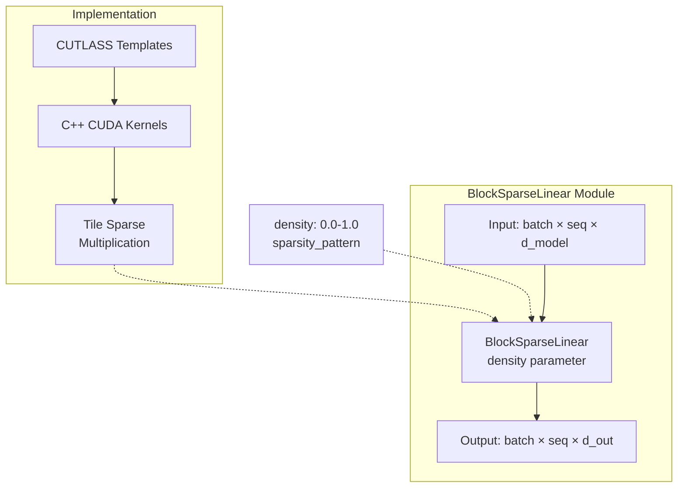

**Usage Example:**
```python
from pytorch_block_sparse import BlockSparseLinear

# Replace standard linear layer
# self.fc = nn.Linear(1024, 256)
self.fc = BlockSparseLinear(1024, 256, density=0.1)
```

**Sources:** [pytorch_block_sparse.md:33-50]()

### Performance Characteristics

| Sparsity | Memory Savings | Speed vs Dense | Use Case |
|----------|----------------|----------------|----------|
| 50% | 2× | ~1.5× | Moderate savings |
| 75% | 4× | ~2× | High savings |
| 90% | 10× | ~5× | Extreme savings |

**Note:** Performance approximately 2× slower than cuBLAS dense operations at current implementation, but significantly faster than PyTorch's native sparse operations.

**Sources:** [pytorch_block_sparse.md:65-78]()

### Block Sparse Model Patching

The `BlockSparseModelPatcher` allows converting existing models to use block sparse layers:

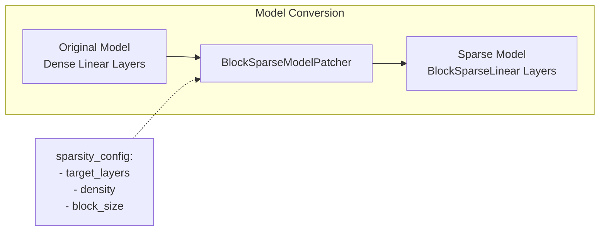

**Sources:** [pytorch_block_sparse.md:47-50]()

---

## Architecture Comparison

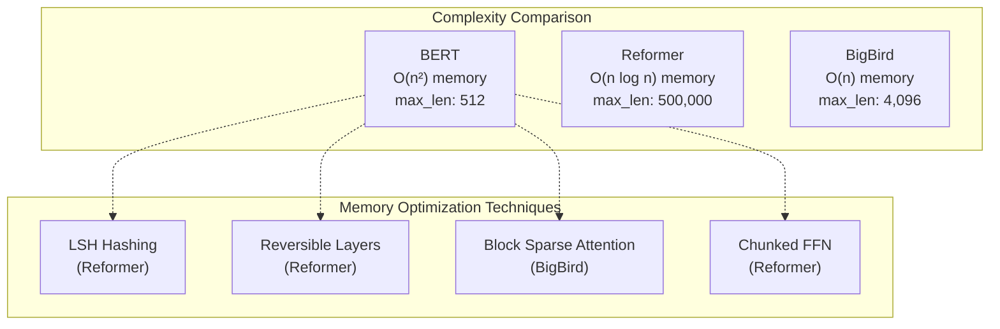

| Feature | BERT | Reformer | BigBird |
|---------|------|----------|---------|
| Attention Complexity | O(n²) | O(n log n) | O(n) |
| Max Sequence Length | 512 | 500,000 | 4,096 |
| Attention Type | Full | LSH + Local | Block Sparse |
| Activation Storage | Standard | Reversible | Standard |
| Positional Encoding | Learned/Sinusoidal | Axial | Standard |
| Training Memory | High | Low | Medium |

**Sources:** [reformer.md:14-22](), [big-bird.md:13-16]()

---

## Configuration Parameters

### Reformer Configuration

```python
# Key Reformer configuration parameters
config.num_buckets          # Number of LSH buckets (n_b)
config.num_hashes           # Number of hash rounds (n_h)
config.lsh_chunk_length     # LSH chunk size (l_c)
config.local_chunk_length   # Local attention chunk size
config.local_num_chunks_before  # Previous chunks to attend
config.axial_pos_shape      # Factorization for positional encoding
config.axial_pos_embds_dim  # Dimensions per axis
```

**Sources:** [reformer.md:33-34](), [reformer.md:135-160]()

### BigBird Configuration

```python
# Key BigBird configuration parameters
config.block_size           # Size of attention blocks (typically 64)
config.num_random_blocks    # Number of random connections (typically 3)
config.attention_type       # "block_sparse" or "original_full"
```

**Sources:** [big-bird.md:180-230]()

### Block Sparse Configuration

```python
# BlockSparseLinear parameters
density                     # 0.0-1.0, fraction of weights to keep
block_size                  # Size of sparse blocks
sparsity_pattern           # Pattern for block selection
```

**Sources:** [pytorch_block_sparse.md:33-50]()

---

## Memory and Performance Trade-offs

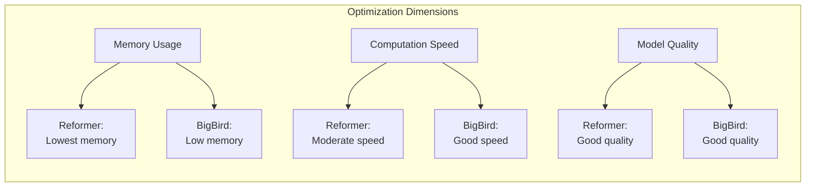

**Key Trade-offs:**

1. **Reformer:** Optimizes for maximum sequence length at the cost of some computational overhead from LSH hashing
2. **BigBird:** Balances efficiency and quality with fixed sparse pattern, good for document-level tasks
3. **Block Sparse:** Provides flexible sparsity patterns, useful for custom architectures

**Sources:** [reformer.md:14-30](), [big-bird.md:13-20](), [pytorch_block_sparse.md:65-89]()

---

