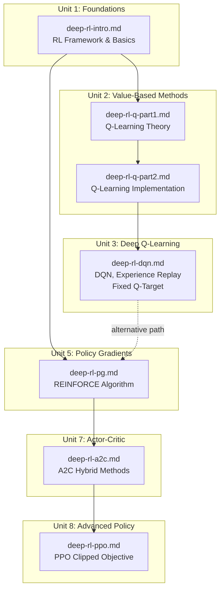
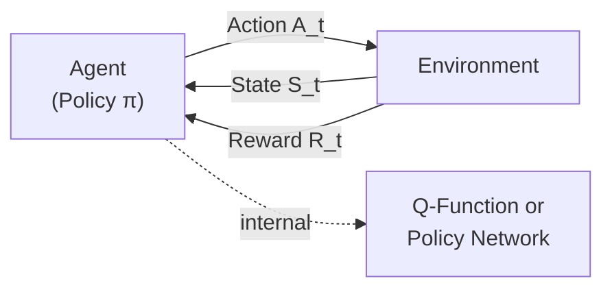
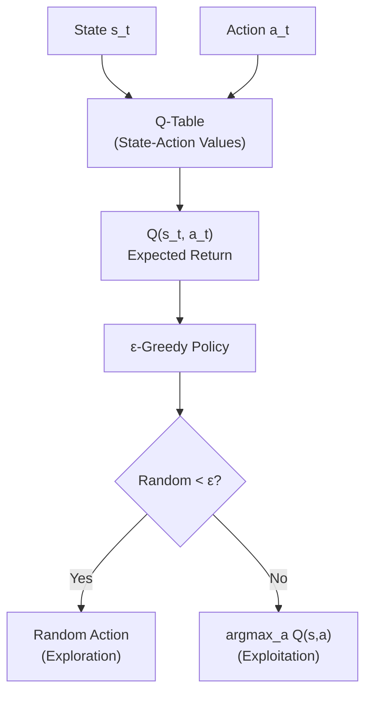
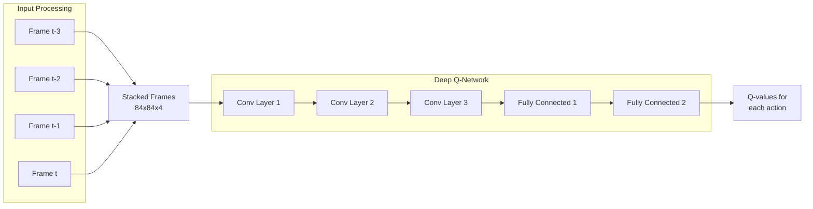
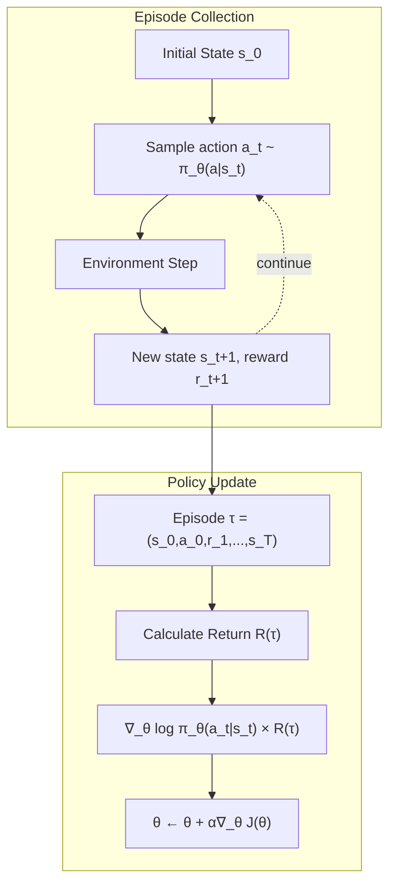
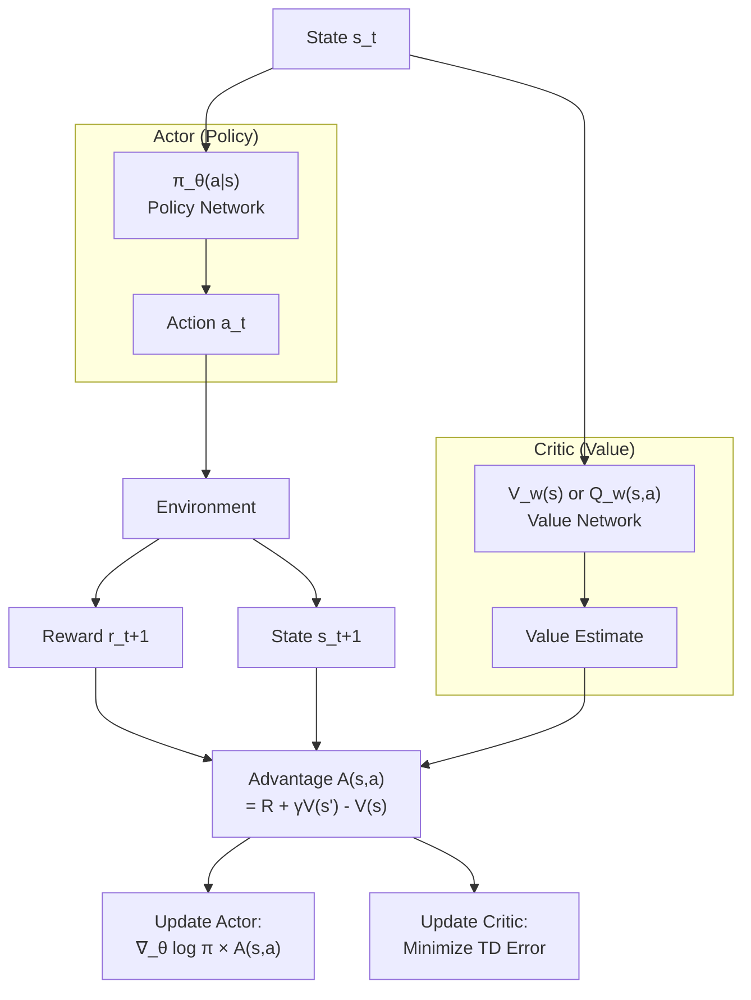
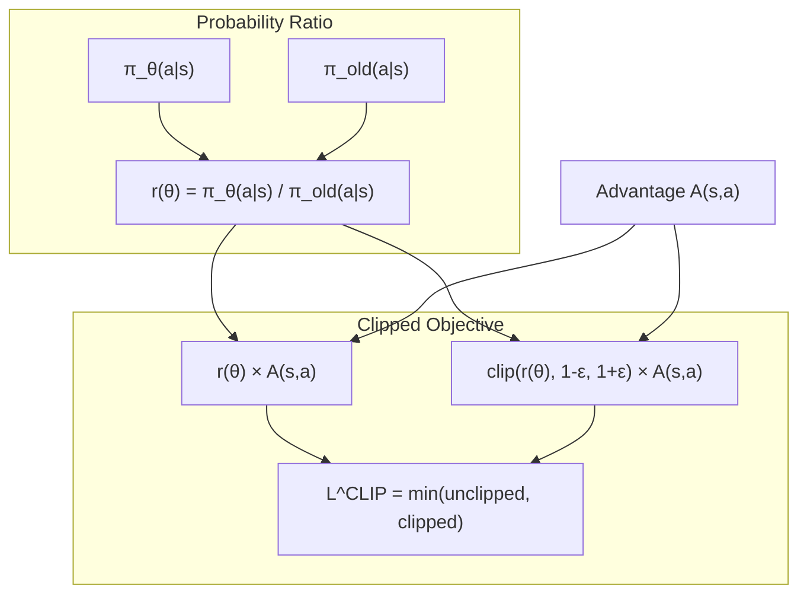
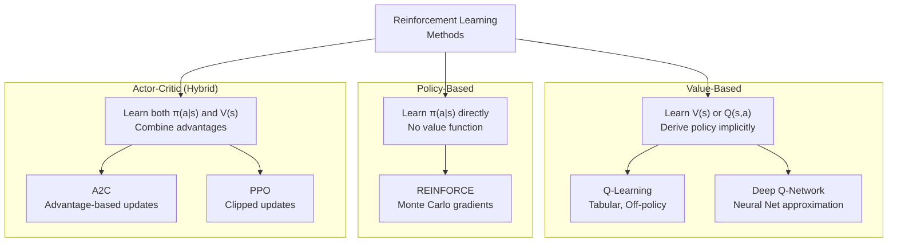
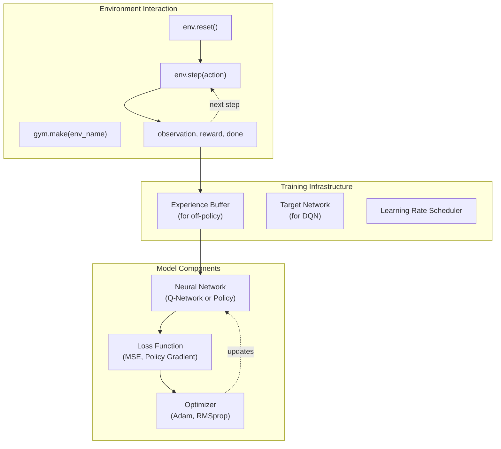
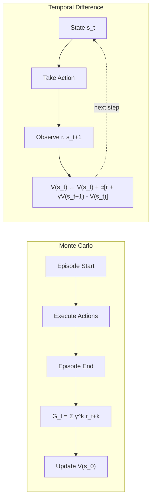

<!-- source: DeepWiki mcp.deepwiki.com · repo huggingface/blog · page 7 Deep Reinforcement Learning · fetched 2026-10-26 -->

# Deep Reinforcement Learning

<details>
<summary>Relevant source files</summary>

The following files were used as context for generating this wiki page:

- [assets/63_deep_rl_intro/tasks.jpg](assets/63_deep_rl_intro/tasks.jpg)
- [assets/70_deep_rl_q_part1/bellman6.jpg](assets/70_deep_rl_q_part1/bellman6.jpg)
- [assets/78_ml_director_insights/witty-works.png](assets/78_ml_director_insights/witty-works.png)
- [assets/86_bloom/bloom-examples.jpg](assets/86_bloom/bloom-examples.jpg)
- [assets/controlnet/thumbnail.png](assets/controlnet/thumbnail.png)
- [assets/cosmopedia/thumbnail.png](assets/cosmopedia/thumbnail.png)
- [bloom.md](bloom.md)
- [classification-use-cases.md](classification-use-cases.md)
- [controlnet.md](controlnet.md)
- [cosmopedia.md](cosmopedia.md)
- [deep-rl-a2c.md](deep-rl-a2c.md)
- [deep-rl-dqn.md](deep-rl-dqn.md)
- [deep-rl-intro.md](deep-rl-intro.md)
- [deep-rl-pg.md](deep-rl-pg.md)
- [deep-rl-ppo.md](deep-rl-ppo.md)
- [deep-rl-q-part1.md](deep-rl-q-part1.md)
- [deep-rl-q-part2.md](deep-rl-q-part2.md)
- [ml-director-insights-2.md](ml-director-insights-2.md)

</details>


## Purpose and Scope

This section provides a comprehensive curriculum for Deep Reinforcement Learning, covering the progression from foundational concepts to advanced algorithms. The material spans value-based methods (Q-Learning, Deep Q-Networks) and policy-based methods (REINFORCE, Actor-Critic, PPO), teaching both theoretical foundations and practical implementations.

For specific Deep RL topics:
- Fundamental RL concepts and Q-Learning → see [Introduction to Deep RL](#7.1)
- Policy gradient and actor-critic methods → see [Policy Gradient Methods](#7.2)
- Practical applications of RL → see [RL Applications](#7.3)

For related ML topics:
- Training and fine-tuning LLMs → see [Training and Fine-tuning LLMs](#2.2)
- RLHF and reward models → see [Reinforcement Learning from Human Feedback](#4.3)

Sources: [deep-rl-intro.md](), [deep-rl-q-part1.md](), [deep-rl-dqn.md](), [deep-rl-pg.md](), [deep-rl-a2c.md](), [deep-rl-ppo.md]()

## Curriculum Architecture

The Deep RL curriculum follows a structured progression from basic concepts to advanced implementations, organized into distinct learning units.



**Curriculum Progression**

| Unit | Topic | Key Concepts | Implementation |
|------|-------|--------------|----------------|
| 1 | RL Basics | Markov Property, Reward Hypothesis, Exploration vs Exploitation | LunarLander environment |
| 2 | Q-Learning | Q-Table, Bellman Equation, TD Learning | FrozenLake, Taxi environments |
| 3 | Deep Q-Networks | Neural Network Q-Function, Experience Replay | Atari games (Space Invaders) |
| 5 | Policy Gradients | REINFORCE, Stochastic Policies | CartPole, PixelCopter, Pong |
| 7 | Actor-Critic | Advantage Function, Variance Reduction | PyBullet robotics environments |
| 8 | PPO | Clipped Surrogate Objective, Stable Updates | CartPole, LunarLander |

Sources: [deep-rl-intro.md:1-76](), [deep-rl-q-part1.md:1-52](), [deep-rl-dqn.md:1-54](), [deep-rl-pg.md:1-49](), [deep-rl-a2c.md:1-51](), [deep-rl-ppo.md:1-60]()

## Core RL Framework

### The Reinforcement Learning Loop

The fundamental RL process operates as a continuous interaction loop between an agent and its environment.



**Core Components:**

- **State (S_t)**: Complete or partial description of the environment at time t
- **Action (A_t)**: Decision made by the agent based on current state
- **Reward (R_t+1)**: Feedback signal indicating quality of action
- **Policy (π)**: Function mapping states to actions or action probability distributions
- **Value Function**: Estimates expected cumulative reward from a state

**Key Properties:**

The **Markov Property** states that the current state contains all necessary information for decision-making, without requiring the full history of past states and actions. This enables efficient learning algorithms that operate on state transitions.

The **Reward Hypothesis** posits that all goals can be formulated as maximization of expected cumulative reward, providing a universal optimization objective.

Sources: [deep-rl-intro.md:143-187](), [deep-rl-q-part1.md:64-76]()

### Action and Observation Spaces

RL environments are characterized by their action and observation spaces:

**Discrete Action Spaces**: Finite set of possible actions (e.g., {up, down, left, right, jump} in platformers)

**Continuous Action Spaces**: Infinite action possibilities (e.g., steering angle in self-driving cars can be any value between -180° and +180°)

**Fully Observable**: Agent receives complete state information (e.g., chess board)

**Partially Observable**: Agent receives limited observations (e.g., first-person view in video games)

Sources: [deep-rl-intro.md:188-253]()

## Value-Based Methods

Value-based methods learn to estimate the value of states or state-action pairs, then derive a policy by selecting actions with highest estimated values.

### Q-Learning Fundamentals

Q-Learning trains a **Q-Function** that outputs the expected cumulative reward for taking action `a` in state `s`. The Q-Function uses a **Q-Table** for tabular environments where each cell stores the value Q(s,a).



**Bellman Equation for Q-Learning:**

The Q-value update uses the Bellman equation to incorporate immediate reward and discounted future value:

```
Q(S_t, A_t) ← Q(S_t, A_t) + α[R_t+1 + γ max_a Q(S_t+1, a) - Q(S_t, A_t)]
```

Where:
- `α` = learning rate
- `γ` = discount factor (typically 0.95-0.99)
- `R_t+1` = immediate reward
- `max_a Q(S_t+1, a)` = best Q-value in next state

**Key Characteristics:**

- **Off-policy**: Uses different policies for acting (ε-greedy) and updating (greedy)
- **Temporal Difference (TD)**: Updates after each step rather than waiting for episode completion
- **Bootstrap**: Estimates Q-values using other estimated Q-values

Sources: [deep-rl-q-part1.md:95-192](), [deep-rl-q-part2.md:50-220]()

### Deep Q-Networks (DQN)

For large or continuous state spaces, Q-Tables become infeasible. Deep Q-Learning replaces the Q-Table with a neural network that approximates Q-values.

**DQN Architecture:**



**Critical DQN Improvements:**

1. **Experience Replay**: Stores transitions `(s, a, r, s')` in a replay buffer, then samples random mini-batches for training. This breaks correlations between consecutive samples and enables reuse of experiences.

2. **Fixed Q-Target**: Uses a separate target network with frozen parameters for computing TD targets, updated every C steps. This stabilizes training by preventing the target from moving during updates.

3. **Double DQN**: Decouples action selection (using main network) from Q-value estimation (using target network) to reduce overestimation bias.

**Preprocessing Steps:**
- Grayscale conversion (RGB → single channel)
- Resize to 84x84 pixels
- Stack 4 consecutive frames to capture temporal information
- Frame skipping to reduce computational cost

Sources: [deep-rl-dqn.md:55-229]()

## Policy-Based Methods

Policy-based methods directly optimize the policy function without learning value functions as intermediaries. They output probability distributions over actions.

### REINFORCE Algorithm

REINFORCE (Monte Carlo Policy Gradient) uses complete episode returns to update policy parameters θ through gradient ascent.



**Policy Gradient Theorem:**

The gradient of the expected return is:

```
∇_θ J(θ) = E[∇_θ log π_θ(a_t|s_t) × R(τ)]
```

**Advantages over Value-Based:**
- Can learn stochastic policies
- Effective in high-dimensional or continuous action spaces
- No perceptual aliasing issues
- Simpler integration (no separate value function storage)

**Disadvantages:**
- High variance in gradient estimates
- Sample inefficiency (requires many episodes)
- Can converge to local optima
- Slower convergence than value-based methods

Sources: [deep-rl-pg.md:51-183]()

### Actor-Critic Methods (A2C)

Actor-Critic combines value-based and policy-based approaches to reduce variance while maintaining policy optimization.



**Advantage Function:**

The advantage measures how much better an action is compared to the average:

```
A(s,a) = Q(s,a) - V(s) ≈ r + γV(s') - V(s)
```

This is estimated using the TD error, avoiding the need to learn both Q and V functions explicitly.

**Training Process:**
1. Actor selects action based on current policy
2. Critic evaluates the state value
3. Execute action, observe reward and next state
4. Calculate advantage using TD error
5. Update actor to increase probability of actions with positive advantage
6. Update critic to better estimate state values

Sources: [deep-rl-a2c.md:54-152]()

### Proximal Policy Optimization (PPO)

PPO improves upon basic policy gradient methods by constraining policy updates to prevent destructive large changes.

**Clipped Surrogate Objective:**



**Objective Function:**

```
L^CLIP(θ) = E[min(r_t(θ)A_t, clip(r_t(θ), 1-ε, 1+ε)A_t)]
```

Where `ε` is typically 0.2, creating a trust region `[0.8, 1.2]` for the probability ratio.

**Clipping Behavior:**

| Scenario | Advantage Sign | Ratio Range | Effect |
|----------|----------------|-------------|--------|
| Good action, increased probability | Positive | > 1+ε | Clipped - prevents excessive increase |
| Good action, moderate change | Positive | [1-ε, 1+ε] | Unclipped - allows increase |
| Bad action, decreased probability | Negative | < 1-ε | Clipped - prevents excessive decrease |
| Bad action, moderate change | Negative | [1-ε, 1+ε] | Unclipped - allows decrease |

The clipping ensures stable training by:
- Preventing catastrophically large policy updates
- Maintaining proximity between old and new policies
- Enabling multiple epochs of optimization on the same batch

Sources: [deep-rl-ppo.md:62-176]()

## Method Comparison and Selection

### Taxonomy of RL Algorithms



### Algorithm Selection Guide

| Criterion | Q-Learning | DQN | REINFORCE | A2C | PPO |
|-----------|------------|-----|-----------|-----|-----|
| **State Space** | Small, discrete | Large, continuous | Any | Any | Any |
| **Action Space** | Small, discrete | Small, discrete | Any | Any | Any |
| **Sample Efficiency** | Moderate | High (replay) | Low | Moderate | Moderate |
| **Stability** | High | Moderate | Low (high variance) | Moderate | High |
| **Convergence Speed** | Fast (small spaces) | Moderate | Slow | Moderate | Moderate |
| **Implementation** | Simple | Complex | Moderate | Complex | Complex |
| **Memory Requirements** | Low (Q-table) | High (replay buffer) | Low | Moderate | Moderate |
| **Best For** | Grid worlds, simple games | Atari, visual inputs | Continuous control | Robotics | General purpose |

Sources: [deep-rl-intro.md:379-519](), [deep-rl-q-part2.md:185-220](), [deep-rl-pg.md:82-136](), [deep-rl-a2c.md:54-97](), [deep-rl-ppo.md:62-87]()

## Implementation Details

### Training Loop Components

Common elements across all Deep RL implementations:



**Common Hyperparameters:**

- **Learning Rate (α)**: Typically 0.0001 - 0.001 for deep networks
- **Discount Factor (γ)**: Usually 0.95 - 0.99
- **Batch Size**: 32 - 256 for DQN, 64 - 2048 for PPO
- **Epsilon Decay**: Start 1.0, decay to 0.01 - 0.1 for exploration
- **Network Architecture**: 2-3 hidden layers, 64-256 units each
- **Target Update Frequency**: Every 1000 - 10000 steps (DQN)
- **Clip Range (ε)**: 0.1 - 0.3 for PPO

### Exploration Strategies

**ε-Greedy (for Q-Learning, DQN):**
```
if random() < ε:
    action = random_action()  # Exploration
else:
    action = argmax(Q(s, a))  # Exploitation
```

**Stochastic Policies (for Policy Gradients):**
Actions sampled from learned probability distributions provide inherent exploration without manual ε scheduling.

Sources: [deep-rl-q-part2.md:116-181](), [deep-rl-dqn.md:87-229](), [deep-rl-pg.md:143-183]()

## Training Environments

The curriculum uses progressively challenging environments to demonstrate different algorithms:

| Environment | State Space | Action Space | Algorithm Units | Difficulty |
|-------------|-------------|--------------|-----------------|------------|
| FrozenLake-v1 | 16 discrete | 4 discrete | Q-Learning | Beginner |
| Taxi-v3 | 500 discrete | 6 discrete | Q-Learning | Beginner |
| CartPole-v1 | 4 continuous | 2 discrete | DQN, REINFORCE, PPO | Intermediate |
| LunarLander-v2 | 8 continuous | 4 discrete | DQN, PPO | Intermediate |
| Space Invaders (Atari) | 210×160×3 pixels | 6 discrete | DQN | Advanced |
| PixelCopter | Visual | 2 discrete | REINFORCE | Advanced |
| Pong (Atari) | 210×160×3 pixels | 6 discrete | REINFORCE | Advanced |
| PyBullet Robotics | High-dim continuous | Continuous | A2C | Advanced |

**Environment Characteristics:**

- **Discrete vs Continuous**: Affects algorithm selection (Q-Learning only for discrete)
- **Visual vs Low-dimensional**: Visual requires CNN preprocessing
- **Sparse vs Dense Rewards**: Affects learning difficulty and required techniques
- **Deterministic vs Stochastic**: Influences variance in learning

Sources: [deep-rl-q-part2.md:29-36](), [deep-rl-dqn.md:37-42](), [deep-rl-pg.md:38-41](), [deep-rl-a2c.md:37-42](), [deep-rl-ppo.md:36-45]()

## Monte Carlo vs Temporal Difference Learning

A fundamental distinction in RL is how value estimates are updated:

**Monte Carlo (MC) Learning:**
- Waits until episode completion
- Updates using actual observed return G_t
- Unbiased estimates but high variance
- Used in REINFORCE

**Temporal Difference (TD) Learning:**
- Updates after each step
- Uses bootstrapped estimate: r + γV(s')
- Biased but lower variance
- Used in Q-Learning, DQN, A2C, PPO



**Variance-Bias Tradeoff:**
- MC: No bias (uses true returns) but high variance (single trajectory)
- TD: Biased (uses estimates) but lower variance (leverages learned values)

Sources: [deep-rl-q-part1.md:256-424]()

## Performance and Optimization

### Stability Techniques

Deep RL training can be unstable. Key stabilization techniques:

1. **Experience Replay** (DQN): Break temporal correlations
2. **Target Networks** (DQN): Stabilize bootstrapping targets
3. **Advantage Normalization** (A2C, PPO): Reduce gradient variance
4. **Clipped Updates** (PPO): Prevent catastrophic policy changes
5. **Gradient Clipping**: Prevent exploding gradients in recurrent policies
6. **Reward Scaling**: Normalize reward ranges for stable learning

### Computational Considerations

**Memory Requirements:**
- Q-Learning: O(|S| × |A|) for Q-table
- DQN: Replay buffer typically 100K - 1M transitions
- Policy Gradients: Episode storage, much smaller than DQN

**Training Time:**
- Simple environments: Minutes to hours
- Atari games: Hours to days on GPUs
- Robotics: Days to weeks with parallelization

**Parallelization:**
- A2C/A3C: Multiple environments in parallel
- PPO: Vectorized environments, batch processing
- DQN: Harder to parallelize due to replay buffer synchronization

Sources: [deep-rl-dqn.md:138-229](), [deep-rl-a2c.md:54-76](), [deep-rl-ppo.md:62-156]()

---

