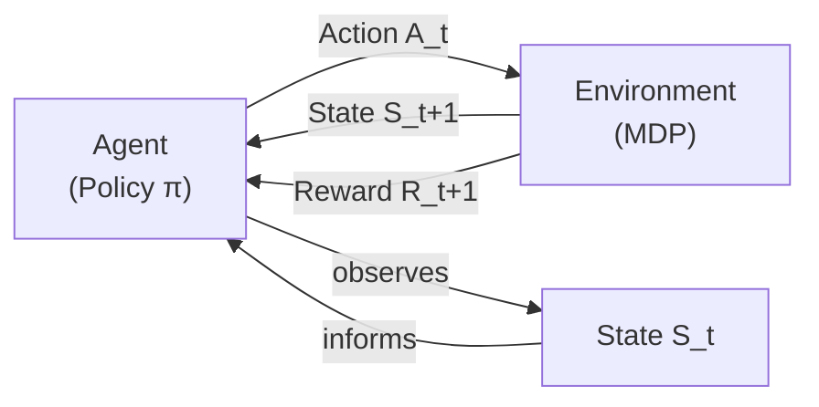
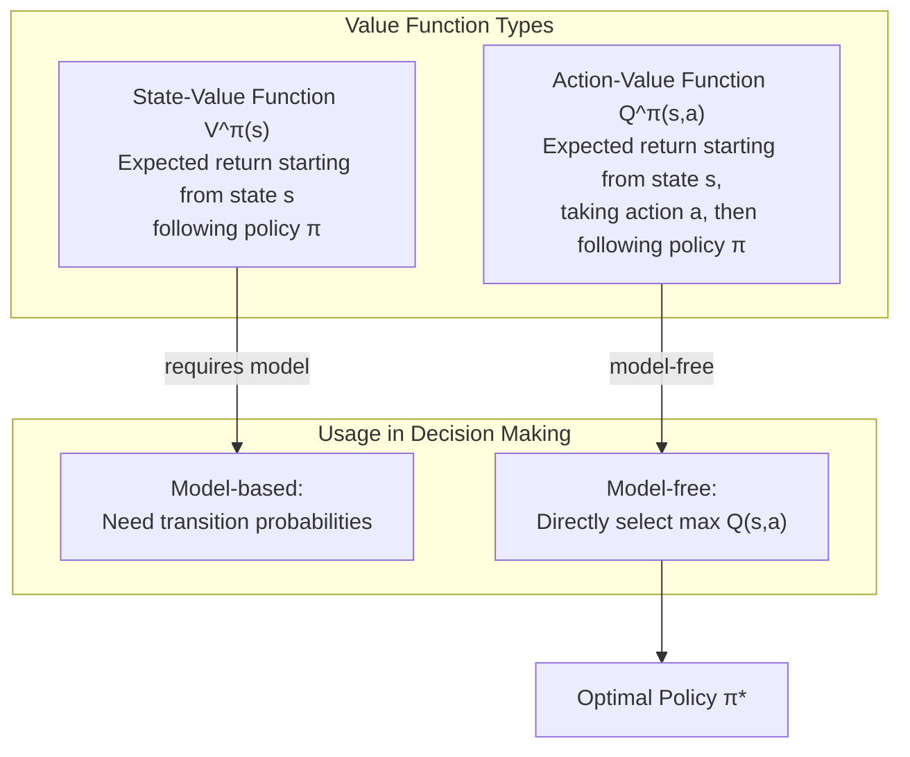
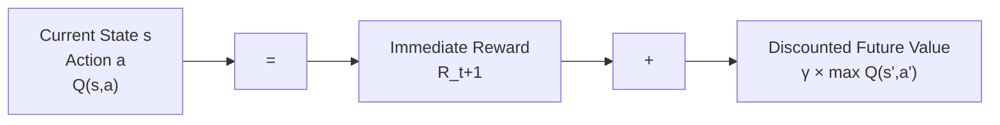
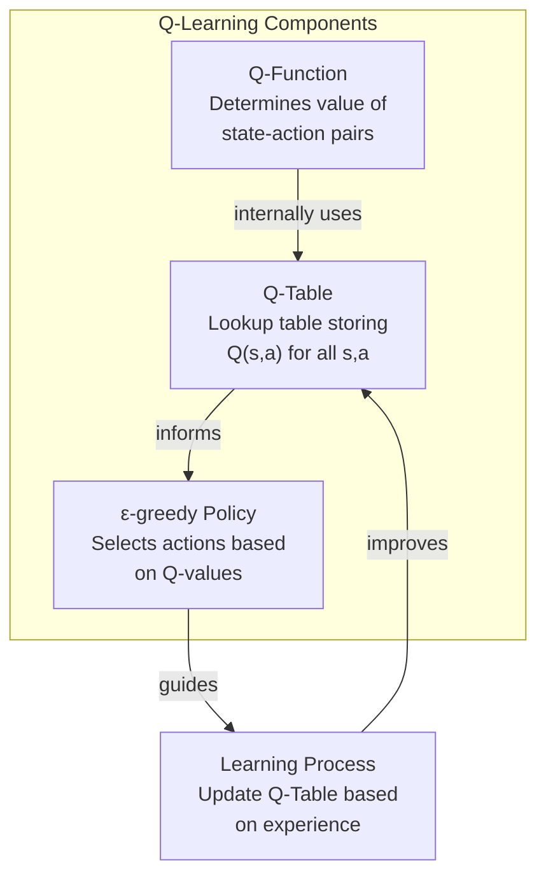
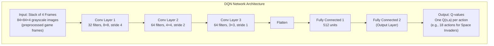
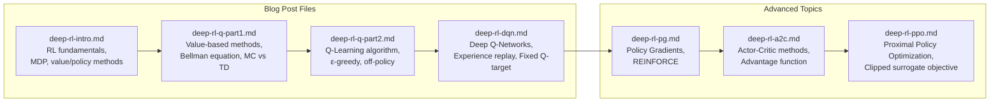

<!-- source: DeepWiki mcp.deepwiki.com · repo huggingface/blog · page 7.1 Introduction to Deep RL · fetched 2026-10-26 -->

# Introduction to Deep RL

<details>
<summary>Relevant source files</summary>

The following files were used as context for generating this wiki page:

- [assets/63_deep_rl_intro/tasks.jpg](assets/63_deep_rl_intro/tasks.jpg)
- [assets/70_deep_rl_q_part1/bellman6.jpg](assets/70_deep_rl_q_part1/bellman6.jpg)
- [assets/78_ml_director_insights/witty-works.png](assets/78_ml_director_insights/witty-works.png)
- [assets/86_bloom/bloom-examples.jpg](assets/86_bloom/bloom-examples.jpg)
- [assets/controlnet/thumbnail.png](assets/controlnet/thumbnail.png)
- [assets/cosmopedia/thumbnail.png](assets/cosmopedia/thumbnail.png)
- [bloom.md](bloom.md)
- [classification-use-cases.md](classification-use-cases.md)
- [controlnet.md](controlnet.md)
- [cosmopedia.md](cosmopedia.md)
- [deep-rl-a2c.md](deep-rl-a2c.md)
- [deep-rl-dqn.md](deep-rl-dqn.md)
- [deep-rl-intro.md](deep-rl-intro.md)
- [deep-rl-pg.md](deep-rl-pg.md)
- [deep-rl-ppo.md](deep-rl-ppo.md)
- [deep-rl-q-part1.md](deep-rl-q-part1.md)
- [deep-rl-q-part2.md](deep-rl-q-part2.md)
- [ml-director-insights-2.md](ml-director-insights-2.md)

</details>


## Purpose and Scope

This document provides foundational knowledge for Deep Reinforcement Learning as presented in the Hugging Face blog's Deep RL Class. It covers the core concepts of Reinforcement Learning, value-based methods, Q-Learning, the Bellman equation, and Deep Q-Networks (DQN).

For policy-based methods (REINFORCE, Actor-Critic, PPO), see [Policy Gradient Methods](#7.2). For practical applications of RL techniques, see [RL Applications](#7.3).

**Note**: The blog contains legacy content that has been superseded by an updated curriculum at `huggingface.co/deep-rl-course`. The materials in this repository represent the original course structure and serve as historical reference.

Sources: [deep-rl-intro.md:1-28](), [deep-rl-q-part1.md:1-28](), [deep-rl-dqn.md:1-28]()

## The Reinforcement Learning Framework

### Core RL Process

Reinforcement Learning is a computational framework for learning from interaction. An agent learns to make decisions by performing actions in an environment, receiving rewards as feedback, and maximizing cumulative reward over time.



**The RL Loop Components**:

| Component | Symbol | Description |
|-----------|--------|-------------|
| State | S_t | Complete or partial description of environment at time t |
| Action | A_t | Decision made by agent at time t |
| Reward | R_t+1 | Scalar feedback signal from environment |
| Policy | π | Function mapping states to actions (agent's behavior) |
| Value Function | V(s) or Q(s,a) | Expected cumulative reward from a state or state-action pair |

The agent's goal is to find an optimal policy π* that maximizes the **expected return** (cumulative discounted reward):

**Return**: G_t = R_{t+1} + γR_{t+2} + γ²R_{t+3} + ... where γ ∈ [0,1] is the discount factor.

Sources: [deep-rl-intro.md:97-183](), [deep-rl-q-part1.md:64-93]()

### Markov Decision Process

The RL problem is formalized as a **Markov Decision Process (MDP)**, which satisfies the Markov Property: the future depends only on the current state, not the history.

**MDP Components**:
- **State Space**: Set of all possible states (discrete or continuous)
- **Action Space**: Set of all possible actions (discrete or continuous)
- **Transition Function**: P(s'|s,a) - probability of reaching state s' from state s via action a
- **Reward Function**: R(s,a) - immediate reward for taking action a in state s
- **Discount Factor**: γ - balances immediate vs long-term rewards

**Task Types**:

| Type | Characteristics | Example |
|------|----------------|---------|
| Episodic | Has terminal state, fixed length | Super Mario (level ends at goal/death) |
| Continuing | No terminal state, runs indefinitely | Stock trading agent |

Sources: [deep-rl-intro.md:184-334]()

### Exploration vs Exploitation Trade-off

A fundamental RL challenge is balancing:
- **Exploration**: Trying new actions to discover better strategies
- **Exploitation**: Using known information to maximize reward

Common strategies include **ε-greedy** (with probability ε explore randomly, otherwise exploit) and decaying ε schedules.

Sources: [deep-rl-intro.md:336-378](), [deep-rl-q-part1.md:137-145]()

## Value-Based Methods

### State-Value and Action-Value Functions

Value-based methods learn a value function to indirectly derive an optimal policy.



**Key Distinction**:
- **V(s)**: Value of being in state s (requires knowledge of transition dynamics to select actions)
- **Q(s,a)**: Value of taking action a in state s (can directly select action with highest Q-value)

In value-based methods, the policy is typically **greedy** with respect to the value function:
π(s) = argmax_a Q(s,a)

Sources: [deep-rl-q-part1.md:95-192](), [deep-rl-intro.md:454-484]()

### The Bellman Equation

The Bellman equation provides a recursive decomposition of value functions, enabling iterative value estimation.

**Bellman Equation for Q-values**:

Q(s,a) = R(s,a) + γ Σ_{s'} P(s'|s,a) max_{a'} Q(s',a')

Or more intuitively:
- Q(s,a) = immediate reward R + discounted value of best next action

**Key Insight**: Instead of summing all future rewards from scratch, we can express the value of a state-action pair as the immediate reward plus the discounted value of the next state.



Sources: [deep-rl-q-part1.md:194-254]()

### Monte Carlo vs Temporal Difference Learning

Two fundamental approaches to learning value functions:

| Aspect | Monte Carlo (MC) | Temporal Difference (TD) |
|--------|------------------|--------------------------|
| Update timing | End of episode | After each step |
| Target | Actual return G_t | Estimated return R_{t+1} + γV(s_{t+1}) |
| Bias/Variance | Unbiased, high variance | Biased (bootstrap), lower variance |
| Episode requirement | Requires complete episodes | Works with incomplete episodes |
| Convergence | Slower, needs many episodes | Faster, more sample efficient |

**Monte Carlo Update**:
V(s_t) ← V(s_t) + α[G_t - V(s_t)]

**Temporal Difference Update (TD(0))**:
V(s_t) ← V(s_t) + α[R_{t+1} + γV(s_{t+1}) - V(s_t)]

The TD approach **bootstraps** - it updates estimates based on other estimates, not just actual returns.

Sources: [deep-rl-q-part1.md:256-420]()

## Q-Learning Algorithm

### Q-Table and Q-Function

Q-Learning is an **off-policy, value-based method** that learns the optimal action-value function Q*.



**Q-Table Structure** (for discrete state/action spaces):

|  | Action 1 | Action 2 | Action 3 | Action 4 |
|---|----------|----------|----------|----------|
| State 1 | Q(s₁,a₁) | Q(s₁,a₂) | Q(s₁,a₃) | Q(s₁,a₄) |
| State 2 | Q(s₂,a₁) | Q(s₂,a₂) | Q(s₂,a₃) | Q(s₂,a₄) |
| State 3 | Q(s₃,a₁) | Q(s₃,a₂) | Q(s₃,a₃) | Q(s₃,a₄) |

Sources: [deep-rl-q-part2.md:50-114]()

### Q-Learning Update Rule

**Algorithm**:

1. Initialize Q-table with zeros (or random values)
2. For each episode:
   - For each time step:
     - Choose action using ε-greedy strategy: 
       - With probability ε: random action (exploration)
       - With probability 1-ε: argmax_a Q(s,a) (exploitation)
     - Take action A_t, observe R_{t+1} and S_{t+1}
     - Update Q-value:
       
       **Q(S_t, A_t) ← Q(S_t, A_t) + α[R_{t+1} + γ max_a Q(S_{t+1}, a) - Q(S_t, A_t)]**
     
     - S_t ← S_{t+1}

**Key Parameters**:
- **α (learning rate)**: Step size for updates (typically 0.1 to 0.5)
- **γ (discount factor)**: Weight of future rewards (typically 0.95 to 0.99)
- **ε (epsilon)**: Exploration rate (typically starts at 1.0, decays to 0.01)

Sources: [deep-rl-q-part2.md:115-186]()

### Off-Policy Learning

Q-Learning is **off-policy** because it uses different policies for:
- **Behavior policy** (acting): ε-greedy (explores)
- **Target policy** (learning): greedy - max_a Q(s,a) (pure exploitation)

The update uses the greedy action for the next state regardless of which action the ε-greedy policy would actually take.

**Contrast with On-Policy** (e.g., SARSA):
- SARSA uses the same ε-greedy policy for both acting and updating
- SARSA update: Q(s,a) ← Q(s,a) + α[R + γQ(s',a') - Q(s,a)] where a' is the actual next action taken

Sources: [deep-rl-q-part2.md:185-220]()

## From Q-Learning to Deep Q-Networks

### Limitations of Q-Tables

Q-Learning with tables works well for small, discrete state/action spaces but fails when:

- **State space is large**: Atari games have 256^(210×160×3) ≈ 10^100000 possible states
- **State space is continuous**: Robot control with continuous joint angles
- **Generalization needed**: Similar states should have similar Q-values

**Scalability Comparison**:

| Environment | State Space Size | Q-Table Feasibility |
|-------------|------------------|---------------------|
| FrozenLake-v1 | 16 states | ✓ Practical |
| Taxi-v3 | 500 states | ✓ Practical |
| CartPole-v1 | Continuous (infinite) | ✗ Impossible |
| Atari (raw pixels) | ~10^100000 | ✗ Impossible |

Sources: [deep-rl-dqn.md:55-84]()

### Deep Q-Network (DQN) Architecture

DQN replaces the Q-table with a neural network Q_θ(s,a) parameterized by weights θ.



**Frame Stacking**: Stack 4 consecutive frames to capture temporal information (motion, velocity). Example: In Pong, a single frame doesn't reveal ball direction; 4 frames show trajectory.

**Preprocessing Pipeline**:
1. Convert to grayscale (3 channels → 1 channel)
2. Resize to 84×84 pixels
3. Stack 4 frames
4. Result: 84×84×4 tensor input

Sources: [deep-rl-dqn.md:87-125]()

### DQN Training Stabilization Techniques

Deep Q-Learning faces instability from combining:
- Non-linear function approximation (neural network)
- Bootstrapping (using estimates to update estimates)
- Off-policy learning

**Three Key Innovations**:

#### 1. Experience Replay

Store experiences (s, a, r, s') in a replay buffer and sample random minibatches for training.

**Replay Buffer Structure**:
```
Buffer D (capacity N):
[(s₀, a₀, r₁, s₁),
 (s₁, a₁, r₂, s₂),
 ...
 (sₜ, aₜ, r_{t+1}, s_{t+1}),
 ...] 
```

**Benefits**:
- Breaks correlation between consecutive samples
- Reuses experiences multiple times (sample efficiency)
- Reduces variance in updates
- Prevents catastrophic forgetting

#### 2. Fixed Q-Target

Use a separate target network Q_θ⁻ with frozen parameters for computing TD targets.

**Update Rule**:
- TD Target: y_t = r_{t+1} + γ max_a Q_θ⁻(s_{t+1}, a)
- Loss: L(θ) = (y_t - Q_θ(s_t, a_t))²
- Every C steps: θ⁻ ← θ (copy current network to target network)

**Benefit**: Prevents moving target problem where both predicted and target values change simultaneously.

#### 3. Gradient Clipping / Huber Loss

Use Huber loss instead of MSE to reduce impact of outliers:
- Quadratic for small errors (smooth gradient)
- Linear for large errors (bounded gradient)

Sources: [deep-rl-dqn.md:127-229]()

### Double DQN

Addresses Q-value **overestimation** caused by max operator bias.

**Standard DQN Target**: 
y = r + γ max_a Q_θ⁻(s', a)  
(target network selects and evaluates action)

**Double DQN Target**: 
y = r + γ Q_θ⁻(s', argmax_a Q_θ(s', a))  
(current network selects, target network evaluates)

**Why This Helps**: Decouples action selection from value estimation, reducing positive bias in Q-value estimates.

Sources: [deep-rl-dqn.md:210-229]()

## Blog Post Structure and File Organization

The Deep RL content in this repository is organized as a progressive curriculum:



**Content Migration**: All blog posts include notices that updated versions are available at `huggingface.co/deep-rl-course/unitX/introduction`, indicating the curriculum has moved to a dedicated course platform.

**Key Assets**:
- [assets/63_deep_rl_intro/]() - Diagrams for RL fundamentals (tasks, policy, value functions)
- [assets/70_deep_rl_q_part1/]() - Bellman equation visualizations, MC vs TD comparisons
- [assets/73_deep_rl_q_part2/]() - Q-Learning algorithm diagrams, Q-table examples
- [assets/78_deep_rl_dqn/]() - DQN architecture, experience replay, atari environments

Sources: [deep-rl-intro.md:1-50](), [deep-rl-q-part1.md:1-50](), [deep-rl-q-part2.md:1-50](), [deep-rl-dqn.md:1-50]()

## Practical Implementation References

The blog posts reference hands-on implementations:

**Q-Learning Implementation**:
- Environment: FrozenLake-v1, Taxi-v3
- Colab notebook: `github.com/huggingface/deep-rl-class/blob/main/unit2/unit2.ipynb`
- Implements Q-table from scratch with NumPy

**DQN Implementation**:
- Environments: Atari games (Space Invaders, Pong, Seaquest)
- Framework: RL-Baselines3-Zoo (built on Stable-Baselines3)
- Colab notebook: `github.com/huggingface/deep-rl-class/blob/main/unit3/unit3.ipynb`
- Uses pre-built DQN from Stable-Baselines3

**Leaderboard**: Results are shared on Hugging Face Hub with a community leaderboard at `huggingface.co/spaces/chrisjay/Deep-Reinforcement-Learning-Leaderboard`

Sources: [deep-rl-q-part2.md:323-359](), [deep-rl-dqn.md:232-260]()

---

