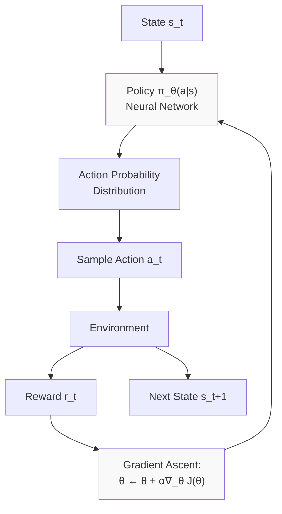
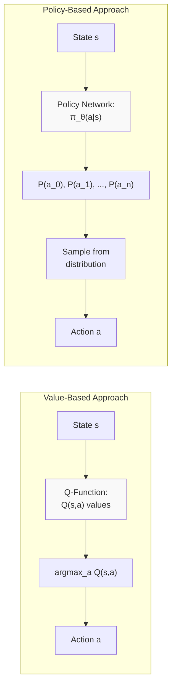
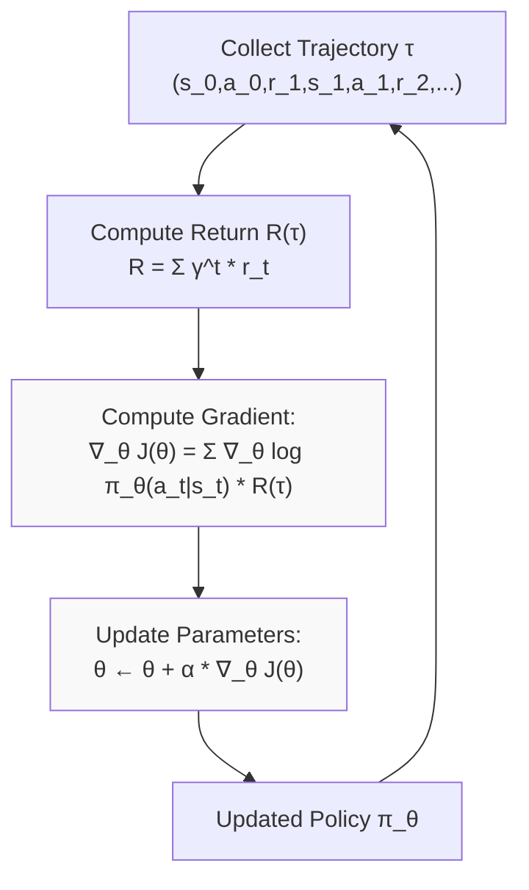
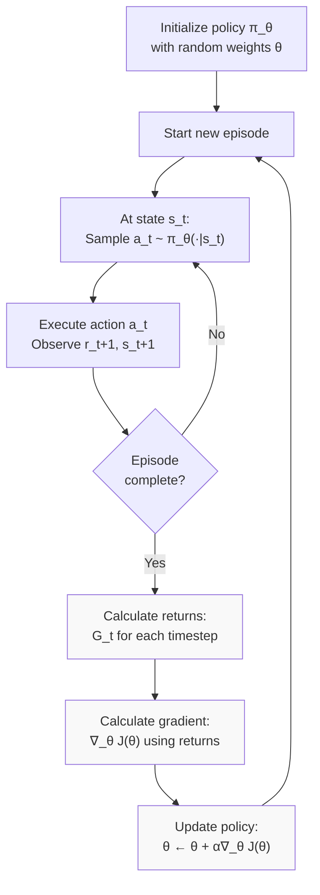
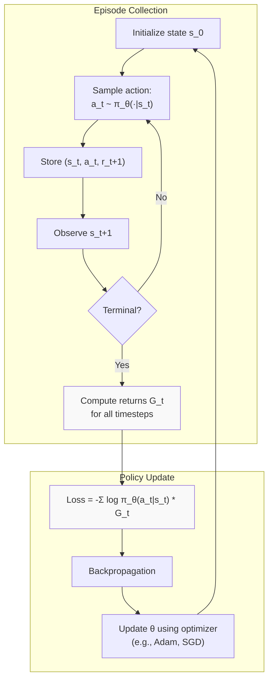

<!-- source: DeepWiki mcp.deepwiki.com · repo huggingface/blog · page 7.2 Policy Gradient Methods · fetched 2026-10-26 -->

# Policy Gradient Methods

<details>
<summary>Relevant source files</summary>

The following files were used as context for generating this wiki page:

- [assets/63_deep_rl_intro/tasks.jpg](assets/63_deep_rl_intro/tasks.jpg)
- [assets/70_deep_rl_q_part1/bellman6.jpg](assets/70_deep_rl_q_part1/bellman6.jpg)
- [assets/78_ml_director_insights/witty-works.png](assets/78_ml_director_insights/witty-works.png)
- [assets/86_bloom/bloom-examples.jpg](assets/86_bloom/bloom-examples.jpg)
- [assets/controlnet/thumbnail.png](assets/controlnet/thumbnail.png)
- [assets/cosmopedia/thumbnail.png](assets/cosmopedia/thumbnail.png)
- [bloom.md](bloom.md)
- [classification-use-cases.md](classification-use-cases.md)
- [controlnet.md](controlnet.md)
- [cosmopedia.md](cosmopedia.md)
- [deep-rl-a2c.md](deep-rl-a2c.md)
- [deep-rl-dqn.md](deep-rl-dqn.md)
- [deep-rl-intro.md](deep-rl-intro.md)
- [deep-rl-pg.md](deep-rl-pg.md)
- [deep-rl-ppo.md](deep-rl-ppo.md)
- [deep-rl-q-part1.md](deep-rl-q-part1.md)
- [deep-rl-q-part2.md](deep-rl-q-part2.md)
- [ml-director-insights-2.md](ml-director-insights-2.md)

</details>


## Purpose and Scope

This document covers policy gradient methods, a family of reinforcement learning algorithms that directly optimize the policy function through gradient ascent. Policy gradient methods represent a fundamental shift from value-based approaches like Q-Learning and Deep Q-Learning (see [7.1](#7.1)) by learning to output action probability distributions rather than estimating state or state-action values.

The scope includes:
- Core concepts of policy-based reinforcement learning
- The Reinforce (Monte Carlo Policy Gradient) algorithm
- Policy gradient theorem and optimization mechanics
- Trade-offs compared to value-based methods

For advanced policy gradient variants like Actor-Critic and PPO, as well as practical applications, see [7.3](#7.3).

## Overview of Policy Gradient Methods

Policy gradient methods are a subclass of policy-based algorithms that optimize the policy directly by estimating the weights of an optimal policy using gradient ascent. Rather than learning a value function as an intermediate step to derive a policy, these methods parameterize the policy itself with weights θ and adjust these parameters to maximize expected cumulative reward.



**Figure 1: Policy Gradient Learning Loop**

The key innovation is using the policy π_θ to directly control the probability distribution over actions, where θ represents learnable parameters (typically neural network weights). The objective is to find parameters that maximize the expected return J(θ).

Sources: [deep-rl-pg.md:51-77]

## Policy-Based vs Value-Based Methods

The fundamental difference between these approaches lies in what they learn and how they derive actions:

| Aspect | Value-Based Methods | Policy-Based Methods |
|--------|---------------------|---------------------|
| **Primary Function** | Learn Q(s,a) or V(s) | Learn π_θ(a\|s) directly |
| **Action Selection** | Derived via argmax over Q-values | Sample from probability distribution |
| **Policy Type** | Implicitly deterministic (or ε-greedy) | Naturally stochastic |
| **Exploration** | Requires explicit ε-greedy strategy | Built into probability distribution |
| **Continuous Actions** | Difficult (requires discretization) | Natural support |
| **Convergence** | Can converge to global optimum | Often converges to local optimum |



**Figure 2: Value-Based vs Policy-Based Action Selection**

Sources: [deep-rl-intro.md:379-484], [deep-rl-pg.md:51-136]

## The Policy Function

In policy gradient methods, the policy π_θ is a parameterized function that maps states to probability distributions over actions:

**Stochastic Policy:**
- Outputs: `π_θ(a|s)` = probability of taking action a in state s
- Representation: Neural network with softmax output layer
- Behavior: Samples actions according to learned probabilities

**Deterministic Policy (less common in policy gradients):**
- Outputs: Single action for each state
- Representation: `a = π_θ(s)`

The stochastic formulation provides several benefits:
1. **Inherent exploration**: No need for separate exploration strategies
2. **Perceptual aliasing robustness**: Different actions can be taken in similar-looking states
3. **Continuous action space support**: Can output parameters of continuous distributions (e.g., Gaussian mean/variance)

Sources: [deep-rl-intro.md:404-451], [deep-rl-pg.md:59-63]

## Policy Gradient Theorem and Objective Function

The core of policy gradient methods is maximizing the objective function J(θ), which represents expected return:

**Objective Function:**
```
J(θ) = E_τ~π_θ [R(τ)]
```

Where:
- τ (tau) represents a trajectory (sequence of states, actions, rewards)
- R(τ) is the cumulative reward for trajectory τ
- The expectation is taken over trajectories sampled from policy π_θ

**Policy Gradient Theorem:**

The gradient of J(θ) with respect to parameters θ is:

```
∇_θ J(θ) = E_τ~π_θ [∑_t ∇_θ log π_θ(a_t|s_t) * R(τ)]
```

This provides the direction of steepest increase in expected return. The intuition:
- `∇_θ log π_θ(a_t|s_t)`: Direction that increases probability of action a_t at state s_t
- `R(τ)`: Scaling factor - if return is high, push probabilities up; if low, push down



**Figure 3: Policy Gradient Update Cycle**

Sources: [deep-rl-pg.md:142-181]

## The Reinforce Algorithm

Reinforce (Monte Carlo Policy Gradient) is the foundational policy gradient algorithm. It uses complete episode returns to estimate the gradient.

**Algorithm Structure:**

```
Loop:
  1. Use policy π_θ to collect episode τ = (s_0,a_0,r_1,...,s_T)
  2. Compute return for each timestep: G_t = Σ_{k=t}^T γ^(k-t) * r_k
  3. Estimate gradient: ĝ = Σ_t ∇_θ log π_θ(a_t|s_t) * G_t
  4. Update weights: θ ← θ + α * ĝ
```

**Key Characteristics:**

- **Monte Carlo sampling**: Waits for complete episodes before updating
- **Unbiased estimates**: Uses actual returns, not bootstrapped estimates
- **High variance**: Different trajectories from same state can yield very different returns
- **On-policy**: Must use trajectories collected from current policy



**Figure 4: Reinforce Algorithm Flow**

**Gradient Interpretation:**

For each state-action pair in the trajectory:
- If `R(τ) > 0`: Increase probability of actions taken (push probabilities up)
- If `R(τ) < 0`: Decrease probability of actions taken (push probabilities down)
- Magnitude of adjustment proportional to `|R(τ)|`

Sources: [deep-rl-pg.md:142-181], [deep-rl-a2c.md:54-76]

## Variance Problem and Solutions

The Reinforce algorithm suffers from high variance because the same starting state can lead to very different returns due to:
1. Stochasticity in the environment
2. Stochasticity in the policy
3. Long episode lengths amplifying randomness

**Variance Impact:**

```
R(τ) = R_{t+1} + γR_{t+2} + γ²R_{t+3} + ...
```

Even with the same starting state and initial actions, different random events during the episode can produce vastly different total returns. This leads to:
- Slow training (requires many samples to get accurate gradient estimates)
- Unstable learning (high gradient variance)
- Sample inefficiency

**Common Mitigation Strategies:**

1. **Baseline Subtraction**: Subtract a baseline b(s) from returns to reduce variance without introducing bias
   - Modified gradient: `∇_θ J(θ) = E[∇_θ log π_θ(a_t|s_t) * (R(τ) - b(s_t))]`
   - Common baseline: Value function V(s)

2. **Advantage Function**: Use `A(s,a) = Q(s,a) - V(s)` instead of raw returns
   - Measures how much better action a is compared to average
   - Leads to Actor-Critic methods (beyond scope of basic Reinforce)

3. **Multiple Trajectories**: Collect many episodes before updating to average out variance

Sources: [deep-rl-a2c.md:54-76]

## Advantages and Disadvantages

### Advantages

**1. Integration Simplicity**
- No need to maintain separate Q-tables or value functions
- Direct optimization of the desired objective (policy)

**2. Stochastic Policy Support**
- Natural exploration through probability distributions
- No manual ε-greedy implementation needed

**3. Perceptual Aliasing Robustness**
- Can assign different action probabilities to perceptually similar states
- Avoids getting stuck in deterministic loops

**4. Continuous Action Space**
- Can output parameters of continuous distributions (e.g., Gaussian μ, σ)
- No need for action discretization
- Critical for robotics and control tasks

**5. Better for High-Dimensional Actions**
- Scales better than value-based methods when action space is large
- Doesn't require computing Q-values for all possible actions

### Disadvantages

**1. Local Optima Convergence**
- Gradient ascent can get stuck in local maxima
- Unlike value iteration which can find global optimum under certain conditions

**2. Sample Inefficiency**
- Monte Carlo sampling requires complete episodes
- High variance necessitates many samples
- Step-by-step learning is slower than some value-based methods

**3. High Variance**
- Gradient estimates have high variance without variance reduction techniques
- Requires careful hyperparameter tuning (learning rate, baseline, etc.)

**4. Sensitivity to Hyperparameters**
- Learning rate must be carefully chosen
- Too high: unstable training
- Too low: extremely slow convergence

Sources: [deep-rl-pg.md:81-136]

## Implementation Considerations

When implementing policy gradient methods, several technical details are critical:

### Network Architecture

**Policy Network Structure:**
- Input: State representation (e.g., game frames, sensor readings)
- Hidden layers: Feature extraction (convolutional layers for images, dense layers for tabular)
- Output: Probability distribution over actions
  - Discrete actions: Softmax layer with one output per action
  - Continuous actions: Mean and variance of Gaussian distribution

### Training Loop Components



**Figure 5: Implementation Flow**

### Key Implementation Details

1. **Return Calculation**: 
   - Must be done backward from terminal state
   - Apply discount factor γ properly: `G_t = r_{t+1} + γ*G_{t+1}`

2. **Log Probability Computation**:
   - Use `log(π_θ(a_t|s_t))` for numerical stability
   - PyTorch: `log_prob = distribution.log_prob(action)`

3. **Loss Function**:
   - Policy gradient loss: `-log_prob * return`
   - Negative sign because PyTorch minimizes loss but we want to maximize J(θ)

4. **Normalization**:
   - Often normalize returns across batch: `(G - mean(G)) / (std(G) + ε)`
   - Helps stabilize training

5. **Episode Length Handling**:
   - Set maximum episode length to prevent infinite loops
   - May need to handle truncated vs. terminal states differently

Sources: [deep-rl-pg.md:183-191]

## Comparison Matrix

| Method | Type | Update Frequency | Variance | Bias | Action Space | Convergence |
|--------|------|------------------|----------|------|--------------|-------------|
| Q-Learning | Value-based | Per step (TD) | Low | High initially | Discrete only | Global optimum* |
| Deep Q-Network | Value-based | Per step (TD) | Low | Moderate | Discrete only | Local optimum |
| Reinforce | Policy-based | Per episode (MC) | High | None | Both | Local optimum |
| Actor-Critic | Hybrid | Per step (TD) | Moderate | Low | Both | Local optimum |

*Under tabular settings with sufficient exploration

Sources: [deep-rl-q-part1.md:256-424], [deep-rl-pg.md:26-136], [deep-rl-a2c.md:26-36]

## Connection to Advanced Methods

Policy gradient methods serve as the foundation for more sophisticated algorithms:

- **Actor-Critic Methods**: Combine policy gradient (actor) with value function (critic) to reduce variance
- **Proximal Policy Optimization (PPO)**: Adds constraints to prevent destructive large policy updates
- **Trust Region Policy Optimization (TRPO)**: Uses KL divergence constraints for stable updates
- **Advantage Actor-Critic (A2C)**: Uses advantage function `A(s,a) = Q(s,a) - V(s)` as the scaling factor
- **Asynchronous Advantage Actor-Critic (A3C)**: Parallel training with multiple agents

These extensions address the variance and sample efficiency limitations of basic Reinforce while maintaining the benefits of policy-based learning.

Sources: [deep-rl-a2c.md:84-152], [deep-rl-ppo.md:61-89]

---

**Summary**: Policy gradient methods represent a paradigm shift from value-based RL by directly optimizing the policy through gradient ascent. While they offer unique advantages for stochastic policies and continuous action spaces, they require careful handling of variance and sample efficiency challenges. The Reinforce algorithm provides the conceptual foundation, with modern variants like PPO and A2C building upon these principles to achieve state-of-the-art performance in complex domains.

---

