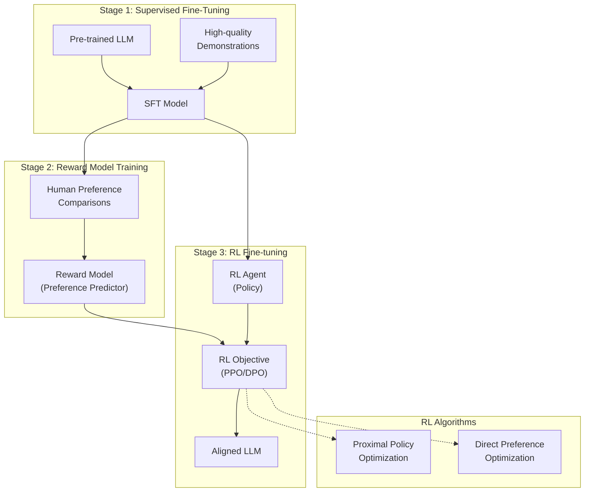
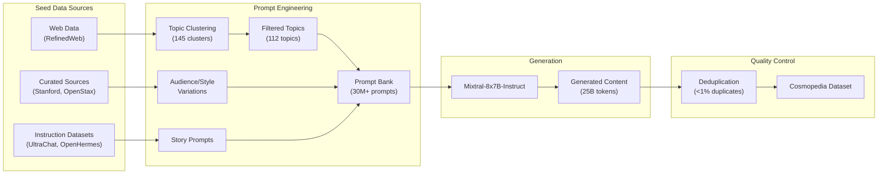
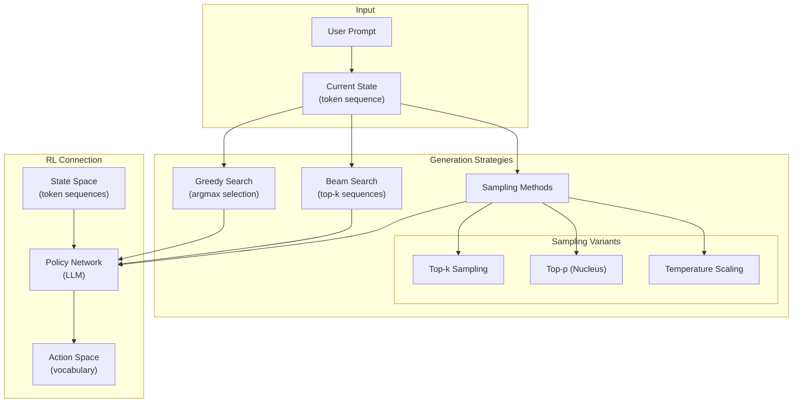
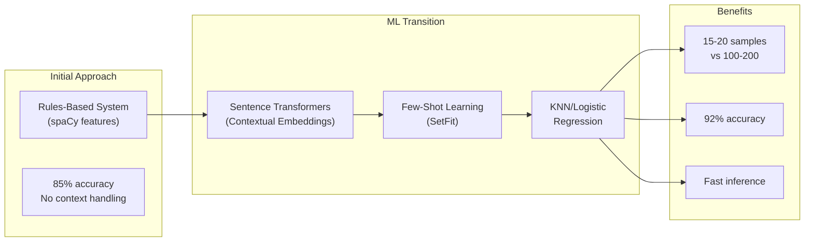

<!-- source: DeepWiki mcp.deepwiki.com · repo huggingface/blog · page 7.3 RL Applications · fetched 2026-10-26 -->

# RL Applications

Relevant source files

The following files were used as context for generating this wiki page:

- [assets/63_deep_rl_intro/tasks.jpg](assets/63_deep_rl_intro/tasks.jpg)
- [assets/70_deep_rl_q_part1/bellman6.jpg](assets/70_deep_rl_q_part1/bellman6.jpg)
- [assets/78_ml_director_insights/witty-works.png](assets/78_ml_director_insights/witty-works.png)
- [assets/86_bloom/bloom-examples.jpg](assets/86_bloom/bloom-examples.jpg)
- [assets/controlnet/thumbnail.png](assets/controlnet/thumbnail.png)
- [assets/cosmopedia/thumbnail.png](assets/cosmopedia/thumbnail.png)
- [bloom.md](bloom.md)
- [classification-use-cases.md](classification-use-cases.md)
- [controlnet.md](controlnet.md)
- [cosmopedia.md](cosmopedia.md)
- [deep-rl-a2c.md](deep-rl-a2c.md)
- [deep-rl-dqn.md](deep-rl-dqn.md)
- [deep-rl-intro.md](deep-rl-intro.md)
- [deep-rl-pg.md](deep-rl-pg.md)
- [deep-rl-ppo.md](deep-rl-ppo.md)
- [deep-rl-q-part1.md](deep-rl-q-part1.md)
- [deep-rl-q-part2.md](deep-rl-q-part2.md)
- [ml-director-insights-2.md](ml-director-insights-2.md)

## Purpose and Scope

This document covers practical applications of reinforcement learning techniques beyond training environments, including alignment methods like Constitutional AI and Reinforcement Learning from Human Feedback (RLHF), synthetic data generation pipelines, and production deployments of RL agents. For foundational RL concepts and algorithms, see [Introduction to Deep RL](#7.1) and [Policy Gradient Methods](#7.2). For specific RL algorithms (Q-Learning, DQN, PPO), refer to the respective units in the Deep RL curriculum.

This page focuses on how RL methods are applied to solve real-world problems in language model alignment, content generation, and other domains beyond the benchmark environments (CartPole, LunarLander, Atari) used for algorithm development.

## Reinforcement Learning from Human Feedback (RLHF)

RLHF is a technique that uses reinforcement learning to align language models with human preferences. The approach trains models to generate outputs that humans find helpful, harmless, and honest by incorporating human feedback into the reward signal.

### RLHF Training Pipeline

**RLHF Training Pipeline**

The RLHF process typically involves three stages: (1) supervised fine-tuning on high-quality demonstrations, (2) training a reward model from human preference comparisons, and (3) using RL algorithms like PPO to optimize the policy against the learned reward model.

Sources: [deep-rl-ppo.md:1-50](), [deep-rl-intro.md:1-100]()

### Constitutional AI

Constitutional AI extends RLHF by incorporating explicit principles (a "constitution") that guide model behavior. Instead of relying solely on human feedback, the model is trained to critique and revise its own outputs based on predefined rules and values.

**Key Components:**

- **Self-Critique**: The model evaluates its own responses against constitutional principles
- **Revision**: Outputs are iteratively improved based on critique
- **RL Phase**: Policy is fine-tuned using PPO or similar algorithms with rewards derived from constitutional adherence

The approach reduces reliance on large-scale human annotation while maintaining alignment with desired behaviors.

Sources: [deep-rl-ppo.md:1-100](), [deep-rl-intro.md:134-139]()

## Synthetic Data Generation with RL

Reinforcement learning techniques are increasingly used to generate large-scale synthetic datasets for training language models. Unlike RLHF which aligns existing models, these approaches use RL-guided generation to create diverse, high-quality training data.

### Cosmopedia Dataset Generation

The Cosmopedia dataset demonstrates large-scale synthetic data generation using LLMs with carefully engineered prompts and quality control.

**Synthetic Data Generation Pipeline for Cosmopedia**

The generation process leverages diverse seed data sources, extensive prompt engineering with topic clustering, and quality controls to produce 25 billion tokens of educational content across textbooks, blog posts, stories, and WikiHow articles.

Sources: [cosmopedia.md:1-150]()

### Prompt Diversity Strategies

Cosmopedia employs several strategies to maximize diversity in generated content:

| Strategy | Description | Scale |
|----------|-------------|-------|
| **Topic Clustering** | Web samples clustered into 145 topics, filtered to 112 educational topics | 23M prompts |
| **Curated Sources** | Educational materials from Stanford, OpenStax, Khan Academy, WikiHow | 266K units |
| **Audience Variation** | Same topic adapted for young children, high school, college, researchers | 4x multiplier |
| **Style Variation** | Textbooks, blog posts, WikiHow articles for same content | 3x multiplier |
| **Format Conditioning** | Specific instructions for format/content differences per style | All prompts |

Sources: [cosmopedia.md:36-104]()

### llm-swarm for Distributed Generation

For large-scale generation tasks requiring compute efficiency, `llm-swarm` provides distributed generation capabilities. The approach parallelizes inference across multiple GPUs or nodes to generate synthetic data at scale.

**Key Features:**

- Distributed prompt processing across worker nodes
- Batch inference optimization for throughput
- Quality filtering and deduplication pipelines
- Integration with Hugging Face Hub for model loading

Sources: [cosmopedia.md:150-250]()

## Production RL Deployments

### Text Generation Applications

Reinforcement learning principles inform various text generation strategies used in production LLM deployments:

**Text Generation as Sequential Decision Making**

Text generation can be viewed through an RL lens where the model (policy) selects actions (tokens) given states (context) to maximize reward (coherence, relevance, quality).

Sources: [deep-rl-intro.md:379-403](), [deep-rl-q-part1.md:1-100]()

### Exploration-Exploitation in Generation

The exploration-exploitation tradeoff from RL directly applies to text generation:

- **Exploitation** (Greedy/Beam Search): Select highest probability tokens, risk repetitive or generic outputs
- **Exploration** (Sampling): Introduce randomness for diversity, risk incoherence
- **Balanced Approaches** (Top-p, Temperature): Control exploration degree via hyperparameters

This mirrors epsilon-greedy strategies from value-based RL methods.

Sources: [deep-rl-intro.md:336-377](), [deep-rl-q-part2.md:130-149]()

### Robotics Applications

The Deep RL curriculum demonstrates robotics applications using PyBullet environments where agents learn continuous control:

**Trained Agents:**
- Bipedal walker navigation
- Spider locomotion
- Robotic manipulation tasks

**RL Algorithms Used:**
- A2C for stabilized actor-critic learning
- PPO for robust policy optimization in continuous action spaces

These environments showcase RL's ability to learn complex motor skills through trial-and-error interaction.

Sources: [deep-rl-a2c.md:36-42](), [deep-rl-a2c.md:153-158](), [deep-rl-ppo.md:36-45]()

## Case Study: ML Applications in SaaS

Real-world applications of ML (including RL-inspired approaches) demonstrate practical deployment patterns:

### Witty Works Writing Assistant

The Witty Works case study illustrates transitioning from rule-based systems to ML-based approaches, a pattern relevant to RL applications:

**ML System Evolution in Production**

The transition from rules to learned models mirrors how RL systems can replace hand-crafted reward functions with learned value functions or policies.

Sources: [classification-use-cases.md:27-98]()

**Key Lessons for RL Deployment:**

1. **Simple approaches first**: Traditional methods often sufficient before deep RL
2. **Data efficiency**: Few-shot methods reduce annotation requirements (similar to sample-efficient RL)
3. **Production constraints**: Latency and deployment complexity matter beyond benchmark performance
4. **Iterative improvement**: Systems evolve from simple to complex as needs grow

Sources: [classification-use-cases.md:1-122]()

## Training Environments vs Production Deployment

The Deep RL curriculum progresses from simple to complex environments, illustrating the path from research to application:

| Environment | Complexity | RL Method | Application Domain |
|-------------|-----------|-----------|-------------------|
| FrozenLake | Discrete, small state space | Q-Learning | Algorithm validation |
| CartPole | Continuous observations, discrete actions | DQN, Reinforce | Control theory |
| LunarLander | Physics simulation | DQN, PPO | Aerospace |
| Space Invaders | High-dimensional visual input | DQN | Game AI |
| PyBullet Robotics | Continuous control | A2C, PPO | Robotics |
| LLM Alignment | Sequential text generation | PPO (RLHF) | NLP applications |

The progression demonstrates increasing complexity from tabular methods to deep RL to production LLM applications.

Sources: [deep-rl-q-part2.md:30-36](), [deep-rl-dqn.md:36-43](), [deep-rl-a2c.md:36-42](), [deep-rl-ppo.md:36-45]()

## Common Challenges in RL Applications

### Variance Reduction

High variance in policy gradient estimates leads to unstable training. Production systems address this through:

- **Baseline subtraction**: Advantage functions (A2C, PPO)
- **Multiple trajectories**: Batch collection for averaging
- **Variance-bias tradeoffs**: TD vs Monte Carlo methods

Sources: [deep-rl-a2c.md:54-81](), [deep-rl-pg.md:129-135]()

### Sample Efficiency

RL typically requires many environment interactions. Strategies for improvement:

- **Experience replay**: Reuse past experiences (DQN)
- **Off-policy learning**: Learn from historical data
- **Transfer learning**: Pre-trained models as initialization
- **Synthetic data**: Generate training data (Cosmopedia approach)

Sources: [deep-rl-dqn.md:154-177](), [cosmopedia.md:1-50]()

### Reward Specification

Defining appropriate rewards is challenging. Approaches include:

- **RLHF**: Learn rewards from human preferences
- **Constitutional AI**: Explicit principle-based rewards
- **Reward shaping**: Intermediate rewards for sparse environments
- **Multi-objective optimization**: Balance multiple reward components

Sources: [deep-rl-intro.md:174-180](), [deep-rl-q-part1.md:234-245]()

## Integration with Hugging Face Ecosystem

RL applications in the Hugging Face ecosystem leverage several key components:

**Libraries:**
- `transformers`: Model architectures for RL policies (GPT, T5)
- `trl`: Training library for RLHF with PPO implementation
- `datasets`: Dataset management for training data
- `accelerate`: Distributed training support

**Infrastructure:**
- Hugging Face Hub: Model and dataset sharing
- Spaces: Demo deployment for RL agents
- Inference API: Production serving of aligned models

RL agents trained through the curriculum are uploaded to the Hub for community access and evaluation.

Sources: [deep-rl-intro.md:46-57](), [deep-rl-q-part2.md:323-335](), [deep-rl-dqn.md:232-245]()

---

This document covers the practical applications of reinforcement learning beyond theoretical training. For algorithm details, see the respective Deep RL units. For specific implementation guidance, refer to the training notebooks and code repositories linked in each unit.

---

