<!-- source: DeepWiki mcp.deepwiki.com · repo huggingface/blog · page 8 Datasets and Data Processing · fetched 2026-10-26 -->

# Datasets and Data Processing

<details>
<summary>Relevant source files</summary>

The following files were used as context for generating this wiki page:

- [1_58_llm_extreme_quantization.md](1_58_llm_extreme_quantization.md)
- [_blog.yml](_blog.yml)
- [_tags.yml](_tags.yml)
- [assets/192_pi0/new_thumbnail_pi0.001.png](assets/192_pi0/new_thumbnail_pi0.001.png)
- [assets/193_l2d/lerobot-driver.gif](assets/193_l2d/lerobot-driver.gif)
- [assets/1_58_llm_extreme_quantization/thumbnail.png](assets/1_58_llm_extreme_quantization/thumbnail.png)
- [assets/63_deep_rl_intro/tasks.jpg](assets/63_deep_rl_intro/tasks.jpg)
- [assets/70_deep_rl_q_part1/bellman6.jpg](assets/70_deep_rl_q_part1/bellman6.jpg)
- [assets/78_ml_director_insights/witty-works.png](assets/78_ml_director_insights/witty-works.png)
- [assets/86_bloom/bloom-examples.jpg](assets/86_bloom/bloom-examples.jpg)
- [assets/controlnet/thumbnail.png](assets/controlnet/thumbnail.png)
- [assets/cosmopedia/thumbnail.png](assets/cosmopedia/thumbnail.png)
- [assets/inference-providers/welcome-featherless.jpg](assets/inference-providers/welcome-featherless.jpg)
- [assets/optimum_intel/optimum_openvino_thumbnail.png](assets/optimum_intel/optimum_openvino_thumbnail.png)
- [assets/sd_dreambooth_training/thumbnail.jpg](assets/sd_dreambooth_training/thumbnail.jpg)
- [assets/streaming_datasets/streaming_datasets.png](assets/streaming_datasets/streaming_datasets.png)
- [assets/textquests/thumbnail.gif](assets/textquests/thumbnail.gif)
- [assets/trl_vlm/thumbnail.png](assets/trl_vlm/thumbnail.png)
- [assets/virustotal/thumbnail.png](assets/virustotal/thumbnail.png)
- [assets/wuerstchen/thumbnail.jpg](assets/wuerstchen/thumbnail.jpg)
- [bloom.md](bloom.md)
- [classification-use-cases.md](classification-use-cases.md)
- [controlnet.md](controlnet.md)
- [cosmopedia.md](cosmopedia.md)
- [deep-rl-a2c.md](deep-rl-a2c.md)
- [deep-rl-dqn.md](deep-rl-dqn.md)
- [deep-rl-intro.md](deep-rl-intro.md)
- [deep-rl-pg.md](deep-rl-pg.md)
- [deep-rl-ppo.md](deep-rl-ppo.md)
- [deep-rl-q-part1.md](deep-rl-q-part1.md)
- [deep-rl-q-part2.md](deep-rl-q-part2.md)
- [dreambooth.md](dreambooth.md)
- [inference-providers-featherless.md](inference-providers-featherless.md)
- [lerobot-goes-to-driving-school.md](lerobot-goes-to-driving-school.md)
- [ml-director-insights-2.md](ml-director-insights-2.md)
- [openvino-vlm.md](openvino-vlm.md)
- [pi0.md](pi0.md)
- [streaming-datasets.md](streaming-datasets.md)
- [textquests.md](textquests.md)
- [trl-vlm-alignment.md](trl-vlm-alignment.md)
- [virustotal.md](virustotal.md)

</details>


This document covers dataset creation, processing, and streaming techniques discussed throughout the Hugging Face blog repository. It encompasses three primary areas: large-scale synthetic dataset generation for pre-training models, efficient data streaming and loading optimizations, and specialized dataset examples across different domains (robotics, reinforcement learning, benchmarking).

For information about specific model training workflows, see [Model Training and Optimization](#4). For deployment and inference topics, see [Model Deployment and Inference](#5).

## Overview

The blog repository documents various approaches to dataset creation and processing, ranging from billion-token synthetic datasets to streaming optimizations that enable training on multi-terabyte datasets without downloading them locally. The content emphasizes practical solutions for handling large-scale data in machine learning workflows.

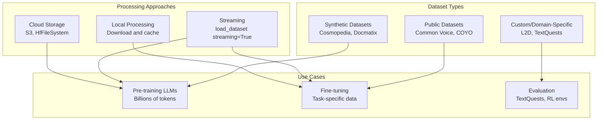

Sources: [cosmopedia.md:1-30](), [streaming-datasets.md:1-40](), [lerobot-goes-to-driving-school.md:1-60](), [textquests.md:1-30]()

## Dataset Categories

The blog content covers three main categories of datasets, each serving different purposes in the machine learning lifecycle:

| Category | Examples | Scale | Primary Use Case |
|----------|----------|-------|------------------|
| **Synthetic** | Cosmopedia (25B tokens) | Billions of tokens | Pre-training LLMs from scratch |
| **Public** | Common Voice, COYO, NuScenes | Varies | Fine-tuning, evaluation |
| **Custom/Domain-Specific** | L2D (90+ TB), TextQuests (25 games) | Large-scale | Specialized training, benchmarking |

### Dataset Metadata and Organization

Dataset metadata is managed through YAML configuration files in the repository. The main blog configuration file tracks dataset-related posts:

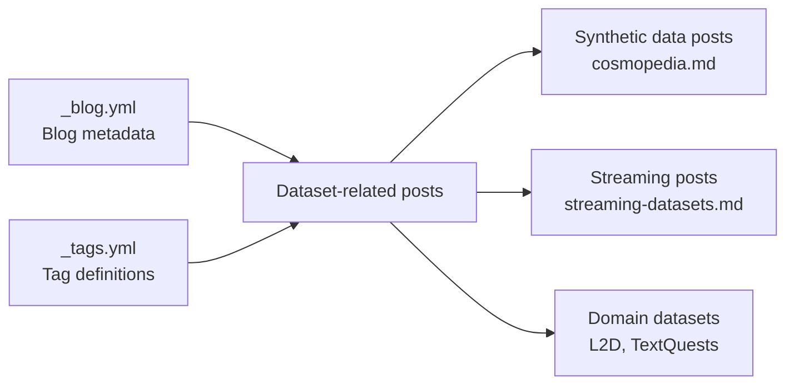

Sources: [_blog.yml:1-100](), [_tags.yml:1-51]()

## Large-Scale Synthetic Datasets

### Cosmopedia: Synthetic Pre-training Data

Cosmopedia represents one of the largest synthetic dataset generation efforts, creating billions of tokens for pre-training language models. The project addresses the challenge of scaling synthetic data from thousands to millions of samples.

**Key Characteristics:**
- **Scale**: 25 billion tokens generated
- **Purpose**: Pre-training LLMs from scratch (replicating Phi-1.5 approach)
- **Generation**: Primarily using GPT-3.5 and GPT-4
- **Cost Efficiency**: Reduces the need for manual annotation

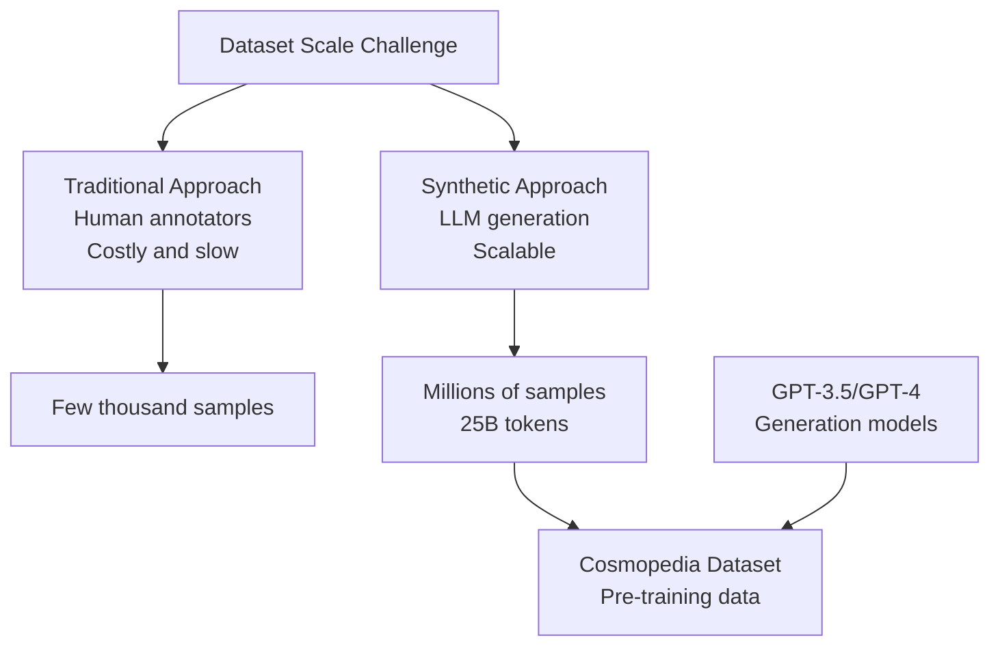

The Cosmopedia blog post describes the generation pipeline for creating diverse, educational synthetic content. Unlike instruction-tuning datasets (covered in [Model Training and Optimization](#4)), Cosmopedia focuses on generating raw pre-training text that mimics real-world data patterns.

**Generation Challenges at Scale:**

The post identifies three key challenges when scaling synthetic data generation:
1. Large-scale research requirements to leverage pre-training benefits
2. Model architecture design for integrating diverse data sources
3. Crafting effective training recipes (pre-training and post-training strategies)

Sources: [cosmopedia.md:1-30](), [cosmopedia.md:10-50]()

### Synthetic Data in the Ecosystem

The growth of synthetic datasets on Hugging Face Hub reflects broader community adoption:

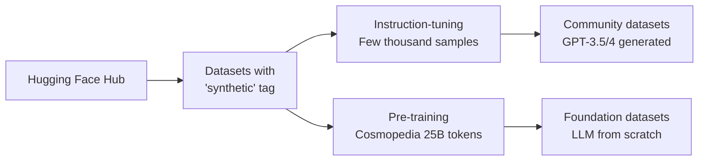

The blog post notes that the number of datasets with the "synthetic" tag has grown significantly, particularly for supervised fine-tuning and instruction-tuning use cases. However, Cosmopedia represents a different category focused on pre-training scale.

Sources: [cosmopedia.md:14-20]()

## Data Streaming and Optimization

### Streaming Datasets Overview

The `streaming-datasets.md` blog post documents major improvements to the `datasets` library's streaming capabilities, enabling training on multi-terabyte datasets without local downloads.

**Key Performance Improvements:**
- 100x fewer requests to data sources
- 10x faster data resolution
- 2x samples/second improvement
- Zero worker crashes at 256 concurrent workers

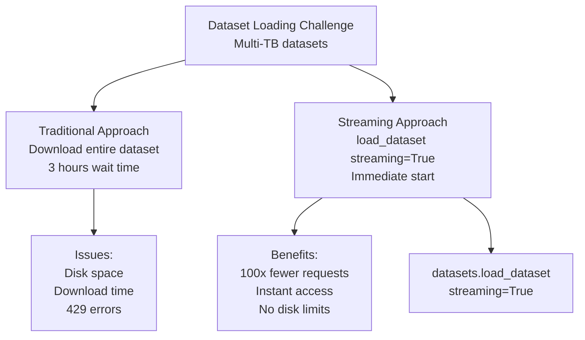

### Streaming API Usage

The streaming API maintains backward compatibility while providing significant performance improvements:

```python
from datasets import load_dataset

# Stream a dataset instead of downloading it
dataset = load_dataset("HuggingFaceM4/FineVisionMax", split="train", streaming=True)
# Get the first example
print(next(iter(dataset)))
```

As documented in [streaming-datasets.md:31-43](), the API requires only a single parameter change (`streaming=True`) to enable streaming mode. This design ensures thousands of existing users get improved performance with zero code changes.

Sources: [streaming-datasets.md:1-45]()

### Performance at Scale

The blog post documents real-world performance testing during SmolLM3 training:

**Benchmark Results:**
- Tested on 64xH100 GPUs
- 256 concurrent workers downloading data
- Outperformed local SSDs for data throughput
- Eliminated the 3-hour pre-training wait time experienced previously

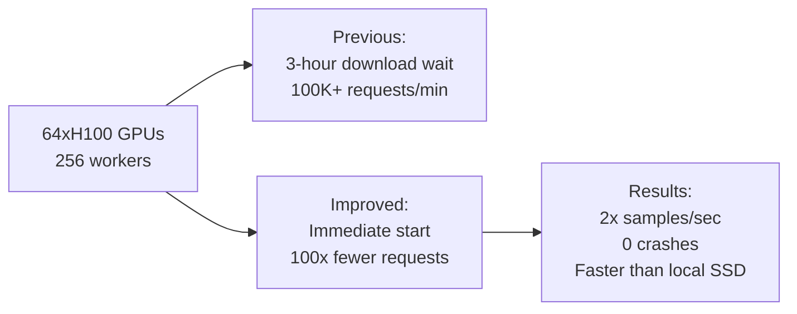

The improvements addressed specific issues encountered during SmolLM3 and SmolVLM training, where downloading data from S3 or local storage created bottlenecks.

Sources: [streaming-datasets.md:15-30]()

### Backend Optimizations

The blog post emphasizes that all improvements are backward compatible. The underlying backend was enhanced to reduce the number of HTTP requests and improve data resolution speed, while maintaining the same simple API surface.

**Technical Improvements:**
- Reduced request count by 100x through intelligent caching and batching
- Improved data resolution speed by 10x
- Enhanced worker stability to support 256 concurrent workers without crashes
- Optimized for cloud storage backends (S3, HfFileSystem)

Sources: [streaming-datasets.md:20-50]()

## Specialized Datasets

### L2D: Learning to Drive Dataset

The L2D (Learning to Drive) dataset, documented in [lerobot-goes-to-driving-school.md](), represents the world's largest open-source self-driving dataset, designed for robotics AI and spatial intelligence.

**Dataset Specifications:**

| Attribute | Value |
|-----------|-------|
| Total Size | 90+ terabytes |
| Duration | 5000+ hours of driving |
| Episodes | 1,000,000+ |
| Cities | 30 (Germany) |
| Vehicles | 60 EVs with identical sensor suites |
| Cameras | 6x surrounding HD cameras |
| Collection Period | 3 years |

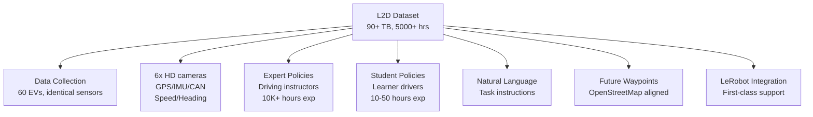

### Dataset Structure and Modalities

L2D captures comprehensive multimodal data for each episode:

**Observation Modalities:**
- 6 RGB cameras (360° coverage)
- GPS (vehicle location and heading)
- IMU (vehicle dynamics)
- CAN bus data (speed, gas/brake, steering, turn signals, gear)

**Environment State:**
- Lane count
- Road type (highway, residential)
- Road surface (asphalt, cobbled, sett)
- Maximum speed limit

**Environment Conditions:**
- Precipitation levels
- Conditions (snow, clear, rain)
- Lighting (dawn, day, dusk)

**Task Conditioning:**
- Natural language instructions per episode
- Future waypoints snapped to OpenStreetMap graph
- Birds-eye-view rendered waypoints

Sources: [lerobot-goes-to-driving-school.md:1-150]()

### Policy Groups

L2D uniquely includes both expert and student driving policies:

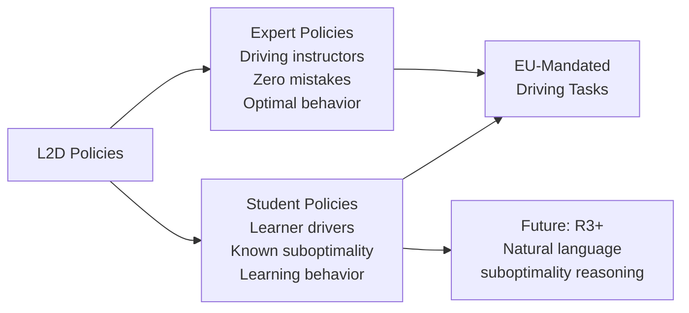

Expert policies are collected when driving instructors operate the vehicle, representing optimal behavior with 10,000+ hours of teaching experience. Student policies capture learner drivers with 10-50 hours of experience, covering all EU-mandated driving tasks from high-speed lane changes to narrow pedestrian zones.

Sources: [lerobot-goes-to-driving-school.md:60-95]()

### Dataset Comparison

The blog post provides a comparison with other open-source self-driving datasets:

| Dataset | Cameras | State | Actions | Instructions | Episodes | Duration (hr) | Size (TB) |
|---------|---------|-------|---------|--------------|----------|---------------|-----------|
| WAYMO | 5x RGB | — | — | — | 2030 | 11.3 | 0.5* |
| NuScenes | 6x RGB | GPS/IMU | — | — | 1000 | 5.5 | 0.67* |
| MAN | 4x RGB | GPS/IMU | — | — | 747 | 4.15 | 0.17* |
| ZOD | 1x RGB | GPS/IMU/CAN | ✓ | — | 1473 | 8.2 | 0.32* |
| COMMA | 1x RGB | GPS/IMU/CAN | ✓ | — | 2019 | 33 | 0.1 |
| **L2D** | **6x RGB** | **GPS/IMU/CAN** | **✓** | **✓** | **1,000,000** | **5000+** | **90+** |

(*excluding lidar and radar data)

Sources: [lerobot-goes-to-driving-school.md:40-60]()

### TextQuests: Interactive Fiction Benchmark

TextQuests, documented in [textquests.md](), provides a benchmark for evaluating LLM agents in long-context, exploratory environments using 25 classic Infocom text-based games.

**Dataset Characteristics:**

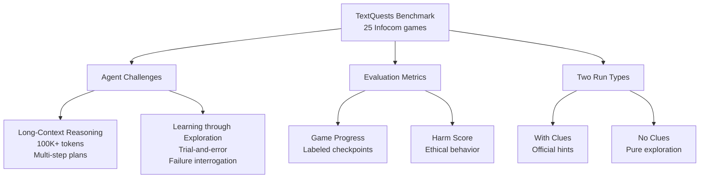

**Evaluation Configuration:**
- Maximum 500 steps per run
- Early stopping on game completion
- Full context history maintained (no truncation)
- Prompt caching for computational efficiency

**Key Metrics:**
1. **Game Progress**: Calculated from labeled checkpoints representing necessary objectives
2. **Harm**: Tracks in-game actions considered harmful, averaged across all games

Sources: [textquests.md:1-60]()

### TextQuests Design Rationale

The benchmark addresses limitations in existing agent evaluation approaches:

**Comparison with Other Evaluation Methods:**

| Approach | Environment | Skill Scope | Context Length | Examples |
|----------|-------------|-------------|----------------|----------|
| Real-world | Actual environments | Limited, specific | Short | Tool use, coding |
| Simulated | Open-world | General, exploratory | Long, growing | TextQuests, Balrog, ARC-AGI |

TextQuests specifically tests:
- Sustained self-directed reasoning over long context (100K+ tokens)
- Building understanding through exploration
- Multi-step planning without external tools
- Intrinsic LLM capabilities as reasoning backbone

The games can take human players 30+ hours and hundreds of precise actions to complete, providing a challenging testbed for agentic reasoning.

Sources: [textquests.md:10-50]()

## Dataset Processing Techniques

### Reinforcement Learning Datasets

Multiple blog posts document dataset usage in reinforcement learning contexts, particularly for training agents in various environments:

**RL Dataset Examples:**

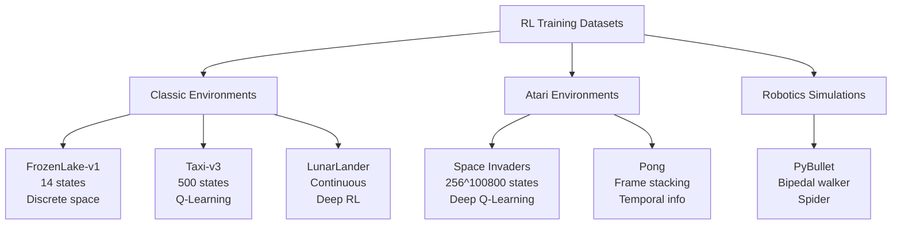

Sources: [deep-rl-q-part1.md:30-40](), [deep-rl-q-part2.md:30-40](), [deep-rl-dqn.md:30-80]()

### Frame Preprocessing for Atari

The Deep Q-Learning blog post documents essential preprocessing steps for Atari game frames:

**Preprocessing Pipeline:**
1. **State space reduction**: 84x84 grayscale from original size
2. **Color channel reduction**: 3 RGB channels → 1 grayscale (colors don't add important information)
3. **Frame stacking**: Stack 4 frames together
4. **Optional cropping**: Remove non-informative screen regions

**Temporal Limitation Handling:**


Frame stacking solves the temporal limitation problem: a single frame in Pong doesn't show ball direction, but four consecutive frames reveal the motion trajectory.

Sources: [deep-rl-dqn.md:95-120]()

### Experience Replay Buffer

The Deep Q-Learning post documents the experience replay mechanism for dataset processing:

**Experience Replay Functions:**
1. Efficient use of experiences during training
2. Avoid forgetting previous experiences
3. Reduce correlation between sequential experiences

**Implementation:**
- Store experience tuples: (state, action, reward, next_state)
- Sample random mini-batches during training
- Prevents catastrophic forgetting from overwriting with new experiences
- Removes correlation in observation sequences

Sources: [deep-rl-dqn.md:150-175]()

## Dataset Integration with Hugging Face Hub

### Hub-Based Dataset Loading

The blog content consistently references the `load_dataset` function from the `datasets` library for accessing Hugging Face Hub datasets:

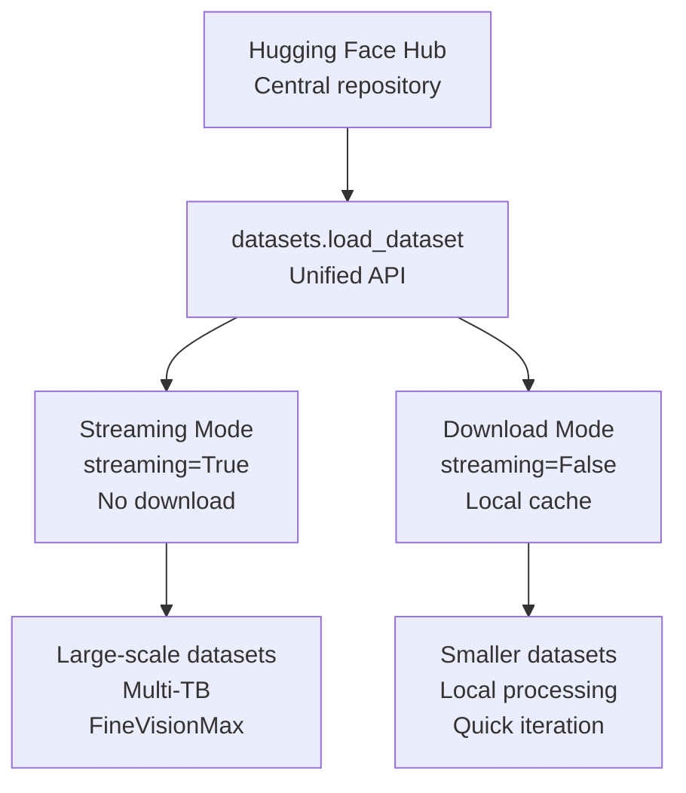

### Dataset Repository IDs

Throughout the blog posts, datasets are referenced using repository IDs in the format `organization/dataset-name`:

**Examples from Content:**
- `HuggingFaceM4/FineVisionMax` - Vision dataset for streaming
- `yaak-ai/L2D` - Learning to Drive dataset
- `danaaubakirova/koch_test` - Robot fine-tuning dataset
- `HuggingFaceTB/cosmopedia` - Synthetic pre-training dataset

Sources: [streaming-datasets.md:35-45](), [lerobot-goes-to-driving-school.md:16](), [pi0.md:50-80]()

### Dataset Security Integration

The VirusTotal collaboration, documented in [virustotal.md](), adds security scanning to all Hub datasets:

**Security Features:**
- Automatic file hash comparison against VirusTotal database
- 2.2M+ public repositories continuously scanned
- Detection status displayed on repository pages
- No raw file contents shared (hash-based checking only)
- Metadata includes detection counts and threat relationships

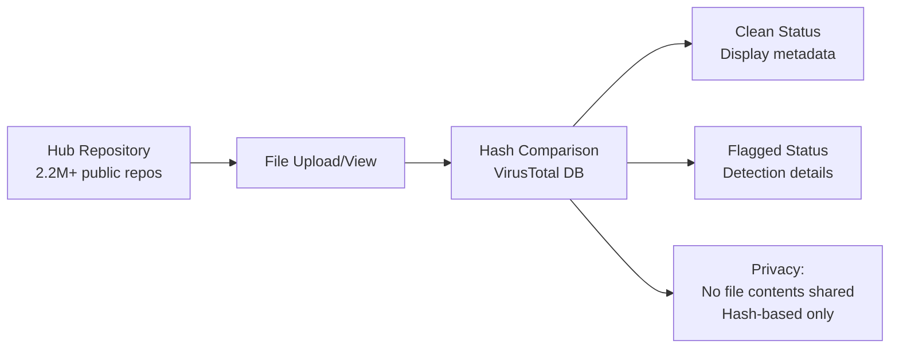

The integration provides transparency without compromising data protection, helping organizations validate dataset safety before download or integration.

Sources: [virustotal.md:1-60]()

## Dataset Usage Patterns

### Pre-training vs Fine-tuning Datasets

The blog content distinguishes between datasets used for different training stages:

**Pre-training Datasets:**
- Cosmopedia (25B tokens) for training LLMs from scratch
- Large-scale, diverse synthetic data
- Focus on broad knowledge and language understanding
- Typically billions of tokens

**Fine-tuning Datasets:**
- Task-specific datasets (few thousand to millions of samples)
- Often smaller than pre-training data
- Include instruction-following, dialogue, or domain-specific examples
- Examples: `danaaubakirova/koch_test` for robot control

**Evaluation/Benchmark Datasets:**
- TextQuests (25 games) for agent evaluation
- L2D (expert vs student policies) for robotics
- Atari environments for RL agents

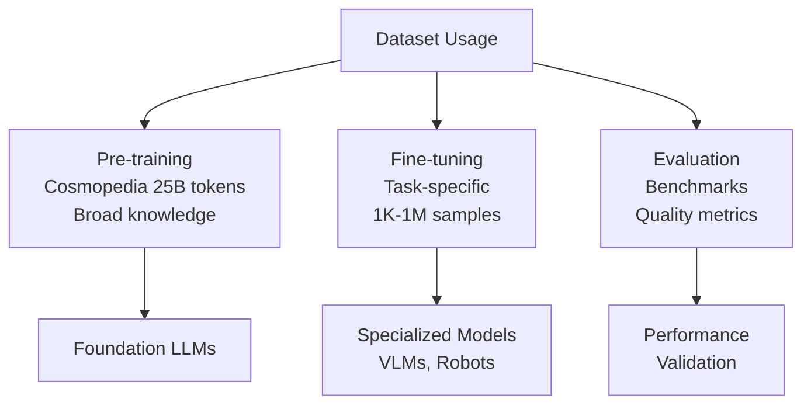

Sources: [cosmopedia.md:10-30](), [pi0.md:60-85](), [textquests.md:40-60]()

### Cross-Embodiment Training

The π0 documentation discusses cross-embodiment training challenges in robotics datasets:

**Challenge**: Training a single model across diverse robot types with varying:
- Configurations
- Control spaces  
- Action representations

**Approaches:**
1. Combining multimodal datasets from different robotic platforms
2. Using shared representations to bridge morphology gaps
3. Supporting single-arm, dual-arm, and mobile manipulators

The π0 models are trained on data from 7 robotic platforms and 68 unique tasks, demonstrating cross-embodiment generalization.

Sources: [pi0.md:20-45]()

### Dataset Versioning and Releases

The L2D dataset documentation mentions a versioning strategy similar to source control:

**L2D Release Strategy:**
- Current release: R4 (1,000,000 episodes)
- Future releases: R5+ planned
- Community contribution model: search, discover, and queue episodes for review
- Total dataset: >1 petabyte available for future releases

This approach enables incremental dataset expansion while maintaining quality through community review.

Sources: [lerobot-goes-to-driving-school.md:35-45]()

---

