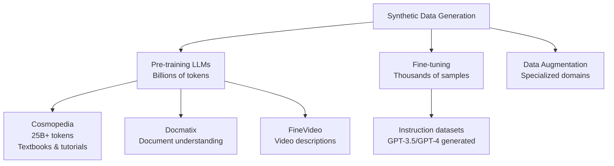
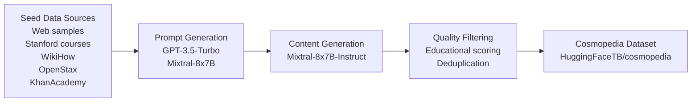
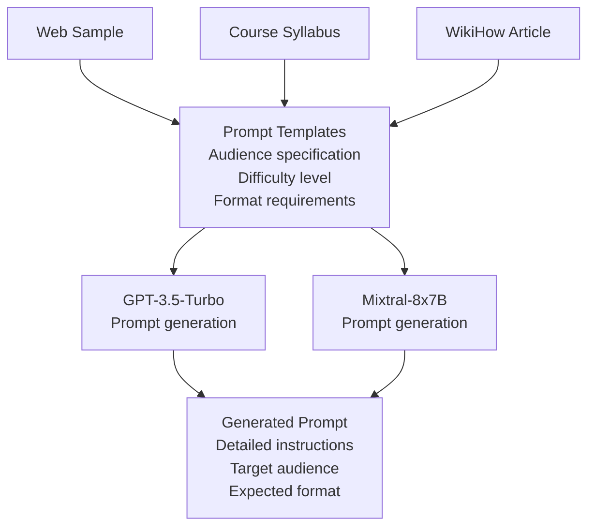
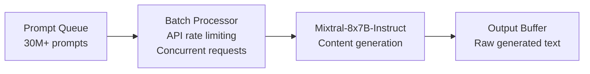
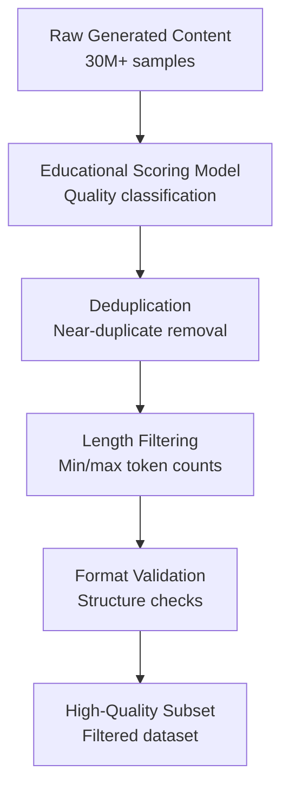
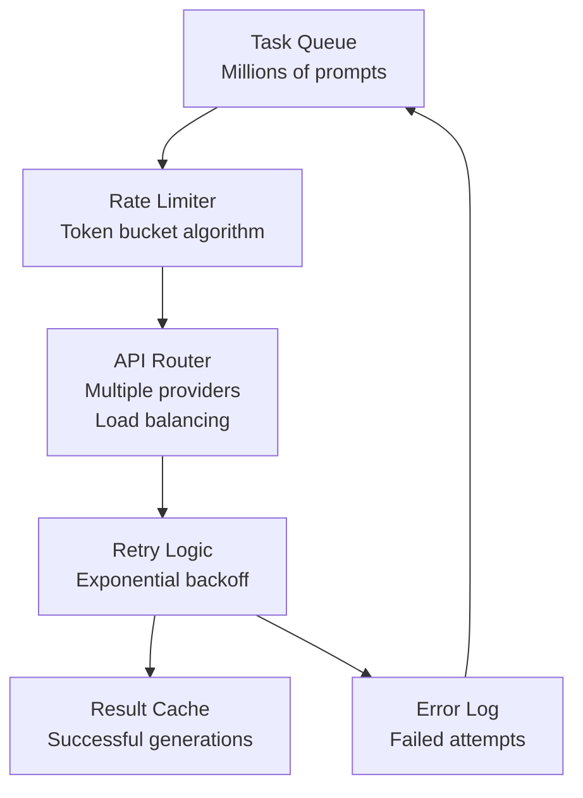
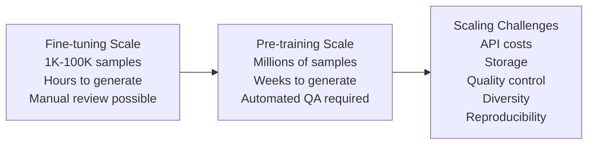
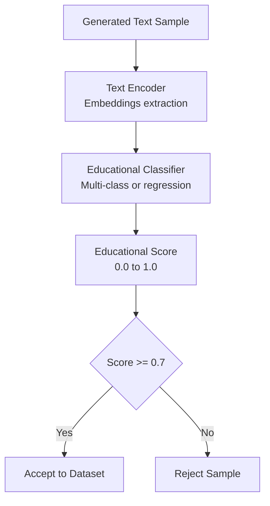
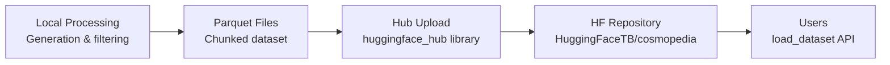
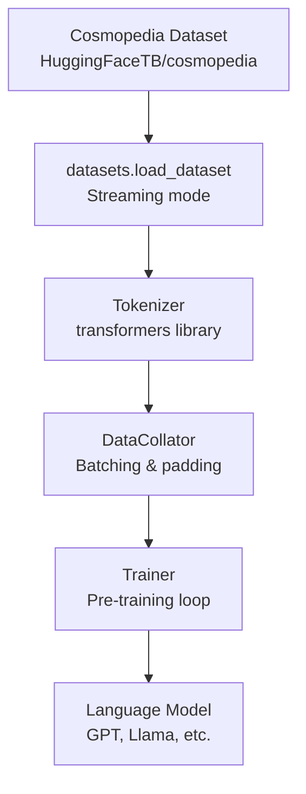

<!-- source: DeepWiki mcp.deepwiki.com · repo huggingface/blog · page 8.1 Large-Scale Synthetic Datasets · fetched 2026-10-26 -->

# Large-Scale Synthetic Datasets

<details>
<summary>Relevant source files</summary>

The following files were used as context for generating this wiki page:

- [1_58_llm_extreme_quantization.md](1_58_llm_extreme_quantization.md)
- [_blog.yml](_blog.yml)
- [_tags.yml](_tags.yml)
- [assets/192_pi0/new_thumbnail_pi0.001.png](assets/192_pi0/new_thumbnail_pi0.001.png)
- [assets/193_l2d/lerobot-driver.gif](assets/193_l2d/lerobot-driver.gif)
- [assets/1_58_llm_extreme_quantization/thumbnail.png](assets/1_58_llm_extreme_quantization/thumbnail.png)
- [assets/63_deep_rl_intro/tasks.jpg](assets/63_deep_rl_intro/tasks.jpg)
- [assets/70_deep_rl_q_part1/bellman6.jpg](assets/70_deep_rl_q_part1/bellman6.jpg)
- [assets/78_ml_director_insights/witty-works.png](assets/78_ml_director_insights/witty-works.png)
- [assets/86_bloom/bloom-examples.jpg](assets/86_bloom/bloom-examples.jpg)
- [assets/controlnet/thumbnail.png](assets/controlnet/thumbnail.png)
- [assets/cosmopedia/thumbnail.png](assets/cosmopedia/thumbnail.png)
- [assets/inference-providers/welcome-featherless.jpg](assets/inference-providers/welcome-featherless.jpg)
- [assets/optimum_intel/optimum_openvino_thumbnail.png](assets/optimum_intel/optimum_openvino_thumbnail.png)
- [assets/sd_dreambooth_training/thumbnail.jpg](assets/sd_dreambooth_training/thumbnail.jpg)
- [assets/streaming_datasets/streaming_datasets.png](assets/streaming_datasets/streaming_datasets.png)
- [assets/textquests/thumbnail.gif](assets/textquests/thumbnail.gif)
- [assets/trl_vlm/thumbnail.png](assets/trl_vlm/thumbnail.png)
- [assets/virustotal/thumbnail.png](assets/virustotal/thumbnail.png)
- [assets/wuerstchen/thumbnail.jpg](assets/wuerstchen/thumbnail.jpg)
- [bloom.md](bloom.md)
- [classification-use-cases.md](classification-use-cases.md)
- [controlnet.md](controlnet.md)
- [cosmopedia.md](cosmopedia.md)
- [deep-rl-a2c.md](deep-rl-a2c.md)
- [deep-rl-dqn.md](deep-rl-dqn.md)
- [deep-rl-intro.md](deep-rl-intro.md)
- [deep-rl-pg.md](deep-rl-pg.md)
- [deep-rl-ppo.md](deep-rl-ppo.md)
- [deep-rl-q-part1.md](deep-rl-q-part1.md)
- [deep-rl-q-part2.md](deep-rl-q-part2.md)
- [dreambooth.md](dreambooth.md)
- [inference-providers-featherless.md](inference-providers-featherless.md)
- [lerobot-goes-to-driving-school.md](lerobot-goes-to-driving-school.md)
- [ml-director-insights-2.md](ml-director-insights-2.md)
- [openvino-vlm.md](openvino-vlm.md)
- [pi0.md](pi0.md)
- [streaming-datasets.md](streaming-datasets.md)
- [textquests.md](textquests.md)
- [trl-vlm-alignment.md](trl-vlm-alignment.md)
- [virustotal.md](virustotal.md)

</details>


## Purpose and Scope

This document covers the creation and management of large-scale synthetic datasets used for pre-training and fine-tuning language models in the Hugging Face ecosystem. It focuses on the technical pipelines, data generation strategies, and quality control mechanisms employed in creating billion-token synthetic datasets such as Cosmopedia, Docmatix, and FineVideo.

For information about dataset streaming and optimization techniques, see [Data Streaming and Optimization](#8.2). For smaller-scale synthetic data used in fine-tuning workflows, see [Training and Fine-tuning LLMs](#2.2).

## Overview of Synthetic Data Generation

Synthetic data generation has become a critical component in modern ML workflows, particularly for pre-training large language models. Unlike traditional datasets that rely on human annotation or web scraping, synthetic datasets are generated programmatically using existing language models to create training data at unprecedented scales.

### Primary Use Cases



**Dataset Scale Comparison**

| Dataset | Tokens | Samples | Generation Method | Primary Use |
|---------|--------|---------|-------------------|-------------|
| Cosmopedia | 25B+ | 30M+ | LLM-generated textbooks | Pre-training |
| Docmatix | Not specified | Large-scale | Document processing | Vision-language models |
| FineVideo | Not specified | Large-scale | Video captioning | Multimodal models |
| Instruction datasets | <1B | 1K-100K | GPT-3.5/4 prompting | Fine-tuning |

Sources: [cosmopedia.md:1-25]()

## The Cosmopedia Pipeline

Cosmopedia represents a large-scale effort to create synthetic textbook-style content for pre-training language models, inspired by Microsoft's Phi-1.5 approach. The pipeline involves multiple stages of data generation, filtering, and quality control.

### Architecture Overview



**Generation Pipeline Stages**

Sources: [cosmopedia.md:220-350]()

### Seed Data Collection

The first stage involves curating diverse seed data sources that serve as inspiration and structural templates for synthetic content generation:

**Seed Data Sources:**

| Source | Content Type | Examples | Scale |
|--------|-------------|----------|-------|
| Web samples | Auto-generated topics | Science, history, programming | Millions of topics |
| Stanford courses | Course syllabi | CS, engineering, humanities | Hundreds of courses |
| WikiHow | How-to guides | Practical skills | Thousands of articles |
| OpenStax | Textbook chapters | Academic subjects | Complete textbooks |
| KhanAcademy | Educational topics | Math, science | Comprehensive curriculum |

The seed data provides:
- Topic diversity across domains
- Structural templates for content organization
- Quality benchmarks for educational content
- Target difficulty levels and audience specifications

Sources: [cosmopedia.md:95-180]()

### Prompt Generation Strategy

The second stage generates detailed prompts that guide the content generation process. This two-stage approach (prompt generation → content generation) allows for better control over output quality and diversity.



**Prompt Generation Techniques:**

1. **Audience-aware prompting**: Specify target reader (child, college student, expert)
2. **Difficulty calibration**: Set complexity level based on seed content
3. **Format specification**: Define structure (tutorial, textbook chapter, Q&A)
4. **Topic expansion**: Generate related subtopics from seed material

Example prompt structure:
- Base instruction template
- Seed content context
- Audience and difficulty modifiers
- Format and length requirements
- Quality criteria

Sources: [cosmopedia.md:180-280]()

### Content Generation Process

The third stage uses the generated prompts to create actual educational content at scale using Mixtral-8x7B-Instruct-v0.1.

**Generation Configuration:**



**Technical Parameters:**

| Parameter | Value | Purpose |
|-----------|-------|---------|
| Model | Mixtral-8x7B-Instruct-v0.1 | Open-source generation |
| Batch size | Variable | API rate management |
| Temperature | 0.7-0.9 | Creativity vs. coherence |
| Max tokens | 2048-4096 | Content length control |
| Top-p | 0.9 | Nucleus sampling |

**Generation Challenges:**

1. **API rate limits**: Managing millions of requests across API providers
2. **Cost optimization**: Balancing quality vs. inference costs
3. **Consistency**: Maintaining style and quality across 30M+ samples
4. **Error handling**: Managing failed generations and retries
5. **Storage**: Processing and storing terabytes of generated text

Sources: [cosmopedia.md:280-420]()

### Quality Filtering Pipeline

The fourth stage applies rigorous quality control to filter generated content and ensure educational value.



**Quality Filtering Stages:**

1. **Educational Scoring**
   - Uses dedicated classifier model
   - Scores content on educational value
   - Filters low-quality or off-topic content
   - Threshold-based selection

2. **Deduplication**
   - Identifies near-duplicate samples
   - Removes redundant content
   - Preserves diversity across dataset
   - Hash-based and similarity-based methods

3. **Length Validation**
   - Minimum token requirements
   - Maximum length constraints
   - Removes truncated or incomplete samples

4. **Format Validation**
   - Checks structural requirements
   - Validates markdown/formatting
   - Ensures completeness

**Quality Metrics:**

| Metric | Target | Purpose |
|--------|--------|---------|
| Educational score | >0.7 | Content quality threshold |
| Uniqueness | >95% | Diversity requirement |
| Completion rate | >90% | Full content coverage |
| Format validity | >98% | Structural correctness |

Sources: [cosmopedia.md:420-580]()

## Technical Implementation Details

### Batch Processing and API Management

Large-scale synthetic data generation requires careful management of API calls, rate limits, and cost optimization.



**API Management Strategies:**

1. **Rate Limiting**
   - Token bucket implementation
   - Per-provider rate tracking
   - Adaptive throttling based on errors

2. **Load Balancing**
   - Multiple API providers
   - Fallback mechanisms
   - Cost-based routing

3. **Error Handling**
   - Exponential backoff
   - Automatic retry with jitter
   - Dead letter queue for persistent failures

4. **Caching**
   - Result deduplication
   - Prompt caching for retries
   - Partial result recovery

Sources: [cosmopedia.md:220-350]()

### Data Storage and Processing

Handling terabytes of generated text requires efficient storage and processing pipelines.

**Storage Architecture:**

| Component | Technology | Purpose |
|-----------|-----------|---------|
| Raw outputs | Cloud object storage | Temporary generation results |
| Processed data | Parquet files | Efficient columnar storage |
| Final dataset | Hugging Face Hub | Distribution and versioning |
| Metadata | JSON/JSONL | Tracking and filtering |

**Processing Pipeline:**

1. **Streaming ingestion**: Process outputs as they're generated
2. **Distributed filtering**: Parallel quality assessment
3. **Incremental deduplication**: Process in chunks to manage memory
4. **Batch uploading**: Aggregate before Hub upload

Sources: [cosmopedia.md:1-600]()

## Scale Considerations and Best Practices

### Scaling from Thousands to Billions

Moving from fine-tuning datasets (thousands of samples) to pre-training datasets (billions of tokens) introduces unique challenges:

**Scale Comparison:**



**Best Practices for Large-Scale Generation:**

1. **Iterative Development**
   - Start with small pilot (1K-10K samples)
   - Validate quality and diversity
   - Gradually scale to millions
   - Monitor metrics throughout

2. **Cost Management**
   - Use open-source models where possible (Mixtral vs. GPT-4)
   - Implement aggressive caching
   - Optimize prompt lengths
   - Batch requests efficiently

3. **Quality Assurance**
   - Automated scoring models
   - Statistical quality monitoring
   - Regular manual spot-checks
   - A/B testing on downstream tasks

4. **Diversity Maintenance**
   - Track topic distribution
   - Monitor style variation
   - Prevent mode collapse
   - Ensure demographic representation

5. **Reproducibility**
   - Version control prompts and configs
   - Log generation parameters
   - Save random seeds
   - Document filtering criteria

Sources: [cosmopedia.md:1-100]()

### Cost Optimization Strategies

**Cost Breakdown for 30M Sample Generation:**

| Component | Approach | Impact |
|-----------|----------|--------|
| Model selection | Mixtral vs. GPT-4 | 10-100x cost reduction |
| Prompt optimization | Shorter, focused prompts | 30-50% token savings |
| Batch processing | Larger batch sizes | 20-30% throughput gain |
| Caching | Deduplicate before generation | 10-15% API call reduction |
| Filtering | Pre-filter seeds | 40-60% generation reduction |

**Open-Source vs. Proprietary Models:**

- **GPT-3.5/GPT-4**: Higher quality, higher cost, rate limits
- **Mixtral-8x7B**: Lower cost, self-hosted option, good quality
- **Open alternatives**: Full control, infrastructure overhead

Sources: [cosmopedia.md:50-200]()

## Quality Control and Validation

### Educational Scoring Model

Cosmopedia employs a dedicated classifier to assess the educational value of generated content.



**Scoring Criteria:**

- Coherence and readability
- Educational structure (introduction, explanation, examples)
- Factual consistency
- Appropriate complexity for target audience
- Completeness of explanations

Sources: [cosmopedia.md:450-520]()

### Deduplication Methods

Preventing near-duplicates is critical for dataset quality and model performance.

**Deduplication Pipeline:**

1. **Exact deduplication**: Hash-based matching
2. **Near-duplicate detection**: MinHash or SimHash
3. **Semantic deduplication**: Embedding similarity
4. **Cross-source deduplication**: Remove overlaps with web data

**Technical Approaches:**

| Method | Technique | Precision | Recall |
|--------|-----------|-----------|--------|
| Exact match | SHA-256 hashing | 100% | Limited |
| MinHash | LSH with n-grams | High | Medium |
| Embeddings | Cosine similarity | Medium | High |
| Hybrid | Combined approaches | Highest | Highest |

Sources: [cosmopedia.md:480-550]()

## Dataset Versioning and Distribution

### Hugging Face Hub Integration

All large-scale synthetic datasets are hosted on the Hugging Face Hub for easy access and versioning.



**Repository Structure:**

```
HuggingFaceTB/cosmopedia/
├── README.md                 # Dataset card with metadata
├── data/
│   ├── train-00000.parquet  # Chunked parquet files
│   ├── train-00001.parquet
│   └── ...
└── config.json              # Dataset configuration
```

**Access Pattern:**

```python
from datasets import load_dataset

# Load full dataset
dataset = load_dataset("HuggingFaceTB/cosmopedia")

# Stream for large-scale training
dataset = load_dataset("HuggingFaceTB/cosmopedia", streaming=True)
```

Sources: [cosmopedia.md:1-50](), [_blog.yml:1-100]()

## Related Large-Scale Synthetic Datasets

### Docmatix

While not detailed in the provided files, Docmatix is mentioned as a large-scale synthetic dataset focused on document understanding tasks, likely combining OCR, layout analysis, and document question-answering capabilities.

### FineVideo

FineVideo is referenced as a synthetic dataset for video understanding, presumably containing generated video descriptions, captions, and multimodal annotations at scale.

### Comparison with Traditional Datasets

**Synthetic vs. Real Data:**

| Aspect | Synthetic (Cosmopedia) | Real (Web Crawl) |
|--------|------------------------|------------------|
| Scale | 25B+ tokens | Trillions of tokens |
| Quality | High, filtered | Variable |
| Diversity | Controlled | Organic |
| Cost | API costs | Crawling infrastructure |
| Legal | Clean licensing | Copyright concerns |
| Bias | Controllable | Reflects web biases |

Sources: [cosmopedia.md:1-100](), [_blog.yml:982-987]()

## Integration with Training Pipelines

Large-scale synthetic datasets integrate directly with modern training frameworks for pre-training language models.

### LeRobot and Transformers Integration



**Training Configuration:**

- **Streaming**: Essential for 25B+ token datasets
- **Shuffling**: Requires careful buffer management
- **Mixing**: Often combined with web data
- **Curriculum**: May start with high-quality synthetic before web data

Sources: [cosmopedia.md:1-50](), [streaming-datasets.md:1-100]()

## Future Directions

### Emerging Trends in Synthetic Data

1. **Multimodal synthesis**: Generating paired text-image, text-video data
2. **Domain specialization**: Medical, legal, scientific synthetic corpora
3. **Reasoning chains**: Synthetic data for chain-of-thought training
4. **Multilingual expansion**: Generating educational content in multiple languages
5. **Quality improvements**: Better models for higher-quality outputs

### Challenges and Research Directions

- **Model collapse**: Avoiding degradation from training on model-generated data
- **Diversity preservation**: Maintaining dataset variety at billion-token scale
- **Factual accuracy**: Ensuring synthetic content is factually correct
- **Bias amplification**: Preventing LLM biases from amplifying in synthetic data
- **Evaluation methods**: Better metrics for synthetic data quality

Sources: [cosmopedia.md:1-100]()

---

**Key Takeaways:**

- Large-scale synthetic datasets enable pre-training without massive web scraping
- Multi-stage pipelines (seed → prompt → generate → filter) ensure quality
- Cost optimization through open-source models (Mixtral) is critical
- Quality control requires automated scoring and deduplication
- Hugging Face Hub provides infrastructure for distribution and versioning
- Synthetic data complements rather than replaces web-crawled data

Sources: [cosmopedia.md:1-600]()

---

