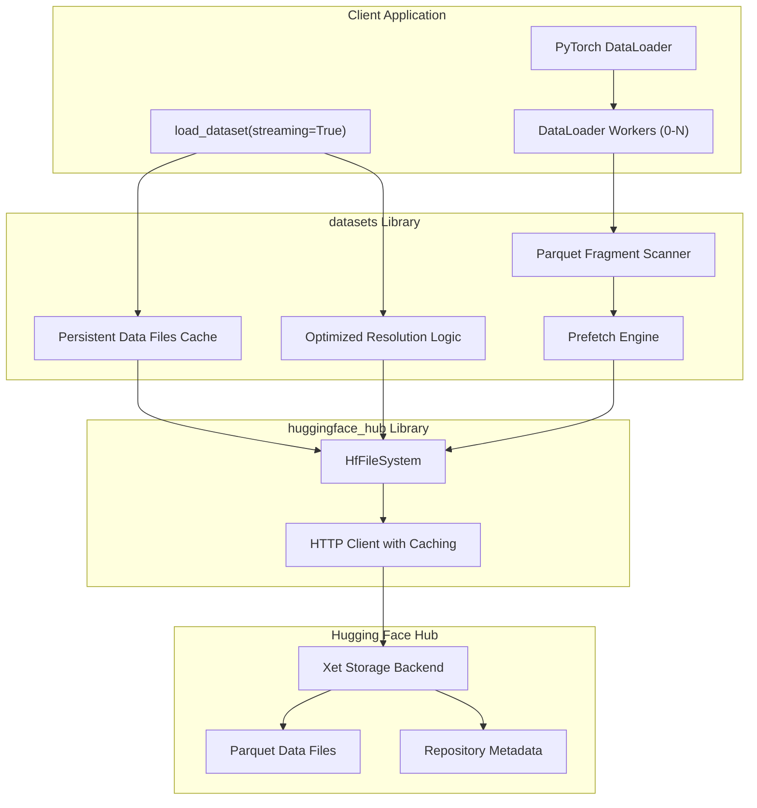
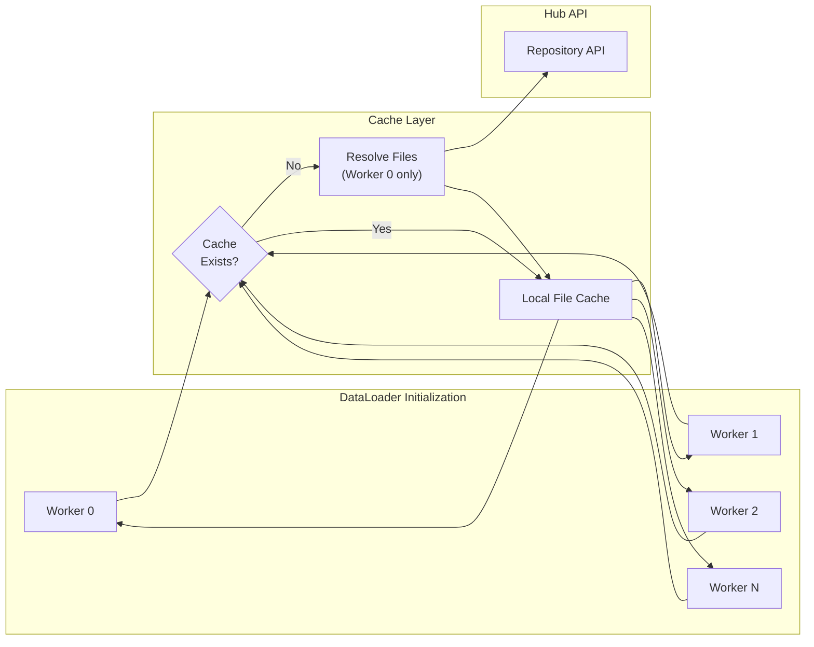
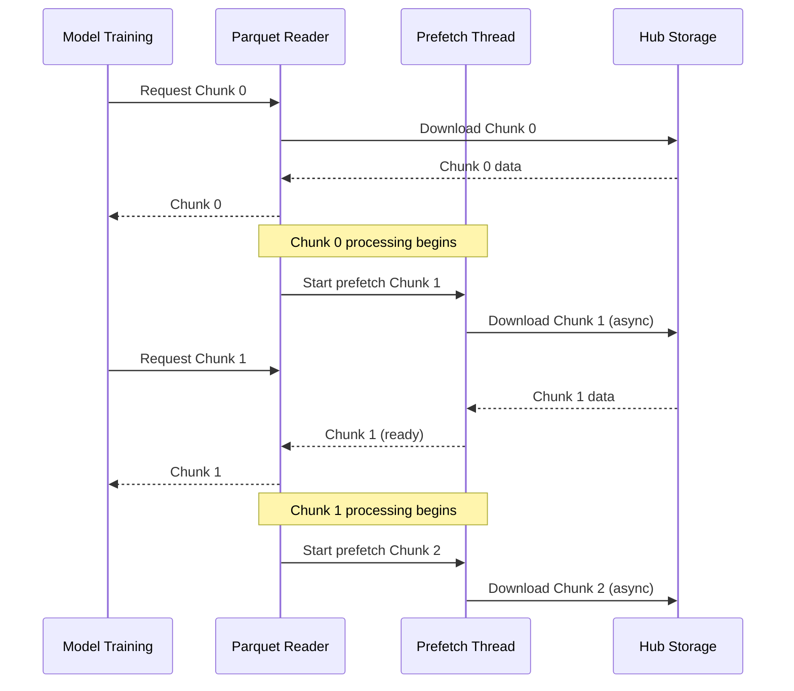
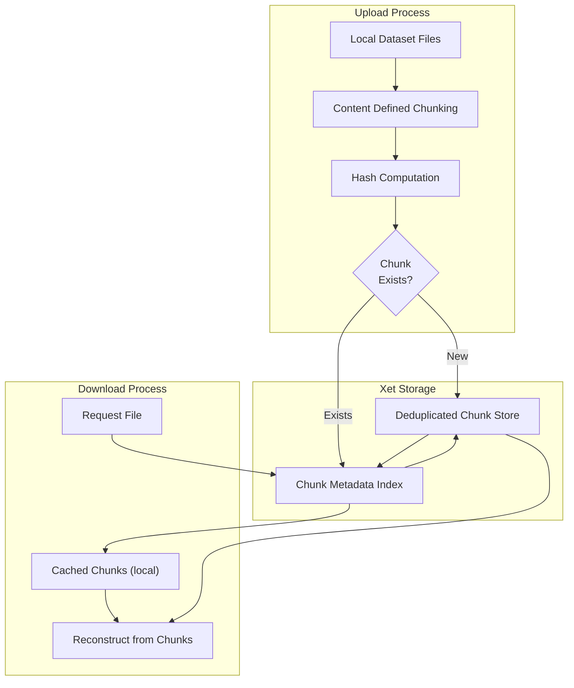

<!-- source: DeepWiki mcp.deepwiki.com · repo huggingface/blog · page 8.2 Data Streaming and Optimization · fetched 2026-10-26 -->

# Data Streaming and Optimization

<details>
<summary>Relevant source files</summary>

The following files were used as context for generating this wiki page:

- [1_58_llm_extreme_quantization.md](1_58_llm_extreme_quantization.md)
- [_blog.yml](_blog.yml)
- [_tags.yml](_tags.yml)
- [assets/192_pi0/new_thumbnail_pi0.001.png](assets/192_pi0/new_thumbnail_pi0.001.png)
- [assets/193_l2d/lerobot-driver.gif](assets/193_l2d/lerobot-driver.gif)
- [assets/1_58_llm_extreme_quantization/thumbnail.png](assets/1_58_llm_extreme_quantization/thumbnail.png)
- [assets/inference-providers/welcome-featherless.jpg](assets/inference-providers/welcome-featherless.jpg)
- [assets/optimum_intel/optimum_openvino_thumbnail.png](assets/optimum_intel/optimum_openvino_thumbnail.png)
- [assets/sd_dreambooth_training/thumbnail.jpg](assets/sd_dreambooth_training/thumbnail.jpg)
- [assets/streaming_datasets/streaming_datasets.png](assets/streaming_datasets/streaming_datasets.png)
- [assets/textquests/thumbnail.gif](assets/textquests/thumbnail.gif)
- [assets/trl_vlm/thumbnail.png](assets/trl_vlm/thumbnail.png)
- [assets/virustotal/thumbnail.png](assets/virustotal/thumbnail.png)
- [assets/wuerstchen/thumbnail.jpg](assets/wuerstchen/thumbnail.jpg)
- [dreambooth.md](dreambooth.md)
- [inference-providers-featherless.md](inference-providers-featherless.md)
- [lerobot-goes-to-driving-school.md](lerobot-goes-to-driving-school.md)
- [openvino-vlm.md](openvino-vlm.md)
- [pi0.md](pi0.md)
- [streaming-datasets.md](streaming-datasets.md)
- [textquests.md](textquests.md)
- [trl-vlm-alignment.md](trl-vlm-alignment.md)
- [virustotal.md](virustotal.md)

</details>


## Purpose and Scope

This page documents the data streaming and optimization capabilities in the Hugging Face ecosystem, focusing on efficient loading and processing of large-scale datasets without downloading them locally. It covers the `datasets` library streaming API, underlying optimization techniques, custom streaming pipelines using `HfFileSystem`, and the Xet storage backend that enables fast deduplicated transfers.

For information about creating large-scale synthetic datasets, see [Large-Scale Synthetic Datasets](#8.1). For time series-specific data processing, see [Dataset Processing with GluonTS](#8.3).

---

## Streaming API Overview

The `datasets` library provides a streaming mode that allows training on multi-terabyte datasets immediately without local downloads:

```python
from datasets import load_dataset

# Stream a dataset instead of downloading it
dataset = load_dataset("HuggingFaceM4/FineVisionMax", split="train", streaming=True)

# Iterate immediately
for example in dataset:
    # Process example
    pass
```

The `streaming=True` flag enables on-demand data fetching from remote repositories, eliminating the need for local disk space and pre-download waiting time.

**Sources:** [streaming-datasets.md:31-42]()

---

## Streaming Architecture



**Architecture Overview**

The streaming system consists of multiple layers working together:

1. **Client Layer**: User code with `load_dataset` and `DataLoader` managing multiple workers
2. **Optimization Layer**: Caching and resolution logic that minimize redundant requests
3. **I/O Layer**: `HfFileSystem` and HTTP client handling actual network transfers
4. **Storage Layer**: Xet backend providing deduplicated storage and transfer

**Sources:** [streaming-datasets.md:46-70](), [streaming-datasets.md:88-95]()

---

## Startup Optimization

### Persistent Data Files Cache

When multiple DataLoader workers initialize, each worker traditionally resolved the dataset's file list independently, creating a "request storm" that could generate 100,000+ requests and trigger rate limiting.

The solution implements a shared cache:



**Cache Behavior:**
- First worker resolves file list from Hub API
- Results written to local cache directory
- Subsequent workers read from cache
- Reduces startup requests by ~100x

**Sources:** [streaming-datasets.md:60-64]()

### Optimized Resolution Logic

The file resolution process was optimized to minimize API calls:

| Optimization | Description | Impact |
|--------------|-------------|--------|
| Bundled Requests | Group multiple metadata queries into single API calls | Fewer round trips |
| Selective Fetching | Only request necessary metadata fields | Reduced payload size |
| Cached Metadata | Store repository metadata locally | Skip redundant queries |

These optimizations reduced data file resolution time by 10x.

**Sources:** [streaming-datasets.md:64-65]()

---

## Runtime Streaming Optimization

### Prefetching for Parquet

Parquet datasets now support background prefetching, where the next data chunk is downloaded while the current chunk is being processed:



This pipeline ensures the GPU never waits for data, improving throughput by up to 2x.

**Sources:** [streaming-datasets.md:66-69]()

### Configurable Buffering

Advanced users can tune buffer sizes and prefetch behavior for their specific hardware:

```python
import pyarrow
import pyarrow.dataset

fragment_scan_options = pyarrow.dataset.ParquetFragmentScanOptions(
    cache_options=pyarrow.CacheOptions(
        prefetch_limit=1,              # Number of chunks to prefetch
        range_size_limit=128 << 20     # Minimum request size: 128 MiB
    ),
)

ds = load_dataset(
    "dataset_id", 
    streaming=True, 
    fragment_scan_options=fragment_scan_options
)
```

**Configuration Parameters:**

| Parameter | Description | Default | Recommended Range |
|-----------|-------------|---------|-------------------|
| `prefetch_limit` | Number of chunks to prefetch in background | 0 | 1-4 |
| `range_size_limit` | Minimum size of each HTTP request | 32 MiB | 64-256 MiB |

Larger request sizes reduce overhead but increase memory usage. Optimal values depend on network bandwidth and GPU processing speed.

**Sources:** [streaming-datasets.md:70-84]()

---

## Custom Streaming Pipelines

### HfFileSystem API

For custom data formats or specialized processing, `HfFileSystem` provides direct access to Hub files with efficient streaming:

```python
from huggingface_hub import HfFileSystem

path = f"hf://datasets/{dataset_id}/{path_in_repo}"
fs = HfFileSystem()

# Stream file with read()
with fs.open(path) as f:
    while True:
        chunk = f.read(8192)
        if not chunk:
            break
        # Process chunk
        
# Random access with seek()
with fs.open(path) as f:
    f.seek(offset)
    data = f.read(size)
```

**Sources:** [streaming-datasets.md:96-109](), [lerobot-goes-to-driving-school.md:101-109]()

### DataLoader Integration

`HfFileSystem` instances can be passed to PyTorch `DataLoader` to reuse cached directory listings:

```python
from huggingface_hub import HfFileSystem
from torch.utils.data import DataLoader

fs = HfFileSystem()

# List files (cached internally)
files = fs.glob(f"datasets/{dataset_id}/**/*.parquet")

# Pass to DataLoader
# Workers will reuse cached .ls() and .glob() results
dataloader = DataLoader(
    custom_dataset,
    num_workers=8,
    # ... other parameters
)
```

This eliminates redundant directory listing requests from multiple workers.

**Sources:** [streaming-datasets.md:111-112](), [lerobot-goes-to-driving-school.md:101-112]()

---

## Storage Backend: Xet

### Deduplication Architecture



**Xet Storage Features:**

Xet is a dedupe-based storage system that powers Hugging Face Hub. Unlike traditional remote storage like S3:

1. **Content-Defined Chunking**: Files are split into chunks based on content, not fixed offsets
2. **Global Deduplication**: Identical chunks across different files/datasets are stored once
3. **Fast Transfers**: Only unique chunks are transferred during upload/download
4. **Parquet CDC**: Special chunking for Parquet files that respects column boundaries

**Sources:** [streaming-datasets.md:88-95]()

### Parquet Content-Defined Chunking

Parquet CDC optimizes deduplication for columnar data:

| Feature | Benefit |
|---------|---------|
| Column-aware chunking | Chunks align with Parquet row groups |
| Higher dedup ratio | Similar columns across datasets share chunks |
| Faster uploads | Skip duplicate row groups |
| Efficient updates | Only changed row groups transferred |

This makes uploading datasets to Hugging Face faster than traditional cloud storage, as demonstrated by the `pyspark_huggingface` package.

**Sources:** [streaming-datasets.md:92-94]()

---

## Performance Characteristics

### Benchmark Results

The streaming optimizations were tested during training of SmolLM3 and nanoVLM on 64×H100 GPUs with 256 DataLoader workers:

| Metric | Before Optimization | After Optimization | Improvement |
|--------|---------------------|-------------------|-------------|
| Startup Requests | ~100,000 requests | ~1,000 requests | 100× reduction |
| Data Resolution Time | 180 seconds | 18 seconds | 10× faster |
| Streaming Throughput | 1.0× baseline | 2.0× baseline | 2× faster |
| Worker Crashes | Frequent (rate limit) | Zero | 100% stable |
| In-flight Requests | 10,000+ concurrent | 5,000 concurrent | 2× more efficient |

**Sources:** [streaming-datasets.md:20-21](), [streaming-datasets.md:50-56]()

### Real-World Training Impact

Example from SmolLM3 training:

- **Pre-optimization**: 3 hours waiting before each training run to download data
- **Post-optimization**: Immediate training start, streaming as fast as local SSDs
- **Configuration**: 64×H100 GPUs, 256 DataLoader workers, multi-TB datasets

The improvements made streaming from Hub comparable to or faster than local SSD storage for large-scale training.

**Sources:** [streaming-datasets.md:25](), [streaming-datasets.md:114-116]()

---

## Integration Examples

### Basic Streaming Training Loop

```python
from datasets import load_dataset
from transformers import AutoTokenizer
from torch.utils.data import DataLoader

# Stream dataset
dataset = load_dataset(
    "HuggingFaceM4/FineVisionMax", 
    split="train", 
    streaming=True
)

# Create DataLoader with multiple workers
dataloader = DataLoader(
    dataset,
    batch_size=32,
    num_workers=8  # Shares cached file list across workers
)

# Train immediately
for batch in dataloader:
    # Training logic
    pass
```

**Sources:** [streaming-datasets.md:31-45]()

### Advanced Parquet Streaming

```python
import pyarrow.dataset
from datasets import load_dataset

# Configure buffering for high-bandwidth network
fragment_scan_options = pyarrow.dataset.ParquetFragmentScanOptions(
    cache_options=pyarrow.CacheOptions(
        prefetch_limit=2,              # Prefetch 2 chunks ahead
        range_size_limit=256 << 20     # 256 MiB requests
    ),
)

# Stream with optimized settings
dataset = load_dataset(
    "large_parquet_dataset",
    streaming=True,
    fragment_scan_options=fragment_scan_options
)
```

**Sources:** [streaming-datasets.md:72-84]()

### Custom Format Streaming

```python
from huggingface_hub import HfFileSystem

# For formats not supported by datasets library
fs = HfFileSystem()
path = f"hf://datasets/{dataset_id}/video_files/example.mp4"

with fs.open(path, "rb") as f:
    # Stream video frames
    while True:
        frame_data = f.read(frame_size)
        if not frame_data:
            break
        # Process frame
```

**Sources:** [streaming-datasets.md:96-109](), [lerobot-goes-to-driving-school.md:101-109]()

---

## Summary

The data streaming and optimization system provides:

1. **Zero-download training**: Start training immediately on multi-TB datasets
2. **Scalable workers**: 256+ concurrent workers without rate limiting
3. **Efficient transfers**: 100× fewer requests, 10× faster resolution, 2× throughput
4. **Flexible backends**: Parquet streaming with prefetch, custom pipelines with `HfFileSystem`
5. **Smart storage**: Xet deduplication for faster uploads and transfers

These capabilities enable large-scale ML training workflows that were previously impractical without dedicated data infrastructure.

**Sources:** [streaming-datasets.md:15-21](), [streaming-datasets.md:114-128]()

---

