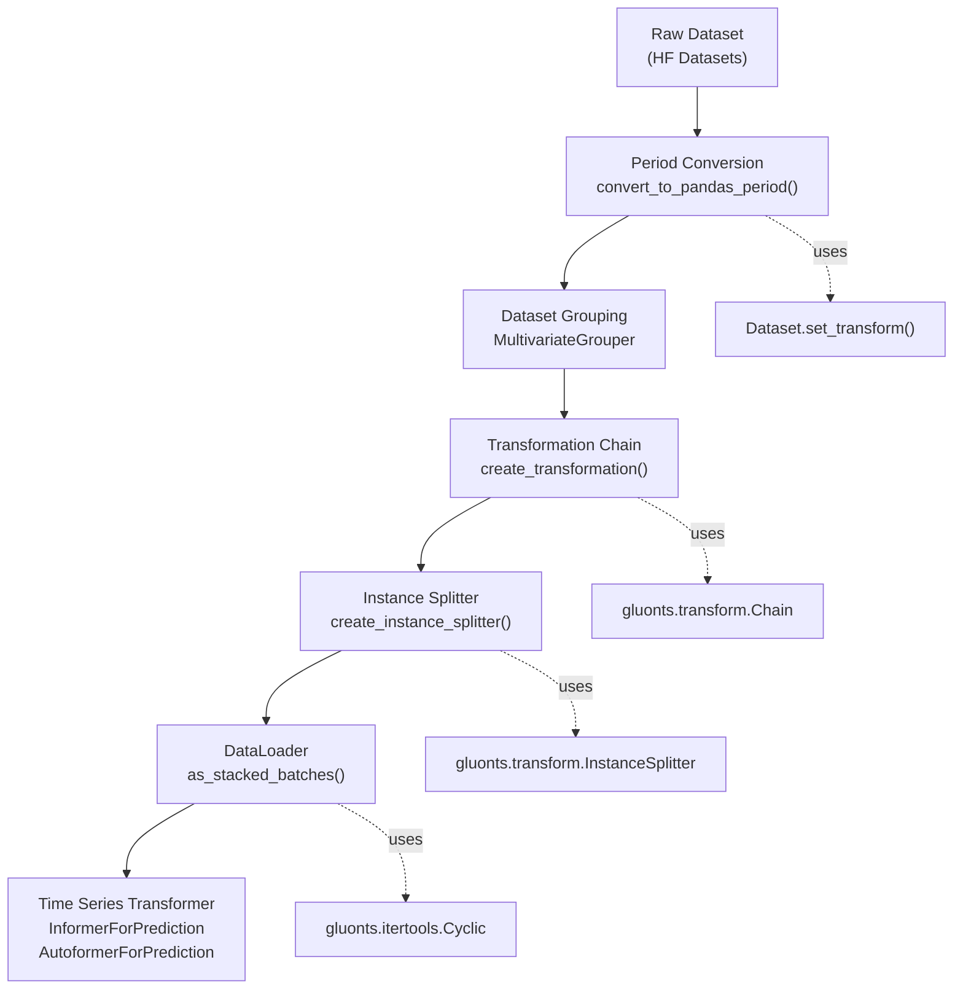
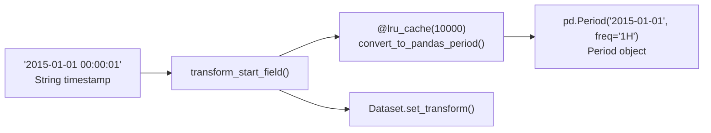
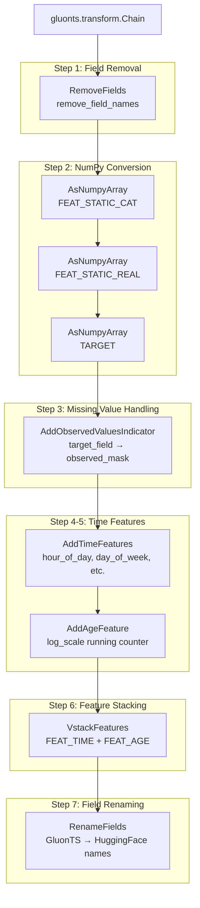
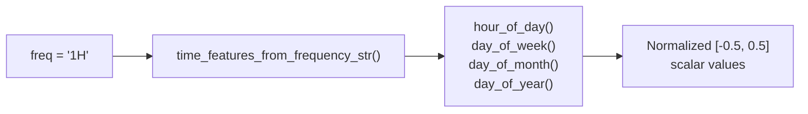
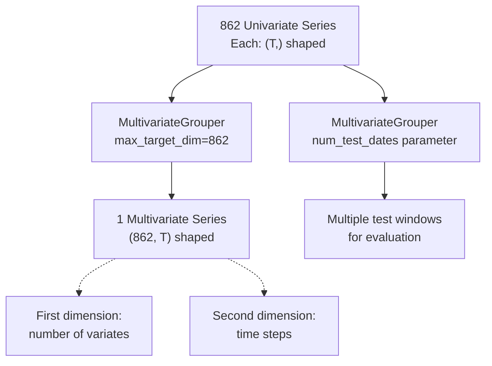
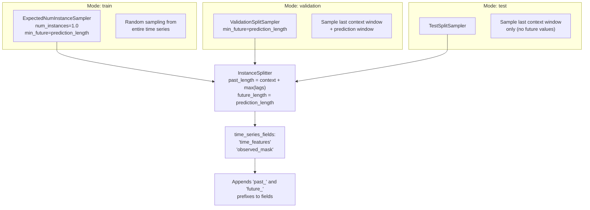
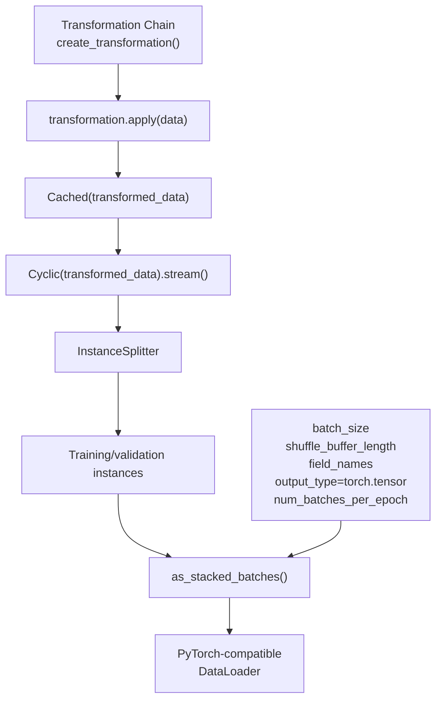
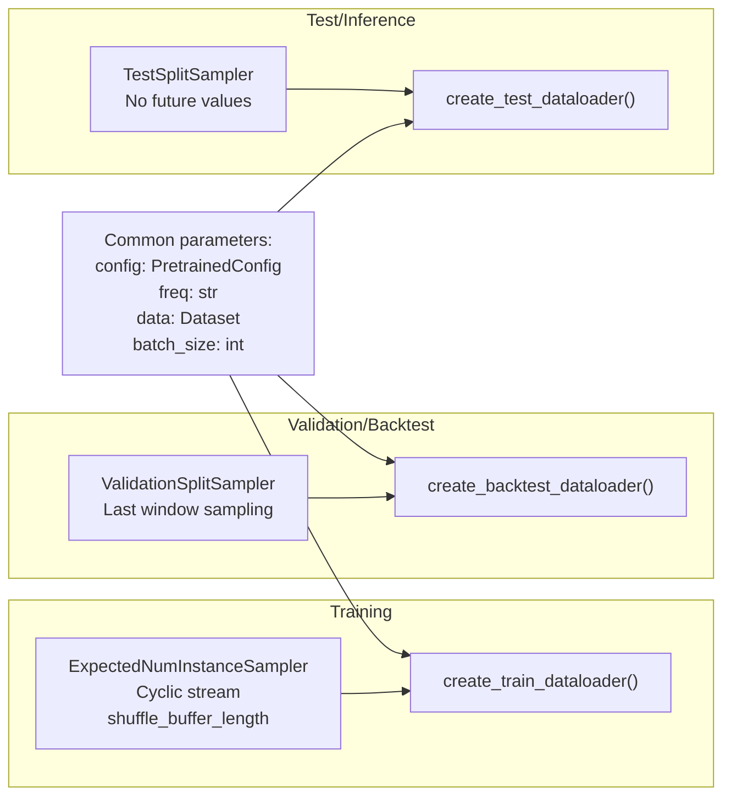
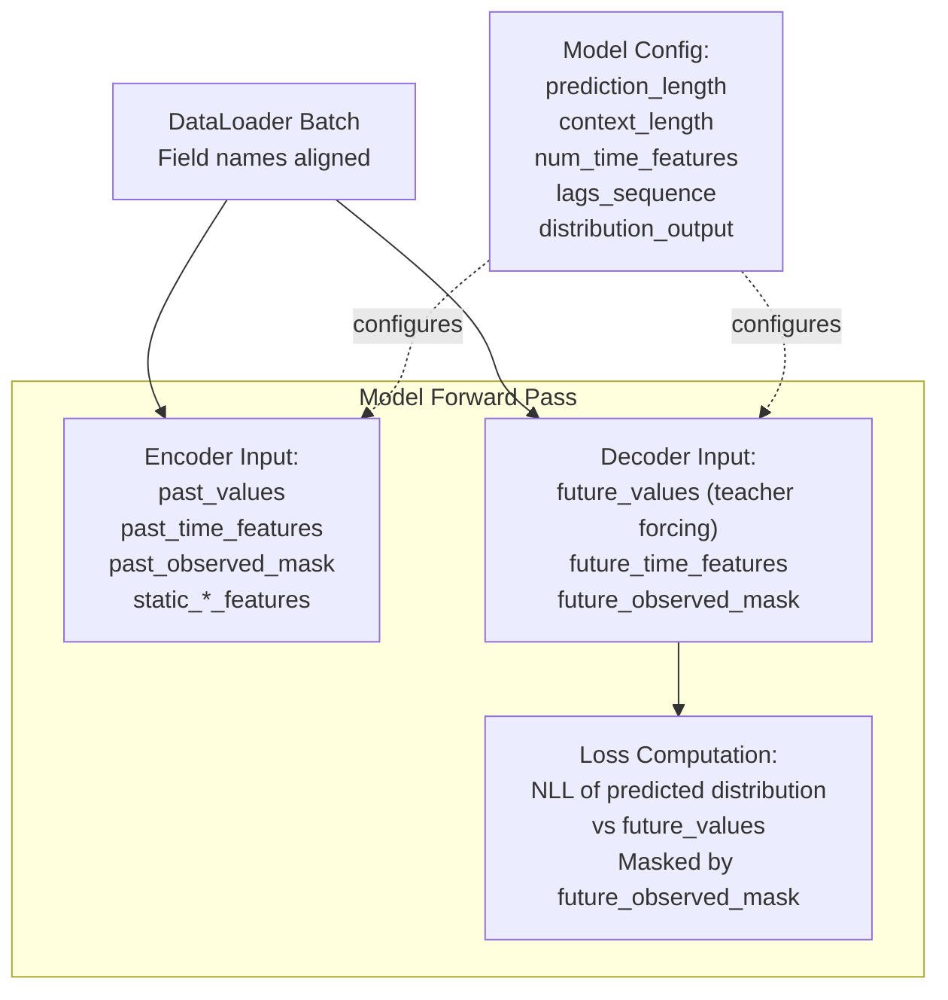

<!-- source: DeepWiki mcp.deepwiki.com · repo huggingface/blog · page 8.3 Dataset Processing with GluonTS · fetched 2026-10-26 -->

# Dataset Processing with GluonTS

<details>
<summary>Relevant source files</summary>

The following files were used as context for generating this wiki page:

- [assets/118_time-series-transformers/thumbnail.png](assets/118_time-series-transformers/thumbnail.png)
- [assets/134_informer/thumbnail.png](assets/134_informer/thumbnail.png)
- [assets/150_autoformer/thumbnail.png](assets/150_autoformer/thumbnail.png)
- [autoformer.md](autoformer.md)
- [informer.md](informer.md)
- [time-series-transformers.md](time-series-transformers.md)
- [zh/informer.md](zh/informer.md)
- [zh/time-series-transformers.md](zh/time-series-transformers.md)

</details>


## Purpose and Scope

This document describes the GluonTS-based data processing pipeline used to prepare time series datasets for training Transformer models in the Hugging Face ecosystem. GluonTS provides transformations, instance splitting, and data loading utilities that convert raw time series data into model-ready batches.

For information about specific time series models (Informer, Autoformer, TimeSeriesTransformer), see [Specialized Model Types](#6). For time series model architecture details, see [Time Series Models](#6.2).

## Overview

The blog repository demonstrates end-to-end time series forecasting using GluonTS as the data processing layer. GluonTS handles:

- **Field transformations**: Converting datetime fields, creating time features, handling static/dynamic covariates
- **Instance splitting**: Sampling context and prediction windows from time series
- **Multivariate grouping**: Combining multiple univariate series into multivariate tensors
- **Batch creation**: Generating PyTorch-compatible dataloaders with proper field naming

This preprocessing layer is consistent across Informer, Autoformer, and TimeSeriesTransformer implementations.

**Sources:** [informer.md:1-178](), [time-series-transformers.md:1-67](), [autoformer.md:1-273]()

## Data Processing Pipeline

### High-Level Architecture



**Sources:** [informer.md:175-346](), [time-series-transformers.md:49-217](), [autoformer.md:270-437]()

### Period Conversion

Time series data starts with string-formatted timestamps that must be converted to pandas `Period` objects. This conversion uses the dataset's frequency (`freq`) parameter.



The implementation uses `functools.lru_cache` for performance optimization and applies the transformation on-the-fly via `datasets.Dataset.set_transform()`.

**Sources:** [informer.md:298-328](), [time-series-transformers.md:181-217](), [autoformer.md:295-328]()

**Key Functions:**
- [informer.md:310-312]() - `convert_to_pandas_period(date, freq)`
- [informer.md:315-317]() - `transform_start_field(batch, freq)`
- [informer.md:324-327]() - Application via `set_transform(partial(...))`

## Transformation Chain

### Chain Architecture

GluonTS uses a `Chain` object to compose multiple transformations into a sequential pipeline. Each transformation modifies or adds fields to the time series data.



**Sources:** [informer.md:456-578](), [time-series-transformers.md:295-433](), [autoformer.md:325-437]()

### Transformation Components

| Transformation | Purpose | Input Field | Output Field |
|----------------|---------|-------------|--------------|
| `RemoveFields` | Remove unused static/dynamic features | Various | N/A |
| `AsNumpyArray` | Convert to NumPy with expected dimensions | `TARGET`, `FEAT_STATIC_CAT`, etc. | Same |
| `AddObservedValuesIndicator` | Create mask for missing values | `TARGET` | `OBSERVED_VALUES` |
| `AddTimeFeatures` | Extract time-based features from frequency | `START`, `TARGET` | `FEAT_TIME` |
| `AddAgeFeature` | Add running counter feature | `TARGET` | `FEAT_AGE` |
| `VstackFeatures` | Stack features vertically | `FEAT_TIME`, `FEAT_AGE`, etc. | `FEAT_TIME` |
| `RenameFields` | Map GluonTS names to HF names | GluonTS field names | `time_features`, `values`, etc. |

**Sources:** [informer.md:484-578](), [time-series-transformers.md:325-433]()

### Time Feature Engineering

GluonTS automatically generates time features based on the dataset frequency. For hourly data (`freq="1H"`):



Example output for timestamp `2015-01-01 01:00:01`:
- `hour_of_day`: -0.45652174
- `day_of_week`: 0.0
- `day_of_month`: -0.5
- `day_of_year`: -0.5

**Sources:** [informer.md:384-412](), [time-series-transformers.md:234-262]()

**Key Code:**
- [informer.md:385-391]() - Time feature extraction for hourly data
- [informer.md:397-408]() - Example feature values

## Multivariate Dataset Grouping

For multivariate forecasting, individual univariate time series must be grouped into a single multivariate matrix. This is done using `MultivariateGrouper`.



**Key Configuration:**
- Training: `max_target_dim` = number of time series
- Testing: `num_test_dates` = number of rolling test windows

**Sources:** [informer.md:330-356]()

**Implementation:**
- [informer.md:334-345]() - Train/test grouper creation
- [informer.md:348-355]() - Verification of 2D target shape

## Instance Splitting

The `InstanceSplitter` samples windows from time series for training, validation, and testing. It operates in three modes with different sampling strategies.

### Instance Splitter Modes



**Sources:** [informer.md:580-623](), [time-series-transformers.md:435-477](), [autoformer.md:439-477]()

### Window Sampling Visualization

For a time series with length T:

| Mode | Context Window | Prediction Window | Sampling Strategy |
|------|----------------|-------------------|-------------------|
| **train** | Random position | Follows context | Multiple random samples |
| **validation** | Last `context_length` values | Last `prediction_length` values | Single fixed sample |
| **test** | Last `context_length` values | Not sampled | Single fixed sample |

**Key Parameters:**
- `past_length` = `context_length` + `max(lags_sequence)` - Ensures lag features are available
- `future_length` = `prediction_length` - Decoder prediction horizon
- `time_series_fields` = Fields that should be split into past/future variants

**Sources:** [informer.md:613-622](), [time-series-transformers.md:467-476]()

**Implementation:**
- [informer.md:588-623]() - `create_instance_splitter()` function
- [informer.md:596-604]() - Mode-specific sampler selection
- [informer.md:606-622]() - InstanceSplitter configuration

## DataLoader Creation

GluonTS provides utilities to create PyTorch-compatible dataloaders from transformed and split datasets.

### DataLoader Pipeline



**Sources:** [informer.md:625-687](), [time-series-transformers.md:479-620]()

### Field Names for Model Input

The dataloaders produce batches with specific field names that match the model's expected inputs:

**Training Fields:**
- `past_time_features` - Time features for context window
- `past_values` - Target values for context window
- `past_observed_mask` - Missing value mask for context
- `future_time_features` - Time features for prediction window
- `future_values` - Target values for prediction window (labels)
- `future_observed_mask` - Missing value mask for predictions
- `static_categorical_features` - Static categorical covariates (if present)
- `static_real_features` - Static real-valued covariates (if present)

**Prediction Fields** (excludes future_values and future_observed_mask):
- Used during inference when future values are unknown

**Sources:** [informer.md:648-663](), [time-series-transformers.md:502-517]()

### DataLoader Factory Functions



**Sources:** [informer.md:638-762](), [time-series-transformers.md:492-620]()

**Key Functions:**
- [informer.md:638-687]() - `create_train_dataloader()` with cyclic streaming
- [informer.md:691-726]() - `create_backtest_dataloader()` for validation
- [informer.md:728-762]() - `create_test_dataloader()` for inference

### Batch Structure Example

For the traffic dataset with hourly frequency:

```
Batch shape example (from informer.md):
past_time_features:       torch.Size([256, 264, 5])
past_values:              torch.Size([256, 264, 862])
past_observed_mask:       torch.Size([256, 264, 862])
future_time_features:     torch.Size([256, 48, 5])
future_values:            torch.Size([256, 48, 862])
future_observed_mask:     torch.Size([256, 48, 862])

Dimensions:
- 256: batch size
- 264: past_length (context + max lag)
- 862: number of variates (multivariate)
- 5: number of time features
- 48: prediction_length
```

**Sources:** [informer.md:787-797]()

## Integration with Transformers Library

The processed data flows seamlessly into Hugging Face Transformer models:



**Sources:** [informer.md:805-839](), [time-series-transformers.md:664-696]()

**Key Integration Points:**
- [informer.md:812-827]() - Forward pass with batch fields
- [informer.md:831-836]() - Loss computation with observed mask
- Field renaming via [informer.md:567-575]() ensures compatibility

## Usage Example

Complete pipeline for training an Informer model:

1. **Load dataset** - [informer.md:186-197]()
2. **Convert periods** - [informer.md:298-327]()
3. **Group multivariate** - [informer.md:330-345]()
4. **Create transformation** - [informer.md:484-578]()
5. **Create instance splitter** - [informer.md:588-623]()
6. **Create dataloader** - [informer.md:766-781]()
7. **Train model** - [informer.md:847-895]()

Similar pipelines exist for TimeSeriesTransformer and Autoformer with minor variations in model configuration but identical data processing.

**Sources:** [informer.md:1-903](), [time-series-transformers.md:1-800](), [autoformer.md:1-700]()

---

