<!-- source: DeepWiki mcp.deepwiki.com · repo huggingface/blog · page 9 Hugging Face Platform · fetched 2026-10-26 -->

# Hugging Face Platform

<details>
<summary>Relevant source files</summary>

The following files were used as context for generating this wiki page:

- [1_58_llm_extreme_quantization.md](1_58_llm_extreme_quantization.md)
- [1b-sentence-embeddings.md](1b-sentence-embeddings.md)
- [_blog.yml](_blog.yml)
- [_tags.yml](_tags.yml)
- [accelerated-inference.md](accelerated-inference.md)
- [assets/17_the_partnership_amazon_sagemaker_and_hugging_face/cover.png](assets/17_the_partnership_amazon_sagemaker_and_hugging_face/cover.png)
- [assets/17_the_partnership_amazon_sagemaker_and_hugging_face/thumbnail.png](assets/17_the_partnership_amazon_sagemaker_and_hugging_face/thumbnail.png)
- [assets/192_pi0/new_thumbnail_pi0.001.png](assets/192_pi0/new_thumbnail_pi0.001.png)
- [assets/193_l2d/lerobot-driver.gif](assets/193_l2d/lerobot-driver.gif)
- [assets/1_58_llm_extreme_quantization/thumbnail.png](assets/1_58_llm_extreme_quantization/thumbnail.png)
- [assets/25_hardware_partners_program/carbon_inc_quantizer.png](assets/25_hardware_partners_program/carbon_inc_quantizer.png)
- [assets/deploy-with-openvino/demo.gif](assets/deploy-with-openvino/demo.gif)
- [assets/deploy-with-openvino/openvino_genai_workflow.png](assets/deploy-with-openvino/openvino_genai_workflow.png)
- [assets/galore_introduction/thumbnail.png](assets/galore_introduction/thumbnail.png)
- [assets/inference-providers/welcome-featherless.jpg](assets/inference-providers/welcome-featherless.jpg)
- [assets/leaderboards-on-the-hub/thumbnail_flageval.png](assets/leaderboards-on-the-hub/thumbnail_flageval.png)
- [assets/optimum_intel/optimum_openvino_thumbnail.png](assets/optimum_intel/optimum_openvino_thumbnail.png)
- [assets/sd_dreambooth_training/thumbnail.jpg](assets/sd_dreambooth_training/thumbnail.jpg)
- [assets/streaming_datasets/streaming_datasets.png](assets/streaming_datasets/streaming_datasets.png)
- [assets/textquests/thumbnail.gif](assets/textquests/thumbnail.gif)
- [assets/trl_vlm/thumbnail.png](assets/trl_vlm/thumbnail.png)
- [assets/virustotal/thumbnail.png](assets/virustotal/thumbnail.png)
- [assets/wuerstchen/thumbnail.jpg](assets/wuerstchen/thumbnail.jpg)
- [bert-cpu-scaling-part-2.md](bert-cpu-scaling-part-2.md)
- [community-update.md](community-update.md)
- [debate.md](debate.md)
- [deploy-hugging-face-models-easily-with-amazon-sagemaker.md](deploy-hugging-face-models-easily-with-amazon-sagemaker.md)
- [deploy-with-openvino.md](deploy-with-openvino.md)
- [dreambooth.md](dreambooth.md)
- [few-shot-learning-gpt-neo-and-inference-api.md](few-shot-learning-gpt-neo-and-inference-api.md)
- [fr/_blog.yml](fr/_blog.yml)
- [galore.md](galore.md)
- [hardware-partners-program.md](hardware-partners-program.md)
- [inference-providers-featherless.md](inference-providers-featherless.md)
- [lerobot-goes-to-driving-school.md](lerobot-goes-to-driving-school.md)
- [openvino-vlm.md](openvino-vlm.md)
- [pi0.md](pi0.md)
- [sentence-transformers-in-the-hub.md](sentence-transformers-in-the-hub.md)
- [streaming-datasets.md](streaming-datasets.md)
- [textquests.md](textquests.md)
- [the-partnership-amazon-sagemaker-and-hugging-face.md](the-partnership-amazon-sagemaker-and-hugging-face.md)
- [trl-vlm-alignment.md](trl-vlm-alignment.md)
- [virustotal.md](virustotal.md)

</details>


## Purpose and Scope

This document provides an overview of the Hugging Face Platform infrastructure, which serves as the central hosting and distribution system for machine learning models, datasets, and applications. The platform enables researchers, practitioners, and organizations to share, discover, and deploy AI models at scale.

For detailed information about security features and Hub authentication, see [Hub Integration and Security](#9.1). For information about interactive applications and demo hosting, see [Spaces and Applications](#9.2).

Related topics:
- For dataset management and streaming, see [Datasets and Data Processing](#8)
- For model deployment options, see [Model Deployment and Inference](#5)
- For training workflows, see [Model Training and Optimization](#4)

---

## Platform Architecture Overview

The Hugging Face Platform consists of three primary components that work together to provide a complete ML lifecycle infrastructure:

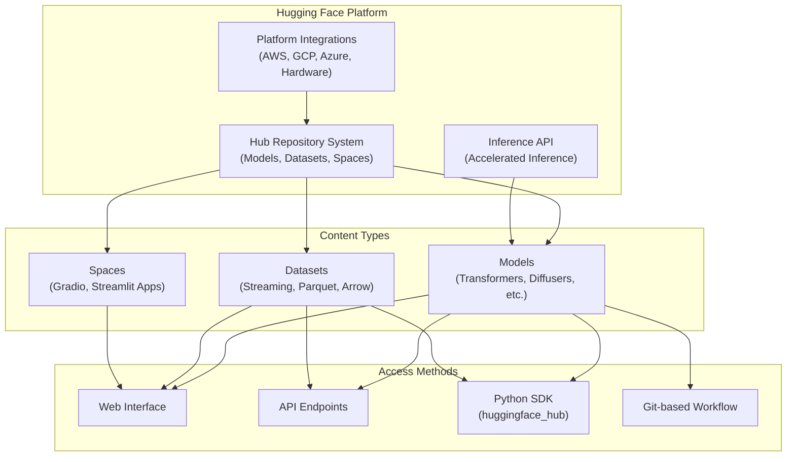

**Hub Repository System** - Central storage for over 2.2 million public model and dataset repositories, providing version control, collaboration features, and discovery mechanisms.

**Inference Infrastructure** - Hosted inference services that provide production-ready endpoints for model deployment without infrastructure management.

**Platform Integrations** - Native integration with cloud providers (AWS SageMaker, GCP Vertex AI, Azure AI Studio) and hardware optimization frameworks (OpenVINO, ONNX Runtime, Intel Neural Compressor).

Sources: [_blog.yml:1-2393](), [virustotal.md:1-55](), [the-partnership-amazon-sagemaker-and-hugging-face.md:1-90]()

---

## Hub Repository System

### Model and Dataset Hosting

The Hub provides Git-based version control for ML artifacts, enabling collaborative development and reproducible research:

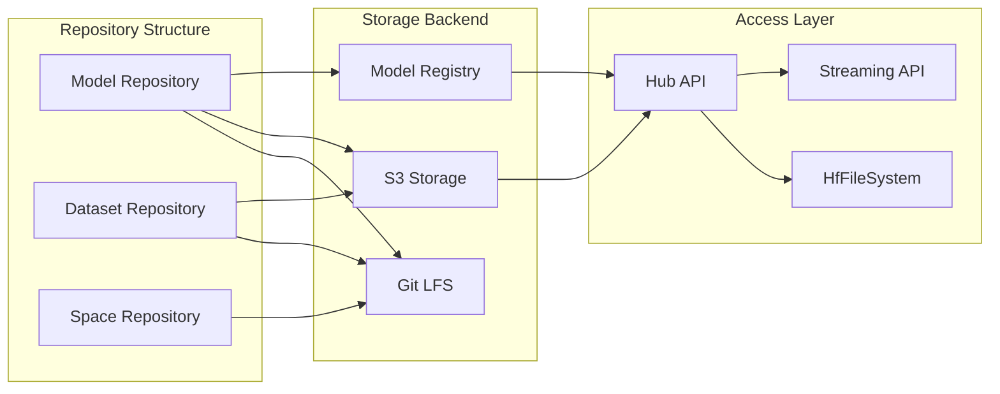

**Repository Types:**
- **Model Repositories**: Store model weights, configuration files (`config.json`), tokenizers, and model cards
- **Dataset Repositories**: Host data files in Parquet, Arrow, or custom formats with metadata
- **Space Repositories**: Application code with Dockerfile or requirements for Gradio/Streamlit apps

**Key Features:**
- Version control via Git with LFS support for large files
- Model cards for documentation (following model card framework)
- Dataset cards with schema information
- DOI support for academic citation
- Private repositories with access control

Sources: [virustotal.md:13-42](), [streaming-datasets.md:1-120](), [sentence-transformers-in-the-hub.md:1-130]()

### Model Discovery and Metadata

The platform provides comprehensive search and filtering capabilities across repositories:

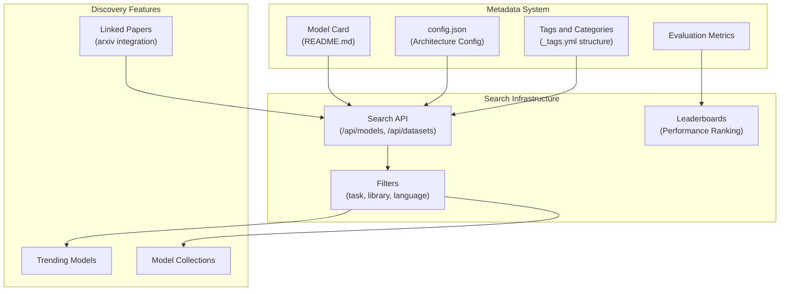

The tagging system from [_tags.yml:1-51]() provides standardized categorization:

| Tag Category | Examples | Usage |
|--------------|----------|-------|
| Task Types | `nlp`, `cv`, `audio`, `rl` | Pipeline categorization |
| Domains | `community`, `research`, `partnerships` | Content source |
| Methods | `rlhf`, `diffusion`, `quantization` | Training approach |
| Applications | `game-dev`, `case-studies`, `leaderboard` | Use case |

Sources: [_tags.yml:1-51](), [_blog.yml:1-2393](), [debate.md:1-151](), [textquests.md:1-94]()

---

## Inference Infrastructure

### Accelerated Inference API

The platform provides hosted inference with optimized performance for production deployments:

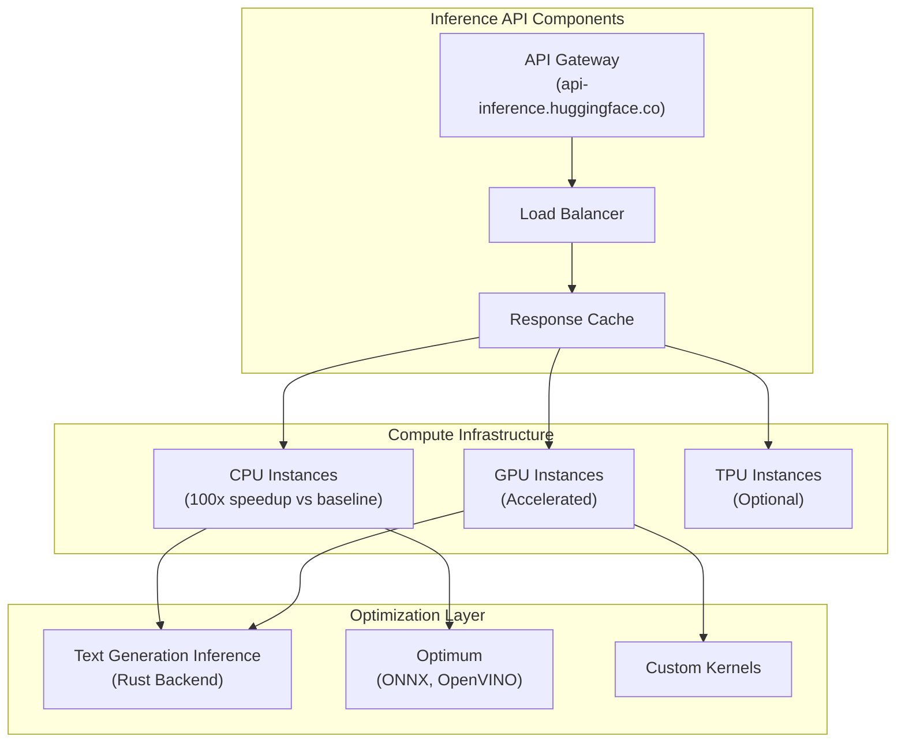

**Performance Optimizations:**
- 100x speedup for transformer inference through kernel optimization and batching
- Built-in caching for repeated queries
- Automatic model quantization (INT8, FP16) based on hardware
- Dynamic batching for throughput optimization

**API Interface:**

The Inference API supports multiple input formats depending on the task:

```python
# Text classification request
{
    "inputs": "Camera - You are awarded a SiPix Digital Camera!"
}

# Question answering request
{
    "inputs": {
        "question": "What is used for inference?",
        "context": "This model is used with sagemaker for inference."
    }
}

# Zero-shot classification with parameters
{
    "inputs": "Hi, I recently bought a device from your company...",
    "parameters": {
        "candidate_labels": ["refund", "legal", "faq"]
    }
}
```

Sources: [accelerated-inference.md:1-80](), [few-shot-learning-gpt-neo-and-inference-api.md:52-85](), [deploy-hugging-face-models-easily-with-amazon-sagemaker.md:66-100]()

### Inference Endpoints

For dedicated deployment, Inference Endpoints provide managed infrastructure:

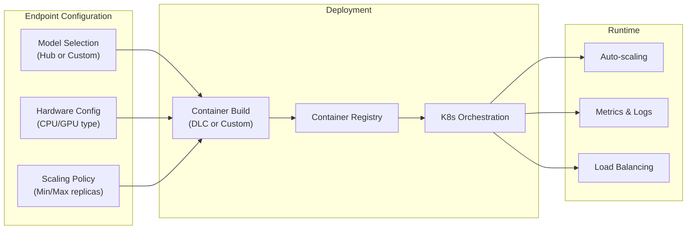

**Endpoint Features:**
- Private endpoints with custom authentication
- Multiple regions for latency optimization
- Real-time and batch inference modes
- Integration with monitoring services (CloudWatch, Datadog)

Sources: [the-partnership-amazon-sagemaker-and-hugging-face.md:1-90](), [deploy-hugging-face-models-easily-with-amazon-sagemaker.md:1-340]()

---

## Platform Integrations

### Cloud Provider Integration Architecture

The platform maintains deep integrations with major cloud providers through specialized tooling:

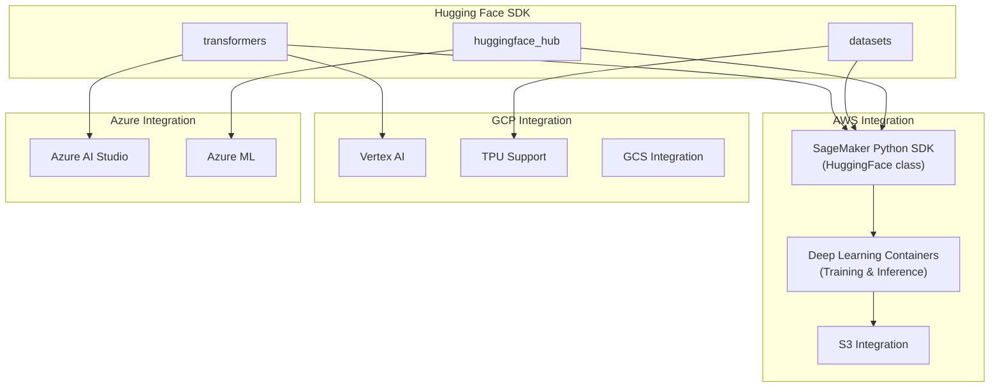

**AWS SageMaker Integration:**

The `HuggingFace` estimator class provides seamless training and deployment:

```python
from sagemaker.huggingface import HuggingFace

# Training configuration
huggingface_estimator = HuggingFace(
    entry_point='train.py',
    source_dir='./scripts',
    instance_type='ml.p3.2xlarge',
    instance_count=1,
    role=role,
    transformers_version='4.6',
    pytorch_version='1.7',
    py_version='py36',
    hyperparameters=hyperparameters
)

# Deploy after training
predictor = huggingface_estimator.deploy(
    initial_instance_count=1,
    instance_type="ml.m5.xlarge"
)
```

**Key Integration Features:**
- Deep Learning Containers with pre-installed optimized libraries
- Distributed training support (Data Parallel, Model Parallel)
- Spot instance training with automatic checkpointing
- Git-based training script management
- Direct Hub model deployment

Sources: [the-partnership-amazon-sagemaker-and-hugging-face.md:14-493](), [deploy-hugging-face-models-easily-with-amazon-sagemaker.md:1-340]()

### Hardware Acceleration Partnerships

The platform collaborates with hardware vendors through the Optimum library:

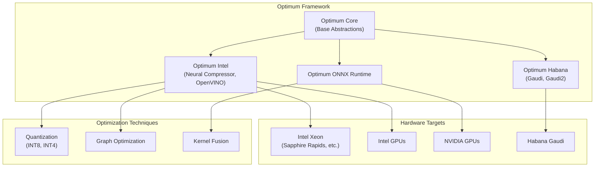

**Hardware Partner Ecosystem:**

| Partner | Library | Key Features | Supported Hardware |
|---------|---------|--------------|-------------------|
| Intel | `optimum-intel` | Neural Compressor, OpenVINO | Xeon CPUs, Arc GPUs, Flex GPUs |
| ONNX Runtime | `optimum-onnxruntime` | Graph optimization, custom ops | CPUs, NVIDIA GPUs |
| Habana | `optimum-habana` | Gaudi-specific kernels | Gaudi, Gaudi2 |
| AMD | ROCm support | GPU acceleration | Radeon GPUs |

**Intel OpenVINO Integration Example:**

```python
from optimum.intel import OVModelForVisualCausalLM, OVWeightQuantizationConfig

# Quantization configuration
q_config = OVWeightQuantizationConfig(bits=8)

# Load and quantize model
q_model = OVModelForVisualCausalLM.from_pretrained(
    model_id, 
    quantization_config=q_config
)
q_model.save_pretrained("smolvlm_int8")

# Deploy on GPU
model = OVModelForVisualCausalLM.from_pretrained(model_id, device="gpu")
```

Sources: [hardware-partners-program.md:1-128](), [openvino-vlm.md:1-197](), [deploy-with-openvino.md:1-280]()

---

## Security and Content Integrity

### VirusTotal Integration

The platform integrates VirusTotal for continuous malware scanning of repository files:

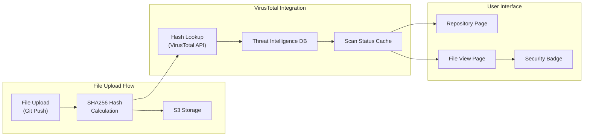

**Security Workflow:**
1. File hash comparison against VirusTotal database (no file upload)
2. Display of detection counts and threat metadata
3. Continuous monitoring of 2.2M+ public repositories
4. Privacy-preserving design (only hashes shared, not content)

**Detection Results Display:**

The Hub displays VirusTotal status for each file with:
- Detection count from antivirus vendors
- Known malware family associations
- Threat campaign intelligence
- Historical analysis data

Sources: [virustotal.md:1-55]()

### Authentication and Access Control

Hub authentication uses token-based access with fine-grained permissions:

| Token Type | Scope | Use Case |
|-----------|-------|----------|
| Read | Public repository access | Model download, dataset streaming |
| Write | Repository modification | Push commits, create repositories |
| Inference API | API endpoint access | Production inference calls |
| Fine-grained | Custom permissions | Organization-level access control |

Sources: [virustotal.md:1-55](), [the-partnership-amazon-sagemaker-and-hugging-face.md:117-136]()

---

## Dataset Streaming Infrastructure

### Streaming Architecture

The platform enables zero-download dataset access through optimized streaming:

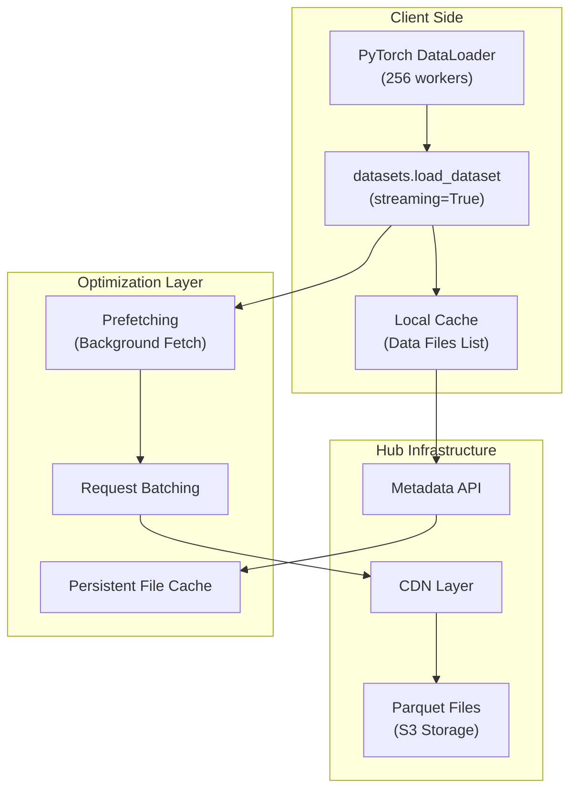

**Performance Improvements:**

The streaming infrastructure achieves significant performance gains through:

1. **Persistent Data Files Cache**: First worker resolves file list, others use local cache
   - 100x reduction in startup requests
   - 10x faster data resolution

2. **Prefetching**: Background fetching of next chunks during processing
   - 2x increase in samples/sec
   - Eliminates GPU idle time

3. **Request Optimization**: Bundled API calls for metadata
   - Up to 2x more efficient in-flight requests
   - Zero worker crashes at 256 concurrent workers

**Usage Example:**

```python
from datasets import load_dataset

# Stream dataset without downloading
dataset = load_dataset(
    "HuggingFaceM4/FineVisionMax",
    split="train",
    streaming=True
)

# Immediate iteration
for sample in dataset:
    # Train without waiting for full download
    process(sample)
```

Sources: [streaming-datasets.md:1-120](), [lerobot-goes-to-driving-school.md:111-141]()

---

## Model Distribution and Versioning

### Git-Based Workflow

Model repositories use Git with LFS for version control:

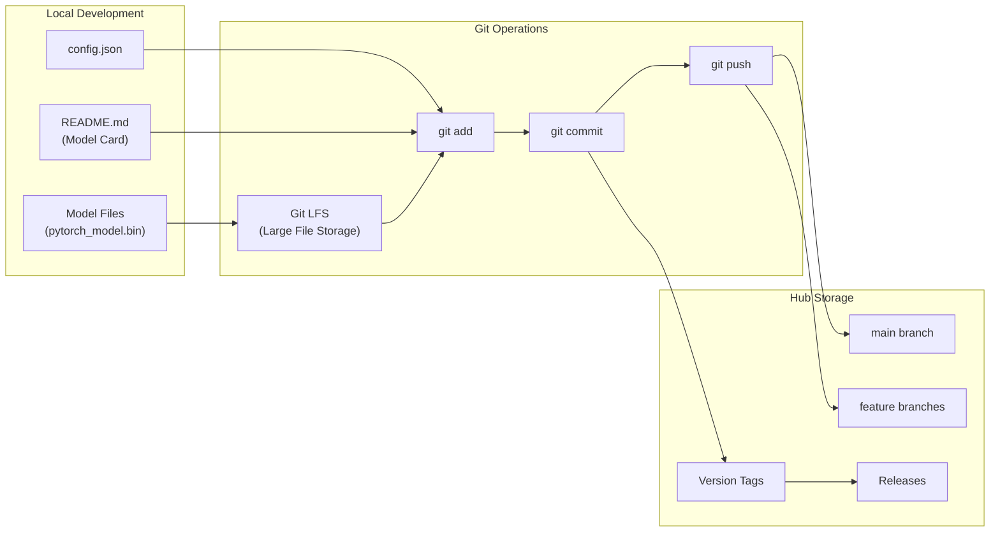

**Model Card Structure:**

Model cards follow a standardized format for documentation:
- Model description and intended use
- Training data and procedures
- Evaluation results and benchmarks
- Limitations and biases
- Citation information

**Programmatic Access:**

```python
from huggingface_hub import HfApi, hf_hub_download

# Upload model
api = HfApi()
api.upload_folder(
    folder_path="local_model/",
    repo_id="username/model-name",
    repo_type="model"
)

# Download specific file
model_path = hf_hub_download(
    repo_id="username/model-name",
    filename="pytorch_model.bin",
    revision="v1.0"  # Specific version
)
```

Sources: [the-partnership-amazon-sagemaker-and-hugging-face.md:465-492](), [sentence-transformers-in-the-hub.md:1-130](), [1b-sentence-embeddings.md:1-90]()

---

## Developer Tools and SDKs

### Python SDK Ecosystem

The platform provides multiple SDKs for different use cases:

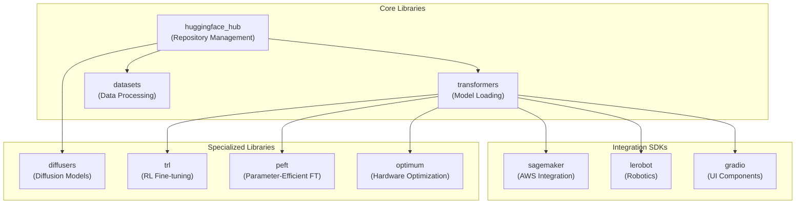

**Key SDK Capabilities:**

| Library | Primary Function | Key Classes/Methods |
|---------|-----------------|---------------------|
| `huggingface_hub` | Repository operations | `HfApi`, `hf_hub_download`, `upload_file` |
| `transformers` | Model inference/training | `AutoModel`, `pipeline`, `Trainer` |
| `datasets` | Data loading/processing | `load_dataset`, `Dataset`, `DatasetDict` |
| `diffusers` | Generative models | `DiffusionPipeline`, `StableDiffusionPipeline` |
| `trl` | RLHF and alignment | `SFTTrainer`, `DPOTrainer`, `GRPOTrainer` |

Sources: [trl-vlm-alignment.md:1-300](), [pi0.md:1-280](), [galore.md:1-180]()

### Widget and Inference Integration

The platform provides interactive widgets for model demonstration:

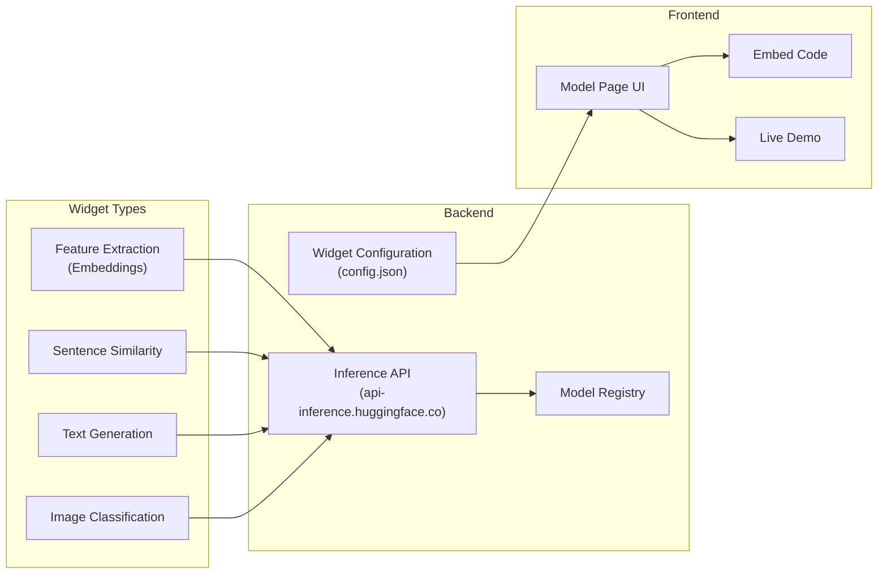

**Widget Configuration:**

Models specify their widget behavior through pipeline tags and configuration:

```yaml
# In model card metadata
pipeline_tag: "feature-extraction"
widget:
  - text: "Hello World"
  - text: "Hallo Welt"
```

Sources: [sentence-transformers-in-the-hub.md:15-75](), [deploy-hugging-face-models-easily-with-amazon-sagemaker.md:66-100]()

---

## Platform Scalability and Performance

### Infrastructure Metrics

The platform handles massive scale across multiple dimensions:

| Metric | Scale | Performance Characteristics |
|--------|-------|----------------------------|
| Public Repositories | 2.2M+ | Continuous VirusTotal scanning |
| Dataset Size | Multi-TB | 100x request efficiency improvement |
| Inference Throughput | Varies | 100x speedup vs baseline transformers |
| Concurrent Workers | 256+ | Zero crashes with optimized streaming |
| Cloud Regions | Multiple | AWS, GCP, Azure support |

**Training Infrastructure Support:**

The platform enables distributed training at scale through cloud integrations:
- Multi-node distributed training (SageMaker Distributed)
- Spot instance management with checkpointing
- Automated hyperparameter tuning
- Mixed precision training (FP16, BF16)
- Gradient accumulation and checkpointing

Sources: [streaming-datasets.md:1-120](), [virustotal.md:13-20](), [galore.md:1-180](), [the-partnership-amazon-sagemaker-and-hugging-face.md:344-463]()

---

