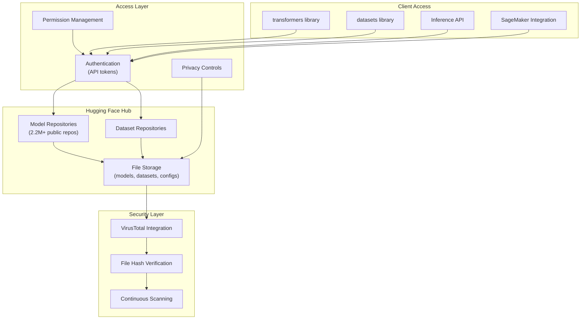
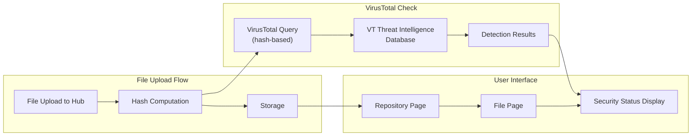
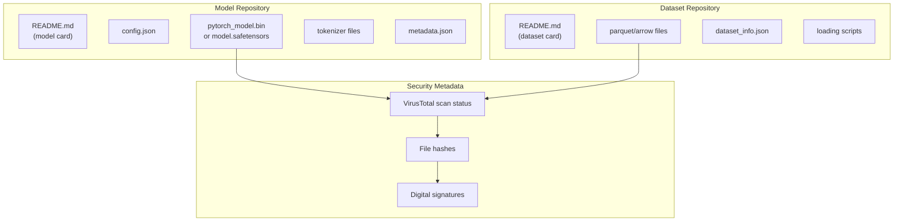
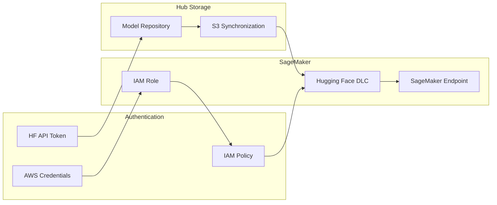
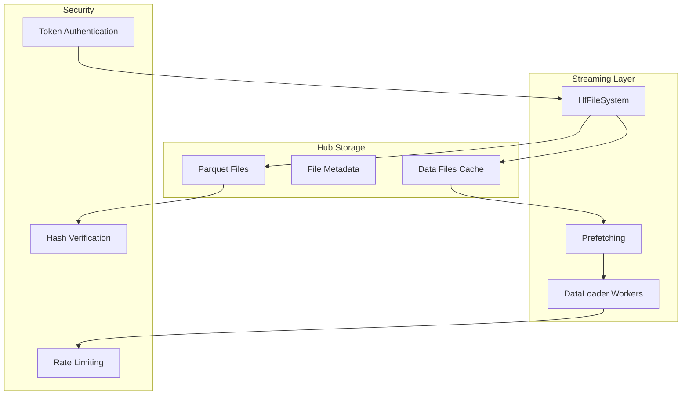
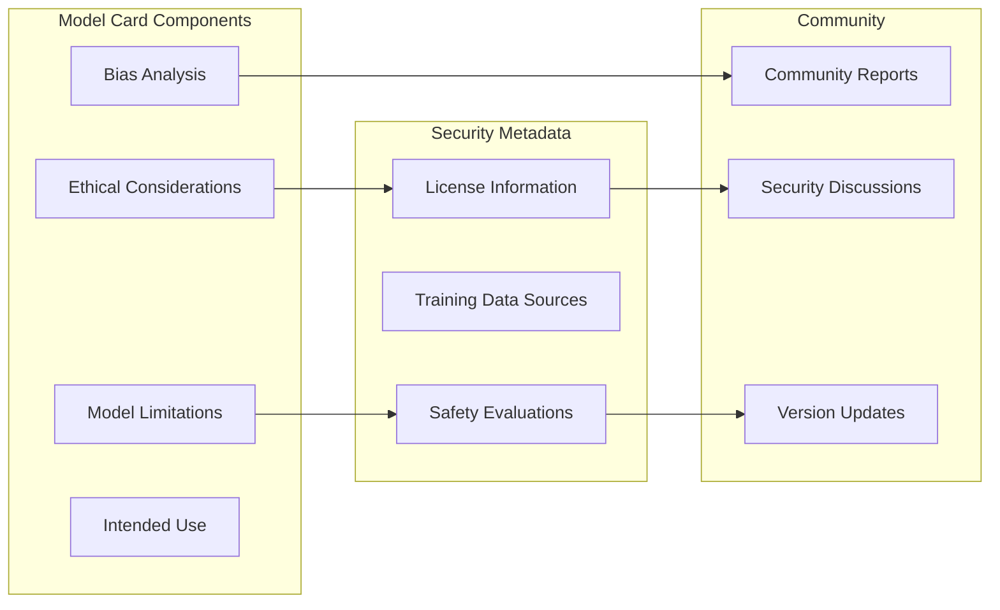

<!-- source: DeepWiki mcp.deepwiki.com · repo huggingface/blog · page 9.1 Hub Integration and Security · fetched 2026-10-26 -->

# Hub Integration and Security

<details>
<summary>Relevant source files</summary>

The following files were used as context for generating this wiki page:

- [1_58_llm_extreme_quantization.md](1_58_llm_extreme_quantization.md)
- [1b-sentence-embeddings.md](1b-sentence-embeddings.md)
- [_blog.yml](_blog.yml)
- [_tags.yml](_tags.yml)
- [accelerated-inference.md](accelerated-inference.md)
- [assets/17_the_partnership_amazon_sagemaker_and_hugging_face/cover.png](assets/17_the_partnership_amazon_sagemaker_and_hugging_face/cover.png)
- [assets/17_the_partnership_amazon_sagemaker_and_hugging_face/thumbnail.png](assets/17_the_partnership_amazon_sagemaker_and_hugging_face/thumbnail.png)
- [assets/192_pi0/new_thumbnail_pi0.001.png](assets/192_pi0/new_thumbnail_pi0.001.png)
- [assets/193_l2d/lerobot-driver.gif](assets/193_l2d/lerobot-driver.gif)
- [assets/1_58_llm_extreme_quantization/thumbnail.png](assets/1_58_llm_extreme_quantization/thumbnail.png)
- [assets/25_hardware_partners_program/carbon_inc_quantizer.png](assets/25_hardware_partners_program/carbon_inc_quantizer.png)
- [assets/deploy-with-openvino/demo.gif](assets/deploy-with-openvino/demo.gif)
- [assets/deploy-with-openvino/openvino_genai_workflow.png](assets/deploy-with-openvino/openvino_genai_workflow.png)
- [assets/galore_introduction/thumbnail.png](assets/galore_introduction/thumbnail.png)
- [assets/inference-providers/welcome-featherless.jpg](assets/inference-providers/welcome-featherless.jpg)
- [assets/leaderboards-on-the-hub/thumbnail_flageval.png](assets/leaderboards-on-the-hub/thumbnail_flageval.png)
- [assets/optimum_intel/optimum_openvino_thumbnail.png](assets/optimum_intel/optimum_openvino_thumbnail.png)
- [assets/sd_dreambooth_training/thumbnail.jpg](assets/sd_dreambooth_training/thumbnail.jpg)
- [assets/streaming_datasets/streaming_datasets.png](assets/streaming_datasets/streaming_datasets.png)
- [assets/textquests/thumbnail.gif](assets/textquests/thumbnail.gif)
- [assets/trl_vlm/thumbnail.png](assets/trl_vlm/thumbnail.png)
- [assets/virustotal/thumbnail.png](assets/virustotal/thumbnail.png)
- [assets/wuerstchen/thumbnail.jpg](assets/wuerstchen/thumbnail.jpg)
- [bert-cpu-scaling-part-2.md](bert-cpu-scaling-part-2.md)
- [community-update.md](community-update.md)
- [debate.md](debate.md)
- [deploy-hugging-face-models-easily-with-amazon-sagemaker.md](deploy-hugging-face-models-easily-with-amazon-sagemaker.md)
- [deploy-with-openvino.md](deploy-with-openvino.md)
- [dreambooth.md](dreambooth.md)
- [few-shot-learning-gpt-neo-and-inference-api.md](few-shot-learning-gpt-neo-and-inference-api.md)
- [fr/_blog.yml](fr/_blog.yml)
- [galore.md](galore.md)
- [hardware-partners-program.md](hardware-partners-program.md)
- [inference-providers-featherless.md](inference-providers-featherless.md)
- [lerobot-goes-to-driving-school.md](lerobot-goes-to-driving-school.md)
- [openvino-vlm.md](openvino-vlm.md)
- [pi0.md](pi0.md)
- [sentence-transformers-in-the-hub.md](sentence-transformers-in-the-hub.md)
- [streaming-datasets.md](streaming-datasets.md)
- [textquests.md](textquests.md)
- [the-partnership-amazon-sagemaker-and-hugging-face.md](the-partnership-amazon-sagemaker-and-hugging-face.md)
- [trl-vlm-alignment.md](trl-vlm-alignment.md)
- [virustotal.md](virustotal.md)

</details>


This document covers the integration of models and datasets with the Hugging Face Hub, focusing on security features, authentication mechanisms, and file integrity verification. It describes how the blog repository's content relates to Hub-hosted models and datasets, and the security measures in place to protect users.

For information about Hugging Face Spaces and interactive applications, see [Spaces and Applications](#9.2). For details on model deployment and inference, see [Model Deployment and Inference](#5).

## Overview

The Hugging Face Hub serves as the central repository for over 2.2 million public model and dataset repositories. The blog repository documents various aspects of Hub integration, including partnerships for model deployment, security scanning, and best practices for hosting and sharing ML artifacts.

Sources: [virustotal.md:1-55](), [_blog.yml:1-100]()

## Hub Architecture



Sources: [virustotal.md:1-55](), [sentence-transformers-in-the-hub.md:1-100](), [the-partnership-amazon-sagemaker-and-hugging-face.md:1-100]()

## VirusTotal Security Integration

### Threat Detection System

The Hub implements continuous security scanning through a collaboration with VirusTotal, the world's leading threat-intelligence and malware analysis platform. This integration provides automated malware detection for all files shared across the Hub.



Sources: [virustotal.md:1-55]()

### Hash-Based Verification

The integration uses a privacy-preserving hash-based approach:

1. **File hash comparison** against VirusTotal's database
2. **No raw file sharing** - only hashes are transmitted to VirusTotal
3. **Metadata retrieval** including detection counts and threat intelligence
4. **Cached results** from previous VirusTotal analyses

Example repository with VirusTotal status: [Juronuim/xbraw2025](https://huggingface.co/Juronuim/xbraw2025/tree/main)

Sources: [virustotal.md:15-41]()

### Threat Categories

The system detects multiple threat types:

| Threat Type | Description |
|-------------|-------------|
| Malicious payloads | Code disguised as model files or archives |
| Compromised files | Files tampered with before upload |
| Known malware | Binary assets linked to malware campaigns |
| Unsafe serialization | Objects executing unsafe code when loaded |

Sources: [virustotal.md:16-28]()

## Hub Authentication and Access Control

### API Token System

The Hub uses token-based authentication for programmatic access. Tokens are required for:

- Loading private models and datasets
- Uploading models and datasets
- Accessing Inference API endpoints
- Deploying to cloud platforms (SageMaker, Vertex AI)

```python
# Example authentication pattern from blog posts
from sagemaker.huggingface import HuggingFaceModel

# Token retrieved from settings
API_TOKEN = ""  # From https://huggingface.co/settings/token

# Model deployment with authentication
model = HuggingFaceModel(
    model_data="s3://path/to/model",
    role=role,
    transformers_version="4.6",
    pytorch_version="1.7"
)
```

Sources: [few-shot-learning-gpt-neo-and-inference-api.md:56-75](), [deploy-hugging-face-models-easily-with-amazon-sagemaker.md:1-100]()

### Security Best Practices

The blog documents security considerations in password and authentication management:

- **Password deprecation** for Git operations (as of August 2023)
- **Token-based authentication** for all Hub interactions
- **Scoped permissions** for API tokens

Sources: [_blog.yml:1848-1853]()

## Model and Dataset Hosting

### Repository Structure

Hub repositories follow standardized structures for interoperability:



Sources: [virustotal.md:1-55](), [sentence-transformers-in-the-hub.md:1-100]()

### Sentence Transformers Integration

The Hub provides first-class support for Sentence Transformers models with specialized features:

- **90+ pretrained models** available in the Hub
- **Feature extraction widgets** for live model testing
- **Sentence similarity widgets** for comparing embeddings
- **Automatic model cards** with usage examples

Example loading pattern:

```python
from sentence_transformers import SentenceTransformer

# Load directly from Hub
model = SentenceTransformer('sentence-transformers/paraphrase-MiniLM-L6-v2')
embeddings = model.encode(sentences)
```

Sources: [sentence-transformers-in-the-hub.md:1-130](), [1b-sentence-embeddings.md:1-100]()

## Cloud Platform Integration Security

### SageMaker Integration

The Hub integrates with Amazon SageMaker for secure model deployment:



Sources: [the-partnership-amazon-sagemaker-and-hugging-face.md:1-500](), [deploy-hugging-face-models-easily-with-amazon-sagemaker.md:1-300]()

### IAM Role Requirements

SageMaker deployments require specific IAM permissions:

- **S3 read access** for downloading models from Hub
- **SageMaker execution permissions** for creating endpoints
- **CloudWatch logging permissions** for monitoring

Example IAM role usage:

```python
import sagemaker

sess = sagemaker.Session()
role = sagemaker.get_execution_role()  # IAM role with permissions

huggingface_model = HuggingFaceModel(
    model_data="s3://models/my-model/model.tar.gz",
    role=role,  # IAM role attached
    transformers_version="4.6",
    pytorch_version="1.7"
)
```

Sources: [deploy-hugging-face-models-easily-with-amazon-sagemaker.md:117-135](), [the-partnership-amazon-sagemaker-and-hugging-face.md:117-136]()

## Streaming and Dataset Security

### Streaming Architecture

The Hub supports secure streaming of large datasets without local downloads:



Sources: [streaming-datasets.md:1-100]()

### Authentication for Streaming

Streaming datasets requires proper authentication for private repositories:

```python
from datasets import load_dataset

# Stream with authentication
dataset = load_dataset(
    "private-org/private-dataset",
    split="train",
    streaming=True,
    token="hf_..."  # Required for private repos
)
```

The streaming system includes:
- **Persistent cache** for data file listings across workers
- **Token-based access** for private datasets
- **Rate limiting protection** to prevent API blocking
- **Hash verification** for downloaded chunks

Sources: [streaming-datasets.md:1-100]()

## File Integrity and Safety

### Safetensors Format

The Hub promotes the use of safetensors format for improved security:

- **Prevents arbitrary code execution** during loading
- **Faster load times** compared to pickle
- **Security audit** completed (May 2023)
- **No pickle vulnerabilities** from deserialization attacks

Sources: [_blog.yml:1470-1476]()

### Model Cards and Documentation

Security considerations are documented in model cards:



Sources: [_blog.yml:1035-1042](), [few-shot-learning-gpt-neo-and-inference-api.md:104-125]()

## Responsible AI and Content Guidelines

### Content Moderation

The Hub implements content guidelines to prevent misuse:

- **Community reporting** mechanisms for problematic content
- **Ethical charter** for multimodal models
- **Content guidelines** updated (June 2023)
- **Model bias evaluation** tools and benchmarks

Sources: [_blog.yml:519-526](), [_blog.yml:1579-1584]()

### Privacy Considerations

Security features prioritize user privacy:

- **Hash-based scanning** (no raw file transmission to VirusTotal)
- **Private repository support** with access controls
- **Compliance** with data protection principles
- **Regional deployment options** for data sovereignty

Sources: [virustotal.md:35-40](), [_blog.yml:2070-2076]()

## Integration Examples

### Loading Models with Security

```python
from transformers import AutoModel, AutoTokenizer

# Load from Hub with token authentication
model = AutoModel.from_pretrained(
    "model-org/model-name",
    token="hf_...",  # Required for private models
    trust_remote_code=False  # Security: disable custom code
)

tokenizer = AutoTokenizer.from_pretrained(
    "model-org/model-name",
    token="hf_..."
)
```

Sources: [sentence-transformers-in-the-hub.md:22-29]()

### Deploying with Security Controls

```python
from sagemaker.huggingface import HuggingFaceModel

# Deploy with IAM controls
model = HuggingFaceModel(
    model_data="s3://secure-bucket/model.tar.gz",
    role=iam_role,  # Scoped permissions
    transformers_version="4.6",
    pytorch_version="1.7",
    env={
        'HF_TOKEN': os.environ['HF_TOKEN']  # Secure token handling
    }
)

predictor = model.deploy(
    initial_instance_count=1,
    instance_type="ml.m5.xlarge"
)
```

Sources: [deploy-hugging-face-models-easily-with-amazon-sagemaker.md:186-197]()

## Benefits for the Community

The Hub integration and security features provide:

| Benefit | Description |
|---------|-------------|
| **Transparency** | VirusTotal scan results visible to all users |
| **Safety** | Automated scanning prevents malware distribution |
| **Efficiency** | Cached results reduce redundant scanning |
| **Trust** | Security-first approach builds community confidence |
| **Privacy** | Hash-based verification protects user data |

Organizations can integrate VirusTotal checks into CI/CD workflows to prevent deployment of malicious artifacts.

Sources: [virustotal.md:42-48]()

---

