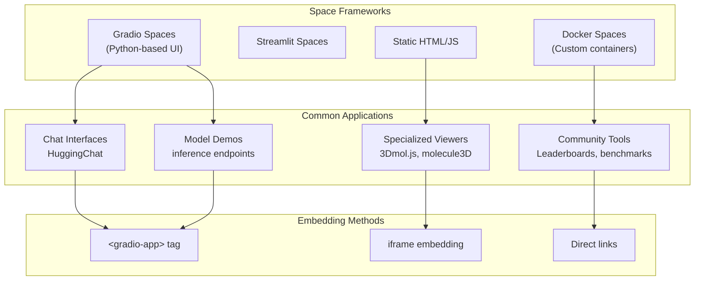
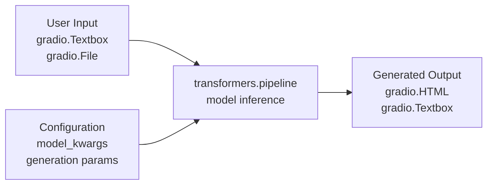
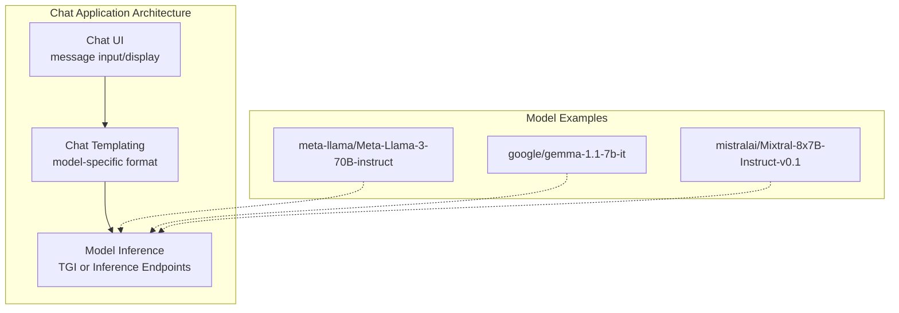
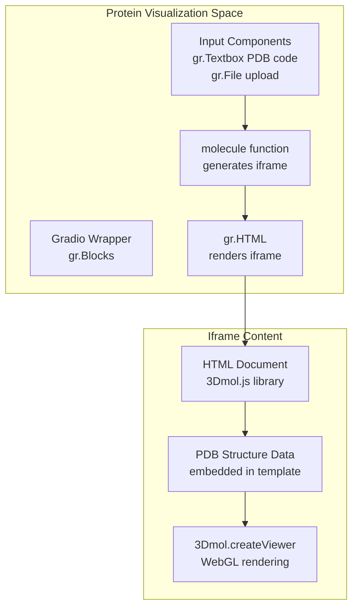
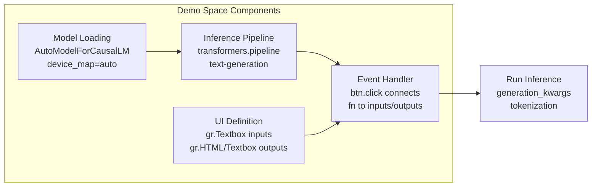
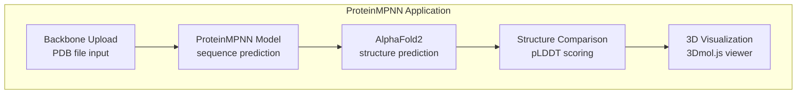
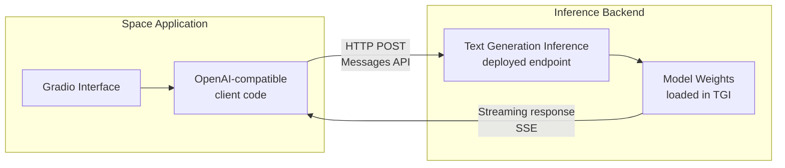
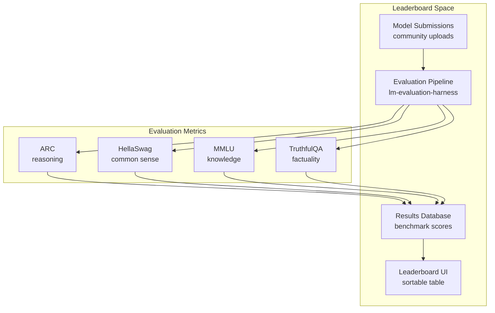

<!-- source: DeepWiki mcp.deepwiki.com · repo huggingface/blog · page 9.2 Spaces and Applications · fetched 2026-10-26 -->

# Spaces and Applications

<details>
<summary>Relevant source files</summary>

The following files were used as context for generating this wiki page:

- [4bit-transformers-bitsandbytes.md](4bit-transformers-bitsandbytes.md)
- [_events.yml](_events.yml)
- [accelerate-deepspeed.md](accelerate-deepspeed.md)
- [assets/138_stackllama/thumbnail.png](assets/138_stackllama/thumbnail.png)
- [assets/147_falcon/falcon_thumbnail.jpg](assets/147_falcon/falcon_thumbnail.jpg)
- [assets/83_accelerate_deepspeed/chatbot.png](assets/83_accelerate_deepspeed/chatbot.png)
- [assets/83_accelerate_deepspeed/cls_run.png](assets/83_accelerate_deepspeed/cls_run.png)
- [assets/83_accelerate_deepspeed/deepspeed-thumbnail.png](assets/83_accelerate_deepspeed/deepspeed-thumbnail.png)
- [assets/98_spaces_3dmoljs/thumbnail.png](assets/98_spaces_3dmoljs/thumbnail.png)
- [assets/assisted-generation/thumbnail.png](assets/assisted-generation/thumbnail.png)
- [assets/diffusion-models-event/thumbnail.png](assets/diffusion-models-event/thumbnail.png)
- [assets/gemma/Gemma-logo-small.png](assets/gemma/Gemma-logo-small.png)
- [assets/gemma/gcp-deploy.png](assets/gemma/gcp-deploy.png)
- [assets/gemma/gcp-train-gemma.png](assets/gemma/gcp-train-gemma.png)
- [assets/gemma/thumbnail.jpg](assets/gemma/thumbnail.jpg)
- [assets/inference_pro/thumbnail.png](assets/inference_pro/thumbnail.png)
- [assets/instruction_tuning_sd/thumbnail.png](assets/instruction_tuning_sd/thumbnail.png)
- [assets/llama2/thumbnail.jpg](assets/llama2/thumbnail.jpg)
- [assets/llama3/thumbnail.jpg](assets/llama3/thumbnail.jpg)
- [assets/mixtral/thumbnail.jpg](assets/mixtral/thumbnail.jpg)
- [assisted-generation.md](assisted-generation.md)
- [diffusion-models-event.md](diffusion-models-event.md)
- [falcon.md](falcon.md)
- [gemma.md](gemma.md)
- [inference-pro.md](inference-pro.md)
- [instruction-tuning-sd.md](instruction-tuning-sd.md)
- [llama2.md](llama2.md)
- [llama3.md](llama3.md)
- [mixtral.md](mixtral.md)
- [spaces_3dmoljs.md](spaces_3dmoljs.md)
- [stackllama.md](stackllama.md)
- [zh/Llama2-for-non-engineers.md](zh/Llama2-for-non-engineers.md)
- [zh/gemma.md](zh/gemma.md)
- [zh/huggy-lingo.md](zh/huggy-lingo.md)
- [zh/llama3.md](zh/llama3.md)
- [zh/mixtral.md](zh/mixtral.md)

</details>


This document covers the Hugging Face Spaces platform and the ecosystem of applications built on top of it. Spaces provide a hosting environment for machine learning demos, interactive applications, and community tools. For information about model and dataset hosting on the Hub, see [Hub Integration and Security](#9.1).

## Overview

Spaces are containerized applications that run on Hugging Face infrastructure, enabling the community to create and share machine learning demos without managing deployment infrastructure. Spaces support multiple frameworks but are most commonly built with Gradio, which provides Python-based UI components specifically designed for ML applications.

The platform serves several key purposes:
- **Model Demonstration**: Quick deployment of model interfaces for testing and showcasing
- **Community Applications**: Tools like Hugging Chat, leaderboards, and benchmarking systems
- **Educational Resources**: Interactive tutorials and exploratory interfaces
- **Specialized Visualizations**: Domain-specific viewers (e.g., protein structure visualization)

Sources: [llama2.md:67-73](), [gemma.md:99-102](), [falcon.md:69-75](), [spaces_3dmoljs.md:1-55]()

## Space Types and Framework Integration



**Space Types by Framework**

| Framework | Use Case | Example |
|-----------|----------|---------|
| Gradio | Interactive ML demos | `huggingface-projects/llama-2-13b-chat` |
| Streamlit | Dashboard-style apps | Data exploration tools |
| Static HTML/JS | Custom visualizations | `simonduerr/3dmol.js` |
| Docker | Complex applications | `HuggingFaceH4/open_llm_leaderboard` |

Sources: [llama2.md:67-73](), [spaces_3dmoljs.md:14-20](), [falcon.md:69-77]()

## Gradio-Based Spaces

### Basic Gradio Integration

Gradio is the primary framework for creating ML demos on Spaces. Applications define interfaces using Python components that automatically generate web UIs.

**Gradio Pipeline Pattern** (commonly used for model demos):



The pattern seen across model demos follows this structure:
1. Initialize model and tokenizer via `transformers.pipeline`
2. Define Gradio input components (textboxes, file uploads)
3. Create inference function that processes inputs
4. Connect components via Gradio blocks or interface
5. Launch with `demo.launch()`

Sources: [llama2.md:99-126](), [gemma.md:123-150](), [falcon.md:97-128]()

### Embedding Gradio Spaces

Spaces can be embedded in external pages using the `<gradio-app>` web component:

```html
<script type="module" src="https://gradio.s3-us-west-2.amazonaws.com/3.37.0/gradio.js"></script>
<gradio-app theme_mode="light" space="huggingface-projects/llama-2-13b-chat"></gradio-app>
```

Key attributes:
- `space`: The HuggingFace space identifier (format: `username/space-name`)
- `theme_mode`: Visual theme (`"light"` or `"dark"`)
- `src`: Version-specific Gradio JavaScript runtime

This embedding mechanism is used extensively throughout blog posts to provide interactive demos directly in documentation.

Sources: [llama2.md:71-72](), [gemma.md:160-165](), [falcon.md:73-74](), [mixtral.md:158-163]()

## Chat Applications

### Hugging Chat Integration

Hugging Chat is a production chat interface built as a Space, serving as the primary conversational demo platform for instruction-tuned models.



**Chat Model Integration Points**:

| Model | Chat URL Pattern | Backend |
|-------|------------------|---------|
| Llama 3 70B | `huggingface.co/chat/models/meta-llama/Meta-Llama-3-70B-instruct` | TGI |
| Gemma 7B | `huggingface.co/chat/models/google/gemma-1.1-7b-it` | TGI |
| Mixtral 8x7B | `huggingface.co/chat/?model=mistralai/Mixtral-8x7B-Instruct-v0.1` | TGI |

The chat interface handles:
- Model-specific prompt templating (e.g., Llama 3's `<|start_header_id|>` format)
- Streaming token generation via Server-Sent Events
- Conversation history management
- System prompt configuration

Sources: [llama3.md:95-96](), [gemma.md:101-102](), [mixtral.md:105-106](), [llama2.md:34-36]()

## Specialized Visualization Spaces

### Custom HTML/JS Applications

For visualizations requiring specialized libraries not available in standard Python frameworks, Spaces support custom HTML/JavaScript applications.

**3Dmol.js Protein Visualization Example**:



The `molecule()` function pattern (from `spaces_3dmoljs.md`):
1. Reads molecular structure data (PDB format)
2. Embeds data in HTML template with 3Dmol.js library
3. Returns iframe with `srcdoc` containing the complete HTML document
4. 3Dmol.js initializes viewer and renders structure in browser

**Key Implementation Details**:
- HTML must be constructed as a single string (avoiding apostrophes due to `srcdoc` attribute parsing)
- Libraries loaded via CDN: jQuery and 3Dmol.js
- Viewer configuration in JavaScript embedded in the document
- Styles defined for `.mol-container` class control viewer dimensions

Sources: [spaces_3dmoljs.md:61-176]()

### Gradio Custom Components

Modern approach using packaged custom components (as of May 2024 update in `spaces_3dmoljs.md`):

```python
from gradio_molecule3d import Molecule3D

reps = [{
    "model": 0,
    "chain": "",
    "resname": "",
    "style": "stick",
    "color": "whiteCarbon",
    "residue_range": "",
    "around": 0,
    "byres": False,
}]

with gr.Blocks() as demo:
    Molecule3D(reps=reps)
```

The `gradio_molecule3d` custom component simplifies integration by:
- Providing native Gradio component API
- Enabling user-modifiable visualizations at runtime
- Handling complex 3D rendering configuration declaratively

Sources: [spaces_3dmoljs.md:14-41]()

## Demo Space Patterns

### Model Inference Demos

Standard pattern for showcasing model capabilities:



**Common Configuration Parameters**:
- `model_kwargs`: `torch_dtype`, `quantization_config`, `device_map`
- `generation_kwargs`: `max_new_tokens`, `temperature`, `top_p`, `top_k`, `do_sample`
- `eos_token_id`: Termination tokens (may be multiple for chat models)

Examples referenced in blog posts:
- `huggingface-projects/llama-2-13b-chat`: Llama 2 chat demo
- `HuggingFaceH4/falcon-chat-demo-for-blog`: Falcon chat interface
- `runwayml/stable-diffusion-v1-5`: Image generation demo
- `ysharma/Explore_llamav2_with_TGI`: Llama 2 with TGI backend

Sources: [llama2.md:67-135](), [gemma.md:117-167](), [falcon.md:71-128](), [mixtral.md:140-164]()

### Production Application Spaces

More complex applications running as full services:

**ProteinMPNN Space Architecture** (from `spaces_3dmoljs.md`):



This demonstrates a multi-stage ML pipeline:
1. User uploads protein backbone structure
2. ProteinMPNN predicts optimal sequences for the structure
3. AlphaFold2 validates predictions by predicting structures from sequences
4. Comparison identifies successful redesigns (high pLDDT, similar structure)
5. Results visualized interactively with 3Dmol.js

Sources: [spaces_3dmoljs.md:177-179]()

## Space Integration with Model Deployments

### Inference Endpoints Connection

Spaces can connect to Inference Endpoints for production-grade inference:



**Messages API Integration** (from Inference Endpoints):

The OpenAI-compatible API allows Spaces to connect to deployed models:

```python
from openai import OpenAI

client = OpenAI(
    base_url="<ENDPOINT_URL>" + "/v1/",
    api_key="<HF_API_TOKEN>",
)
chat_completion = client.chat.completions.create(
    model="tgi",
    messages=[
        {"role": "user", "content": "Why is open-source software important?"},
    ],
    stream=True,
    max_tokens=500
)
```

This pattern enables Spaces to leverage:
- TGI's optimized inference (continuous batching, tensor parallelism)
- Scalable backend infrastructure
- Model hot-swapping without Space redeployment
- Streaming responses for better UX

Sources: [inference-pro.md:182-207](), [gemma.md:216-242](), [llama3.md:182-207]()

## Community Tools and Leaderboards

### Open LLM Leaderboard

The `HuggingFaceH4/open_llm_leaderboard` Space serves as the primary benchmark platform:



The leaderboard referenced extensively across model releases:
- Standardized evaluation across models
- Automated score calculation and ranking
- Public transparency for model performance
- Integration with Eleuther AI's evaluation harness

Sources: [falcon.md:206-237](), [llama2.md:51-64](), [gemma.md:59-74](), [mixtral.md:59-81]()

## Event and Demo Spaces

Spaces serve as live event platforms for model releases and educational content:

**Diffusion Models Live Event** (from `diffusion-models-event.md`):
- Embedded demos showcasing Stable Diffusion capabilities
- Interactive educational components for learning sessions
- Speaker presentation integrations
- Community engagement tools

**Space as Demo Platform**:
```html
<gradio-app theme_mode="light" space="runwayml/stable-diffusion-v1-5"></gradio-app>
```

This embedding pattern allows:
- Real-time model interaction during presentations
- Persistent demos for post-event reference
- Community experimentation with featured models
- Educational resource archiving

Sources: [diffusion-models-event.md:1-54]()

## Technical Infrastructure

### Space Deployment Process

While the provided files don't show backend Space infrastructure code, they reveal the deployment pattern:

1. **Repository Structure**: Space repository contains application code (typically `app.py` for Gradio)
2. **Framework Detection**: Automatic detection of framework (Gradio, Streamlit, etc.) from repository
3. **Container Build**: Spaces build Docker containers with appropriate dependencies
4. **Resource Allocation**: GPU/CPU assignment based on Space tier
5. **Endpoint Creation**: Public URL generation (`huggingface.co/spaces/{username}/{space-name}`)

### Embedding and Integration

**Gradio App Embedding Mechanism**:
- JavaScript runtime loaded from `gradio.s3-us-west-2.amazonaws.com`
- Web component (`<gradio-app>`) communicates with Space backend
- Version-specific runtime (e.g., `3.37.0`, `3.32.0`) ensures compatibility
- Theme modes supported: `"light"`, `"dark"`

**Custom Iframe Pattern**:
```python
def molecule(input_pdb):
    mol = read_mol(input_pdb)
    x = ("""<!DOCTYPE html><html> [...] </html>""")
    return f"""<iframe [...] srcdoc='{x}'></iframe>"""
```

This pattern used for:
- Custom JavaScript library integration
- Complex client-side rendering
- Browser security compliance (sandboxed execution)

Sources: [spaces_3dmoljs.md:118-170](), [llama2.md:71-72](), [falcon.md:73-74]()

---

**Summary**: Spaces provide the application layer of the Hugging Face platform, enabling community members to deploy, share, and embed ML applications without infrastructure management. The ecosystem spans simple model demos to complex production applications, all integrated with the Hub's model and dataset repositories.

---

