# Page: Overview

# Overview

<details>
<summary>Relevant source files</summary>

The following files were used as context for generating this wiki page:

- [1_58_llm_extreme_quantization.md](1_58_llm_extreme_quantization.md)
- [README.md](README.md)
- [_blog.yml](_blog.yml)
- [_tags.yml](_tags.yml)
- [assets/114_pricing-update/thumbnail.png](assets/114_pricing-update/thumbnail.png)
- [assets/192_pi0/new_thumbnail_pi0.001.png](assets/192_pi0/new_thumbnail_pi0.001.png)
- [assets/193_l2d/lerobot-driver.gif](assets/193_l2d/lerobot-driver.gif)
- [assets/1_58_llm_extreme_quantization/thumbnail.png](assets/1_58_llm_extreme_quantization/thumbnail.png)
- [assets/45_gptj_sagemaker/model_load_time.png](assets/45_gptj_sagemaker/model_load_time.png)
- [assets/45_gptj_sagemaker/thumbnail.png](assets/45_gptj_sagemaker/thumbnail.png)
- [assets/46_infinity_cpu_performance/latency.png](assets/46_infinity_cpu_performance/latency.png)
- [assets/46_infinity_cpu_performance/overview.png](assets/46_infinity_cpu_performance/overview.png)
- [assets/46_infinity_cpu_performance/pipeline.png](assets/46_infinity_cpu_performance/pipeline.png)
- [assets/46_infinity_cpu_performance/throughput.png](assets/46_infinity_cpu_performance/throughput.png)
- [assets/46_infinity_cpu_performance/thumbnail.png](assets/46_infinity_cpu_performance/thumbnail.png)
- [assets/inference-providers/welcome-featherless.jpg](assets/inference-providers/welcome-featherless.jpg)
- [assets/optimum_intel/optimum_openvino_thumbnail.png](assets/optimum_intel/optimum_openvino_thumbnail.png)
- [assets/sd_dreambooth_training/thumbnail.jpg](assets/sd_dreambooth_training/thumbnail.jpg)
- [assets/streaming_datasets/streaming_datasets.png](assets/streaming_datasets/streaming_datasets.png)
- [assets/textquests/thumbnail.gif](assets/textquests/thumbnail.gif)
- [assets/thumbnail-template.svg](assets/thumbnail-template.svg)
- [assets/trl_vlm/thumbnail.png](assets/trl_vlm/thumbnail.png)
- [assets/virustotal/thumbnail.png](assets/virustotal/thumbnail.png)
- [assets/wuerstchen/thumbnail.jpg](assets/wuerstchen/thumbnail.jpg)
- [dreambooth.md](dreambooth.md)
- [gptj-sagemaker.md](gptj-sagemaker.md)
- [inference-providers-featherless.md](inference-providers-featherless.md)
- [infinity-cpu-performance.md](infinity-cpu-performance.md)
- [lerobot-goes-to-driving-school.md](lerobot-goes-to-driving-school.md)
- [openvino-vlm.md](openvino-vlm.md)
- [pi0.md](pi0.md)
- [pricing-update.md](pricing-update.md)
- [streaming-datasets.md](streaming-datasets.md)
- [textquests.md](textquests.md)
- [trl-vlm-alignment.md](trl-vlm-alignment.md)
- [virustotal.md](virustotal.md)

</details>


The Hugging Face blog repository (https://github.com/huggingface/blog) is a YAML-based content management system for publishing technical articles about machine learning. The repository contains markdown files for articles, YAML registries for metadata management, and asset storage for images and media.

The repository manages over 1000 technical blog posts across topics including LLM deployment, VLM training, diffusion models, and hardware optimization. Content is organized through `_blog.yml` (primary registry), `_tags.yml` (taxonomy), and corresponding `.md` files. Publication occurs automatically when pull requests are merged to the main branch.

For content-specific documentation, see [Large Language Models](#2), [Vision Language Models](#3), [Model Training and Optimization](#4), [Model Deployment and Inference](#5), [Specialized Model Types](#6), and [Deep Reinforcement Learning](#7).

## Repository Architecture

The repository consists of YAML configuration files, markdown content files, and asset directories.

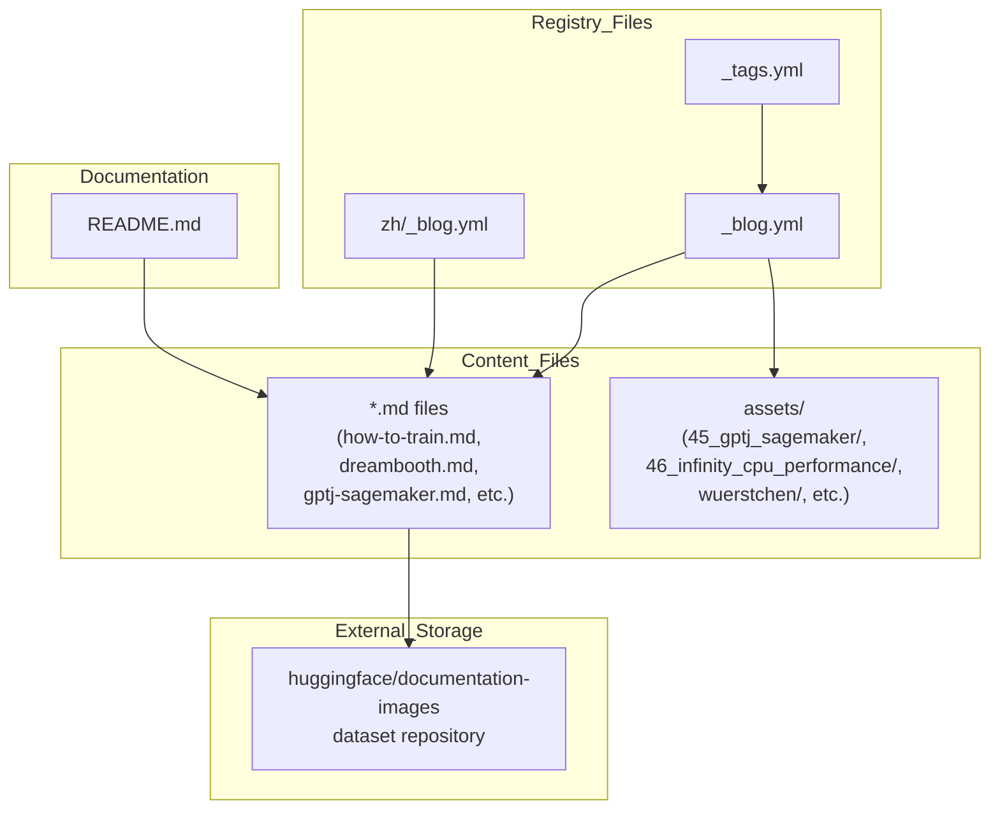

Sources: [_blog.yml:1-2500](), [_tags.yml:1-51](), [README.md:1-111](), [gptj-sagemaker.md:1-285](), [dreambooth.md:1-200]()

## Content Registry Structure

`_blog.yml` contains an array of entries with the following structure:

```yaml
- local: how-to-train
  date: February 14, 2020
  tags:
    - guide
    - nlp
```

Each entry maps to a markdown file (`${local}.md`) and optionally an assets directory (`assets/${prefix}_${local}/`).

### YAML Entry Fields

| Field | Type | Example | Description |
|-------|------|---------|-------------|
| `local` | string | `"gptj-sagemaker"` | Filename without .md extension |
| `date` | string | `"January 11, 2022"` | Publication date |
| `tags` | array | `["partnerships", "aws", "guide", "nlp"]` | Tag references from `_tags.yml` |
| `guest` | boolean | `true` | Optional, indicates guest author |
| `thumbnail` | string | Not in YAML | Defined in markdown front matter |

### Markdown Front Matter Structure

```yaml
---
title: "Deploy GPT-J 6B for inference using Hugging Face Transformers and Amazon SageMaker"
thumbnail: /blog/assets/45_gptj_sagemaker/thumbnail.png
authors:
- user: philschmid
---
```

The `local` field in `_blog.yml` must match the filename. For `local: gptj-sagemaker`, the file must be `gptj-sagemaker.md`.

Sources: [_blog.yml:3-11](), [_blog.yml:304-311](), [gptj-sagemaker.md:1-7](), [README.md:19-35]()

## Publication Workflow

The publication process requires five steps:

1. **Branch Creation**: Create a branch with format `YourName/Title`
2. **File Creation**: Create `${local}.md` file with markdown content
3. **Asset Creation**: Create `assets/${local}/` directory with thumbnail image
4. **Registry Update**: Add entry to `_blog.yml` with `local`, `date`, and `tags` fields
5. **Pull Request**: Open PR, which triggers automatic publication on merge

### File Creation Example

For an article with `local: gptj-sagemaker`:
- Create file: `gptj-sagemaker.md`
- Create directory: `assets/45_gptj_sagemaker/`
- Add thumbnail: `assets/45_gptj_sagemaker/thumbnail.png`
- Update `_blog.yml`:
  ```yaml
  - local: gptj-sagemaker
    date: January 11, 2022
    tags:
      - partnerships
      - aws
      - guide
      - nlp
  ```

The numerical prefix (e.g., `45_`) in asset directories is optional and used for rough ordering.

### Hub Integration

Upon merge, the article is automatically published to `https://huggingface.co/blog/${local}`. For example, `local: gptj-sagemaker` publishes to `https://huggingface.co/blog/gptj-sagemaker`.

The Hub automatically inserts UI elements after the first `<h1>` tag:
- Publication date
- "Update on GitHub" button
- Author avatars (from `authors` field in front matter)

Sources: [README.md:6-49](), [_blog.yml:304-311](), [gptj-sagemaker.md:1-7]()

## Asset Management

Assets are split between local storage (thumbnails) and external storage (content images).

### Local Assets (Thumbnails Only)

Thumbnails are stored in `assets/${prefix}_${local}/thumbnail.{png,jpg,gif}` and referenced in markdown front matter:

```yaml
thumbnail: /blog/assets/45_gptj_sagemaker/thumbnail.png
```

Images should be compressed using https://tinypng.com or https://www.iloveimg.com/compress-image.

### External Assets (Content Images)

Content images are stored in the `huggingface/documentation-images` dataset repository to reduce repository bloat. The folder structure mirrors the blog repository:

- Blog repo: `assets/192_pi0/`
- Documentation images: `huggingface/documentation-images/resolve/main/blog/192_pi0/`

Example reference in markdown:
```markdown

```

### Thumbnail Generation

Recommended thumbnail size: `1300x650` pixels. Templates:
- SVG template: `assets/thumbnail-template.svg`
- Figma template: https://www.figma.com/file/sXrf9VtkkbWI7kCIesMkDY/HF-Blog-Template

Sources: [README.md:12-18](), [README.md:51-56](), [pi0.md:1-10](), [gptj-sagemaker.md:2]()

## Content Taxonomy

`_tags.yml` defines allowed tag values and their display labels:

```yaml
- value: community
  label: community

- value: guide
  label: guide

- value: nlp
  label: NLP
```

### Complete Tag List

| Tag Value | Display Label | Common Use Cases |
|-----------|--------------|------------------|
| `community` | community | Community events, contributor highlights |
| `guide` | guide | Tutorials, how-to articles |
| `open-source-collab` | open source collab | Library integrations, partnerships |
| `partnerships` | partnerships | Commercial partnerships (AWS, Intel, etc.) |
| `research` | research | Research paper summaries |
| `nlp` | NLP | Natural language processing |
| `audio` | Audio | Speech recognition, TTS |
| `cv` | CV | Computer vision |
| `rl` | RL | Reinforcement learning |
| `ethics` | ethics | AI safety, responsible AI |
| `diffusion` | Diffusion | Diffusion models (Stable Diffusion, etc.) |
| `game-dev` | Game Development | Unity integration, game AI |
| `rlhf` | RLHF | RLHF training techniques |
| `leaderboard` | Leaderboard | Model evaluation leaderboards |
| `case-studies` | Case Studies | Industry use cases |
| `lerobot` | LeRobot | Robotics (LeRobot ecosystem) |
| `inference-providers` | Inference Providers | Inference optimization |

Tags in `_blog.yml` entries must reference values defined in `_tags.yml`.

Sources: [_tags.yml:1-51](), [_blog.yml:5-10](), [_blog.yml:304-311]()

## Multilingual Content Support

The repository supports internationalization through separate content registries for different languages.

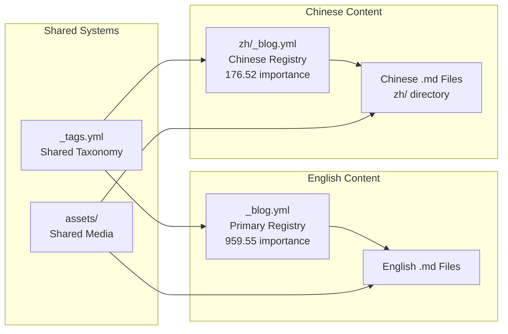

The multilingual system maintains separate registries while sharing common resources like assets and taxonomy definitions.

Sources: [_blog.yml:1](), [zh/_blog.yml]() (referenced in architecture diagrams)

---

# Page: Blog System Architecture

# Blog System Architecture

<details>
<summary>Relevant source files</summary>

The following files were used as context for generating this wiki page:

- [1_58_llm_extreme_quantization.md](1_58_llm_extreme_quantization.md)
- [README.md](README.md)
- [_blog.yml](_blog.yml)
- [_tags.yml](_tags.yml)
- [assets/114_pricing-update/thumbnail.png](assets/114_pricing-update/thumbnail.png)
- [assets/192_pi0/new_thumbnail_pi0.001.png](assets/192_pi0/new_thumbnail_pi0.001.png)
- [assets/193_l2d/lerobot-driver.gif](assets/193_l2d/lerobot-driver.gif)
- [assets/1_58_llm_extreme_quantization/thumbnail.png](assets/1_58_llm_extreme_quantization/thumbnail.png)
- [assets/45_gptj_sagemaker/model_load_time.png](assets/45_gptj_sagemaker/model_load_time.png)
- [assets/45_gptj_sagemaker/thumbnail.png](assets/45_gptj_sagemaker/thumbnail.png)
- [assets/46_infinity_cpu_performance/latency.png](assets/46_infinity_cpu_performance/latency.png)
- [assets/46_infinity_cpu_performance/overview.png](assets/46_infinity_cpu_performance/overview.png)
- [assets/46_infinity_cpu_performance/pipeline.png](assets/46_infinity_cpu_performance/pipeline.png)
- [assets/46_infinity_cpu_performance/throughput.png](assets/46_infinity_cpu_performance/throughput.png)
- [assets/46_infinity_cpu_performance/thumbnail.png](assets/46_infinity_cpu_performance/thumbnail.png)
- [assets/inference-providers/welcome-featherless.jpg](assets/inference-providers/welcome-featherless.jpg)
- [assets/optimum_intel/optimum_openvino_thumbnail.png](assets/optimum_intel/optimum_openvino_thumbnail.png)
- [assets/sd_dreambooth_training/thumbnail.jpg](assets/sd_dreambooth_training/thumbnail.jpg)
- [assets/streaming_datasets/streaming_datasets.png](assets/streaming_datasets/streaming_datasets.png)
- [assets/textquests/thumbnail.gif](assets/textquests/thumbnail.gif)
- [assets/thumbnail-template.svg](assets/thumbnail-template.svg)
- [assets/trl_vlm/thumbnail.png](assets/trl_vlm/thumbnail.png)
- [assets/virustotal/thumbnail.png](assets/virustotal/thumbnail.png)
- [assets/wuerstchen/thumbnail.jpg](assets/wuerstchen/thumbnail.jpg)
- [dreambooth.md](dreambooth.md)
- [gptj-sagemaker.md](gptj-sagemaker.md)
- [inference-providers-featherless.md](inference-providers-featherless.md)
- [infinity-cpu-performance.md](infinity-cpu-performance.md)
- [lerobot-goes-to-driving-school.md](lerobot-goes-to-driving-school.md)
- [openvino-vlm.md](openvino-vlm.md)
- [pi0.md](pi0.md)
- [pricing-update.md](pricing-update.md)
- [streaming-datasets.md](streaming-datasets.md)
- [textquests.md](textquests.md)
- [trl-vlm-alignment.md](trl-vlm-alignment.md)
- [virustotal.md](virustotal.md)

</details>


This document describes the technical architecture of the Hugging Face blog content management system, including the file-based structure, metadata organization, asset management, and publication workflow. The blog system is built around YAML configuration files (`_blog.yml`, `_tags.yml`) and Markdown content files that together form a version-controlled, static-site-friendly blog platform.

For information about contributing content to the blog, see [Contributing to the Blog](#1.2).

## System Overview

The blog system operates as a file-based content management system where blog posts are authored as Markdown files with YAML front matter, registered in a central `_blog.yml` configuration file, and categorized using tags defined in `_tags.yml`. The system is designed to be simple, version-controlled, and automatically deployed through GitHub workflows.

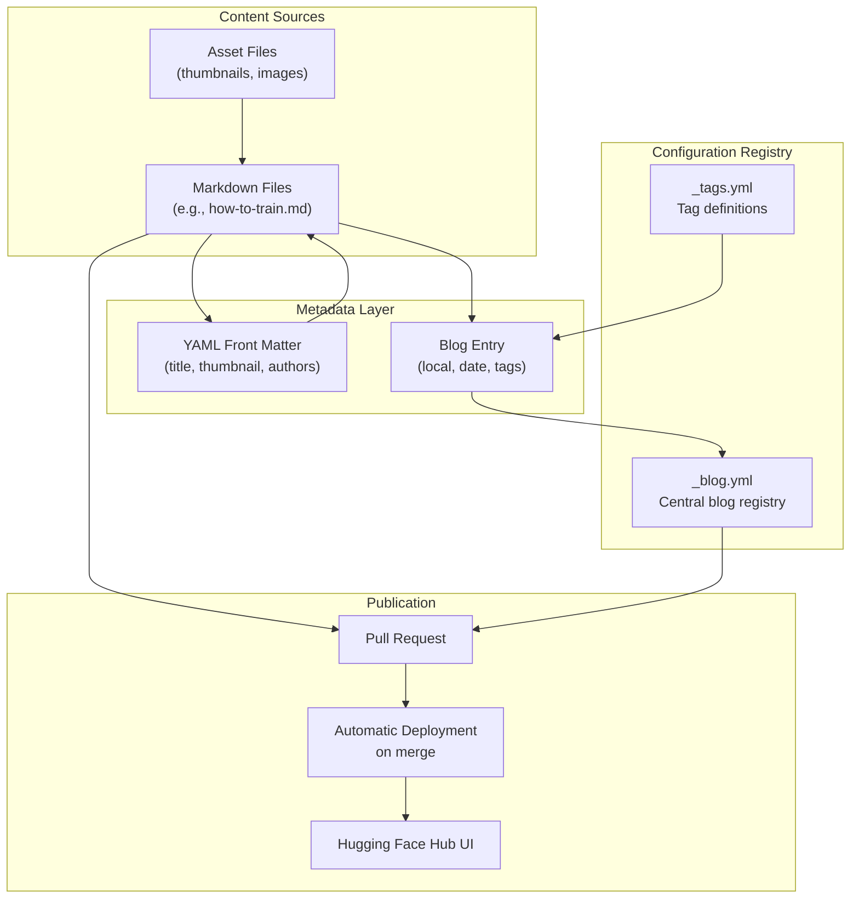

Sources: [_blog.yml:1-8000](), [README.md:1-111](), [_tags.yml:1-51]()

## Core Configuration Files

### _blog.yml: Central Blog Registry

The `_blog.yml` file serves as the master index of all blog posts in the repository. Each entry in this YAML file represents a single blog post and contains metadata that complements the post's front matter.

**Structure:**

Each blog entry in `_blog.yml` follows this schema:

- `local`: The filename of the markdown file (without `.md` extension)
- `date`: Publication date
- `tags`: Array of tag values (references `_tags.yml`)
- `guest` (optional): Boolean indicating guest post
- `thumbnail` (optional): Can be overridden here

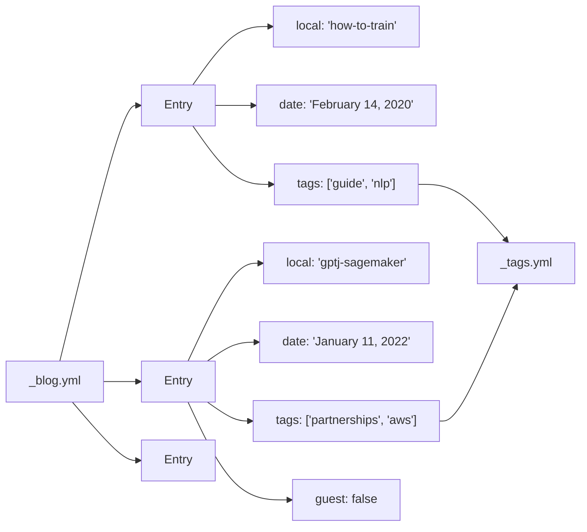

**Example entries:**

```yaml
- local: how-to-train
  date: February 14, 2020
  tags:
    - guide
    - nlp

- local: gptj-sagemaker
  date: January 11, 2022
  tags:
    - partnerships
    - aws
    - guide
    - nlp
```

Sources: [_blog.yml:1-100](), [_blog.yml:304-311]()

### _tags.yml: Tag Taxonomy

The `_tags.yml` file defines all available tags that can be applied to blog posts. Each tag has a `value` (used in `_blog.yml`) and a `label` (displayed in the UI).

**Tag Structure:**

| Field | Description | Example |
|-------|-------------|---------|
| `value` | Internal identifier used in `_blog.yml` | `"rlhf"` |
| `label` | Display label shown to users | `"RLHF"` |

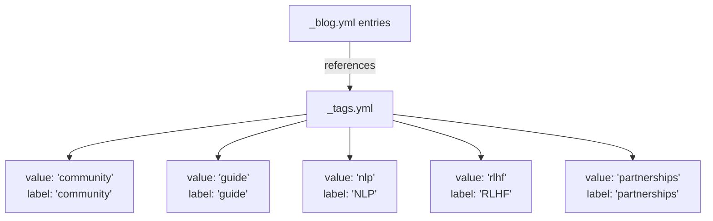

**Common tag categories:**

- **Content Type**: `guide`, `research`, `case-studies`, `announcement`
- **Technical Domain**: `nlp`, `audio`, `cv` (computer vision), `rl` (reinforcement learning), `diffusion`
- **Collaboration**: `community`, `open-source-collab`, `partnerships`
- **Specific Topics**: `rlhf`, `game-dev`, `leaderboard`, `inference-providers`
- **Ethics**: `ethics`

Sources: [_tags.yml:1-51]()

## Markdown File Structure

### YAML Front Matter

Every blog post markdown file begins with YAML front matter enclosed in triple dashes (`---`). This metadata is essential for the Hub to display the post correctly.

**Required fields:**

| Field | Description | Example |
|-------|-------------|---------|
| `title` | Post title displayed at the top | `"Training Stable Diffusion with Dreambooth"` |
| `thumbnail` | Path to thumbnail image | `"/blog/assets/sd_dreambooth_training/thumbnail.jpg"` |
| `authors` | Array of author objects with `user` field | `[{user: "valhalla"}, {user: "pcuenq"}]` |

**Optional fields:**

- `guest`: Boolean for guest authors (also can use `org` field in author object)

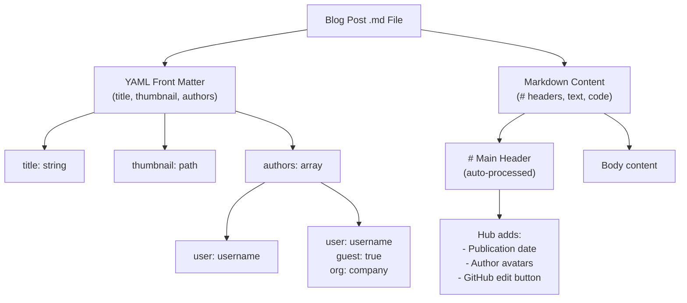

**Example from dreambooth.md:**

```yaml
---
title: Training Stable Diffusion with Dreambooth using Diffusers
thumbnail: /blog/assets/sd_dreambooth_training/thumbnail.jpg
authors:
- user: valhalla
- user: pcuenq
- user: 9of9
  guest: true
---

# Training Stable Diffusion with Dreambooth using 🧨 Diffusers

[Content begins here...]
```

The Hub automatically inserts UI elements after the main header (`# Training Stable Diffusion...`):
- Publication date ("Published on [date]")
- "Update on GitHub" button
- Author avatars

Sources: [README.md:19-42](), [dreambooth.md:1-10](), [trl-vlm-alignment.md:1-10]()

## Asset Management

### Two-Tier Storage Strategy

The blog uses a split storage approach to balance repository size with asset accessibility:

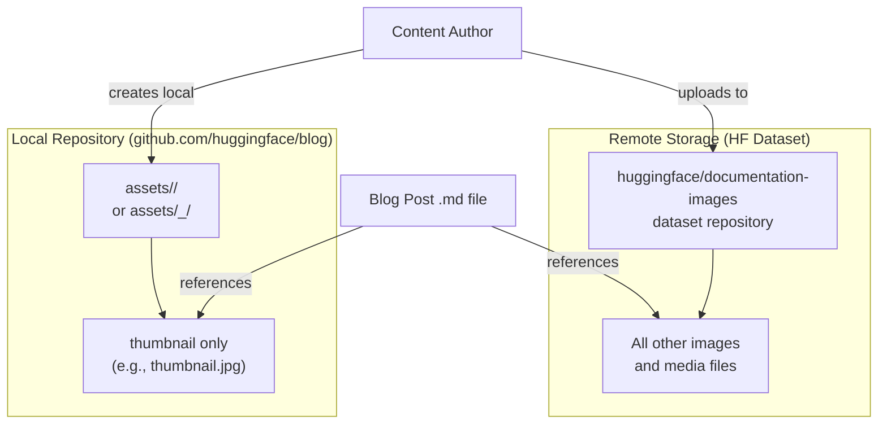

**Local asset folder structure:**

1. Create folder: `assets/<post-name>/` or optionally `assets/<number>_<post-name>/`
   - The numeric prefix is optional and used for rough ordering
   - Example: `assets/sd_dreambooth_training/` or `assets/123_intro-rl/`

2. Store **only the thumbnail** in this folder
   - This keeps the git repository lean
   - Example: `assets/sd_dreambooth_training/thumbnail.jpg`

**Remote asset storage:**

1. All other images go to: `https://huggingface.co/datasets/huggingface/documentation-images/tree/main/blog/<post-name>/`
2. Benefits:
   - Reduces repository bloat for cloning/pulling
   - Centralized image hosting
   - Easier to manage large media files

**Asset optimization requirements:**

Images should be compressed to ensure fast page loading:
- Use https://tinypng.com or https://www.iloveimg.com/compress-image
- Keep file sizes small

Sources: [README.md:12-17](), [dreambooth.md:2](), [gptj-sagemaker.md:2]()

## Content Creation Workflow

### Branch-Based Contribution Model

The blog follows a standard Git workflow with branch-based development and pull request reviews:

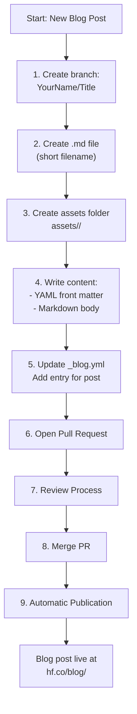

**Step-by-step process:**

1. **Create branch**: `YourName/Title` format
   - Example: `john/introducing-dreambooth`

2. **Create markdown file** with short, URL-friendly name
   - Filename becomes the URL path
   - Example: `intro-rl.md` → `hf.co/blog/intro-rl`

3. **Create asset folder**: `assets/<post-name>/`
   - Optional numeric prefix: `assets/123_intro-rl/`
   - Upload thumbnail to this folder
   - Upload other images to HuggingFace documentation-images dataset

4. **Write content**:
   - Add YAML front matter with title, thumbnail, authors
   - Write markdown content starting with `# Main Header`

5. **Update `_blog.yml`**:
   - Add entry with `local`, `date`, `tags` fields
   - Ensure tags exist in `_tags.yml`

6. **Open pull request** for review

7. **Automatic deployment** occurs when PR is merged

Sources: [README.md:6-49]()

### File Naming Conventions

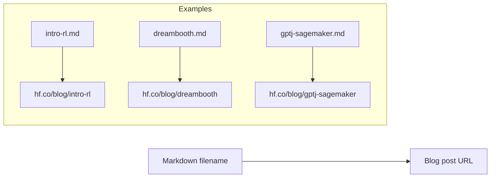

**Guidelines:**
- Use short, descriptive names
- Use hyphens for word separation
- Avoid spaces and special characters
- The filename is permanent (becomes the URL)

Sources: [README.md:9-10]()

## Metadata Schema Relationships

The blog system uses three sources of metadata that work together:

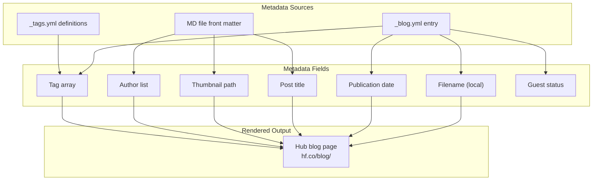

**Metadata Resolution:**

| Field | Primary Source | Secondary Source | Usage |
|-------|---------------|------------------|--------|
| Filename | `_blog.yml` (`local`) | N/A | URL path generation |
| Publication Date | `_blog.yml` (`date`) | N/A | "Published on" display |
| Title | MD front matter (`title`) | N/A | Page header, meta tags |
| Thumbnail | MD front matter (`thumbnail`) | Can override in `_blog.yml` | Social sharing, preview |
| Authors | MD front matter (`authors`) | N/A | Author avatars, attribution |
| Tags | `_blog.yml` (`tags`) | Validated against `_tags.yml` | Categorization, filtering |
| Guest Status | `_blog.yml` (`guest`) or MD author object | N/A | Attribution display |

Sources: [_blog.yml:1-100](), [README.md:19-42](), [_tags.yml:1-51]()

## Content Formatting Features

### LaTeX Support

Mathematical expressions can be included using LaTeX notation wrapped in `\\(` and `\\)`:

```markdown
\\( Q(S_t, A_t) \\)
```

This renders as: Q(S_t, A_t)

Sources: [README.md:59-70]()

### Figure Captions

Two methods are supported for captioning figures:

**Method 1: Markdown tables**
```markdown
|  |
|:--:|
| *Figure caption text* |
```

**Method 2: HTML**
```html
<figure>
  
  <figcaption>Figure caption text</figcaption>
</figure>
```

Sources: [README.md:72-77]()

### Highlight Boxes

Special highlight boxes can be used sparingly for important notes:

```html
<div style="background-color: #e6f9e6; padding: 16px 32px; outline: 2px solid; border-radius: 10px;">
  Important note content here
</div>
```

Sources: [README.md:79-81](), [infinity-cpu-performance.md:15-23]()

### Embedding Spaces

Hugging Face Spaces can be embedded directly in blog posts using a Gradio script tag:

```html
<script
	type="module"
	src="https://gradio.s3-us-west-2.amazonaws.com/4.36.1/gradio.js"
></script>

<gradio-app theme_mode="light" space="derek-thomas/hugging-face-blog-assistant"></gradio-app>
```

Sources: [README.md:83-97]()

## Publication Workflow

### Automatic Deployment Pipeline


**Key characteristics:**

1. **Automatic**: No manual deployment steps required
2. **Merge-triggered**: Publication happens automatically on PR merge
3. **Version controlled**: All changes tracked in Git history
4. **Rollback capable**: Can revert via Git if needed

Sources: [README.md:47-49]()

### Content Review Tools

The blog system provides tools to help with content creation:

**Community Blog Editor**
- URL: `https://huggingface.co/new-blog`
- Features: Preview function for markdown rendering
- Use case: Draft and preview posts before committing

**Blog Assistant Space**
- URL: `https://huggingface.co/spaces/derek-thomas/hugging-face-blog-assistant`
- Features: 
  - Caption figure formatting
  - Tip formatting helpers
  - Clickable reference insertion

Sources: [README.md:99-109]()

## Tag Taxonomy and Organization

### Tag Categories

The blog uses a structured tag taxonomy to organize content:

```mermaid
graph TB
    Tags["Blog Tags (_tags.yml)"]
    
    Tags --> Type["Content Type"]
    Tags --> Domain["Technical Domain"]
    Tags --> Collab["Collaboration Type"]
    Tags --> Special["Specialized Topics"]
    
    Type --> Guide["guide"]
    Type --> Research["research"]
    Type --> CaseStudy["case-studies"]
    Type --> Announce["announcement"]
    
    Domain --> NLP["nlp (NLP)"]
    Domain --> Audio["audio (Audio)"]
    Domain --> CV["cv (CV)"]
    Domain --> RL["rl (RL)"]
    Domain --> Diff["diffusion (Diffusion)"]
    
    Collab --> Community["community"]
    Collab --> OpenSource["open-source-collab"]
    Collab --> Partner["partnerships"]
    
    Special --> RLHF["rlhf (RLHF)"]
    Special --> GameDev["game-dev (Game Development)"]
    Special --> Leaderboard["leaderboard (Leaderboard)"]
    Special --> Ethics["ethics"]
    Special --> LeRobot["lerobot (LeRobot)"]
```

**Tag usage examples:**

| Post Type | Typical Tags | Example |
|-----------|-------------|---------|
| Tutorial | `guide`, domain tag | `["guide", "nlp"]` |
| Research announcement | `research`, domain tags | `["research", "cv", "multimodal"]` |
| Partnership | `partnerships`, company tag, domain | `["partnerships", "aws", "nlp"]` |
| Case study | `case-studies` | `["case-studies"]` |
| Community content | `community`, `open-source-collab` | `["community", "research"]` |

Sources: [_tags.yml:1-51](), [_blog.yml:3-7](), [_blog.yml:304-311]()

## Historical Evolution

### Post Volume and Growth

The `_blog.yml` file contains over 2,000 entries spanning from February 2020 to present, showing the blog's growth trajectory:

**Early posts (2020)**:
- Focus on foundational guides (`how-to-train`, `how-to-generate`)
- Introduction of key concepts like Reformer, encoder-decoder architectures

**Partnership expansion (2021-2022)**:
- AWS SageMaker integration posts
- Intel hardware optimization guides
- Cloud provider collaborations (GCP, Azure)

**Model evolution (2022-2023)**:
- Diffusion models (Stable Diffusion, Dreambooth)
- Large language models (GPT-J, BLOOM)
- Quantization techniques (8-bit, 4-bit)

**Recent focus (2024-2025)**:
- Vision-language models (VLMs)
- Extreme quantization (1.58-bit models)
- Robotics foundation models (π0, LeRobot)
- Streaming datasets optimization

Sources: [_blog.yml:1-100](), [_blog.yml:2000-2400]()

## Summary

The Hugging Face blog system architecture is a file-based, version-controlled content management system built on:

1. **Configuration files**: `_blog.yml` (master registry) and `_tags.yml` (tag taxonomy)
2. **Content files**: Markdown with YAML front matter
3. **Asset management**: Split storage (local thumbnails, remote full assets)
4. **Publication workflow**: Branch-based Git workflow with automatic deployment
5. **Metadata schema**: Coordinated data across YAML files and front matter

This architecture enables distributed content creation while maintaining consistency through version control and automated validation.

Sources: [_blog.yml:1-8000](), [_tags.yml:1-51](), [README.md:1-111]()

---

# Page: Contributing to the Blog

# Contributing to the Blog

<details>
<summary>Relevant source files</summary>

The following files were used as context for generating this wiki page:

- [README.md](README.md)
- [assets/114_pricing-update/thumbnail.png](assets/114_pricing-update/thumbnail.png)
- [assets/45_gptj_sagemaker/model_load_time.png](assets/45_gptj_sagemaker/model_load_time.png)
- [assets/45_gptj_sagemaker/thumbnail.png](assets/45_gptj_sagemaker/thumbnail.png)
- [assets/46_infinity_cpu_performance/latency.png](assets/46_infinity_cpu_performance/latency.png)
- [assets/46_infinity_cpu_performance/overview.png](assets/46_infinity_cpu_performance/overview.png)
- [assets/46_infinity_cpu_performance/pipeline.png](assets/46_infinity_cpu_performance/pipeline.png)
- [assets/46_infinity_cpu_performance/throughput.png](assets/46_infinity_cpu_performance/throughput.png)
- [assets/46_infinity_cpu_performance/thumbnail.png](assets/46_infinity_cpu_performance/thumbnail.png)
- [assets/thumbnail-template.svg](assets/thumbnail-template.svg)
- [gptj-sagemaker.md](gptj-sagemaker.md)
- [infinity-cpu-performance.md](infinity-cpu-performance.md)
- [pricing-update.md](pricing-update.md)

</details>


## Purpose and Scope

This document provides technical guidance for contributing blog posts to the Hugging Face blog repository. It covers the branch-based workflow, file structure conventions, Markdown authoring requirements, YAML front matter configuration, asset management, and the pull request process that results in automatic publication.

**Note**: External contributors should consider creating a [community blog](https://huggingface.co/blog-explorers) instead of submitting to this repository. Community blog posts appear on the main blog page alongside official posts. This repository is primarily for collaboration posts with Hugging Face.

For information about the blog infrastructure and metadata management, see [Blog System Architecture](#1.1).

---

## Contribution Workflow

The blog contribution process follows a Git-based workflow with specific conventions for file naming, asset organization, and metadata configuration.

**Workflow: Blog Post Creation and Publication**

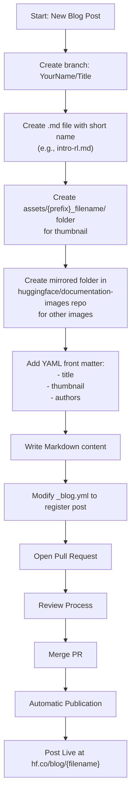

Sources: [README.md:1-111]()

---

## Repository File Structure

The repository organizes blog posts, assets, and metadata using a specific directory structure.

**File Organization**

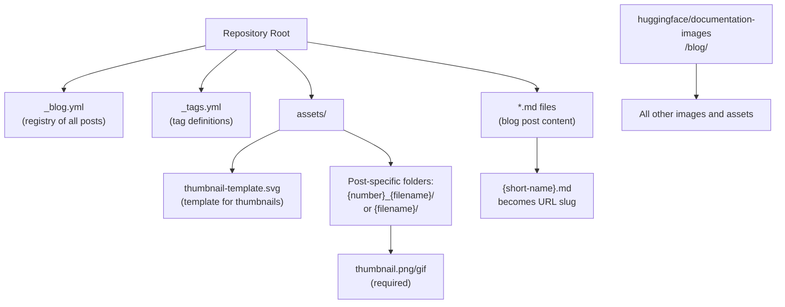

**Key File Types:**
- **Markdown files**: Blog post content (e.g., `gptj-sagemaker.md`, `infinity-cpu-performance.md`)
- **`_blog.yml`**: Central registry that controls post visibility and ordering
- **`assets/{folder}/`**: Contains thumbnail images only
- **External repo**: All non-thumbnail images stored in `huggingface/documentation-images`

Sources: [README.md:9-14](), [gptj-sagemaker.md:1-285](), [infinity-cpu-performance.md:1-171]()

---

## Creating a Blog Post

### Step 1: Branch Creation

Create a descriptive branch following the naming convention:

```
YourName/Title
```

Example: `john/deep-rl-tutorial`

Sources: [README.md:7]()

### Step 2: File Naming

Create a Markdown file with a **short, URL-friendly name**. This name becomes the blog post URL.

| File Name | Resulting URL |
|-----------|---------------|
| `intro-rl.md` | `https://hf.co/blog/intro-rl` |
| `gptj-sagemaker.md` | `https://hf.co/blog/gptj-sagemaker` |
| `infinity-cpu-performance.md` | `https://hf.co/blog/infinity-cpu-performance` |

Sources: [README.md:9-10]()

### Step 3: Asset Management

**Asset Organization Strategy**

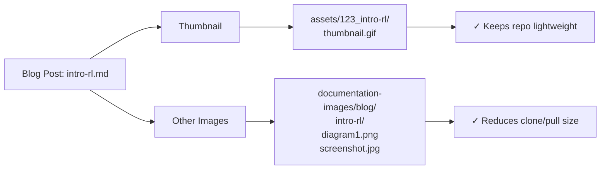

**Thumbnail Storage** (in this repository):
1. Create folder: `assets/{optional-number}_{filename}/`
2. Place thumbnail image (1300×650 recommended)
3. Reference in front matter: `/blog/assets/{folder}/thumbnail.{ext}`

**Other Images** (external repository):
1. Create mirrored folder in `huggingface/documentation-images/tree/main/blog/`
2. Upload all non-thumbnail images there
3. Reference using full URL or repository path

**Image Optimization**: Use compressed images (try [tinypng.com](https://tinypng.com) or [iloveimg.com](https://www.iloveimg.com/compress-image)) to ensure fast page loading.

Sources: [README.md:12-17]()

### Step 4: YAML Front Matter Structure

Every blog post must begin with YAML front matter enclosed in `---` delimiters.

**Front Matter Schema**

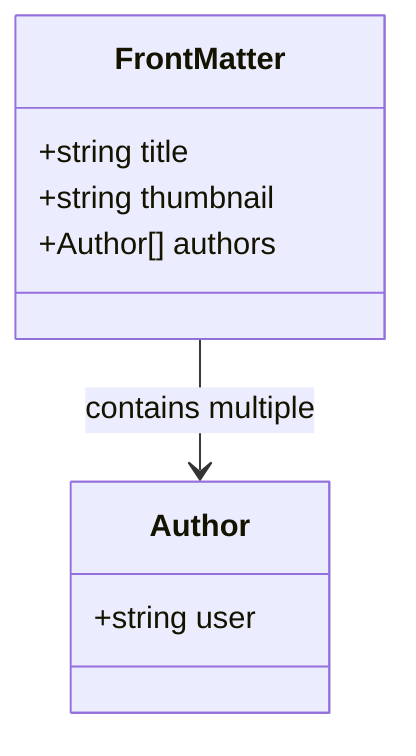

**Example Configuration:**

```yaml
---
title: "Deploy GPT-J 6B for inference using Hugging Face Transformers and Amazon SageMaker" 
thumbnail: /blog/assets/45_gptj_sagemaker/thumbnail.png
authors:
- user: philschmid
- user: jeffboudier
---
```

**Field Specifications:**

| Field | Type | Required | Description |
|-------|------|----------|-------------|
| `title` | string | Yes | Post title (appears in H1) |
| `thumbnail` | string | Yes | Path to thumbnail image |
| `authors` | array | Yes | List of author objects with `user` field |

**Author Rendering**: The Hub automatically inserts after the main header (`# Title`):
- Publication date
- "Update on GitHub" button  
- Author avatars from the `authors` list

Sources: [README.md:19-41](), [gptj-sagemaker.md:1-6](), [infinity-cpu-performance.md:1-8](), [pricing-update.md:1-7]()

### Step 5: Content Authoring

Write content using standard Markdown. The system supports:

**Basic Markdown**: Headings, lists, links, images, code blocks, tables, etc.

**Copy-Paste from Notion**: Use `Ctrl+Shift+V` to paste as Markdown.

Sources: [README.md:43]()

---

## Advanced Content Features

### LaTeX Mathematical Expressions

Inline LaTeX using escaped parentheses syntax:

```
\\(Q(S_t, A_t)\\)
```

Renders as: $Q(S_t, A_t)$

Sources: [README.md:59-70]()

### Figure Captions

**Method 1: Markdown Table**

```markdown
|  |
|:--:|
| *Figure caption text* |
```

**Method 2: HTML**

```html
<figure class="image table text-center m-0 w-full">
  <medium-zoom background="rgba(0,0,0,.7)" alt="Description" src="path/to/image.png"></medium-zoom>
  <figcaption>Figure 1. Caption text</figcaption>
</figure>
```

Sources: [README.md:72-77](), [gptj-sagemaker.md:59-63](), [infinity-cpu-performance.md:46-49]()

### Highlight Boxes

Special emphasis boxes for important notes (use sparingly):

```html
<div style="background-color: #e6f9e6; padding: 16px 32px; outline: 2px solid; border-radius: 10px;">
  Important note text here.
</div>
```

Sources: [README.md:79-81](), [infinity-cpu-performance.md:15-23]()

### Embedding Hugging Face Spaces

Embed interactive Gradio apps directly in posts:

```html
<script
	type="module"
	src="https://gradio.s3-us-west-2.amazonaws.com/4.36.1/gradio.js"
></script>

<gradio-app theme_mode="light" space="derek-thomas/hugging-face-blog-assistant"></gradio-app>
```

Sources: [README.md:83-97]()

---

## Publishing Process

**Publication Pipeline**

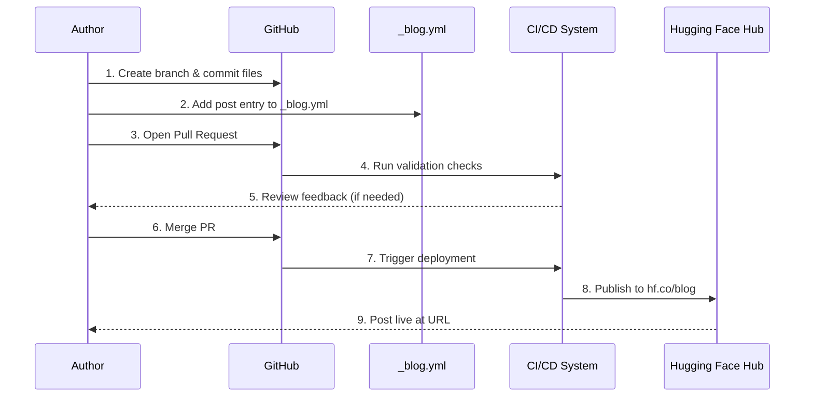

**Critical Steps:**

1. **Modify `_blog.yml`**: Add entry for your post to register it in the system
2. **Open Pull Request**: Initiates review process
3. **Merge = Publish**: Merging the PR **automatically publishes** the post

**Post-Publication URL**: `https://huggingface.co/blog/{filename-without-md}`

Sources: [README.md:45-49]()

---

## Helper Tools and Resources

### Thumbnail Template

Use the provided SVG template to create consistent thumbnails:

**Template Location**: `assets/thumbnail-template.svg`

**Recommended Dimensions**: 1300×650 pixels

**Alternative**: [Figma template](https://www.figma.com/file/sXrf9VtkkbWI7kCIesMkDY/HF-Blog-Template?node-id=351%3A39)

Sources: [README.md:51-56](), [assets/thumbnail-template.svg:1-12]()

### Community Blog Editor

Preview your Markdown before submitting:

**Tool**: [https://huggingface.co/new-blog](https://huggingface.co/new-blog)

**Features**: 
- Live preview function
- WYSIWYG editing
- Proper rendering of custom elements

Sources: [README.md:101]()

### Blog Assistant Space

Helper tool for generating common Markdown patterns:

**Tool**: [https://huggingface.co/spaces/derek-thomas/hugging-face-blog-assistant](https://huggingface.co/spaces/derek-thomas/hugging-face-blog-assistant)

**Capabilities**:
- Insert caption figures with image tables
- Format tip boxes
- Generate clickable references

Sources: [README.md:103-109]()

---

## Summary Checklist

Before opening a pull request, verify:

- [ ] Branch created with `YourName/Title` naming
- [ ] Markdown file created with short, URL-friendly name
- [ ] Thumbnail created and placed in `assets/{folder}/`
- [ ] Other images uploaded to `documentation-images` repo
- [ ] Images compressed for web performance
- [ ] YAML front matter complete (`title`, `thumbnail`, `authors`)
- [ ] Content written in Markdown
- [ ] Entry added to `_blog.yml`
- [ ] Pull request opened
- [ ] Ready for automatic publication upon merge

Sources: [README.md:1-111]()

---

# Page: Large Language Models

# Large Language Models

<details>
<summary>Relevant source files</summary>

The following files were used as context for generating this wiki page:

- [4bit-transformers-bitsandbytes.md](4bit-transformers-bitsandbytes.md)
- [_events.yml](_events.yml)
- [accelerate-deepspeed.md](accelerate-deepspeed.md)
- [assets/138_stackllama/thumbnail.png](assets/138_stackllama/thumbnail.png)
- [assets/147_falcon/falcon_thumbnail.jpg](assets/147_falcon/falcon_thumbnail.jpg)
- [assets/83_accelerate_deepspeed/chatbot.png](assets/83_accelerate_deepspeed/chatbot.png)
- [assets/83_accelerate_deepspeed/cls_run.png](assets/83_accelerate_deepspeed/cls_run.png)
- [assets/83_accelerate_deepspeed/deepspeed-thumbnail.png](assets/83_accelerate_deepspeed/deepspeed-thumbnail.png)
- [assets/98_spaces_3dmoljs/thumbnail.png](assets/98_spaces_3dmoljs/thumbnail.png)
- [assets/assisted-generation/thumbnail.png](assets/assisted-generation/thumbnail.png)
- [assets/diffusion-models-event/thumbnail.png](assets/diffusion-models-event/thumbnail.png)
- [assets/gemma/Gemma-logo-small.png](assets/gemma/Gemma-logo-small.png)
- [assets/gemma/gcp-deploy.png](assets/gemma/gcp-deploy.png)
- [assets/gemma/gcp-train-gemma.png](assets/gemma/gcp-train-gemma.png)
- [assets/gemma/thumbnail.jpg](assets/gemma/thumbnail.jpg)
- [assets/inference_pro/thumbnail.png](assets/inference_pro/thumbnail.png)
- [assets/instruction_tuning_sd/thumbnail.png](assets/instruction_tuning_sd/thumbnail.png)
- [assets/llama2/thumbnail.jpg](assets/llama2/thumbnail.jpg)
- [assets/llama3/thumbnail.jpg](assets/llama3/thumbnail.jpg)
- [assets/mixtral/thumbnail.jpg](assets/mixtral/thumbnail.jpg)
- [assisted-generation.md](assisted-generation.md)
- [diffusion-models-event.md](diffusion-models-event.md)
- [falcon.md](falcon.md)
- [gemma.md](gemma.md)
- [inference-pro.md](inference-pro.md)
- [instruction-tuning-sd.md](instruction-tuning-sd.md)
- [llama2.md](llama2.md)
- [llama3.md](llama3.md)
- [mixtral.md](mixtral.md)
- [spaces_3dmoljs.md](spaces_3dmoljs.md)
- [stackllama.md](stackllama.md)
- [zh/Llama2-for-non-engineers.md](zh/Llama2-for-non-engineers.md)
- [zh/gemma.md](zh/gemma.md)
- [zh/huggy-lingo.md](zh/huggy-lingo.md)
- [zh/llama3.md](zh/llama3.md)
- [zh/mixtral.md](zh/mixtral.md)

</details>


This document provides an overview of Large Language Model (LLM) content in the Hugging Face blog repository. It covers model releases, deployment strategies, optimization techniques, and training approaches for state-of-the-art open language models. For specific model families and their integration details, see [Open-Weight LLM Families](#2.1). For training techniques including supervised fine-tuning and RLHF, see [Training and Fine-tuning LLMs](#2.2). For quantization and memory optimization methods, see [LLM Optimization and Quantization](#2.3). For generation strategies and decoding methods, see [Text Generation and Decoding](#2.4).

## Content Organization

The blog repository documents LLMs across several major dimensions: model releases (introducing new open-weight families), deployment infrastructure (inference endpoints, cloud integrations), optimization techniques (quantization, efficient training), and training methodologies (SFT, RLHF, parameter-efficient methods). Each blog post typically covers end-to-end workflows from model loading to deployment or fine-tuning.

### LLM Model Coverage

The repository documents major open-weight LLM releases with comprehensive integration guides. The following table shows the primary model families covered:

| Model Family | Blog Post | Parameter Sizes | Key Features |
|--------------|-----------|-----------------|--------------|
| Llama 2 | llama2.md | 7B, 13B, 70B | RLHF-tuned, 4k context, commercial license |
| Llama 3 | llama3.md | 8B, 70B | 128K vocab, GQA, 8k context |
| Gemma | gemma.md | 2B, 7B | Gemini-based, 8k context, Apache 2.0 |
| Falcon | falcon.md | 7B, 40B | RefinedWeb training, multi-query attention |
| Mixtral | mixtral.md | 8x7B MoE | Sparse MoE, 32k context, matches GPT-3.5 |

Sources: [llama2.md:1-242](), [llama3.md:1-283](), [gemma.md:1-294](), [falcon.md:1-297](), [mixtral.md:1-304]()

### LLM Lifecycle in Blog Content

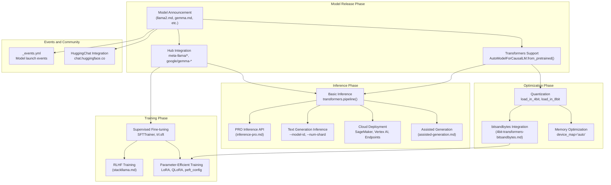

**LLM Content Workflow**

This diagram shows how blog content covers the complete LLM lifecycle from release to deployment and training.

Sources: [llama2.md:1-242](), [inference-pro.md:1-342](), [4bit-transformers-bitsandbytes.md:1-459](), [stackllama.md:1-291](), [assisted-generation.md:1-351](), [_events.yml:1-324]()

## Model Integration Patterns

### Transformers Integration

All documented LLM releases follow a consistent integration pattern with the `transformers` library. The basic loading pattern uses `AutoModelForCausalLM` and `AutoTokenizer`:

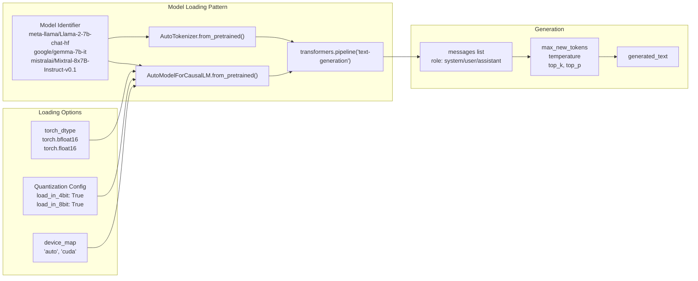

**Standard LLM Loading and Generation Pattern**

Sources: [llama2.md:84-126](), [gemma.md:104-167](), [llama3.md:99-176](), [mixtral.md:123-164]()

### Prompt Format Specifications

Each model family uses a specific prompt template that must be followed for effective instruction following. The blog posts document these formats:

| Model Family | Prompt Format Key Tokens | Template Location |
|--------------|--------------------------|-------------------|
| Llama 2 | `<s>[INST] <<SYS>>`, `<</SYS>>`, `[/INST]` | llama2.md:184-220 |
| Llama 3 | `<\|begin_of_text\|>`, `<\|start_header_id\|>`, `<\|end_header_id\|>`, `<\|eot_id\|>` | llama3.md:80-89 |
| Gemma | `<start_of_turn>user`, `<end_of_turn>`, `<start_of_turn>model` | gemma.md:76-91 |
| Mixtral | `<s> [INST]`, `[/INST]` | mixtral.md:87-95 |

The chat templates are accessible via `tokenizer.apply_chat_template()` in transformers for automatic formatting.

Sources: [llama2.md:178-226](), [llama3.md:77-92](), [gemma.md:76-91](), [mixtral.md:87-95]()

## Deployment Infrastructure

### Inference Options

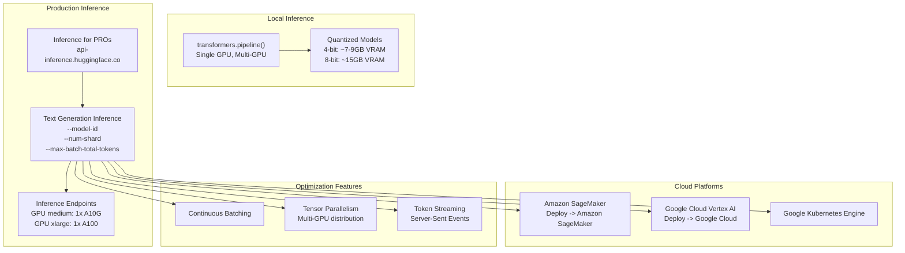

**Inference Deployment Options**

Sources: [llama2.md:139-152](), [inference-pro.md:37-324](), [gemma.md:199-221](), [falcon.md:142-203]()

### PRO Inference API Models

The `inference-pro.md` document details curated models available through the PRO subscription. These models use Text Generation Inference as the backend:

- `meta-llama/Meta-Llama-3-8B-Instruct` (8k context)
- `meta-llama/Meta-Llama-3-70B-Instruct` (8k context)
- `mistralai/Mixtral-8x7B-Instruct-v0.1` (32k context)
- `mistralai/Mistral-7B-Instruct-v0.2` (32k context)
- `codellama/CodeLlama-34b-Instruct-hf` (16k context)
- `stabilityai/stable-diffusion-xl-base-1.0` (image generation)

API endpoint pattern: `https://api-inference.huggingface.co/models/{model_id}`

Sources: [inference-pro.md:37-53](), [inference-pro.md:56-86]()

## Training and Fine-tuning Approaches

### Parameter-Efficient Fine-Tuning

The blog extensively covers PEFT methods, particularly QLoRA (4-bit quantization + LoRA):

```mermaid
graph TB
    subgraph "QLoRA Components"
        BaseModel["Base Model<br/>load_in_4bit=True<br/>bnb_4bit_compute_dtype"]
        LoRAConfig["LoraConfig<br/>r=16, lora_alpha=32<br/>target_modules"]
        PEFTModel["get_peft_model()"]
    end
    
    subgraph "Training Setup"
        SFTTrainer["SFTTrainer<br/>(trl library)"]
        Dataset["Training Dataset<br/>OpenAssistant/oasst_top1"]
        TrainingArgs["per_device_train_batch_size<br/>gradient_accumulation_steps<br/>learning_rate"]
    end
    
    subgraph "Memory Optimization"
        Quantization["4-bit NormalFloat<br/>bitsandbytes"]
        GradientCheckpoint["gradient_checkpointing"]
        PagedOptimizer["Paged Optimizers"]
    end
    
    subgraph "Output"
        Adapters["LoRA Adapters<br/>~65MB for 7B model"]
        MergedModel["Optional: Merge Adapters<br/>Full fine-tuned model"]
    end
    
    BaseModel --> PEFTModel
    LoRAConfig --> PEFTModel
    
    PEFTModel --> SFTTrainer
    Dataset --> SFTTrainer
    TrainingArgs --> SFTTrainer
    
    Quantization --> BaseModel
    GradientCheckpoint --> SFTTrainer
    PagedOptimizer --> SFTTrainer
    
    SFTTrainer --> Adapters
    Adapters --> MergedModel
```

**QLoRA Fine-tuning Architecture**

The typical command pattern for QLoRA fine-tuning:

```bash
accelerate launch --num_processes=1 examples/scripts/sft.py \
  --model_name_or_path meta-llama/Llama-2-7b-hf \
  --dataset_name timdettmers/openassistant-guanaco \
  --load_in_4bit \
  --use_peft \
  --batch_size 4 \
  --gradient_accumulation_steps 2
```

Sources: [llama2.md:153-177](), [gemma.md:223-277](), [falcon.md:240-293](), [mixtral.md:186-218](), [4bit-transformers-bitsandbytes.md:1-459]()

### RLHF Training Pipeline

The StackLLaMA example ([stackllama.md:1-291]()) demonstrates the complete RLHF pipeline:

```mermaid
graph TB
    subgraph "Phase 1: Supervised Fine-tuning"
        BaseModel["LLaMA Base Model<br/>7B parameters"]
        SFTData["Stack Exchange Dataset<br/>ConstantLengthDataset"]
        SFTModel["SFT Model<br/>Causal LM objective"]
    end
    
    subgraph "Phase 2: Reward Modeling"
        PairedData["Preference Pairs<br/>(y_j preferred over y_k)"]
        RewardTrainer["RewardTrainer<br/>Custom loss function"]
        RewardModel["Reward Model<br/>Scores generations"]
    end
    
    subgraph "Phase 3: RL Training"
        PPOTrainer["PPOTrainer<br/>Policy optimization"]
        KLPenalty["KL Divergence Penalty<br/>vs reference model"]
        RLModel["RL-tuned Model<br/>StackLLaMA"]
    end
    
    subgraph "Memory Efficiency"
        Load8bit["load_in_8bit=True"]
        LoRAAdapters["LoRA Adapters<br/>trainable parameters"]
        FrozenBase["Frozen Base Model<br/>Shared weights"]
    end
    
    BaseModel --> SFTData
    SFTData --> SFTModel
    
    SFTModel --> PairedData
    PairedData --> RewardTrainer
    RewardTrainer --> RewardModel
    
    SFTModel --> PPOTrainer
    RewardModel --> PPOTrainer
    PPOTrainer --> KLPenalty
    PPOTrainer --> RLModel
    
    Load8bit --> BaseModel
    LoRAAdapters --> SFTModel
    LoRAAdapters --> PPOTrainer
    FrozenBase --> PPOTrainer
```

**RLHF Training Pipeline for StackLLaMA**

Key code references:
- SFT training with packing: [stackllama.md:78-111]()
- Reward model training: [stackllama.md:117-157]()
- PPO training loop: [stackllama.md:159-212]()

Sources: [stackllama.md:1-291]()

## Quantization and Optimization

### Quantization Methods

The repository documents several quantization approaches:

| Method | Precision | Memory Reduction | Loading Code |
|--------|-----------|------------------|--------------|
| bitsandbytes 8-bit | INT8 | ~2x | `load_in_8bit=True` |
| bitsandbytes 4-bit | NF4/FP4 | ~4x | `load_in_4bit=True` |
| GPTQ | INT4 | ~4x | `GPTQConfig(bits=4)` |

For a 7B parameter model:
- FP16: ~14GB VRAM
- INT8: ~7GB VRAM  
- INT4: ~3.5GB VRAM

Typical 4-bit loading configuration:

```python
from transformers import BitsAndBytesConfig

quantization_config = BitsAndBytesConfig(
    load_in_4bit=True,
    bnb_4bit_compute_dtype=torch.float16,
    bnb_4bit_use_double_quant=True,
    bnb_4bit_quant_type="nf4"
)
```

Sources: [4bit-transformers-bitsandbytes.md:82-459](), [llama2.md:84-97](), [falcon.md:142-173](), [mixtral.md:219-285]()

### Assisted Generation

Assisted generation ([assisted-generation.md:1-351]()) reduces latency by using a smaller "assistant" model to propose candidate tokens that the main model validates in parallel:

```mermaid
graph LR
    subgraph "Standard Generation"
        Prompt1["Prompt"] --> Forward1["Model Forward"]
        Forward1 --> Token1["1 Token"]
        Token1 --> Forward2["Model Forward"]
        Forward2 --> Token2["1 Token"]
    end
    
    subgraph "Assisted Generation"
        Prompt2["Prompt"] --> Assistant["Assistant Model<br/>Generate N candidates"]
        Assistant --> Validation["Main Model<br/>Validate all N in parallel"]
        Validation --> Accepted["Accept K tokens<br/>(K ≤ N)"]
    end
```

**Standard vs Assisted Generation**

Configuration:
```python
assistant_model = AutoModelForCausalLM.from_pretrained("assistant-model-id")
outputs = model.generate(
    input_ids,
    assistant_model=assistant_model,
    do_sample=True
)
```

Can achieve up to 10x speedup on commodity hardware for specific use cases.

Sources: [assisted-generation.md:1-351]()

## Event and Release Tracking

The `_events.yml` file ([_events.yml:1-324]()) tracks major LLM-related events:

- Model launches: Llama 2 (line 19), Falcon (line 29), diffusion models (line 131)
- Technical workshops and webinars
- Community events and reading groups
- Live demos and announcements (HuggingCast series)

Events link directly to model releases and provide historical context for major open-source LLM milestones.

Sources: [_events.yml:1-324]()

## Key Integration Points

### Hugging Face Hub Model Identifiers

All documented models follow the Hub namespace pattern:

- Llama models: `meta-llama/Llama-2-{size}b-{variant}-hf` or `meta-llama/Meta-Llama-3-{size}B-{variant}`
- Gemma models: `google/gemma-{size}b` or `google/gemma-{size}b-it`
- Falcon models: `tiiuae/falcon-{size}b` or `tiiuae/falcon-{size}b-instruct`
- Mixtral models: `mistralai/Mixtral-8x7B-{variant}-v0.1`

### Common Configuration Parameters

Across all blog posts, these parameters appear consistently:

**Generation parameters:**
- `max_new_tokens`: Maximum tokens to generate
- `temperature`: Sampling randomness (0.0-1.0)
- `top_k`, `top_p`: Nucleus sampling parameters
- `do_sample`: Enable sampling vs greedy decoding
- `eos_token_id`: End-of-sequence token(s)

**Loading parameters:**
- `torch_dtype`: Model precision (torch.float16, torch.bfloat16)
- `device_map`: Device placement strategy ("auto", "cuda", manual mapping)
- `load_in_4bit`/`load_in_8bit`: Quantization flags
- `trust_remote_code`: Allow custom model code (required for some models)

**Training parameters:**
- `per_device_train_batch_size`: Batch size per GPU
- `gradient_accumulation_steps`: Gradient accumulation for effective batch size
- `learning_rate`: Optimizer learning rate (typically 1e-5 to 2e-4 for fine-tuning)
- `num_train_epochs`: Training epochs

Sources: [llama2.md:115-135](), [gemma.md:136-165](), [mixtral.md:141-163](), [inference-pro.md:240-282]()

---

# Page: Open-Weight LLM Families

# Open-Weight LLM Families

<details>
<summary>Relevant source files</summary>

The following files were used as context for generating this wiki page:

- [4bit-transformers-bitsandbytes.md](4bit-transformers-bitsandbytes.md)
- [_events.yml](_events.yml)
- [accelerate-deepspeed.md](accelerate-deepspeed.md)
- [assets/138_stackllama/thumbnail.png](assets/138_stackllama/thumbnail.png)
- [assets/147_falcon/falcon_thumbnail.jpg](assets/147_falcon/falcon_thumbnail.jpg)
- [assets/83_accelerate_deepspeed/chatbot.png](assets/83_accelerate_deepspeed/chatbot.png)
- [assets/83_accelerate_deepspeed/cls_run.png](assets/83_accelerate_deepspeed/cls_run.png)
- [assets/83_accelerate_deepspeed/deepspeed-thumbnail.png](assets/83_accelerate_deepspeed/deepspeed-thumbnail.png)
- [assets/98_spaces_3dmoljs/thumbnail.png](assets/98_spaces_3dmoljs/thumbnail.png)
- [assets/assisted-generation/thumbnail.png](assets/assisted-generation/thumbnail.png)
- [assets/diffusion-models-event/thumbnail.png](assets/diffusion-models-event/thumbnail.png)
- [assets/gemma/Gemma-logo-small.png](assets/gemma/Gemma-logo-small.png)
- [assets/gemma/gcp-deploy.png](assets/gemma/gcp-deploy.png)
- [assets/gemma/gcp-train-gemma.png](assets/gemma/gcp-train-gemma.png)
- [assets/gemma/thumbnail.jpg](assets/gemma/thumbnail.jpg)
- [assets/inference_pro/thumbnail.png](assets/inference_pro/thumbnail.png)
- [assets/instruction_tuning_sd/thumbnail.png](assets/instruction_tuning_sd/thumbnail.png)
- [assets/llama2/thumbnail.jpg](assets/llama2/thumbnail.jpg)
- [assets/llama3/thumbnail.jpg](assets/llama3/thumbnail.jpg)
- [assets/mixtral/thumbnail.jpg](assets/mixtral/thumbnail.jpg)
- [assisted-generation.md](assisted-generation.md)
- [diffusion-models-event.md](diffusion-models-event.md)
- [falcon.md](falcon.md)
- [gemma.md](gemma.md)
- [inference-pro.md](inference-pro.md)
- [instruction-tuning-sd.md](instruction-tuning-sd.md)
- [llama2.md](llama2.md)
- [llama3.md](llama3.md)
- [mixtral.md](mixtral.md)
- [spaces_3dmoljs.md](spaces_3dmoljs.md)
- [stackllama.md](stackllama.md)
- [zh/Llama2-for-non-engineers.md](zh/Llama2-for-non-engineers.md)
- [zh/gemma.md](zh/gemma.md)
- [zh/huggy-lingo.md](zh/huggy-lingo.md)
- [zh/llama3.md](zh/llama3.md)
- [zh/mixtral.md](zh/mixtral.md)

</details>


This document provides a comprehensive overview of major open-weight Large Language Model (LLM) families, including their architectures, sizes, capabilities, and integration within the Hugging Face ecosystem. It covers Meta's Llama models, Google's Gemma models, and Mistral AI's Mixtral models, focusing on their technical specifications, performance characteristics, and use patterns.

For information about specialized Code LLMs, see [Code LLMs](#2.2).

## Key Open-Weight LLM Families

Open-weight LLMs are models whose weights are publicly available for research and commercial applications, under various licenses. The major families covered in this document include:

```mermaid
graph TB
    subgraph "Main Open-Weight LLM Families"
        Llama["Meta's Llama Family"]
        Gemma["Google's Gemma Family"]
        Mixtral["Mistral's Mixtral Family"]
    end
    
    Llama --> Llama2["Llama 2 (7B, 13B, 70B)"]
    Llama --> Llama3["Llama 3 (8B, 70B)"]
    
    Gemma --> Gemma1["Gemma 1 (2B, 7B)"]
    Gemma --> Gemma2["Gemma 2 (9B, 27B)"]
    Gemma --> Gemma3["Gemma 3 (1B, 4B, 12B, 27B)"]
    
    Mixtral --> Mixtral8x7B["Mixtral 8x7B"]
    Mixtral --> Mixtral8x22B["Mixtral 8x22B"]
    
    style Llama fill:#f9f9f9,stroke:#333,stroke-width:2px
    style Gemma fill:#f9f9f9,stroke:#333,stroke-width:2px
    style Mixtral fill:#f9f9f9,stroke:#333,stroke-width:2px
```

Sources: [gemma3.md](gemma3.md), [gemma.md](gemma.md), [llama3.md](llama3.md), [mixtral.md](mixtral.md)

## Meta's Llama Family

Meta's Llama models are a series of powerful open-weight language models that have advanced the state of open AI. The family includes Llama 2 and Llama 3, each available in various sizes.

### Llama 3

Llama 3 represents Meta's latest iteration in the Llama series, released with significant improvements over Llama 2:

- **Available Variants**:
  - Base models: 8B and 70B parameters
  - Instruction-tuned models: 8B-Instruct and 70B-Instruct
  - Llama Guard 2 (safety-focused model fine-tuned on Llama 3 8B)

- **Key Features**:
  - Expanded vocabulary size (128,256 tokens vs. 32K in Llama 2)
  - 8K token context window
  - Grouped-Query Attention (GQA) for efficient processing
  - Trained on 15 trillion tokens (8x more data than Llama 2)
  - Strong multilingual capabilities

- **Chat Format**:
  ```
  <|begin_of_text|><|start_header_id|>system<|end_header_id|>
  
  {{ system_prompt }}<|eot_id|><|start_header_id|>user<|end_header_id|>
  
  {{ user_msg_1 }}<|eot_id|><|start_header_id|>assistant<|end_header_id|>
  
  {{ model_answer_1 }}<|eot_id|>
  ```

- **Performance**: Llama 3 70B demonstrates significant improvements over Llama 2, with the 70B model achieving a leaderboard score of 26.37 compared to Llama 2 70B's 18.25.

Sources: [llama3.md:39-56](llama3.md), [llama3.md:77-91](llama3.md)

### Llama 2

The predecessor to Llama 3, Llama 2 provides solid performance while requiring fewer computational resources:

- **Available Variants**:
  - Base models: 7B, 13B, and 70B parameters
  - Chat (instruction-tuned) models for all sizes

- **Licensing**: Llama 2 license allows for commercial use with relatively permissive terms.

- **Benchmark Performance**: On the Open LLM Leaderboard, Llama 2 70B achieved a score of 18.25, while the 7B version scored 8.72.

Sources: [llama3.md:60-72](llama3.md)

## Google's Gemma Family

Google's Gemma models are a series of state-of-the-art LLMs designed for efficient deployment across various hardware platforms. The family has evolved through multiple generations with Gemma 3 being the latest release.

### Gemma 3

Gemma 3 represents Google's latest multimodal, multilingual LLM:

- **Available Variants**:
  - 1B: Text-only, English, 32K context window
  - 4B, 12B, 27B: Multimodal (text and images), 140+ languages, 128K context window
  - Both pre-trained (PT) and instruction-tuned (IT) versions available

- **Key Features**:
  - Multimodal capabilities (image + text) using SigLIP vision encoder
  - Bidirectional attention for image tokens
  - Extended context window (32K for 1B, 128K for others)
  - Improved multilingualism with double the amount of multilingual data
  - Enhanced tokenizer (262K entries) optimized for Chinese, Japanese, and Korean

- **Technical Enhancements**:
  - Positional embeddings improved with RoPE base frequency upgraded from 10K to 1M
  - KV Cache optimization with sliding window interleaved attention
  - "Pan and scan" algorithm for processing images during inference

- **Performance**: Gemma 3 27B-IT outperforms Gemma 2 27B-IT and competes with Gemini 1.5-Pro across benchmarks, achieving an LMSys Elo score of 1339.

Sources: [gemma3.md:14-45](gemma3.md), [gemma3.md:50-82](gemma3.md), [gemma3.md:89-99](gemma3.md)

### Gemma (1st Generation)

The first generation of Google's Gemma models:

- **Available Variants**:
  - 2B and 7B parameter models
  - Both base and instruction-tuned versions

- **Performance**: Gemma 7B shows strong performance comparable to Mistral 7B, while Gemma 2B provides decent performance for its size.

- **Prompt Format**:
  ```
  <start_of_turn>user
  knock knock<end_of_turn>
  <start_of_turn>model
  who is there<end_of_turn>
  <start_of_turn>user
  LaMDA<end_of_turn>
  <start_of_turn>model
  LaMDA who?<end_of_turn>
  ```

Sources: [gemma.md:16-48](gemma.md), [gemma.md:74-90](gemma.md)

## Mistral's Mixtral Family

Mixtral represents an innovative approach to LLMs using Mixture of Experts (MoE) architecture, developed by Mistral AI.

### Architecture: Mixture of Experts

```mermaid
graph TD
    subgraph "Standard Transformer"
        InputS["Input"] --> AttentionS["Attention Layers"]
        AttentionS --> FFNS["Feed-Forward Network"]
        FFNS --> OutputS["Output"]
    end
    
    subgraph "Mixture of Experts (MoE)"
        Input["Input"] --> Attention["Attention Layers"]
        Attention --> Router["Router Network"]
        Router --> |Routes tokens| Experts["Multiple Expert FFNs"]
        Router --> |"Selects 2 experts per token"| Gate["Gating Mechanism"]
        Experts --> Gate
        Gate --> Output["Output"]
    end
    
    subgraph "Mixtral 8x7B Structure"
        MixInput["Input"] --> MixAttention["Attention Block"]
        MixAttention --> MixRouter["Router"]
        MixRouter --> |"Routes to"| Expert1["Expert 1"]
        MixRouter --> |"Routes to"| Expert2["Expert 2"]
        MixRouter --> |"Routes to"| Expert8["Expert 8"]
        Expert1 --> MixCombiner["Weighted Combination"]
        Expert2 --> MixCombiner
        Expert8 --> MixCombiner
        MixCombiner --> MixOutput["Output"]
    end
```

Sources: [mixtral.md:46-48](mixtral.md), [mixtral.md:84-93](mixtral.md)

### Mixtral 8x7B

- **Architecture**: Contains 8 "expert" models, where each token is processed by the 2 most relevant experts
- **Effective Parameters**: ~45B parameters total, but computes at the speed of a 12B parameter model
- **Context Length**: 32K tokens
- **Language Support**: English, French, German, Spanish, and Italian
- **Capabilities**: Strong coding abilities (40.2% on HumanEval)
- **Licensing**: Apache 2.0 license, commercially permissive

- **Prompt Format**:
  ```
  <s> [INST] User Instruction 1 [/INST] Model answer 1</s> [INST] User instruction 2[/INST]
  ```

- **Performance**: The instruction-tuned version outperforms all other open-access models on MT-Bench with a score of 8.30, comparable to GPT-3.5.

Sources: [mixtral.md:44-88](mixtral.md), [mixtral.md:92-102](mixtral.md)

## Performance Comparison

The following table provides a comparative overview of the performance of major open-weight LLM families:

| Model | Parameters | Context Length | Benchmark Score | Commercial Use | License |
|-------|------------|----------------|----------------|----------------|---------|
| Llama 3 70B | 70B | 8K | 26.37 (Leaderboard) | ✅ | Llama 3 license |
| Llama 3 8B | 8B | 8K | 13.41 (Leaderboard) | ✅ | Llama 3 license |
| Mixtral 8x7B | ~45B effective | 32K | 68.42 (Leaderboard) | ✅ | Apache 2.0 |
| Gemma 3 27B | 27B | 128K | 1339 (LMSys Elo) | ✅ | Gemma license |
| Gemma 3 12B | 12B | 128K | - | ✅ | Gemma license |
| Gemma 7B | 7B | 8K | 63.75 (Leaderboard) | ✅ | Gemma license |
| Llama 2 70B | 70B | 4K | 18.25 (Leaderboard) | ✅ | Llama 2 license |
| Llama 2 7B | 7B | 4K | 8.72 (Leaderboard) | ✅ | Llama 2 license |

Note: Different benchmark metrics are used across models, making direct comparisons challenging.

Sources: [llama3.md:60-72](llama3.md), [gemma3.md:89-99](gemma3.md), [mixtral.md:59-88](mixtral.md)

## Integration with Hugging Face Ecosystem

The Hugging Face ecosystem provides comprehensive support for these open-weight LLM families, enabling easy loading, inference, fine-tuning, and deployment.

```mermaid
graph TD
    subgraph "Hugging Face Ecosystem Integration"
        Models["Open-Weight LLM Models"] --> Transformers["🤗 Transformers Library"]
        Models --> TGI["Text Generation Inference"]
        
        Transformers --> Tokenizers["Tokenization"]
        Transformers --> Generation["Text Generation"]
        Transformers --> Quantization["Model Quantization"]
        
        Transformers --> TRL["🤗 TRL"]
        TRL --> SFT["Supervised Fine-Tuning"]
        TRL --> RLHF["RLHF/DPO Training"]
        
        TGI --> Endpoints["Inference Endpoints"]
        TGI --> CloudDeploy["Cloud Deployment"]
        TGI --> DockerDeploy["Docker Deployment"]
        
        Quantization --> GPTQ["GPTQ"]
        Quantization --> QLoRA["QLoRA"]
        Quantization --> BitsAndBytes["4-bit/8-bit Quantization"]
    end
```

### Loading and Inference

All the open-weight LLM families can be loaded using the Transformers library:

```python
from transformers import AutoTokenizer, AutoModelForCausalLM
import torch

# Example for loading Llama 3
model_id = "meta-llama/Meta-Llama-3-8B"
tokenizer = AutoTokenizer.from_pretrained(model_id)
model = AutoModelForCausalLM.from_pretrained(
    model_id, 
    torch_dtype=torch.bfloat16, 
    device_map="auto"
)

# For Mixtral models
# from transformers import MixtralForCausalLM
# model = MixtralForCausalLM.from_pretrained("mistralai/Mixtral-8x7B-v0.1")

# For Gemma 3
# from transformers import Gemma3ForCausalLM, Gemma3ForConditionalGeneration
# model = Gemma3ForCausalLM.from_pretrained("google/gemma-3-7b")
# model_multimodal = Gemma3ForConditionalGeneration.from_pretrained("google/gemma-3-4b-it")
```

Sources: [llama3.md:110-147](llama3.md), [gemma3.md:101-144](gemma3.md), [mixtral.md:143-167](mixtral.md)

### Model Quantization

For efficient deployment on consumer hardware, all models support various quantization methods:

- **4-bit Quantization**: Reduces memory requirements by ~75% compared to FP16
- **GPTQ**: Post-training quantization with calibration
- **QLoRA**: For fine-tuning quantized models

```python
# 4-bit quantization example
from transformers import BitsAndBytesConfig

quantization_config = BitsAndBytesConfig(
    load_in_4bit=True,
    bnb_4bit_compute_dtype=torch.float16
)

model = AutoModelForCausalLM.from_pretrained(
    model_id,
    quantization_config=quantization_config,
    device_map="auto"
)
```

Sources: [llama3.md:159-173](llama3.md), [mixtral.md:219-263](mixtral.md), [gemma3.md:106-107](gemma3.md)

### Fine-tuning

The TRL library provides easy fine-tuning capabilities:

```bash
# Example TRL command for SFT fine-tuning
trl sft \
--model_name_or_path meta-llama/Meta-Llama-3-8B \
--dataset_name HuggingFaceH4/no_robots \
--learning_rate 0.0001 \
--per_device_train_batch_size 4 \
--max_seq_length 2048 \
--output_dir ./llama3-sft \
--use_peft \
--load_in_4bit \
--gradient_checkpointing
```

Sources: [llama3.md:221-257](llama3.md), [mixtral.md:185-215](mixtral.md), [gemma.md:224-267](gemma.md)

### Deployment Options

Multiple deployment options are available:

1. **Text Generation Inference (TGI)**: Production-ready inference container with continuous batching and tensor parallelism
2. **Inference Endpoints**: Managed deployment service for production applications
3. **Cloud Provider Integrations**: Native integrations with AWS SageMaker, Google Cloud Vertex AI
4. **On-device Solutions**: MLX for Apple Silicon, llama.cpp for optimized CPU inference

Sources: [gemma3.md:262-307](gemma3.md), [llama3.md:177-201](llama3.md), [mixtral.md:166-190](mixtral.md)

## Specialized Capabilities

Each LLM family has unique strengths that make them suitable for different applications:

- **Llama 3**: Strong general performance, balanced with good multilingual capabilities
- **Gemma 3**: Multimodal capabilities with image understanding, strong multilingual support, and long context windows (up to 128K tokens)
- **Mixtral**: Efficient computation with MoE architecture, strong multilingual and coding abilities

The selection of an appropriate model depends on the specific requirements of your application, including computational resources, context length needs, and multimodal capabilities.

Sources: [gemma3.md:33-44](gemma3.md), [llama3.md:39-56](llama3.md), [mixtral.md:44-65](mixtral.md)

---

# Page: Training and Fine-tuning LLMs

# Training and Fine-tuning LLMs

<details>
<summary>Relevant source files</summary>

The following files were used as context for generating this wiki page:

- [assets/03_reformer/thumbnail.png](assets/03_reformer/thumbnail.png)
- [assets/04_pytorch_block_sparse/thumbnail.png](assets/04_pytorch_block_sparse/thumbnail.png)
- [assets/05_encoder_decoder/thumbnail.png](assets/05_encoder_decoder/thumbnail.png)
- [assets/07_porting_fsmt/thumbnail.png](assets/07_porting_fsmt/thumbnail.png)
- [assets/08_warm_starting_encoder_decoder/thumbnail.png](assets/08_warm_starting_encoder_decoder/thumbnail.png)
- [assets/gemma/Gemma-logo-small.png](assets/gemma/Gemma-logo-small.png)
- [assets/gemma/gcp-deploy.png](assets/gemma/gcp-deploy.png)
- [assets/gemma/gcp-train-gemma.png](assets/gemma/gcp-train-gemma.png)
- [assets/gemma/thumbnail.jpg](assets/gemma/thumbnail.jpg)
- [assets/llama3/thumbnail.jpg](assets/llama3/thumbnail.jpg)
- [assets/mixtral/thumbnail.jpg](assets/mixtral/thumbnail.jpg)
- [encoder-decoder.md](encoder-decoder.md)
- [gemma.md](gemma.md)
- [how-to-generate.md](how-to-generate.md)
- [how-to-train.md](how-to-train.md)
- [llama3.md](llama3.md)
- [mixtral.md](mixtral.md)
- [notebooks/03_reformer.ipynb](notebooks/03_reformer.ipynb)
- [notebooks/05_encoder_decoder.ipynb](notebooks/05_encoder_decoder.ipynb)
- [notebooks/08_warm_starting_encoder_decoder.ipynb](notebooks/08_warm_starting_encoder_decoder.ipynb)
- [pytorch_block_sparse.md](pytorch_block_sparse.md)
- [reformer.md](reformer.md)
- [warm-starting-encoder-decoder.md](warm-starting-encoder-decoder.md)
- [zh/Llama2-for-non-engineers.md](zh/Llama2-for-non-engineers.md)
- [zh/gemma.md](zh/gemma.md)
- [zh/huggy-lingo.md](zh/huggy-lingo.md)
- [zh/llama3.md](zh/llama3.md)
- [zh/mixtral.md](zh/mixtral.md)

</details>


## Purpose and Scope

This document covers the techniques and practical implementations for training large language models (LLMs) from scratch and fine-tuning pre-trained models on specific tasks. It focuses on the `transformers` and `trl` libraries' approaches to model training, including:

- Training new language models from scratch with custom tokenizers
- Fine-tuning pre-trained models using supervised fine-tuning (SFT)
- Parameter-efficient fine-tuning techniques (PEFT, LoRA, QLoRA)
- Warm-starting encoder-decoder models from pre-trained checkpoints
- Memory optimization techniques for training on consumer hardware

For deploying trained models, see [Model Deployment and Inference](#5). For specific reinforcement learning techniques like RLHF and DPO, see [Reinforcement Learning from Human Feedback](#4.3). For distributed training strategies, see [Distributed Training](#4.4).

## Training Language Models from Scratch

Training a language model from scratch involves two main phases: tokenizer training and model pre-training.

### Tokenizer Training

The first step is training a custom tokenizer optimized for the target language or domain. The `tokenizers` library provides efficient implementations of various tokenization algorithms.

```mermaid
graph TB
    RawText["Raw Text Corpus<br/>(e.g., OSCAR, Leipzig)"]
    ByteLevelBPE["ByteLevelBPETokenizer"]
    VocabFile["vocab.json"]
    MergesFile["merges.txt"]
    TrainedTokenizer["Trained Tokenizer"]
    
    RawText --> ByteLevelBPE
    ByteLevelBPE --> VocabFile
    ByteLevelBPE --> MergesFile
    VocabFile --> TrainedTokenizer
    MergesFile --> TrainedTokenizer
    
    ByteLevelBPE -.parameters.-> VocabSize["vocab_size<br/>min_frequency<br/>special_tokens"]
```

**Sources:** [how-to-train.md:42-111]()

The tokenizer training process uses `ByteLevelBPETokenizer` which builds vocabulary from single bytes, ensuring all words are decomposable without unknown tokens. Key configuration parameters include:

- **vocab_size**: Target vocabulary size (e.g., 52,000)
- **min_frequency**: Minimum token frequency threshold
- **special_tokens**: Model-specific tokens like `<s>`, `<pad>`, `</s>`, `<unk>`, `<mask>`

The training produces two artifacts: `vocab.json` containing ranked tokens by frequency, and `merges.txt` listing learned byte-pair merges.

**Sources:** [how-to-train.md:48-111]()

### Model Pre-training

Pre-training involves training the model on a large corpus using self-supervised objectives like masked language modeling (MLM) or causal language modeling (CLM).

```mermaid
graph TB
    subgraph "Training Pipeline"
        Dataset["EsperantoDataset<br/>(custom Dataset class)"]
        Tokenizer["ByteLevelBPETokenizer"]
        Model["RobertaConfig +<br/>RobertaForMaskedLM"]
        Trainer["Trainer"]
        
        Dataset --> Tokenizer
        Tokenizer --> TokenizedData["Tokenized Sequences<br/>(max_length=512)"]
        TokenizedData --> Model
        Model --> Trainer
    end
    
    subgraph "Configuration"
        HyperParams["Hyperparameters<br/>learning_rate: 1e-4<br/>num_train_epochs: 5<br/>per_gpu_train_batch_size: 16"]
        ModelConfig["Model Config<br/>vocab_size: 52000<br/>hidden_size: 768<br/>num_layers: 6<br/>num_attention_heads: 12"]
    end
    
    HyperParams --> Trainer
    ModelConfig --> Model
```

**Sources:** [how-to-train.md:139-216](), [encoder-decoder.md:143-147]()

The training process uses:

1. **Custom Dataset**: Implements `torch.utils.data.Dataset` to load and tokenize text files on-the-fly or as preprocessing
2. **Model Architecture**: RoBERTa-like models for masked language modeling, or GPT-like models for causal language modeling
3. **Training Script**: `run_language_modeling.py` handles the training loop with MLM objective
4. **Trainer API**: `transformers.Trainer` manages training, evaluation, and checkpointing

Key hyperparameters from the example:
- `--model_type roberta`
- `--mlm` (for masked language modeling)
- `--learning_rate 1e-4`
- `--num_train_epochs 5`
- `--per_gpu_train_batch_size 16`
- `--evaluate_during_training`

**Sources:** [how-to-train.md:143-216]()

### Validation and Testing

After pre-training, the model can be tested using `FillMaskPipeline` for MLM models or text generation for CLM models:

```mermaid
graph LR
    Model["Pre-trained Model"]
    Pipeline["pipeline('fill-mask')"]
    Input["'La suno <mask>.'"]
    Output["Predictions:<br/>brilis (0.25)<br/>lumis (0.10)<br/>brilas (0.04)"]
    
    Model --> Pipeline
    Input --> Pipeline
    Pipeline --> Output
```

**Sources:** [how-to-train.md:220-285]()

## Fine-tuning Pre-trained Models

Fine-tuning adapts pre-trained models to specific downstream tasks using labeled data. This section covers both full fine-tuning and parameter-efficient methods.

### Supervised Fine-tuning (SFT)

Supervised fine-tuning trains the model on task-specific examples to adapt its behavior.

```mermaid
graph TB
    PreTrained["Pre-trained Model<br/>(e.g., Llama-3-8B, Gemma-7B)"]
    Dataset["Task Dataset<br/>(e.g., OpenAssistant, no_robots)"]
    SFTTrainer["SFTTrainer<br/>(from TRL)"]
    FineTuned["Fine-tuned Model"]
    
    PreTrained --> SFTTrainer
    Dataset --> SFTTrainer
    SFTTrainer --> FineTuned
    
    Config["Training Config<br/>learning_rate<br/>batch_size<br/>max_seq_length<br/>gradient_accumulation_steps"]
    Config --> SFTTrainer
```

**Sources:** [llama3.md:221-258](), [gemma.md:244-276]()

The TRL library provides the `SFTTrainer` class which handles:
- Automatic dataset formatting (e.g., to chatml format)
- Integration with PEFT for efficient training
- Memory-efficient training configurations

Using the TRL CLI:

```bash
trl sft \
  --model_name_or_path meta-llama/Meta-Llama-3-8B \
  --dataset_name HuggingFaceH4/no_robots \
  --learning_rate 0.0001 \
  --per_device_train_batch_size 4 \
  --max_seq_length 2048 \
  --output_dir ./llama3-sft
```

**Sources:** [llama3.md:242-255]()

### Parameter-Efficient Fine-Tuning (PEFT)

PEFT techniques reduce memory requirements and training time by only updating a small subset of parameters.

```mermaid
graph TB
    subgraph "Full Fine-tuning"
        AllParams["Update All Parameters<br/>(~90GB for 70B model)"]
    end
    
    subgraph "PEFT Methods"
        LoRA["LoRA<br/>Low-Rank Adaptation<br/>Updates: q_proj, k_proj,<br/>v_proj, o_proj"]
        QLoRA["QLoRA<br/>LoRA + 4-bit Quantization<br/>Memory: ~23GB for 45B model"]
    end
    
    subgraph "Configuration"
        PEFTConfig["PEFT Config<br/>--use_peft<br/>--lora_r 16<br/>--lora_alpha 32<br/>--target_modules"]
        QuantConfig["Quantization Config<br/>--load_in_4bit<br/>bnb_4bit_compute_dtype"]
    end
    
    PEFTConfig --> LoRA
    QuantConfig --> QLoRA
    LoRA -.recommended.-> QLoRA
```

**Sources:** [mixtral.md:186-218](), [gemma.md:244-276](), [llama3.md:221-258]()

#### LoRA Configuration

LoRA adds trainable low-rank matrices to transformer layers:

- **lora_r**: Rank of update matrices (typically 8-64)
- **lora_alpha**: Scaling factor (typically 2× lora_r)
- **target_modules**: Which layers to adapt (attention projections: `q_proj`, `k_proj`, `v_proj`, `o_proj`)

**Important**: For Mixture-of-Experts models like Mixtral, do not target MLP layers as they are sparse and don't interact well with PEFT.

**Sources:** [mixtral.md:189-218]()

#### QLoRA Implementation

QLoRA combines LoRA with 4-bit quantization for extreme memory efficiency:

```bash
accelerate launch examples/scripts/sft.py \
  --model_name mistralai/Mixtral-8x7B-v0.1 \
  --dataset_name trl-lib/ultrachat_200k_chatml \
  --batch_size 2 \
  --learning_rate 2e-4 \
  --use_peft \
  --peft_lora_r 16 --peft_lora_alpha 32 \
  --target_modules q_proj k_proj v_proj o_proj \
  --load_in_4bit
```

**Sources:** [mixtral.md:200-215]()

This configuration enables fine-tuning large models on single consumer GPUs (e.g., A100 40GB).

### Task-Specific Fine-tuning

Fine-tuning can be adapted to various downstream tasks by using appropriate training scripts and objectives.

```mermaid
graph TB
    PreTrained["Pre-trained LM"]
    
    subgraph "Classification Tasks"
        NER["Token Classification<br/>(NER, POS tagging)<br/>run_ner.py"]
        Sentiment["Sequence Classification<br/>(Sentiment Analysis)"]
    end
    
    subgraph "Generation Tasks"
        Summarization["Summarization<br/>EncoderDecoderModel"]
        Translation["Translation<br/>EncoderDecoderModel"]
    end
    
    PreTrained --> NER
    PreTrained --> Sentiment
    PreTrained --> Summarization
    PreTrained --> Translation
    
    ClassHead["Classification Head<br/>(pooling + feed-forward)"]
    NER --> ClassHead
    Sentiment --> ClassHead
```

**Sources:** [how-to-train.md:287-327](), [warm-starting-encoder-decoder.md:1-66]()

Example for token classification (POS tagging):

The `run_ner.py` script can be used for any token classification task by formatting data in CoNLL-2003 format. The script:
- Loads the pre-trained model
- Adds a token classification head
- Fine-tunes on labeled sequences

**Sources:** [how-to-train.md:287-327]()

## Warm-starting Encoder-Decoder Models

Warm-starting leverages pre-trained encoder-only (e.g., BERT) or decoder-only (e.g., GPT-2) checkpoints to initialize encoder-decoder models, avoiding expensive pre-training from scratch.

```mermaid
graph TB
    subgraph "Pre-trained Checkpoints"
        BERT["BERT<br/>(encoder-only)"]
        GPT2["GPT-2<br/>(decoder-only)"]
        RoBERTa["RoBERTa<br/>(encoder-only)"]
    end
    
    subgraph "Warm-started Models"
        EncDec["EncoderDecoderModel"]
    end
    
    BERT -.encoder.-> EncDec
    RoBERTa -.encoder.-> EncDec
    GPT2 -.decoder.-> EncDec
    
    EncDec --> SeqToSeq["Sequence-to-Sequence Tasks<br/>Summarization<br/>Translation<br/>Sentence Paraphrasing"]
    
    Config["EncoderDecoderModel.from_encoder_decoder_pretrained<br/>encoder_pretrained_model_name_or_path<br/>decoder_pretrained_model_name_or_path"]
    Config --> EncDec
```

**Sources:** [warm-starting-encoder-decoder.md:34-66](), [encoder-decoder.md:331-537]()

### EncoderDecoderModel Framework

The `EncoderDecoderModel` class in transformers enables combining any pre-trained encoder and decoder:

```python
# Example: BERT encoder + GPT-2 decoder
from transformers import EncoderDecoderModel

model = EncoderDecoderModel.from_encoder_decoder_pretrained(
    encoder_pretrained_model_name_or_path="bert-base-uncased",
    decoder_pretrained_model_name_or_path="gpt2"
)
```

**Sources:** [warm-starting-encoder-decoder.md:48-66]()

This approach is effective for:
- **Summarization**: BERT/RoBERTa encoder + GPT-2 decoder
- **Translation**: Language-specific BERT encoder + GPT-2 decoder
- **Dialogue**: BERT encoder + DialoGPT decoder

The warm-started models achieve competitive results compared to fully pre-trained encoder-decoder models (T5, Pegasus, BART) at a fraction of the training cost.

**Sources:** [warm-starting-encoder-decoder.md:26-43]()

### Cross-Attention Initialization

When warm-starting, the cross-attention layers (which attend from decoder to encoder) must be randomly initialized since they don't exist in the standalone encoder/decoder models. The model requires fine-tuning to learn effective cross-attention patterns.

```mermaid
graph LR
    subgraph "Encoder Stack"
        EncSelfAttn["Self-Attention<br/>(from BERT)"]
        EncFFN["Feed-Forward<br/>(from BERT)"]
    end
    
    subgraph "Decoder Stack"
        DecSelfAttn["Self-Attention<br/>(from GPT-2)"]
        CrossAttn["Cross-Attention<br/>(randomly initialized)"]
        DecFFN["Feed-Forward<br/>(from GPT-2)"]
    end
    
    EncSelfAttn --> EncFFN
    DecSelfAttn --> CrossAttn
    CrossAttn --> DecFFN
    EncFFN -.keys,values.-> CrossAttn
```

**Sources:** [encoder-decoder.md:520-531](), [warm-starting-encoder-decoder.md:34-66]()

## Memory Optimization Techniques

Training and fine-tuning LLMs requires significant memory. Several techniques reduce memory requirements:

### Quantization

Quantization reduces precision of model weights and activations:

| Precision | Memory for 45B params | Supported by |
|-----------|----------------------|--------------|
| float16 | >90 GB | Native PyTorch |
| 8-bit | >45 GB | bitsandbytes |
| 4-bit | >23 GB | bitsandbytes |

**Sources:** [mixtral.md:114-121]()

Loading with 4-bit quantization:

```python
from transformers import AutoModelForCausalLM
import torch

model = AutoModelForCausalLM.from_pretrained(
    "mistralai/Mixtral-8x7B-Instruct-v0.1",
    torch_dtype=torch.float16,
    load_in_4bit=True,
    bnb_4bit_compute_dtype=torch.float16
)
```

**Sources:** [mixtral.md:226-236](), [gemma.md:154-164]()

### Gradient Checkpointing

Gradient checkpointing trades compute for memory by recomputing intermediate activations during backward pass instead of storing them:

```bash
trl sft \
  --gradient_checkpointing \
  --gradient_accumulation_steps 4
```

This enables training larger models or using larger batch sizes on the same hardware.

**Sources:** [llama3.md:242-255]()

### Mixed Precision Training

Using `bfloat16` or `float16` reduces memory footprint and speeds up training on modern GPUs:

```python
model = AutoModelForCausalLM.from_pretrained(
    model_id,
    torch_dtype=torch.bfloat16  # or torch.float16
)
```

**Sources:** [llama3.md:115-175](), [gemma.md:123-152]()

## Training Scripts and Tools

### Transformers Training Scripts

The transformers library provides production-ready training scripts:

- **run_language_modeling.py**: Pre-training with MLM or CLM objectives
- **run_ner.py**: Token classification fine-tuning
- **run_summarization.py**: Sequence-to-sequence fine-tuning

**Sources:** [how-to-train.md:143-216](), [how-to-train.md:287-327]()

### TRL Library

The TRL (Transformer Reinforcement Learning) library provides high-level interfaces for LLM fine-tuning:

```mermaid
graph TB
    subgraph "TRL Components"
        SFTTrainer["SFTTrainer<br/>(Supervised Fine-tuning)"]
        CLI["TRL CLI<br/>trl sft<br/>trl chat"]
        DataFormat["Dataset Formatters<br/>(chatml, conversation)"]
    end
    
    subgraph "Integration"
        PEFT["PEFT<br/>(LoRA, QLoRA)"]
        BNB["bitsandbytes<br/>(Quantization)"]
        Accelerate["accelerate<br/>(Multi-GPU)"]
    end
    
    SFTTrainer --> PEFT
    SFTTrainer --> BNB
    SFTTrainer --> Accelerate
    CLI --> SFTTrainer
    DataFormat --> SFTTrainer
```

**Sources:** [llama3.md:221-258](), [gemma.md:244-276](), [mixtral.md:186-218]()

Key features:
- **Automatic chat formatting**: Converts datasets to model-specific chat templates
- **PEFT integration**: Seamless LoRA/QLoRA support
- **Multi-GPU training**: Via accelerate library
- **CLI interface**: Simple command-line training without code

Example using TRL CLI:

```bash
trl sft \
  --model_name_or_path meta-llama/Meta-Llama-3-8B \
  --dataset_name HuggingFaceH4/no_robots \
  --learning_rate 0.0001 \
  --per_device_train_batch_size 4 \
  --max_seq_length 2048 \
  --output_dir ./llama3-sft \
  --use_peft \
  --load_in_4bit \
  --log_with wandb \
  --gradient_checkpointing
```

**Sources:** [llama3.md:242-255]()

### Trainer Configuration

The `Trainer` class provides extensive configuration options:

```mermaid
graph TB
    TrainingArgs["TrainingArguments"]
    
    subgraph "Core Settings"
        LR["learning_rate<br/>warmup_steps<br/>lr_scheduler_type"]
        Batch["per_device_train_batch_size<br/>gradient_accumulation_steps"]
        Epochs["num_train_epochs<br/>max_steps"]
    end
    
    subgraph "Optimization"
        GradCheck["gradient_checkpointing<br/>fp16 / bf16<br/>optim (adamw_torch)"]
    end
    
    subgraph "Logging & Saving"
        Save["save_steps<br/>save_total_limit<br/>logging_steps"]
        Eval["evaluation_strategy<br/>eval_steps"]
    end
    
    TrainingArgs --> LR
    TrainingArgs --> Batch
    TrainingArgs --> Epochs
    TrainingArgs --> GradCheck
    TrainingArgs --> Save
    TrainingArgs --> Eval
```

**Sources:** [how-to-train.md:191-216]()

## Best Practices

### Model Selection for Fine-tuning

When selecting models for fine-tuning:

1. **For Summarization/Translation**: Use warm-started encoder-decoder models (BERT→GPT-2) or pre-trained seq2seq models (T5, BART)
2. **For Chat/Instruction**: Use pre-trained causal LMs (Llama, Gemma, Mixtral) with SFT
3. **For Classification**: Use encoder models (BERT, RoBERTa) with classification head

**Sources:** [warm-starting-encoder-decoder.md:34-66](), [how-to-train.md:287-327]()

### Hyperparameter Guidelines

Based on successful training examples:

- **Learning Rate**: 1e-4 to 2e-4 for fine-tuning, 1e-4 for pre-training
- **Batch Size**: As large as GPU memory allows (use gradient accumulation if needed)
- **LoRA Rank**: 8-16 for most tasks, up to 64 for complex tasks
- **Sequence Length**: Match pre-training length or task requirements

**Sources:** [how-to-train.md:191-216](), [mixtral.md:200-218](), [llama3.md:242-255]()

### Training Monitoring

Monitor training progress using:

```python
# Enable evaluation during training
--evaluate_during_training
--logging_steps 10
--eval_steps 500

# Use TensorBoard for visualization
tensorboard dev upload --logdir runs
```

Key metrics to track:
- Training/validation loss convergence
- Perplexity (for language modeling)
- Task-specific metrics (accuracy, F1, BLEU, etc.)

**Sources:** [how-to-train.md:194-218]()

---

# Page: LLM Optimization and Quantization

# LLM Optimization

<details>
<summary>Relevant source files</summary>

The following files were used as context for generating this wiki page:

- [1_58_llm_extreme_quantization.md](1_58_llm_extreme_quantization.md)
- [4bit-transformers-bitsandbytes.md](4bit-transformers-bitsandbytes.md)
- [_blog.yml](_blog.yml)
- [_events.yml](_events.yml)
- [_tags.yml](_tags.yml)
- [accelerate-deepspeed.md](accelerate-deepspeed.md)
- [assets/138_stackllama/thumbnail.png](assets/138_stackllama/thumbnail.png)
- [assets/147_falcon/falcon_thumbnail.jpg](assets/147_falcon/falcon_thumbnail.jpg)
- [assets/192_pi0/new_thumbnail_pi0.001.png](assets/192_pi0/new_thumbnail_pi0.001.png)
- [assets/193_l2d/lerobot-driver.gif](assets/193_l2d/lerobot-driver.gif)
- [assets/1_58_llm_extreme_quantization/thumbnail.png](assets/1_58_llm_extreme_quantization/thumbnail.png)
- [assets/83_accelerate_deepspeed/chatbot.png](assets/83_accelerate_deepspeed/chatbot.png)
- [assets/83_accelerate_deepspeed/cls_run.png](assets/83_accelerate_deepspeed/cls_run.png)
- [assets/83_accelerate_deepspeed/deepspeed-thumbnail.png](assets/83_accelerate_deepspeed/deepspeed-thumbnail.png)
- [assets/98_spaces_3dmoljs/thumbnail.png](assets/98_spaces_3dmoljs/thumbnail.png)
- [assets/assisted-generation/thumbnail.png](assets/assisted-generation/thumbnail.png)
- [assets/diffusion-models-event/thumbnail.png](assets/diffusion-models-event/thumbnail.png)
- [assets/gemma/Gemma-logo-small.png](assets/gemma/Gemma-logo-small.png)
- [assets/gemma/gcp-deploy.png](assets/gemma/gcp-deploy.png)
- [assets/gemma/gcp-train-gemma.png](assets/gemma/gcp-train-gemma.png)
- [assets/gemma/thumbnail.jpg](assets/gemma/thumbnail.jpg)
- [assets/inference-providers/welcome-featherless.jpg](assets/inference-providers/welcome-featherless.jpg)
- [assets/inference_pro/thumbnail.png](assets/inference_pro/thumbnail.png)
- [assets/instruction_tuning_sd/thumbnail.png](assets/instruction_tuning_sd/thumbnail.png)
- [assets/llama2/thumbnail.jpg](assets/llama2/thumbnail.jpg)
- [assets/llama3/thumbnail.jpg](assets/llama3/thumbnail.jpg)
- [assets/mixtral/thumbnail.jpg](assets/mixtral/thumbnail.jpg)
- [assets/optimum_intel/optimum_openvino_thumbnail.png](assets/optimum_intel/optimum_openvino_thumbnail.png)
- [assets/sd_dreambooth_training/thumbnail.jpg](assets/sd_dreambooth_training/thumbnail.jpg)
- [assets/streaming_datasets/streaming_datasets.png](assets/streaming_datasets/streaming_datasets.png)
- [assets/textquests/thumbnail.gif](assets/textquests/thumbnail.gif)
- [assets/trl_vlm/thumbnail.png](assets/trl_vlm/thumbnail.png)
- [assets/virustotal/thumbnail.png](assets/virustotal/thumbnail.png)
- [assets/wuerstchen/thumbnail.jpg](assets/wuerstchen/thumbnail.jpg)
- [assisted-generation.md](assisted-generation.md)
- [diffusion-models-event.md](diffusion-models-event.md)
- [dreambooth.md](dreambooth.md)
- [falcon.md](falcon.md)
- [gemma.md](gemma.md)
- [inference-pro.md](inference-pro.md)
- [inference-providers-featherless.md](inference-providers-featherless.md)
- [instruction-tuning-sd.md](instruction-tuning-sd.md)
- [lerobot-goes-to-driving-school.md](lerobot-goes-to-driving-school.md)
- [llama2.md](llama2.md)
- [llama3.md](llama3.md)
- [mixtral.md](mixtral.md)
- [openvino-vlm.md](openvino-vlm.md)
- [pi0.md](pi0.md)
- [spaces_3dmoljs.md](spaces_3dmoljs.md)
- [stackllama.md](stackllama.md)
- [streaming-datasets.md](streaming-datasets.md)
- [textquests.md](textquests.md)
- [trl-vlm-alignment.md](trl-vlm-alignment.md)
- [virustotal.md](virustotal.md)
- [zh/Llama2-for-non-engineers.md](zh/Llama2-for-non-engineers.md)
- [zh/gemma.md](zh/gemma.md)
- [zh/huggy-lingo.md](zh/huggy-lingo.md)
- [zh/llama3.md](zh/llama3.md)
- [zh/mixtral.md](zh/mixtral.md)

</details>


This document covers optimization techniques for deploying Large Language Models (LLMs) in production environments, focusing on memory efficiency, computational performance, and inference speed improvements. The material encompasses quantization methods, attention algorithm optimizations, architectural innovations, and caching strategies specifically for autoregressive text generation.

For information about basic model training techniques, see [Basic Training Techniques](#4.1). For distributed training optimizations, see [Distributed Training](#4.4). For deployment infrastructure, see [Model Deployment](#5).

## Memory Optimization Through Quantization

LLM memory requirements are primarily determined by model parameters stored as floating-point values. The fundamental memory calculation follows the rule: loading a model with X billion parameters requires approximately 2 * X GB of VRAM in bfloat16 precision, or 4 * X GB in float32 precision.

### Precision Reduction Strategies

```mermaid
graph TB
    A["float32"] --> B["4 * X GB VRAM"]
    C["bfloat16/float16"] --> D["2 * X GB VRAM"] 
    E["8-bit quantization"] --> F["~1 GB VRAM"]
    G["4-bit quantization"] --> H["~0.5 GB VRAM"]
    
    I["AutoModelForCausalLM.from_pretrained()"] --> J["load_in_8bit=True"]
    I --> K["load_in_4bit=True"]
    I --> L["torch_dtype=torch.bfloat16"]
```

**Memory Requirements for Popular Models**

| Model | Parameters | bfloat16 VRAM | 8-bit VRAM | 4-bit VRAM |
|-------|------------|---------------|-------------|-------------|
| bigcode/octocoder | 15.5B | ~31 GB | ~15 GB | ~9 GB |
| Falcon-40b | 40B | ~80 GB | ~40 GB | ~20 GB |
| Llama-2-70b | 70B | ~140 GB | ~70 GB | ~35 GB |
| BLOOM | 176B | ~352 GB | ~176 GB | ~88 GB |

### Quantization Process

The quantization workflow follows a four-step process for each matrix multiplication operation:

```mermaid
flowchart LR
    A["Input (bfloat16)"] --> B["Dequantize Weights"]
    B --> C["Matrix Multiplication"]
    C --> D["Quantize Weights"]
    D --> E["Output (bfloat16)"]
    
    F["Quantized Weights Storage"] --> B
    D --> F
```

This process trades memory efficiency against computational overhead, as weights must be dynamically dequantized and requantized for each operation.

**Sources:** [optimize-llm.md:35-288]()

## Flash Attention Implementation

Flash Attention addresses the quadratic memory complexity of self-attention layers, which becomes prohibitive for long input sequences. Standard self-attention requires storing QK^T matrices of size N², where N is the sequence length.

### Memory Complexity Comparison

```mermaid
graph TB
    A["Standard Attention"] --> B["O(N²) Memory"]
    C["Flash Attention"] --> D["O(N) Memory"]
    
    E["QK^T Matrix"] --> F["N² Elements"]
    G["40 Attention Heads"] --> H["40 * 2 * N² Bytes"]
    
    I["N=1000"] --> J["~50 MB VRAM"]
    K["N=16000"] --> L["~19 GB VRAM"] 
    M["N=100000"] --> N["~1 TB VRAM"]
```

### Flash Attention Algorithm

Flash Attention breaks the computation into smaller chunks, computing partial softmax statistics iteratively:

```mermaid
flowchart TD
    A["Input Sequence X"] --> B["Chunk Processing"]
    B --> C["Partial Softmax Computation"]
    C --> D["Update Statistics"]
    D --> E["Combine Results"]
    E --> F["Final Output O"]
    
    G["Softmax Statistics"] --> H["s_ij^a, s_ij^b"]
    H --> C
```

The algorithm maintains mathematical equivalence to standard attention while using only linear memory with respect to sequence length.

**Sources:** [optimize-llm.md:292-490]()

## Architectural Optimizations

### Positional Embedding Strategies

Modern LLMs employ relative positional embeddings that improve performance on long sequences and enable length extrapolation beyond training contexts.

```mermaid
graph TB
    A["Positional Embeddings"] --> B["Absolute"]
    A --> C["Relative"]
    
    B --> D["Sinusoidal"]
    B --> E["Learned"]
    
    C --> F["RoPE"]
    C --> G["ALiBi"]
    
    H["RoPE Models"] --> I["Falcon, Llama, PaLM"]
    J["ALiBi Models"] --> K["MPT, BLOOM"]
    
    L["Query Vector q_i"] --> M["Rotational Matrix R_θ"]
    M --> N["Modified Attention Score"]
```

### Multi-Query and Grouped-Query Attention

These architectures reduce memory consumption for key-value caching by sharing key-value projections across attention heads.

```mermaid
flowchart LR
    A["Standard Multi-Head"] --> B["n_head Key-Value Pairs"]
    C["Multi-Query Attention"] --> D["1 Shared Key-Value Pair"]
    E["Grouped-Query Attention"] --> F["n_groups Key-Value Pairs"]
    
    B --> G["High Memory Usage"]
    D --> H["Low Memory Usage"]
    F --> I["Balanced Trade-off"]
```

**Sources:** [optimize-llm.md:491-746]()

## Key-Value Cache Optimization

Autoregressive generation benefits significantly from caching previous key-value computations to avoid redundant calculations.

### Cache Implementation

```mermaid
sequenceDiagram
    participant T as "Tokenizer"
    participant M as "Model"
    participant C as "KV Cache"
    participant G as "Generator"
    
    T->>M: Initial prompt tokens
    M->>C: Store initial KV pairs
    M->>G: First token logits
    
    loop Autoregressive Generation
        G->>M: Next token + cached KV
        M->>C: Append new KV pair
        M->>G: Next token logits
    end
```

### Memory Scaling

The key-value cache memory requirement scales as:
`2 * sequence_length * n_layers * n_heads * head_dim * precision_bytes`

For a model with 32 layers, 32 heads, and a 16,000 token sequence:
- Standard Multi-Head: ~15 GB memory
- Multi-Query Attention: ~400 MB memory

**Sources:** [optimize-llm.md:584-746]()

## Implementation Integration

### Transformers Library Integration

The optimizations integrate seamlessly with the Hugging Face Transformers library through specific parameters and methods:

```mermaid
graph TB
    A["AutoModelForCausalLM.from_pretrained()"] --> B["Quantization Options"]
    A --> C["Attention Options"]
    A --> D["Cache Options"]
    
    B --> E["load_in_8bit=True"]
    B --> F["load_in_4bit=True"]
    B --> G["torch_dtype=torch.bfloat16"]
    
    C --> H["model.to_bettertransformer()"]
    C --> I["torch.backends.cuda.sdp_kernel()"]
    
    D --> J["use_cache=True"]
    D --> K["past_key_values parameter"]
```

### Memory Management

```mermaid
flowchart TD
    A["Memory Allocation"] --> B["Model Weights"]
    A --> C["Activation Memory"]
    A --> D["KV Cache Memory"]
    
    B --> E["Quantized Storage"]
    C --> F["Flash Attention Optimization"]
    D --> G["MQA/GQA Reduction"]
    
    H["torch.cuda.max_memory_allocated()"] --> I["Peak Memory Tracking"]
    J["torch.cuda.empty_cache()"] --> K["Memory Cleanup"]
```

**Sources:** [optimize-llm.md:67-160](), [optimize-llm.md:446-489](), [optimize-llm.md:625-677]()

## Performance Trade-offs

### Optimization Decision Matrix

| Technique | Memory Reduction | Speed Impact | Accuracy Impact |
|-----------|------------------|--------------|-----------------|
| 8-bit Quantization | ~50% | Slight decrease | Minimal |
| 4-bit Quantization | ~75% | Moderate decrease | Small |
| Flash Attention | Variable | Significant increase | None |
| Multi-Query Attention | ~95% (cache) | Increase | Minimal |
| Key-Value Cache | Constant | Major increase | None |

### Implementation Recommendations

```mermaid
decision
    A["GPU Memory Available?"] --> B[">80GB"]
    A --> C["40-80GB"]
    A --> D["<40GB"]
    
    B --> E["Use bfloat16 + Flash Attention"]
    C --> F["Add 8-bit Quantization"]
    D --> G["Use 4-bit Quantization + MQA"]
    
    H["Long Sequences?"] --> I["Yes"]
    H --> J["No"]
    
    I --> K["Flash Attention + ALiBi/RoPE"]
    J --> L["Standard Optimizations"]
```

**Sources:** [optimize-llm.md:267-290](), [optimize-llm.md:672-677](), [optimize-llm.md:720-746]()

---

# Page: Text Generation and Decoding

# Text Generation and Decoding

<details>
<summary>Relevant source files</summary>

The following files were used as context for generating this wiki page:

- [4bit-transformers-bitsandbytes.md](4bit-transformers-bitsandbytes.md)
- [_events.yml](_events.yml)
- [accelerate-deepspeed.md](accelerate-deepspeed.md)
- [assets/03_reformer/thumbnail.png](assets/03_reformer/thumbnail.png)
- [assets/04_pytorch_block_sparse/thumbnail.png](assets/04_pytorch_block_sparse/thumbnail.png)
- [assets/05_encoder_decoder/thumbnail.png](assets/05_encoder_decoder/thumbnail.png)
- [assets/07_porting_fsmt/thumbnail.png](assets/07_porting_fsmt/thumbnail.png)
- [assets/08_warm_starting_encoder_decoder/thumbnail.png](assets/08_warm_starting_encoder_decoder/thumbnail.png)
- [assets/138_stackllama/thumbnail.png](assets/138_stackllama/thumbnail.png)
- [assets/147_falcon/falcon_thumbnail.jpg](assets/147_falcon/falcon_thumbnail.jpg)
- [assets/83_accelerate_deepspeed/chatbot.png](assets/83_accelerate_deepspeed/chatbot.png)
- [assets/83_accelerate_deepspeed/cls_run.png](assets/83_accelerate_deepspeed/cls_run.png)
- [assets/83_accelerate_deepspeed/deepspeed-thumbnail.png](assets/83_accelerate_deepspeed/deepspeed-thumbnail.png)
- [assets/98_spaces_3dmoljs/thumbnail.png](assets/98_spaces_3dmoljs/thumbnail.png)
- [assets/assisted-generation/thumbnail.png](assets/assisted-generation/thumbnail.png)
- [assets/diffusion-models-event/thumbnail.png](assets/diffusion-models-event/thumbnail.png)
- [assets/inference_pro/thumbnail.png](assets/inference_pro/thumbnail.png)
- [assets/instruction_tuning_sd/thumbnail.png](assets/instruction_tuning_sd/thumbnail.png)
- [assets/llama2/thumbnail.jpg](assets/llama2/thumbnail.jpg)
- [assisted-generation.md](assisted-generation.md)
- [diffusion-models-event.md](diffusion-models-event.md)
- [encoder-decoder.md](encoder-decoder.md)
- [falcon.md](falcon.md)
- [how-to-generate.md](how-to-generate.md)
- [how-to-train.md](how-to-train.md)
- [inference-pro.md](inference-pro.md)
- [instruction-tuning-sd.md](instruction-tuning-sd.md)
- [llama2.md](llama2.md)
- [notebooks/03_reformer.ipynb](notebooks/03_reformer.ipynb)
- [notebooks/05_encoder_decoder.ipynb](notebooks/05_encoder_decoder.ipynb)
- [notebooks/08_warm_starting_encoder_decoder.ipynb](notebooks/08_warm_starting_encoder_decoder.ipynb)
- [pytorch_block_sparse.md](pytorch_block_sparse.md)
- [reformer.md](reformer.md)
- [spaces_3dmoljs.md](spaces_3dmoljs.md)
- [stackllama.md](stackllama.md)
- [warm-starting-encoder-decoder.md](warm-starting-encoder-decoder.md)

</details>


## Purpose and Scope

This document covers the theory and practical implementation of text generation and decoding methods in transformer-based language models. It explains the core strategies for converting model predictions into output text sequences, including greedy search, beam search, sampling methods, and advanced techniques like assisted generation.

For information about training language models from scratch, see [Training and Fine-tuning LLMs](#2.2). For model-specific deployment and optimization, see [LLM Optimization and Quantization](#2.3).

## Auto-regressive Generation Fundamentals

Auto-regressive language generation operates on the principle that a word sequence probability distribution can be decomposed into conditional next-word distributions:

$$ P(w_{1:T} | W_0 ) = \prod_{t=1}^T P(w_{t} | w_{1: t-1}, W_0) $$

where \\(W_0\\) is the initial context and the sequence length \\(T\\) is determined on-the-fly, typically ending when an EOS (end-of-sequence) token is generated.

### Generation Pipeline Architecture

```mermaid
graph TB
    Input["Input Tokens<br/>(context sequence)"]
    Tokenizer["AutoTokenizer.from_pretrained()"]
    Model["AutoModelForCausalLM"]
    
    subgraph "Generation Loop"
        Forward["model.generate()"]
        Logits["Logit Computation<br/>(next token scores)"]
        Decode["Decoding Strategy<br/>(greedy/beam/sample)"]
        Sample["Token Selection"]
        Update["Append to Sequence"]
    end
    
    Output["Generated Tokens"]
    Detokenizer["tokenizer.decode()"]
    Text["Output Text"]
    
    Input --> Tokenizer
    Tokenizer --> Model
    Model --> Forward
    Forward --> Logits
    Logits --> Decode
    Decode --> Sample
    Sample --> Update
    Update -->|"continue if not EOS"| Logits
    Update -->|"stop if EOS"| Output
    Output --> Detokenizer
    Detokenizer --> Text
```

**Sources:** [how-to-generate.md:36-46](), [encoder-decoder.md:117-145]()

## Decoding Strategies

### Greedy Search

Greedy search selects the highest probability token at each timestep: \\(w_t = \arg\max_{w}P(w | w_{1:t-1})\\). This is the simplest decoding method but suffers from repetition and missing high-probability sequences hidden behind lower-probability tokens.

```mermaid
graph LR
    Start["Context: 'I enjoy walking'"]
    T1["P(w1|context)"]
    Select1["Select max:<br/>'with' (0.5)"]
    T2["P(w2|context,'with')"]
    Select2["Select max:<br/>'my' (0.4)"]
    T3["P(w3|...)"]
    Select3["Select max:<br/>'dog' (0.3)"]
    
    Start --> T1
    T1 --> Select1
    Select1 --> T2
    T2 --> Select2
    Select2 --> T3
    T3 --> Select3
```

**Implementation:**

The `generate()` method uses greedy decoding by default when `do_sample=False` and `num_beams=1`.

**Sources:** [how-to-generate.md:73-133]()

### Beam Search

Beam search maintains the top `num_beams` hypotheses at each step, reducing the risk of missing high-probability sequences. It computes:

For each beam, expand with all possible next tokens and keep the top `num_beams` combined sequences by cumulative probability.

```mermaid
graph TB
    subgraph "Timestep 1"
        B1_1["Beam 1: 'The nice' (0.2)"]
        B1_2["Beam 2: 'The dog' (0.18)"]
    end
    
    subgraph "Timestep 2"
        B2_1["'The dog has' (0.162)"]
        B2_2["'The nice woman' (0.08)"]
        B2_3["'The dog runs' (0.054)"]
    end
    
    B1_1 --> B2_2
    B1_2 --> B2_1
    B1_2 --> B2_3
    
    Best["Selected: 'The dog has'<br/>(highest probability)"]
    B2_1 --> Best
```

**Key Parameters:**

| Parameter | Type | Description |
|-----------|------|-------------|
| `num_beams` | int | Number of beams to keep (default: 1) |
| `early_stopping` | bool | Stop when all beams reach EOS |
| `no_repeat_ngram_size` | int | Prevent n-gram repetition |
| `num_return_sequences` | int | Number of sequences to return (≤ num_beams) |

**Sources:** [how-to-generate.md:137-282](), [inference-pro.md:240-256]()

### Sampling Methods

Sampling introduces randomness by selecting tokens according to their probability distribution rather than deterministically choosing the most likely token.

#### Basic Sampling

With `do_sample=True`, tokens are sampled from:

$$ w_t \sim P(w|w_{1:t-1}) $$

#### Temperature Scaling

Temperature \\(\tau\\) controls the sharpness of the probability distribution:

$$ P'(w_i) = \frac{\exp(z_i/\tau)}{\sum_j \exp(z_j/\tau)} $$

- \\(\tau < 1\\): Sharper distribution (more deterministic)
- \\(\tau > 1\\): Flatter distribution (more random)
- \\(\tau \to 0\\): Equivalent to greedy search

```mermaid
graph LR
    Logits["Raw Logits z"]
    Temp["Apply Temperature<br/>z' = z/τ"]
    Softmax["Softmax(z')"]
    Sample["Sample Token"]
    
    Logits --> Temp
    Temp --> Softmax
    Softmax --> Sample
```

**Sources:** [how-to-generate.md:315-421]()

#### Top-K Sampling

Top-K sampling filters the \\(K\\) most likely tokens and redistributes probability mass among them:

```python
# Conceptual implementation
top_k_logits, top_k_indices = torch.topk(logits, k=50)
filtered_probs = softmax(top_k_logits)
next_token = sample(filtered_probs)
```

This prevents sampling from very low-probability tokens that may produce incoherent text.

**Sources:** [how-to-generate.md:425-491]()

#### Top-p (Nucleus) Sampling

Top-p sampling dynamically selects the smallest set of tokens whose cumulative probability exceeds \\(p\\):

$$ V_{top-p} = \arg\min_{V} \left\{ V : \sum_{w \in V} P(w|context) \geq p \right\} $$

This adapts the vocabulary size based on the probability distribution's shape.

```mermaid
graph TB
    Probs["Token Probabilities<br/>(sorted descending)"]
    Cumsum["Compute Cumulative Sum"]
    Filter["Keep tokens until<br/>cumsum ≥ p"]
    Renorm["Renormalize Probabilities"]
    Sample["Sample Token"]
    
    Probs --> Cumsum
    Cumsum --> Filter
    Filter --> Renorm
    Renorm --> Sample
```

**Sources:** [how-to-generate.md:495-554]()

## Generation Parameters and Control

### Core Parameters

The `generate()` method and `text_generation()` pipeline support extensive parameterization:

| Parameter | Default | Effect |
|-----------|---------|--------|
| `max_new_tokens` | 20 | Maximum tokens to generate |
| `max_length` | model_max_length | Total sequence length limit |
| `do_sample` | False | Enable sampling vs. greedy |
| `temperature` | 1.0 | Sampling temperature |
| `top_k` | 50 | Top-K sampling parameter |
| `top_p` | 1.0 | Nucleus sampling threshold |
| `repetition_penalty` | 1.0 | Penalty for repeated tokens |
| `num_beams` | 1 | Beam search width |
| `num_return_sequences` | 1 | Number of sequences to return |

### Stopping Criteria

```mermaid
graph TB
    Gen["Generate Next Token"]
    CheckEOS{"Token == EOS?"}
    CheckLen{"Length >= max?"}
    CheckStop{"In stop_sequences?"}
    
    Continue["Continue Generation"]
    Stop["Stop Generation"]
    
    Gen --> CheckEOS
    CheckEOS -->|"Yes"| Stop
    CheckEOS -->|"No"| CheckLen
    CheckLen -->|"Yes"| Stop
    CheckLen -->|"No"| CheckStop
    CheckStop -->|"Yes"| Stop
    CheckStop -->|"No"| Continue
    Continue --> Gen
```

**Configuration Parameters:**

- `eos_token_id`: Token ID that triggers sequence termination
- `max_new_tokens`: Hard limit on generation length
- `stop_sequences`: List of strings that trigger early stopping
- `early_stopping` (beam search): Stop when all beams complete

**Sources:** [how-to-generate.md:56-103](), [inference-pro.md:240-256]()

### Practical Parameter Combinations

**Conservative (factual) generation:**
```python
generate(
    do_sample=False,          # Greedy decoding
    repetition_penalty=1.2,   # Reduce repetition
    max_new_tokens=256
)
```

**Creative generation:**
```python
generate(
    do_sample=True,
    temperature=0.8,
    top_p=0.95,
    top_k=50,
    max_new_tokens=512
)
```

**Code completion:**
```python
generate(
    do_sample=True,
    temperature=0.2,          # Low temperature for consistency
    top_p=0.95,
    max_new_tokens=100
)
```

**Sources:** [how-to-generate.md:390-420](), [llama2.md:94-135](), [inference-pro.md:240-256]()

## Advanced Techniques

### Streaming Generation

Token streaming returns generated tokens progressively rather than waiting for the complete sequence. This dramatically improves perceived latency for long generations.

```mermaid
graph LR
    Client["Client Request"]
    Generate["model.generate()"]
    
    subgraph "Streaming Response"
        Token1["Token 1"]
        Token2["Token 2"]
        Token3["Token 3"]
        TokenN["Token N"]
    end
    
    Client --> Generate
    Generate --> Token1
    Token1 --> Token2
    Token2 --> Token3
    Token3 --> TokenN
```

**Implementation with `InferenceClient`:**

```python
# Example usage pattern from inference-pro.md:298-313
for token in client.text_generation(
    "How do you make cheese?",
    max_new_tokens=12,
    stream=True
):
    print(token)
```

**Sources:** [inference-pro.md:283-323](), [how-to-generate.md:629-631]()

### Assisted Generation

Assisted generation uses a smaller "assistant" model to speculate multiple tokens ahead, which are then validated by the larger "target" model in parallel. This exploits the memory bandwidth bottleneck: loading model weights is expensive, but computing multiple tokens in parallel is nearly free.

```mermaid
graph TB
    Input["Input Tokens"]
    
    subgraph "Speculation Phase"
        Assistant["Small Assistant Model<br/>(e.g., 1B params)"]
        Spec["Generate K candidate tokens<br/>(greedy or sampling)"]
    end
    
    subgraph "Validation Phase"
        Target["Large Target Model<br/>(e.g., 7B params)"]
        Parallel["Validate all K+1 tokens<br/>in single forward pass"]
        Accept["Accept longest<br/>matching prefix"]
    end
    
    Append["Append accepted tokens"]
    Continue{"Continue?"}
    
    Input --> Assistant
    Assistant --> Spec
    Spec --> Target
    Target --> Parallel
    Parallel --> Accept
    Accept --> Append
    Append --> Continue
    Continue -->|"Yes"| Assistant
    Continue -->|"No"| Output["Final Sequence"]
```

**Performance Characteristics:**

- **Speedup**: 2-3x on commodity hardware, up to 10x in optimal conditions
- **Quality**: Identical output distribution to standard generation
- **Memory**: Requires both models in memory simultaneously
- **Best for**: Batch size = 1, greedy or low-temperature sampling

**Key Insight:** The target model can validate K speculated tokens in approximately the same time as generating 1 token autoregressively, because the bottleneck is memory bandwidth (loading weights) not computation.

**Sources:** [assisted-generation.md:1-47](), [assisted-generation.md:103-180]()

### Caching Considerations

The Inference API caches recent results by default. To force fresh generation:

```python
client = InferenceClient(model="...", token=TOKEN)
client.headers["x-use-cache"] = "0"
```

**Sources:** [inference-pro.md:268-280]()

## Implementation in Transformers

### Basic Usage Pattern

```mermaid
graph TB
    Load["Load Model & Tokenizer"]
    Encode["tokenizer(text, return_tensors='pt')"]
    Generate["model.generate(**inputs, ...)"]
    Decode["tokenizer.decode(outputs)"]
    
    Load --> Encode
    Encode --> Generate
    Generate --> Decode
    
    subgraph "generate() Internals"
        PrepareInputs["_prepare_model_inputs()"]
        GenerationConfig["_get_generation_config()"]
        Loop["_greedy_search() or<br/>_sample() or<br/>_beam_search()"]
        Stopping["_stopping_criteria()"]
    end
    
    Generate --> PrepareInputs
    PrepareInputs --> GenerationConfig
    GenerationConfig --> Loop
    Loop --> Stopping
```

### Pipeline Integration

The `text-generation` pipeline provides a high-level interface:

```python
from transformers import pipeline

generator = pipeline(
    "text-generation",
    model="gpt2",
    device_map="auto"
)

outputs = generator(
    "The future of AI is",
    max_new_tokens=50,
    do_sample=True,
    top_k=50,
    top_p=0.95,
    num_return_sequences=3
)
```

**Sources:** [how-to-generate.md:56-70](), [llama2.md:102-126](), [falcon.md:96-128]()

### Generation Config

Generation behavior can be configured via:

1. **Method arguments:** `model.generate(max_new_tokens=100, ...)`
2. **GenerationConfig object:** Saved with model for defaults
3. **Model config:** `config.max_position_embeddings` etc.

Priority: method arguments > GenerationConfig > model config

**Sources:** [how-to-generate.md:629-633]()

## Comparison of Decoding Methods

| Method | Deterministic | Quality | Speed | Use Case |
|--------|---------------|---------|-------|----------|
| Greedy | Yes | Moderate | Fastest | Quick responses, factual QA |
| Beam Search | Yes | High | Slow | Translation, summarization |
| Sampling (high temp) | No | Variable | Fast | Creative writing |
| Top-K | No | Good | Fast | Balanced generation |
| Top-p | No | Good | Fast | Most versatile |
| Top-p + Top-K | No | Very Good | Fast | Current best practice |
| Assisted | Configurable | Same as base | 2-10x faster | Latency-critical applications |

**Sources:** [how-to-generate.md:284-312](), [how-to-generate.md:594-620](), [assisted-generation.md:1-16]()

## Common Pitfalls and Solutions

### Repetition

**Problem:** Models repeat the same phrases or get stuck in loops.

**Solutions:**
- Use `no_repeat_ngram_size=2` or higher (beam search)
- Increase `repetition_penalty` (1.0-1.5)
- Use sampling instead of greedy/beam search
- Reduce `temperature` if using very high values

**Sources:** [how-to-generate.md:117-121](), [how-to-generate.md:189-229]()

### Incoherence with Sampling

**Problem:** Sampled text is random gibberish.

**Solutions:**
- Lower `temperature` (try 0.7-0.8)
- Use Top-p (0.9-0.95) and/or Top-K (40-50)
- Combine multiple constraints: `top_p=0.95, top_k=50, temperature=0.8`

**Sources:** [how-to-generate.md:363-421]()

### Length Control

**Problem:** Generated text too short or too long.

**Solutions:**
- Set `max_new_tokens` explicitly
- Use `stop_sequences` for semantic stopping
- Adjust `eos_token_id` if needed
- For minimum length: use `min_length` parameter

**Sources:** [inference-pro.md:240-256]()

---

# Page: Vision Language Models

# Vision Language Models

<details>
<summary>Relevant source files</summary>

The following files were used as context for generating this wiki page:

- [1_58_llm_extreme_quantization.md](1_58_llm_extreme_quantization.md)
- [_blog.yml](_blog.yml)
- [_tags.yml](_tags.yml)
- [assets/192_pi0/new_thumbnail_pi0.001.png](assets/192_pi0/new_thumbnail_pi0.001.png)
- [assets/193_l2d/lerobot-driver.gif](assets/193_l2d/lerobot-driver.gif)
- [assets/1_58_llm_extreme_quantization/thumbnail.png](assets/1_58_llm_extreme_quantization/thumbnail.png)
- [assets/inference-providers/welcome-featherless.jpg](assets/inference-providers/welcome-featherless.jpg)
- [assets/optimum_intel/optimum_openvino_thumbnail.png](assets/optimum_intel/optimum_openvino_thumbnail.png)
- [assets/sd_dreambooth_training/thumbnail.jpg](assets/sd_dreambooth_training/thumbnail.jpg)
- [assets/streaming_datasets/streaming_datasets.png](assets/streaming_datasets/streaming_datasets.png)
- [assets/textquests/thumbnail.gif](assets/textquests/thumbnail.gif)
- [assets/trl_vlm/thumbnail.png](assets/trl_vlm/thumbnail.png)
- [assets/virustotal/thumbnail.png](assets/virustotal/thumbnail.png)
- [assets/wuerstchen/thumbnail.jpg](assets/wuerstchen/thumbnail.jpg)
- [dreambooth.md](dreambooth.md)
- [inference-providers-featherless.md](inference-providers-featherless.md)
- [lerobot-goes-to-driving-school.md](lerobot-goes-to-driving-school.md)
- [openvino-vlm.md](openvino-vlm.md)
- [pi0.md](pi0.md)
- [streaming-datasets.md](streaming-datasets.md)
- [textquests.md](textquests.md)
- [trl-vlm-alignment.md](trl-vlm-alignment.md)
- [virustotal.md](virustotal.md)
- [zh/_blog.yml](zh/_blog.yml)
- [zh/asr-diarization.md](zh/asr-diarization.md)
- [zh/big-bird.md](zh/big-bird.md)
- [zh/docmatix.md](zh/docmatix.md)
- [zh/dynamic_speculation_lookahead.md](zh/dynamic_speculation_lookahead.md)
- [zh/fine-video.md](zh/fine-video.md)
- [zh/infini-attention.md](zh/infini-attention.md)
- [zh/kv-cache-quantization.md](zh/kv-cache-quantization.md)
- [zh/llama32.md](zh/llama32.md)
- [zh/pytorch-fsdp.md](zh/pytorch-fsdp.md)
- [zh/train-sentence-transformers.md](zh/train-sentence-transformers.md)
- [zh/vertex-colored-to-textured-mesh.md](zh/vertex-colored-to-textured-mesh.md)
- [zh/zero-shot-vqa-docmatix.md](zh/zero-shot-vqa-docmatix.md)

</details>


## Purpose and Scope

Vision Language Models (VLMs) are multimodal neural networks that process both visual and textual inputs to perform tasks requiring joint understanding of images and language. This document provides an overview of VLM architectures, key models available in the Hugging Face ecosystem, and their core capabilities. 

For detailed information on specific aspects:
- VLM training and alignment techniques, see [VLM Training and Alignment](#3.1)
- Specific VLM architectures and implementations, see [Vision Language Models Overview](#3.2)  
- Extension to robotic control with Vision-Language-Action models, see [Vision-Language-Action Models](#3.3)
- Optimization and deployment strategies, see [VLM Optimization](#3.4)

## VLM Architecture Fundamentals

VLMs extend traditional language models by incorporating visual understanding through a vision encoder component. The fundamental architecture combines three key elements: a vision encoder that processes images into embeddings, a language model that processes text, and a projection layer that aligns the vision and language representations.

```mermaid
graph TB
    subgraph Input["Input Processing"]
        ImageInput["Image Input<br/>(H×W×C)"]
        TextInput["Text Input<br/>(token sequence)"]
    end
    
    subgraph VisionEncoder["Vision Encoder"]
        ViT["Vision Transformer<br/>(ViT, CLIP, SigLIP)"]
        ImagePatches["Image Patches<br/>(N patches)"]
        VisionEmbeds["Vision Embeddings<br/>(d_vision)"]
    end
    
    subgraph Projection["Multimodal Projection"]
        ProjectionLayer["Projection Layer<br/>(Linear/MLP)"]
        AlignedEmbeds["Aligned Embeddings<br/>(d_model)"]
    end
    
    subgraph LanguageModel["Language Model"]
        TextEmbeds["Text Embeddings<br/>(d_model)"]
        Transformer["Transformer Decoder<br/>(Llama, Gemma, Qwen)"]
        Output["Text Output"]
    end
    
    ImageInput --> ViT
    ViT --> ImagePatches
    ImagePatches --> VisionEmbeds
    VisionEmbeds --> ProjectionLayer
    ProjectionLayer --> AlignedEmbeds
    
    TextInput --> TextEmbeds
    AlignedEmbeds --> Transformer
    TextEmbeds --> Transformer
    Transformer --> Output
```

**Token Representation and Attention**

VLMs treat image patches as visual tokens that are processed alongside text tokens. The key innovation is in how attention is computed across modalities. As described in [trl-vlm-alignment.md:93-121](), VLMs use specialized attention mechanisms:

- **Prefix Tokens**: Image and text tokens form a "prefix" that attends fully to each other (non-causal attention)
- **State Tokens**: Represent the model's internal state and can attend to prefix tokens triangularly
- **Cross-Modal Attention**: Enables the language model to condition its outputs on visual information

```mermaid
graph LR
    subgraph AttentionMask["VLM Attention Pattern"]
        ImageTokens["Image Tokens<br/>(fully attend)"]
        TextTokens["Text Tokens<br/>(fully attend)"]
        StateTokens["State Tokens<br/>(causal)"]
        GeneratedTokens["Generated Tokens<br/>(causal)"]
    end
    
    ImageTokens -.bidirectional.-> TextTokens
    ImageTokens --> StateTokens
    TextTokens --> StateTokens
    StateTokens -.causal.-> GeneratedTokens
```

Sources: [trl-vlm-alignment.md:89-175](), [pi0.md:89-121]()

## Key VLM Models in the Ecosystem

The Hugging Face Hub hosts several prominent VLM families, each with distinct architectural choices and optimization strategies.

| Model Family | Vision Encoder | Language Model | Key Features | Sizes Available |
|--------------|----------------|----------------|--------------|-----------------|
| **Idefics2** | SigLIP | Mistral | Improved training, better performance | 8B |
| **PaliGemma** | SigLIP-So400m | Gemma | Joint vision-language pretraining | 3B, 10B, 28B |
| **Llama 3.2 Vision** | Custom ViT | Llama 3 | State-of-art reasoning, cross-attention | 11B, 90B |
| **SmolVLM** | SigLIP-So400m | SmolLM2 | Efficient, on-device deployment | 256M, 500M, 2B |
| **Florence-2** | DaViT | BART | Document understanding, fine-grained tasks | Base, Large |
| **Qwen2-VL** | Custom ViT | Qwen2 | Dynamic resolution, multilingual | 2B, 7B, 72B |

```mermaid
graph TB
    subgraph ModelFamilies["VLM Model Families on Hub"]
        direction TB
        
        subgraph LargeScale["Large-Scale Models (>10B)"]
            Llama32_90B["meta-llama/Llama-3.2-90B-Vision"]
            Idefics2_8B["HuggingFaceM4/idefics2-8b"]
            PaliGemma_28B["google/paligemma2-28b-pt-896"]
        end
        
        subgraph MediumScale["Medium-Scale Models (2-10B)"]
            Llama32_11B["meta-llama/Llama-3.2-11B-Vision"]
            Qwen2VL_7B["Qwen/Qwen2-VL-7B"]
            PaliGemma_3B["google/paligemma-3b-pt-224"]
        end
        
        subgraph SmallScale["Small/Edge Models (<2B)"]
            SmolVLM_2B["HuggingFaceTB/SmolVLM2-2B"]
            SmolVLM_500M["HuggingFaceTB/SmolVLM2-500M"]
            SmolVLM_256M["HuggingFaceTB/SmolVLM2-256M"]
        end
    end
    
    subgraph Deployment["Deployment Targets"]
        Cloud["Cloud/Data Center<br/>(Multi-GPU)"]
        SingleGPU["Single GPU<br/>(Consumer Hardware)"]
        Edge["Edge Devices<br/>(Mobile, IoT)"]
    end
    
    LargeScale --> Cloud
    MediumScale --> SingleGPU
    SmallScale --> Edge
```

**Model Implementation in Transformers**

VLMs in the `transformers` library follow a consistent API pattern. The core classes include:

- `OVModelForVisualCausalLM`: OpenVINO-optimized vision models [openvino-vlm.md:48-53]()
- `Pi0Policy`: Vision-Language-Action policy models [pi0.md:86-87]()
- Processor classes that handle both image and text preprocessing

Sources: [openvino-vlm.md:18-53](), [pi0.md:12-87](), [trl-vlm-alignment.md:1-300]()

## Core Capabilities and Tasks

VLMs excel at tasks requiring joint visual and linguistic understanding:

**Document Visual Question Answering (DocVQA)**

DocVQA is a primary application where models analyze document images and answer questions about their content. The [Docmatix dataset](https://huggingface.co/datasets/HuggingFaceM4/Docmatix) contains 2.4M images with 9.5M question-answer pairs from 1.3M PDF documents, enabling large-scale DocVQA training.

**Visual Reasoning and Captioning**

VLMs perform multi-step reasoning over images, as demonstrated in the MPO (Mixed Preference Optimization) approach which combines reasoning tasks with preference learning [trl-vlm-alignment.md:63-90]().

**Task Performance by Model**

Common benchmarks include:
- **DocVQA**: Document understanding accuracy
- **VQAv2**: General visual question answering
- **TextVQA**: Text-heavy image questions
- **ChartQA**: Chart and graph interpretation
- **MMMU**: Massive multi-discipline multimodal understanding

```mermaid
graph TB
    subgraph Tasks["VLM Task Categories"]
        DocUnderstanding["Document Understanding<br/>(DocVQA, ChartQA)"]
        VisualReasoning["Visual Reasoning<br/>(MMMU, MathVista)"]
        ImageCaptioning["Image Captioning<br/>(COCO, Flickr30k)"]
        OCR["OCR and Text Recognition<br/>(TextVQA, TextCaps)"]
    end
    
    subgraph Datasets["Training Datasets"]
        Docmatix["Docmatix<br/>(2.4M images, 9.5M QA)"]
        Cauldron["The Cauldron<br/>(50 datasets)"]
        LLavaInstruct["LLaVA-Instruct-Mix"]
    end
    
    subgraph Applications["Applications"]
        RAG["Document RAG<br/>(Retrieval-Augmented)"]
        Assistants["Visual Assistants"]
        Accessibility["Accessibility Tools"]
        Robotics["Robotics Control"]
    end
    
    Docmatix --> DocUnderstanding
    Cauldron --> VisualReasoning
    LLavaInstruct --> ImageCaptioning
    
    DocUnderstanding --> RAG
    VisualReasoning --> Assistants
    ImageCaptioning --> Accessibility
    VisualReasoning --> Robotics
```

Sources: [trl-vlm-alignment.md:55-66](), [zh/docmatix.md:1-50]()

## From VLMs to VLAs

Vision-Language-Action (VLA) models extend VLMs by adding action tokens that represent motor commands for robotic control. This transforms a VLM from a passive observer to an active agent.

**Key Architectural Differences**

The main distinction between VLMs and VLAs lies in action representation [pi0.md:89-120]():

- **VLMs**: Process (image, text) → generate text
- **VLAs**: Process (image, text, state) → generate actions

VLAs introduce additional token types:
- **State Tokens**: Represent robot's current configuration (joint angles, sensor values)
- **Action Tokens**: Represent motor command sequences (continuous or discrete)
- **Time Embeddings**: Encode temporal information for sequential actions

**π0 Model Architecture**

The π0 model exemplifies VLA design with flow matching for action generation [pi0.md:40-50]():

```mermaid
graph TB
    subgraph VLAArchitecture["π0 VLA Architecture"]
        direction TB
        
        subgraph Inputs["Inputs"]
            CameraFeeds["Camera Feeds<br/>(6x RGB streams)"]
            TextInstruction["Natural Language<br/>Instruction"]
            RobotState["Robot State<br/>(joints, sensors)"]
        end
        
        subgraph Encoder["Vision-Language Encoder"]
            VisionEnc["PaliGemma Vision<br/>(SigLIP)"]
            LangModel["Expert Gemma<br/>(Language Model)"]
            StateEmbed["State Embeddings"]
        end
        
        subgraph ActionGen["Action Generation"]
            FlowMatching["Flow Matching<br/>(50Hz trajectory)"]
            ActionSeq["Action Sequence<br/>(motor commands)"]
        end
        
        CameraFeeds --> VisionEnc
        TextInstruction --> LangModel
        RobotState --> StateEmbed
        
        VisionEnc --> FlowMatching
        LangModel --> FlowMatching
        StateEmbed --> FlowMatching
        
        FlowMatching --> ActionSeq
    end
    
    subgraph Training["Training Data"]
        L2D["L2D Dataset<br/>(5000+ hours driving)"]
        CrossEmbodiment["7 Robot Platforms<br/>(68 tasks)"]
    end
    
    L2D --> VLAArchitecture
    CrossEmbodiment --> VLAArchitecture
```

**Usage Example**

Loading and using a π0 policy [pi0.md:58-87]():

```python
from lerobot.common.policies.pi0 import Pi0Policy

# Load pretrained π0 model
policy = Pi0Policy.from_pretrained("lerobot/pi0")

# Fine-tune on custom dataset
python lerobot/scripts/train.py \
    --policy.path=lerobot/pi0 \
    --dataset.repo_id=your_dataset
```

Sources: [pi0.md:1-120](), [lerobot-goes-to-driving-school.md:1-100]()

## Training and Deployment Pipeline

### Training Approaches

VLM training follows a multi-stage process:

1. **Supervised Fine-Tuning (SFT)**: Basic instruction following [trl-vlm-alignment.md:241-260]()
2. **Alignment Methods**: Advanced preference optimization
   - MPO (Mixed Preference Optimization): Combines DPO, BCO, and SFT losses
   - GRPO (Group Relative Policy Optimization): Batch-based policy updates
   - GSPO (Group Sequence Policy Optimization): Sequence-level importance sampling

**Training with TRL**

The TRL library provides trainers for VLM alignment [trl-vlm-alignment.md:134-151]():

```python
from trl import GRPOConfig, GRPOTrainer

training_args = GRPOConfig(
    learning_rate=1e-5,
    max_prompt_length=None,
)

trainer = GRPOTrainer(
    model=model_id,
    reward_funcs=[format_reward, accuracy_reward],
    args=training_args,
    train_dataset=train_dataset,
)
trainer.train()
```

### Optimization and Deployment

**Quantization Strategies** [openvino-vlm.md:54-114]()

Three main quantization approaches are available:

| Method | Weights | Activations | Use Case | Speedup |
|--------|---------|-------------|----------|---------|
| **Weight-Only (WOQ)** | INT8/INT4 | FP16 | Memory-constrained | Moderate |
| **Static Quantization** | INT8 | INT8 | Maximum performance | High |
| **Mixed Quantization** | INT8 vision + INT8 LM | Varies | Balanced | Medium-High |

**OpenVINO Deployment**

Convert and optimize VLMs for CPU inference [openvino-vlm.md:36-53]():

```python
from optimum.intel import OVModelForVisualCausalLM, OVWeightQuantizationConfig

# Weight-only quantization
q_config = OVWeightQuantizationConfig(bits=8)
q_model = OVModelForVisualCausalLM.from_pretrained(
    model_id, 
    quantization_config=q_config
)
q_model.save_pretrained("smolvlm_int8")

# Deploy on GPU
model = OVModelForVisualCausalLM.from_pretrained(
    model_id, 
    device="gpu"
)
```

**Performance Benchmarks**

On Intel Core Ultra 7 265K CPU [openvino-vlm.md:142-159]():

| Configuration | TTFT (s) | TPOT (s) | Throughput (tok/s) | Speedup |
|---------------|----------|----------|-------------------|---------|
| PyTorch | 5.150 | 1.385 | 0.722 | 1x |
| OpenVINO | 0.420 | 0.021 | 47.237 | 65x |
| OpenVINO INT8 | 0.247 | 0.016 | 63.928 | 88x |

```mermaid
graph TB
    subgraph DeploymentPipeline["VLM Deployment Pipeline"]
        direction LR
        
        subgraph Training["Training Stage"]
            BaseModel["Base VLM<br/>(e.g., SmolVLM)"]
            SFT["Supervised<br/>Fine-Tuning"]
            Alignment["Alignment<br/>(MPO/GRPO/DPO)"]
        end
        
        subgraph Optimization["Optimization Stage"]
            Quantization["Quantization<br/>(INT8/INT4)"]
            Compilation["Model Compilation<br/>(OpenVINO/ONNX)"]
        end
        
        subgraph Deployment["Deployment Targets"]
            Cloud["Cloud API<br/>(Inference Endpoints)"]
            Edge["Edge Devices<br/>(Intel NPU/GPU)"]
            Mobile["Mobile<br/>(Transformers.js)"]
        end
        
        BaseModel --> SFT
        SFT --> Alignment
        Alignment --> Quantization
        Quantization --> Compilation
        
        Compilation --> Cloud
        Compilation --> Edge
        Compilation --> Mobile
    end
    
    subgraph Tools["Hugging Face Tools"]
        TRL["TRL<br/>(trl.GRPOTrainer)"]
        OptimumIntel["Optimum-Intel<br/>(OVModelForVisualCausalLM)"]
        Transformers["Transformers<br/>(AutoModelForVision2Seq)"]
    end
    
    TRL --> Training
    OptimumIntel --> Optimization
    Transformers --> Deployment
```

Sources: [trl-vlm-alignment.md:69-151](), [openvino-vlm.md:25-180](), [pi0.md:49-87]()

---

# Page: VLM Training and Alignment

# VLM Training and Alignment

<details>
<summary>Relevant source files</summary>

The following files were used as context for generating this wiki page:

- [1_58_llm_extreme_quantization.md](1_58_llm_extreme_quantization.md)
- [_blog.yml](_blog.yml)
- [_tags.yml](_tags.yml)
- [assets/192_pi0/new_thumbnail_pi0.001.png](assets/192_pi0/new_thumbnail_pi0.001.png)
- [assets/193_l2d/lerobot-driver.gif](assets/193_l2d/lerobot-driver.gif)
- [assets/1_58_llm_extreme_quantization/thumbnail.png](assets/1_58_llm_extreme_quantization/thumbnail.png)
- [assets/inference-providers/welcome-featherless.jpg](assets/inference-providers/welcome-featherless.jpg)
- [assets/optimum_intel/optimum_openvino_thumbnail.png](assets/optimum_intel/optimum_openvino_thumbnail.png)
- [assets/sd_dreambooth_training/thumbnail.jpg](assets/sd_dreambooth_training/thumbnail.jpg)
- [assets/streaming_datasets/streaming_datasets.png](assets/streaming_datasets/streaming_datasets.png)
- [assets/textquests/thumbnail.gif](assets/textquests/thumbnail.gif)
- [assets/trl_vlm/thumbnail.png](assets/trl_vlm/thumbnail.png)
- [assets/virustotal/thumbnail.png](assets/virustotal/thumbnail.png)
- [assets/wuerstchen/thumbnail.jpg](assets/wuerstchen/thumbnail.jpg)
- [dreambooth.md](dreambooth.md)
- [inference-providers-featherless.md](inference-providers-featherless.md)
- [lerobot-goes-to-driving-school.md](lerobot-goes-to-driving-school.md)
- [openvino-vlm.md](openvino-vlm.md)
- [pi0.md](pi0.md)
- [streaming-datasets.md](streaming-datasets.md)
- [textquests.md](textquests.md)
- [trl-vlm-alignment.md](trl-vlm-alignment.md)
- [virustotal.md](virustotal.md)

</details>


This page documents the training and alignment methods for Vision Language Models (VLMs) available in the TRL (Transformer Reinforcement Learning) library. It covers supervised fine-tuning, preference optimization techniques (DPO, MPO), policy gradient methods (GRPO, GSPO, RLOO, Online DPO), and vLLM integration for efficient training.

For general VLM architectures and model overviews, see [Vision Language Models Overview](#3.2). For VLM optimization and quantization techniques, see [VLM Optimization](#3.4). For Vision-Language-Action models in robotics, see [Vision-Language-Action Models](#3.3).

## VLM Alignment Overview

VLM alignment extends language model alignment techniques to multimodal models that process both images and text. The alignment pipeline typically follows a three-stage process: base model training, supervised fine-tuning (SFT) to follow instructions, and preference optimization to align with human preferences.

```mermaid
graph TB
    BaseModel["Base VLM<br/>(e.g., Qwen2.5-VL, SmolVLM)"]
    SFT["Supervised Fine-Tuning<br/>SFTTrainer"]
    Alignment["Preference Optimization"]
    
    subgraph "Preference Methods"
        DPO["DPO/MPO<br/>Pairwise Preferences"]
        GRPO["GRPO/GSPO<br/>Group-based RL"]
        RLOO["RLOO<br/>Leave-One-Out RL"]
        OnlineDPO["Online DPO<br/>Dynamic Preferences"]
    end
    
    BaseModel --> SFT
    SFT --> Alignment
    Alignment --> DPO
    Alignment --> GRPO
    Alignment --> RLOO
    Alignment --> OnlineDPO
    
    DPO --> FinalModel["Aligned VLM"]
    GRPO --> FinalModel
    RLOO --> FinalModel
    OnlineDPO --> FinalModel
```

Sources: [trl-vlm-alignment.md:1-298]()

## Supervised Fine-Tuning (SFT)

The `SFTTrainer` provides native support for VLM supervised fine-tuning with standardized transformers APIs. The trainer handles vision datasets with an `images` column containing image data alongside text prompts and responses.

### SFTTrainer Architecture

```mermaid
graph LR
    Dataset["VLM Dataset<br/>messages + images columns"]
    Config["SFTConfig<br/>max_length=None"]
    Model["VLM Model<br/>(Qwen2.5-VL, etc)"]
    
    Dataset --> Trainer["SFTTrainer"]
    Config --> Trainer
    Model --> Trainer
    
    Trainer --> Processing["Image Processing<br/>Token Embedding"]
    Processing --> Training["Training Loop<br/>Cross-Entropy Loss"]
    Training --> Output["Fine-tuned VLM"]
```

### Usage Example

The `SFTTrainer` is initialized with a VLM model path and dataset. Setting `max_length=None` prevents truncation of image tokens during training:

```python
from trl import SFTConfig, SFTTrainer
from datasets import load_dataset

trainer = SFTTrainer(
    model="Qwen/Qwen2.5-VL-3B-Instruct",
    args=SFTConfig(max_length=None),
    train_dataset=load_dataset("trl-lib/llava-instruct-mix", split="train"),
)
trainer.train()
```

The training script `sft_vlm.py` provides a complete implementation supporting various VLM architectures from transformers.

Sources: [trl-vlm-alignment.md:241-260](), [sft_vlm.py]()

## Direct Preference Optimization (DPO)

DPO aligns VLMs using pairwise preference data by optimizing a contrastive loss between chosen and rejected responses. The method trains the model to increase the likelihood of preferred responses while decreasing the likelihood of rejected ones.

### DPO Components

```mermaid
graph TB
    Input["Preference Dataset<br/>prompt + chosen + rejected"]
    
    Config["DPOConfig<br/>loss_type, beta, etc"]
    Model["VLM Model"]
    RefModel["Reference Model<br/>(frozen)"]
    
    Input --> Trainer["DPOTrainer"]
    Config --> Trainer
    Model --> Trainer
    RefModel --> Trainer
    
    Trainer --> Forward["Forward Pass<br/>chosen & rejected"]
    Forward --> Loss["DPO Loss<br/>sigmoid/hinge/ipo"]
    Loss --> Backward["Backward Pass<br/>Update Model"]
    Backward --> Output["Aligned Model"]
```

### DPO Loss Functions

The `DPOTrainer` supports multiple loss types configured via `DPOConfig.loss_type`:

| Loss Type | Formula | Use Case |
|-----------|---------|----------|
| `sigmoid` | Standard DPO contrastive loss | Default preference optimization |
| `hinge` | Margin-based loss | When preferences have confidence scores |
| `ipo` | Identity Preference Optimization | More stable training |
| `bco_pair` | Binary Classifier Optimization | Quality assessment |

Sources: [trl-vlm-alignment.md:55-90]()

## Mixed Preference Optimization (MPO)

MPO extends DPO with a combined loss function incorporating preference learning (DPO sigmoid loss), quality assessment (BCO loss), and supervised learning (SFT loss). This multi-objective approach addresses distribution shift and improves reasoning coherence in VLMs.

### MPO Loss Architecture

```mermaid
graph TB
    Dataset["Dataset with<br/>chosen/rejected pairs"]
    
    subgraph "MPO Combined Loss"
        SigmoidLoss["Sigmoid Loss<br/>(DPO preference)<br/>weight: 0.8"]
        BCOLoss["BCO Pair Loss<br/>(quality)<br/>weight: 0.2"]
        SFTLoss["SFT Loss<br/>(generation)<br/>weight: 1.0"]
    end
    
    Dataset --> SigmoidLoss
    Dataset --> BCOLoss
    Dataset --> SFTLoss
    
    SigmoidLoss --> Combined["Combined Loss<br/>Σ(weight_i × loss_i)"]
    BCOLoss --> Combined
    SFTLoss --> Combined
    
    Combined --> Update["Model Update"]
```

### MPO Configuration

MPO is configured by specifying multiple loss types and their corresponding weights in `DPOConfig`:

```python
mpo_config = DPOConfig(
    loss_type=["sigmoid", "bco_pair", "sft"],
    loss_weights=[0.8, 0.2, 1.0],
)

mpo_trainer = DPOTrainer(
    model=model_id,
    args=mpo_config,
    processing_class=tokenizer,
    train_dataset=dataset,
)
```

The combined loss approach yields significant improvements, with the paper reporting 6.2 point gains on MathVista benchmarks.

Sources: [trl-vlm-alignment.md:63-90]()

## Group Relative Policy Optimization (GRPO)

GRPO is a policy gradient method that updates policies over batches of trajectories (groups) rather than individual samples. This approach averages out reward noise and learns broader patterns of good responses, making it more robust and performant than traditional PPO.

### GRPO Training Flow

```mermaid
graph TB
    Prompt["Prompt + Image"]
    Model["Policy Model<br/>(trainable)"]
    
    subgraph "Generation Phase"
        Gen1["Generate<br/>trajectory 1"]
        Gen2["Generate<br/>trajectory 2"]
        GenN["Generate<br/>trajectory N"]
    end
    
    subgraph "Reward Phase"
        Reward1["Reward Function 1<br/>(e.g., format_reward)"]
        Reward2["Reward Function 2<br/>(e.g., accuracy_reward)"]
    end
    
    subgraph "Optimization Phase"
        GroupAdvantage["Compute Group<br/>Advantages"]
        PolicyUpdate["Policy Gradient<br/>Update"]
    end
    
    Prompt --> Model
    Model --> Gen1
    Model --> Gen2
    Model --> GenN
    
    Gen1 --> Reward1
    Gen2 --> Reward1
    GenN --> Reward1
    
    Gen1 --> Reward2
    Gen2 --> Reward2
    GenN --> Reward2
    
    Reward1 --> GroupAdvantage
    Reward2 --> GroupAdvantage
    
    GroupAdvantage --> PolicyUpdate
    PolicyUpdate --> Model
```

### GRPO Reward Functions

GRPO uses multiple reward functions to assess generation quality. The reward functions are Python callables that take completions and optional keyword arguments:

```python
def format_reward(completions, **kwargs):
    """Check if completion matches expected format"""
    pattern = r"^\s*<answer>.*?</answer>$"
    matches = [re.match(pattern, content) for content in completions]
    return [1.0 if match else 0.0 for match in matches]

def accuracy_reward(completions, **kwargs):
    """Check if completion matches ground truth"""
    solutions = kwargs['solution']
    # Parse and verify answers
    # Return list of float rewards
```

The trainer is initialized with reward functions and configuration:

```python
training_args = GRPOConfig(
    learning_rate=1e-5,
    max_prompt_length=None,
)

trainer = GRPOTrainer(
    model=model_id,
    reward_funcs=[format_reward, accuracy_reward],
    args=training_args,
    train_dataset=train_dataset,
)
```

Sources: [trl-vlm-alignment.md:92-153]()

## Group Sequence Policy Optimization (GSPO)

GSPO is a variant of GRPO that computes importance sampling weights at the sequence level instead of per-token. This achieves more stable training, particularly beneficial for Mixture-of-Experts (MoE) style models.

### GSPO vs GRPO Comparison

| Aspect | GRPO | GSPO |
|--------|------|------|
| Importance Sampling | Per-token level | Sequence level |
| Stability | Good | Better for MoE models |
| Configuration | `importance_sampling_level="token"` | `importance_sampling_level="sequence"` |
| Use Case | General VLM training | MoE architecture training |

### GSPO Configuration

GSPO shares the `GRPOTrainer` implementation but requires specific configuration parameters:

```python
training_args = GRPOConfig(
    importance_sampling_level="sequence",
    epsilon=3e-4,
    epsilon_high=4e-4,
    beta=0.0,
    loss_type="grpo",
    steps_per_generation=1,
)

trainer = GRPOTrainer(
    model=model_id,
    reward_funcs=[format_reward, accuracy_reward],
    args=training_args,
    train_dataset=train_dataset,
)
```

Sources: [trl-vlm-alignment.md:155-174]()

## Reinforce Leave One Out (RLOO)

RLOO is a policy gradient method that uses leave-one-out baselines to reduce variance in advantage estimation. Each trajectory's reward is compared against the average of all other trajectories in the batch, providing more stable gradient estimates.

### RLOO Trainer Setup

```mermaid
graph LR
    Model["VLM Model"]
    Config["RLOOConfig"]
    Rewards["Reward Functions"]
    Dataset["Train Dataset"]
    
    Model --> Trainer["RLOOTrainer"]
    Config --> Trainer
    Rewards --> Trainer
    Dataset --> Trainer
    
    Trainer --> Generation["Sample N<br/>Trajectories"]
    Generation --> Baseline["Leave-One-Out<br/>Baseline"]
    Baseline --> Advantages["Compute<br/>Advantages"]
    Advantages --> Update["Policy Update"]
```

The `RLOOTrainer` is initialized similarly to `GRPOTrainer`:

```python
trainer = RLOOTrainer(
    model=model_name,
    args=training_args,
    reward_funcs=[think_format_reward, accuracy_reward],
    train_dataset=train_dataset,
    eval_dataset=eval_dataset,
)
```

Training can be launched via the example script:

```bash
CUDA_VISIBLE_DEVICES=1,2 python3 examples/scripts/rloo_vlm.py \
    --model_name_or_path Qwen/Qwen2.5-VL-3B-Instruct
```

Sources: [trl-vlm-alignment.md:199-225]()

## Online Direct Preference Optimization

Online DPO extends DPO by generating preference pairs dynamically during training rather than using a fixed dataset. This allows the model to continuously adapt to its changing policy and explore new regions of the output space.

### Online DPO Architecture

```mermaid
graph TB
    Prompt["Input Prompt"]
    Policy["Policy Model"]
    RefModel["Reference Model"]
    
    subgraph "Online Generation"
        GenChosen["Generate<br/>Chosen Response"]
        GenRejected["Generate<br/>Rejected Response"]
        Reward["Reward Model<br/>or Function"]
    end
    
    subgraph "DPO Training"
        PairDataset["Dynamic Preference<br/>Pairs"]
        DPOLoss["DPO Loss"]
    end
    
    Prompt --> Policy
    Prompt --> RefModel
    
    Policy --> GenChosen
    Policy --> GenRejected
    
    GenChosen --> Reward
    GenRejected --> Reward
    
    Reward --> PairDataset
    PairDataset --> DPOLoss
    
    RefModel --> DPOLoss
    DPOLoss --> Update["Update Policy"]
    Update --> Policy
```

### Online DPO Usage

Online DPO supports vLLM for efficient generation during training:

```bash
CUDA_VISIBLE_DEVICES=1,2 python3 examples/scripts/online_dpo_vlm.py \
    --model_name_or_path Qwen/Qwen2.5-VL-3B-Instruct \
    --use_vllm --vllm_mode server
```

The trainer generates preference pairs on-the-fly and updates the policy using DPO loss.

Sources: [trl-vlm-alignment.md:227-239]()

## vLLM Integration

vLLM integration enables efficient online generation during RL-based training methods (GRPO, GSPO, RLOO, Online DPO). It provides two modes: `colocate` and `server`, offering flexibility for different hardware setups.

### vLLM Modes

```mermaid
graph TB
    subgraph "Colocate Mode"
        TrainProc1["Training Process"]
        GPU1["Shared GPU"]
        
        TrainProc1 --> GPU1
        GPU1 --> VLLMInstance["vLLM LLM Instance<br/>(in-process)"]
        VLLMInstance --> Generation1["Fast Generation"]
        Generation1 --> Training1["Policy Training"]
        Training1 --> TrainProc1
    end
    
    subgraph "Server Mode"
        TrainProc2["Training Process"]
        ServerProc["Separate vLLM<br/>Server Process"]
        GPU2["Generation GPU"]
        GPU3["Training GPU"]
        
        TrainProc2 --> HTTP["HTTP Requests"]
        HTTP --> ServerProc
        ServerProc --> GPU2
        GPU2 --> Generation2["Fast Generation"]
        Generation2 --> HTTP
        TrainProc2 --> GPU3
        GPU3 --> Training2["Policy Training"]
    end
```

### vLLM Configuration

**Colocate Mode**: Runs vLLM in the same process as training, sharing GPU memory:

```bash
CUDA_VISIBLE_DEVICES=1,2 python3 examples/scripts/grpo_vlm.py \
    --model_name_or_path Qwen/Qwen2.5-VL-3B-Instruct \
    --use_vllm --vllm_mode colocate
```

**Server Mode**: Runs vLLM in a separate process. First, start the vLLM server:

```bash
trl vllm-serve --model Qwen/Qwen2.5-VL-3B-Instruct \
    --tensor-parallel-size 1
```

Then run training with server mode:

```bash
CUDA_VISIBLE_DEVICES=1,2 python3 examples/scripts/grpo_vlm.py \
    --model_name_or_path Qwen/Qwen2.5-VL-3B-Instruct \
    --use_vllm --vllm_mode server
```

### Transformers Backend

vLLM can be configured to use the transformers backend for compatibility:

```bash
--vllm_model_impl transformers
```

This flag works with both colocate and server modes.

Sources: [trl-vlm-alignment.md:261-283]()

## Training Scripts Overview

TRL provides example scripts for all alignment methods in the `examples/scripts/` directory:

| Script | Method | Usage |
|--------|--------|-------|
| `sft_vlm.py` | Supervised Fine-Tuning | `python examples/scripts/sft_vlm.py` |
| `online_dpo_vlm.py` | Online DPO | `python examples/scripts/online_dpo_vlm.py --use_vllm` |
| `rloo_vlm.py` | RLOO | `python examples/scripts/rloo_vlm.py` |
| `grpo_vlm.py` | GRPO/GSPO | `python examples/scripts/grpo_vlm.py --use_vllm` |

All scripts support VLM models from transformers and can be customized via command-line arguments. The scripts handle multimodal dataset loading, image processing, and training loop orchestration.

Sources: [trl-vlm-alignment.md:205-279]()

## Dataset Format Requirements

VLM training requires datasets with specific column structures:

```mermaid
graph LR
    subgraph "SFT Dataset"
        Messages["messages column<br/>(chat format)"]
        Images1["images column<br/>(image data)"]
    end
    
    subgraph "DPO/MPO Dataset"
        Prompt["prompt column"]
        Chosen["chosen column"]
        Rejected["rejected column"]
        Images2["images column"]
    end
    
    subgraph "GRPO/RLOO Dataset"
        Input["input column<br/>(prompt + image)"]
        Labels["labels column<br/>(optional)"]
    end
    
    Messages --> SFTTrainer["SFTTrainer"]
    Images1 --> SFTTrainer
    
    Prompt --> DPOTrainer["DPOTrainer"]
    Chosen --> DPOTrainer
    Rejected --> DPOTrainer
    Images2 --> DPOTrainer
    
    Input --> RLTrainer["RL Trainers<br/>(GRPO/RLOO)"]
    Labels --> RLTrainer
```

Example datasets:
- SFT: `trl-lib/llava-instruct-mix`
- DPO: Vision datasets with `chosen`/`rejected` pairs
- GRPO: Task-specific datasets with reward signals

Sources: [trl-vlm-alignment.md:241-260]()

## Performance Comparison

The document provides comparison results for different alignment methods on Qwen2.5-VL-3B:

| Method | Dataset | Training | Key Benefit |
|--------|---------|----------|-------------|
| Base Model | - | Pre-training only | Baseline performance |
| MPO | Preference pairs | Combined loss | +6.2 pts on MathVista |
| GRPO | Math problems | Group RL | Better reasoning coherence |
| GSPO | Math problems | Sequence-level IS | More stable for MoE |

The alignment methods show progressive improvements over the base model, with GRPO and GSPO producing more coherent reasoning traces in mathematical problem-solving tasks.

Sources: [trl-vlm-alignment.md:176-197]()

---

# Page: Vision Language Models Overview

# Vision Language Models Overview

<details>
<summary>Relevant source files</summary>

The following files were used as context for generating this wiki page:

- [1_58_llm_extreme_quantization.md](1_58_llm_extreme_quantization.md)
- [_blog.yml](_blog.yml)
- [_tags.yml](_tags.yml)
- [assets/192_pi0/new_thumbnail_pi0.001.png](assets/192_pi0/new_thumbnail_pi0.001.png)
- [assets/193_l2d/lerobot-driver.gif](assets/193_l2d/lerobot-driver.gif)
- [assets/1_58_llm_extreme_quantization/thumbnail.png](assets/1_58_llm_extreme_quantization/thumbnail.png)
- [assets/63_deep_rl_intro/tasks.jpg](assets/63_deep_rl_intro/tasks.jpg)
- [assets/70_deep_rl_q_part1/bellman6.jpg](assets/70_deep_rl_q_part1/bellman6.jpg)
- [assets/78_ml_director_insights/witty-works.png](assets/78_ml_director_insights/witty-works.png)
- [assets/86_bloom/bloom-examples.jpg](assets/86_bloom/bloom-examples.jpg)
- [assets/controlnet/thumbnail.png](assets/controlnet/thumbnail.png)
- [assets/cosmopedia/thumbnail.png](assets/cosmopedia/thumbnail.png)
- [assets/inference-providers/welcome-featherless.jpg](assets/inference-providers/welcome-featherless.jpg)
- [assets/optimum_intel/optimum_openvino_thumbnail.png](assets/optimum_intel/optimum_openvino_thumbnail.png)
- [assets/sd_dreambooth_training/thumbnail.jpg](assets/sd_dreambooth_training/thumbnail.jpg)
- [assets/streaming_datasets/streaming_datasets.png](assets/streaming_datasets/streaming_datasets.png)
- [assets/textquests/thumbnail.gif](assets/textquests/thumbnail.gif)
- [assets/trl_vlm/thumbnail.png](assets/trl_vlm/thumbnail.png)
- [assets/virustotal/thumbnail.png](assets/virustotal/thumbnail.png)
- [assets/wuerstchen/thumbnail.jpg](assets/wuerstchen/thumbnail.jpg)
- [bloom.md](bloom.md)
- [classification-use-cases.md](classification-use-cases.md)
- [controlnet.md](controlnet.md)
- [cosmopedia.md](cosmopedia.md)
- [deep-rl-a2c.md](deep-rl-a2c.md)
- [deep-rl-dqn.md](deep-rl-dqn.md)
- [deep-rl-intro.md](deep-rl-intro.md)
- [deep-rl-pg.md](deep-rl-pg.md)
- [deep-rl-ppo.md](deep-rl-ppo.md)
- [deep-rl-q-part1.md](deep-rl-q-part1.md)
- [deep-rl-q-part2.md](deep-rl-q-part2.md)
- [dreambooth.md](dreambooth.md)
- [inference-providers-featherless.md](inference-providers-featherless.md)
- [lerobot-goes-to-driving-school.md](lerobot-goes-to-driving-school.md)
- [ml-director-insights-2.md](ml-director-insights-2.md)
- [openvino-vlm.md](openvino-vlm.md)
- [pi0.md](pi0.md)
- [streaming-datasets.md](streaming-datasets.md)
- [textquests.md](textquests.md)
- [trl-vlm-alignment.md](trl-vlm-alignment.md)
- [virustotal.md](virustotal.md)
- [zh/_blog.yml](zh/_blog.yml)
- [zh/asr-diarization.md](zh/asr-diarization.md)
- [zh/big-bird.md](zh/big-bird.md)
- [zh/docmatix.md](zh/docmatix.md)
- [zh/dynamic_speculation_lookahead.md](zh/dynamic_speculation_lookahead.md)
- [zh/fine-video.md](zh/fine-video.md)
- [zh/infini-attention.md](zh/infini-attention.md)
- [zh/kv-cache-quantization.md](zh/kv-cache-quantization.md)
- [zh/llama32.md](zh/llama32.md)
- [zh/pytorch-fsdp.md](zh/pytorch-fsdp.md)
- [zh/train-sentence-transformers.md](zh/train-sentence-transformers.md)
- [zh/vertex-colored-to-textured-mesh.md](zh/vertex-colored-to-textured-mesh.md)
- [zh/zero-shot-vqa-docmatix.md](zh/zero-shot-vqa-docmatix.md)

</details>


## Purpose and Scope

This document provides a comprehensive overview of Vision Language Models (VLMs) as covered in the Hugging Face blog repository, focusing on architectural patterns, model trends, and capabilities emerging in 2025. VLMs are multimodal models that process both visual and textual inputs to generate text outputs, enabling applications from image captioning to visual question answering.

For specific VLM implementations, see [SmolVLM Family](#3.1). For vision-language-action models that extend VLMs with robotic capabilities, see [Vision-Language-Action Models](#3.3). For training techniques applicable to VLMs, see [Reinforcement Learning from Human Feedback](#4.2) and [LLM Optimization](#4.3).

## VLM Architecture Overview

### Core Architecture Components

```mermaid
graph TB
    subgraph "Image Processing Pipeline"
        ImageInput["Image Input"]
        ImageEncoder["Image Encoder<br/>(CLIP, SigLIP, DINOv2)"]
        ImagePatches["Image Patches/Features"]
    end
    
    subgraph "Text Processing Pipeline"
        TextInput["Text Input/Prompt"]
        TextTokenizer["Text Tokenizer"]
        TextEmbeddings["Text Embeddings"]
    end
    
    subgraph "Multimodal Fusion"
        MultimodalProjector["Multimodal Projector<br/>(Dense Network)"]
        SharedEmbeddingSpace["Shared Embedding Space"]
    end
    
    subgraph "Generation Pipeline"
        TextDecoder["Text Decoder<br/>(LLaMA, Vicuna, Qwen)"]
        GeneratedText["Generated Text Output"]
    end
    
    ImageInput --> ImageEncoder
    ImageEncoder --> ImagePatches
    ImagePatches --> MultimodalProjector
    
    TextInput --> TextTokenizer
    TextTokenizer --> TextEmbeddings
    TextEmbeddings --> SharedEmbeddingSpace
    
    MultimodalProjector --> SharedEmbeddingSpace
    SharedEmbeddingSpace --> TextDecoder
    TextDecoder --> GeneratedText
```

**Sources:** [vlms-2025.md:85-101](), [vlms.md:85-101]()

### Training Strategies and Implementation Patterns

VLMs employ different training strategies based on computational constraints and target capabilities. The most common approach involves frozen encoders with trainable projection layers.

```mermaid
graph LR
    subgraph "LLaVA Training Pattern"
        A["CLIP ImageEncoder<br/>(Frozen)"]
        B["MultimodalProjector<br/>(Trainable)"]
        C["Vicuna TextDecoder<br/>(Frozen → Unfrozen)"]
    end
    
    subgraph "End-to-End Training"
        D["KOSMOS-2<br/>(Full Training)"]
        E["Computationally Expensive"]
    end
    
    subgraph "Direct Patch Processing"
        F["Fuyu-8B<br/>(No Image Encoder)"]
        G["Direct Patch → Projection"]
    end
    
    A --> B
    B --> C
    D --> E
    F --> G
```

**Sources:** [vlms.md:87-101](), [vlms-2025.md:52-58]()

## Model Trends and Categories

### Any-to-Any Models

Any-to-any models represent the latest evolution in multimodal architectures, capable of processing and generating content across multiple modalities.

```mermaid
graph TB
    subgraph "Qwen2.5-Omni Architecture"
        A["MultipleEncoders<br/>(Image, Text, Audio)"]
        B["SharedLatentSpace"]
        C["ThinkerModule<br/>(Text Generation)"]
        D["TalkerModule<br/>(Speech Generation)"]
    end
    
    subgraph "Alternative Implementations"
        E["Chameleon<br/>(Meta)"]
        F["LuminamGPT<br/>(Alpha-VLLM)"]
        G["MiniCPM-o-2.6<br/>(8B Parameters)"]
        H["Janus-Pro-7B<br/>(DeepSeek)"]
    end
    
    A --> B
    B --> C
    B --> D
    
    E --> F
    G --> H
```

**Sources:** [vlms-2025.md:48-60]()

### Small Vision Language Models

Small VLMs focus on efficiency and deployment in resource-constrained environments while maintaining competitive performance.

| Model Family | Parameter Range | Key Features |
|-------------|----------------|--------------|
| `SmolVLM` | 256M, 500M, 2.2B | Video understanding, consumer device deployment |
| `gemma-3-4b-it` | 4B | 128k context window, 140+ languages |
| `Qwen2.5-VL-3B-Instruct` | 3B | Object detection, document understanding, 32k context |
| `moondream2` | ~2B | Early small VLM implementation |
| `Florence-2` | Various | Microsoft's compact VLM suite |

**Sources:** [vlms-2025.md:75-103]()

### Mixture-of-Experts VLMs

MoE architectures in VLMs provide enhanced performance through selective expert activation while maintaining computational efficiency.

```mermaid
graph TB
    subgraph "MoE VLM Architecture"
        A["Input Processing"]
        B["Router Network"]
        C["Expert 1<br/>(Vision)"]
        D["Expert 2<br/>(Text)"]
        E["Expert 3<br/>(Multimodal)"]
        F["Expert N<br/>(Specialized)"]
        G["Output Aggregation"]
    end
    
    subgraph "Notable MoE VLMs"
        H["Kimi-VL-A3B-Thinking<br/>(16B total, 2.8B active)"]
        I["DeepSeek-VL2<br/>(MoE decoder)"]
        J["Llama-4<br/>(MoE with vision)"]
        K["MoE-LLaVA<br/>(Efficiency focused)"]
    end
    
    A --> B
    B --> C
    B --> D
    B --> E
    B --> F
    C --> G
    D --> G
    E --> G
    F --> G
    
    H --> I
    I --> J
    J --> K
```

**Sources:** [vlms-2025.md:106-117]()

## Specialized Capabilities

### Object Detection and Localization

VLMs extend traditional computer vision tasks through structured text output with localization tokens.

```mermaid
graph LR
    subgraph "Detection Pipeline"
        A["Image + Text Prompt"]
        B["'detect bird on roof'"]
        C["VLM Processing"]
        D["Bounding Box Tokens"]
    end
    
    subgraph "Segmentation Pipeline"
        E["'segment striped cat'"]
        F["VLM Processing"]
        G["Detection + Segmentation Tokens"]
        H["VAE Decoder"]
        I["Segmentation Masks"]
    end
    
    subgraph "Model Implementations"
        J["PaliGemma<br/>(First localization VLM)"]
        K["PaliGemma-2<br/>(Improved performance)"]
        L["Molmo<br/>(Pointing, counting)"]
        M["Qwen2.5-VL<br/>(UI elements detection)"]
    end
    
    A --> B
    B --> C
    C --> D
    
    E --> F
    F --> G
    G --> H
    H --> I
    
    J --> K
    K --> L
    L --> M
```

**Sources:** [vlms-2025.md:137-156]()

### Multimodal Safety Models

Safety models filter VLM inputs and outputs to prevent harmful content and ensure compliance.

| Model | Architecture | Capabilities |
|-------|-------------|-------------|
| `ShieldGemma-2-4b-it` | Built on `ShieldGemma` | Image policy compliance checking |
| `Llama-Guard-4` | Pruned from `Llama-4-Scout` | Multimodal, multilingual safety filtering |

**Sources:** [vlms-2025.md:158-170]()

### Multimodal RAG Systems

Multimodal Retrieval Augmented Generation bypasses traditional document parsing through direct image-based retrieval.

```mermaid
graph TB
    subgraph "Traditional RAG Pipeline"
        A["PDF Documents"]
        B["Complex Parsing<br/>(Layout, Tables, Images)"]
        C["Markdown Conversion"]
        D["Text Retriever"]
        E["LLM Generation"]
    end
    
    subgraph "Multimodal RAG Pipeline"
        F["PDF Pages as Images"]
        G["Multimodal Retriever<br/>(ColPali, DSE)"]
        H["Relevant Page Selection"]
        I["VLM Generation"]
    end
    
    subgraph "Retriever Architectures"
        J["DSE Models<br/>(Single vector per passage)"]
        K["ColBERT-like Models<br/>(Multiple vectors, MaxSim)"]
        L["ColPali<br/>(VLM + LLM encoders)"]
        M["ColQwen2, ColSmolVLM<br/>(Variants)"]
    end
    
    A --> B
    B --> C
    C --> D
    D --> E
    
    F --> G
    G --> H
    H --> I
    
    J --> K
    K --> L
    L --> M
```

**Sources:** [vlms-2025.md:172-209]()

## Technical Implementation Patterns

### Transformers Integration

VLM implementations in the Hugging Face ecosystem follow standardized patterns using the `transformers` library.

```mermaid
graph TB
    subgraph "Model Loading Pattern"
        A["LlavaNextProcessor.from_pretrained()"]
        B["LlavaNextForConditionalGeneration.from_pretrained()"]
        C["Model Configuration<br/>(torch_dtype, low_cpu_mem_usage)"]
    end
    
    subgraph "Inference Pipeline"
        D["processor(prompt, image)"]
        E["model.generate(**inputs)"]
        F["processor.decode(output)"]
    end
    
    subgraph "Training Integration"
        G["SFTTrainer<br/>(TRL Library)"]
        H["LLavaDataCollator"]
        I["Dataset Processing<br/>(llava-instruct-mix-vsft)"]
    end
    
    A --> B
    B --> C
    C --> D
    D --> E
    E --> F
    
    G --> H
    H --> I
```

**Sources:** [vlms.md:106-244]()

### Video Understanding Extensions

Video language models handle temporal sequences through frame selection and temporal encoding strategies.

```mermaid
graph LR
    subgraph "LongVU Approach"
        A["Video Frames"]
        B["DINOv2 Similarity<br/>(Remove duplicates)"]
        C["Query-relevant Selection<br/>(Text-frame similarity)"]
        D["Processed Frame Sequence"]
    end
    
    subgraph "Qwen2.5VL Approach"
        E["Dynamic FPS Adaptation"]
        F["Multimodal RoPE<br/>(Absolute time positions)"]
        G["Context-aware Processing"]
    end
    
    subgraph "Gemma 3 Approach"
        H["Interleaved Timestamps"]
        I["'Frame 00.00: <image>'"]
        J["Temporal Understanding"]
    end
    
    A --> B
    B --> C
    C --> D
    
    E --> F
    F --> G
    
    H --> I
    I --> J
```

**Sources:** [vlms-2025.md:262-273]()

## Evaluation and Benchmarks

### Benchmark Evolution

VLM evaluation has evolved from general-purpose benchmarks to specialized capability assessments.

| Benchmark | Focus | Key Features |
|-----------|-------|-------------|
| `MMT-Bench` | Expert knowledge, reasoning | 31,325 questions, 32 meta-tasks, multimodal scenarios |
| `MMMU-Pro` | Advanced understanding | Vision-only input, 10 candidate options, real-world simulation |
| `ViDoRe` | Document retrieval | English/French documents, contrastive pre-training |
| `Vision Arena` | Human preferences | Anonymous voting, continuous updates |
| `Open VLM Leaderboard` | Standardized metrics | Model filtering, comparative analysis |

**Sources:** [vlms-2025.md:339-354](), [vlms.md:48-83]()

### Training and Alignment Techniques

Modern VLM training incorporates preference optimization methods adapted from language model alignment.

```mermaid
graph TB
    subgraph "Direct Preference Optimization"
        A["RLAIF-V Dataset<br/>(83k samples)"]
        B["Image + Question Pairs"]
        C["Chosen vs Rejected Responses"]
        D["DPOConfig, DPOTrainer<br/>(TRL Library)"]
    end
    
    subgraph "Training Configuration"
        E["bf16 Precision"]
        F["Gradient Checkpointing"]
        G["Batch Size Management"]
        H["PEFT Integration"]
    end
    
    A --> B
    B --> C
    C --> D
    D --> E
    E --> F
    F --> G
    G --> H
```

**Sources:** [vlms-2025.md:275-336]()

---

# Page: Vision-Language-Action Models

# Vision-Language-Action Models

<details>
<summary>Relevant source files</summary>

The following files were used as context for generating this wiki page:

- [1_58_llm_extreme_quantization.md](1_58_llm_extreme_quantization.md)
- [_blog.yml](_blog.yml)
- [_tags.yml](_tags.yml)
- [assets/192_pi0/new_thumbnail_pi0.001.png](assets/192_pi0/new_thumbnail_pi0.001.png)
- [assets/193_l2d/lerobot-driver.gif](assets/193_l2d/lerobot-driver.gif)
- [assets/1_58_llm_extreme_quantization/thumbnail.png](assets/1_58_llm_extreme_quantization/thumbnail.png)
- [assets/inference-providers/welcome-featherless.jpg](assets/inference-providers/welcome-featherless.jpg)
- [assets/optimum_intel/optimum_openvino_thumbnail.png](assets/optimum_intel/optimum_openvino_thumbnail.png)
- [assets/sd_dreambooth_training/thumbnail.jpg](assets/sd_dreambooth_training/thumbnail.jpg)
- [assets/streaming_datasets/streaming_datasets.png](assets/streaming_datasets/streaming_datasets.png)
- [assets/textquests/thumbnail.gif](assets/textquests/thumbnail.gif)
- [assets/trl_vlm/thumbnail.png](assets/trl_vlm/thumbnail.png)
- [assets/virustotal/thumbnail.png](assets/virustotal/thumbnail.png)
- [assets/wuerstchen/thumbnail.jpg](assets/wuerstchen/thumbnail.jpg)
- [dreambooth.md](dreambooth.md)
- [inference-providers-featherless.md](inference-providers-featherless.md)
- [lerobot-goes-to-driving-school.md](lerobot-goes-to-driving-school.md)
- [openvino-vlm.md](openvino-vlm.md)
- [pi0.md](pi0.md)
- [streaming-datasets.md](streaming-datasets.md)
- [textquests.md](textquests.md)
- [trl-vlm-alignment.md](trl-vlm-alignment.md)
- [virustotal.md](virustotal.md)

</details>


## Purpose and Scope

This page documents Vision-Language-Action (VLA) models, a class of foundation models that extend Vision-Language Models (VLMs) with physical action capabilities for robotic control. The focus is on the **π0** and **π0-FAST** models developed by Physical Intelligence, their integration with the **LeRobot** robotics framework, action representation techniques including **FAST (Frequency-space Action Sequence Tokenization)**, and the **L2D (Learning to Drive)** dataset for autonomous vehicle control.

For VLM training and alignment techniques (MPO, GRPO, GSPO), see [VLM Training and Alignment](#3.1). For general VLM architectures and vision-language understanding, see [Vision Language Models Overview](#3.2).

---

## VLA Models vs VLMs: Architecture and Capabilities

Vision-Language-Action Models extend VLMs by incorporating **action and observation state tokens** in addition to image and text tokens. While VLMs process and generate multimodal representations (images and text), VLAs produce sequences of motor commands for physical robots.

### Key Architectural Differences

| Aspect | VLMs | VLAs |
|--------|------|------|
| **Output** | Text tokens | Action tokens + state tokens |
| **Training Data** | Image-text pairs | Robot trajectories (observations + actions) |
| **Attention Mechanism** | Standard causal/bidirectional | Specialized block-sparse patterns |
| **Token Types** | Image + Text | Image + Text + State + Action + Time |
| **Applications** | Visual question answering, captioning | Robot control, manipulation, navigation |

Sources: [pi0.md:12-92]()

---

## π0: Vision-Language-Action Foundation Model

### Model Overview

**π0 (Pi-Zero)** is a generalist robot control model trained on data from **7 robotic platforms** and **68 unique tasks**. It employs **flow matching-based action generation** to produce smooth, real-time action trajectories at **50Hz**.

```mermaid
graph TB
    subgraph "π0 Architecture"
        Input["Multimodal Input"]
        PrefixTokens["Prefix Tokens<br/>(Image + Text)"]
        SuffixTokens["Suffix Tokens<br/>(State + Action + Time)"]
        FlowMatching["Flow Matching<br/>Denoising Process"]
        Actions["Motor Commands<br/>50Hz"]
        
        Input --> PrefixTokens
        Input --> SuffixTokens
        SuffixTokens --> FlowMatching
        FlowMatching --> Actions
    end
    
    subgraph "Training Data"
        Platforms["7 Robot Platforms"]
        Tasks["68 Unique Tasks"]
        Embodiments["Single-arm<br/>Dual-arm<br/>Mobile manipulators"]
    end
    
    Platforms --> Input
    Tasks --> Input
    Embodiments --> Input
```

**Diagram: π0 Model Architecture and Training Data Sources**

Sources: [pi0.md:39-45]()

### Token Types and Attention Masks

The model processes four distinct token types with specialized attention patterns:

| Token Type | Description | Attention Pattern |
|------------|-------------|-------------------|
| **Prefix Tokens** | Full scene (images + text) | Full bidirectional attention (like PaliGemma) |
| **State Tokens** | Robot's current environment state (joint angles, sensors) | Attends to prefix + previous states (triangular) |
| **Action Tokens** | Motor command sequences | Full visibility over all non-padding tokens |
| **Time Embeddings** | Temporal step index | Appended to suffix portion |

The resulting **2D causal mask** exhibits strong **block sparsity**. The implementation uses **FlexAttention** with precomputed masks for efficient computation:

```python
# Example from implementation
def precomputed_mask_factory(precomputed_mask: torch.Tensor):
    def mask_mod(b, h, q_idx, kv_idx):
        return precomputed_mask[b][h][q_idx][kv_idx]
    return mask_mod

mask_mod = precomputed_mask_factory(causal_mask)
block_mask = create_block_mask(mask_mod=mask_mod)
attn_output, attention_weights = flex_attention(
    query, key, value, block_mask=block_mask
)
```

Sources: [pi0.md:93-177](), [_blog.yml:1-100]()

### Usage with LeRobot

The π0 models are integrated into the **LeRobot** repository and accessible via standard Hugging Face APIs:

**Loading a pretrained model:**
```python
from lerobot.common.policies.pi0 import Pi0Policy

policy = Pi0Policy.from_pretrained("lerobot/pi0")
```

**Fine-tuning on custom data:**
```bash
python lerobot/scripts/train.py \
  --policy.path=lerobot/pi0 \
  --dataset.repo_id=danaaubakirova/koch_test
```

**Evaluation:**
```bash
python lerobot/scripts/eval.py \
  --pretrained_policy.path=/path/to/pretrained/pi0
```

Sources: [pi0.md:49-88]()

---

## π0-FAST: Frequency-Space Action Tokenization

### Motivation and Architecture

**π0-FAST** is an autoregressive variant of π0 that introduces **FAST (Frequency-space Action Sequence Tokenization)**, addressing limitations in discrete action tokenization:

**Problems with traditional tokenization:**
- Per-dimension, per-timestep binning creates lossy representations
- Inefficient for high-frequency control tasks
- Vector Quantization (VQ) is sensitive to hyperparameters

**FAST advantages:**
- **5x faster training** compared to diffusion-based VLAs
- Improved action representation via DCT compression
- Stronger generalization across embodiments

```mermaid
graph LR
    subgraph "FAST Tokenization Pipeline"
        RawActions["Raw Robot Actions<br/>N-dimensional vectors"]
        Normalize["Quantile Normalization<br/>1st-99th percentile → [-1,1]"]
        DCT["Discrete Cosine Transform<br/>Time → Frequency domain"]
        ScaleRound["Scale and Round<br/>Remove insignificant coefficients"]
        Flatten["Flatten DCT Matrix<br/>Interleave low-freq first"]
        BPE["Byte Pair Encoding<br/>Merge frequent patterns"]
        Tokens["Integer Token Sequence"]
        
        RawActions --> Normalize
        Normalize --> DCT
        DCT --> ScaleRound
        ScaleRound --> Flatten
        Flatten --> BPE
        BPE --> Tokens
    end
    
    subgraph "Reconstruction"
        Tokens2["Tokens"]
        InverseBPE["Inverse BPE"]
        InverseDCT["Inverse DCT"]
        Denormalize["Denormalize"]
        Actions["Reconstructed Actions"]
        
        Tokens2 --> InverseBPE
        InverseBPE --> InverseDCT
        InverseDCT --> Denormalize
        Denormalize --> Actions
    end
```

**Diagram: FAST Action Tokenization and Reconstruction Pipeline**

Sources: [pi0.md:194-229]()

### FAST Tokenizer Implementation

The tokenizer is available as a Hugging Face `AutoProcessor` and can be used standalone:

**Using the pretrained FAST+ tokenizer:**
```python
from transformers import AutoProcessor

# Load universal FAST+ tokenizer (trained on 1M action sequences)
processor = AutoProcessor.from_pretrained("physical-intelligence/fast")

# Tokenize action sequences (should be quantile-normalized to [-1,1])
tokens = processor(actions=normalized_actions)

# Decode back to actions
reconstructed_actions = processor.decode(tokens)
```

**Training a custom FAST tokenizer:**
Users can train domain-specific tokenizers on their own datasets. The tokenizer has only two hyperparameters:
- **Scaling coefficient** applied before rounding
- **BPE vocabulary size**

Both parameters remain robust across different datasets.

Sources: [pi0.md:227-233]()

---

## LeRobot Ecosystem Integration

### Repository Structure and Training Scripts

```mermaid
graph TB
    subgraph "LeRobot Training Pipeline"
        Scripts["lerobot/scripts/"]
        Train["train.py<br/>Main training entry point"]
        Eval["eval.py<br/>Policy evaluation"]
        
        Scripts --> Train
        Scripts --> Eval
    end
    
    subgraph "Policy Implementations"
        Policies["lerobot/common/policies/"]
        Pi0Policy["pi0.py<br/>Pi0Policy class"]
        
        Policies --> Pi0Policy
    end
    
    subgraph "Datasets"
        DatasetRepo["Hugging Face Hub"]
        KochTest["danaaubakirova/koch_test"]
        L2D["yaak-ai/L2D"]
        
        DatasetRepo --> KochTest
        DatasetRepo --> L2D
    end
    
    Train --> Pi0Policy
    Train --> DatasetRepo
    Eval --> Pi0Policy
```

**Diagram: LeRobot Training Infrastructure and Components**

### Model Collections

The π0 models are organized in Hugging Face collections:

- **Pi0 models**: `lerobot/pi0-models-67a0f92dc62e52ace7220eba`
- **Pi0+FAST models**: `lerobot/pi0fast-models-67eab97cc139d6f20513ff4a`

Both base models and fine-tuned variants are available, compatible with cross-embodiment training across single-arm, bimanual, and mobile manipulation robots.

Sources: [pi0.md:14-16](), [pi0.md:67-82]()

---

## L2D Dataset: Learning to Drive

### Dataset Overview

**L2D (Learning to Drive)** is the world's largest open-source self-driving dataset, specifically designed for training end-to-end Vision-Language-Action models for autonomous vehicles.

**Key Statistics:**
- **Size**: 90+ TeraBytes of multimodal data
- **Duration**: 5000+ hours of driving
- **Episodes**: 1,000,000
- **Cities**: 30 German cities
- **Vehicles**: 60 EVs with identical sensor suites
- **Policy Types**: Expert (driving instructors) and Student (learner drivers)

```mermaid
graph TB
    subgraph "L2D Dataset Composition"
        Observations["Observations"]
        Actions["Actions"]
        State["State Information"]
        Tasks["Task Instructions"]
        
        Cameras["6x HD RGB Cameras<br/>360° coverage<br/>observation.images.front_left"]
        GPS["GPS Location<br/>observation.state.vehicle.latitude"]
        IMU["IMU Dynamics<br/>observation.state.vehicle.acceleration_x"]
        Speed["Vehicle Speed<br/>observation.state.vehicle.speed"]
        
        Observations --> Cameras
        Observations --> GPS
        Observations --> IMU
        Observations --> Speed
    end
    
    subgraph "Actions"
        Continuous["Continuous Actions"]
        Discrete["Discrete Actions"]
        
        Gas["action.continuous.gas_pedal_normalized"]
        Brake["action.continuous.brake_pedal_normalized"]
        Steering["action.continuous.steering_angle_normalized"]
        
        Gear["action.discrete.gear"]
        TurnSignal["action.discrete.turn_signal"]
        
        Continuous --> Gas
        Continuous --> Brake
        Continuous --> Steering
        Discrete --> Gear
        Discrete --> TurnSignal
    end
    
    subgraph "Task Conditioning"
        Language["Natural Language Instructions"]
        Waypoints["Future Waypoints<br/>observation.state.vehicle.waypoints<br/>N2L (10 points, 100m)"]
        TaskID["EU Driving Task Catalog<br/>task.policy"]
        
        Tasks --> Language
        Tasks --> Waypoints
        Tasks --> TaskID
    end
```

**Diagram: L2D Dataset Modality Types and Structure**

Sources: [lerobot-goes-to-driving-school.md:16-26](), [lerobot-goes-to-driving-school.md:106-144]()

### Sensor Suite and Synchronization

All modalities are synchronized to the front-left camera (`observation.images.front_left`) using unix epoch timestamps at **10Hz sampling rate**:

| Modality | LeRobotDataset v3.0 Key | Shape | Alignment Strategy |
|----------|------------------------|-------|-------------------|
| Images (6x) | `observation.images.front_left` [left_forward, ...] | N3HW | asof[20ms][nearest] |
| Speed | `observation.state.vehicle.speed` | N1 | interpolate |
| Heading | `observation.state.vehicle.heading` [heading_error] | N1 | asof[50ms][nearest] |
| GPS | `observation.state.vehicle.latitude` [longitude/altitude] | N1 | asof[50ms][nearest] |
| IMU | `observation.state.vehicle.acceleration_x` [y] | N1 | interpolate |
| Waypoints | `observation.state.vehicle.waypoints` | N2L | asof[10m][nearest] |
| Gas | `action.continuous.gas_pedal_normalized` | N1 | interpolate |
| Brake | `action.continuous.brake_pedal_normalized` | N1 | interpolate |
| Steering | `action.continuous.steering_angle_normalized` | N1 | interpolate |
| Turn Signal | `action.discrete.turn_signal` | N1 | asof[100ms][nearest] |
| Gear | `action.discrete.gear` | N1 | asof[100ms][nearest] |
| Instructions | `task.instructions` | N1 | — |
| Policy Type | `task.policy` | N1 | — |

Sources: [lerobot-goes-to-driving-school.md:118-141]()

### Task Catalog and Language Conditioning

L2D follows the official German driving task catalog with unique Task IDs and natural language instructions for each episode. The LeRobot task is universally set to:

> "Follow the waypoints while adhering to traffic rules and regulations"

**Example episode annotations:**

| Episode | Instructions | Task | Sub-task | Task ID |
|---------|-------------|------|----------|---------|
| [18](https://huggingface.co/spaces/lerobot/visualize_dataset?dataset=yaak-ai%2FL2D&episode=18) | "Drive straight through going around the parked delivery truck and yield to the incoming traffic" | Passing, overtaking | Passing obstacles and narrow spots | 3.1.1.3a |
| [14](https://huggingface.co/spaces/lerobot/visualize_dataset?dataset=yaak-ai%2FL2D&episode=14) | "Drive through the unprotected left turn yielding to through traffic" | Intersections, junctions | Crossing intersections & junctions | 4.1.1.3a |
| [0](https://huggingface.co/spaces/lerobot/visualize_dataset?dataset=yaak-ai%2FL2D&episode=0) | "Drive straight up to the yield sign and take first exit from the roundabout" | Roundabouts | Roundabouts | 5.1.1.3a |

Sources: [lerobot-goes-to-driving-school.md:145-162]()

### Waypoint Generation Pipeline

Waypoints are automatically generated using:
- Vehicle GPS position
- **Open-Source Routing Machine (OSRM)** for map-matching
- **OpenStreetMap (OSM)** graph data
- Large Language Model for natural language instruction generation

The system computes **10 equidistant points** spanning **100 meters** from the vehicle's current location, snapped to the OSM graph. These serve as drive-by-waypoints for the model.

```mermaid
graph LR
    subgraph "Waypoint Generation"
        RawGPS["Raw GPS Trace"]
        OSRM["OSRM Map Matching"]
        OSM["OpenStreetMap Graph"]
        Sample["Sample 10 Points<br/>100m ahead"]
        BEV["Render in Birds-Eye View"]
        Waypoints["observation.state.vehicle.waypoints"]
        
        RawGPS --> OSRM
        OSRM --> OSM
        OSM --> Sample
        Sample --> BEV
        BEV --> Waypoints
    end
    
    subgraph "Instruction Generation"
        RouteInfo["Route Features<br/>Restrictions<br/>Maneuvers"]
        LLM["Large Language Model"]
        Instructions["task.instructions"]
        
        OSM --> RouteInfo
        RouteInfo --> LLM
        LLM --> Instructions
    end
```

**Diagram: L2D Waypoint and Instruction Generation Using OSM and OSRM**

Sources: [lerobot-goes-to-driving-school.md:164-181](), [lerobot-goes-to-driving-school.md:198-211]()

---

## Training and Fine-tuning Approaches

### Pre-training vs Fine-tuning

**Traditional BitNet approach:**
- Requires training from scratch
- Uses extreme quantization (1.58 bits: -1, 0, 1)
- High computational cost

**π0 Fine-tuning approach:**
- Start from pretrained VLM (PaliGemma + Expert Gemma)
- Fine-tune on robotic data
- Enables cross-embodiment transfer

### Training Configurations

**Fine-tuning the π0 base checkpoint:**
```bash
python lerobot/scripts/train.py \
  --policy.path=lerobot/pi0 \
  --dataset.repo_id=danaaubakirova/koch_test
```

**Training with VLM defaults + π0 fine-tuning:**
```bash
python lerobot/scripts/train.py \
  --policy.type=pi0 \
  --dataset.repo_id=danaaubakirova/koch_test
```

**Key hyperparameters:**
- Batch size typically 2-4
- Low learning rates (1e-6 to 5e-6)
- 400-1200 training steps depending on task
- 8-bit Adam, fp16 training, or gradient accumulation for 16GB GPUs

Sources: [pi0.md:66-82]()

### L2D Training Setup

The L2D dataset supports training with two policy groups:

**Expert Policies (Driving Instructors):**
- 10K+ hours of experience
- Zero driving mistakes
- Considered optimal trajectories

**Student Policies (Learner Drivers):**
- 10-50 hours of experience
- Contains suboptimal behavior
- Natural mistakes for robust training

Both groups are collected with **identical sensor suites** on **60 KIA E-niro vehicles** operating in **30 German cities**. Future releases (R3+) will include natural language reasoning for suboptimal student actions.

Sources: [lerobot-goes-to-driving-school.md:62-94]()

---

## Robotic Control Applications

### Task Categories Covered by π0

The π0 model demonstrates zero-shot and fine-tuned performance on:

**Manipulation Tasks:**
- Laundry folding
- Table bussing
- Grocery bagging
- Box assembly
- Object retrieval

**Cross-Embodiment Support:**
- Single-arm manipulators
- Dual-arm (bimanual) systems
- Mobile manipulators

The **FAST+ universal tokenizer** is trained on **1 million action sequences** across these diverse embodiments, enabling generalization.

Sources: [pi0.md:39-45](), [pi0.md:226-229]()

### Autonomous Driving Tasks (L2D)

L2D covers all **EU-mandated driving tasks** required for obtaining a driving license:

**Task Categories:**
1. Passing and overtaking (navigating obstacles)
2. Intersections and junctions (right-of-way rules)
3. Roundabouts (correct lane positioning)
4. Train crossings
5. Yield signs and stop signs
6. Merging with moving traffic
7. Unprotected turns
8. Lane changes on highways
9. Pedestrian zones

**Environment Conditions:**
- Diverse weather: Snow, Rain, Clear
- Lighting: Dawn, Day, Dusk
- Road surfaces: Asphalt, Cobbled, Sett
- Special scenarios: Construction zones, sensor failures, non-functioning signals

Sources: [lerobot-goes-to-driving-school.md:102-105](), [lerobot-goes-to-driving-school.md:145-162]()

---

## Comparison with Other Datasets

### Autonomous Driving Datasets

| Dataset | RGB Cameras | State | Actions | Instructions | Episodes | Duration (hr) | Size (TB) |
|---------|-------------|-------|---------|--------------|----------|---------------|-----------|
| WAYMO | 5x | — | — | — | 2,030 | 11.3 | 0.5* |
| NuScenes | 6x | GPS/IMU | — | — | 1,000 | 5.5 | 0.67* |
| MAN | 4x | GPS/IMU | — | — | 747 | 4.15 | 0.17* |
| ZOD | 1x | GPS/IMU/CAN | ✓ | — | 1,473 | 8.2 | 0.32* |
| COMMA | 1x | GPS/IMU/CAN | ✓ | — | 2,019 | 33 | 0.1 |
| **L2D** | **6x** | **GPS/IMU/CAN** | ✓ | ✓ | **1,000,000** | **5,000+** | **90+** |

*\* Excluding lidar and radar data*

L2D is the only large-scale dataset combining:
- Multi-camera observations (360° coverage)
- Complete vehicle state and control signals
- Natural language task instructions
- Expert and student policies
- Waypoint-based navigation conditioning

Sources: [lerobot-goes-to-driving-school.md:46-54]()

---

## Implementation Details

### Code Organization

```mermaid
graph TB
    subgraph "Hugging Face Transformers Integration"
        Transformers["transformers library"]
        AutoModel["AutoModelForCausalLM"]
        BitNetQuant["bitnet quantization method<br/>PR #33410"]
        BitLinear["BitLinear layers<br/>Replace standard Linear"]
        
        Transformers --> AutoModel
        AutoModel --> BitNetQuant
        BitNetQuant --> BitLinear
    end
    
    subgraph "LeRobot Policy Implementation"
        LeRobot["lerobot/"]
        Scripts["scripts/train.py<br/>scripts/eval.py"]
        Policies["common/policies/pi0.py"]
        Pi0PolicyClass["Pi0Policy.from_pretrained()"]
        
        LeRobot --> Scripts
        LeRobot --> Policies
        Policies --> Pi0PolicyClass
    end
    
    subgraph "FAST Tokenizer"
        HFHub["huggingface_hub"]
        AutoProcessor["AutoProcessor"]
        FASTModel["physical-intelligence/fast"]
        
        HFHub --> AutoProcessor
        AutoProcessor --> FASTModel
    end
    
    Pi0PolicyClass --> AutoModel
    FASTModel --> AutoProcessor
```

**Diagram: Code Architecture Mapping VLA Components to Implementation Classes**

### Loading and Inference Example

```python
from transformers import AutoModelForCausalLM, AutoTokenizer
import torch

# Load model with bitnet quantization (handled automatically)
model = AutoModelForCausalLM.from_pretrained(
    "HF1BitLLM/Llama3-8B-1.58-100B-tokens",
    device_map="cuda",
    torch_dtype=torch.bfloat16
)

tokenizer = AutoTokenizer.from_pretrained("meta-llama/Meta-Llama-3-8B-Instruct")

# Example robotic instruction
input_text = "Pick up the red block and place it in the box"
input_ids = tokenizer.encode(input_text, return_tensors="pt").cuda()

# Generate action sequence
output = model.generate(input_ids, max_new_tokens=100)
generated_text = tokenizer.decode(output[0], skip_special_tokens=True)
```

The API remains unchanged from standard Hugging Face models - all VLA-specific processing (action tokenization, state handling, flow matching) is handled internally.

Sources: [pi0.md:49-88](), [1_58_llm_extreme_quantization.md:48-68]()

---

## Dataset Access and Visualization

### Hugging Face Hub Integration

**L2D Dataset:**
- Repository: `yaak-ai/L2D`
- Visualization: `lerobot/visualize_dataset` Space
- Format: LeRobotDataset v3.0

**Loading L2D:**
```python
from datasets import load_dataset

dataset = load_dataset("yaak-ai/L2D", split="train", streaming=True)
```

**Episode visualization links:**
- [Episode 18 - Passing obstacles](https://huggingface.co/spaces/lerobot/visualize_dataset?dataset=yaak-ai%2FL2D&episode=18)
- [Episode 82 - Roundabout with train crossing](https://huggingface.co/spaces/lerobot/visualize_dataset?dataset=yaak-ai%2FL2D&episode=82)
- [Episode 57 - Construction zone](https://huggingface.co/spaces/lerobot/visualize_dataset?dataset=yaak-ai%2FL2D&episode=57)

### Search and Curation Tools

The dataset includes **Nutron** visualization and search interface:
- Multimodal search using LLM-powered natural language queries
- Semantic spatiotemporal indexing
- GPS trace visualization on interactive maps
- Episode discovery across 1+ PetaBytes of raw data

Sources: [lerobot-goes-to-driving-school.md:183-237]()

---

## Performance and Benchmarks

### π0-FAST Training Efficiency

| Metric | Improvement |
|--------|-------------|
| Training Speed | 5x faster than diffusion VLAs |
| Action Fidelity | Lossless reconstruction via DCT |
| Generalization | Stronger cross-embodiment transfer |
| Hyperparameter Sensitivity | Robust with only 2 parameters |

### Hardware Requirements

**Minimum (16GB GPU):**
- Use 8-bit Adam optimizer
- Enable fp16 training
- Apply gradient accumulation

**Recommended (24GB+ GPU):**
- Full precision training
- Larger batch sizes (4+)
- Concurrent text encoder fine-tuning

The models support standard PyTorch distributed training and are compatible with Google Colab and Kaggle environments.

Sources: [pi0.md:194-206](), [dreambooth.md:26-45]()

---

## Future Directions and Extensions

### Planned L2D Releases

**Release R3+:**
- Natural language reasoning for suboptimal student policies
- Example: "incorrect/jerky handling of the steering wheel in the proximity of in-coming traffic"

**Release R5+:**
- Community-contributed episodes from 1+ PetaBytes archive
- Version control-inspired dataset curation workflow
- Search and discovery tools for novel driving scenarios

**FAST+ Universal Tokenizer:**
- Trained on 1M action sequences
- Supports single-arm, bimanual, and mobile manipulation
- Available as `physical-intelligence/fast` on Hugging Face Hub

### Cross-Embodiment Training

VLA models enable training across diverse robot morphologies by:
- Combining multimodal datasets from different platforms
- Using shared action representations (FAST tokenization)
- Leveraging transfer learning from foundation models

This approach addresses the challenge of limited data per robot type while maintaining action fidelity across different control spaces.

Sources: [pi0.md:23-32](), [lerobot-goes-to-driving-school.md:237-245]()

---

Sources: [pi0.md](), [lerobot-goes-to-driving-school.md](), [trl-vlm-alignment.md](), [_blog.yml:1-100](), [1_58_llm_extreme_quantization.md]()

---

# Page: VLM Optimization

# VLM Optimization

<details>
<summary>Relevant source files</summary>

The following files were used as context for generating this wiki page:

- [1_58_llm_extreme_quantization.md](1_58_llm_extreme_quantization.md)
- [_blog.yml](_blog.yml)
- [_tags.yml](_tags.yml)
- [assets/192_pi0/new_thumbnail_pi0.001.png](assets/192_pi0/new_thumbnail_pi0.001.png)
- [assets/193_l2d/lerobot-driver.gif](assets/193_l2d/lerobot-driver.gif)
- [assets/1_58_llm_extreme_quantization/thumbnail.png](assets/1_58_llm_extreme_quantization/thumbnail.png)
- [assets/inference-providers/welcome-featherless.jpg](assets/inference-providers/welcome-featherless.jpg)
- [assets/optimum_intel/optimum_openvino_thumbnail.png](assets/optimum_intel/optimum_openvino_thumbnail.png)
- [assets/sd_dreambooth_training/thumbnail.jpg](assets/sd_dreambooth_training/thumbnail.jpg)
- [assets/streaming_datasets/streaming_datasets.png](assets/streaming_datasets/streaming_datasets.png)
- [assets/textquests/thumbnail.gif](assets/textquests/thumbnail.gif)
- [assets/trl_vlm/thumbnail.png](assets/trl_vlm/thumbnail.png)
- [assets/virustotal/thumbnail.png](assets/virustotal/thumbnail.png)
- [assets/wuerstchen/thumbnail.jpg](assets/wuerstchen/thumbnail.jpg)
- [dreambooth.md](dreambooth.md)
- [inference-providers-featherless.md](inference-providers-featherless.md)
- [lerobot-goes-to-driving-school.md](lerobot-goes-to-driving-school.md)
- [openvino-vlm.md](openvino-vlm.md)
- [pi0.md](pi0.md)
- [streaming-datasets.md](streaming-datasets.md)
- [textquests.md](textquests.md)
- [trl-vlm-alignment.md](trl-vlm-alignment.md)
- [virustotal.md](virustotal.md)

</details>


## Purpose and Scope

This page covers optimization techniques for Vision Language Models (VLMs), focusing on model conversion, quantization, and deployment strategies for efficient inference on resource-constrained hardware. The primary approach documented here uses OpenVINO and Optimum Intel to optimize VLMs for deployment on Intel CPUs and GPUs, achieving significant speedups and memory reduction while maintaining acceptable accuracy.

For information about VLM training and alignment, see [VLM Training and Alignment](#3.1). For general VLM architecture details, see [Vision Language Models Overview](#3.2).

Sources: [openvino-vlm.md:1-30]()

## Overview: Optimization Pipeline

The VLM optimization process consists of three main stages: model conversion to an optimized intermediate representation, quantization to reduce precision and memory footprint, and inference execution with optimized kernels.

```mermaid
graph TB
    HFModel["Hugging Face VLM Model<br/>(e.g., SmolVLM2-256M-Video-Instruct)"]
    
    subgraph "Stage 1: Conversion"
        ConvCLI["optimum-cli export openvino"]
        ConvAPI["OVModelForVisualCausalLM.from_pretrained()"]
        OVIR["OpenVINO IR Format"]
    end
    
    subgraph "Stage 2: Quantization"
        WOQConfig["OVWeightQuantizationConfig"]
        StaticConfig["OVPipelineQuantizationConfig"]
        QuantModel["Quantized Model<br/>(INT8 weights/activations)"]
    end
    
    subgraph "Stage 3: Inference"
        LoadModel["OVModelForVisualCausalLM.from_pretrained()"]
        Generate["model.generate()"]
        Output["Generated Text Output"]
    end
    
    HFModel --> ConvCLI
    HFModel --> ConvAPI
    ConvCLI --> OVIR
    ConvAPI --> OVIR
    
    OVIR --> WOQConfig
    OVIR --> StaticConfig
    WOQConfig --> QuantModel
    StaticConfig --> QuantModel
    
    QuantModel --> LoadModel
    LoadModel --> Generate
    Generate --> Output
```

Sources: [openvino-vlm.md:35-130]()

## Model Conversion to OpenVINO IR

Converting a VLM from standard PyTorch/Transformers format to OpenVINO Intermediate Representation (IR) format is the first step in the optimization pipeline. This conversion enables the use of OpenVINO's inference optimizations.

### Conversion Methods

There are two primary methods for converting models:

**Method 1: CLI-based Conversion**

```bash
optimum-cli export openvino -m HuggingFaceTB/SmolVLM2-256M-Video-Instruct smolvlm_ov/
```

**Method 2: Programmatic Conversion**

```python
from optimum.intel import OVModelForVisualCausalLM

model_id = "HuggingFaceTB/SmolVLM2-256M-Video-Instruct"
model = OVModelForVisualCausalLM.from_pretrained(model_id)
model.save_pretrained("smolvlm_ov")
```

```mermaid
graph LR
    Input["Model ID or Path"]
    
    subgraph "CLI Path"
        CLI["optimum-cli"]
        CLIExport["export openvino command"]
    end
    
    subgraph "API Path"
        APIClass["OVModelForVisualCausalLM"]
        FromPretrained["from_pretrained()"]
        SavePretrained["save_pretrained()"]
    end
    
    subgraph "Output"
        IRFiles["OpenVINO IR Files<br/>(.xml, .bin)"]
    end
    
    Input --> CLI
    Input --> APIClass
    
    CLI --> CLIExport
    CLIExport --> IRFiles
    
    APIClass --> FromPretrained
    FromPretrained --> SavePretrained
    SavePretrained --> IRFiles
```

The `OVModelForVisualCausalLM` class handles the conversion automatically when called with `from_pretrained()` on a Hugging Face model ID. The resulting OpenVINO IR files are saved in the specified directory and can be loaded for quantization or inference.

Sources: [openvino-vlm.md:35-53]()

## Quantization Techniques

Quantization reduces the precision of model weights and/or activations, decreasing model size and improving inference speed. Optimum Intel supports two main quantization approaches for VLMs.

### Weight Only Quantization (WOQ)

Weight Only Quantization reduces only the weights to lower precision (typically INT8) while keeping activations in their original precision. This approach:

- Reduces model size and memory usage
- Improves loading times
- Has minimal accuracy degradation
- Provides limited inference speedup (activations still in FP32/FP16)

**Note:** Since OpenVINO 2024.3, quantized weights trigger runtime quantization of corresponding activations, providing additional speedup.

```mermaid
graph TB
    subgraph "Weight Only Quantization Flow"
        ModelID["model_id"]
        WOQCfg["OVWeightQuantizationConfig<br/>bits=8"]
        FromPretrained["OVModelForVisualCausalLM.from_pretrained()"]
        QuantModel["Quantized Model<br/>(INT8 weights, FP activations)"]
        Save["save_pretrained()"]
        Output["Output Directory"]
    end
    
    ModelID --> FromPretrained
    WOQCfg --> FromPretrained
    FromPretrained --> QuantModel
    QuantModel --> Save
    Save --> Output
```

**Implementation Example:**

```python
from optimum.intel import OVModelForVisualCausalLM, OVWeightQuantizationConfig

q_config = OVWeightQuantizationConfig(bits=8)
q_model = OVModelForVisualCausalLM.from_pretrained(
    model_id, 
    quantization_config=q_config
)
q_model.save_pretrained("smolvlm_int8")
```

**CLI Alternative:**

```bash
optimum-cli export openvino -m HuggingFaceTB/SmolVLM2-256M-Video-Instruct \
  --weight-format int8 smolvlm_int8/
```

Sources: [openvino-vlm.md:70-92]()

### Static Quantization

Static Quantization quantizes both weights and activations before inference, requiring a calibration step with representative data. This approach:

- Provides greater performance improvements than WOQ
- Reduces both model size and inference latency
- Requires a calibration dataset
- May have more accuracy degradation than WOQ

The recommended strategy applies static quantization to the vision encoder while using weight-only quantization for other model components (language model, text embeddings).

```mermaid
graph TB
    subgraph "Pipeline Quantization Configuration"
        Dataset["Calibration Dataset<br/>(e.g., contextual_test)"]
        
        PipelineCfg["OVPipelineQuantizationConfig"]
        
        LMCfg["lm_model:<br/>OVWeightQuantizationConfig(bits=8)"]
        TextCfg["text_embeddings_model:<br/>OVWeightQuantizationConfig(bits=8)"]
        VisionCfg["vision_embeddings_model:<br/>OVQuantizationConfig(bits=8)"]
        
        PipelineCfg --> LMCfg
        PipelineCfg --> TextCfg
        PipelineCfg --> VisionCfg
        Dataset --> PipelineCfg
    end
    
    subgraph "Quantization Process"
        FromPretrained["OVModelForVisualCausalLM.from_pretrained()"]
        Calibrate["Run calibration samples<br/>through vision encoder"]
        QuantModel["Mixed Quantized Model"]
    end
    
    PipelineCfg --> FromPretrained
    FromPretrained --> Calibrate
    Calibrate --> QuantModel
```

**Implementation Example:**

```python
from optimum.intel import (
    OVModelForVisualCausalLM, 
    OVPipelineQuantizationConfig,
    OVQuantizationConfig, 
    OVWeightQuantizationConfig
)

q_config = OVPipelineQuantizationConfig(
    quantization_configs={
        "lm_model": OVWeightQuantizationConfig(bits=8),
        "text_embeddings_model": OVWeightQuantizationConfig(bits=8),
        "vision_embeddings_model": OVQuantizationConfig(bits=8),
    },
    dataset=dataset,
    num_samples=num_samples,
)
q_model = OVModelForVisualCausalLM.from_pretrained(
    model_id, 
    quantization_config=q_config
)
q_model.save_pretrained("smolvlm_static_int8")
```

The vision encoder is called only once per generation, so static quantization on this component provides noticeable improvement without significantly affecting overall throughput. This is particularly beneficial for scenarios with short answers or multiple images as input.

Sources: [openvino-vlm.md:94-114]()

## Inference Execution

Once a model is converted and quantized, it can be loaded and used for inference with the standard Transformers API. The optimized models integrate seamlessly with existing code.

```mermaid
graph TB
    subgraph "Inference Setup"
        ModelPath["Quantized Model Path"]
        Device["Target Device<br/>(CPU or GPU)"]
        
        LoadModel["OVModelForVisualCausalLM.from_pretrained()"]
        LoadProc["AutoProcessor.from_pretrained()"]
        
        ModelPath --> LoadModel
        Device --> LoadModel
        ModelPath --> LoadProc
    end
    
    subgraph "Generation"
        Input["Input Text + Images"]
        Processor["processor()"]
        Inputs["Tokenized Inputs"]
        Generate["model.generate()"]
        Decode["processor.batch_decode()"]
        Output["Generated Text"]
    end
    
    LoadModel --> Generate
    LoadProc --> Processor
    Input --> Processor
    Processor --> Inputs
    Inputs --> Generate
    Generate --> Decode
    Decode --> Output
```

**Basic Inference Example:**

```python
from optimum.intel import OVModelForVisualCausalLM

# Load quantized model
q_model = OVModelForVisualCausalLM.from_pretrained(
    "smolvlm_static_int8"
)

# Generate
generated_ids = q_model.generate(**inputs, max_new_tokens=100)
generated_texts = processor.batch_decode(generated_ids, skip_special_tokens=True)
```

**GPU Inference:**

For Intel integrated GPUs, discrete GPUs, or AI PCs, models can be loaded on GPU:

```python
model = OVModelForVisualCausalLM.from_pretrained(
    model_id, 
    device="gpu"
)
```

Sources: [openvino-vlm.md:116-131]()

## Performance Benchmarks

Performance measurements on SmolVLM2-256M-Video-Instruct demonstrate the impact of optimization techniques. The benchmark used a single image input and measured key metrics across PyTorch, OpenVINO, and OpenVINO with 8-bit WOQ configurations.

### Benchmark Metrics

| Metric | Description |
|--------|-------------|
| **Time To First Token (TTFT)** | Latency before the first output token is generated |
| **Time Per Output Token (TPOT)** | Average time to generate each subsequent token |
| **End-to-End Latency** | Total time to generate all output tokens |
| **Decoding Throughput** | Tokens generated per second during decoding |

### Results on Intel Core Ultra 7 265K

| Configuration | TTFT (s) | TPOT (s) | End-to-End Latency (s) | Throughput (tokens/s) |
|---------------|----------|----------|------------------------|----------------------|
| PyTorch | 5.150 | 1.385 | 25.927 | 0.722 |
| OpenVINO | 0.420 | 0.021 | 0.738 | 47.237 |
| OpenVINO 8-bit WOQ | 0.247 | 0.016 | 0.482 | 63.928 |

```mermaid
graph LR
    subgraph "Performance Comparison"
        PT["PyTorch<br/>TTFT: 5.15s<br/>Throughput: 0.72 tok/s"]
        OV["OpenVINO<br/>TTFT: 0.42s<br/>Throughput: 47.24 tok/s"]
        OV8["OpenVINO 8-bit WOQ<br/>TTFT: 0.25s<br/>Throughput: 63.93 tok/s"]
        
        PT -->|"12x faster TTFT<br/>65x throughput"| OV
        OV -->|"1.7x faster TTFT<br/>1.4x throughput"| OV8
    end
```

**Key Findings:**

- OpenVINO conversion alone provides **12x speedup in TTFT** and **65x throughput improvement** over PyTorch
- Adding 8-bit weight-only quantization provides an additional **1.7x speedup in TTFT** and **1.4x throughput improvement**
- Model size reduction enables efficient deployment on CPU-only systems
- No GPU required for production-grade inference performance

### Platform Configuration

Tests were conducted on:
- **CPU:** Intel Core Ultra 7 265K
- **Memory:** 64 GB DDR5 @ 6400 MHz
- **OS:** Ubuntu 24.10
- **OpenVINO:** 2025.2.0
- **Software:** torch 2.8.0, transformers 4.53.3, optimum-intel 1.25.2

Sources: [openvino-vlm.md:140-183]()

## Integration Architecture

The optimization pipeline integrates several libraries and components to enable efficient VLM deployment.

```mermaid
graph TB
    subgraph "Hugging Face Ecosystem"
        Transformers["transformers library<br/>AutoProcessor, Model APIs"]
        Datasets["datasets library<br/>Calibration data"]
        Hub["Hugging Face Hub<br/>Model repository"]
    end
    
    subgraph "Optimum Intel"
        OptimumCore["optimum.intel core"]
        OVMVLCM["OVModelForVisualCausalLM"]
        OVWQCfg["OVWeightQuantizationConfig"]
        OVQCfg["OVQuantizationConfig"]
        OVPQCfg["OVPipelineQuantizationConfig"]
        
        OptimumCore --> OVMVLCM
        OptimumCore --> OVWQCfg
        OptimumCore --> OVQCfg
        OptimumCore --> OVPQCfg
    end
    
    subgraph "OpenVINO Runtime"
        OVRT["OpenVINO Runtime"]
        IRFormat["IR Format (.xml, .bin)"]
        Kernels["Optimized Kernels<br/>(CPU, GPU)"]
        
        OVRT --> IRFormat
        OVRT --> Kernels
    end
    
    Hub --> Transformers
    Transformers --> OVMVLCM
    Datasets --> OVPQCfg
    
    OVMVLCM --> OVRT
    OVWQCfg --> OVMVLCM
    OVQCfg --> OVMVLCM
    OVPQCfg --> OVMVLCM
```

**Component Responsibilities:**

- `transformers`: Provides base model architectures and processor classes
- `optimum.intel`: Bridges Transformers and OpenVINO, providing conversion and quantization
- `OVModelForVisualCausalLM`: Main class for VLM conversion, quantization, and inference
- `OVWeightQuantizationConfig`: Configuration for weight-only quantization
- `OVQuantizationConfig`: Configuration for full (static) quantization
- `OVPipelineQuantizationConfig`: Configuration for mixed quantization across model components
- OpenVINO Runtime: Executes optimized models with hardware-specific kernels

Sources: [openvino-vlm.md:1-191]()

## Best Practices

### Quantization Strategy Selection

| Use Case | Recommended Approach | Rationale |
|----------|---------------------|-----------|
| General inference | 8-bit Weight Only Quantization | Best balance of speed, size, and accuracy |
| Memory-constrained deployment | 8-bit Weight Only Quantization | Significant size reduction with minimal accuracy loss |
| Latency-critical applications | Mixed static + WOQ quantization | Maximum throughput improvement |
| Short-answer scenarios | Static quantization on vision encoder | Vision encoder overhead is proportionally larger |
| Multi-image input | Static quantization on vision encoder | Vision encoder called multiple times |

### Hardware Considerations

```mermaid
graph TB
    Hardware["Target Hardware"]
    
    CPU["Intel CPU<br/>(Xeon, Core Ultra)"]
    iGPU["Integrated GPU<br/>(Intel Arc Graphics)"]
    dGPU["Discrete GPU<br/>(Intel Arc)"]
    
    Hardware --> CPU
    Hardware --> iGPU
    Hardware --> dGPU
    
    CPU --> CPUOpt["Use INT8 quantization<br/>Optimize for CPU kernels"]
    iGPU --> GPUOpt["device='gpu' parameter<br/>May benefit from FP16"]
    dGPU --> GPUOpt
```

- **CPU Deployment:** INT8 quantization provides best performance
- **GPU Deployment:** Use `device="gpu"` parameter; may benefit from different precision strategies
- **Memory Requirements:** 8-bit WOQ reduces model size by ~4x compared to FP32

Sources: [openvino-vlm.md:55-183]()

## Related Optimization Topics

For additional VLM optimization and deployment information:

- VLM training optimization techniques: See [VLM Training and Alignment](#3.1)
- General model quantization for LLMs: See [LLM Optimization and Quantization](#2.3)
- Hardware acceleration strategies: See [Hardware Acceleration](#5.2)
- Cloud deployment of optimized models: See [Cloud Provider Integrations](#5.1)

Sources: [openvino-vlm.md:1-191](), [_blog.yml:1-100]()

---

# Page: Model Training and Optimization

# Model Training and Optimization

<details>
<summary>Relevant source files</summary>

The following files were used as context for generating this wiki page:

- [assets/03_reformer/thumbnail.png](assets/03_reformer/thumbnail.png)
- [assets/04_pytorch_block_sparse/thumbnail.png](assets/04_pytorch_block_sparse/thumbnail.png)
- [assets/05_encoder_decoder/thumbnail.png](assets/05_encoder_decoder/thumbnail.png)
- [assets/07_porting_fsmt/thumbnail.png](assets/07_porting_fsmt/thumbnail.png)
- [assets/08_warm_starting_encoder_decoder/thumbnail.png](assets/08_warm_starting_encoder_decoder/thumbnail.png)
- [assets/63_deep_rl_intro/tasks.jpg](assets/63_deep_rl_intro/tasks.jpg)
- [assets/70_deep_rl_q_part1/bellman6.jpg](assets/70_deep_rl_q_part1/bellman6.jpg)
- [assets/78_ml_director_insights/witty-works.png](assets/78_ml_director_insights/witty-works.png)
- [assets/86_bloom/bloom-examples.jpg](assets/86_bloom/bloom-examples.jpg)
- [assets/controlnet/thumbnail.png](assets/controlnet/thumbnail.png)
- [assets/cosmopedia/thumbnail.png](assets/cosmopedia/thumbnail.png)
- [bloom.md](bloom.md)
- [classification-use-cases.md](classification-use-cases.md)
- [controlnet.md](controlnet.md)
- [cosmopedia.md](cosmopedia.md)
- [deep-rl-a2c.md](deep-rl-a2c.md)
- [deep-rl-dqn.md](deep-rl-dqn.md)
- [deep-rl-intro.md](deep-rl-intro.md)
- [deep-rl-pg.md](deep-rl-pg.md)
- [deep-rl-ppo.md](deep-rl-ppo.md)
- [deep-rl-q-part1.md](deep-rl-q-part1.md)
- [deep-rl-q-part2.md](deep-rl-q-part2.md)
- [encoder-decoder.md](encoder-decoder.md)
- [how-to-generate.md](how-to-generate.md)
- [how-to-train.md](how-to-train.md)
- [ml-director-insights-2.md](ml-director-insights-2.md)
- [notebooks/03_reformer.ipynb](notebooks/03_reformer.ipynb)
- [notebooks/05_encoder_decoder.ipynb](notebooks/05_encoder_decoder.ipynb)
- [notebooks/08_warm_starting_encoder_decoder.ipynb](notebooks/08_warm_starting_encoder_decoder.ipynb)
- [pytorch_block_sparse.md](pytorch_block_sparse.md)
- [reformer.md](reformer.md)
- [warm-starting-encoder-decoder.md](warm-starting-encoder-decoder.md)

</details>


This page covers comprehensive techniques for training transformer models and optimizing their performance. It encompasses fundamental training approaches including tokenizer creation and model pretraining, advanced optimization strategies like reinforcement learning from human feedback (RLHF), memory optimization techniques, and performance improvements for both training and inference.

For information about specific model architectures and their implementations, see [Large Language Models](#2). For deployment and inference optimization in production environments, see [Model Deployment](#5).

## Training Pipeline Overview

The model training and optimization process in the Hugging Face ecosystem follows a structured pipeline from data preparation through deployment optimization.

```mermaid
flowchart TD
    A["Raw Text Data"] --> B["ByteLevelBPETokenizer"]
    B --> C["vocab.json & merges.txt"]
    C --> D["AutoModelForCausalLM.from_pretrained()"]
    D --> E["Trainer.train()"]
    E --> F["Fine-tuned Model"]
    F --> G["RLHF Pipeline"]
    G --> H["Reward Model Training"]
    H --> I["PPO Optimization"]
    I --> J["Aligned Model"]
    J --> K["Optimization Techniques"]
    K --> L["BlockSparseLinear"]
    K --> M["Flash Attention"]
    K --> N["Model Quantization"]
    L --> O["Production Ready Model"]
    M --> O
    N --> O
```

Sources: [how-to-train.md:1-356], [rlhf.md:1-168], [pytorch_block_sparse.md:1-89]

## Basic Training Techniques

### Tokenizer Training

The foundation of any language model training begins with tokenizer creation. The `ByteLevelBPETokenizer` from the tokenizers library provides efficient subword tokenization.

```mermaid
flowchart LR
    A["pathlib.Path.glob()"] --> B["ByteLevelBPETokenizer()"]
    B --> C["tokenizer.train()"]
    C --> D["tokenizer.save_model()"]
    D --> E["vocab.json"]
    D --> F["merges.txt"]
    E --> G["AutoTokenizer.from_pretrained()"]
    F --> G
```

The training process involves several key parameters:
- `vocab_size`: Typically 52,000 for balanced performance
- `min_frequency`: Usually set to 2 to avoid rare token inclusion  
- `special_tokens`: Essential tokens like `<s>`, `<pad>`, `</s>`, `<unk>`, `<mask>`

Sources: [how-to-train.md:42-71]

### Model Pretraining

Model training utilizes the `run_language_modeling.py` script and the `Trainer` class for masked language modeling objectives.

| Component | Class/Function | Purpose |
|-----------|----------------|---------|
| Data Loading | `EsperantoDataset(Dataset)` | Custom dataset implementation |
| Model Architecture | `AutoModelForCausalLM` | Auto-loading of model architectures |
| Training Loop | `Trainer` | Handles training, evaluation, and checkpointing |
| Tokenization | `BertProcessing` | Post-processing for special tokens |

The training configuration involves critical hyperparameters:
- `learning_rate`: 1e-4 for stable convergence
- `per_gpu_train_batch_size`: 16 (adjust based on GPU memory)
- `num_train_epochs`: 5 for complete training cycles
- `save_steps`: 2000 for regular checkpointing

Sources: [how-to-train.md:139-208]

## Reinforcement Learning from Human Feedback

RLHF represents a sophisticated training paradigm that aligns language models with human preferences through a multi-stage process.

### RLHF Architecture

```mermaid
flowchart TD
    A["Pretrained Language Model"] --> B["Reward Model Training"]
    A --> C["Policy Model (Copy of LM)"]
    B --> D["Human Preference Dataset"]
    D --> E["Ranking Annotations"]
    E --> F["Reward Function r_θ"]
    C --> G["PPO Training Loop"]
    F --> G
    G --> H["KL Divergence Penalty"]
    H --> I["Final Reward: r - λ * r_KL"]
    I --> J["Policy Gradient Update"]
    J --> K["Aligned Model"]
```

### Training Components

The RLHF pipeline consists of three distinct phases:

1. **Reward Model Training**: Using `preference model pretraining (PMP)` on human-ranked outputs
2. **Policy Optimization**: Implementing `Proximal Policy Optimization (PPO)` for stable updates  
3. **KL Regularization**: Preventing drift from the original model distribution

Key libraries supporting RLHF include:
- `TRL` (Transformers Reinforcement Learning): Basic PPO fine-tuning
- `TRLX`: Scalable RL training for large models
- `RL4LMs`: Comprehensive RL algorithms for language models

Sources: [rlhf.md:30-108]

## LLM Optimization Techniques

### Memory-Efficient Architectures

The Reformer model introduces several innovations to reduce memory consumption while maintaining performance:

```mermaid
flowchart LR
    A["Standard Attention O(n²)"] --> B["LSH Self-Attention"]
    A --> C["Local Self-Attention"] 
    B --> D["O(n * log n) Memory"]
    C --> E["O(n * chunk_length) Memory"]
    F["Feed Forward Layers"] --> G["Chunked Feed Forward"]
    G --> H["Better Time-Memory Tradeoff"]
    I["Residual Connections"] --> J["Reversible Residual Layers"]
    J --> K["Reduced Training Memory"]
```

#### LSH Self-Attention Implementation

The `LSH self-attention` mechanism clusters query vectors using locality-sensitive hashing:

- `config.num_buckets`: Controls hashing granularity
- `config.lsh_chunk_length`: Defines processing chunk size
- `config.num_hashes`: Multiple hash rounds for improved accuracy

#### Local Self-Attention Configuration

Local attention parameters optimize context access:
- `config.local_chunk_length`: Local context window size
- `config.local_num_chunks_before`: Previous chunks to include
- `config.local_num_chunks_after`: Following chunks to include

Sources: [reformer.md:37-184]

### Block Sparse Matrices

The `pytorch_block_sparse` extension provides efficient sparse linear layer implementations:

```mermaid
flowchart TD
    A["torch.nn.Linear"] --> B["BlockSparseLinear"]
    B --> C["CUTLASS Templates"]
    C --> D["Block-Sparse GEMM"]
    D --> E["75% Sparsity = 2x Speedup"]
    D --> F["75% Sparsity = 4x Memory Reduction"]
    G["BlockSparseModelPatcher"] --> H["Runtime Model Modification"]
    H --> I["Dynamic Sparsification"]
```

Key implementation details:
- `BlockSparseLinear(in_features, out_features, density=0.1)`: Drop-in replacement
- `BlockSparseModelPatcher`: Modifies existing models without code changes
- Performance scales with sparsity level

Sources: [pytorch_block_sparse.md:34-88]

### Inference Optimization

Accelerated inference combines multiple optimization techniques:

| Technique | Implementation | Performance Gain |
|-----------|----------------|------------------|
| Graph Optimization | ONNX Runtime | 10x speedup |
| Layer Fusion | CPU-specific instructions | Architecture dependent |
| Quantization | INT8/FP16 operations | 2-4x speedup |
| Attention Optimization | Reduced dimensionality | Context dependent |

```mermaid
flowchart LR
    A["Hugging Face Pipelines"] --> B["Tokenization Optimization"]
    A --> C["Attention Matrix Reduction"]
    B --> D["Rust Implementation Caching"]
    C --> E["Last Token Attention Focus"]
    D --> F["10x Tokenization Speedup"]
    E --> F
    F --> G["ONNX Runtime Compilation"]
    G --> H["Hardware-Specific Optimization"]
    H --> I["100x Total Speedup"]
```

Sources: [accelerated-inference.md:18-48]

## Advanced Training Strategies

### Warm-Starting Encoder-Decoder Models

Warm-starting leverages pre-trained checkpoints to initialize encoder-decoder architectures:

```mermaid
flowchart TD
    A["BERT Checkpoint"] --> B["Encoder Initialization"]
    C["GPT2 Checkpoint"] --> D["Decoder Initialization"] 
    B --> E["EncoderDecoderModel"]
    D --> E
    E --> F["Cross-Attention Layers"]
    F --> G["Fine-tuning on Seq2Seq Task"]
    G --> H["Warm-Started Model"]
    
    I["Alternative: BERT → Both"] --> J["Shared Encoder-Decoder"]
    J --> K["Bi-directional → Uni-directional Adaptation"]
```

The `EncoderDecoderModel` framework enables flexible combinations:
- BERT encoder + GPT2 decoder for translation tasks
- Shared BERT initialization for summarization
- Architecture-specific adaptations for cross-attention

Sources: [warm-starting-encoder-decoder.md:347-516]

### Text Generation Optimization

Decoding strategies significantly impact generation quality and speed:

```mermaid
flowchart LR
    A["model.generate()"] --> B["Greedy Search"]
    A --> C["Beam Search"]
    A --> D["Top-K Sampling"]
    A --> E["Top-p (Nucleus) Sampling"]
    
    B --> F["Deterministic, Fast"]
    C --> G["num_beams Parameter"]
    D --> H["top_k Parameter"] 
    E --> I["top_p Parameter"]
    
    G --> J["no_repeat_ngram_size"]
    J --> K["Repetition Prevention"]
```

Generation parameters control output characteristics:
- `max_new_tokens`: Output length limit
- `temperature`: Probability distribution sharpening  
- `do_sample`: Enable stochastic generation
- `early_stopping`: Terminate on EOS token

Sources: [how-to-generate.md:73-640]

## Integration with Hugging Face Ecosystem

The training and optimization techniques integrate seamlessly with the broader Hugging Face platform:

```mermaid
flowchart TB
    A["🤗 Hub"] --> B["Pre-trained Model Loading"]
    C["🤗 Transformers"] --> D["Training Scripts & Trainer"]
    E["🤗 Tokenizers"] --> F["Efficient Tokenization"]
    G["🤗 TRL"] --> H["RLHF Implementation"]
    I["🤗 Accelerate"] --> J["Distributed Training"]
    K["🤗 Optimum"] --> L["Hardware Optimization"]
    
    B --> M["Model Training Pipeline"]
    D --> M
    F --> M
    H --> M
    J --> M
    L --> M
    
    M --> N["Optimized Production Model"]
```

This ecosystem provides end-to-end support from initial training through production deployment, with each component designed for interoperability and scalability.

Sources: [how-to-train.md:330-356], [rlhf.md:97-108], [accelerated-inference.md:43-51]

---

# Page: Basic Training Techniques

# Basic Training Techniques

<details>
<summary>Relevant source files</summary>

The following files were used as context for generating this wiki page:

- [assets/03_reformer/thumbnail.png](assets/03_reformer/thumbnail.png)
- [assets/04_pytorch_block_sparse/thumbnail.png](assets/04_pytorch_block_sparse/thumbnail.png)
- [assets/05_encoder_decoder/thumbnail.png](assets/05_encoder_decoder/thumbnail.png)
- [assets/07_porting_fsmt/thumbnail.png](assets/07_porting_fsmt/thumbnail.png)
- [assets/08_warm_starting_encoder_decoder/thumbnail.png](assets/08_warm_starting_encoder_decoder/thumbnail.png)
- [encoder-decoder.md](encoder-decoder.md)
- [how-to-generate.md](how-to-generate.md)
- [how-to-train.md](how-to-train.md)
- [notebooks/03_reformer.ipynb](notebooks/03_reformer.ipynb)
- [notebooks/05_encoder_decoder.ipynb](notebooks/05_encoder_decoder.ipynb)
- [notebooks/08_warm_starting_encoder_decoder.ipynb](notebooks/08_warm_starting_encoder_decoder.ipynb)
- [pytorch_block_sparse.md](pytorch_block_sparse.md)
- [reformer.md](reformer.md)
- [warm-starting-encoder-decoder.md](warm-starting-encoder-decoder.md)

</details>


## Purpose and Scope

This document covers fundamental techniques for training transformer-based language models from scratch, including tokenizer training, dataset preparation, masked language modeling, and basic training loops. The content focuses on the practical aspects of training small to medium-sized models using the 🤗Transformers library.

For advanced distributed training strategies across multiple GPUs, see [Distributed Training](#4.4). For memory optimization techniques like gradient checkpointing, see [Memory Optimization](#4.5). For reinforcement learning-based fine-tuning methods, see [Reinforcement Learning from Human Feedback](#4.3).

## Training Pipeline Overview

The complete training pipeline for a language model involves several sequential stages:

```mermaid
graph TB
    RawData["Raw Text Data<br/>(OSCAR, Leipzig Corpora)"]
    TokenizerTrain["ByteLevelBPETokenizer<br/>Training"]
    VocabMerges["vocab.json<br/>merges.txt"]
    DatasetPrep["Dataset Preparation<br/>EsperantoDataset"]
    ModelInit["Model Initialization<br/>RobertaConfig"]
    MLMTrain["Masked Language Modeling<br/>run_language_modeling.py"]
    Validation["FillMaskPipeline<br/>Validation"]
    FineTune["Fine-tuning<br/>(Token Classification)"]
    ModelShare["Model Sharing<br/>transformers-cli upload"]
    
    RawData --> TokenizerTrain
    TokenizerTrain --> VocabMerges
    VocabMerges --> DatasetPrep
    DatasetPrep --> ModelInit
    ModelInit --> MLMTrain
    MLMTrain --> Validation
    Validation --> FineTune
    FineTune --> ModelShare
```

Sources: [how-to-train.md:1-356]()

## Tokenizer Training

### ByteLevelBPETokenizer Configuration

Training a custom tokenizer is the first step in creating a language model. The `ByteLevelBPETokenizer` from the tokenizers library provides an efficient implementation of byte-level Byte-Pair Encoding.

```mermaid
graph LR
    InputFiles["Text Files<br/>*.txt"]
    BPEInit["ByteLevelBPETokenizer()"]
    TrainConfig["Training Configuration<br/>vocab_size=52000<br/>min_frequency=2"]
    SpecialTokens["Special Tokens<br/>&lt;s&gt;, &lt;pad&gt;, &lt;/s&gt;,<br/>&lt;unk&gt;, &lt;mask&gt;"]
    VocabOutput["vocab.json"]
    MergesOutput["merges.txt"]
    
    InputFiles --> BPEInit
    TrainConfig --> BPEInit
    SpecialTokens --> BPEInit
    BPEInit --> VocabOutput
    BPEInit --> MergesOutput
```

The tokenizer training process involves:

1. **Initialization**: Create a `ByteLevelBPETokenizer` instance
2. **File Discovery**: Collect all training text files
3. **Training**: Execute the `.train()` method with configuration parameters
4. **Saving**: Persist vocabulary and merge files to disk

Key configuration parameters:

| Parameter | Typical Value | Description |
|-----------|---------------|-------------|
| `vocab_size` | 52,000 | Total number of tokens in vocabulary |
| `min_frequency` | 2 | Minimum frequency for token inclusion |
| `special_tokens` | `["<s>", "<pad>", "</s>", "<unk>", "<mask>"]` | RoBERTa-style special tokens |

The byte-level approach ensures that all words can be decomposed into tokens, eliminating `<unk>` tokens for unknown words. Training on a 3GB corpus typically completes in approximately 5 minutes.

Sources: [how-to-train.md:42-111]()

### Post-Processing Configuration

After training, the tokenizer requires post-processing setup to handle special tokens correctly:

```mermaid
graph TB
    TokenizerLoad["ByteLevelBPETokenizer<br/>(vocab.json, merges.txt)"]
    PostProc["BertProcessing<br/>post_processor"]
    EOSToken["&lt;/s&gt; token"]
    BOSToken["&lt;s&gt; token"]
    Truncation["enable_truncation<br/>(max_length=512)"]
    
    TokenizerLoad --> PostProc
    EOSToken --> PostProc
    BOSToken --> PostProc
    PostProc --> Truncation
```

The `BertProcessing` post-processor adds appropriate beginning-of-sentence (`<s>`) and end-of-sentence (`</s>`) tokens to encoded sequences, following the RoBERTa tokenization scheme.

Sources: [how-to-train.md:115-137]()

## Dataset Preparation

### Custom Dataset Implementation

Dataset preparation involves creating a custom `Dataset` subclass that loads and tokenizes text data:

```mermaid
classDiagram
    class Dataset {
        <<abstract>>
        +__len__()
        +__getitem__(i)
    }
    
    class EsperantoDataset {
        -ByteLevelBPETokenizer tokenizer
        -List~int~ examples
        +__init__(evaluate: bool)
        +__len__() int
        +__getitem__(i) Tensor
    }
    
    class TextDataset {
        <<provided>>
    }
    
    class LineByLineTextDataset {
        <<provided>>
    }
    
    Dataset <|-- EsperantoDataset
    Dataset <|-- TextDataset
    Dataset <|-- LineByLineTextDataset
```

The custom dataset implementation follows this pattern:

1. **Tokenizer Initialization**: Load the trained tokenizer with post-processing
2. **File Processing**: Iterate through training/evaluation text files
3. **Encoding**: Batch encode all lines using `tokenizer.encode_batch()`
4. **Storage**: Store token IDs in a list for efficient access

Key considerations:
- **On-the-fly vs. Pre-processing**: For large datasets, tokenization can occur during `__getitem__()` rather than in `__init__()`
- **Batch-level Padding**: Padding is deferred to batch collation for efficiency
- **File Splitting**: Separate `-train.txt` and `-eval.txt` files enable train/eval split

Sources: [how-to-train.md:155-189]()

## Masked Language Modeling

### Training Architecture

Masked Language Modeling (MLM) is the pre-training objective where the model learns to predict randomly masked tokens:

```mermaid
graph TB
    InputSeq["Input Sequence<br/>'La suno &lt;mask&gt;.'"]
    Tokenize["Tokenization"]
    RandomMask["Random Masking<br/>(15% of tokens)"]
    Model["RobertaForMaskedLM"]
    MLMHead["Language Model Head"]
    Loss["Cross-Entropy Loss"]
    Prediction["Predicted Token<br/>'brilis'"]
    
    InputSeq --> Tokenize
    Tokenize --> RandomMask
    RandomMask --> Model
    Model --> MLMHead
    MLMHead --> Loss
    Loss --> Prediction
```

The MLM training process involves:

1. **Input Processing**: Tokenize input text sequences
2. **Masking**: Randomly mask 15% of tokens with `<mask>` token
3. **Forward Pass**: Process through RoBERTa model architecture
4. **Prediction**: Generate probability distribution over vocabulary
5. **Loss Calculation**: Compute cross-entropy loss for masked positions only

### Model Configuration

RoBERTa-style models are initialized with specific architectural parameters:

| Configuration Parameter | Example Value | Description |
|-------------------------|---------------|-------------|
| `model_type` | `"roberta"` | Model architecture type |
| `vocab_size` | 52,000 | Size of vocabulary |
| `hidden_size` | 768 | Dimension of hidden layers |
| `num_hidden_layers` | 6 | Number of transformer blocks |
| `num_attention_heads` | 12 | Number of attention heads per layer |
| `intermediate_size` | 3,072 | Feed-forward layer dimension |

Sources: [how-to-train.md:139-153](), [how-to-train.md:194-208]()

### Training Script Integration

The training process uses the `run_language_modeling.py` script (now `run_mlm.py` in current versions):

```mermaid
graph LR
    ConfigFile["Model Config<br/>RobertaConfig"]
    TokenizerFiles["Tokenizer Files<br/>vocab.json, merges.txt"]
    TrainingScript["run_language_modeling.py<br/>--mlm flag"]
    Dataset["Custom Dataset"]
    Trainer["Transformers Trainer"]
    Checkpoint["Model Checkpoint<br/>(saved every N steps)"]
    TensorBoard["TensorBoard Logs<br/>runs/"]
    
    ConfigFile --> TrainingScript
    TokenizerFiles --> TrainingScript
    Dataset --> TrainingScript
    TrainingScript --> Trainer
    Trainer --> Checkpoint
    Trainer --> TensorBoard
```

Key script arguments:

| Argument | Purpose |
|----------|---------|
| `--output_dir` | Directory for saved checkpoints |
| `--model_type` | Specify architecture (e.g., `roberta`) |
| `--mlm` | Enable masked language modeling |
| `--config_name` | Path to model configuration |
| `--tokenizer_name` | Path to tokenizer files |
| `--do_train` | Enable training mode |
| `--do_eval` | Enable evaluation during training |
| `--evaluate_during_training` | Periodic evaluation on eval set |

Sources: [how-to-train.md:191-208]()

## Training Hyperparameters

### Core Training Parameters

Hyperparameter selection significantly impacts training convergence and model quality:

| Hyperparameter | Example Value | Considerations |
|----------------|---------------|----------------|
| `learning_rate` | `1e-4` | Lower rates for stable convergence |
| `num_train_epochs` | 5 | Balance between training time and convergence |
| `per_gpu_train_batch_size` | 16 | Maximize based on GPU memory |
| `save_steps` | 2,000 | Checkpoint frequency |
| `save_total_limit` | 2 | Limit disk usage for checkpoints |
| `seed` | 42 | Reproducibility |

**Batch Size Guidelines**: Select the largest batch size that fits in GPU memory. Larger batches provide more stable gradients but require more memory.

**Learning Rate Scheduling**: The default scheduler typically uses linear warmup followed by linear decay. The warmup period prevents large gradient updates early in training.

**Checkpoint Strategy**: Regular checkpointing enables recovery from failures and evaluation of intermediate models. The `save_total_limit` parameter prevents unbounded disk usage by maintaining only the N most recent checkpoints.

Sources: [how-to-train.md:191-208]()

## Validation and Model Testing

### FillMaskPipeline for Qualitative Evaluation

The `FillMaskPipeline` provides a convenient interface for validating learned language representations:

```mermaid
graph TB
    ModelPath["Model Checkpoint<br/>./models/EsperBERTo-small"]
    TokenizerPath["Tokenizer<br/>./models/EsperBERTo-small"]
    Pipeline["pipeline('fill-mask')"]
    InputSeq["Input with &lt;mask&gt;<br/>'La suno &lt;mask&gt;.'"]
    TopK["Top-K Predictions"]
    Results["Scored Predictions<br/>brilis: 0.25<br/>lumis: 0.10<br/>..."]
    
    ModelPath --> Pipeline
    TokenizerPath --> Pipeline
    Pipeline --> InputSeq
    InputSeq --> TopK
    TopK --> Results
```

The pipeline returns predictions ranked by probability, enabling qualitative assessment of:
- **Syntactic Understanding**: Does the model predict grammatically correct words?
- **Semantic Coherence**: Are predictions semantically appropriate for context?
- **Domain Knowledge**: Does the model capture domain-specific vocabulary?

Example validation patterns:

1. **Simple Grammar**: `"La suno <mask>."` → Tests verb prediction
2. **Semantic Context**: `"Jen la komenco de bela <mask>."` → Tests contextual understanding
3. **Long-range Dependencies**: Sequences requiring attention to distant tokens

Sources: [how-to-train.md:220-285]()

### Quantitative Evaluation Metrics

Training and evaluation losses are logged to TensorBoard for quantitative analysis:

```mermaid
graph LR
    TrainingLoop["Training Loop"]
    TrainLoss["Training Loss<br/>(per batch)"]
    EvalLoss["Evaluation Loss<br/>(periodic)"]
    TensorBoard["TensorBoard<br/>tensorboard.dev"]
    LossPlots["Loss Curves"]
    
    TrainingLoop --> TrainLoss
    TrainingLoop --> EvalLoss
    TrainLoss --> TensorBoard
    EvalLoss --> TensorBoard
    TensorBoard --> LossPlots
```

TensorBoard visualization enables monitoring:
- **Training Loss Convergence**: Decreasing trend indicates learning
- **Evaluation Loss**: Guards against overfitting
- **Loss Divergence**: Gap between train/eval indicates generalization

The `--evaluate_during_training` flag triggers periodic evaluation, with results logged alongside training metrics. TensorBoard can be uploaded to `tensorboard.dev` for sharing and remote viewing.

Sources: [how-to-train.md:210-218]()

## Fine-tuning for Downstream Tasks

### Token Classification Pipeline

After pre-training, models can be fine-tuned for specific tasks like Part-of-Speech (POS) tagging:

```mermaid
graph TB
    PretrainedModel["Pre-trained MLM Model"]
    TaskData["CoNLL-2003 Format<br/>Token-level Labels"]
    NERScript["run_ner.py"]
    TokenClassification["Token Classification Head"]
    FineTunedModel["Task-specific Model"]
    Pipeline["TokenClassificationPipeline"]
    Predictions["Token-level Predictions<br/>PRON, VERB, NOUN, ADJ"]
    
    PretrainedModel --> NERScript
    TaskData --> NERScript
    NERScript --> TokenClassification
    TokenClassification --> FineTunedModel
    FineTunedModel --> Pipeline
    Pipeline --> Predictions
```

The `run_ner.py` script (or `run_token_classification.py`) handles:
- **Label Alignment**: Mapping tokens to labels in CoNLL format
- **Head Initialization**: Adding classification layer for tag prediction
- **Fine-tuning**: Training only on labeled downstream data

**POS Tagging as Token Classification**: Part-of-speech tagging is structurally identical to Named Entity Recognition (NER), differing only in the label set. Both use the same script and architecture.

Fine-tuning configuration typically uses:
- **Smaller Learning Rate**: `1e-5` to `5e-5` to avoid catastrophic forgetting
- **Fewer Epochs**: 3-5 epochs usually sufficient
- **Larger Batch Size**: Task-specific data is typically smaller

Sources: [how-to-train.md:287-328]()

### TokenClassificationPipeline Usage

The fine-tuned model can be deployed using the `TokenClassificationPipeline`:

```mermaid
graph LR
    ModelPath["./models/EsperBERTo-small-pos/"]
    PipelineInit["pipeline('ner')"]
    InputText["'Mi estas viro kej<br/>estas tago varma.'"]
    TokenPredictions["Per-token Labels<br/>PRON, VERB, NOUN, ADJ"]
    
    ModelPath --> PipelineInit
    PipelineInit --> InputText
    InputText --> TokenPredictions
```

The pipeline automatically handles:
- **Tokenization**: Using the model's associated tokenizer
- **Model Inference**: Forward pass through fine-tuned model
- **Post-processing**: Mapping logits to label predictions
- **Token Alignment**: Handling sub-word tokenization

Sources: [how-to-train.md:301-323]()

## Model Sharing and Distribution

### Hugging Face Hub Integration

Trained models can be shared via the Hugging Face Hub for community use:

```mermaid
graph TB
    LocalModel["Local Model Checkpoint"]
    CLI["transformers-cli upload"]
    README["README.md<br/>Model Card"]
    HubUpload["Hugging Face Hub"]
    ModelPage["https://huggingface.co/<br/>username/model_name"]
    AutoModel["AutoModel.from_pretrained<br/>('username/model_name')"]
    
    LocalModel --> CLI
    README --> CLI
    CLI --> HubUpload
    HubUpload --> ModelPage
    ModelPage --> AutoModel
```

Model card components:
- **Model Description**: Architecture and training details
- **Training Parameters**: Dataset, preprocessing, hyperparameters
- **Evaluation Results**: Performance metrics on validation/test sets
- **Intended Uses**: Recommended applications
- **Limitations**: Known issues or constraints

Once uploaded, models become accessible via `AutoModel.from_pretrained("username/model_name")`, enabling one-line loading for downstream users.

Sources: [how-to-train.md:329-351]()

---

Sources: [how-to-train.md:1-356](), [how-to-generate.md:1-640](), [encoder-decoder.md:1-932]()

---

# Page: Encoder-Decoder Architectures

# Encoder-Decoder Architectures

<details>
<summary>Relevant source files</summary>

The following files were used as context for generating this wiki page:

- [assets/03_reformer/thumbnail.png](assets/03_reformer/thumbnail.png)
- [assets/04_pytorch_block_sparse/thumbnail.png](assets/04_pytorch_block_sparse/thumbnail.png)
- [assets/05_encoder_decoder/thumbnail.png](assets/05_encoder_decoder/thumbnail.png)
- [assets/07_porting_fsmt/thumbnail.png](assets/07_porting_fsmt/thumbnail.png)
- [assets/08_warm_starting_encoder_decoder/thumbnail.png](assets/08_warm_starting_encoder_decoder/thumbnail.png)
- [encoder-decoder.md](encoder-decoder.md)
- [how-to-generate.md](how-to-generate.md)
- [how-to-train.md](how-to-train.md)
- [notebooks/03_reformer.ipynb](notebooks/03_reformer.ipynb)
- [notebooks/05_encoder_decoder.ipynb](notebooks/05_encoder_decoder.ipynb)
- [notebooks/08_warm_starting_encoder_decoder.ipynb](notebooks/08_warm_starting_encoder_decoder.ipynb)
- [pytorch_block_sparse.md](pytorch_block_sparse.md)
- [reformer.md](reformer.md)
- [warm-starting-encoder-decoder.md](warm-starting-encoder-decoder.md)

</details>


## Purpose and Scope

This page explains transformer-based encoder-decoder architectures for sequence-to-sequence tasks in natural language processing. It covers the mathematical formulation, architectural components (encoder and decoder), attention mechanisms (bi-directional self-attention, uni-directional self-attention, and cross-attention), and warm-starting techniques using pre-trained checkpoints.

For text generation and decoding strategies, see [Text Generation and Decoding](#2.4). For training encoder-decoder models from scratch, see [Basic Training Techniques](#4.1). For RLHF and alignment of encoder-decoder models, see [Reinforcement Learning from Human Feedback](#4.3).

## Architecture Overview

### Mathematical Formulation

Encoder-decoder models solve sequence-to-sequence problems by mapping an input sequence $\mathbf{X}_{1:n}$ of $n$ vectors to an output sequence $\mathbf{Y}_{1:m}$ of $m$ vectors, where $m$ is determined dynamically:

$$f: \mathbf{X}_{1:n} \to \mathbf{Y}_{1:m}$$

The model factorizes the conditional probability distribution as:

$$p_{\theta_{enc}, \theta_{dec}}(\mathbf{Y}_{1:m} | \mathbf{X}_{1:n}) = \prod_{i=1}^{m} p_{\theta_{dec}}(\mathbf{y}_i | \mathbf{Y}_{0:i-1}, \mathbf{\overline{X}}_{1:n})$$

where $\mathbf{\overline{X}}_{1:n} = f_{\theta_{enc}}(\mathbf{X}_{1:n})$ is the contextualized encoding sequence.

**Sources:** [encoder-decoder.md:331-381]()

### High-Level Architecture

```mermaid
graph TB
    subgraph Input["Input Processing"]
        X["Input Sequence<br/>X_1:n"]
    end
    
    subgraph Encoder["Encoder Stack<br/>(Bi-directional Self-Attention)"]
        EncBlock1["Encoder Block 1<br/>Bi-Self-Attention + FFN"]
        EncBlock2["Encoder Block 2<br/>Bi-Self-Attention + FFN"]
        EncBlockN["Encoder Block N<br/>Bi-Self-Attention + FFN"]
    end
    
    subgraph Decoder["Decoder Stack<br/>(Uni-directional + Cross-Attention)"]
        DecBlock1["Decoder Block 1<br/>Uni-Self-Attention + Cross-Attention + FFN"]
        DecBlock2["Decoder Block 2<br/>Uni-Self-Attention + Cross-Attention + FFN"]
        DecBlockM["Decoder Block M<br/>Uni-Self-Attention + Cross-Attention + FFN"]
    end
    
    subgraph Output["Output Generation"]
        LMHead["LM Head<br/>Linear Layer"]
        Logits["Logit Vectors<br/>L_1:m"]
        Y["Output Sequence<br/>Y_1:m"]
    end
    
    X --> EncBlock1
    EncBlock1 --> EncBlock2
    EncBlock2 --> EncBlockN
    EncBlockN --> |"Encoded X̄_1:n"| DecBlock1
    EncBlockN --> |"Encoded X̄_1:n"| DecBlock2
    EncBlockN --> |"Encoded X̄_1:n"| DecBlockM
    
    DecBlock1 --> DecBlock2
    DecBlock2 --> DecBlockM
    DecBlockM --> LMHead
    LMHead --> Logits
    Logits --> |"Softmax + Sampling"| Y
```

**Sources:** [encoder-decoder.md:331-465]()

## Encoder Component

### Bi-Directional Self-Attention

The encoder maps the input sequence $\mathbf{X}_{1:n}$ to a contextualized encoding sequence $\mathbf{\overline{X}}_{1:n}$ using stacked encoder blocks. Each encoder block contains:

1. **Bi-directional self-attention layer** - allows each position to attend to all positions in the input
2. **Feed-forward layers** - two position-wise feed-forward networks

The bi-directional self-attention mechanism computes:

$$\text{Attention}(\mathbf{Q}, \mathbf{K}, \mathbf{V}) = \text{softmax}\left(\frac{\mathbf{Q}\mathbf{K}^T}{\sqrt{d_k}}\right)\mathbf{V}$$

where $\mathbf{Q}$, $\mathbf{K}$, and $\mathbf{V}$ are query, key, and value matrices derived from the input.

**Sources:** [encoder-decoder.md:539-627]()

### Encoder Block Architecture

```mermaid
graph TB
    subgraph EncoderBlock["Encoder Block Architecture"]
        Input["Input Vectors<br/>x'_1...x'_n"]
        
        subgraph BiSelfAttn["Bi-Directional Self-Attention"]
            Q["Query<br/>Projection"]
            K["Key<br/>Projection"]
            V["Value<br/>Projection"]
            Attn["Attention<br/>Computation"]
        end
        
        Norm1["Layer Norm 1"]
        
        subgraph FFN["Feed-Forward Network"]
            FF1["Linear + Activation"]
            FF2["Linear"]
        end
        
        Norm2["Layer Norm 2"]
        Output["Output Vectors<br/>x''_1...x''_n"]
    end
    
    Input --> Q
    Input --> K
    Input --> V
    Q --> Attn
    K --> Attn
    V --> Attn
    Attn --> Norm1
    Input --> |"Residual"| Norm1
    Norm1 --> FF1
    FF1 --> FF2
    FF2 --> Norm2
    Norm1 --> |"Residual"| Norm2
    Norm2 --> Output
```

**Key Characteristics:**
- Each position attends to **all positions** in the sequence
- Parallel processing of all positions (no sequential dependency)
- Captures bidirectional context

| Component | Purpose | Mathematical Operation |
|-----------|---------|----------------------|
| Self-Attention | Capture dependencies between all input positions | $\text{softmax}(\mathbf{Q}\mathbf{K}^T)\mathbf{V}$ |
| Feed-Forward | Apply non-linear transformations | $\text{FFN}(x) = \max(0, xW_1 + b_1)W_2 + b_2$ |
| Layer Normalization | Stabilize training | $\text{LayerNorm}(x) = \gamma \frac{x - \mu}{\sigma} + \beta$ |
| Residual Connections | Enable gradient flow | $\text{Output} = \text{Sublayer}(x) + x$ |

**Sources:** [encoder-decoder.md:539-627](), [how-to-train.md:139-155]()

## Decoder Component

### Uni-Directional Self-Attention and Cross-Attention

The decoder generates the output sequence auto-regressively using three key mechanisms:

1. **Uni-directional (causal) self-attention** - ensures position $i$ only attends to positions $< i$
2. **Cross-attention** - attends to the encoder's output $\mathbf{\overline{X}}_{1:n}$
3. **Feed-forward layers** - position-wise transformations

```mermaid
graph TB
    subgraph DecoderBlock["Decoder Block Architecture"]
        PrevY["Previous Target<br/>Vectors Y_0:i-1"]
        
        subgraph UniSelfAttn["Uni-Directional Self-Attention"]
            QD["Query<br/>Projection"]
            KD["Key<br/>Projection"]
            VD["Value<br/>Projection"]
            MaskedAttn["Masked Attention<br/>(Causal Mask)"]
        end
        
        Norm1D["Layer Norm 1"]
        
        subgraph CrossAttn["Cross-Attention"]
            QC["Query from<br/>Decoder"]
            KC["Key from<br/>Encoder X̄"]
            VC["Value from<br/>Encoder X̄"]
            CrossAttnOp["Cross Attention<br/>Computation"]
        end
        
        Norm2D["Layer Norm 2"]
        
        subgraph FFND["Feed-Forward Network"]
            FF1D["Linear + Activation"]
            FF2D["Linear"]
        end
        
        Norm3D["Layer Norm 3"]
        OutputD["Output Vector<br/>for position i"]
    end
    
    EncoderOut["Encoder Output<br/>X̄_1:n"] --> KC
    EncoderOut --> VC
    
    PrevY --> QD
    PrevY --> KD
    PrevY --> VD
    QD --> MaskedAttn
    KD --> MaskedAttn
    VD --> MaskedAttn
    MaskedAttn --> Norm1D
    PrevY --> |"Residual"| Norm1D
    
    Norm1D --> QC
    QC --> CrossAttnOp
    KC --> CrossAttnOp
    VC --> CrossAttnOp
    CrossAttnOp --> Norm2D
    Norm1D --> |"Residual"| Norm2D
    
    Norm2D --> FF1D
    FF1D --> FF2D
    FF2D --> Norm3D
    Norm2D --> |"Residual"| Norm3D
    Norm3D --> OutputD
```

### Attention Mechanism Comparison

| Attention Type | Location | Query Source | Key/Value Source | Masking |
|----------------|----------|--------------|------------------|---------|
| Bi-directional Self-Attention | Encoder | Input sequence | Input sequence | None (full attention) |
| Uni-directional Self-Attention | Decoder | Previous targets | Previous targets | Causal mask (position $i$ sees only $< i$) |
| Cross-Attention | Decoder | Previous targets | Encoder output | None (full attention to encoder) |

**Sources:** [encoder-decoder.md:628-972](), [encoder-decoder.md:331-465]()

### Auto-Regressive Generation Process

During inference, the decoder generates tokens one at a time:

1. Initialize with BOS (beginning-of-sequence) token: $\mathbf{y}_0 = \text{BOS}$
2. For each step $i$:
   - Compute logits: $\mathbf{l}_i = f_{\theta_{dec}}(\mathbf{Y}_{0:i-1}, \mathbf{\overline{X}}_{1:n})$
   - Sample next token: $\mathbf{y}_i \sim \text{softmax}(\mathbf{l}_i)$
   - Append to sequence: $\mathbf{Y}_{0:i} = [\mathbf{Y}_{0:i-1}, \mathbf{y}_i]$
3. Stop when EOS (end-of-sequence) token is generated

**Sources:** [encoder-decoder.md:401-449](), [how-to-generate.md:35-47]()

## Warm-Starting Encoder-Decoder Models

### Motivation and Approach

Training encoder-decoder models from scratch is computationally expensive. Warm-starting leverages pre-trained encoder-only (e.g., BERT) and decoder-only (e.g., GPT-2) checkpoints to initialize encoder-decoder models, significantly reducing training costs while maintaining competitive performance.

```mermaid
graph LR
    subgraph PretrainedModels["Pre-trained Models"]
        BERT["BERT<br/>(Encoder-Only)<br/>Bi-directional Self-Attention"]
        GPT2["GPT-2<br/>(Decoder-Only)<br/>Uni-directional Self-Attention"]
    end
    
    subgraph WarmStarting["Warm-Starting Process"]
        Init["Initialize<br/>EncoderDecoderModel"]
        CopyEnc["Copy BERT weights<br/>to Encoder"]
        CopyDec["Copy GPT-2 weights<br/>to Decoder"]
        AddCross["Add Cross-Attention<br/>Layers (randomly initialized)"]
    end
    
    subgraph EncoderDecoder["Warm-Started Encoder-Decoder"]
        Encoder["Encoder<br/>(from BERT)"]
        Decoder["Decoder<br/>(from GPT-2 + Cross-Attention)"]
    end
    
    BERT --> CopyEnc
    GPT2 --> CopyDec
    Init --> CopyEnc
    Init --> CopyDec
    CopyEnc --> AddCross
    CopyDec --> AddCross
    AddCross --> Encoder
    AddCross --> Decoder
```

### Warm-Starting Strategies

| Strategy | Encoder Source | Decoder Source | Use Case |
|----------|---------------|----------------|----------|
| BERT→BERT | BERT checkpoint | BERT checkpoint | General sequence-to-sequence |
| BERT→GPT-2 | BERT checkpoint | GPT-2 checkpoint | Leveraging both model types |
| BERT→Random | BERT checkpoint | Random initialization | Encoder-focused tasks |
| Random→GPT-2 | Random initialization | GPT-2 checkpoint | Decoder-focused tasks |

**Sources:** [warm-starting-encoder-decoder.md:338-402]()

### EncoderDecoderModel Class

The `EncoderDecoderModel` class in 🤗Transformers provides a framework for creating and warm-starting encoder-decoder models.

**Key Components:**
- `EncoderDecoderModel.from_encoder_decoder_pretrained()` - factory method for warm-starting
- `encoder` - encoder module (e.g., BERT)
- `decoder` - decoder module (e.g., GPT-2 with added cross-attention)
- `config` - `EncoderDecoderConfig` combining encoder and decoder configurations

**Sources:** [warm-starting-encoder-decoder.md:471-546]()

### Cross-Attention Layer Initialization

When warm-starting with a decoder-only model like GPT-2, cross-attention layers must be added since GPT-2 only has self-attention:

```mermaid
graph TB
    subgraph GPT2Block["Original GPT-2 Block"]
        SelfAttn["Self-Attention<br/>(Uni-directional)"]
        FFN1["Feed-Forward Network"]
    end
    
    subgraph ModifiedBlock["Modified Decoder Block"]
        SelfAttn2["Self-Attention<br/>(Uni-directional)<br/>[from GPT-2]"]
        CrossAttn["Cross-Attention<br/>[randomly initialized]"]
        FFN2["Feed-Forward Network<br/>[from GPT-2]"]
    end
    
    GPT2Block --> |"Warm-start"| SelfAttn2
    GPT2Block --> |"Warm-start"| FFN2
    Random["Random<br/>Initialization"] --> CrossAttn
```

The cross-attention layers are initialized randomly and learn to attend to encoder outputs during fine-tuning.

**Sources:** [warm-starting-encoder-decoder.md:403-506]()

## Practical Usage with Transformers

### Creating Warm-Started Models

The following code pattern is used to create warm-started encoder-decoder models (referenced from examples, not new code):

**From Pre-trained Checkpoints:**
- Uses `EncoderDecoderModel.from_encoder_decoder_pretrained(encoder_model, decoder_model)`
- Encoder model: typically `bert-base-uncased` or similar BERT variants
- Decoder model: typically `gpt2` or similar GPT-2 variants

**Configuration:**
- `EncoderDecoderConfig` combines encoder and decoder configurations
- Special tokens: `bos_token_id`, `eos_token_id`, `pad_token_id`, `decoder_start_token_id`
- Generation parameters: `max_length`, `num_beams`, etc.

**Sources:** [warm-starting-encoder-decoder.md:471-546](), [encoder-decoder.md:467-506]()

### Model Instantiation Pattern

```mermaid
graph TB
    subgraph CodeEntities["Code Entities"]
        EMFDP["EncoderDecoderModel.<br/>from_encoder_decoder_pretrained()"]
        EncModel["encoder_model_name<br/>(e.g., 'bert-base-uncased')"]
        DecModel["decoder_model_name<br/>(e.g., 'gpt2')"]
        Config["EncoderDecoderConfig"]
    end
    
    subgraph Components["Model Components"]
        Encoder["model.encoder<br/>(BertModel)"]
        Decoder["model.decoder<br/>(GPT2LMHeadModel)"]
    end
    
    subgraph Inference["Inference Methods"]
        Generate["model.generate()<br/>(auto-regressive generation)"]
        Forward["model.forward()<br/>(training forward pass)"]
    end
    
    EncModel --> EMFDP
    DecModel --> EMFDP
    EMFDP --> Config
    EMFDP --> Encoder
    EMFDP --> Decoder
    Encoder --> Generate
    Decoder --> Generate
    Encoder --> Forward
    Decoder --> Forward
```

**Sources:** [encoder-decoder.md:467-506](), [warm-starting-encoder-decoder.md:471-546]()

### Sequence-to-Sequence Tasks

Encoder-decoder models are used for various NLG tasks:

| Task | Input | Output | Example Models |
|------|-------|--------|----------------|
| Translation | Text in source language | Text in target language | MarianMT, mBART |
| Summarization | Long document | Short summary | BART, Pegasus, T5 |
| Question Answering | Context + Question | Answer | T5 |
| Text-to-Text | Task-specific input | Task-specific output | T5, BART |

**Key Models in 🤗Transformers:**
- `T5Model` / `T5ForConditionalGeneration`
- `BartModel` / `BartForConditionalGeneration`
- `MarianMTModel`
- `PegasusModel` / `PegasusForConditionalGeneration`
- `EncoderDecoderModel` (generic warm-started model)

**Sources:** [encoder-decoder.md:54-58](), [warm-starting-encoder-decoder.md:1-73]()

### Training Considerations

**Memory Optimization:**
- Encoder-decoder models require more memory than encoder-only or decoder-only models
- The encoder processes the full input sequence simultaneously
- The decoder processes sequentially but needs to store encoder outputs
- Gradient checkpointing can reduce memory usage during training

**Fine-tuning Process:**
1. Load warm-started model
2. Prepare sequence-to-sequence dataset (input-output pairs)
3. Fine-tune on task-specific data
4. Cross-attention layers learn to bridge encoder and decoder
5. Pre-trained weights adapt to the specific task

**Sources:** [warm-starting-encoder-decoder.md:34-73](), [how-to-train.md:139-209]()

## Architecture Comparison

### Encoder-Only vs Decoder-Only vs Encoder-Decoder

| Aspect | Encoder-Only (BERT) | Decoder-Only (GPT-2) | Encoder-Decoder |
|--------|---------------------|----------------------|-----------------|
| Attention Type | Bi-directional self-attention | Uni-directional self-attention | Both + cross-attention |
| Input Processing | Full context | Left-to-right context | Encoder: full, Decoder: causal |
| Output Length | Fixed (input length) | Variable (auto-regressive) | Variable (auto-regressive) |
| Typical Tasks | Classification, NER, extraction | Text generation, completion | Translation, summarization, seq2seq |
| Example Models | BERT, RoBERTa, ELECTRA | GPT-2, GPT-3 | T5, BART, MarianMT, Pegasus |

**Sources:** [encoder-decoder.md:75-274](), [warm-starting-encoder-decoder.md:75-296]()

---

**Sources:** [encoder-decoder.md:1-972](), [warm-starting-encoder-decoder.md:1-546](), [how-to-train.md:1-355](), [how-to-generate.md:1-640]()

---

# Page: Reinforcement Learning from Human Feedback

# Reinforcement Learning from Human Feedback

<details>
<summary>Relevant source files</summary>

The following files were used as context for generating this wiki page:

- [4bit-transformers-bitsandbytes.md](4bit-transformers-bitsandbytes.md)
- [_events.yml](_events.yml)
- [accelerate-deepspeed.md](accelerate-deepspeed.md)
- [assets/138_stackllama/thumbnail.png](assets/138_stackllama/thumbnail.png)
- [assets/147_falcon/falcon_thumbnail.jpg](assets/147_falcon/falcon_thumbnail.jpg)
- [assets/63_deep_rl_intro/tasks.jpg](assets/63_deep_rl_intro/tasks.jpg)
- [assets/70_deep_rl_q_part1/bellman6.jpg](assets/70_deep_rl_q_part1/bellman6.jpg)
- [assets/78_ml_director_insights/witty-works.png](assets/78_ml_director_insights/witty-works.png)
- [assets/83_accelerate_deepspeed/chatbot.png](assets/83_accelerate_deepspeed/chatbot.png)
- [assets/83_accelerate_deepspeed/cls_run.png](assets/83_accelerate_deepspeed/cls_run.png)
- [assets/83_accelerate_deepspeed/deepspeed-thumbnail.png](assets/83_accelerate_deepspeed/deepspeed-thumbnail.png)
- [assets/86_bloom/bloom-examples.jpg](assets/86_bloom/bloom-examples.jpg)
- [assets/98_spaces_3dmoljs/thumbnail.png](assets/98_spaces_3dmoljs/thumbnail.png)
- [assets/assisted-generation/thumbnail.png](assets/assisted-generation/thumbnail.png)
- [assets/controlnet/thumbnail.png](assets/controlnet/thumbnail.png)
- [assets/cosmopedia/thumbnail.png](assets/cosmopedia/thumbnail.png)
- [assets/diffusion-models-event/thumbnail.png](assets/diffusion-models-event/thumbnail.png)
- [assets/inference_pro/thumbnail.png](assets/inference_pro/thumbnail.png)
- [assets/instruction_tuning_sd/thumbnail.png](assets/instruction_tuning_sd/thumbnail.png)
- [assets/llama2/thumbnail.jpg](assets/llama2/thumbnail.jpg)
- [assisted-generation.md](assisted-generation.md)
- [bloom.md](bloom.md)
- [classification-use-cases.md](classification-use-cases.md)
- [controlnet.md](controlnet.md)
- [cosmopedia.md](cosmopedia.md)
- [deep-rl-a2c.md](deep-rl-a2c.md)
- [deep-rl-dqn.md](deep-rl-dqn.md)
- [deep-rl-intro.md](deep-rl-intro.md)
- [deep-rl-pg.md](deep-rl-pg.md)
- [deep-rl-ppo.md](deep-rl-ppo.md)
- [deep-rl-q-part1.md](deep-rl-q-part1.md)
- [deep-rl-q-part2.md](deep-rl-q-part2.md)
- [diffusion-models-event.md](diffusion-models-event.md)
- [falcon.md](falcon.md)
- [inference-pro.md](inference-pro.md)
- [instruction-tuning-sd.md](instruction-tuning-sd.md)
- [llama2.md](llama2.md)
- [ml-director-insights-2.md](ml-director-insights-2.md)
- [spaces_3dmoljs.md](spaces_3dmoljs.md)
- [stackllama.md](stackllama.md)

</details>


## Purpose and Scope

This document describes Reinforcement Learning from Human Feedback (RLHF), a technique for fine-tuning large language models to align with human preferences and expectations. RLHF combines supervised learning, reward modeling, and reinforcement learning to improve model behavior beyond what standard pre-training and supervised fine-tuning can achieve.

For general deep reinforcement learning concepts, see [Deep Reinforcement Learning](#7). For policy gradient methods used in RLHF, see [Policy Gradient Methods](#7.2).

## Overview

RLHF enables models like ChatGPT, GPT-4, Claude, and Llama 2 to produce responses that better align with how humans expect them to behave. The technique addresses the challenge that models trained purely on next-token prediction may generate technically correct but undesirable outputs.

The key innovation is using human feedback to train a reward model that captures human preferences, then optimizing the language model policy using reinforcement learning to maximize rewards from this learned reward model.

```mermaid
graph TB
    PretrainedLM["Pretrained Language Model"]
    SFT["Supervised Fine-Tuning (SFT)"]
    RM["Reward Model Training"]
    RL["RL Fine-Tuning (PPO/DPO)"]
    FinalModel["RLHF-Tuned Model"]
    
    PretrainedLM --> SFT
    SFT --> RM
    SFT --> RL
    RM --> RL
    RL --> FinalModel
    
    HumanData["Human Demonstrations"] --> SFT
    HumanPrefs["Human Preference Data"] --> RM
```

**RLHF Training Pipeline**

Sources: [llama2.md:17-26](), [stackllama.md:16-23]()

## Three-Stage RLHF Pipeline

### Stage 1: Supervised Fine-Tuning

The first stage takes a capable pretrained model and fine-tunes it on high-quality human demonstrations. This bootstraps the model to generate outputs in the desired format and domain.

For StackLLaMA, this involves:
- Starting with a pretrained LLaMA model
- Fine-tuning on the Stack Exchange dataset with packing for efficiency
- Using LoRA (Low-Rank Adaptation) for memory-efficient training

```mermaid
graph LR
    BaseModel["LLaMA Base Model<br/>(AutoModelForCausalLM)"]
    LoRA["LoRA Adapters<br/>(get_peft_model)"]
    Dataset["ConstantLengthDataset<br/>(Stack Exchange)"]
    Trainer["transformers.Trainer"]
    SFTModel["SFT Model"]
    
    BaseModel --> LoRA
    LoRA --> Trainer
    Dataset --> Trainer
    Trainer --> SFTModel
```

**Supervised Fine-Tuning Architecture**

The implementation uses efficient training strategies:
- 8-bit model loading via `load_in_8bit=True`
- LoRA configuration with `r=16`, `lora_alpha=32`
- Packing multiple texts into fixed-length sequences for efficiency

Sources: [stackllama.md:78-111](), [llama2.md:153-177]()

### Stage 2: Reward Model Training

The reward model learns to predict which outputs humans prefer. It takes a prompt and two candidate responses, outputting a scalar score for each. The model is trained to assign higher scores to preferred responses.

```mermaid
graph TB
    Input["Input: Prompt + 2 Responses"]
    RM["Reward Model<br/>(AutoModelForSequenceClassification)"]
    Score1["Score for Response 1"]
    Score2["Score for Response 2"]
    Loss["Loss = -log(sigmoid(score1 - score2))"]
    
    Input --> RM
    RM --> Score1
    RM --> Score2
    Score1 --> Loss
    Score2 --> Loss
```

**Reward Model Training Process**

The custom loss function is implemented in `RewardTrainer`:

```python
class RewardTrainer(Trainer):
    def compute_loss(self, model, inputs, return_outputs=False):
        rewards_j = model(input_ids=inputs["input_ids_j"], 
                         attention_mask=inputs["attention_mask_j"])[0]
        rewards_k = model(input_ids=inputs["input_ids_k"], 
                         attention_mask=inputs["attention_mask_k"])[0]
        loss = -nn.functional.logsigmoid(rewards_j - rewards_k).mean()
```

Key implementation details:
- Uses pairwise ranking loss
- Processes pairs of (chosen, rejected) responses
- Outputs single scalar value per response
- Trained with LoRA for efficiency (`r=8`, `lora_alpha=32`)

Sources: [stackllama.md:117-150]()

### Stage 3: Reinforcement Learning Fine-Tuning

The final stage uses the reward model to optimize the language model policy. Two main approaches exist:

**PPO (Proximal Policy Optimization):**
- Treats text generation as a sequential decision problem
- Uses the reward model to score complete responses
- Applies policy gradient updates with a clipped objective
- Maintains a reference model to prevent drift

**DPO (Direct Preference Optimization):**
- Directly optimizes the policy from preference data
- Skips explicit reward model inference during training
- Uses a simpler loss function based on preference pairs

```mermaid
graph TB
    Policy["Policy Model<br/>(LLaMA + LoRA)"]
    RefModel["Reference Model<br/>(Frozen SFT Model)"]
    RewardModel["Reward Model"]
    
    Prompt["Prompt"] --> Policy
    Policy --> Response["Generated Response"]
    Response --> RewardModel
    RewardModel --> Reward["Reward Score"]
    
    Response --> KL["KL Divergence"]
    RefModel --> KL
    
    Reward --> PPOLoss["PPO Loss"]
    KL --> PPOLoss
    PPOLoss --> Policy
```

**RL Training Loop with PPO**

The PPO implementation uses the TRL (Transformer Reinforcement Learning) library:

| Component | Implementation | Purpose |
|-----------|----------------|---------|
| Policy Model | `AutoModelForCausalLMWithValueHead` | Generates responses and estimates values |
| Reference Model | Frozen copy of SFT model | Prevents policy drift via KL penalty |
| Reward Model | `AutoModelForSequenceClassification` | Scores generated responses |
| Optimizer | `PPOTrainer` | Manages the PPO training loop |

The PPO objective balances reward maximization with staying close to the reference policy:

```
Loss = -E[reward(response)] + β * KL(policy || reference)
```

Sources: [stackllama.md:152-205](), [llama2.md:40-46]()

## Implementation in Hugging Face Ecosystem

### Core Libraries

```mermaid
graph LR
    transformers["transformers<br/>(Model Loading)"]
    peft["peft<br/>(LoRA Training)"]
    trl["trl<br/>(RLHF Training)"]
    datasets["datasets<br/>(Data Processing)"]
    
    transformers --> peft
    peft --> trl
    datasets --> trl
    
    SFTTrainer["SFTTrainer"]
    RewardTrainer["RewardTrainer"]
    PPOTrainer["PPOTrainer"]
    DPOTrainer["DPOTrainer"]
    
    trl --> SFTTrainer
    trl --> RewardTrainer
    trl --> PPOTrainer
    trl --> DPOTrainer
```

**RLHF Library Ecosystem**

Key classes and their roles:

- `AutoModelForCausalLM` - Loads base language models
- `AutoModelForSequenceClassification` - Used for reward models
- `LoraConfig` / `get_peft_model` - Enables efficient fine-tuning
- `SFTTrainer` - Handles supervised fine-tuning with packing
- `RewardTrainer` - Custom trainer for reward model training
- `PPOTrainer` - Implements PPO algorithm for RL fine-tuning
- `DPOTrainer` - Implements Direct Preference Optimization

Sources: [stackllama.md:88-109](), [llama2.md:153-177]()

### Memory Optimization Strategies

RLHF training requires significant memory. The following techniques enable training large models:

| Technique | Description | Memory Savings |
|-----------|-------------|----------------|
| 8-bit Loading | `load_in_8bit=True` | ~50% reduction |
| LoRA | Low-rank adapter layers | Train only ~0.1% of parameters |
| Gradient Checkpointing | Recompute activations | Trade compute for memory |
| CPU Offloading | `device_map="auto"` | Use CPU RAM for overflow |

Example configuration for 7B model:

```python
model = AutoModelForCausalLM.from_pretrained(
    "meta-llama/Llama-2-7b-hf",
    load_in_8bit=True,
    device_map={"": Accelerator().local_process_index}
)

lora_config = LoraConfig(
    r=16,
    lora_alpha=32,
    lora_dropout=0.05,
    bias="none",
    task_type="CAUSAL_LM"
)
```

Sources: [stackllama.md:52-66](), [llama2.md:153-159]()

## Dataset Preparation

### Stack Exchange Dataset

The Stack Exchange dataset provides a rich source of preference data without requiring new human annotations. Answers are ranked using upvotes and acceptance status:

```
score = log2(1 + upvotes) + (1 if accepted else 0)
```

For reward modeling:
- Sample up to 10 answer pairs per question
- Convert HTML to Markdown for cleaner outputs
- Create (chosen, rejected) pairs based on scores

```mermaid
graph TB
    RawData["Stack Exchange<br/>Questions + Answers"]
    Scoring["Compute Answer Scores<br/>(log2(1 + upvotes))"]
    Pairing["Create Preference Pairs<br/>(max 10 per question)"]
    Cleaning["HTML to Markdown<br/>Conversion"]
    Dataset["Final Dataset<br/>(lvwerra/stack-exchange-paired)"]
    
    RawData --> Scoring
    Scoring --> Pairing
    Pairing --> Cleaning
    Cleaning --> Dataset
```

**Dataset Processing Pipeline**

Sources: [stackllama.md:41-49]()

### Preference Data Format

For reward model training, each sample contains:

- `prompt` - The question or instruction
- `chosen` - The preferred response
- `rejected` - The less preferred response

The reward trainer processes these into paired inputs:

```python
{
    "input_ids_j": tokens_for_chosen,
    "attention_mask_j": mask_for_chosen,
    "input_ids_k": tokens_for_rejected,
    "attention_mask_k": mask_for_rejected
}
```

Sources: [stackllama.md:133-141]()

## Case Study: StackLLaMA

StackLLaMA demonstrates the complete RLHF pipeline for training a model to answer Stack Exchange questions.

### Training Configuration

| Stage | Model | Dataset | Training Time |
|-------|-------|---------|---------------|
| SFT | LLaMA 7B | Stack Exchange | Few thousand steps |
| Reward Model | LLaMA 7B | 100K preference pairs | 1 epoch |
| PPO | SFT Model | Validation set | Multiple epochs |

### Model Architecture

```mermaid
graph TB
    subgraph "Stage 1: SFT"
        SFT_Base["LLaMA 7B"]
        SFT_LoRA["LoRA Adapters<br/>(r=16)"]
        SFT_Out["SFT Model"]
        SFT_Base --> SFT_LoRA
        SFT_LoRA --> SFT_Out
    end
    
    subgraph "Stage 2: Reward Model"
        RM_Base["LLaMA 7B"]
        RM_LoRA["LoRA Adapters<br/>(r=8)"]
        RM_Head["Sequence Classification Head"]
        RM_Out["Reward Model"]
        RM_Base --> RM_LoRA
        RM_LoRA --> RM_Head
        RM_Head --> RM_Out
    end
    
    subgraph "Stage 3: PPO"
        PPO_Model["SFT Model + Value Head"]
        PPO_Ref["Reference Model<br/>(Frozen SFT)"]
        PPO_RM["Reward Model"]
        PPO_Out["Final RLHF Model"]
        PPO_Model --> PPO_Out
        PPO_Ref -.-> PPO_Out
        PPO_RM -.-> PPO_Out
    end
    
    SFT_Out --> PPO_Model
    SFT_Out --> PPO_Ref
    RM_Out --> PPO_RM
```

**StackLLaMA Three-Stage Architecture**

Sources: [stackllama.md:1-34](), [stackllama.md:78-205]()

## Case Study: Llama 2 Chat

Llama 2 Chat models demonstrate state-of-the-art RLHF results, achieving performance comparable to ChatGPT.

### Key Features

- Multiple model sizes: 7B, 13B, 70B parameters
- Trained on 2 trillion tokens (base models)
- RLHF optimization for dialogue applications
- Custom prompt format for multi-turn conversations

### Prompt Format

Llama 2 Chat uses a specific template for conversations:

```
<s>[INST] <<SYS>>
{system_prompt}
<</SYS>>

{user_message} [/INST] {model_response} </s><s>[INST] {next_user_message} [/INST]
```

This format enables:
- System-level instructions for behavior control
- Multi-turn conversation tracking
- Clear separation between user and assistant turns

Example usage:

```python
prompt = """<s>[INST] <<SYS>>
You are a helpful, respectful and honest assistant.
<</SYS>>

What is RLHF? [/INST]"""

pipeline = transformers.pipeline(
    "text-generation",
    model="meta-llama/Llama-2-7b-chat-hf",
    torch_dtype=torch.float16,
    device_map="auto"
)
response = pipeline(prompt, max_new_tokens=200)
```

Sources: [llama2.md:178-227]()

### RLHF Training Details

The Llama 2 paper reports:
- Iterative RLHF with multiple rounds
- Rejection sampling for improved data quality
- PPO with adaptive KL penalty
- Careful reward model calibration

Performance benchmarks show Llama 2 Chat models outperform most open models on helpfulness and safety metrics.

Sources: [llama2.md:38-46]()

## Training Tools and Scripts

### TRL Library Components

The `trl` library provides production-ready RLHF implementations:

```mermaid
graph LR
    subgraph "TRL Trainers"
        SFT["SFTTrainer<br/>(Supervised Fine-Tuning)"]
        RM["RewardTrainer<br/>(Reward Modeling)"]
        PPO["PPOTrainer<br/>(PPO Algorithm)"]
        DPO["DPOTrainer<br/>(Direct Preference)"]
    end
    
    subgraph "Supporting Classes"
        ValueHead["AutoModelForCausalLMWithValueHead"]
        RefModel["create_reference_model"]
        Config["PPOConfig / DPOConfig"]
    end
    
    SFT --> PPO
    RM --> PPO
    ValueHead --> PPO
    RefModel --> PPO
    Config --> PPO
    Config --> DPO
```

**TRL Library Architecture**

### Example Training Scripts

For supervised fine-tuning with packing:

```python
from trl import SFTTrainer
from transformers import AutoModelForCausalLM

model = AutoModelForCausalLM.from_pretrained(
    "meta-llama/Llama-2-7b-hf",
    load_in_8bit=True
)

trainer = SFTTrainer(
    model=model,
    train_dataset=dataset,
    packing=True,
    max_seq_length=2048
)
trainer.train()
```

For PPO training:

```python
from trl import PPOTrainer, PPOConfig

ppo_config = PPOConfig(
    learning_rate=1.41e-5,
    batch_size=4,
    mini_batch_size=1
)

ppo_trainer = PPOTrainer(
    config=ppo_config,
    model=policy_model,
    ref_model=reference_model,
    reward_model=reward_model
)
```

Sources: [stackllama.md:152-205](), [llama2.md:153-177]()

## Evaluation and Metrics

### Human Evaluation

RLHF models are typically evaluated through:
- Human preference ratings on test prompts
- Comparison against baseline models (GPT-4, ChatGPT)
- Safety and helpfulness benchmarks
- Domain-specific task performance

### Automated Benchmarks

Common evaluation datasets:
- Vicuna benchmark (conversational ability)
- TruthfulQA (factual accuracy)
- HumanEval (code generation)
- MMLU (multi-task understanding)

Llama 2 Chat achieves 99.3% of ChatGPT performance on Vicuna benchmark according to GPT-4 evaluations.

Sources: [stackllama.md:19-21](), [llama2.md:40-46]()

## Best Practices

### Model Selection

- Start with a capable base model (7B+ parameters recommended)
- Ensure the model has good in-domain performance before RLHF
- Consider using models already fine-tuned on instructions

### Data Quality

- High-quality SFT data is critical for good baseline performance
- Diverse preference data improves reward model generalization
- 50K-100K preference pairs typically sufficient for reward modeling

### Hyperparameter Tuning

Key parameters to tune:

| Parameter | Typical Range | Purpose |
|-----------|---------------|---------|
| Learning Rate | 1e-6 to 1e-5 | Controls update step size |
| KL Coefficient (β) | 0.01 to 0.1 | Balances reward vs. reference policy |
| PPO Clip Range (ε) | 0.1 to 0.3 | Limits policy updates |
| Batch Size | 4 to 64 | Trade-off between stability and speed |

### Common Pitfalls

- **Reward Hacking**: Model exploits reward model weaknesses
  - Solution: Use KL penalty, iterative RLHF rounds
- **Mode Collapse**: Model generates repetitive outputs
  - Solution: Adjust temperature, use diverse prompts
- **Forgetting**: Model loses capabilities from pretraining
  - Solution: Lower learning rate, stronger KL penalty

Sources: [stackllama.md:52-66](), [llama2.md:153-177]()

## Resources and References

### Official Implementations

- TRL library: [github.com/huggingface/trl](https://github.com/lvwerra/trl)
- StackLLaMA repository: Code for reproducing results
- Llama 2 models: Available on Hugging Face Hub

### Key Papers

- InstructGPT: "Training language models to follow instructions with human feedback"
- QLoRA: "Efficient Finetuning of Quantized LLMs"
- Llama 2: "Open Foundation and Fine-Tuned Chat Models"

### Training Examples

- Basic SFT script: [trl/examples/scripts/sft_trainer.py]()
- Reward modeling: Custom `RewardTrainer` implementation
- PPO training: [stackllama.md:152-205]()

Sources: [stackllama.md:25-34](), [llama2.md:229-237](), [_events.yml:116-119]()

---

# Page: Distributed Training

# Distributed Training

<details>
<summary>Relevant source files</summary>

The following files were used as context for generating this wiki page:

- [4bit-transformers-bitsandbytes.md](4bit-transformers-bitsandbytes.md)
- [_events.yml](_events.yml)
- [accelerate-deepspeed.md](accelerate-deepspeed.md)
- [assets/138_stackllama/thumbnail.png](assets/138_stackllama/thumbnail.png)
- [assets/147_falcon/falcon_thumbnail.jpg](assets/147_falcon/falcon_thumbnail.jpg)
- [assets/83_accelerate_deepspeed/chatbot.png](assets/83_accelerate_deepspeed/chatbot.png)
- [assets/83_accelerate_deepspeed/cls_run.png](assets/83_accelerate_deepspeed/cls_run.png)
- [assets/83_accelerate_deepspeed/deepspeed-thumbnail.png](assets/83_accelerate_deepspeed/deepspeed-thumbnail.png)
- [assets/98_spaces_3dmoljs/thumbnail.png](assets/98_spaces_3dmoljs/thumbnail.png)
- [assets/assisted-generation/thumbnail.png](assets/assisted-generation/thumbnail.png)
- [assets/diffusion-models-event/thumbnail.png](assets/diffusion-models-event/thumbnail.png)
- [assets/inference_pro/thumbnail.png](assets/inference_pro/thumbnail.png)
- [assets/instruction_tuning_sd/thumbnail.png](assets/instruction_tuning_sd/thumbnail.png)
- [assets/llama2/thumbnail.jpg](assets/llama2/thumbnail.jpg)
- [assisted-generation.md](assisted-generation.md)
- [diffusion-models-event.md](diffusion-models-event.md)
- [falcon.md](falcon.md)
- [inference-pro.md](inference-pro.md)
- [instruction-tuning-sd.md](instruction-tuning-sd.md)
- [llama2.md](llama2.md)
- [spaces_3dmoljs.md](spaces_3dmoljs.md)
- [stackllama.md](stackllama.md)
- [zh/_blog.yml](zh/_blog.yml)
- [zh/asr-diarization.md](zh/asr-diarization.md)
- [zh/big-bird.md](zh/big-bird.md)
- [zh/docmatix.md](zh/docmatix.md)
- [zh/dynamic_speculation_lookahead.md](zh/dynamic_speculation_lookahead.md)
- [zh/fine-video.md](zh/fine-video.md)
- [zh/infini-attention.md](zh/infini-attention.md)
- [zh/kv-cache-quantization.md](zh/kv-cache-quantization.md)
- [zh/llama32.md](zh/llama32.md)
- [zh/pytorch-fsdp.md](zh/pytorch-fsdp.md)
- [zh/train-sentence-transformers.md](zh/train-sentence-transformers.md)
- [zh/vertex-colored-to-textured-mesh.md](zh/vertex-colored-to-textured-mesh.md)
- [zh/zero-shot-vqa-docmatix.md](zh/zero-shot-vqa-docmatix.md)

</details>


This page explains techniques for training models across multiple GPUs and nodes in the Hugging Face ecosystem. It covers data parallel training, advanced optimizations like ZeRO (Zero Redundancy Optimizer), and integrations with libraries like DeepSpeed, FairScale, and Ray. For information about basic training techniques, see [Basic Training Techniques](#4.1), and for LLM optimization for inference, see [LLM Optimization](#4.3).

## Overview of Distributed Training Approaches

Distributed training becomes essential as model sizes grow beyond what fits on a single GPU. The Hugging Face ecosystem supports several approaches to distribute the training workload:

```mermaid
graph TD
    subgraph "Distributed Training Approaches"
        DP["Data Parallelism"] --> DDP["DistributedDataParallel"]
        DP --> FSDP["Fully Sharded Data Parallel"]
        DP --> ZeRO["Zero Redundancy Optimizer"]
        
        MP["Model Parallelism"] --> PP["Pipeline Parallelism"]
        MP --> TP["Tensor Parallelism"]
        
        Hybrid["Hybrid Parallelism"] --> ZeRO
        Hybrid --> PP
        Hybrid --> TP
    end
```

Sources: [zero-deepspeed-fairscale.md:19-20]()

### Data Parallelism

In data parallel training, identical copies of the model run on multiple GPUs, each processing different batches of data. Gradients are synchronized across devices to update the model. This is the simplest form of distributed training and works well when the model fits on a single GPU.

**Standard Data Parallel**: Implemented in PyTorch through `DistributedDataParallel` (DDP), this approach replicates the model, gradients, and optimizer states on each GPU, which limits the maximum model size.

**Fully Sharded Data Parallel**: A more memory-efficient version where model parameters, gradients, and optimizer states are sharded across GPUs.

### Zero Redundancy Optimizer (ZeRO)

ZeRO is an optimization technology that dramatically reduces memory requirements by partitioning model states across GPUs and only gathering them when needed.

```mermaid
graph TD
    subgraph "ZeRO Partitioning"
        title["ZeRO Data Distribution"]
        
        GPU1["GPU 0"] --- PO1["Partition of\nOptimizer States"]
        GPU2["GPU 1"] --- PO2["Partition of\nOptimizer States"]
        GPU3["GPU 2"] --- PO3["Partition of\nOptimizer States"]
        
        GPU1 --- PG1["Partition of\nGradients"]
        GPU2 --- PG2["Partition of\nGradients"]
        GPU3 --- PG3["Partition of\nGradients"]
        
        GPU1 --- PP1["Partition of\nParameters"]
        GPU2 --- PP2["Partition of\nParameters"]
        GPU3 --- PP3["Partition of\nParameters"]
    end
```

Sources: [zero-deepspeed-fairscale.md:139-141]()

ZeRO comes in three optimization stages:
- **Stage 1**: Optimizer state partitioning
- **Stage 2**: Gradient partitioning + Stage 1
- **Stage 3**: Parameter partitioning + Stage 1 & 2

### Model Parallelism

When a model is too large to fit on a single GPU even with data parallelism optimizations, model parallelism splits the model across multiple GPUs:

- **Pipeline Parallelism**: Divides the model layers across GPUs
- **Tensor Parallelism**: Splits individual layers across GPUs

## DeepSpeed Integration

DeepSpeed is a deep learning optimization library from Microsoft that implements ZeRO and can be integrated with the Hugging Face Trainer.

```mermaid
graph TD
    subgraph "DeepSpeed Integration Workflow"
        Train["Training Script"] --> HFTrainer["Hugging Face Trainer"]
        HFTrainer --> DSArg["--deepspeed flag"]
        DSArg --> DSConfig["ds_config.json"]
        DSConfig --> ZeROStage["ZeRO Stage"]
        DSConfig --> Offload["CPU Offload"]
        DSConfig --> Other["Other DeepSpeed configs"]
        
        ZeROStage --> Stage1["Stage 1: Optimizer States"]
        ZeROStage --> Stage2["Stage 2: + Gradients"]
        ZeROStage --> Stage3["Stage 3: + Parameters"]
    end
```

Sources: [zero-deepspeed-fairscale.md:101-105](), [zero-deepspeed-fairscale.md:154-155]()

### Example Performance Gains

DeepSpeed enables significant performance improvements in both multi-GPU and single-GPU settings:

| Method | Max Batch Size | Train Time (s) | Eval Time (s) |
|--------|---------------|----------------|---------------|
| Baseline (DDP) | 16 | 30.95 | 56.33 |
| DeepSpeed w/o CPU offload | 40 | 10.40 | 34.93 |
| DeepSpeed w/ CPU offload | 50 | 20.97 | 32.14 |

*Results for T5-large model fine-tuning on 2x 24GB GPUs*

Sources: [zero-deepspeed-fairscale.md:68-70]()

### Single-GPU Large Model Training

DeepSpeed's ZeRO-Offload can enable training of models that wouldn't otherwise fit on a single GPU:

```
# Training T5-3B (3 billion parameters) on a single 24GB GPU
# Without DeepSpeed:
CUDA_VISIBLE_DEVICES=0 ./finetune_trainer.py --model_name_or_path t5-3b --fp16 --per_device_train_batch_size 1
# Result: CUDA out of memory error even with batch size 1

# With DeepSpeed:
CUDA_VISIBLE_DEVICES=0 deepspeed --num_gpus=1 ./finetune_trainer.py --model_name_or_path t5-3b --fp16 --per_device_train_batch_size 20 --deepspeed ds_config_1gpu.json
# Result: Successfully trains with batch size 20
```

Sources: [zero-deepspeed-fairscale.md:107-112]()

### Configuring DeepSpeed

DeepSpeed requires a JSON configuration file that specifies options like ZeRO stage and CPU offloading:

```json
{
  "zero_optimization": {
    "stage": 2,
    "offload_optimizer": {
      "device": "cpu",
      "pin_memory": true
    },
    "contiguous_gradients": true,
    "overlap_comm": true
  },
  "fp16": {
    "enabled": true
  }
}
```

To use DeepSpeed with the Hugging Face Trainer:

```bash
python -m transformers.trainer \
  --deepspeed ds_config.json \
  [other training arguments]
```

Sources: [zero-deepspeed-fairscale.md:171-176]()

## FairScale Integration

FairScale is a PyTorch extension from Facebook for large-scale training. It also implements ZeRO-like optimizations through Sharded Data Parallel.

```mermaid
graph TD
    subgraph "FairScale Integration"
        Train["Training Script"] --> HFTrainer["Hugging Face Trainer"]
        HFTrainer --> FSDP["--sharded_ddp flag"]
        FSDP --> ShardedDDP["FairScale ShardedDDP"]
        ShardedDDP --> OptimizerShard["Optimizer State Sharding"]
        ShardedDDP --> GradientShard["Gradient Sharding"]
    end
```

FairScale is easier to deploy than DeepSpeed but currently implements fewer optimizations. It's a good starting point for distributed training.

| Method | Max Batch Size | Train Time (s) | Eval Time (s) |
|--------|---------------|----------------|---------------|
| Baseline (DDP) | 16 | 30.95 | 56.33 |
| sharded_ddp | 30 | 25.91 | 47.56 |
| sharded_ddp+fp16 | 30 | 17.38 | 45.66 |

*Results for T5-large model fine-tuning on 2x 24GB GPUs*

Sources: [zero-deepspeed-fairscale.md:66-67]()

To use FairScale with the Hugging Face Trainer:

```bash
python -m transformers.trainer \
  --sharded_ddp simple \
  [other training arguments]
```

Sources: [zero-deepspeed-fairscale.md:21-22]()

## Ray for Distributed Hyperparameter Tuning

Ray Tune enables distributed hyperparameter optimization, allowing you to leverage multiple GPUs for finding optimal training configurations.

```mermaid
graph TD
    subgraph "Ray Tune Integration"
        Trainer["Trainer"] --> HPSearch["hyperparameter_search()"]
        HPSearch --> RayBackend["backend='ray'"]
        RayBackend --> SearchSpace["Hyperparameter Space"]
        RayBackend --> SearchAlgorithm["Search Algorithm"]
        
        SearchAlgorithm --> BO["Bayesian Optimization"]
        SearchAlgorithm --> ASHA["ASHA (HyperBand)"]
        SearchAlgorithm --> PBT["Population Based Training"]
        
        RayBackend --> Resources["resources_per_trial"]
        Resources --> GPU["num_gpus"]
        Resources --> CPU["num_cpus"]
    end
```

Sources: [ray-tune.md:143-147]()

### Ray Tune Integration Example

```python
from ray.tune.suggest.hyperopt import HyperOptSearch
from ray.tune.schedulers import ASHAScheduler

trainer = Trainer(
    args=training_args,
    model_init=model_init,
    compute_metrics=compute_metrics,
)

best_trial = trainer.hyperparameter_search(
    direction="maximize",
    backend="ray",
    search_alg=HyperOptSearch(metric="objective", mode="max"),
    scheduler=ASHAScheduler(metric="objective", mode="max"),
    n_trials=10,
    resources_per_trial={"gpu": 1}
)
```

Sources: [ray-tune.md:147-169]()

### Hyperparameter Tuning Performance

Different search algorithms can significantly impact performance:

| Algorithm | Best Val Acc | Best Test Acc | Total GPU min | Cost |
|-----------|--------------|---------------|---------------|------|
| Grid Search | 74% | 65.4% | 45 min | $2.30 |
| Bayesian Optimization + Early Stop | 77% | 66.9% | 104 min | $5.30 |
| Population-based Training | 78% | 70.5% | 48 min | $2.45 |

*Results for BERT model fine-tuning on RTE dataset*

Sources: [ray-tune.md:34-70]()

## Distributed Retrieval for RAG Models

For Retrieval Augmented Generation (RAG) models, Ray can also be used to distribute the document retrieval process across multiple workers, improving training efficiency.

```mermaid
graph TD
    subgraph "Distributed RAG with Ray"
        Train["Training"] --> DataParallel["Data Parallel Training"]
        DataParallel --> GPU1["GPU 0 Training Worker"]
        DataParallel --> GPU2["GPU 1 Training Worker"]
        DataParallel --> GPU3["GPU 2 Training Worker"]
        
        GPU1 --> Query1["Retrieval Query"]
        GPU2 --> Query2["Retrieval Query"]
        GPU3 --> Query3["Retrieval Query"]
        
        subgraph "Ray Retrieval Workers"
            RW1["Retrieval Worker 0"]
            RW2["Retrieval Worker 1"]
            RW3["Retrieval Worker 2"]
            RW4["Retrieval Worker 3"]
        end
        
        Query1 --> RW1
        Query1 --> RW2
        Query2 --> RW2
        Query2 --> RW3
        Query3 --> RW3
        Query3 --> RW4
    end
```

Sources: [ray-rag.md:52-54]()

Using Ray for distributed retrieval in RAG provides up to 2x faster retrieval compared to torch.distributed, with better scaling as the number of GPUs increases:

| Method | 2 GPU | 3 GPU | 4 GPU |
|--------|-------|-------|-------|
| torch.distributed | 2.12 sec/retrieval | 2.62 sec/retrieve | 3.438 sec/retrieve |
| Ray 2 retrieval processes | 1.49 sec/retrieve | 1.539 sec/retrieve | 2.029 sec/retrieve |
| Ray 4 retrieval processes | 1.145 sec/retrieve | 1.484 sec/retrieve | 1.66 sec/retrieve |

Sources: [ray-rag.md:88-102]()

## Best Practices and Considerations

When implementing distributed training:

1. **Start Simple**: Begin with `--sharded_ddp` as it's the easiest to implement with minimal changes
2. **Memory vs Speed**: ZeRO Stage 3 offers maximum memory efficiency but with some computational overhead
3. **GPU Communication**: Ensure high-bandwidth connections between GPUs for efficient gradient synchronization
4. **Batch Size Scaling**: Increase batch size proportionally with the number of GPUs
5. **Memory Fragmentation**: DeepSpeed addresses GPU memory fragmentation issues that often cause OOM errors
6. **Mixed Precision**: Combining distributed training with fp16 or bf16 provides additional memory savings and speed

Sources: [zero-deepspeed-fairscale.md:154-157]()

## Integration Paths

### Using with Hugging Face Trainer

The simplest way to use distributed training is through the Hugging Face Trainer class:

```python
from transformers import Trainer, TrainingArguments

training_args = TrainingArguments(
    output_dir="./output",
    per_device_train_batch_size=8,
    # DeepSpeed integration
    deepspeed="ds_config.json",  # Alternatively: sharded_ddp=True
)

trainer = Trainer(
    model=model,
    args=training_args,
    train_dataset=train_dataset,
)

trainer.train()
```

Sources: [zero-deepspeed-fairscale.md:119-121]()

### Custom Training Loops

For custom training loops outside of the Trainer class, you can directly use DeepSpeed's or FairScale's APIs. Generally, this involves:

1. Initializing the distributed environment
2. Wrapping your model with the appropriate sharding wrapper
3. Handling gradient synchronization in your training loop

Sources: [zero-deepspeed-fairscale.md:169-177]()

## Future Developments

The distributed training landscape continues to evolve rapidly:

- **Model Parameters Sharding**: Both DeepSpeed and FairScale are working on full parameter sharding (ZeRO Stage 3)
- **DeepSpeed Sparse Attention**: Coming improvements for efficient attention mechanisms
- **1-bit Adam**: Reducing communication overhead for distributed optimization
- **PyTorch Integration**: ZeRO is being integrated directly into PyTorch

Sources: [zero-deepspeed-fairscale.md:162-167]()

## Conclusion

Distributed training techniques like ZeRO are essential for working with modern large-scale models. They enable training models that would otherwise be impossible on available hardware and can significantly reduce training time. The Hugging Face ecosystem provides easy access to these advanced techniques through integrations with DeepSpeed, FairScale, and Ray, making state-of-the-art distributed training accessible to all users.

---

# Page: Memory Optimization

# Memory Optimization

<details>
<summary>Relevant source files</summary>

The following files were used as context for generating this wiki page:

- [1_58_llm_extreme_quantization.md](1_58_llm_extreme_quantization.md)
- [4bit-transformers-bitsandbytes.md](4bit-transformers-bitsandbytes.md)
- [_blog.yml](_blog.yml)
- [_events.yml](_events.yml)
- [_tags.yml](_tags.yml)
- [accelerate-deepspeed.md](accelerate-deepspeed.md)
- [assets/138_stackllama/thumbnail.png](assets/138_stackllama/thumbnail.png)
- [assets/147_falcon/falcon_thumbnail.jpg](assets/147_falcon/falcon_thumbnail.jpg)
- [assets/192_pi0/new_thumbnail_pi0.001.png](assets/192_pi0/new_thumbnail_pi0.001.png)
- [assets/193_l2d/lerobot-driver.gif](assets/193_l2d/lerobot-driver.gif)
- [assets/1_58_llm_extreme_quantization/thumbnail.png](assets/1_58_llm_extreme_quantization/thumbnail.png)
- [assets/83_accelerate_deepspeed/chatbot.png](assets/83_accelerate_deepspeed/chatbot.png)
- [assets/83_accelerate_deepspeed/cls_run.png](assets/83_accelerate_deepspeed/cls_run.png)
- [assets/83_accelerate_deepspeed/deepspeed-thumbnail.png](assets/83_accelerate_deepspeed/deepspeed-thumbnail.png)
- [assets/98_spaces_3dmoljs/thumbnail.png](assets/98_spaces_3dmoljs/thumbnail.png)
- [assets/assisted-generation/thumbnail.png](assets/assisted-generation/thumbnail.png)
- [assets/diffusion-models-event/thumbnail.png](assets/diffusion-models-event/thumbnail.png)
- [assets/inference-providers/welcome-featherless.jpg](assets/inference-providers/welcome-featherless.jpg)
- [assets/inference_pro/thumbnail.png](assets/inference_pro/thumbnail.png)
- [assets/instruction_tuning_sd/thumbnail.png](assets/instruction_tuning_sd/thumbnail.png)
- [assets/llama2/thumbnail.jpg](assets/llama2/thumbnail.jpg)
- [assets/optimum_intel/optimum_openvino_thumbnail.png](assets/optimum_intel/optimum_openvino_thumbnail.png)
- [assets/sd_dreambooth_training/thumbnail.jpg](assets/sd_dreambooth_training/thumbnail.jpg)
- [assets/streaming_datasets/streaming_datasets.png](assets/streaming_datasets/streaming_datasets.png)
- [assets/textquests/thumbnail.gif](assets/textquests/thumbnail.gif)
- [assets/trl_vlm/thumbnail.png](assets/trl_vlm/thumbnail.png)
- [assets/virustotal/thumbnail.png](assets/virustotal/thumbnail.png)
- [assets/wuerstchen/thumbnail.jpg](assets/wuerstchen/thumbnail.jpg)
- [assisted-generation.md](assisted-generation.md)
- [diffusion-models-event.md](diffusion-models-event.md)
- [dreambooth.md](dreambooth.md)
- [falcon.md](falcon.md)
- [inference-pro.md](inference-pro.md)
- [inference-providers-featherless.md](inference-providers-featherless.md)
- [instruction-tuning-sd.md](instruction-tuning-sd.md)
- [lerobot-goes-to-driving-school.md](lerobot-goes-to-driving-school.md)
- [llama2.md](llama2.md)
- [openvino-vlm.md](openvino-vlm.md)
- [pi0.md](pi0.md)
- [spaces_3dmoljs.md](spaces_3dmoljs.md)
- [stackllama.md](stackllama.md)
- [streaming-datasets.md](streaming-datasets.md)
- [textquests.md](textquests.md)
- [trl-vlm-alignment.md](trl-vlm-alignment.md)
- [virustotal.md](virustotal.md)

</details>


## Purpose and Scope

This document covers memory optimization techniques for training and deploying large language models and other transformer-based architectures. The content focuses on practical methods to reduce GPU memory consumption, including quantization, parameter-efficient fine-tuning (PEFT), gradient checkpointing, and memory-efficient optimizers. These techniques enable training models that would otherwise be impossible to fit in available hardware.

For distributed training strategies that complement memory optimization, see [Distributed Training](#4.4). For basic training setup and tokenization, see [Basic Training Techniques](#4.1). For RLHF-specific optimization, see [Reinforcement Learning from Human Feedback](#4.3).

## Memory Requirements of Large Models

Training large language models requires substantial GPU memory. The total memory footprint consists of several components:

**Memory Breakdown:**
- **Model Parameters**: 2 bytes per parameter (bfloat16/float16) or 4 bytes (float32)
- **Optimizer States**: 8 bytes per parameter for Adam (momentum and variance)
- **Gradients**: Same size as parameters (2-4 bytes per parameter)
- **Activations**: Varies by batch size, sequence length, and model architecture
- **Temporary Buffers**: For intermediate computations

For a 7B parameter model in bfloat16 with Adam optimizer:
```
Parameters: 7B × 2 bytes = 14GB
Optimizer: 7B × 8 bytes = 56GB
Gradients: 7B × 2 bytes = 14GB
Total (before activations): ~84GB
```

This exceeds the capacity of consumer GPUs and even many datacenter GPUs, making memory optimization essential.

Sources: [stackllama.md:52-54](), [falcon.md:52-64]()

## Quantization Techniques

Quantization reduces memory by representing model weights and/or activations with lower precision data types. The Hugging Face ecosystem supports several quantization methods through the `bitsandbytes` library and `transformers` integration.

### Memory Footprint Comparison

```mermaid
graph TB
    subgraph "Precision Types"
        FP32["FP32<br/>4 bytes/param<br/>28GB for 7B model"]
        FP16["FP16/BF16<br/>2 bytes/param<br/>14GB for 7B model"]
        INT8["INT8<br/>1 byte/param<br/>7GB for 7B model"]
        INT4["INT4/NF4<br/>0.5 bytes/param<br/>3.5GB for 7B model"]
    end
    
    FP32 -->|"Half Precision"| FP16
    FP16 -->|"8-bit Quantization"| INT8
    INT8 -->|"4-bit Quantization"| INT4
    
    style FP32 fill:#f9f9f9
    style INT4 fill:#f9f9f9
```

Sources: [4bit-transformers-bitsandbytes.md:36-48](), [falcon.md:44]()

### 8-bit Quantization

The `bitsandbytes` library enables loading models in 8-bit precision through the `load_in_8bit` parameter. This technique from the LLM.int8() paper reduces memory requirements by 50% while maintaining model quality.

**Implementation in Transformers:**

```python
from transformers import AutoModelForCausalLM

model = AutoModelForCausalLM.from_pretrained(
    "model_name",
    load_in_8bit=True,
    device_map="auto"
)
```

The 8-bit loading process:
1. Loads model weights in 8-bit integer format
2. Converts to float16 during forward pass for computation
3. Handles outlier features with mixed precision
4. Reduces memory by ~50% vs float16

**Memory Impact:**
- 40B parameter model: ~45GB (vs ~90GB in bfloat16)
- Fits in single A6000 (48GB) or large consumer GPUs

Sources: [falcon.md:142-169](), [llama2.md:147]()

### 4-bit Quantization and QLoRA

4-bit quantization, introduced in the QLoRA paper, further reduces memory through the NormalFloat (NF4) data type and double quantization.

**Key Innovations:**
- **NF4 (4-bit NormalFloat)**: Information-theoretically optimal for normally distributed weights
- **Double Quantization**: Quantizes the quantization constants themselves
- **Paged Optimizers**: Manages memory spikes during training

```mermaid
graph LR
    subgraph "QLoRA Architecture"
        BaseModel["Base Model<br/>(4-bit NF4)"]
        LoRA["LoRA Adapters<br/>(trainable, FP16)"]
        Forward["Forward Pass"]
        
        BaseModel -->|"frozen weights"| Forward
        LoRA -->|"adapter weights"| Forward
        Forward --> Output["Model Output"]
    end
    
    subgraph "Memory Savings"
        Standard["Standard Training<br/>65B model: ~780GB"]
        QLoRA_Mem["QLoRA Training<br/>65B model: ~48GB"]
    end
    
    Standard -.->|"enables"| QLoRA_Mem
```

**Loading 4-bit Models:**

The `transformers` library supports 4-bit loading through the `BitsAndBytesConfig`:

```python
from transformers import AutoModelForCausalLM, BitsAndBytesConfig

bnb_config = BitsAndBytesConfig(
    load_in_4bit=True,
    bnb_4bit_quant_type="nf4",
    bnb_4bit_compute_dtype=torch.bfloat16,
    bnb_4bit_use_double_quant=True
)

model = AutoModelForCausalLM.from_pretrained(
    "meta-llama/Llama-2-7b-hf",
    quantization_config=bnb_config,
    device_map="auto"
)
```

**Configuration Parameters:**
- `load_in_4bit`: Enable 4-bit quantization
- `bnb_4bit_quant_type`: Quantization data type ("fp4" or "nf4")
- `bnb_4bit_compute_dtype`: Computation precision (bfloat16 recommended)
- `bnb_4bit_use_double_quant`: Enable double quantization for additional savings

**Memory Comparison for Different Model Sizes:**

| Model Size | FP16 | 8-bit | 4-bit |
|------------|------|-------|-------|
| 7B | 14GB | 7GB | 3.5GB |
| 13B | 26GB | 13GB | 6.5GB |
| 33B | 66GB | 33GB | 16.5GB |
| 65B | 130GB | 65GB | 32.5GB |

Sources: [4bit-transformers-bitsandbytes.md:1-20](), [falcon.md:172](), [llama2.md:155-156]()

### Extreme Quantization (1.58-bit)

Recent research has pushed quantization even further to 1.58-bit precision, dramatically reducing memory and computational requirements while maintaining reasonable performance.

**Ternary Weights:**
The 1.58-bit approach uses ternary weights {-1, 0, +1}, requiring only ~1.58 bits per parameter in practice.

**Trade-offs:**
- Massive memory reduction (>10x vs FP16)
- Requires specialized training procedures
- May need quality recovery through fine-tuning
- Suitable for deployment scenarios prioritizing efficiency

Sources: [1_58_llm_extreme_quantization.md]()

## Parameter-Efficient Fine-Tuning (PEFT)

PEFT techniques reduce memory by training only a small subset of parameters while keeping the base model frozen. The `peft` library provides a unified interface for multiple PEFT methods.

### Low-Rank Adaptation (LoRA)

LoRA adds trainable low-rank decomposition matrices to model layers, drastically reducing trainable parameters and memory requirements.

```mermaid
graph TB
    subgraph "Standard Fine-Tuning"
        Input1["Input"]
        Weights1["Model Weights<br/>(all trainable)"]
        Output1["Output"]
        Input1 --> Weights1 --> Output1
    end
    
    subgraph "LoRA Fine-Tuning"
        Input2["Input"]
        FrozenWeights["Frozen Weights<br/>(pretrained)"]
        LoRAA["LoRA Matrix A<br/>(rank r)"]
        LoRAB["LoRA Matrix B<br/>(rank r)"]
        Add["Addition"]
        Output2["Output"]
        
        Input2 --> FrozenWeights --> Add
        Input2 --> LoRAA --> LoRAB --> Add
        Add --> Output2
    end
    
    style FrozenWeights fill:#f9f9f9
    style LoRAA fill:#f9f9f9
    style LoRAB fill:#f9f9f9
```

**LoRA Configuration:**

```python
from peft import LoraConfig, get_peft_model

lora_config = LoraConfig(
    r=16,                # Rank of decomposition
    lora_alpha=32,       # Scaling factor
    lora_dropout=0.05,   # Dropout probability
    bias="none",         # Bias training strategy
    task_type="CAUSAL_LM"
)

model = get_peft_model(model, lora_config)
```

**Key Parameters:**
- `r`: Rank of low-rank matrices (typically 8-64)
- `lora_alpha`: Scaling parameter (often 2×r)
- `target_modules`: Which layers to adapt (defaults to attention layers)
- `lora_dropout`: Regularization

**Trainable Parameters Reduction:**

For a 7B model with LoRA (r=16):
- Original parameters: 7B
- LoRA parameters: ~4M (0.05%)
- Memory for gradients/optimizer: ~40MB vs ~56GB

Sources: [stackllama.md:56-111](), [falcon.md:240-303]()

### Integration with Quantization (QLoRA)

QLoRA combines 4-bit quantization with LoRA for extreme memory efficiency. The base model is loaded in 4-bit while LoRA adapters remain in higher precision.

```python
from transformers import AutoModelForCausalLM, BitsAndBytesConfig
from peft import prepare_model_for_kbit_training, LoraConfig, get_peft_model

# Load base model in 4-bit
bnb_config = BitsAndBytesConfig(
    load_in_4bit=True,
    bnb_4bit_quant_type="nf4",
    bnb_4bit_compute_dtype=torch.bfloat16
)

model = AutoModelForCausalLM.from_pretrained(
    "meta-llama/Llama-2-7b-hf",
    quantization_config=bnb_config,
    device_map="auto"
)

# Prepare for training
model = prepare_model_for_kbit_training(model)

# Add LoRA adapters
lora_config = LoraConfig(
    r=16,
    lora_alpha=32,
    target_modules=["q_proj", "v_proj"],
    lora_dropout=0.05,
    bias="none",
    task_type="CAUSAL_LM"
)

model = get_peft_model(model, lora_config)
```

**Training Example:**

The workflow combines model loading, adapter configuration, and training:

1. Load base model in 4-bit
2. Prepare for k-bit training (enables gradient checkpointing)
3. Add LoRA adapters
4. Train with standard `Trainer`

Sources: [stackllama.md:88-111](), [falcon.md:260-303](), [llama2.md:153-176]()

## Gradient Checkpointing

Gradient checkpointing (also called activation checkpointing) trades computation for memory by not storing all intermediate activations during the forward pass. Instead, activations are recomputed during the backward pass when needed.

**Memory Savings:**
- Reduces activation memory from O(n) to O(√n) for n layers
- Increases training time by ~20-30%
- Essential for training with long sequences or large batch sizes

**Activation with peft:**

```python
from peft import prepare_model_for_kbit_training

# Automatically enables gradient checkpointing for quantized models
model = prepare_model_for_kbit_training(model)
```

**Manual Activation:**

```python
model.gradient_checkpointing_enable()
```

The technique is particularly effective when combined with quantization and LoRA, enabling training of models like 65B Llama on a single 48GB GPU.

Sources: [stackllama.md:88](), [falcon.md:245]()

## Memory-Efficient Optimizers

Standard optimizers like Adam store momentum and variance for each parameter, requiring 8 bytes per parameter. Memory-efficient alternatives reduce this overhead.

### 8-bit Adam Optimizer

The `bitsandbytes` library provides 8-bit Adam (`AdamW8bit`) which quantizes optimizer states:

```python
import bitsandbytes as bnb

optimizer = bnb.optim.AdamW8bit(
    model.parameters(),
    lr=1e-4,
    betas=(0.9, 0.999)
)
```

**Memory Savings:**
- Standard Adam: 8 bytes per parameter
- 8-bit Adam: ~2 bytes per parameter
- For 7B model: 56GB → 14GB optimizer state

### Paged Optimizers

QLoRA introduces paged optimizers that handle memory spikes by using unified memory with automatic page-to-page transfers between CPU and GPU:

```python
from bitsandbytes.optim import PagedAdamW8bit

optimizer = PagedAdamW8bit(
    model.parameters(),
    lr=1e-4
)
```

This prevents out-of-memory errors during gradient accumulation or when processing variable-length sequences.

Sources: [stackllama.md:52-54](), [4bit-transformers-bitsandbytes.md:19-20]()

## Hugging Face Ecosystem Integration

Memory optimization techniques are integrated across multiple Hugging Face libraries, providing a cohesive workflow.

```mermaid
graph TB
    subgraph "Library Ecosystem"
        Transformers["transformers<br/>Model loading & inference"]
        PEFT["peft<br/>Parameter-efficient training"]
        BitsAndBytes["bitsandbytes<br/>Quantization & optimizers"]
        TRL["trl<br/>RL & instruction tuning"]
        Accelerate["accelerate<br/>Distributed training"]
    end
    
    subgraph "Optimization Techniques"
        Quant["Quantization<br/>(4-bit, 8-bit)"]
        LoRA_Tech["LoRA Adapters"]
        GradCheck["Gradient Checkpointing"]
        Opt8bit["8-bit Optimizers"]
    end
    
    BitsAndBytes --> Quant
    BitsAndBytes --> Opt8bit
    PEFT --> LoRA_Tech
    PEFT --> GradCheck
    
    Transformers --> BitsAndBytes
    Transformers --> PEFT
    TRL --> PEFT
    TRL --> BitsAndBytes
    Accelerate --> Transformers
    
    style Transformers fill:#f9f9f9
    style PEFT fill:#f9f9f9
    style BitsAndBytes fill:#f9f9f9
```

### Training Pipeline Example

Complete training setup combining multiple memory optimization techniques:

```python
from transformers import AutoModelForCausalLM, BitsAndBytesConfig, TrainingArguments
from peft import prepare_model_for_kbit_training, LoraConfig, get_peft_model
from trl import SFTTrainer

# 1. Quantization config
bnb_config = BitsAndBytesConfig(
    load_in_4bit=True,
    bnb_4bit_quant_type="nf4",
    bnb_4bit_compute_dtype=torch.bfloat16,
    bnb_4bit_use_double_quant=True
)

# 2. Load model in 4-bit
model = AutoModelForCausalLM.from_pretrained(
    "meta-llama/Llama-2-7b-hf",
    quantization_config=bnb_config,
    device_map="auto"
)

# 3. Prepare for k-bit training (enables gradient checkpointing)
model = prepare_model_for_kbit_training(model)

# 4. Configure LoRA
lora_config = LoraConfig(
    r=16,
    lora_alpha=32,
    target_modules=["q_proj", "k_proj", "v_proj", "o_proj"],
    lora_dropout=0.05,
    bias="none",
    task_type="CAUSAL_LM"
)

# 5. Add LoRA adapters
model = get_peft_model(model, lora_config)

# 6. Training arguments with memory optimizations
training_args = TrainingArguments(
    output_dir="./results",
    per_device_train_batch_size=4,
    gradient_accumulation_steps=4,
    optim="paged_adamw_8bit",  # Memory-efficient optimizer
    fp16=True,
    max_grad_norm=0.3,
    warmup_ratio=0.03,
    lr_scheduler_type="constant"
)

# 7. Train
trainer = SFTTrainer(
    model=model,
    args=training_args,
    train_dataset=dataset
)

trainer.train()
```

**Memory Breakdown for 7B Model:**
- Base model (4-bit): ~3.5GB
- LoRA adapters: ~40MB
- Optimizer state (8-bit): ~40MB
- Gradients: ~40MB
- Activations (with checkpointing): ~2-4GB
- **Total: ~6-8GB** (vs ~84GB without optimizations)

This enables training on consumer GPUs like RTX 3090 (24GB) or even Google Colab free tier.

Sources: [falcon.md:260-303](), [llama2.md:153-176](), [stackllama.md:56-111]()

### Inference Optimizations

Memory optimization for inference follows similar principles but with different trade-offs:

```python
# Inference with 4-bit quantization
model = AutoModelForCausalLM.from_pretrained(
    "meta-llama/Llama-2-7b-hf",
    load_in_4bit=True,
    device_map="auto"
)

# Generate with reduced memory
outputs = model.generate(
    inputs,
    max_new_tokens=200,
    use_cache=True,  # KV cache for faster generation
    do_sample=True
)
```

**KV Cache Considerations:**
- Standard attention: Stores K,V for all tokens (large memory)
- Multi-query attention (Falcon): Shares K,V across heads (10-100x smaller cache)
- For Falcon-7B: ~20MB vs ~1,100MB for standard attention

Sources: [falcon.md:50-56](), [llama2.md:77-152]()

## Best Practices and Recommendations

### Choosing Quantization Level

| Scenario | Recommendation | Memory Savings | Quality Impact |
|----------|---------------|----------------|----------------|
| Inference only, quality critical | 8-bit or FP16 | 50% | Minimal |
| Inference, memory constrained | 4-bit NF4 | 75% | Small |
| Fine-tuning, large model | 4-bit + QLoRA | 75%+ | Minimal with proper tuning |
| Research/experimentation | FP16/BF16 | None | None |
| Extreme deployment constraints | 1.58-bit | 90%+ | Moderate, needs fine-tuning |

### Training Configuration Guidelines

1. **Start with 8-bit** for initial experiments
2. **Use 4-bit + LoRA** for production fine-tuning of large models
3. **Enable gradient checkpointing** when training with long sequences
4. **Use paged optimizers** to handle memory spikes
5. **Monitor GPU memory** with `torch.cuda.max_memory_allocated()`

### Common Pitfalls

- **Mixing precisions incorrectly**: Ensure compute dtype matches model requirements
- **Insufficient LoRA rank**: Start with r=16, increase if underfitting
- **Forgetting device_map**: Use `device_map="auto"` for multi-GPU setups
- **Cache mismanagement**: Clear GPU cache between runs in notebooks

Sources: [falcon.md:240-303](), [4bit-transformers-bitsandbytes.md]()

## Performance Benchmarks

Comparative training speeds and memory usage across configurations:

| Configuration | 7B Model Memory | Training Speed | Quality |
|---------------|----------------|----------------|---------|
| FP16 Full Fine-tune | 84GB+ | 1.0x (baseline) | 100% |
| 8-bit Full Fine-tune | 45GB | 0.95x | 99.5% |
| 4-bit + LoRA (QLoRA) | 6-8GB | 0.85x | 99%+ |
| 8-bit + LoRA | 10-12GB | 0.90x | 99%+ |

*Speed measurements relative to FP16 baseline; actual performance varies by hardware*

The memory savings enable previously impossible configurations, such as:
- 65B model training on single 48GB GPU
- 7B model training on Google Colab free tier (16GB)
- 33B model fine-tuning on consumer GPUs (24GB)

Sources: [stackllama.md](), [falcon.md](), [4bit-transformers-bitsandbytes.md]()

---

# Page: Model Deployment and Inference

# Model Deployment

<details>
<summary>Relevant source files</summary>

The following files were used as context for generating this wiki page:

- [1b-sentence-embeddings.md](1b-sentence-embeddings.md)
- [README.md](README.md)
- [accelerated-inference.md](accelerated-inference.md)
- [assets/114_pricing-update/thumbnail.png](assets/114_pricing-update/thumbnail.png)
- [assets/17_the_partnership_amazon_sagemaker_and_hugging_face/cover.png](assets/17_the_partnership_amazon_sagemaker_and_hugging_face/cover.png)
- [assets/17_the_partnership_amazon_sagemaker_and_hugging_face/thumbnail.png](assets/17_the_partnership_amazon_sagemaker_and_hugging_face/thumbnail.png)
- [assets/25_hardware_partners_program/carbon_inc_quantizer.png](assets/25_hardware_partners_program/carbon_inc_quantizer.png)
- [assets/45_gptj_sagemaker/model_load_time.png](assets/45_gptj_sagemaker/model_load_time.png)
- [assets/45_gptj_sagemaker/thumbnail.png](assets/45_gptj_sagemaker/thumbnail.png)
- [assets/46_infinity_cpu_performance/latency.png](assets/46_infinity_cpu_performance/latency.png)
- [assets/46_infinity_cpu_performance/overview.png](assets/46_infinity_cpu_performance/overview.png)
- [assets/46_infinity_cpu_performance/pipeline.png](assets/46_infinity_cpu_performance/pipeline.png)
- [assets/46_infinity_cpu_performance/throughput.png](assets/46_infinity_cpu_performance/throughput.png)
- [assets/46_infinity_cpu_performance/thumbnail.png](assets/46_infinity_cpu_performance/thumbnail.png)
- [assets/deploy-with-openvino/demo.gif](assets/deploy-with-openvino/demo.gif)
- [assets/deploy-with-openvino/openvino_genai_workflow.png](assets/deploy-with-openvino/openvino_genai_workflow.png)
- [assets/galore_introduction/thumbnail.png](assets/galore_introduction/thumbnail.png)
- [assets/leaderboards-on-the-hub/thumbnail_flageval.png](assets/leaderboards-on-the-hub/thumbnail_flageval.png)
- [assets/thumbnail-template.svg](assets/thumbnail-template.svg)
- [bert-cpu-scaling-part-2.md](bert-cpu-scaling-part-2.md)
- [community-update.md](community-update.md)
- [debate.md](debate.md)
- [deploy-hugging-face-models-easily-with-amazon-sagemaker.md](deploy-hugging-face-models-easily-with-amazon-sagemaker.md)
- [deploy-with-openvino.md](deploy-with-openvino.md)
- [few-shot-learning-gpt-neo-and-inference-api.md](few-shot-learning-gpt-neo-and-inference-api.md)
- [fr/_blog.yml](fr/_blog.yml)
- [galore.md](galore.md)
- [gptj-sagemaker.md](gptj-sagemaker.md)
- [hardware-partners-program.md](hardware-partners-program.md)
- [infinity-cpu-performance.md](infinity-cpu-performance.md)
- [pricing-update.md](pricing-update.md)
- [sentence-transformers-in-the-hub.md](sentence-transformers-in-the-hub.md)
- [the-partnership-amazon-sagemaker-and-hugging-face.md](the-partnership-amazon-sagemaker-and-hugging-face.md)

</details>


This document covers the comprehensive model deployment infrastructure and strategies utilized in the Hugging Face ecosystem, as documented through various blog posts and tutorials. It focuses on production-ready deployment patterns, optimization techniques, and integration approaches for deploying machine learning models at scale.

For information about model training and optimization prior to deployment, see [Model Training and Optimization](#4). For details about specialized models and their deployment considerations, see [Specialized Models](#6).

## Deployment Architecture Overview

The Hugging Face ecosystem provides multiple deployment pathways, each optimized for different use cases and infrastructure requirements. The architecture spans cloud providers, specialized hardware, and privacy-preserving inference methods.

```mermaid
graph TB
    subgraph "Hugging Face Hub"
        Models["Models Repository"]
        Datasets["Datasets Repository"]
        Spaces["Spaces Applications"]
    end
    
    subgraph "Inference Infrastructure"
        TGI["Text Generation Inference (TGI)"]
        TEI["Text Embeddings Inference (TEI)"]
        Endpoints["Inference Endpoints"]
        CustomHandlers["Custom Inference Handlers"]
    end
    
    subgraph "Cloud Providers"
        SageMaker["Amazon SageMaker"]
        HFEndpoints["HF Inference Endpoints"]
        GCP["Google Cloud Platform"]
    end
    
    subgraph "Optimization Layers"
        OptimumIntel["Optimum Intel"]
        IPEX["Intel Extension for PyTorch"]
        Quantization["Model Quantization"]
        FHE["Fully Homomorphic Encryption"]
    end
    
    subgraph "Hardware Acceleration"
        IntelCPU["Intel Xeon CPUs"]
        GPUs["NVIDIA GPUs"]
        Habana["Habana Gaudi"]
        OpenVINO["Intel OpenVINO"]
    end
    
    Models --> TGI
    Models --> TEI
    Models --> Endpoints
    
    TGI --> SageMaker
    TEI --> HFEndpoints
    Endpoints --> CustomHandlers
    
    OptimumIntel --> IntelCPU
    IPEX --> IntelCPU
    Quantization --> GPUs
    FHE --> Endpoints
    
    CustomHandlers --> FHE
```

Sources: [sagemaker-huggingface-llm.md:24-51](), [fhe-endpoints.md:14-18](), [setfit-optimum-intel.md:39-43]()

## Core Inference Components

The deployment ecosystem is built around several key inference components that provide the foundation for model serving across different environments.

### Text Generation Inference (TGI)

`TGI` serves as the primary engine for deploying Large Language Models with optimized performance characteristics:

```mermaid
graph LR
    subgraph "TGI Features"
        TensorParallel["Tensor Parallelism"]
        DynamicBatching["Dynamic Batching"]
        FlashAttention["Flash Attention"]
        SafeTensors["SafeTensors Loading"]
        Quantization["bitsandbytes Quantization"]
        Streaming["Token Streaming (SSE)"]
    end
    
    subgraph "Supported Architectures"
        BLOOM["BLOOM/BLOOMZ"]
        Llama["Llama Models"]
        Falcon["Falcon 7B/40B"]
        StarCoder["StarCoder"]
        FLAN["FLAN-T5-XXL"]
    end
    
    TensorParallel --> GPUDistribution["Multi-GPU Distribution"]
    DynamicBatching --> Throughput["Increased Throughput"]
    FlashAttention --> MemoryOpt["Memory Optimization"]
```

Sources: [sagemaker-huggingface-llm.md:26-50]()

### Text Embeddings Inference (TEI)

`TEI` provides optimized serving for embedding models with specific focus on performance and scalability:

- Faster inference speeds compared to proprietary alternatives
- Support for fine-tuned embedding models
- Elimination of rate limiting concerns
- Integration with retrieval-augmented generation (RAG) systems

Sources: [ryght-case-study.md:52-53]()

## Cloud Deployment Patterns

### Amazon SageMaker Integration

The `HuggingFaceModel` class provides the primary interface for deploying models to SageMaker using the Hugging Face LLM Deep Learning Container (DLC).

```mermaid
graph TD
    subgraph "SageMaker Deployment Flow"
        ModelConfig["HuggingFaceModel Configuration"]
        DLC["get_huggingface_llm_image_uri()"]
        EndpointConfig["Endpoint Configuration"]
        Deploy["model.deploy()"]
    end
    
    subgraph "Configuration Parameters"
        HF_MODEL_ID["HF_MODEL_ID"]
        SM_NUM_GPUS["SM_NUM_GPUS"]
        MAX_INPUT_LENGTH["MAX_INPUT_LENGTH"]
        MAX_TOTAL_TOKENS["MAX_TOTAL_TOKENS"]
        HF_MODEL_QUANTIZE["HF_MODEL_QUANTIZE"]
    end
    
    subgraph "Instance Types"
        G5_12xlarge["ml.g5.12xlarge (4x A10G)"]
        G5_2xlarge["ml.g5.2xlarge (1x A10G)"]
        CustomVolume["volume_size configuration"]
    end
    
    ModelConfig --> DLC
    DLC --> EndpointConfig
    EndpointConfig --> Deploy
    
    HF_MODEL_ID --> ModelConfig
    SM_NUM_GPUS --> ModelConfig
    MAX_INPUT_LENGTH --> ModelConfig
```

Sources: [sagemaker-huggingface-llm.md:91-151]()

### Inference Endpoints with Custom Handlers

Custom inference handlers enable specialized deployment patterns, particularly for privacy-preserving and domain-specific inference.

```mermaid
graph LR
    subgraph "Custom Handler Architecture"
        EndpointHandler["EndpointHandler.__call__()"]
        Methods["Method Dispatcher"]
        SaveKey["save_key method"]
        AppendKey["append_key method"]
        Inference["inference method"]
    end
    
    subgraph "FHE Implementation"
        ClientSide["Client-side Encryption"]
        KeyStorage["RAM-based Key Storage"]
        EncryptedInference["Encrypted Processing"]
        Decryption["Client-side Decryption"]
    end
    
    EndpointHandler --> Methods
    Methods --> SaveKey
    Methods --> AppendKey
    Methods --> Inference
    
    SaveKey --> KeyStorage
    Inference --> EncryptedInference
```

Sources: [fhe-endpoints.md:166-167]()

## Hardware Optimization and Acceleration

### Intel CPU Optimizations

The `Optimum Intel` library provides comprehensive CPU optimization through multiple layers:

```mermaid
graph TB
    subgraph "Intel Optimization Stack"
        OptimumIntel["optimum.intel.INCQuantizer"]
        IPEX["Intel Extension for PyTorch"]
        AMX["Intel AMX Instructions"]
        VNNI["Vector Neural Network Instructions"]
        AVX512["Intel AVX-512"]
    end
    
    subgraph "Quantization Pipeline"
        CalibrationData["Calibration Dataset"]
        PostTrainingQuant["PostTrainingQuantConfig"]
        QuantizedModel["Quantized Model Output"]
    end
    
    subgraph "Performance Gains"
        Latency["3.45x Latency Reduction"]
        Throughput["7.8x Throughput Increase"]
        ModelSize["2.85x Model Size Reduction"]
    end
    
    OptimumIntel --> PostTrainingQuant
    CalibrationData --> PostTrainingQuant
    PostTrainingQuant --> QuantizedModel
    
    IPEX --> AMX
    IPEX --> VNNI
    IPEX --> AVX512
```

Sources: [setfit-optimum-intel.md:82-96](), [setfit-optimum-intel.md:175-190]()

### Quantization Workflow

The quantization process follows a structured pipeline for model optimization:

1. **Calibration Dataset Preparation**: Load representative samples using `datasets.load_dataset()`
2. **Tokenization**: Apply model tokenizer with padding and truncation
3. **Quantization Configuration**: Define `PostTrainingQuantConfig` with static approach
4. **Model Processing**: Execute `quantizer.quantize()` with calibration data
5. **Performance Validation**: Benchmark against baseline using `PerformanceBenchmark`

Sources: [setfit-optimum-intel.md:67-96]()

## Security and Privacy-Preserving Deployment

### Fully Homomorphic Encryption (FHE)

FHE deployment enables computation on encrypted data without revealing the underlying information:

```mermaid
graph LR
    subgraph "FHE Client Workflow"
        Quantize["fhemodel_client.quantize_encrypt_serialize()"]
        Payload["Encrypted Payload Creation"]
        Query["HTTP Query to Endpoint"]
        Decrypt["fhemodel_client.deserialize_decrypt_dequantize()"]
    end
    
    subgraph "Server Processing"
        KeyManagement["FHE Key Storage"]
        EncryptedCompute["Computation on Encrypted Data"]
        EncryptedResult["Encrypted Response"]
    end
    
    subgraph "Model Types"
        LogisticRegression["Logistic Regression (0.4s)"]
        DecisionTree["Decision Tree (2.0s)"]
        QNN["Quantized Neural Network (3.7s)"]
        CNN["CNN (24s)"]
    end
    
    Quantize --> Payload
    Payload --> Query
    Query --> KeyManagement
    KeyManagement --> EncryptedCompute
    EncryptedCompute --> EncryptedResult
    EncryptedResult --> Decrypt
```

Sources: [fhe-endpoints.md:122-159](), [fhe-endpoints.md:190-196]()

## Data Integration and Analysis Deployment

### DuckDB Integration

DuckDB provides analytical capabilities directly on Hub datasets through parquet file access:

```mermaid
graph TB
    subgraph "Dataset Access Pattern"
        HubDatasets["Hub Datasets"]
        ParquetAPI["datasets-server.huggingface.co/parquet"]
        ParquetFiles["Auto-converted Parquet Files"]
    end
    
    subgraph "DuckDB Processing"
        HTTPExtension["INSTALL httpfs; LOAD httpfs;"]
        SQLQuery["Direct SQL on Remote Files"]
        Analytics["Analytical Processing"]
    end
    
    subgraph "Text2SQL Pipeline"
        NaturalLanguage["Natural Language Query"]
        DuckDBNSQL["DuckDB-NSQL-7B Model"]
        GeneratedSQL["Generated SQL Query"]
        Execution["DuckDB Query Execution"]
    end
    
    HubDatasets --> ParquetAPI
    ParquetAPI --> ParquetFiles
    ParquetFiles --> HTTPExtension
    HTTPExtension --> SQLQuery
    
    NaturalLanguage --> DuckDBNSQL
    DuckDBNSQL --> GeneratedSQL
    GeneratedSQL --> Execution
```

Sources: [hub-duckdb.md:24-33](), [duckdb-nsql-7b.md:118-184]()

## Enterprise Deployment Considerations

### Production Architecture Patterns

Enterprise deployments require specific architectural considerations for scalability, security, and multi-tenancy:

- **Multi-customer isolation**: Customer-specific inference endpoints
- **High-volume processing**: Batching, queuing, and GPU distribution
- **Security requirements**: Private model hosting and data isolation
- **Performance optimization**: Low-latency inference with high throughput

```mermaid
graph TB
    subgraph "Enterprise Architecture"
        LoadBalancer["Load Balancer"]
        EndpointPool["Customer-specific Endpoints"]
        ModelRegistry["LLM Registry"]
        InferenceServices["TGI/TEI Services"]
    end
    
    subgraph "Processing Pipeline"
        RequestQueue["Request Queuing"]
        BatchProcessor["Batch Processing"]
        GPUDistribution["Multi-GPU Distribution"]
        ResponseCache["Response Caching"]
    end
    
    LoadBalancer --> EndpointPool
    EndpointPool --> ModelRegistry
    ModelRegistry --> InferenceServices
    
    InferenceServices --> RequestQueue
    RequestQueue --> BatchProcessor
    BatchProcessor --> GPUDistribution
```

Sources: [ryght-case-study.md:46-55]()

## Performance Benchmarking and Monitoring

Deployment performance is measured across multiple dimensions using structured benchmarking approaches:

| Metric | Measurement Approach | Tools Used |
|--------|---------------------|------------|
| Latency | Single request response time | `PerformanceBenchmark` class |
| Throughput | Requests per second at various batch sizes | Batch processing analysis |
| Model Size | Memory footprint reduction | Model compression metrics |
| Accuracy | Inference quality preservation | Dataset-specific evaluation |

The `PerformanceBenchmark` class provides standardized measurement capabilities across different optimization approaches, enabling direct comparison between baseline and optimized deployments.

Sources: [setfit-optimum-intel.md:103-164]()

---

# Page: Cloud Provider Integrations

# Cloud Provider Integrations

<details>
<summary>Relevant source files</summary>

The following files were used as context for generating this wiki page:

- [1b-sentence-embeddings.md](1b-sentence-embeddings.md)
- [accelerated-inference.md](accelerated-inference.md)
- [assets/17_the_partnership_amazon_sagemaker_and_hugging_face/cover.png](assets/17_the_partnership_amazon_sagemaker_and_hugging_face/cover.png)
- [assets/17_the_partnership_amazon_sagemaker_and_hugging_face/thumbnail.png](assets/17_the_partnership_amazon_sagemaker_and_hugging_face/thumbnail.png)
- [assets/25_hardware_partners_program/carbon_inc_quantizer.png](assets/25_hardware_partners_program/carbon_inc_quantizer.png)
- [assets/deploy-with-openvino/demo.gif](assets/deploy-with-openvino/demo.gif)
- [assets/deploy-with-openvino/openvino_genai_workflow.png](assets/deploy-with-openvino/openvino_genai_workflow.png)
- [assets/galore_introduction/thumbnail.png](assets/galore_introduction/thumbnail.png)
- [assets/gemma/Gemma-logo-small.png](assets/gemma/Gemma-logo-small.png)
- [assets/gemma/gcp-deploy.png](assets/gemma/gcp-deploy.png)
- [assets/gemma/gcp-train-gemma.png](assets/gemma/gcp-train-gemma.png)
- [assets/gemma/thumbnail.jpg](assets/gemma/thumbnail.jpg)
- [assets/leaderboards-on-the-hub/thumbnail_flageval.png](assets/leaderboards-on-the-hub/thumbnail_flageval.png)
- [assets/llama3/thumbnail.jpg](assets/llama3/thumbnail.jpg)
- [assets/mixtral/thumbnail.jpg](assets/mixtral/thumbnail.jpg)
- [bert-cpu-scaling-part-2.md](bert-cpu-scaling-part-2.md)
- [community-update.md](community-update.md)
- [debate.md](debate.md)
- [deploy-hugging-face-models-easily-with-amazon-sagemaker.md](deploy-hugging-face-models-easily-with-amazon-sagemaker.md)
- [deploy-with-openvino.md](deploy-with-openvino.md)
- [few-shot-learning-gpt-neo-and-inference-api.md](few-shot-learning-gpt-neo-and-inference-api.md)
- [fr/_blog.yml](fr/_blog.yml)
- [galore.md](galore.md)
- [gemma.md](gemma.md)
- [hardware-partners-program.md](hardware-partners-program.md)
- [llama3.md](llama3.md)
- [mixtral.md](mixtral.md)
- [sentence-transformers-in-the-hub.md](sentence-transformers-in-the-hub.md)
- [the-partnership-amazon-sagemaker-and-hugging-face.md](the-partnership-amazon-sagemaker-and-hugging-face.md)
- [zh/Llama2-for-non-engineers.md](zh/Llama2-for-non-engineers.md)
- [zh/gemma.md](zh/gemma.md)
- [zh/huggy-lingo.md](zh/huggy-lingo.md)
- [zh/llama3.md](zh/llama3.md)
- [zh/mixtral.md](zh/mixtral.md)

</details>


This document covers the integration patterns and deployment architectures for deploying Hugging Face models on major cloud platforms. The primary focus is on Amazon Web Services (AWS) SageMaker integration, which represents the most comprehensive cloud provider partnership in the Hugging Face ecosystem.

For information about model training optimization techniques, see [Model Training and Optimization](#4). For hardware-specific acceleration, see [Hardware Acceleration](#5.3).

## Amazon SageMaker Integration Architecture

The Hugging Face-SageMaker integration provides a comprehensive platform for both training and inference of transformer models through specialized Deep Learning Containers (DLCs) and SDK extensions.

### Core Integration Components

```mermaid
graph TB
    subgraph "Hugging Face Ecosystem"
        A[transformers] --> B["🤗 Hub"]
        C[datasets] --> B
        D[tokenizers] --> B
    end
    
    subgraph "SageMaker Integration Layer"
        E["HuggingFace Estimator"] --> F["Hugging Face DLCs"]
        G["HuggingFaceModel"] --> F
        H["get_huggingface_llm_image_uri"] --> I["LLM Inference DLC"]
        J["SageMaker Inference Toolkit"] --> I
    end
    
    subgraph "AWS SageMaker Platform"
        K["Training Jobs"] --> L["SageMaker Endpoints"]
        M["Model Registry"] --> L
        N["EC2 Instances"] --> L
    end
    
    B --> E
    B --> G
    F --> K
    I --> L
    
    subgraph "Deployment Targets"
        O["ml.g5.xlarge"]
        P["ml.p3.2xlarge"]
        Q["Spot Instances"]
    end
    
    L --> O
    L --> P
    L --> Q
```

**Sources:** [sagemaker-huggingface-llm.md:89-104](), [the-partnership-amazon-sagemaker-and-hugging-face.md:16-17](), [deploy-hugging-face-models-easily-with-amazon-sagemaker.md:63-68]()

### Hugging Face Deep Learning Containers

The integration utilizes specialized container images optimized for different frameworks and use cases:

| Container Type | Framework | Use Case | Key Features |
|---|---|---|---|
| Training DLC | PyTorch/TensorFlow | Model Training | Distributed training, automatic scaling |
| Inference DLC | PyTorch | Model Serving | TGI optimization, batching |
| LLM Inference DLC | PyTorch | Large Model Serving | Text Generation Inference, quantization |

```mermaid
graph LR
    subgraph "Container Registry"
        A["Training DLCs"] --> B["pytorch-training"]
        A --> C["tensorflow-training"]
        D["Inference DLCs"] --> E["pytorch-inference"]
        F["LLM DLCs"] --> G["text-generation-inference"]
    end
    
    subgraph "SageMaker Runtime"
        H["Training Jobs"] --> B
        H --> C
        I["Inference Endpoints"] --> E
        J["LLM Endpoints"] --> G
    end
    
    subgraph "Optimization Features"
        K["Flash Attention"] --> G
        L["Quantization"] --> G
        M["Dynamic Batching"] --> G
        N["Tensor Parallelism"] --> G
    end
```

**Sources:** [sagemaker-huggingface-llm.md:24-38](), [the-partnership-amazon-sagemaker-and-hugging-face.md:42-43]()

## Deployment Workflows

### Model Training Integration

The `HuggingFace` estimator class provides the primary interface for training Hugging Face models on SageMaker:

```mermaid
graph TD
    A["HuggingFace Estimator"] --> B["hyperparameters"]
    A --> C["entry_point"]
    A --> D["instance_type"]
    A --> E["transformers_version"]
    
    B --> F["Training Job"]
    C --> F
    D --> F
    E --> F
    
    F --> G["Model Artifacts"]
    G --> H["S3 Bucket"]
    
    I["Training Script"] --> J["Trainer API"]
    I --> K["AutoModelForSequenceClassification"]
    I --> L["load_from_disk"]
    
    F --> I
```

**Sources:** [the-partnership-amazon-sagemaker-and-hugging-face.md:138-146](), [the-partnership-amazon-sagemaker-and-hugging-face.md:299-331]()

### Model Inference Deployment

The deployment process utilizes the `HuggingFaceModel` class for both Hub models and custom trained models:

#### Hub Model Deployment

```mermaid
graph TD
    A["HuggingFaceModel"] --> B["env configuration"]
    B --> C["HF_MODEL_ID"]
    B --> D["HF_TASK"]
    
    E["Hub Model"] --> F["distilbert-base-uncased"]
    E --> G["question-answering"]
    
    C --> F
    D --> G
    
    A --> H["deploy()"]
    H --> I["SageMaker Endpoint"]
    
    I --> J["Inference API"]
    J --> K["transformers pipelines"]
    
    subgraph "Request Format"
        L["inputs"]
        M["parameters"]
    end
    
    J --> L
    J --> M
```

**Sources:** [deploy-hugging-face-models-easily-with-amazon-sagemaker.md:220-258](), [deploy-hugging-face-models-easily-with-amazon-sagemaker.md:70-98]()

#### Custom Model Deployment

```mermaid
graph TD
    A["Trained Model"] --> B["model.tar.gz"]
    B --> C["S3 Storage"]
    
    D["HuggingFaceModel"] --> E["model_data"]
    E --> C
    
    D --> F["transformers_version"]
    D --> G["pytorch_version"]
    D --> H["role"]
    
    I["deploy()"] --> J["Instance Configuration"]
    J --> K["initial_instance_count"]
    J --> L["instance_type"]
    
    D --> I
    I --> M["SageMaker Endpoint"]
```

**Sources:** [deploy-hugging-face-models-easily-with-amazon-sagemaker.md:183-206]()

## Large Language Model Inference

### LLM Container Architecture

The specialized LLM inference container is powered by Text Generation Inference (TGI) and provides optimized serving for large language models:

```mermaid
graph TB
    subgraph "LLM Deployment Process"
        A["get_huggingface_llm_image_uri"] --> B["LLM DLC Image"]
        C["HuggingFaceModel"] --> D["Model Configuration"]
        
        D --> E["HF_MODEL_ID"]
        D --> F["SM_NUM_GPUS"]
        D --> G["MAX_INPUT_LENGTH"]
        D --> H["MAX_TOTAL_TOKENS"]
    end
    
    subgraph "TGI Optimizations"
        I["Flash Attention"] --> J["Performance"]
        K["Dynamic Batching"] --> J
        L["Tensor Parallelism"] --> J
        M["Quantization"] --> N["Memory Efficiency"]
        O["safetensors"] --> P["Fast Loading"]
    end
    
    B --> I
    B --> K
    B --> L
    B --> M
    B --> O
    
    subgraph "Supported Models"
        Q["BLOOM"]
        R["GPT-NeoX"]
        S["Llama"]
        T["Falcon"]
    end
    
    B --> Q
    B --> R
    B --> S
    B --> T
```

**Sources:** [sagemaker-huggingface-llm.md:89-104](), [sagemaker-huggingface-llm.md:124-139]()

### LLM Configuration Parameters

The LLM deployment supports extensive configuration through environment variables:

| Parameter | Purpose | Example Value |
|---|---|---|
| `HF_MODEL_ID` | Model identifier from Hub | `"OpenAssistant/pythia-12b-sft-v8-7k-steps"` |
| `SM_NUM_GPUS` | GPU count for tensor parallelism | `json.dumps(4)` |
| `MAX_INPUT_LENGTH` | Maximum input token length | `json.dumps(1024)` |
| `MAX_TOTAL_TOKENS` | Maximum generation length | `json.dumps(2048)` |
| `HF_MODEL_QUANTIZE` | Quantization method | `"bitsandbytes"` |

**Sources:** [sagemaker-huggingface-llm.md:124-131]()

## Advanced Integration Features

### Distributed Training Support

```mermaid
graph TD
    subgraph "Data Parallelism"
        A["smdistributed"] --> B["dataparallel"]
        B --> C["enabled: True"]
    end
    
    subgraph "Model Parallelism"
        D["smdistributed"] --> E["modelparallel"]
        E --> F["parameters"]
        F --> G["microbatches: 4"]
        F --> H["partitions: 4"]
        F --> I["pipeline: interleaved"]
    end
    
    subgraph "Instance Configuration"
        J["ml.p3dn.24xlarge"]
        K["instance_count: 2"]
        L["processes_per_host: 8"]
    end
    
    A --> M["HuggingFace Estimator"]
    D --> M
    J --> M
    K --> M
```

**Sources:** [the-partnership-amazon-sagemaker-and-hugging-face.md:346-370](), [the-partnership-amazon-sagemaker-and-hugging-face.md:384-421]()

### Spot Instance Integration

Cost optimization through managed spot training with checkpointing support:

```mermaid
graph LR
    A["HuggingFace Estimator"] --> B["use_spot_instances: True"]
    A --> C["max_wait: 3600"]
    A --> D["max_run: 1000"]
    A --> E["checkpoint_s3_uri"]
    
    F["Training Job"] --> G["Spot Instance"]
    G --> H["Cost Savings: 88%"]
    
    E --> I["S3 Checkpoints"]
    I --> J["Resume Training"]
    
    B --> F
    C --> F
    D --> F
```

**Sources:** [the-partnership-amazon-sagemaker-and-hugging-face.md:423-461]()

### Inference API Specification

The inference toolkit provides a unified API compatible with Hugging Face pipelines:

```mermaid
graph TD
    subgraph "Request Structure"
        A["Request Body"] --> B["inputs"]
        A --> C["parameters"]
    end
    
    subgraph "Pipeline Tasks"
        D["text-classification"]
        E["question-answering"]
        F["zero-shot-classification"]
        G["token-classification"]
    end
    
    subgraph "Response Processing"
        H["transformers.pipelines"] --> I["Task Processing"]
        I --> J["Response Format"]
    end
    
    B --> D
    B --> E
    B --> F
    B --> G
    
    D --> H
    E --> H
    F --> H
    G --> H
```

**Sources:** [deploy-hugging-face-models-easily-with-amazon-sagemaker.md:70-98]()

This integration architecture enables seamless deployment of Hugging Face models on AWS infrastructure while maintaining compatibility with the broader Hugging Face ecosystem and providing enterprise-grade features for production workloads.

---

# Page: Hardware Acceleration

# Hardware Acceleration

<details>
<summary>Relevant source files</summary>

The following files were used as context for generating this wiki page:

- [1_58_llm_extreme_quantization.md](1_58_llm_extreme_quantization.md)
- [1b-sentence-embeddings.md](1b-sentence-embeddings.md)
- [_blog.yml](_blog.yml)
- [_tags.yml](_tags.yml)
- [accelerated-inference.md](accelerated-inference.md)
- [assets/17_the_partnership_amazon_sagemaker_and_hugging_face/cover.png](assets/17_the_partnership_amazon_sagemaker_and_hugging_face/cover.png)
- [assets/17_the_partnership_amazon_sagemaker_and_hugging_face/thumbnail.png](assets/17_the_partnership_amazon_sagemaker_and_hugging_face/thumbnail.png)
- [assets/192_pi0/new_thumbnail_pi0.001.png](assets/192_pi0/new_thumbnail_pi0.001.png)
- [assets/193_l2d/lerobot-driver.gif](assets/193_l2d/lerobot-driver.gif)
- [assets/1_58_llm_extreme_quantization/thumbnail.png](assets/1_58_llm_extreme_quantization/thumbnail.png)
- [assets/25_hardware_partners_program/carbon_inc_quantizer.png](assets/25_hardware_partners_program/carbon_inc_quantizer.png)
- [assets/deploy-with-openvino/demo.gif](assets/deploy-with-openvino/demo.gif)
- [assets/deploy-with-openvino/openvino_genai_workflow.png](assets/deploy-with-openvino/openvino_genai_workflow.png)
- [assets/galore_introduction/thumbnail.png](assets/galore_introduction/thumbnail.png)
- [assets/inference-providers/welcome-featherless.jpg](assets/inference-providers/welcome-featherless.jpg)
- [assets/leaderboards-on-the-hub/thumbnail_flageval.png](assets/leaderboards-on-the-hub/thumbnail_flageval.png)
- [assets/optimum_intel/optimum_openvino_thumbnail.png](assets/optimum_intel/optimum_openvino_thumbnail.png)
- [assets/sd_dreambooth_training/thumbnail.jpg](assets/sd_dreambooth_training/thumbnail.jpg)
- [assets/streaming_datasets/streaming_datasets.png](assets/streaming_datasets/streaming_datasets.png)
- [assets/textquests/thumbnail.gif](assets/textquests/thumbnail.gif)
- [assets/trl_vlm/thumbnail.png](assets/trl_vlm/thumbnail.png)
- [assets/virustotal/thumbnail.png](assets/virustotal/thumbnail.png)
- [assets/wuerstchen/thumbnail.jpg](assets/wuerstchen/thumbnail.jpg)
- [bert-cpu-scaling-part-2.md](bert-cpu-scaling-part-2.md)
- [community-update.md](community-update.md)
- [debate.md](debate.md)
- [deploy-hugging-face-models-easily-with-amazon-sagemaker.md](deploy-hugging-face-models-easily-with-amazon-sagemaker.md)
- [deploy-with-openvino.md](deploy-with-openvino.md)
- [dreambooth.md](dreambooth.md)
- [few-shot-learning-gpt-neo-and-inference-api.md](few-shot-learning-gpt-neo-and-inference-api.md)
- [fr/_blog.yml](fr/_blog.yml)
- [galore.md](galore.md)
- [hardware-partners-program.md](hardware-partners-program.md)
- [inference-providers-featherless.md](inference-providers-featherless.md)
- [lerobot-goes-to-driving-school.md](lerobot-goes-to-driving-school.md)
- [openvino-vlm.md](openvino-vlm.md)
- [pi0.md](pi0.md)
- [sentence-transformers-in-the-hub.md](sentence-transformers-in-the-hub.md)
- [streaming-datasets.md](streaming-datasets.md)
- [textquests.md](textquests.md)
- [the-partnership-amazon-sagemaker-and-hugging-face.md](the-partnership-amazon-sagemaker-and-hugging-face.md)
- [trl-vlm-alignment.md](trl-vlm-alignment.md)
- [virustotal.md](virustotal.md)

</details>


This section covers hardware acceleration techniques and platforms integrated with the Hugging Face ecosystem for optimizing model training and inference. The content focuses on specialized hardware solutions including Intel processors with optimization libraries, Habana Gaudi accelerators, and various quantization techniques to improve model performance and reduce computational costs.

For information about cloud deployment and general model deployment strategies, see [Cloud Provider Integrations](#5.1). For broader model optimization techniques beyond hardware-specific acceleration, see [LLM Optimization](#4.3).

## Intel Hardware Acceleration

The Hugging Face ecosystem provides extensive support for Intel hardware acceleration through the `optimum-intel` library, which integrates with Intel Extension for PyTorch (IPEX) and OpenVINO toolkit.

### Intel Xeon Processors with IPEX

Intel 4th generation Xeon processors feature AI-accelerated capabilities through Intel Advanced Matrix Extensions (AMX), providing built-in BFloat16 and Int8 GEMM accelerators. The acceleration is achieved through PyTorch 2.0 and Intel Extension for PyTorch integration.

```mermaid
graph TB
    subgraph "Intel Acceleration Stack"
        A["PyTorch Model"] --> B["optimum-intel"]
        B --> C["Intel Extension for PyTorch (IPEX)"]
        C --> D["Intel AMX Instructions"]
        D --> E["4th Gen Xeon Processors"]
        
        F["OpenVINO Models"] --> G["OpenVINO Runtime"]
        G --> H["Intel Hardware Backends"]
        H --> I["CPUs/GPUs/VPUs"]
    end
    
    subgraph "Quantization Pipeline"
        J["Original Model"] --> K["SmoothQuant/RTN"]
        K --> L["Quantized Model (INT8/INT4)"]
        L --> M["Optimized Inference"]
    end
    
    B --> J
```

**Intel Hardware Acceleration Architecture**

The `IPEXModelForCausalLM` class provides seamless integration for loading and running optimized models on Intel hardware. Models can be quantized using various techniques including SmoothQuant for INT8 quantization and Round-to-Nearest (RTN) for INT4 weight-only quantization.

Sources: [intel-starcoder-quantization.md:1-164](), [openvino.md:1-184]()

### OpenVINO Integration

OpenVINO provides cross-platform inference optimization with support for multiple Intel devices including CPUs, integrated GPUs, and discrete GPUs. The integration allows for post-training quantization and quantization-aware training through the Neural Network Compression Framework (NNCF).

```mermaid
graph LR
    subgraph "OpenVINO Workflow"
        A["HF Model"] --> B["OVModelForVisualCausalLM.from_pretrained"]
        B --> C["On-the-fly Conversion"]
        C --> D["OpenVINO IR Format"]
        D --> E["OVModelForXxx.save_pretrained"]
        
        F["Quantization Pipeline"] --> G["OVWeightQuantizationConfig"]
        F --> H["OVQuantizationConfig"]
        F --> I["OVPipelineQuantizationConfig"]
        
        G --> J["Weight-Only Quantization"]
        H --> K["Static Quantization"]
        I --> L["Mixed Quantization"]
    end
    
    subgraph "Supported Model Types"
        M["OVModelForCausalLM"]
        N["OVModelForVisualCausalLM"] 
        O["OVModelForImageClassification"]
        P["OVModelForQuestionAnswering"]
    end
    
    E --> M
    E --> N
    E --> O
    E --> P
```

**OpenVINO Model Optimization Pipeline**

#### Converting Models to OpenVINO

Models can be converted to OpenVINO Intermediate Representation (IR) format using two methods:

1. **Optimum CLI**: `optimum-cli export openvino -m HuggingFaceTB/SmolVLM2-256M-Video-Instruct smolvlm_ov/`
2. **Python API**: Using `OVModelForVisualCausalLM.from_pretrained()` with automatic conversion on the fly

[openvino-vlm.md:40-53]()

#### Quantization Options for OpenVINO

**Weight-Only Quantization (WOQ)**: Quantizes weights to INT8 while keeping activations in original precision. Since OpenVINO 2024.3, activations are quantized at runtime when weights are quantized, providing additional speedup. Configuration uses `OVWeightQuantizationConfig(bits=8)`.

**Static Quantization**: Quantizes both weights and activations to INT8 before inference using a calibration dataset. Requires `OVQuantizationConfig(bits=8)` with dataset and num_samples parameters.

**Pipeline Quantization**: Applies different quantization strategies to different model components. For VLMs, `OVPipelineQuantizationConfig` can apply static quantization to vision encoders and weight-only to language models.

[openvino-vlm.md:70-113]()

#### VLM-Specific Optimization

For Vision-Language Models, the vision encoder can benefit from static quantization as it's called once per generation, while the language model benefits more from weight-only quantization for token generation:

```mermaid
graph TB
    subgraph "VLM Quantization Strategy"
        A["VLM Model"] --> B["vision_embeddings_model"]
        A --> C["lm_model"]
        A --> D["text_embeddings_model"]
        
        B --> E["OVQuantizationConfig<br/>Static INT8"]
        C --> F["OVWeightQuantizationConfig<br/>Weight-Only INT8"]
        D --> F
        
        E --> G["Performance:<br/>+1.7x TTFT<br/>Better for multi-image input"]
        F --> H["Performance:<br/>+1.4x throughput<br/>Better for token generation"]
    end
```

**VLM Component-Specific Quantization**

The `OVPipelineQuantizationConfig` enables mixed quantization where different model components use different quantization strategies optimized for their specific computation patterns.

[openvino-vlm.md:94-113]()

#### Running Inference

Models can be loaded for inference with `device="cpu"` (default) or `device="gpu"` for Intel integrated/discrete GPUs. The `OVModelForVisualCausalLM` class provides a unified interface for VLM inference on Intel hardware.

[openvino-vlm.md:115-130]()

Sources: [openvino.md:22-184](), [openvino-vlm.md:1-197]()

### Intel Neural Compressor

Intel Neural Compressor (formerly LPOT) is an open-source quantization tool designed for deep learning models, providing automated quantization with minimal accuracy loss. It supports post-training quantization, quantization-aware training, and dynamic quantization.

```mermaid
graph TB
    subgraph "Neural Compressor Workflow"
        A["Pre-trained Model"] --> B["INCQuantizer"]
        B --> C["Tuning Configuration YAML"]
        C --> D["Accuracy Criteria"]
        C --> E["Performance Objectives"]
        
        D --> F["Automatic Tuning Process"]
        E --> F
        
        F --> G["Quantized Model"]
        G --> H["Validation Against Criteria"]
        H --> I["Accept/Retry with Different Config"]
    end
    
    subgraph "Configuration Elements"
        J["quantization.approach: post_training_static_quant"]
        K["accuracy_criterion.relative: 0.01"]
        L["performance.warmup: 10"]
    end
    
    C --> J
    C --> K
    C --> L
```

**Intel Neural Compressor Tuning Pipeline**

The quantization process is controlled through a YAML configuration file specifying:
- Quantization approach (post-training static/dynamic, quantization-aware training)
- Accuracy criteria (acceptable accuracy degradation)
- Performance objectives (warmup iterations, number of iterations)

The `INCQuantizer` automatically searches for optimal quantization parameters to meet the specified objectives.

[hardware-partners-program.md:93-105]()

#### Neural Compressor Integration Example

Automatic quantization with Hugging Face models:

```python
from optimum.intel import INCQuantizer
# Configuration loaded from YAML file
# Automatic tuning to find optimal quantization settings
# while maintaining accuracy within specified tolerance
```

The configuration can be hosted on the Hugging Face Model Hub or provided as a local file path, enabling reproducible quantization workflows.

[hardware-partners-program.md:95-105]()

Sources: [hardware-partners-program.md:93-128]()

## Habana Gaudi Acceleration

Habana Gaudi processors provide specialized AI acceleration with significant performance improvements over traditional GPU architectures. The integration uses `optimum-habana` library with `GaudiTrainer` and `GaudiTrainingArguments`.

### Gaudi Architecture Benefits

Habana Gaudi2 features 8 accelerator devices with 96GB memory each, enabling training of larger models with better memory utilization compared to first-generation Gaudi (32GB) and A100 80GB.

```mermaid
graph TB
    subgraph "Habana Gaudi Ecosystem"
        A["HF Transformers"] --> B["optimum-habana"]
        B --> C["GaudiTrainer"]
        B --> D["GaudiTrainingArguments"] 
        C --> E["SynapseAI SDK"]
        D --> E
        E --> F["Gaudi Hardware"]
        
        G["DeepSpeed Integration"] --> H["Distributed Training"]
        H --> E
        
        I["HPU Graphs"] --> J["Optimized Inference"]
        J --> E
    end
    
    subgraph "Memory Architecture"
        K["Gaudi2: 96GB x 8 HPUs"]
        L["Gaudi1: 32GB x 8 HPUs"] 
        M["A100: 80GB x 8 GPUs"]
    end
```

**Habana Gaudi Integration Architecture**

The `GaudiTrainer` replaces the standard `Trainer` class, requiring minimal code changes while providing access to Habana-specific optimizations including lazy mode execution and custom Gaudi configurations.

Sources: [habana-gaudi-2-benchmark.md:1-141](), [habana-gaudi-2-bloom.md:1-145](), [pretraining-bert.md:1-351]()

### Performance Characteristics

Benchmark results demonstrate significant performance improvements:

| Model | Task | Gaudi2 vs A100 Speedup | Memory Efficiency |
|-------|------|------------------------|------------------|
| BERT Pre-training | Training | 1.8x | Higher batch sizes supported |
| Stable Diffusion | Inference | 2.84x | Batch processing optimized |
| T5-3B | Fine-tuning | 2.44x | 96GB enables larger models |
| BLOOMZ-176B | Inference | 1.42x | Distributed across 8 HPUs |

Sources: [habana-gaudi-2-benchmark.md:54-120](), [habana-gaudi-2-bloom.md:36-68]()

## Quantization Techniques

Quantization reduces model memory footprint and improves inference speed through precision reduction while maintaining model accuracy.

### Weight-Only Quantization vs Static Quantization

```mermaid
graph TB
    subgraph "Quantization Methods"
        A["Original Model (FP16/BF16)"] --> B["Weight-Only Quantization"]
        A --> C["Static Quantization"]
        
        B --> D["Weights: INT4/INT8<br/>Activations: FP16"]
        B --> E["Requires Dequantization"]
        
        C --> F["Weights: INT8<br/>Activations: INT8"]
        C --> G["Full INT8 Computation"]
        
        H["Calibration Dataset"] --> C
    end
    
    subgraph "Performance Trade-offs"
        I["Memory Bandwidth Limited<br/>(Token Generation)"] --> J["INT4 WOQ Better"]
        K["Compute Limited<br/>(First Token)"] --> L["INT8 Static Better"]
    end
```

**Quantization Strategy Selection**

The choice between quantization methods depends on the computational bottleneck. For autoregressive token generation (memory bandwidth limited), INT4 weight-only quantization performs better. For parallel processing (compute limited), INT8 static quantization is preferred.

### SmoothQuant Implementation

SmoothQuant addresses the challenge of quantizing large language models by smoothing activation outliers through per-channel scaling factors applied to both weights and activations.

```mermaid
graph LR
    subgraph "SmoothQuant Process"
        A["Input Activations"] --> B["Outlier Detection"]
        B --> C["Scaling Factor Calculation"]  
        C --> D["Smoothed Activations"]
        
        E["Original Weights"] --> F["Scaled Weights"]
        
        D --> G["INT8 Quantization"]
        F --> H["INT8 Quantization"]
        
        G --> I["Quantized Model"]
        H --> I
    end
```

**SmoothQuant Optimization Pipeline**

Sources: [intel-starcoder-quantization.md:62-102]()

## Speculative Decoding and Assisted Generation

Assisted Generation implements speculative decoding to accelerate inference by using a smaller draft model to generate candidate tokens that are then validated by the target model in parallel.

```mermaid
graph TB
    subgraph "Assisted Generation Pipeline"
        A["Draft Model<br/>(bigcode/tiny_starcoder_py)"] --> B["Generate K Candidate Tokens"]
        B --> C["Target Model<br/>(StarCoder-15B)"]
        C --> D["Parallel Validation"]
        D --> E["Accept/Reject Tokens"]
        E --> F["Output Generation"]
        
        G["Memory Cache Friendly<br/>(Draft Model fits in L3)"] --> A
        H["Parallel Processing<br/>(vs Sequential Autoregressive)"] --> C
    end
```

**Speculative Decoding Architecture**

The draft model (164M parameters, ~95x smaller than StarCoder-15B) generates candidate tokens quickly, with the target model performing parallel validation, achieving up to 7.3x speedup in token generation.

Sources: [intel-starcoder-quantization.md:115-142]()

## Integration Patterns

### Optimum Library Integration

The `optimum` library provides hardware-agnostic interfaces that automatically adapt to available acceleration platforms:

```mermaid
graph TB
    subgraph "Optimum Integration Layer"
        A["transformers.AutoModel"] --> B["optimum.ModelForXxx"]
        
        B --> C["optimum.intel.IPEXModel"]
        B --> D["optimum.habana.GaudiModel"]  
        B --> E["optimum.onnxruntime.ORTModel"]
        
        C --> F["Intel Hardware"]
        D --> G["Habana Gaudi"]
        E --> H["ONNX Runtime"]
    end
    
    subgraph "Code Migration Pattern"
        I["from transformers import Trainer"] --> J["from optimum.habana import GaudiTrainer"]
        K["TrainingArguments"] --> L["GaudiTrainingArguments"]
        M["AutoModel.from_pretrained()"] --> N["IPEXModel.from_pretrained()"]
    end
```

**Hardware Abstraction Pattern**

Sources: [intel-starcoder-quantization.md:146-164](), [pretraining-bert.md:240-263](), [openvino.md:122-171]()

This hardware acceleration ecosystem enables significant performance improvements while maintaining compatibility with the broader Hugging Face model ecosystem through standardized interfaces and minimal code changes.

---

# Page: Inference Optimization

# Inference Optimization

<details>
<summary>Relevant source files</summary>

The following files were used as context for generating this wiki page:

- [1b-sentence-embeddings.md](1b-sentence-embeddings.md)
- [4bit-transformers-bitsandbytes.md](4bit-transformers-bitsandbytes.md)
- [README.md](README.md)
- [_events.yml](_events.yml)
- [accelerate-deepspeed.md](accelerate-deepspeed.md)
- [accelerated-inference.md](accelerated-inference.md)
- [assets/114_pricing-update/thumbnail.png](assets/114_pricing-update/thumbnail.png)
- [assets/138_stackllama/thumbnail.png](assets/138_stackllama/thumbnail.png)
- [assets/147_falcon/falcon_thumbnail.jpg](assets/147_falcon/falcon_thumbnail.jpg)
- [assets/17_the_partnership_amazon_sagemaker_and_hugging_face/cover.png](assets/17_the_partnership_amazon_sagemaker_and_hugging_face/cover.png)
- [assets/17_the_partnership_amazon_sagemaker_and_hugging_face/thumbnail.png](assets/17_the_partnership_amazon_sagemaker_and_hugging_face/thumbnail.png)
- [assets/25_hardware_partners_program/carbon_inc_quantizer.png](assets/25_hardware_partners_program/carbon_inc_quantizer.png)
- [assets/45_gptj_sagemaker/model_load_time.png](assets/45_gptj_sagemaker/model_load_time.png)
- [assets/45_gptj_sagemaker/thumbnail.png](assets/45_gptj_sagemaker/thumbnail.png)
- [assets/46_infinity_cpu_performance/latency.png](assets/46_infinity_cpu_performance/latency.png)
- [assets/46_infinity_cpu_performance/overview.png](assets/46_infinity_cpu_performance/overview.png)
- [assets/46_infinity_cpu_performance/pipeline.png](assets/46_infinity_cpu_performance/pipeline.png)
- [assets/46_infinity_cpu_performance/throughput.png](assets/46_infinity_cpu_performance/throughput.png)
- [assets/46_infinity_cpu_performance/thumbnail.png](assets/46_infinity_cpu_performance/thumbnail.png)
- [assets/83_accelerate_deepspeed/chatbot.png](assets/83_accelerate_deepspeed/chatbot.png)
- [assets/83_accelerate_deepspeed/cls_run.png](assets/83_accelerate_deepspeed/cls_run.png)
- [assets/83_accelerate_deepspeed/deepspeed-thumbnail.png](assets/83_accelerate_deepspeed/deepspeed-thumbnail.png)
- [assets/98_spaces_3dmoljs/thumbnail.png](assets/98_spaces_3dmoljs/thumbnail.png)
- [assets/assisted-generation/thumbnail.png](assets/assisted-generation/thumbnail.png)
- [assets/deploy-with-openvino/demo.gif](assets/deploy-with-openvino/demo.gif)
- [assets/deploy-with-openvino/openvino_genai_workflow.png](assets/deploy-with-openvino/openvino_genai_workflow.png)
- [assets/diffusion-models-event/thumbnail.png](assets/diffusion-models-event/thumbnail.png)
- [assets/galore_introduction/thumbnail.png](assets/galore_introduction/thumbnail.png)
- [assets/inference_pro/thumbnail.png](assets/inference_pro/thumbnail.png)
- [assets/instruction_tuning_sd/thumbnail.png](assets/instruction_tuning_sd/thumbnail.png)
- [assets/leaderboards-on-the-hub/thumbnail_flageval.png](assets/leaderboards-on-the-hub/thumbnail_flageval.png)
- [assets/llama2/thumbnail.jpg](assets/llama2/thumbnail.jpg)
- [assets/thumbnail-template.svg](assets/thumbnail-template.svg)
- [assisted-generation.md](assisted-generation.md)
- [bert-cpu-scaling-part-2.md](bert-cpu-scaling-part-2.md)
- [community-update.md](community-update.md)
- [debate.md](debate.md)
- [deploy-hugging-face-models-easily-with-amazon-sagemaker.md](deploy-hugging-face-models-easily-with-amazon-sagemaker.md)
- [deploy-with-openvino.md](deploy-with-openvino.md)
- [diffusion-models-event.md](diffusion-models-event.md)
- [falcon.md](falcon.md)
- [few-shot-learning-gpt-neo-and-inference-api.md](few-shot-learning-gpt-neo-and-inference-api.md)
- [fr/_blog.yml](fr/_blog.yml)
- [galore.md](galore.md)
- [gptj-sagemaker.md](gptj-sagemaker.md)
- [hardware-partners-program.md](hardware-partners-program.md)
- [inference-pro.md](inference-pro.md)
- [infinity-cpu-performance.md](infinity-cpu-performance.md)
- [instruction-tuning-sd.md](instruction-tuning-sd.md)
- [llama2.md](llama2.md)
- [pricing-update.md](pricing-update.md)
- [sentence-transformers-in-the-hub.md](sentence-transformers-in-the-hub.md)
- [spaces_3dmoljs.md](spaces_3dmoljs.md)
- [stackllama.md](stackllama.md)
- [the-partnership-amazon-sagemaker-and-hugging-face.md](the-partnership-amazon-sagemaker-and-hugging-face.md)

</details>


## Purpose and Scope

This document covers inference optimization techniques and infrastructure for deploying Hugging Face models in production environments. It focuses on solutions and techniques for achieving low-latency, high-throughput inference, including Text Generation Inference (TGI), Inference Endpoints, the Inference API, and various optimization strategies.

For cloud-specific deployment options, see [Cloud Provider Integrations](#5.1). For hardware-specific optimizations, see [Hardware Acceleration](#5.2).

Sources: [inference-pro.md:1-18](), [llama2.md:139-152](), [falcon.md:174-203]()

## Text Generation Inference (TGI)

Text Generation Inference is a production-ready inference container developed by Hugging Face for deploying large language models. It provides a Rust, Python, and gRPC-based server optimized for fast and efficient text generation.

### Architecture and Features

```mermaid
graph TB
    Client["Client Application"]
    TGI["Text Generation Inference Server<br/>(Rust/Python/gRPC)"]
    
    subgraph "TGI Core Features"
        CB["Continuous Batching"]
        TS["Token Streaming<br/>(Server-Sent Events)"]
        TP["Tensor Parallelism<br/>(Multi-GPU)"]
        CK["Custom CUDA Kernels"]
        Mon["Monitoring<br/>(Prometheus/OpenTelemetry)"]
    end
    
    subgraph "Model Support"
        Falcon["Falcon Models<br/>(Native Support)"]
        Llama["Llama Models"]
        Other["Other Transformers"]
    end
    
    Client -->|HTTP Request| TGI
    TGI --> CB
    TGI --> TS
    TGI --> TP
    TGI --> CK
    TGI --> Mon
    
    TGI -.->|Serves| Falcon
    TGI -.->|Serves| Llama
    TGI -.->|Serves| Other
```

**Key Features:**

- **Continuous Batching**: Dynamically batches incoming requests to maximize throughput
- **Token Streaming**: Enables streaming responses using Server-Sent Events (SSE)
- **Tensor Parallelism**: Distributes model layers across multiple GPUs for faster inference
- **Optimized Kernels**: Custom CUDA kernels for improved performance
- **Production Monitoring**: Built-in logging, monitoring, and tracing with Prometheus and OpenTelemetry

Sources: [llama2.md:141-145](), [falcon.md:176-186]()

### Native Model Support

TGI provides native implementations for specific model architectures, eliminating the need for Transformers' "trust remote code" feature. This allows for more secure and optimized deployments.

```python
# TGI native support means no trust_remote_code needed
# Models like Falcon are natively supported since v0.8.2
# with custom CUDA kernels for reduced latency
```

Sources: [falcon.md:187-190]()

### Deployment Example

TGI powers production inference services including HuggingChat and can be deployed standalone or through Inference Endpoints.

```python
# Example: Using TGI via Python client
from huggingface_hub import InferenceClient

client = InferenceClient(model="meta-llama/Llama-2-7b-chat-hf", token=YOUR_TOKEN)

# Generate with streaming
for token in client.text_generation("Tell me a story", max_new_tokens=100, stream=True):
    print(token, end="")
```

Sources: [llama2.md:139-152](), [inference-pro.md:17-18]()

## Inference Endpoints

Inference Endpoints is a managed service that allows you to deploy models from the Hub or your own custom models on dedicated infrastructure managed by Hugging Face.

### Deployment Workflow

```mermaid
graph LR
    Hub["Hugging Face Hub<br/>Model Repository"]
    UI["Inference Endpoints UI<br/>ui.endpoints.huggingface.co"]
    
    subgraph "Deployment Options"
        GPU_Med["GPU Medium<br/>(1x A10G)<br/>7B models"]
        GPU_XL["GPU XLarge<br/>(1x A100)<br/>13B models"]
        GPU_2XL["GPU 2XLarge<br/>(2x A100)<br/>70B models (quantized)"]
        GPU_4XL["GPU 4XLarge<br/>(4x A100)<br/>70B models (full)"]
    end
    
    subgraph "Features"
        TGI_Int["TGI Integration"]
        Quant["Int-8 Quantization"]
        Scale["Auto-scaling"]
    end
    
    Hub -->|Select Model| UI
    UI --> GPU_Med
    UI --> GPU_XL
    UI --> GPU_2XL
    UI --> GPU_4XL
    
    GPU_Med --> TGI_Int
    GPU_XL --> TGI_Int
    GPU_2XL --> Quant
    GPU_4XL --> TGI_Int
```

**Hardware Recommendations:**

| Model Size | Instance Type | Notes |
|------------|--------------|-------|
| 7B params | GPU [medium] - 1x NVIDIA A10G | Standard deployment |
| 13B params | GPU [xlarge] - 1x NVIDIA A100 | Standard deployment |
| 40B params | GPU [xlarge] - 1x NVIDIA A100 | With Int-8 quantization |
| 70B params | GPU [2xlarge] - 2x NVIDIA A100 | With bitsandbytes quantization |
| 70B params | GPU [4xlarge] - 4x NVIDIA A100 | Full precision |

Sources: [llama2.md:143-151](), [falcon.md:195-203]()

### Integration with TGI

Inference Endpoints integrates TGI since version 0.8.2, providing optimized inference with native model support and custom kernels.

```python
# Deploy via UI at ui.endpoints.huggingface.co
# Or programmatically:
from huggingface_hub import create_inference_endpoint

endpoint = create_inference_endpoint(
    "my-llama-endpoint",
    repository="meta-llama/Llama-2-7b-hf",
    framework="pytorch",
    task="text-generation",
    accelerator="gpu",
    instance_size="medium",
    instance_type="nvidia-a10g",
    region="us-east-1",
)
```

Sources: [falcon.md:191-203](), [llama2.md:142-151]()

## Inference API

The Inference API provides both free and PRO tiers for running inference on models from the Hugging Face Hub.

### Service Tiers

```mermaid
graph TB
    subgraph "Free Inference API"
        Free["200,000+ Public Models<br/>Rate Limited<br/>Community Access"]
    end
    
    subgraph "Inference for PROs"
        PRO["Curated High-Performance Models<br/>Higher Rate Limits<br/>Exclusive Model Access"]
        
        subgraph "PRO Supported Models"
            Llama3["Meta Llama 3<br/>(8B, 70B)"]
            Mixtral["Mixtral 8x7B"]
            CodeLlama["Code Llama"]
            SDXL["Stable Diffusion XL"]
        end
    end
    
    Free -->|Subscribe| PRO
    PRO --> Llama3
    PRO --> Mixtral
    PRO --> CodeLlama
    PRO --> SDXL
```

Sources: [inference-pro.md:15-53]()

### API Usage Patterns

The Inference API provides multiple interfaces for different use cases:

```python
# Using InferenceClient from huggingface_hub
from huggingface_hub import InferenceClient

client = InferenceClient(model="meta-llama/Meta-Llama-3-8b-Instruct", token=YOUR_TOKEN)

# Text generation with parameters
output = client.text_generation(
    "In a surprising turn of events,",
    temperature=0.7,
    max_new_tokens=100
)

# Streaming response
for token in client.text_generation(
    "How do you make cheese?",
    max_new_tokens=12,
    stream=True
):
    print(token)
```

Sources: [inference-pro.md:90-110](), [inference-pro.md:297-323]()

### Messages API Compatibility

The Inference API supports OpenAI-compatible Messages API, enabling use with standard client libraries:

```python
from openai import OpenAI
import huggingface_hub

# Use OpenAI client with Hugging Face endpoint
client = OpenAI(
    base_url="https://api-inference.huggingface.co/v1/",
    api_key=huggingface_hub.get_token(),
)

chat_completion = client.chat.completions.create(
    model="meta-llama/Meta-Llama-3.1-70B-Instruct",
    messages=[
        {"role": "system", "content": "You are a helpful programming assistant."},
        {"role": "user", "content": "Is Rust better than Python?"},
    ],
    stream=True,
    max_tokens=500
)
```

Sources: [inference-pro.md:208-236]()

## Infinity (Deprecated)

Infinity was a containerized solution for deploying optimized inference pipelines for Transformer models. As of December 2022, it is no longer offered as a commercial solution.

### Historical Context

Infinity provided:
- Hardware-optimized inference containers delivered as Docker containers
- Model Optimization Service (Infinity Multiverse) for target hardware optimization
- End-to-end optimized pipelines including pre-processing, prediction, and post-processing

```mermaid
graph LR
    Model["Transformer Model"]
    Multiverse["Infinity Multiverse<br/>(Model Optimization Service)"]
    Container["Infinity Container<br/>(Hardware-Optimized)"]
    Hardware["Target Hardware<br/>(CPU/GPU)"]
    
    Model -->|Optimize| Multiverse
    Multiverse -->|Optimized Model| Container
    Container -->|Deploy| Hardware
    
    style Multiverse fill:#f9f,stroke:#333,stroke-width:2px,stroke-dasharray: 5 5
    style Container fill:#f9f,stroke:#333,stroke-width:2px,stroke-dasharray: 5 5
```

Sources: [infinity-cpu-performance.md:15-23](), [infinity-cpu-performance.md:36-51]()

### Replacement Solutions

**Current Alternatives:**

1. **Inference Endpoints**: Managed deployment on dedicated infrastructure
2. **🤗 Optimum Intel**: Open-source optimization for Intel hardware
3. **🤗 Optimum ONNX Runtime**: Optimization with ONNX Runtime
4. **Expert Acceleration Program**: Commercial support for custom optimization

Sources: [infinity-cpu-performance.md:15-23]()

### Performance Achievements

Infinity demonstrated significant performance improvements:
- **100x speedup** compared to out-of-box Transformers deployment
- Millisecond latency on modern CPUs (Intel Xeon)
- End-to-end pipeline optimization including tokenization

Sources: [infinity-cpu-performance.md:26-32](), [accelerated-inference.md:1-8]()

## Optimization Techniques

### Text Generation Parameters

Text generation performance and quality can be controlled through various parameters:

**Sampling Parameters:**

| Parameter | Description | Impact |
|-----------|-------------|--------|
| `do_sample` | Enable sampling vs greedy | False = deterministic, True = varied |
| `temperature` | Randomness control | Lower = focused, Higher = creative |
| `top_k` | Top-K sampling | Consider K most probable tokens |
| `top_p` | Nucleus sampling | Consider tokens up to cumulative probability p |
| `repetition_penalty` | Avoid repetition | Penalizes repeated tokens |
| `seed` | Random seed | For reproducible sampling |

**Generation Control:**

| Parameter | Description | Default |
|-----------|-------------|---------|
| `max_new_tokens` | Maximum tokens to generate | 20 |
| `return_full_text` | Include input in output | API: True, Client: False |
| `stop_sequences` | Stop generation on sequence | None |

Sources: [inference-pro.md:239-256]()

### Caching

The Inference API caches recent results to reduce latency for repeated requests. This can be controlled via HTTP headers:

```python
from huggingface_hub import InferenceClient

client = InferenceClient(model="meta-llama/Meta-Llama-3-8b-Instruct", token=YOUR_TOKEN)

# Disable cache for non-deterministic results
client.headers["x-use-cache"] = "0"

output = client.text_generation("Generate a story", do_sample=True)
```

Sources: [inference-pro.md:268-280]()

### Token Streaming

Streaming enables progressive display of generated tokens, reducing perceived latency:

```mermaid
graph LR
    Input["User Input"]
    Model["Language Model"]
    
    subgraph "Non-Streaming"
        Wait["Wait for<br/>Full Generation"]
        Display1["Display All<br/>at Once"]
    end
    
    subgraph "Streaming (SSE)"
        Token1["Token 1"]
        Token2["Token 2"]
        TokenN["Token N"]
        Display2["Progressive<br/>Display"]
    end
    
    Input --> Model
    Model --> Wait
    Wait --> Display1
    
    Model -.->|Stream| Token1
    Token1 -.-> Token2
    Token2 -.-> TokenN
    TokenN -.-> Display2
```

**Implementation:**

```python
# Streaming with InferenceClient
for token in client.text_generation(
    "How do you make cheese?",
    max_new_tokens=12,
    stream=True
):
    print(token, end="")

# Using curl with streaming
curl -N https://api-inference.huggingface.co/models/meta-llama/Meta-Llama-3-8b-Instruct \
    -X POST \
    -d '{"inputs": "Tell me a story", "parameters": {"max_new_tokens": 100}}' \
    -H "Content-Type: application/json" \
    -H "Authorization: Bearer <YOUR_TOKEN>"
```

Sources: [inference-pro.md:282-323]()

### Quantization for Inference

Quantization reduces model memory footprint and can improve inference speed:

**4-bit Quantization:**

```python
from transformers import AutoModelForCausalLM
import torch

# Load model in 4-bit for inference
model = AutoModelForCausalLM.from_pretrained(
    "meta-llama/Llama-2-7b-hf",
    load_in_4bit=True,
    device_map="auto"
)

# 7B model requires ~27GB in 4-bit vs ~90GB in fp16
```

**8-bit Quantization:**

```python
# Load in 8-bit mode
model = AutoModelForCausalLM.from_pretrained(
    "tiiuae/falcon-40b-instruct",
    load_in_8bit=True,
    device_map="auto",
    torch_dtype=torch.bfloat16
)

# 40B model fits in ~45GB vs ~80GB in bf16
```

Sources: [falcon.md:143-173](), [4bit-transformers-bitsandbytes.md:97-106]()

### Batching

Batching multiple requests increases throughput with minimal latency impact:

```python
from transformers import AutoModelForCausalLM, AutoTokenizer
import time

tokenizer = AutoTokenizer.from_pretrained("distilgpt2")
model = AutoModelForCausalLM.from_pretrained("distilgpt2").to("cuda")
inputs = tokenizer(["Hello world"], return_tensors="pt").to("cuda")

# Single request
model.generate(**inputs, max_new_tokens=100, num_return_sequences=1)
# Tokens per second: 418.3

# Batched requests (64x)
model.generate(**inputs, max_new_tokens=100, num_return_sequences=64)
# Tokens per second: 16266.2 (~39x more tokens/second)
```

Sources: [assisted-generation.md:43-73]()

### Assisted Generation

Assisted generation uses a smaller "assistant" model to speculate future tokens, which are then validated by the main model in parallel:

```mermaid
graph TB
    Input["Input Sequence"]
    Assistant["Small Assistant Model<br/>(Fast, Lower Quality)"]
    Main["Main Model<br/>(Slow, High Quality)"]
    
    Input --> Assistant
    Assistant -->|Generate K Candidates| Main
    Main -->|Validate in Parallel| Output["Accepted Tokens"]
    
    Output -.->|Continue| Assistant
```

**Performance:**

- Up to **10x latency reduction** on commodity hardware
- No quality degradation (same output as standard generation)
- Particularly effective for long sequences

**Usage:**

```python
from transformers import AutoModelForCausalLM, AutoTokenizer

model = AutoModelForCausalLM.from_pretrained("meta-llama/Llama-2-13b-hf")
assistant = AutoModelForCausalLM.from_pretrained("meta-llama/Llama-2-7b-hf")
tokenizer = AutoTokenizer.from_pretrained("meta-llama/Llama-2-13b-hf")

inputs = tokenizer("A sequence", return_tensors="pt")

# Standard generation
outputs = model.generate(**inputs, max_new_tokens=100)

# Assisted generation (faster, same quality)
outputs = model.generate(**inputs, assistant_model=assistant, max_new_tokens=100)
```

Sources: [assisted-generation.md:1-14](), [assisted-generation.md:79-end]()

### Memory Bandwidth Optimization

Inference latency is primarily limited by memory bandwidth rather than compute:

**Bottleneck Analysis:**

1. **Loading Weights**: Transferring model parameters from RAM/VRAM to compute cores dominates latency
2. **Computation**: Matrix multiplications are fast once data is loaded
3. **Key-Value Cache**: Attention caching reduces redundant computation but increases memory usage

**Optimization Strategies:**

```mermaid
graph TB
    Problem["Memory Bandwidth Bottleneck"]
    
    subgraph "Solutions"
        Quant["Quantization<br/>(INT8, FP4)<br/>Reduce weight size"]
        Flash["Flash Attention<br/>Reorder operations<br/>Reduce memory access"]
        TP["Tensor Parallelism<br/>Distribute across GPUs<br/>Parallel bandwidth"]
        Batch["Batching<br/>Amortize weight loading<br/>across samples"]
    end
    
    Problem --> Quant
    Problem --> Flash
    Problem --> TP
    Problem --> Batch
```

Sources: [assisted-generation.md:16-41]()

### Multi-Query Attention (MQA)

MQA reduces memory requirements for the key-value cache during inference:

**Standard Multi-Head Attention:**
- Separate key and value for each attention head
- Large cache size: `num_heads * hidden_dim * sequence_length`

**Multi-Query Attention:**
- Shared key and value across all heads
- Reduced cache: `1 * hidden_dim * sequence_length`

**Performance Impact:**

| Model | Cache Size (2048 context) |
|-------|---------------------------|
| Falcon-7B (MQA) | 20 MB |
| LLaMA-7B (Standard) | 1,100 MB |
| Falcon-40B (MQA) | 240 MB |
| LLaMA-65B (Standard) | 5,400 MB |

Sources: [falcon.md:50-67]()

### Hardware-Specific Optimizations

Different hardware platforms benefit from specific optimization techniques. See [Hardware Acceleration](#5.2) for details on:

- Intel optimizations (OpenVINO, Neural Compressor)
- NVIDIA optimizations (TensorRT, Flash Attention)
- AMD optimizations (ROCm)
- Custom accelerators (Gaudi, Inferentia)

Sources: [deploy-with-openvino.md:1-47]()

---

# Page: Specialized Model Types

# Specialized Models

<details>
<summary>Relevant source files</summary>

The following files were used as context for generating this wiki page:

- [assets/118_time-series-transformers/thumbnail.png](assets/118_time-series-transformers/thumbnail.png)
- [assets/132_vit_align/thumbnail.png](assets/132_vit_align/thumbnail.png)
- [assets/134_informer/thumbnail.png](assets/134_informer/thumbnail.png)
- [assets/136_train-your-controlnet/thumbnail.png](assets/136_train-your-controlnet/thumbnail.png)
- [assets/150_autoformer/thumbnail.png](assets/150_autoformer/thumbnail.png)
- [assets/151_mms/mms_map.png](assets/151_mms/mms_map.png)
- [assets/175_constitutional_ai/thumbnail.png](assets/175_constitutional_ai/thumbnail.png)
- [assets/segmoe/thumbnail.png](assets/segmoe/thumbnail.png)
- [assets/textgen-pipe-gaudi/thumbnail.png](assets/textgen-pipe-gaudi/thumbnail.png)
- [assets/xlsr_wav2vec2.png](assets/xlsr_wav2vec2.png)
- [autoformer.md](autoformer.md)
- [big-bird.md](big-bird.md)
- [constitutional_ai.md](constitutional_ai.md)
- [fine-tune-wav2vec2-english.md](fine-tune-wav2vec2-english.md)
- [fine-tune-xlsr-wav2vec2.md](fine-tune-xlsr-wav2vec2.md)
- [hf-bitsandbytes-integration.md](hf-bitsandbytes-integration.md)
- [informer.md](informer.md)
- [mms_adapters.md](mms_adapters.md)
- [notebooks/17_fine_tune_wav2vec2_for_english_asr.ipynb](notebooks/17_fine_tune_wav2vec2_for_english_asr.ipynb)
- [notebooks/18_fine_tune_xlsr_wav2vec2_asr.ipynb](notebooks/18_fine_tune_xlsr_wav2vec2_asr.ipynb)
- [segmoe.md](segmoe.md)
- [stable_diffusion.md](stable_diffusion.md)
- [textgen-pipe-gaudi.md](textgen-pipe-gaudi.md)
- [time-series-transformers.md](time-series-transformers.md)
- [train-your-controlnet.md](train-your-controlnet.md)
- [vit-align.md](vit-align.md)
- [zh/informer.md](zh/informer.md)
- [zh/time-series-transformers.md](zh/time-series-transformers.md)

</details>


This page covers domain-specific and specialized model architectures beyond general large language models (LLMs). These models are designed for specific tasks such as time series forecasting, image generation, speech recognition, and vision-language understanding. For information about LLM deployment and optimization, see [Model Deployment](#5). For training techniques that apply to these specialized models, see [Model Training and Optimization](#4).

## Model Architecture Categories

The Hugging Face blog repository documents several categories of specialized models, each with distinct architectures, training procedures, and deployment considerations:

```mermaid
graph TB
    subgraph "Time Series Models"
        TST["TimeSeriesTransformer"]
        INF["InformerModel"]
        AUTO["AutoformerModel"]
        TST --> TSConfig["TimeSeriesTransformerConfig"]
        INF --> INConfig["InformerConfig"]
        AUTO --> AUConfig["AutoformerConfig"]
    end
    
    subgraph "Generative Models"
        SD["StableDiffusionPipeline"]
        CN["ControlNet"]
        SMoE["SegMoE"]
        SD --> SDVAE["AutoencoderKL"]
        SD --> SDUNET["UNet2DConditionModel"]
        CN --> CNTrain["train_controlnet.py"]
    end
    
    subgraph "Speech Models"
        MMS["Wav2Vec2ForCTC"]
        MMSAD["MMS-Adapters"]
        MMS --> MMSProc["Wav2Vec2FeatureExtractor"]
        MMS --> MMSTok["Wav2Vec2CTCTokenizer"]
    end
    
    subgraph "Vision Models"
        VIT["ViTForImageClassification"]
        ALIGN["AlignModel"]
        VIT --> VITProc["ViTImageProcessor"]
        ALIGN --> ALIGNProc["AlignProcessor"]
    end
```

Sources: [stable_diffusion.md:1-490](), [informer.md:1-760](), [autoformer.md:1-600](), [time-series-transformers.md:1-800](), [mms_adapters.md:1-600](), [vit-align.md:1-400]()

## Time Series Forecasting Models

Time series models in the ecosystem include the vanilla `TimeSeriesTransformer`, the efficiency-focused `InformerModel`, and the decomposition-based `AutoformerModel`. These models implement probabilistic forecasting using distribution heads rather than simple regression outputs.

### Model Architecture Pipeline

```mermaid
graph LR
    subgraph "Input Processing"
        TS["time_series_data"]
        FE["create_transformation()"]
        IS["InstanceSplitter"]
        TS --> FE
        FE --> IS
    end
    
    subgraph "Model Components"
        ENC["encoder_layers"]
        DEC["decoder_layers"]
        DIST["distribution_output"]
        IS --> ENC
        ENC --> DEC
        DEC --> DIST
    end
    
    subgraph "Specialized Features"
        PROB["ProbSparseAttention"]
        DISTILL["distilling_operation"]
        DECOMP["DecompositionLayer"]
        ENC --> PROB
        ENC --> DISTILL
        ENC --> DECOMP
    end
    
    subgraph "Output"
        PRED["prediction_length"]
        SAMPLES["sample_predictions()"]
        DIST --> PRED
        PRED --> SAMPLES
    end
```

The `InformerModel` implements `ProbSparseAttention` to reduce computational complexity from O(T²) to O(T log T), while `AutoformerModel` uses a `DecompositionLayer` to separate trend and seasonal components.

Sources: [informer.md:84-167](), [autoformer.md:83-218](), [time-series-transformers.md:266-290]()

### Training Configuration

Time series models use specialized configurations that differ significantly from NLP transformers:

- `prediction_length`: forecast horizon length
- `context_length`: input sequence length
- `lags_sequence`: lookback windows for feature creation
- `num_time_features`: temporal features like hour_of_day, day_of_week
- `distribution_output`: probabilistic distribution type (student_t, normal, etc.)

Sources: [informer.md:418-440](), [time-series-transformers.md:267-288]()

## Generative Diffusion Models

The repository extensively covers diffusion models for image generation, including Stable Diffusion, ControlNet, and mixture-of-experts variants like SegMoE.

### Stable Diffusion Architecture

```mermaid
graph TD
    subgraph "Text Processing"
        PROMPT["text_prompt"]
        TOK["CLIPTokenizer"]
        ENC["CLIPTextModel"]
        PROMPT --> TOK
        TOK --> ENC
    end
    
    subgraph "Image Generation Pipeline"
        NOISE["random_latents"]
        UNET["UNet2DConditionModel"]
        SCHED["scheduler.step()"]
        VAE["AutoencoderKL.decode()"]
        
        NOISE --> UNET
        ENC --> UNET
        UNET --> SCHED
        SCHED --> UNET
        SCHED --> VAE
    end
    
    subgraph "Pipeline Components"
        SD["StableDiffusionPipeline"]
        FP16["torch.float16"]
        GUID["guidance_scale"]
        STEPS["num_inference_steps"]
    end
```

The `StableDiffusionPipeline.from_pretrained()` method loads the complete pipeline, while individual components can be accessed via subfolders like `"unet"`, `"vae"`, and `"text_encoder"`.

Sources: [stable_diffusion.md:57-96](), [stable_diffusion.md:318-331]()

### ControlNet Training

ControlNet extends Stable Diffusion with additional conditioning inputs through a trainable copy of the UNet encoder:

- Training script: `train_controlnet.py`
- Key parameters: `conditioning_image_column`, `image_column`, `caption_column`
- Memory optimization: `gradient_checkpointing`, `use_8bit_adam`
- Validation: `validation_image`, `validation_prompt`, `validation_steps`

Sources: [train-your-controlnet.md:89-110](), [train-your-controlnet.md:131-152]()

## Speech Recognition Models

The MMS (Massive Multilingual Speech) framework provides ASR capabilities for 1000+ languages through adapter-based architecture.

### MMS Adapter Architecture

```mermaid
graph TB
    subgraph "Base Model"
        BASE["mms-1b-all"]
        FEAT["Wav2Vec2FeatureExtractor"]
        BASE --> FEAT
    end
    
    subgraph "Language Adapters"
        ADP1["adapter.fra.safetensors"]
        ADP2["adapter.deu.safetensors"]
        ADP3["adapter.spa.safetensors"]
        BASE --> ADP1
        BASE --> ADP2
        BASE --> ADP3
    end
    
    subgraph "Processing Pipeline"
        TOK["Wav2Vec2CTCTokenizer"]
        CTC["CTC_loss"]
        CHARS["chars_to_remove_regex"]
        ADP1 --> TOK
        TOK --> CTC
        FEAT --> CHARS
    end
    
    subgraph "Training Components"
        TRAINER["Trainer"]
        COLLATOR["DataCollatorCTCWithPadding"]
        METRIC["wer_metric"]
        CTC --> TRAINER
        TRAINER --> COLLATOR
        TRAINER --> METRIC
    end
```

Each adapter contains approximately 2.5M parameters consisting of small linear projection layers and language-specific vocabulary output layers.

Sources: [mms_adapters.md:53-71](), [mms_adapters.md:286-314]()

### Training Setup

MMS models use Connectionist Temporal Classification (CTC) for sequence-to-sequence learning:

- Feature extractor: `Wav2Vec2FeatureExtractor.from_pretrained()`
- Tokenizer creation: `Wav2Vec2CTCTokenizer` with custom vocabulary
- Data preprocessing: `remove_special_characters()`, `normalize_text()`
- Metrics: Word Error Rate (WER) via `jiwer`

Sources: [mms_adapters.md:115-200](), [mms_adapters.md:300-350]()

## Vision-Language Models

The repository covers ViT for image classification and ALIGN for vision-language understanding, both trained on large-scale datasets.

### Model Pipeline Comparison

```mermaid
graph LR
    subgraph "ViT Classification"
        VITIMG["image_input"]
        VITPROC["ViTImageProcessor"]
        VITMODEL["ViTForImageClassification"]
        VITLOGITS["classification_logits"]
        
        VITIMG --> VITPROC
        VITPROC --> VITMODEL
        VITMODEL --> VITLOGITS
    end
    
    subgraph "ALIGN Dual-Encoder"
        ALIGNIMG["image_input"]
        ALIGNTEXT["text_input"]
        ALIGNPROC["AlignProcessor"]
        ALIGNMODEL["AlignModel"]
        ALIGNSIM["similarity_scores"]
        
        ALIGNIMG --> ALIGNPROC
        ALIGNTEXT --> ALIGNPROC
        ALIGNPROC --> ALIGNMODEL
        ALIGNMODEL --> ALIGNSIM
    end
```

ALIGN uses a dual-encoder architecture trained with contrastive loss on noisy image-text pairs, while ViT uses supervised classification on ImageNet labels.

Sources: [vit-align.md:117-151](), [vit-align.md:200-240]()

### Data Processing

Both models require specific preprocessing:

- ViT: `ViTImageProcessor.from_pretrained()` handles image normalization and resizing
- ALIGN: `AlignProcessor` handles both image and text inputs simultaneously
- Training data: COYO-700M dataset provides 700M image-text pairs with metadata

Sources: [vit-align.md:124-144](), [vit-align.md:94-112]()

## Constitutional AI Models

Constitutional AI implements self-critique and revision for model alignment using a constitutional framework.

### CAI Training Pipeline

The Constitutional AI process involves generating critique-revision pairs:

1. Initial response generation
2. Self-critique using constitutional principles  
3. Response revision based on critique
4. Training data creation for SFT and DPO

Key components include `llm-swarm` for distributed generation and constitutional principles encoded as prompts.

Sources: [constitutional_ai.md:36-74](), [constitutional_ai.md:101-163]()

## Hardware Optimization

Specialized models support various hardware optimization techniques:

### OpenVINO Integration

Models can be optimized for Intel hardware using OpenVINO:

- Export: `optimum-cli export openvino`
- Quantization: INT8 optimization for inference
- GenAI API: C++ deployment with minimal dependencies

Sources: [deploy-with-openvino.md:25-57]()

### Intel Gaudi Support

Text generation models support Intel Gaudi accelerators through Optimum Habana:

- Custom pipeline classes for Llama 2 variants
- Flexible batch processing and generation parameters
- Integration with LangChain for application development

Sources: [textgen-pipe-gaudi.md:10-17]()

---

# Page: Diffusion Models

# Generative Models

<details>
<summary>Relevant source files</summary>

The following files were used as context for generating this wiki page:

- [assets/132_vit_align/thumbnail.png](assets/132_vit_align/thumbnail.png)
- [assets/136_train-your-controlnet/thumbnail.png](assets/136_train-your-controlnet/thumbnail.png)
- [assets/151_mms/mms_map.png](assets/151_mms/mms_map.png)
- [assets/175_constitutional_ai/thumbnail.png](assets/175_constitutional_ai/thumbnail.png)
- [assets/63_deep_rl_intro/tasks.jpg](assets/63_deep_rl_intro/tasks.jpg)
- [assets/70_deep_rl_q_part1/bellman6.jpg](assets/70_deep_rl_q_part1/bellman6.jpg)
- [assets/78_ml_director_insights/witty-works.png](assets/78_ml_director_insights/witty-works.png)
- [assets/86_bloom/bloom-examples.jpg](assets/86_bloom/bloom-examples.jpg)
- [assets/controlnet/thumbnail.png](assets/controlnet/thumbnail.png)
- [assets/cosmopedia/thumbnail.png](assets/cosmopedia/thumbnail.png)
- [assets/segmoe/thumbnail.png](assets/segmoe/thumbnail.png)
- [assets/textgen-pipe-gaudi/thumbnail.png](assets/textgen-pipe-gaudi/thumbnail.png)
- [bloom.md](bloom.md)
- [classification-use-cases.md](classification-use-cases.md)
- [constitutional_ai.md](constitutional_ai.md)
- [controlnet.md](controlnet.md)
- [cosmopedia.md](cosmopedia.md)
- [deep-rl-a2c.md](deep-rl-a2c.md)
- [deep-rl-dqn.md](deep-rl-dqn.md)
- [deep-rl-intro.md](deep-rl-intro.md)
- [deep-rl-pg.md](deep-rl-pg.md)
- [deep-rl-ppo.md](deep-rl-ppo.md)
- [deep-rl-q-part1.md](deep-rl-q-part1.md)
- [deep-rl-q-part2.md](deep-rl-q-part2.md)
- [ml-director-insights-2.md](ml-director-insights-2.md)
- [mms_adapters.md](mms_adapters.md)
- [segmoe.md](segmoe.md)
- [stable_diffusion.md](stable_diffusion.md)
- [textgen-pipe-gaudi.md](textgen-pipe-gaudi.md)
- [train-your-controlnet.md](train-your-controlnet.md)
- [vit-align.md](vit-align.md)

</details>


This document covers generative AI models featured in the Hugging Face blog, with a focus on diffusion-based image generation models including Stable Diffusion, ControlNet, and advanced architectures like SegMoE. The content primarily addresses text-to-image generation, model training techniques, and architectural innovations in the generative modeling space.

For time series forecasting models, see [Time Series Models](#6.1). For reinforcement learning-based generative approaches, see [Reinforcement Learning Models](#6.3). For generative embedding techniques, see [Embedding Models](#6.5).

## Diffusion Model Architecture

Diffusion models represent a class of generative models that learn to gradually denoise random Gaussian noise to produce samples. The blog extensively covers Denoising Diffusion Probabilistic Models (DDPMs) and their implementation.

### Core Mathematical Framework

The diffusion process consists of two key components: a forward diffusion process that gradually adds noise to data, and a learned reverse denoising process that reconstructs data from noise.

```mermaid
graph TD
    X0["x₀ (real image)"] --> X1["x₁ (slightly noisy)"]
    X1 --> X2["x₂ (more noisy)"]
    X2 --> XT["xₜ (pure noise)"]
    
    XT --> RXT["reverse: xₜ₋₁"]
    RXT --> RX2["reverse: x₂"]
    RX2 --> RX1["reverse: x₁"]
    RX1 --> RX0["reverse: x₀"]
    
    X0 -.-> ForwardProcess["q(xₜ|x₀) forward process"]
    RX0 -.-> ReverseProcess["pθ(xₜ₋₁|xₜ) learned reverse"]
```

The forward process follows the equation: `q(x_t | x_{t-1}) = N(x_t; √(1-β_t) x_{t-1}, β_t I)` where `β_t` represents the variance schedule.

### Neural Network Architecture Components

Diffusion models typically employ a U-Net architecture for the denoising process, consisting of several key components implemented in the codebase.

```mermaid
graph TB
    subgraph "U-Net Architecture"
        Input["noisy_image + time_embedding"]
        Encoder["Encoder Blocks"]
        Bottleneck["Bottleneck"]
        Decoder["Decoder Blocks"]
        Output["predicted_noise"]
        
        Input --> Encoder
        Encoder --> Bottleneck
        Bottleneck --> Decoder
        Decoder --> Output
        
        Encoder -.-> Skip["skip connections"]
        Skip -.-> Decoder
    end
    
    subgraph "Core Classes"
        UNet["UNet2DConditionModel"]
        ResNet["ResnetBlock"]
        Attention["Attention"]
        TimeEmb["SinusoidalPositionEmbeddings"]
    end
    
    UNet --> Input
    ResNet --> Encoder
    ResNet --> Decoder
    Attention --> Encoder
    Attention --> Decoder
    TimeEmb --> Input
```

Sources: [annotated-diffusion.md:399-522](), [stable_diffusion.md:255-263]()

## Stable Diffusion Implementation

Stable Diffusion operates in latent space rather than pixel space, making it computationally efficient while maintaining high-quality generation capabilities.

### Pipeline Components

The `StableDiffusionPipeline` integrates three main components to enable text-to-image generation.

```mermaid
graph LR
    subgraph "Text Processing"
        Prompt["text prompt"]
        CLIPTokenizer["CLIPTokenizer"]
        CLIPTextModel["CLIPTextModel"]
        TextEmbeds["text_embeddings"]
        
        Prompt --> CLIPTokenizer
        CLIPTokenizer --> CLIPTextModel
        CLIPTextModel --> TextEmbeds
    end
    
    subgraph "Latent Generation"
        Noise["random_latents"]
        UNet2D["UNet2DConditionModel"]
        Scheduler["PNDMScheduler/DDIMScheduler/LMSDiscreteScheduler"]
        Latents["denoised_latents"]
        
        Noise --> UNet2D
        TextEmbeds --> UNet2D
        UNet2D --> Scheduler
        Scheduler --> Latents
    end
    
    subgraph "Image Decoding"
        AutoencoderKL["AutoencoderKL (VAE)"]
        Image["final_image"]
        
        Latents --> AutoencoderKL
        AutoencoderKL --> Image
    end
```

The VAE encoder compresses images from pixel space `(3, 512, 512)` to latent space `(4, 64, 64)`, achieving a spatial compression ratio of 64x.

### Custom Pipeline Implementation

The blog demonstrates how to build custom inference pipelines by manually orchestrating the components rather than using the pre-built `StableDiffusionPipeline`.

```mermaid
flowchart TD
    ModelLoad["Load Individual Components"]
    TokenEmbed["Text Tokenization & Embedding"]
    LatentInit["Initialize Random Latents"]
    DenoiseLoop["Iterative Denoising Loop"]
    VAEDecode["VAE Decoding to Image"]
    
    ModelLoad --> TokenEmbed
    ModelLoad --> LatentInit
    TokenEmbed --> DenoiseLoop
    LatentInit --> DenoiseLoop
    DenoiseLoop --> VAEDecode
    
    subgraph "Component Loading"
        AutoencoderKL_Load["AutoencoderKL.from_pretrained()"]
        CLIPTokenizer_Load["CLIPTokenizer.from_pretrained()"]
        CLIPTextModel_Load["CLIPTextModel.from_pretrained()"]
        UNet_Load["UNet2DConditionModel.from_pretrained()"]
        LMSScheduler_Load["LMSDiscreteScheduler()"]
    end
    
    subgraph "Denoising Implementation"
        TimeStep["for t in scheduler.timesteps"]
        NoisePredict["unet(latents, t, text_embeddings)"]
        SchedulerStep["scheduler.step(noise_pred, t, latents)"]
        
        TimeStep --> NoisePredict
        NoisePredict --> SchedulerStep
        SchedulerStep --> TimeStep
    end
```

Sources: [stable_diffusion.md:300-481](), [stable_diffusion.md:57-95]()

## Training and Customization

### Basic Diffusion Model Training

The training process involves learning to predict noise added to images at various timesteps. The loss function is a simple MSE between predicted and actual noise.

```mermaid
graph TD
    subgraph "Training Loop"
        BatchSample["Sample batch (x₀)"]
        TimeSample["Sample random timestep t"]
        NoiseSample["Sample noise ε ~ N(0,I)"]
        NoiseAdd["Add noise: x_t = √(ᾱ_t)x₀ + √(1-ᾱ_t)ε"]
        Predict["Neural network predicts ε_θ(x_t, t)"]
        Loss["MSE Loss: ||ε - ε_θ(x_t, t)||²"]
        Backprop["Backpropagation"]
        
        BatchSample --> TimeSample
        TimeSample --> NoiseSample
        NoiseSample --> NoiseAdd
        NoiseAdd --> Predict
        Predict --> Loss
        Loss --> Backprop
        Backprop --> BatchSample
    end
    
    subgraph "Key Functions"
        ExtractFn["extract(a, t, x_shape)"]
        QSample["q_sample(x_start, t, noise)"]
        PLoss["p_losses(denoise_model, x_start, t)"]
    end
```

### ControlNet Training Architecture

ControlNet enables fine-grained control over diffusion models by adding conditioning through adapter networks that preserve the original model's knowledge.

```mermaid
graph TB
    subgraph "ControlNet Training Process"
        Dataset["Training Dataset"]
        GroundTruth["ground_truth_image"]
        CondImage["conditioning_image"]
        Caption["text_caption"]
        
        Dataset --> GroundTruth
        Dataset --> CondImage  
        Dataset --> Caption
    end
    
    subgraph "Model Architecture"
        PretrainedSD["Pretrained Stable Diffusion"]
        ControlNet["ControlNet Adapter"]
        CombinedOutput["Combined Output"]
        
        PretrainedSD --> CombinedOutput
        ControlNet --> CombinedOutput
        CondImage --> ControlNet
    end
    
    subgraph "Training Script"
        TrainScript["train_controlnet.py"]
        Accelerate["accelerate launch"]
        ModelArgs["--pretrained_model_name_or_path"]
        DataArgs["--dataset_name, --conditioning_image_column"]
        
        Accelerate --> TrainScript
        ModelArgs --> TrainScript
        DataArgs --> TrainScript
    end
```

The training command structure follows the pattern: `accelerate launch train_controlnet.py --pretrained_model_name_or_path="model" --dataset_name=dataset --conditioning_image_column=column_name`.

Sources: [train-your-controlnet.md:89-110](), [train-your-controlnet.md:20-67]()

## Advanced Generative Model Techniques

### SegMoE: Mixture of Diffusion Experts

SegMoE implements Mixture-of-Experts (MoE) architectures for diffusion models, replacing some feed-forward layers with sparse MoE layers that route tokens to specialized expert networks.

```mermaid
graph TD
    subgraph "SegMoE Architecture"
        Input["Input Tokens"]
        Router["Router Network"]
        Expert1["Expert Model 1"]
        Expert2["Expert Model 2"]
        Expert3["Expert Model 3"]
        Expert4["Expert Model 4"]
        Combiner["Output Combiner"]
        
        Input --> Router
        Router --> Expert1
        Router --> Expert2
        Router --> Expert3
        Router --> Expert4
        Expert1 --> Combiner
        Expert2 --> Combiner
        Expert3 --> Combiner
        Expert4 --> Combiner
    end
    
    subgraph "Model Variants"
        SegMoE4x2["SegMoE-4x2 (4 experts, 2 active)"]
        SegMoE2x1["SegMoE-2x1 (2 experts, 1 active)"] 
        SegMoESD4x2["SegMoE-SD4x2 (SD-based 4x2)"]
    end
    
    subgraph "Creation Process"
        SegMoePackage["segmoe package"]
        MergeKitInspired["mergekit-inspired design"]
        CustomMoE["create_your_own_moe()"]
    end
```

### Constitutional AI Integration

The blog also covers Constitutional AI techniques for generative models, implementing self-critique and revision capabilities to align model outputs with specified principles.

```mermaid
flowchart TD
    subgraph "Constitutional AI Pipeline"
        Prompt["User Prompt"]
        InitResponse["Initial Model Response"]
        Constitution["Constitutional Principles"]
        Critique["Self-Critique Process"]
        Revision["Response Revision"]
        FinalOutput["Aligned Output"]
        
        Prompt --> InitResponse
        InitResponse --> Critique
        Constitution --> Critique
        Critique --> Revision
        Revision --> FinalOutput
    end
    
    subgraph "Implementation Components"
        LLMSwarm["llm-swarm (scalable generation)"]
        CAIDataset["Constitutional AI datasets"]
        DPOTraining["DPO training pipeline"]
        SFTTraining["SFT training pipeline"]
    end
    
    subgraph "Model Variants"
        AnthropicCAI["mistral-7b-anthropic"]
        GrokCAI["mistral-7b-grok"]
        CAIConv["cai-conversation-harmless dataset"]
    end
```

Sources: [segmoe.md:36-49](), [constitutional_ai.md:36-74]()

## Model Deployment and Optimization

### OpenVINO Integration

The blog demonstrates optimization and deployment of generative models using Optimum-Intel and OpenVINO GenAI for edge deployment scenarios.

```mermaid
graph TB
    subgraph "Optimization Pipeline"
        HFModel["Hugging Face Model"]
        OptimumIntel["Optimum-Intel"]
        OpenVINOIR["OpenVINO IR Format"]
        Quantization["Weight-only Quantization"]
        OptimizedModel["Optimized Model"]
        
        HFModel --> OptimumIntel
        OptimumIntel --> OpenVINOIR
        OpenVINOIR --> Quantization
        Quantization --> OptimizedModel
    end
    
    subgraph "Export Methods"
        PythonAPI["OVModelForCausalLM.from_pretrained()"]
        CLI["optimum-cli export openvino"]
    end
    
    subgraph "Deployment API"
        GenAI["OpenVINO GenAI API"]
        CPPDeploy["C++ Deployment"]
        PythonDeploy["Python Deployment"]
        
        GenAI --> CPPDeploy
        GenAI --> PythonDeploy
    end
```

### Hardware Acceleration

The repository covers deployment on various hardware accelerators including Intel Gaudi accelerators for text generation pipelines.

```mermaid
graph LR
    subgraph "Hardware Targets"
        IntelGaudi["Intel Gaudi 2 AI Accelerator"]
        IntelCPU["Intel CPU (OpenVINO)"]
        GPU["GPU Deployment"]
    end
    
    subgraph "Optimization Libraries"
        OptimumHabana["Optimum-Habana"]
        OptimumIntel["Optimum-Intel"]
        DeepSpeed["DeepSpeed Integration"]
    end
    
    subgraph "Pipeline Implementation"
        TextGenPipeline["text-generation-pipeline"]
        RunPipeline["run_pipeline.py"]
        LangChain["LangChain Integration"]
    end
```

Sources: [deploy-with-openvino.md:62-83](), [textgen-pipe-gaudi.md:38-52]()

---

# Page: Time Series Models

# Time Series Models

<details>
<summary>Relevant source files</summary>

The following files were used as context for generating this wiki page:

- [assets/118_time-series-transformers/thumbnail.png](assets/118_time-series-transformers/thumbnail.png)
- [assets/134_informer/thumbnail.png](assets/134_informer/thumbnail.png)
- [assets/150_autoformer/thumbnail.png](assets/150_autoformer/thumbnail.png)
- [autoformer.md](autoformer.md)
- [informer.md](informer.md)
- [time-series-transformers.md](time-series-transformers.md)
- [zh/informer.md](zh/informer.md)
- [zh/time-series-transformers.md](zh/time-series-transformers.md)

</details>


## Purpose and Scope

This document covers the time series forecasting models available in the Hugging Face blog repository, specifically the **TimeSeriesTransformer**, **Informer**, and **Autoformer** architectures. These models implement probabilistic forecasting using transformer-based approaches for both univariate and multivariate time series prediction tasks.

For reinforcement learning applications in time series, see [Deep Reinforcement Learning](#7). For deployment of time series models to cloud platforms, see [Cloud Provider Integrations](#5.1). For general transformer architecture concepts, see [Model Training and Optimization](#4).

## Overview of Time Series Forecasting

Time series forecasting in this repository differs from classical statistical methods (ARIMA, etc.) by employing **global probabilistic models** that learn from multiple time series simultaneously. The key characteristics are:

| Characteristic | Classical Methods | Deep Learning Methods |
|---------------|------------------|----------------------|
| Training Scope | Local (per series) | Global (all series) |
| Output Type | Point values | Probability distributions |
| Uncertainty | Not modeled | Explicitly modeled |
| Context | Limited lookback | Configurable windows |

The models predict probability distributions (Student-t, Gaussian, etc.) rather than single point values, enabling uncertainty quantification. This is implemented through distribution heads that output distribution parameters.

**Sources:** [time-series-transformers.md:20-46](), [informer.md:20-28]()

```mermaid
graph TB
    subgraph "Forecasting Paradigm"
        TS["Time Series Data<br/>Multiple sequences"]
        
        subgraph "Classical Approach"
            Local["Local Models<br/>One per series"]
            Point["Point Forecasts"]
        end
        
        subgraph "Deep Learning Approach"
            Global["Global Model<br/>Shared across series"]
            Prob["Probabilistic Forecasts<br/>Distribution outputs"]
        end
        
        TS --> Local
        TS --> Global
        Local --> Point
        Global --> Prob
    end
    
    subgraph "Model Types in Repository"
        TST["TimeSeriesTransformer<br/>Vanilla transformer"]
        INF["Informer<br/>ProbSparse + Distilling"]
        AUTO["Autoformer<br/>Decomposition + Autocorrelation"]
    end
    
    Global --> TST
    Global --> INF
    Global --> AUTO
```

**Sources:** [time-series-transformers.md:20-46](), [autoformer.md:22-26]()

## Available Models

### TimeSeriesTransformer

The vanilla Time Series Transformer applies the standard encoder-decoder architecture from [Vaswani et al., 2017] to time series forecasting. It is the simplest of the three models and serves as a baseline.

**Key features:**
- Standard multi-head self-attention
- Configurable context and prediction lengths
- Support for static categorical/real features
- Time-based positional encodings via GluonTS time features

**Configuration parameters:**
- `prediction_length`: Forecast horizon
- `context_length`: Historical context window (defaults to `prediction_length` if not specified)
- `lags_sequence`: Lookback indices for autoregressive features
- `num_time_features`: Count of temporal features (e.g., month, day, age)
- `d_model`, `encoder_layers`, `decoder_layers`: Transformer architecture parameters

**Sources:** [time-series-transformers.md:32-46](), [time-series-transformers.md:219-291]()

### Informer

The Informer model (AAAI 2021 Best Paper) addresses the quadratic complexity of vanilla transformers for long sequence time series forecasting (LSTF). It introduces two key innovations:

**1. ProbSparse Attention:** Reduces attention complexity from O(T²D) to O(T log T) by selecting only "active" queries that contribute meaningful attention scores.

**2. Distilling Operation:** Progressively reduces encoder layer inputs by half using 1D convolution and max pooling, reducing memory from O(N·T²) to O(N·T log T).

**Model class:** `InformerForPrediction`

**Sources:** [informer.md:30-36](), [informer.md:358-441]()

### Autoformer

The Autoformer model (NeurIPS 2021) incorporates decomposition-based time series analysis into the transformer architecture:

**1. Decomposition Layer:** Separates time series into trend-cyclical and seasonal components using moving average pooling.

**2. Autocorrelation Mechanism:** Replaces self-attention with autocorrelation computed in frequency domain via FFT, aggregating values by time delay rather than point-wise.

**Model class:** `AutoformerModel` / `AutoformerForPrediction`

**Sources:** [autoformer.md:48-52](), [autoformer.md:54-109]()

```mermaid
graph LR
    subgraph "Model Architecture Comparison"
        Input["Time Series Input<br/>context_length × features"]
        
        subgraph "TimeSeriesTransformer"
            TST_Enc["Standard Encoder<br/>Multi-head attention"]
            TST_Dec["Standard Decoder<br/>Causal attention"]
        end
        
        subgraph "Informer"
            INF_Enc["ProbSparse Encoder<br/>O(T log T) attention"]
            INF_Dist["Distilling Layers<br/>Conv1d + MaxPool"]
            INF_Dec["Decoder"]
        end
        
        subgraph "Autoformer"
            AUTO_Decomp["Decomposition Layer<br/>Trend/Seasonal split"]
            AUTO_Enc["Autocorrelation Encoder<br/>FFT-based"]
            AUTO_Dec["Autocorrelation Decoder"]
        end
        
        Input --> TST_Enc
        Input --> INF_Enc
        Input --> AUTO_Decomp
        
        TST_Enc --> TST_Dec
        INF_Enc --> INF_Dist
        INF_Dist --> INF_Dec
        AUTO_Decomp --> AUTO_Enc
        AUTO_Enc --> AUTO_Dec
    end
    
    TST_Dec --> Dist["Distribution Head<br/>Student-t / Gaussian"]
    INF_Dec --> Dist
    AUTO_Dec --> Dist
```

**Sources:** [time-series-transformers.md:219-291](), [informer.md:358-441](), [autoformer.md:48-109]()

## Key Architectural Components

### ProbSparse Attention (Informer)

ProbSparse attention selects only the most "active" queries to compute attention, dramatically reducing computational cost for long sequences.

**Query Sparsity Measurement:**

The measurement M(qᵢ, K) identifies queries that deviate from uniform distribution:

```
M(qᵢ, K) = max_j(qᵢkⱼᵀ/√d) - (1/Lₖ)∑ⱼ(qᵢkⱼᵀ/√d)
```

**Implementation approach:**
1. Sample subset of keys: `K_sample` with U_part = min(sampling_factor × L_Q × log(L_K), L_K)
2. Compute Q_K_sample = queries × K_sample.T
3. Calculate sparsity measurement M
4. Select top-u queries where u = sampling_factor × log(L_Q)
5. Form Q_reduce from top-u queries
6. Compute attention: softmax(Q_reduce × K.T / √d_k) × V

**Code implementation:** [informer.md:86-131]()

**Sources:** [informer.md:39-82](), [informer.md:86-134]()

### Decomposition Layer (Autoformer)

The decomposition layer separates time series into trend and seasonal components using a moving average kernel:

```
X_trend = AvgPool(Padding(X))
X_seasonal = X - X_trend
```

**PyTorch implementation structure:**
- `DecompositionLayer` class with configurable `kernel_size`
- Padding: Replicates first and last values (kernel_size-1)/2 times
- Moving average via `nn.AvgPool1d`
- Returns both seasonal and trend components

This layer is applied progressively throughout the encoder and decoder to refine the decomposition.

**Code reference:** [autoformer.md:83-109]()

**Sources:** [autoformer.md:54-109]()

### Autocorrelation Mechanism (Autoformer)

Instead of computing attention in the time domain, Autoformer computes autocorrelations in the frequency domain and aggregates by time delay.

**Frequency Domain Computation:**
```python
# Compute autocorrelation using FFT
Q_fft = torch.fft.rfft(query_states, dim=1)
K_fft = torch.fft.rfft(key_states, dim=1)
attn_weights = Q_fft * torch.conj(K_fft)
attn_weights = torch.fft.irfft(attn_weights, dim=1)
```

**Time Delay Aggregation:**
1. Find top-k delays from autocorrelations: τ₁, τ₂, ..., τₖ
2. Apply softmax to autocorrelations at these delays
3. Roll value states by each delay
4. Aggregate: ∑ᵢ Roll(V, τᵢ) · R̂(Q,K)(τᵢ)

**Code reference:** [autoformer.md:141-218]()

**Sources:** [autoformer.md:113-218]()

```mermaid
graph TB
    subgraph "Informer: ProbSparse Attention"
        Q1["Query Matrix Q<br/>L_Q × d"]
        K1["Key Matrix K<br/>L_K × d"]
        Sample["Random Sample K<br/>U_part keys"]
        Measure["Compute M(q_i, K)<br/>Sparsity measurement"]
        TopU["Select Top-u Queries<br/>Q_reduce"]
        Attn1["softmax(Q_reduce K^T) V<br/>O(T log T)"]
    end
    
    subgraph "Autoformer: Decomposition"
        Input2["Input X"]
        Pad["Padding<br/>Replicate edges"]
        AvgPool["AvgPool1d<br/>Moving average"]
        Trend["X_trend"]
        Seasonal["X_seasonal = X - X_trend"]
    end
    
    subgraph "Autoformer: Autocorrelation"
        Q3["Query Q"]
        K3["Key K"]
        FFT["FFT to frequency<br/>rfft"]
        Multiply["Q_fft * conj(K_fft)"]
        IFFT["IFFT back<br/>irfft"]
        TopK["Top-k delays"]
        Roll["Roll values by delay"]
        Agg["Weighted aggregation"]
    end
    
    Q1 --> Sample
    K1 --> Sample
    Sample --> Measure
    Measure --> TopU
    TopU --> Attn1
    
    Input2 --> Pad
    Pad --> AvgPool
    AvgPool --> Trend
    Input2 --> Seasonal
    Trend --> Seasonal
    
    Q3 --> FFT
    K3 --> FFT
    FFT --> Multiply
    Multiply --> IFFT
    IFFT --> TopK
    TopK --> Roll
    Roll --> Agg
```

**Sources:** [informer.md:39-134](), [autoformer.md:54-218]()

## Data Processing Pipeline

### GluonTS Integration

All three models use the GluonTS library for data transformations and batch creation. The transformation pipeline converts raw time series data into model-ready inputs.

**Core transformation chain:**
1. Remove unused fields (static/dynamic features if not configured)
2. Convert data to NumPy arrays
3. Add observed values indicator (mask for NaN handling)
4. Add time features based on frequency
5. Add age feature (position in series lifetime)
6. Stack temporal features vertically
7. Rename fields to HuggingFace conventions

**Key GluonTS classes used:**
- `Chain`: Compose multiple transformations
- `RemoveFields`, `AsNumpyArray`, `AddObservedValuesIndicator`
- `AddTimeFeatures`, `AddAgeFeature`, `VstackFeatures`
- `RenameFields`: Maps to `past_values`, `future_values`, `time_features`, etc.

**Code references:** [time-series-transformers.md:310-433](), [informer.md:459-578](), [autoformer.md:317-437]()

**Sources:** [time-series-transformers.md:303-337](), [informer.md:452-578]()

### Time Features and Lags

**Time Features:** Derived from timestamp frequency (e.g., for hourly data: hour_of_day, day_of_week, day_of_month, day_of_year). Values are normalized to [-0.5, 0.5].

**Lags Sequence:** Specifies historical lookback points to include as features. For example:
- Hourly frequency: `[1, 2, 3, ..., 24, 25, ..., 168, 169, ...]` (1 hour, 1 day, 1 week, etc.)
- Monthly frequency: `[1, 2, 3, ..., 12, 13, ..., 24, 25, ...]`

**Helper functions:**
- `get_lags_for_frequency(freq)`: Returns default lags for a frequency
- `time_features_from_frequency_str(freq)`: Returns time feature functions

**Code references:** [time-series-transformers.md:233-262](), [informer.md:368-413]()

**Sources:** [time-series-transformers.md:233-262](), [informer.md:368-413]()

### Instance Splitter

The `InstanceSplitter` samples windows from time series for training, validation, and testing. It creates `past_*` and `future_*` fields for encoder and decoder inputs respectively.

**Three modes:**

| Mode | Sampling Strategy | Use Case |
|------|------------------|----------|
| `train` | Random windows | Training with SGD |
| `validation` | Last context + prediction window | Backtesting |
| `test` | Last context window only | Production inference |

**Parameters:**
- `past_length`: context_length + max(lags_sequence)
- `future_length`: prediction_length
- `time_series_fields`: Fields to split (e.g., "time_features", "observed_mask")

**Sampler classes:**
- `ExpectedNumInstanceSampler`: For training (random sampling)
- `ValidationSplitSampler`: For validation (deterministic)
- `TestSplitSampler`: For testing (deterministic)

**Code reference:** [time-series-transformers.md:445-477](), [informer.md:580-623]()

**Sources:** [time-series-transformers.md:435-477](), [informer.md:580-623]()

```mermaid
graph TB
    subgraph "Data Processing Pipeline"
        Raw["Raw Time Series Data<br/>start, target, features"]
        
        subgraph "GluonTS Transformations"
            T1["convert_to_pandas_period<br/>Convert start to pd.Period"]
            T2["create_transformation<br/>Chain of transforms"]
            T3["AddTimeFeatures<br/>hour, day, month, etc."]
            T4["AddAgeFeature<br/>Position in lifetime"]
            T5["AddObservedValuesIndicator<br/>NaN mask"]
            T6["VstackFeatures<br/>Combine features"]
        end
        
        subgraph "Instance Splitting"
            IS["InstanceSplitter"]
            Train["train mode<br/>ExpectedNumInstanceSampler"]
            Val["validation mode<br/>ValidationSplitSampler"]
            Test["test mode<br/>TestSplitSampler"]
        end
        
        subgraph "DataLoader Creation"
            Batches["as_stacked_batches"]
            Output["Batched Tensors<br/>past_values, future_values<br/>past_time_features, etc."]
        end
    end
    
    Raw --> T1
    T1 --> T2
    T2 --> T3
    T3 --> T4
    T4 --> T5
    T5 --> T6
    T6 --> IS
    
    IS --> Train
    IS --> Val
    IS --> Test
    
    Train --> Batches
    Val --> Batches
    Test --> Batches
    Batches --> Output
```

**Sources:** [time-series-transformers.md:190-217](), [time-series-transformers.md:303-477](), [informer.md:298-623]()

## Model Configuration

### Configuration Parameters

All three models share common configuration parameters defined in their respective config classes: `TimeSeriesTransformerConfig`, `InformerConfig`, `AutoformerConfig`.

**Essential parameters:**

| Parameter | Description | Example Values |
|-----------|-------------|----------------|
| `input_size` | Number of variates (1 for univariate, N for multivariate) | 1, 862 |
| `prediction_length` | Forecast horizon | 24, 48 |
| `context_length` | Historical window (defaults to 2×prediction_length) | 48, 96 |
| `lags_sequence` | Autoregressive lookback indices | [1, 2, 3, 24, 25] |
| `num_time_features` | Count of temporal features | 2, 5 |
| `num_static_categorical_features` | Count of categorical features | 0, 1 |
| `num_static_real_features` | Count of real-valued static features | 0 |
| `cardinality` | List of categorical feature value counts | [366] |
| `embedding_dimension` | List of embedding sizes for categoricals | [2], [3] |

**Transformer architecture parameters:**
- `d_model`: Hidden dimension size (e.g., 32, 64)
- `encoder_layers`, `decoder_layers`: Number of layers (e.g., 4, 6)
- `encoder_attention_heads`, `decoder_attention_heads`: Multi-head attention
- `dropout`: Dropout rate

**Informer-specific:**
- `sampling_factor`: For ProbSparse attention (default 5)
- `distil`: Whether to use distilling (default True)

**Autoformer-specific:**
- `autocorrelation_factor`: For selecting top-k delays (default 2)
- `moving_average`: Kernel size for decomposition (default 25)

**Code references:** [time-series-transformers.md:267-291](), [informer.md:418-441](), [autoformer.md:256-264]()

**Sources:** [time-series-transformers.md:219-291](), [informer.md:358-450]()

### Distribution Outputs

Models predict parameters of probability distributions rather than point values. The distribution is configurable via `distribution_output`.

**Available distributions:**

| Distribution | Parameters Predicted | Use Case |
|-------------|---------------------|----------|
| `student_t` (default) | df, loc, scale | Heavy-tailed data |
| `normal` | loc, scale | Gaussian noise |
| `negative_binomial` | mean, alpha | Count data |
| `beta` | concentration0, concentration1 | Bounded [0,1] data |

The distribution head projects the decoder's hidden states to distribution parameters, which are then used to compute negative log-likelihood loss during training and to sample predictions during inference.

**Code reference:** [time-series-transformers.md:293-300](), [informer.md:443-450]()

**Sources:** [time-series-transformers.md:292-302](), [informer.md:443-450]()

## Training Workflow

### DataLoader Creation

Three helper functions create PyTorch-compatible data loaders:

1. **`create_train_dataloader`:** Creates batches with both `past_*` and `future_*` fields for teacher forcing
2. **`create_backtest_dataloader`:** For validation, samples last windows deterministically
3. **`create_test_dataloader`:** For inference, provides only past context

**Batch contents:**
- `past_values`: Historical target values (batch_size × context_length × input_size)
- `past_time_features`: Time features for context (batch_size × context_length × num_time_features)
- `past_observed_mask`: Mask for NaN values (batch_size × context_length × input_size)
- `future_time_features`: Time features for prediction window
- `future_values`: Ground truth for training (batch_size × prediction_length × input_size)
- `future_observed_mask`: Mask for future values
- `static_categorical_features`: If configured (batch_size × num_static_categorical_features)

**Code references:** [time-series-transformers.md:484-620](), [informer.md:630-762]()

**Sources:** [time-series-transformers.md:479-656](), [informer.md:625-782]()

### Forward Pass and Loss

The model's forward pass differs from NLP models:

**Encoder inputs:**
- `past_values`, `past_time_features`, `past_observed_mask`
- `static_categorical_features`, `static_real_features` (if configured)

**Decoder inputs:**
- `future_values`, `future_time_features`, `future_observed_mask`

The decoder automatically shifts `future_values` one position to the right to create labels, enabling teacher forcing during training. The model outputs a loss based on negative log-likelihood of the predicted distribution with respect to ground truth.

**Causal masking:** The decoder uses causal attention to prevent looking into the future during training.

**Code example structure:** [time-series-transformers.md:664-695](), [informer.md:806-839]()

**Sources:** [time-series-transformers.md:657-695](), [informer.md:799-839]()

### Training Loop

Standard PyTorch training loop with 🤗 Accelerate:

```python
from accelerate import Accelerator
from torch.optim import AdamW

accelerator = Accelerator()
model.to(device)
optimizer = AdamW(model.parameters(), lr=6e-4, betas=(0.9, 0.95), weight_decay=1e-1)

model, optimizer, train_dataloader = accelerator.prepare(model, optimizer, train_dataloader)

model.train()
for epoch in range(epochs):
    for batch in train_dataloader:
        optimizer.zero_grad()
        outputs = model(**batch)
        loss = outputs.loss
        accelerator.backward(loss)
        optimizer.step()
```

**Typical hyperparameters:**
- Learning rate: 6e-4
- Optimizer: AdamW with betas=(0.9, 0.95), weight_decay=1e-1
- Epochs: 25-50
- Batch size: 128-256

**Code references:** [time-series-transformers.md:704-781](), [informer.md:847-928]()

**Sources:** [time-series-transformers.md:697-790](), [informer.md:841-896]()

```mermaid
graph TB
    subgraph "Training Workflow"
        Dataset["Time Series Dataset<br/>train/validation/test splits"]
        
        subgraph "Data Preparation"
            Transform["create_transformation<br/>GluonTS Chain"]
            Splitter["create_instance_splitter<br/>mode: train/validation/test"]
            Loader["create_train_dataloader<br/>as_stacked_batches"]
        end
        
        subgraph "Model Components"
            Config["Model Config<br/>TimeSeriesTransformerConfig<br/>InformerConfig<br/>AutoformerConfig"]
            Model["Model Instance<br/>TimeSeriesTransformerForPrediction<br/>InformerForPrediction<br/>AutoformerForPrediction"]
        end
        
        subgraph "Training Loop"
            Batch["Batch Tensors<br/>past_values, future_values<br/>time_features, observed_mask"]
            Forward["model(**batch)<br/>Encoder-Decoder forward"]
            Loss["Negative Log-Likelihood<br/>Distribution loss"]
            Backward["optimizer.step()<br/>AdamW"]
        end
        
        subgraph "Inference"
            TestData["Test Context<br/>past_* fields only"]
            Generate["model.generate()<br/>Ancestral sampling"]
            Predictions["Distribution Samples<br/>Multiple trajectories"]
        end
    end
    
    Dataset --> Transform
    Transform --> Splitter
    Splitter --> Loader
    Loader --> Batch
    
    Config --> Model
    Batch --> Forward
    Model --> Forward
    Forward --> Loss
    Loss --> Backward
    Backward --> Batch
    
    TestData --> Generate
    Model --> Generate
    Generate --> Predictions
```

**Sources:** [time-series-transformers.md:479-790](), [informer.md:625-928]()

## Datasets

### Monash Time Series Forecasting Repository

The examples use datasets from the Monash Time Series Forecasting repository, available on Hugging Face Hub under the `monash_tsf` dataset name.

**Common datasets used:**

| Dataset Name | Domain | Frequency | Num Series | Prediction Length |
|-------------|--------|-----------|------------|------------------|
| `tourism_monthly` | Tourism | Monthly | 366 | 24 |
| `traffic_hourly` | Transportation | Hourly | 862 | 48 |
| `electricity_hourly` | Energy | Hourly | 370 | 24 |
| `exchange_rate_nips` | Finance | Daily | 8 | 30 |

**Dataset structure:**
- `start`: Timestamp as datetime or string
- `target`: List of float values (the time series)
- `feat_static_cat`: Static categorical features (optional)
- `feat_dynamic_real`: Dynamic real-valued features (optional)
- `item_id`: Identifier for the time series

**Loading example:**
```python
from datasets import load_dataset
dataset = load_dataset("monash_tsf", "traffic_hourly")
# Returns DatasetDict with train/validation/test splits
```

**Split structure:**
- Train: Historical data up to some cutoff
- Validation: Train data + prediction_length additional points
- Test: Validation data + prediction_length additional points

**Code references:** [time-series-transformers.md:68-188](), [informer.md:186-296](), [autoformer.md:268-315]()

**Sources:** [time-series-transformers.md:68-188](), [informer.md:186-296](), [autoformer.md:241-315]()

### Multivariate Grouping

For multivariate forecasting with Informer, the `MultivariateGrouper` from GluonTS converts individual univariate series into a single multivariate series:

```python
from gluonts.dataset.multivariate_grouper import MultivariateGrouper

num_of_variates = len(train_dataset)
train_grouper = MultivariateGrouper(max_target_dim=num_of_variates)
multi_variate_train_dataset = train_grouper(train_dataset)
```

This transforms the target from shape (time,) to (num_variates, time), allowing the model to learn dependencies across related time series.

**Code reference:** [informer.md:330-356]()

**Sources:** [informer.md:330-356]()

## Model Comparison and Benchmarking

### Performance Comparison

The Autoformer blog post presents a comparison between transformer-based models and the DLinear baseline on univariate forecasting:

| Dataset | Autoformer MASE | DLinear MASE | Winner |
|---------|----------------|--------------|--------|
| Traffic | 0.910 | 0.965 | Autoformer |
| Exchange-Rate | 1.087 | 1.690 | Autoformer |
| Electricity | 0.751 | 0.831 | Autoformer |

The results demonstrate that transformer-based models are effective for time series forecasting when properly configured. The key factors are:
1. Equivalent model capacity (similar parameter counts)
2. Proper time feature engineering
3. Appropriate context and prediction lengths

**Sources:** [autoformer.md:29-46]()

### DLinear Model

DLinear is a simple baseline that uses Autoformer's `DecompositionLayer` followed by separate linear projections for trend and seasonal components:

```python
def forward(self, context):
    seasonal, trend = self.decomposition(context)
    seasonal_output = self.linear_seasonal(seasonal)
    trend_output = self.linear_trend(trend)
    return seasonal_output + trend_output
```

While simpler than transformers, DLinear lacks the capacity to incorporate covariates (time features, static features) compared to transformer models in the multivariate setting.

**Code reference:** [autoformer.md:224-239]()

**Sources:** [autoformer.md:224-239]()

---

**Key File References:**
- [informer.md:1-1709]() - Informer model documentation and examples
- [time-series-transformers.md:1-1385]() - TimeSeriesTransformer documentation and examples  
- [autoformer.md:1-1201]() - Autoformer model documentation and comparison with DLinear

---

# Page: Speech Recognition Models

# Speech Recognition Models

<details>
<summary>Relevant source files</summary>

The following files were used as context for generating this wiki page:

- [assets/xlsr_wav2vec2.png](assets/xlsr_wav2vec2.png)
- [big-bird.md](big-bird.md)
- [fine-tune-wav2vec2-english.md](fine-tune-wav2vec2-english.md)
- [fine-tune-xlsr-wav2vec2.md](fine-tune-xlsr-wav2vec2.md)
- [hf-bitsandbytes-integration.md](hf-bitsandbytes-integration.md)
- [notebooks/17_fine_tune_wav2vec2_for_english_asr.ipynb](notebooks/17_fine_tune_wav2vec2_for_english_asr.ipynb)
- [notebooks/18_fine_tune_xlsr_wav2vec2_asr.ipynb](notebooks/18_fine_tune_xlsr_wav2vec2_asr.ipynb)

</details>


## Purpose and Scope

This page documents speech recognition models covered in the Hugging Face blog, specifically Wav2Vec2-based architectures for Automatic Speech Recognition (ASR). It covers model architecture, data preparation, fine-tuning workflows, and evaluation methodologies for ASR tasks.

**Primary focus areas:**
- Wav2Vec2 and XLS-R (XLSR-Wav2Vec2) model architectures
- Connectionist Temporal Classification (CTC) training
- ASR fine-tuning on low-resource and high-resource datasets
- Data processing pipelines for audio inputs

For general model training techniques, see [Basic Training Techniques](#4.1). For model deployment and optimization, see [Inference Optimization](#5.3). For quantization approaches that can be applied to speech models, see [LLM Optimization and Quantization](#2.3).

## Model Architecture

### Wav2Vec2 Overview

Wav2Vec2 is a pretrained transformer-based model for ASR released by Facebook AI. It uses a self-supervised contrastive pretraining objective similar to BERT's masked language modeling but applied to speech signals.

**Architecture Diagram: Wav2Vec2 Structure**

```mermaid
graph TB
    subgraph "Input Processing"
        RawAudio["Raw Audio Signal<br/>(sampling_rate: 16000)"]
        FeatureExtractor["Wav2Vec2FeatureExtractor<br/>normalize, pad"]
    end
    
    subgraph "Wav2Vec2 Encoder"
        CNNLayers["CNN Feature Encoder<br/>(7 conv layers)<br/>Extract acoustic features"]
        ContextNetwork["Transformer Network<br/>(12-24 layers)<br/>Contextualized representations"]
    end
    
    subgraph "Fine-tuning Head"
        LinearLayer["Linear Classification Layer<br/>(vocab_size output dim)"]
        CTCLoss["CTC Loss<br/>ctc_loss_reduction"]
    end
    
    subgraph "Output Processing"
        Logits["Logit Vectors<br/>y_1, ..., y_m"]
        Tokenizer["Wav2Vec2CTCTokenizer<br/>decode predictions"]
        Transcription["Text Transcription"]
    end
    
    RawAudio --> FeatureExtractor
    FeatureExtractor --> CNNLayers
    CNNLayers --> ContextNetwork
    ContextNetwork --> LinearLayer
    LinearLayer --> Logits
    Logits --> CTCLoss
    Logits --> Tokenizer
    Tokenizer --> Transcription
```

Sources: [fine-tune-wav2vec2-english.md:19-28](), [fine-tune-xlsr-wav2vec2.md:44-56]()

**Key architectural components:**

| Component | Description | Trainable During Fine-tuning |
|-----------|-------------|------------------------------|
| **CNN Feature Encoder** | 7 convolutional layers extracting acoustic features from raw waveform | No (frozen via `freeze_feature_extractor()`) |
| **Transformer Network** | 12 layers (base) or 24 layers (large) for contextualized representations | Yes |
| **Linear Head** | Classification layer mapping to vocabulary tokens | Yes (randomly initialized) |

Sources: [fine-tune-xlsr-wav2vec2.md:908-918](), [fine-tune-wav2vec2-english.md:732-747]()

### XLS-R (Cross-Lingual Speech Representations)

XLS-R is Wav2Vec2's multilingual successor, pretrained on ~500,000 hours of audio data in 128 languages. It comes in three sizes:

- **Wav2Vec2-XLS-R-300M**: 300 million parameters
- **Wav2Vec2-XLS-R-1B**: 1 billion parameters  
- **Wav2Vec2-XLS-R-2B**: 2 billion parameters

Sources: [fine-tune-xlsr-wav2vec2.md:31-42](), [fine-tune-xlsr-wav2vec2.md:65-67]()

## Core Components

**Component Architecture Diagram**

```mermaid
graph LR
    subgraph "Processing Pipeline"
        Audio["Audio Data<br/>{array, path, sampling_rate}"]
        Processor["Wav2Vec2Processor"]
        Model["Wav2Vec2ForCTC"]
    end
    
    subgraph "Wav2Vec2Processor Components"
        FE["Wav2Vec2FeatureExtractor<br/>feature_size=1<br/>sampling_rate=16000<br/>do_normalize=True"]
        TOK["Wav2Vec2CTCTokenizer<br/>vocab.json<br/>unk_token, pad_token<br/>word_delimiter_token"]
    end
    
    subgraph "Model Outputs"
        InputValues["input_values<br/>(normalized features)"]
        Labels["labels<br/>(encoded tokens)"]
        Loss["CTC Loss"]
        PredLogits["Prediction Logits"]
    end
    
    Audio --> Processor
    Processor --> FE
    Processor --> TOK
    FE --> InputValues
    TOK --> Labels
    InputValues --> Model
    Labels --> Model
    Model --> Loss
    Model --> PredLogits
```

Sources: [fine-tune-wav2vec2-english.md:430-471](), [fine-tune-xlsr-wav2vec2.md:521-554]()

### Wav2Vec2CTCTokenizer

The tokenizer maps model outputs (logit vectors) to text transcriptions. It is created from a vocabulary dictionary that maps characters to integer IDs.

**Key configuration parameters:**

```python
# Vocabulary structure
vocab_dict = {
    ' ': 0,  # Space character
    'a': 1, 'b': 2, ..., 'z': 26,
    '|': 0,  # Word delimiter (mapped to space)
    '[UNK]': len(vocab_dict),  # Unknown token
    '[PAD]': len(vocab_dict) + 1  # Padding token (CTC blank token)
}
```

Sources: [fine-tune-wav2vec2-english.md:287-360](), [fine-tune-xlsr-wav2vec2.md:360-450]()

**Initialization:**

```python
# From vocab.json file
tokenizer = Wav2Vec2CTCTokenizer(
    "./vocab.json",
    unk_token="[UNK]",
    pad_token="[PAD]",
    word_delimiter_token="|"
)
```

Sources: [fine-tune-wav2vec2-english.md:381-385](), [fine-tune-xlsr-wav2vec2.md:467-471]()

### Wav2Vec2FeatureExtractor

Handles audio preprocessing, including normalization and padding. Operates on raw speech signals sampled at 16kHz.

**Configuration parameters:**

| Parameter | Value | Purpose |
|-----------|-------|---------|
| `feature_size` | 1 | Raw waveform (not spectral features) |
| `sampling_rate` | 16000 | Expected audio sampling rate |
| `padding_value` | 0.0 | Value for padding shorter sequences |
| `do_normalize` | True | Zero-mean unit-variance normalization |
| `return_attention_mask` | True (XLS-R) / False (base) | Mask for padded tokens |

Sources: [fine-tune-wav2vec2-english.md:430-459](), [fine-tune-xlsr-wav2vec2.md:521-542]()

### Wav2Vec2Processor

Wraps both `Wav2Vec2FeatureExtractor` and `Wav2Vec2CTCTokenizer` for convenient processing.

```python
processor = Wav2Vec2Processor(
    feature_extractor=feature_extractor,
    tokenizer=tokenizer
)

# Processing audio (feature extraction)
batch["input_values"] = processor(
    audio["array"],
    sampling_rate=audio["sampling_rate"]
).input_values[0]

# Processing text (tokenization) using context manager
with processor.as_target_processor():
    batch["labels"] = processor(batch["text"]).input_ids
```

Sources: [fine-tune-wav2vec2-english.md:467-471](), [fine-tune-xlsr-wav2vec2.md:550-554](), [fine-tune-xlsr-wav2vec2.md:689-699]()

### Wav2Vec2ForCTC

The model class for CTC-based ASR training. Key initialization parameters:

```python
model = Wav2Vec2ForCTC.from_pretrained(
    "facebook/wav2vec2-base",  # or "facebook/wav2vec2-xls-r-300m"
    attention_dropout=0.0,
    hidden_dropout=0.0,
    feat_proj_dropout=0.0,
    mask_time_prob=0.05,  # SpecAugment masking
    layerdrop=0.0,
    ctc_loss_reduction="mean",
    pad_token_id=processor.tokenizer.pad_token_id,
    vocab_size=len(processor.tokenizer)
)

# Freeze CNN feature encoder
model.freeze_feature_extractor()
```

Sources: [fine-tune-wav2vec2-english.md:740-747](), [fine-tune-xlsr-wav2vec2.md:892-918]()

## Data Processing Pipeline

**Data Processing Flow Diagram**

```mermaid
graph TB
    subgraph "Dataset Loading"
        Dataset["Common Voice / LibriSpeech / Timit<br/>load_dataset()"]
        Columns["Columns:<br/>path, audio, text/sentence"]
    end
    
    subgraph "Text Preprocessing"
        RemoveSpecial["remove_special_characters()<br/>regex: [,?.!-;:\"\"]"]
        Lowercase["Convert to lowercase"]
        ReplaceHat["replace_hatted_characters()<br/>(language-specific)"]
        ExtractVocab["extract_all_chars()<br/>Build vocabulary"]
    end
    
    subgraph "Audio Processing"
        LoadAudio["Audio Feature<br/>Auto-load via datasets"]
        CastColumn["cast_column(Audio(16000))<br/>Resample to 16kHz"]
        Normalize["Feature Extractor<br/>Zero-mean normalization"]
    end
    
    subgraph "Tokenization"
        CreateTokenizer["Wav2Vec2CTCTokenizer<br/>from vocab.json"]
        EncodeLabels["Encode text to label IDs"]
    end
    
    subgraph "Final Output"
        InputValues["input_values<br/>(normalized audio)"]
        Labels["labels<br/>(token IDs)"]
        InputLength["input_length<br/>(sequence length)"]
    end
    
    Dataset --> Columns
    Columns --> RemoveSpecial
    RemoveSpecial --> Lowercase
    Lowercase --> ReplaceHat
    ReplaceHat --> ExtractVocab
    ExtractVocab --> CreateTokenizer
    
    Columns --> LoadAudio
    LoadAudio --> CastColumn
    CastColumn --> Normalize
    
    Normalize --> InputValues
    CreateTokenizer --> EncodeLabels
    EncodeLabels --> Labels
    InputValues --> InputLength
```

Sources: [fine-tune-xlsr-wav2vec2.md:192-354](), [fine-tune-wav2vec2-english.md:229-281]()

### Audio Loading and Resampling

The `datasets` library automatically loads and resamples audio using the `Audio` feature:

```python
# Cast audio column to desired sampling rate
common_voice_train = common_voice_train.cast_column(
    "audio",
    Audio(sampling_rate=16_000)
)

# Audio is loaded as:
# {
#   'array': np.array(...),
#   'path': '/path/to/file.mp3',
#   'sampling_rate': 16000
# }
```

Sources: [fine-tune-xlsr-wav2vec2.md:597-614](), [fine-tune-wav2vec2-english.md:486-502]()

### Text Normalization

**Character removal and normalization steps:**

1. **Remove special characters** - punctuation that doesn't represent sound units
2. **Convert to lowercase** - reduce vocabulary size
3. **Language-specific normalization** - e.g., remove diacritics for certain languages

```python
import re

chars_to_remove_regex = '[\,\?\.\!\-\;\:\"\"\%\'\"\�\']'

def remove_special_characters(batch):
    batch["sentence"] = re.sub(
        chars_to_remove_regex,
        '',
        batch["sentence"]
    ).lower()
    return batch

# Language-specific: Turkish hatted characters
def replace_hatted_characters(batch):
    batch["sentence"] = re.sub('[â]', 'a', batch["sentence"])
    batch["sentence"] = re.sub('[î]', 'i', batch["sentence"])
    # ...
    return batch
```

Sources: [fine-tune-xlsr-wav2vec2.md:267-332](), [fine-tune-wav2vec2-english.md:229-238]()

### Vocabulary Creation

Extract all unique characters from the dataset to build the vocabulary:

```python
def extract_all_chars(batch):
    all_text = " ".join(batch["sentence"])
    vocab = list(set(all_text))
    return {"vocab": [vocab], "all_text": [all_text]}

# Apply with batched=True to access all transcriptions
vocab_train = dataset.map(
    extract_all_chars,
    batched=True,
    batch_size=-1,
    keep_in_memory=True
)

# Create vocabulary dictionary
vocab_list = list(set(vocab_train["vocab"][0]) | set(vocab_test["vocab"][0]))
vocab_dict = {v: k for k, v in enumerate(sorted(vocab_list))}

# Add special tokens
vocab_dict["|"] = vocab_dict[" "]  # Word delimiter
del vocab_dict[" "]
vocab_dict["[UNK]"] = len(vocab_dict)
vocab_dict["[PAD]"] = len(vocab_dict)
```

Sources: [fine-tune-xlsr-wav2vec2.md:344-450](), [fine-tune-wav2vec2-english.md:274-360]()

### Dataset Preparation Function

The final preparation function combines audio and text processing:

```python
def prepare_dataset(batch):
    audio = batch["audio"]
    
    # Process audio to input_values
    batch["input_values"] = processor(
        audio["array"],
        sampling_rate=audio["sampling_rate"]
    ).input_values[0]
    
    batch["input_length"] = len(batch["input_values"])
    
    # Encode text to labels
    with processor.as_target_processor():
        batch["labels"] = processor(batch["sentence"]).input_ids
    
    return batch

# Apply to dataset
dataset = dataset.map(
    prepare_dataset,
    remove_columns=dataset.column_names
)
```

Sources: [fine-tune-xlsr-wav2vec2.md:689-707](), [fine-tune-wav2vec2-english.md:551-567]()

## Fine-tuning Workflow

### CTC Training Overview

Connectionist Temporal Classification (CTC) is an algorithm for sequence-to-sequence problems where input and output lengths differ (n >> m for ASR). It handles alignment between audio frames and text tokens automatically.

**Key CTC characteristics:**
- Introduces a blank token for repeated characters and silence
- No explicit alignment required between audio and text
- Output length is much shorter than input length
- Uses dynamic programming for efficient computation

Sources: [fine-tune-xlsr-wav2vec2.md:74-80](), [fine-tune-wav2vec2-english.md:48-55]()

**Training Workflow Diagram**

```mermaid
graph TB
    subgraph "Data Collation"
        Batch["Training Batch"]
        DataCollator["DataCollatorCTCWithPadding<br/>Dynamic padding"]
        PaddedInput["Padded input_values"]
        PaddedLabels["Padded labels<br/>(padding = -100)"]
    end
    
    subgraph "Model Forward Pass"
        Model["Wav2Vec2ForCTC"]
        Logits["Logit Vectors<br/>shape: (batch, seq_len, vocab_size)"]
        CTCLoss["CTC Loss Computation<br/>ctc_loss_reduction='mean'"]
    end
    
    subgraph "Backward Pass"
        GradientComp["Gradient Computation<br/>loss.backward()"]
        FrozenCNN["CNN layers: requires_grad=False"]
        TrainableTransformer["Transformer: requires_grad=True"]
        TrainableHead["Linear head: requires_grad=True"]
    end
    
    subgraph "Evaluation"
        PredIds["argmax(logits) -> pred_ids"]
        Decode["processor.batch_decode()"]
        WER["Word Error Rate (WER)<br/>wer_metric.compute()"]
    end
    
    Batch --> DataCollator
    DataCollator --> PaddedInput
    DataCollator --> PaddedLabels
    PaddedInput --> Model
    PaddedLabels --> Model
    Model --> Logits
    Logits --> CTCLoss
    CTCLoss --> GradientComp
    GradientComp --> FrozenCNN
    GradientComp --> TrainableTransformer
    GradientComp --> TrainableHead
    
    Logits --> PredIds
    PredIds --> Decode
    Decode --> WER
```

Sources: [fine-tune-xlsr-wav2vec2.md:731-918](), [fine-tune-wav2vec2-english.md:572-747]()

### DataCollatorCTCWithPadding

Custom data collator that handles different padding strategies for audio inputs vs. text labels:

```python
@dataclass
class DataCollatorCTCWithPadding:
    """
    Data collator for CTC with dynamic padding.
    Pads input_values and labels separately.
    """
    processor: Wav2Vec2Processor
    padding: Union[bool, str] = True
    
    def __call__(self, features: List[Dict[str, Union[List[int], torch.Tensor]]]):
        # Split inputs and labels
        input_features = [
            {"input_values": feature["input_values"]} 
            for feature in features
        ]
        label_features = [
            {"input_ids": feature["labels"]} 
            for feature in features
        ]
        
        # Pad inputs
        batch = self.processor.pad(
            input_features,
            padding=self.padding,
            return_tensors="pt"
        )
        
        # Pad labels
        with self.processor.as_target_processor():
            labels_batch = self.processor.pad(
                label_features,
                padding=self.padding,
                return_tensors="pt"
            )
        
        # Replace padding with -100 for loss computation
        labels = labels_batch["input_ids"].masked_fill(
            labels_batch.attention_mask.ne(1),
            -100
        )
        
        batch["labels"] = labels
        return batch
```

Sources: [fine-tune-xlsr-wav2vec2.md:777-828](), [fine-tune-wav2vec2-english.md:624-685]()

### Metrics Computation

Word Error Rate (WER) is the standard metric for ASR evaluation:

```python
wer_metric = load_metric("wer")

def compute_metrics(pred):
    pred_logits = pred.predictions
    pred_ids = np.argmax(pred_logits, axis=-1)
    
    # Replace -100 padding with pad_token_id
    pred.label_ids[pred.label_ids == -100] = processor.tokenizer.pad_token_id
    
    # Decode predictions and references
    pred_str = processor.batch_decode(pred_ids)
    label_str = processor.batch_decode(
        pred.label_ids,
        group_tokens=False  # Don't group consecutive tokens
    )
    
    wer = wer_metric.compute(predictions=pred_str, references=label_str)
    return {"wer": wer}
```

**Note:** The `group_tokens=False` parameter is important for CTC decoding to avoid grouping consecutive identical tokens into a single token.

Sources: [fine-tune-xlsr-wav2vec2.md:855-869](), [fine-tune-wav2vec2-english.md:716-730]()

### Training Configuration

Typical training arguments for fine-tuning:

| Parameter | Value | Purpose |
|-----------|-------|---------|
| `group_by_length` | True | Batch similar-length sequences for efficiency |
| `learning_rate` | 1e-4 | Requires tuning per dataset |
| `warmup_steps` | 500 | Gradual learning rate warmup |
| `save_steps` | 400 | Checkpoint frequency |
| `eval_steps` | 400 | Evaluation frequency |
| `logging_steps` | 400 | Logging frequency |
| `save_total_limit` | 2 | Keep only recent checkpoints |
| `gradient_checkpointing` | True | Reduce memory usage |

Sources: [fine-tune-xlsr-wav2vec2.md:920-931]()

## Common Datasets

### Common Voice

Mozilla's multilingual read speech corpus with crowd-sourced recordings. Available in 100+ languages.

**Dataset structure:**
- `train`, `validation`, `test` splits (also `invalidated`, `other` splits)
- Audio files in MP3 format
- Metadata: accent, age, gender, locale, etc.
- Typical training size: 4-10 hours per language (low-resource), up to 100+ hours (high-resource)

```python
from datasets import load_dataset

# Load specific language
common_voice = load_dataset("common_voice", "tr", split="train+validation")
common_voice_test = load_dataset("common_voice", "tr", split="test")

# Remove unnecessary columns
common_voice = common_voice.remove_columns([
    "accent", "age", "client_id", "down_votes",
    "gender", "locale", "segment", "up_votes"
])
```

Sources: [fine-tune-xlsr-wav2vec2.md:169-208]()

### LibriSpeech

English read speech corpus with ~1000 hours of audiobook recordings. Wav2Vec2's pretraining dataset.

**Characteristics:**
- Clean and other (noisy) subsets
- High-quality 16kHz recordings
- Standard ASR benchmark dataset

Sources: [fine-tune-wav2vec2-english.md:33-35](), [fine-tune-wav2vec2-english.md:421-424]()

### Timit

Small English corpus with ~5 hours of phonetically-rich speech. Often used for phoneme recognition.

**Characteristics:**
- Multiple speakers with diverse dialects
- Phonetically balanced sentences
- Both phonetic and word-level transcriptions available

```python
timit = load_dataset("timit_asr")
# Features: file, audio, text, phonetic_detail, word_detail,
#           dialect_region, sentence_type, speaker_id, id
```

Sources: [fine-tune-wav2vec2-english.md:137-171]()

## Evaluation Metrics

### Word Error Rate (WER)

The primary metric for ASR evaluation, calculated as:

```
WER = (Substitutions + Deletions + Insertions) / Total Words in Reference
```

Lower WER indicates better performance. State-of-the-art models achieve:
- Clean LibriSpeech: < 5% WER
- Other LibriSpeech: < 10% WER

```python
from datasets import load_metric

wer_metric = load_metric("wer")
wer = wer_metric.compute(predictions=pred_str, references=label_str)
```

Sources: [fine-tune-wav2vec2-english.md:58-60](), [fine-tune-xlsr-wav2vec2.md:84-86]()

### Phoneme Error Rate (PER)

Alternative metric measuring phoneme-level accuracy. Used when evaluating phoneme classification tasks.

Sources: [fine-tune-wav2vec2-english.md:97-100]()

## Model Checkpoints

### Available Pretrained Models

| Checkpoint | Parameters | Languages | Pretraining Data |
|------------|------------|-----------|------------------|
| `facebook/wav2vec2-base` | 95M | English | LibriSpeech 960h |
| `facebook/wav2vec2-large-lv60` | 317M | English | Libri-Light 60k hours |
| `facebook/wav2vec2-xls-r-300m` | 300M | 128 languages | ~500k hours multilingual |
| `facebook/wav2vec2-xls-r-1b` | 1B | 128 languages | ~500k hours multilingual |
| `facebook/wav2vec2-xls-r-2b` | 2B | 128 languages | ~500k hours multilingual |

Sources: [fine-tune-wav2vec2-english.md:43-46](), [fine-tune-xlsr-wav2vec2.md:37-42]()

### Loading Models

```python
from transformers import Wav2Vec2ForCTC, Wav2Vec2Processor

# Load pretrained model
model = Wav2Vec2ForCTC.from_pretrained("facebook/wav2vec2-xls-r-300m")

# Load from fine-tuned checkpoint
model = Wav2Vec2ForCTC.from_pretrained("your-username/model-name")
```

Sources: [fine-tune-xlsr-wav2vec2.md:892-906]()

### Pushing to Hub

```python
# Save locally
model.save_pretrained("./model")
tokenizer.save_pretrained("./model")

# Push to Hugging Face Hub
tokenizer.push_to_hub("wav2vec2-large-xls-r-300m-tr")
processor.push_to_hub("wav2vec2-large-xls-r-300m-tr")
model.push_to_hub("wav2vec2-large-xls-r-300m-tr")
```

Sources: [fine-tune-xlsr-wav2vec2.md:473-486](), [fine-tune-wav2vec2-english.md:387-398]()

## Training Considerations

### Memory Management

For long sequences, memory usage can become problematic due to quadratic attention complexity. Strategies include:

1. **Filter long sequences** - Remove sequences exceeding maximum length
2. **Gradient checkpointing** - Trade compute for memory
3. **Sequence length limits** - Enforce maximum input length

```python
# Filter sequences longer than 5 seconds
max_input_length_in_sec = 5.0
dataset = dataset.filter(
    lambda x: x < max_input_length_in_sec * 16000,
    input_columns=["input_length"]
)
```

Sources: [fine-tune-xlsr-wav2vec2.md:716-727]()

### Hyperparameter Tuning

Key hyperparameters requiring adjustment per dataset:

- **Dropout rates** - `attention_dropout`, `hidden_dropout`, `feat_proj_dropout`
- **SpecAugment** - `mask_time_prob` for time masking
- **Layer dropout** - `layerdrop` for layer-wise dropout
- **Learning rate** - Typically 1e-4 to 3e-4
- **Weight decay** - For regularization

Small/noisy datasets like Common Voice often require careful tuning.

Sources: [fine-tune-xlsr-wav2vec2.md:879-891]()

### Feature Encoder Freezing

The CNN feature encoder is always frozen during fine-tuning as it has already learned robust acoustic features during pretraining:

```python
model.freeze_feature_extractor()
```

This significantly reduces trainable parameters and prevents overfitting on small datasets.

Sources: [fine-tune-xlsr-wav2vec2.md:908-918](), [fine-tune-wav2vec2-english.md:732-747]()

---

# Page: Embedding Models

# Embedding Models

<details>
<summary>Relevant source files</summary>

The following files were used as context for generating this wiki page:

- [1b-sentence-embeddings.md](1b-sentence-embeddings.md)
- [accelerated-inference.md](accelerated-inference.md)
- [assets/17_the_partnership_amazon_sagemaker_and_hugging_face/cover.png](assets/17_the_partnership_amazon_sagemaker_and_hugging_face/cover.png)
- [assets/17_the_partnership_amazon_sagemaker_and_hugging_face/thumbnail.png](assets/17_the_partnership_amazon_sagemaker_and_hugging_face/thumbnail.png)
- [assets/25_hardware_partners_program/carbon_inc_quantizer.png](assets/25_hardware_partners_program/carbon_inc_quantizer.png)
- [assets/deploy-with-openvino/demo.gif](assets/deploy-with-openvino/demo.gif)
- [assets/deploy-with-openvino/openvino_genai_workflow.png](assets/deploy-with-openvino/openvino_genai_workflow.png)
- [assets/galore_introduction/thumbnail.png](assets/galore_introduction/thumbnail.png)
- [assets/leaderboards-on-the-hub/thumbnail_flageval.png](assets/leaderboards-on-the-hub/thumbnail_flageval.png)
- [bert-cpu-scaling-part-2.md](bert-cpu-scaling-part-2.md)
- [community-update.md](community-update.md)
- [debate.md](debate.md)
- [deploy-hugging-face-models-easily-with-amazon-sagemaker.md](deploy-hugging-face-models-easily-with-amazon-sagemaker.md)
- [deploy-with-openvino.md](deploy-with-openvino.md)
- [few-shot-learning-gpt-neo-and-inference-api.md](few-shot-learning-gpt-neo-and-inference-api.md)
- [fr/_blog.yml](fr/_blog.yml)
- [galore.md](galore.md)
- [hardware-partners-program.md](hardware-partners-program.md)
- [sentence-transformers-in-the-hub.md](sentence-transformers-in-the-hub.md)
- [the-partnership-amazon-sagemaker-and-hugging-face.md](the-partnership-amazon-sagemaker-and-hugging-face.md)

</details>


This document covers the embedding model architectures and implementations featured in the Hugging Face blog, with particular emphasis on Matryoshka embedding models and their integration with the Sentence Transformers framework. The content focuses on training methodologies, usage patterns, and performance characteristics of modern embedding architectures.

For information about large language models and their embeddings, see [Large Language Models](#2). For vision-language model embeddings, see [Vision Language Models](#3).

## Overview of Embedding Models

Embedding models transform complex objects like text, images, or audio into numerical vector representations that capture semantic meaning. These models serve as the foundation for various downstream tasks including similarity search, retrieval systems, classification, and clustering applications.

The blog content demonstrates embedding models primarily through the lens of text embeddings using the Sentence Transformers framework, with specific focus on innovative architectures like Matryoshka embeddings that enable variable-dimension representations.

```mermaid
graph TB
    subgraph "Embedding Model Architecture"
        Input["Input Text"] --> Tokenizer["Tokenizer"]
        Tokenizer --> Model["Transformer Model"]
        Model --> Pooling["Pooling Layer"]
        Pooling --> Output["Fixed-Size Embeddings"]
    end
    
    subgraph "Matryoshka Architecture"
        MatInput["Input Text"] --> MatModel["Transformer Model"]
        MatModel --> MatOutput["Variable-Size Embeddings"]
        MatOutput --> Dim768["768-dim"]
        MatOutput --> Dim512["512-dim"]
        MatOutput --> Dim256["256-dim"]
        MatOutput --> Dim128["128-dim"]
        MatOutput --> Dim64["64-dim"]
    end
```

**Sources:** [matryoshka.md:32-51]()

## Matryoshka Embedding Models

Matryoshka embedding models represent a significant advancement in embedding architecture, enabling the generation of useful embeddings at multiple dimensionalities from a single model. These models are trained to frontload the most important information in earlier dimensions while placing less critical information in later dimensions.

### Core Architecture

The Matryoshka approach addresses the efficiency-performance trade-off inherent in traditional embedding models. Instead of being constrained to a single fixed output dimension, these models can produce meaningful representations when truncated to various smaller sizes.

```mermaid
graph LR
    subgraph "Traditional Embedding"
        TradInput["Input"] --> TradModel["Model"]
        TradModel --> TradEmbed["768-dim Embedding"]
    end
    
    subgraph "Matryoshka Embedding"
        MatInput["Input"] --> MatModel["Matryoshka Model"]
        MatModel --> FullEmbed["768-dim Full Embedding"]
        FullEmbed --> Truncate768["Use dims 0-767"]
        FullEmbed --> Truncate512["Use dims 0-511"]
        FullEmbed --> Truncate256["Use dims 0-255"]
        FullEmbed --> Truncate128["Use dims 0-127"]
        FullEmbed --> Truncate64["Use dims 0-63"]
    end
```

**Sources:** [matryoshka.md:43-58]()

### Training Implementation

Matryoshka embeddings utilize the `MatryoshkaLoss` class within the Sentence Transformers framework. The training process applies loss functions across multiple embedding dimensions simultaneously, encouraging the model to learn hierarchical representations.

```mermaid
graph TB
    subgraph "Training Process"
        TrainData["Training Data"] --> BaseModel["SentenceTransformer Model"]
        BaseModel --> BaseLoss["CoSENTLoss"]
        BaseLoss --> MatLoss["MatryoshkaLoss"]
        MatLoss --> MultipleLosses["Multiple Dimension Losses"]
        
        MultipleLosses --> Loss768["768-dim Loss"]
        MultipleLosses --> Loss512["512-dim Loss"]
        MultipleLosses --> Loss256["256-dim Loss"]
        MultipleLosses --> Loss128["128-dim Loss"]
        MultipleLosses --> Loss64["64-dim Loss"]
        
        Loss768 --> CombinedLoss["Weighted Sum"]
        Loss512 --> CombinedLoss
        Loss256 --> CombinedLoss
        Loss128 --> CombinedLoss
        Loss64 --> CombinedLoss
        
        CombinedLoss --> Optimizer["Model Update"]
    end
```

The training configuration demonstrates the integration of multiple loss components:

- `CoSENTLoss`: Base loss function for sentence similarity
- `MatryoshkaLoss`: Wrapper that applies the base loss across multiple dimensions
- `matryoshka_dims`: List of target dimensions `[768, 512, 256, 128, 64]`
- `matryoshka_weight`: Weights for each dimension loss `[1, 1, 1, 1, 1]`

**Sources:** [matryoshka.md:82-100](), [matryoshka.md:104-117]()

## Model Usage and Inference

### Standard Usage Pattern

Matryoshka embedding models can be loaded and used through the standard Sentence Transformers interface with the addition of the `truncate_dim` parameter for dimension specification.

```mermaid
graph LR
    subgraph "Inference Pipeline"
        LoadModel["SentenceTransformer.load"] --> SetDim["truncate_dim=64"]
        SetDim --> Encode["model.encode()"]
        Encode --> TruncatedEmbeds["64-dim Embeddings"]
        
        TruncatedEmbeds --> CosSim["cos_sim()"]
        CosSim --> Similarities["Similarity Scores"]
    end
    
    subgraph "Model Components"
        ModelPath["tomaarsen/mpnet-base-nli-matryoshka"]
        TruncateDim["truncate_dim Parameter"]
        ModelPath --> LoadModel
        TruncateDim --> SetDim
    end
```

**Sources:** [matryoshka.md:134-155]()

### Specialized Model Handling

Certain models like `nomic-ai/nomic-embed-text-v1.5` require custom preprocessing with layer normalization before truncation:

```mermaid
graph TB
    NomicModel["nomic-ai/nomic-embed-text-v1.5"] --> LoadModel["SentenceTransformer.load"]
    LoadModel --> Encode["model.encode()"]
    Encode --> LayerNorm["F.layer_norm()"]
    LayerNorm --> ManualTruncate["Manual Truncation"]
    ManualTruncate --> FinalEmbeds["Truncated Embeddings"]
```

**Sources:** [matryoshka.md:168-199]()

## Performance Characteristics

### Efficiency Benefits

Matryoshka embedding models provide significant advantages in both computational efficiency and storage requirements. The models enable dynamic trade-offs between performance and resource consumption.

| Dimension | Performance Retention | Storage Reduction | Use Case |
|-----------|---------------------|------------------|----------|
| 768 | 100% | 0% | Full accuracy needed |
| 512 | ~99% | 33% reduction | Balanced performance |
| 256 | ~98% | 67% reduction | Fast similarity search |
| 128 | ~97% | 83% reduction | Real-time applications |
| 64 | ~96% | 92% reduction | Memory-constrained systems |

### Benchmarking Results

The performance evaluation demonstrates that Matryoshka models maintain high performance across dimensional reductions. At 8.3% of the original embedding size (64 out of 768 dimensions), the Matryoshka model preserves 98.37% of performance compared to 96.46% for standard models.

```mermaid
graph LR
    subgraph "Performance Comparison"
        FullDim["768 dimensions"] --> FullPerf["100% Performance"]
        SmallDim["64 dimensions"] --> MatPerf["98.37% Performance"]
        SmallDim --> StdPerf["96.46% Performance"]
        
        MatPerf --> MatAdvantage["Matryoshka Advantage"]
        StdPerf --> MatAdvantage
    end
```

**Sources:** [matryoshka.md:201-217]()

## Integration with Agents and Applications

Embedding models serve as crucial components in agentic systems, particularly for retrieval-augmented generation (RAG) and semantic search applications. The blog demonstrates integration patterns through agent tooling systems.

```mermaid
graph TB
    subgraph "Agent Integration"
        Query["User Query"] --> RetrieverTool["RetrieverTool"]
        RetrieverTool --> EmbedModel["Embedding Model"]
        EmbedModel --> VectorDB["Vector Database"]
        VectorDB --> SimilaritySearch["Similarity Search"]
        SimilaritySearch --> RetrievedDocs["Retrieved Documents"]
        RetrievedDocs --> Agent["Agent Response"]
    end
    
    subgraph "Tool Components"
        ToolClass["RetrieverTool class"]
        VectorStore["VectorStore interface"]
        EmbeddingModel["HuggingFaceEmbeddings"]
        FAISSIndex["FAISS index"]
    end
```

The `RetrieverTool` implementation demonstrates practical embedding usage within agent frameworks, utilizing `HuggingFaceEmbeddings` with models like `"thenlper/gte-small"` for document similarity search.

**Sources:** [agents.md:171-213]()

## Training Scripts and Examples

The blog references multiple training scripts that demonstrate Matryoshka embedding training in practice:

- `matryoshka_nli.py`: Training with Natural Language Inference data using `MultipleNegativesRankingLoss`
- `matryoshka_nli_reduced_dim.py`: Training with reduced maximum dimensions (256)
- `matryoshka_sts.py`: Training on STSBenchmark dataset using `CoSENTLoss`

These scripts provide complete implementations of the training pipeline, including data preprocessing, loss configuration, and model evaluation components.

**Sources:** [matryoshka.md:114-117]()

---

# Page: Efficient Architectures

# Efficient Architectures

<details>
<summary>Relevant source files</summary>

The following files were used as context for generating this wiki page:

- [assets/03_reformer/thumbnail.png](assets/03_reformer/thumbnail.png)
- [assets/04_pytorch_block_sparse/thumbnail.png](assets/04_pytorch_block_sparse/thumbnail.png)
- [assets/05_encoder_decoder/thumbnail.png](assets/05_encoder_decoder/thumbnail.png)
- [assets/07_porting_fsmt/thumbnail.png](assets/07_porting_fsmt/thumbnail.png)
- [assets/08_warm_starting_encoder_decoder/thumbnail.png](assets/08_warm_starting_encoder_decoder/thumbnail.png)
- [assets/xlsr_wav2vec2.png](assets/xlsr_wav2vec2.png)
- [big-bird.md](big-bird.md)
- [encoder-decoder.md](encoder-decoder.md)
- [fine-tune-wav2vec2-english.md](fine-tune-wav2vec2-english.md)
- [fine-tune-xlsr-wav2vec2.md](fine-tune-xlsr-wav2vec2.md)
- [hf-bitsandbytes-integration.md](hf-bitsandbytes-integration.md)
- [how-to-generate.md](how-to-generate.md)
- [how-to-train.md](how-to-train.md)
- [notebooks/03_reformer.ipynb](notebooks/03_reformer.ipynb)
- [notebooks/05_encoder_decoder.ipynb](notebooks/05_encoder_decoder.ipynb)
- [notebooks/08_warm_starting_encoder_decoder.ipynb](notebooks/08_warm_starting_encoder_decoder.ipynb)
- [notebooks/17_fine_tune_wav2vec2_for_english_asr.ipynb](notebooks/17_fine_tune_wav2vec2_for_english_asr.ipynb)
- [notebooks/18_fine_tune_xlsr_wav2vec2_asr.ipynb](notebooks/18_fine_tune_xlsr_wav2vec2_asr.ipynb)
- [pytorch_block_sparse.md](pytorch_block_sparse.md)
- [reformer.md](reformer.md)
- [warm-starting-encoder-decoder.md](warm-starting-encoder-decoder.md)

</details>


## Purpose and Scope

This document covers memory-efficient transformer architectures that address the quadratic complexity bottleneck of standard self-attention. It focuses on **Reformer** and **BigBird**, two architectures that enable processing of extremely long sequences (up to 500,000 tokens for Reformer and 4,096 tokens for BigBird) through innovative attention mechanisms and memory optimization techniques.

For general transformer training techniques, see [Basic Training Techniques](#4.1). For quantization-based memory optimization, see [LLM Optimization and Quantization](#2.3). For distributed training approaches, see [Distributed Training](#4.4).

---

## The Quadratic Complexity Problem

Standard transformer self-attention has an asymptotic memory complexity of O(n²) where n is the sequence length. This occurs because each token attends to all other tokens, requiring computation and storage of an n×n attention matrix.

```mermaid
graph TB
    subgraph "Standard Attention Complexity"
        SeqLen["Sequence Length: n"]
        AttnMatrix["Attention Matrix: n × n"]
        Memory["Memory: O(n²)"]
        
        SeqLen --> AttnMatrix
        AttnMatrix --> Memory
    end
    
    subgraph "Efficient Architectures"
        Reformer["Reformer<br/>O(n log n)"]
        BigBird["BigBird<br/>O(n)"]
        BlockSparse["Block Sparse<br/>O(n × block_size)"]
        
        Memory --> Reformer
        Memory --> BigBird
        Memory --> BlockSparse
    end
```

**Sources:** [reformer.md:1-30](), [big-bird.md:1-20]()

| Model | Max Sequence | Memory Complexity | Key Innovation |
|-------|--------------|-------------------|----------------|
| BERT | 512 | O(n²) | Full attention |
| Reformer | 500,000 | O(n log n) | LSH + reversible layers |
| BigBird | 4,096 | O(n) | Block sparse attention |

**Sources:** [reformer.md:14-22](), [big-bird.md:13-16]()

---

## Reformer Architecture

Reformer introduces four key features to reduce memory requirements while maintaining model performance:

```mermaid
graph LR
    Input["Input Sequence<br/>X₁:n"]
    
    subgraph "Reformer Components"
        LSH["LSH Self-Attention<br/>O(n log n)"]
        Local["Local Attention<br/>Sliding Window"]
        Chunked["Chunked FFN<br/>Time-Memory Trade-off"]
        Reversible["Reversible Layers<br/>No Activation Storage"]
        Axial["Axial Positional<br/>Encodings"]
    end
    
    Output["Output Sequence<br/>Z₁:n"]
    
    Input --> LSH
    Input --> Local
    LSH --> Chunked
    Local --> Chunked
    Chunked --> Reversible
    Reversible --> Axial
    Axial --> Output
```

**Sources:** [reformer.md:23-34]()

### LSH Self-Attention

Locality Sensitive Hashing (LSH) attention clusters query vectors into buckets based on cosine similarity, allowing each query to attend only to keys in the same bucket rather than all keys.

```mermaid
graph TB
    subgraph "LSH Attention Process"
        Queries["Query Vectors Q"]
        LSHHash["LSH Hashing<br/>Hash(q) → bucket"]
        Buckets["Buckets C₁, C₂, ..., Cₙ"]
        Permute["Permute by Bucket"]
        ChunkedAttn["Chunked Attention<br/>Within Buckets"]
        Reorder["Reorder to Original"]
        
        Queries --> LSHHash
        LSHHash --> Buckets
        Buckets --> Permute
        Permute --> ChunkedAttn
        ChunkedAttn --> Reorder
    end
    
    subgraph "Configuration"
        NumBuckets["config.num_buckets"]
        NumHashes["config.num_hashes"]
        ChunkLen["config.lsh_chunk_length"]
        
        NumBuckets -.-> Buckets
        NumHashes -.-> LSHHash
        ChunkLen -.-> ChunkedAttn
    end
```

**Key parameters:**
- `config.num_buckets` (n_b): Number of hash buckets
- `config.num_hashes` (n_h): Number of hashing rounds for improved accuracy
- `config.lsh_chunk_length` (l_c): Chunk size for batched processing
- `config.lsh_num_chunks_before`: Number of previous chunks to attend to

**Sources:** [reformer.md:118-183]()

### Local Self-Attention

Local attention restricts each token to attend only to a fixed-size window of neighboring tokens, drastically reducing memory requirements.

```mermaid
graph LR
    subgraph "Local Attention Window"
        X["Input X₁:₁₆"]
        
        subgraph "Chunks"
            C1["X₁:₄"]
            C2["X₅:₈"]
            C3["X₉:₁₂"]
            C4["X₁₃:₁₆"]
        end
        
        subgraph "Overlapping Context"
            Overlap["Each chunk attends to:<br/>previous chunk + self"]
        end
        
        X --> C1
        X --> C2
        X --> C3
        X --> C4
        
        C1 -.-> Overlap
        C2 -.-> Overlap
        C3 -.-> Overlap
        C4 -.-> Overlap
    end
    
    Config["config.local_chunk_length<br/>config.local_num_chunks_before<br/>config.local_num_chunks_after"]
    Config -.-> Overlap
```

**Configuration:**
- `config.local_chunk_length` (l_c): Size of each chunk
- `config.local_num_chunks_before` (n_p): Number of previous chunks in context
- `config.local_num_chunks_after` (n_a): Number of following chunks in context

Memory complexity: O(n_c × l_c²) = O(n × l_c) where n_c is the number of chunks.

**Sources:** [reformer.md:65-106]()

### Chunked Feed Forward Layers

Chunked feed-forward layers process the sequence in chunks to trade computation time for memory savings:

```mermaid
graph TB
    subgraph "Standard FFN"
        Input1["Input: n × d_h"]
        FFN1["FFN: n × d_ff"]
        Output1["Output: n × d_h"]
        Memory1["Memory: O(n × d_ff)"]
        
        Input1 --> FFN1
        FFN1 --> Output1
        Output1 --> Memory1
    end
    
    subgraph "Chunked FFN"
        Input2["Input: n × d_h"]
        Split["Split into chunks"]
        Process["Process each chunk<br/>sequentially"]
        Concat["Concatenate"]
        Output2["Output: n × d_h"]
        Memory2["Memory: O(chunk_size × d_ff)"]
        
        Input2 --> Split
        Split --> Process
        Process --> Concat
        Concat --> Output2
        Output2 --> Memory2
    end
```

**Sources:** [reformer.md:185-220]()

### Reversible Residual Layers

Reversible layers eliminate the need to store activations during training by computing them on-the-fly during the backward pass:

```mermaid
graph TB
    subgraph "Standard Residual Layer"
        X1["X"]
        F1["Attention/FFN"]
        Add1["X + F(X)"]
        Store1["Store activations<br/>for backward pass"]
        
        X1 --> F1
        F1 --> Add1
        Add1 --> Store1
    end
    
    subgraph "Reversible Residual Layer"
        XY["X₁, X₂"]
        F2["F: Attention"]
        G2["G: FFN"]
        Y1["Y₁ = X₁ + F(X₂)"]
        Y2["Y₂ = X₂ + G(Y₁)"]
        Reverse["Backward:<br/>X₂ = Y₂ - G(Y₁)<br/>X₁ = Y₁ - F(X₂)"]
        NoStore["No activation storage"]
        
        XY --> F2
        XY --> G2
        F2 --> Y1
        G2 --> Y2
        Y1 --> Reverse
        Y2 --> Reverse
        Reverse --> NoStore
    end
```

Reversible layers reduce memory consumption to O(1) with respect to the number of layers during training.

**Sources:** [reformer.md:222-275]()

### Axial Positional Encodings

For very long sequences, standard positional encodings become a memory bottleneck. Axial positional encodings factorize the position encoding into multiple dimensions:

```mermaid
graph LR
    subgraph "Standard Positional Encoding"
        Pos1["Position p"]
        Embed1["Embedding[p]"]
        Size1["Size: max_len × d_h"]
        
        Pos1 --> Embed1
        Embed1 --> Size1
    end
    
    subgraph "Axial Positional Encoding"
        Pos2["Position p"]
        Factor["Factorize:<br/>p = (p₁, p₂)<br/>p = p₁ × axis_len + p₂"]
        Embed2["Embedding[p₁] + Embedding[p₂]"]
        Size2["Size: 2 × √max_len × d_h"]
        
        Pos2 --> Factor
        Factor --> Embed2
        Embed2 --> Size2
    end
```

**Configuration:**
- `config.axial_pos_shape`: Factorization shape (e.g., [64, 64] for 4096 positions)
- `config.axial_pos_embds_dim`: Dimension allocated to each axis

**Sources:** [reformer.md:277-350]()

---

## BigBird Architecture

BigBird uses block sparse attention combining three attention patterns: **sliding** (local), **global**, and **random** attention to approximate full attention while maintaining O(n) complexity.

```mermaid
graph TB
    subgraph "BigBird Attention Patterns"
        Query["Query Token"]
        
        subgraph "Sliding Attention"
            Sliding["Local window<br/>config.block_size"]
        end
        
        subgraph "Global Attention"
            Global["Global tokens<br/>attend to all"]
        end
        
        subgraph "Random Attention"
            Random["Random tokens<br/>config.num_random_blocks"]
        end
        
        Query --> Sliding
        Query --> Global
        Query --> Random
    end
    
    Output["Combined Attention<br/>~O(n)"]
    
    Sliding --> Output
    Global --> Output
    Random --> Output
```

**Sources:** [big-bird.md:32-97]()

### Attention Pattern Components

**Sliding Attention (Local):**
- Each token attends to `w` neighboring tokens (window size)
- Captures local dependencies
- Similar to Reformer's local attention

**Global Attention:**
- Special tokens attend to all positions and are attended by all
- Enables long-range information propagation
- Typically first and last tokens

**Random Attention:**
- Each block attends to `r` randomly selected blocks
- Reduces information travel distance
- Parameter: `config.num_random_blocks`

**Sources:** [big-bird.md:54-97]()

### Block Sparse Implementation

BigBird organizes the sequence into blocks and computes attention using a sparse pattern:

```mermaid
graph TB
    subgraph "Block Sparse Attention Matrix"
        SeqBlocks["Sequence divided into blocks"]
        
        subgraph "Attention Patterns"
            Diag["Diagonal blocks<br/>(sliding)"]
            GlobalRows["Global token rows/cols"]
            RandomBlocks["Random block connections"]
        end
        
        SparseMatrix["Sparse Attention Matrix"]
        
        SeqBlocks --> Diag
        SeqBlocks --> GlobalRows
        SeqBlocks --> RandomBlocks
        
        Diag --> SparseMatrix
        GlobalRows --> SparseMatrix
        RandomBlocks --> SparseMatrix
    end
    
    Config["config.block_size<br/>config.num_random_blocks"]
    Config -.-> SparseMatrix
```

**Key parameters:**
- `config.block_size`: Size of each attention block (typically 64)
- `config.num_random_blocks`: Number of random blocks to attend to (typically 3)

**Sources:** [big-bird.md:99-180]()

### Attention Pattern Graph Representation

The combination of sliding, global, and random attention creates efficient information flow:

```mermaid
graph LR
    subgraph "Information Flow"
        Node1["Token 1"]
        Node2["Token 2"]
        Node3["Token 3"]
        Node4["Token 4"]
        Node5["Token 5"]
        Node6["Token 6"]
        
        Node1 -- "sliding" --> Node2
        Node2 -- "sliding" --> Node3
        Node3 -- "sliding" --> Node4
        Node4 -- "sliding" --> Node5
        Node5 -- "sliding" --> Node6
        
        Node1 -- "global" --> Node3
        Node1 -- "global" --> Node6
        
        Node3 -- "random" --> Node6
    end
    
    FullAttn["Full Attention:<br/>15 connections (6 nodes)"]
    BigBirdAttn["BigBird Attention:<br/>~10 connections"]
    
    Node6 -.-> BigBirdAttn
    FullAttn -.-> BigBirdAttn
```

**Sources:** [big-bird.md:99-114]()

---

## Block Sparse Linear Layers

The `pytorch_block_sparse` extension provides efficient CUDA kernels for block sparse matrix multiplication, enabling practical use of sparse architectures.

```mermaid
graph TB
    subgraph "BlockSparseLinear Module"
        Input["Input: batch × seq × d_model"]
        BSLinear["BlockSparseLinear<br/>density parameter"]
        Output["Output: batch × seq × d_out"]
        
        Input --> BSLinear
        BSLinear --> Output
    end
    
    subgraph "Implementation"
        CUTLASS["CUTLASS Templates"]
        CUDA["C++ CUDA Kernels"]
        TileSparse["Tile Sparse<br/>Multiplication"]
        
        CUTLASS --> CUDA
        CUDA --> TileSparse
        TileSparse -.-> BSLinear
    end
    
    Config["density: 0.0-1.0<br/>sparsity_pattern"]
    Config -.-> BSLinear
```

**Usage Example:**
```python
from pytorch_block_sparse import BlockSparseLinear

# Replace standard linear layer
# self.fc = nn.Linear(1024, 256)
self.fc = BlockSparseLinear(1024, 256, density=0.1)
```

**Sources:** [pytorch_block_sparse.md:33-50]()

### Performance Characteristics

| Sparsity | Memory Savings | Speed vs Dense | Use Case |
|----------|----------------|----------------|----------|
| 50% | 2× | ~1.5× | Moderate savings |
| 75% | 4× | ~2× | High savings |
| 90% | 10× | ~5× | Extreme savings |

**Note:** Performance approximately 2× slower than cuBLAS dense operations at current implementation, but significantly faster than PyTorch's native sparse operations.

**Sources:** [pytorch_block_sparse.md:65-78]()

### Block Sparse Model Patching

The `BlockSparseModelPatcher` allows converting existing models to use block sparse layers:

```mermaid
graph LR
    subgraph "Model Conversion"
        Original["Original Model<br/>Dense Linear Layers"]
        Patcher["BlockSparseModelPatcher"]
        Sparse["Sparse Model<br/>BlockSparseLinear Layers"]
        
        Original --> Patcher
        Patcher --> Sparse
    end
    
    Config["sparsity_config:<br/>- target_layers<br/>- density<br/>- block_size"]
    Config -.-> Patcher
```

**Sources:** [pytorch_block_sparse.md:47-50]()

---

## Architecture Comparison

```mermaid
graph TB
    subgraph "Complexity Comparison"
        BERT["BERT<br/>O(n²) memory<br/>max_len: 512"]
        Reformer["Reformer<br/>O(n log n) memory<br/>max_len: 500,000"]
        BigBird["BigBird<br/>O(n) memory<br/>max_len: 4,096"]
    end
    
    subgraph "Memory Optimization Techniques"
        LSH["LSH Hashing<br/>(Reformer)"]
        Reversible["Reversible Layers<br/>(Reformer)"]
        BlockSparse["Block Sparse Attention<br/>(BigBird)"]
        ChunkedFFN["Chunked FFN<br/>(Reformer)"]
    end
    
    BERT -.-> LSH
    BERT -.-> Reversible
    BERT -.-> BlockSparse
    BERT -.-> ChunkedFFN
```

| Feature | BERT | Reformer | BigBird |
|---------|------|----------|---------|
| Attention Complexity | O(n²) | O(n log n) | O(n) |
| Max Sequence Length | 512 | 500,000 | 4,096 |
| Attention Type | Full | LSH + Local | Block Sparse |
| Activation Storage | Standard | Reversible | Standard |
| Positional Encoding | Learned/Sinusoidal | Axial | Standard |
| Training Memory | High | Low | Medium |

**Sources:** [reformer.md:14-22](), [big-bird.md:13-16]()

---

## Configuration Parameters

### Reformer Configuration

```python
# Key Reformer configuration parameters
config.num_buckets          # Number of LSH buckets (n_b)
config.num_hashes           # Number of hash rounds (n_h)
config.lsh_chunk_length     # LSH chunk size (l_c)
config.local_chunk_length   # Local attention chunk size
config.local_num_chunks_before  # Previous chunks to attend
config.axial_pos_shape      # Factorization for positional encoding
config.axial_pos_embds_dim  # Dimensions per axis
```

**Sources:** [reformer.md:33-34](), [reformer.md:135-160]()

### BigBird Configuration

```python
# Key BigBird configuration parameters
config.block_size           # Size of attention blocks (typically 64)
config.num_random_blocks    # Number of random connections (typically 3)
config.attention_type       # "block_sparse" or "original_full"
```

**Sources:** [big-bird.md:180-230]()

### Block Sparse Configuration

```python
# BlockSparseLinear parameters
density                     # 0.0-1.0, fraction of weights to keep
block_size                  # Size of sparse blocks
sparsity_pattern           # Pattern for block selection
```

**Sources:** [pytorch_block_sparse.md:33-50]()

---

## Memory and Performance Trade-offs

```mermaid
graph LR
    subgraph "Optimization Dimensions"
        Memory["Memory Usage"]
        Speed["Computation Speed"]
        Quality["Model Quality"]
        
        Reformer_Mem["Reformer:<br/>Lowest memory"]
        Reformer_Speed["Reformer:<br/>Moderate speed"]
        Reformer_Quality["Reformer:<br/>Good quality"]
        
        BigBird_Mem["BigBird:<br/>Low memory"]
        BigBird_Speed["BigBird:<br/>Good speed"]
        BigBird_Quality["BigBird:<br/>Good quality"]
        
        Memory --> Reformer_Mem
        Memory --> BigBird_Mem
        
        Speed --> Reformer_Speed
        Speed --> BigBird_Speed
        
        Quality --> Reformer_Quality
        Quality --> BigBird_Quality
    end
```

**Key Trade-offs:**

1. **Reformer:** Optimizes for maximum sequence length at the cost of some computational overhead from LSH hashing
2. **BigBird:** Balances efficiency and quality with fixed sparse pattern, good for document-level tasks
3. **Block Sparse:** Provides flexible sparsity patterns, useful for custom architectures

**Sources:** [reformer.md:14-30](), [big-bird.md:13-20](), [pytorch_block_sparse.md:65-89]()

---

# Page: Deep Reinforcement Learning

# Deep Reinforcement Learning

<details>
<summary>Relevant source files</summary>

The following files were used as context for generating this wiki page:

- [assets/63_deep_rl_intro/tasks.jpg](assets/63_deep_rl_intro/tasks.jpg)
- [assets/70_deep_rl_q_part1/bellman6.jpg](assets/70_deep_rl_q_part1/bellman6.jpg)
- [assets/78_ml_director_insights/witty-works.png](assets/78_ml_director_insights/witty-works.png)
- [assets/86_bloom/bloom-examples.jpg](assets/86_bloom/bloom-examples.jpg)
- [assets/controlnet/thumbnail.png](assets/controlnet/thumbnail.png)
- [assets/cosmopedia/thumbnail.png](assets/cosmopedia/thumbnail.png)
- [bloom.md](bloom.md)
- [classification-use-cases.md](classification-use-cases.md)
- [controlnet.md](controlnet.md)
- [cosmopedia.md](cosmopedia.md)
- [deep-rl-a2c.md](deep-rl-a2c.md)
- [deep-rl-dqn.md](deep-rl-dqn.md)
- [deep-rl-intro.md](deep-rl-intro.md)
- [deep-rl-pg.md](deep-rl-pg.md)
- [deep-rl-ppo.md](deep-rl-ppo.md)
- [deep-rl-q-part1.md](deep-rl-q-part1.md)
- [deep-rl-q-part2.md](deep-rl-q-part2.md)
- [ml-director-insights-2.md](ml-director-insights-2.md)

</details>


## Purpose and Scope

This section provides a comprehensive curriculum for Deep Reinforcement Learning, covering the progression from foundational concepts to advanced algorithms. The material spans value-based methods (Q-Learning, Deep Q-Networks) and policy-based methods (REINFORCE, Actor-Critic, PPO), teaching both theoretical foundations and practical implementations.

For specific Deep RL topics:
- Fundamental RL concepts and Q-Learning → see [Introduction to Deep RL](#7.1)
- Policy gradient and actor-critic methods → see [Policy Gradient Methods](#7.2)
- Practical applications of RL → see [RL Applications](#7.3)

For related ML topics:
- Training and fine-tuning LLMs → see [Training and Fine-tuning LLMs](#2.2)
- RLHF and reward models → see [Reinforcement Learning from Human Feedback](#4.3)

Sources: [deep-rl-intro.md](), [deep-rl-q-part1.md](), [deep-rl-dqn.md](), [deep-rl-pg.md](), [deep-rl-a2c.md](), [deep-rl-ppo.md]()

## Curriculum Architecture

The Deep RL curriculum follows a structured progression from basic concepts to advanced implementations, organized into distinct learning units.

```mermaid
graph TB
    subgraph "Unit 1: Foundations"
        U1["deep-rl-intro.md<br/>RL Framework & Basics"]
    end
    
    subgraph "Unit 2: Value-Based Methods"
        U2A["deep-rl-q-part1.md<br/>Q-Learning Theory"]
        U2B["deep-rl-q-part2.md<br/>Q-Learning Implementation"]
    end
    
    subgraph "Unit 3: Deep Q-Learning"
        U3["deep-rl-dqn.md<br/>DQN, Experience Replay<br/>Fixed Q-Target"]
    end
    
    subgraph "Unit 5: Policy Gradients"
        U5["deep-rl-pg.md<br/>REINFORCE Algorithm"]
    end
    
    subgraph "Unit 7: Actor-Critic"
        U7["deep-rl-a2c.md<br/>A2C Hybrid Methods"]
    end
    
    subgraph "Unit 8: Advanced Policy"
        U8["deep-rl-ppo.md<br/>PPO Clipped Objective"]
    end
    
    U1 --> U2A
    U2A --> U2B
    U2B --> U3
    U1 --> U5
    U5 --> U7
    U7 --> U8
    
    U3 -.alternative path.-> U5
```

**Curriculum Progression**

| Unit | Topic | Key Concepts | Implementation |
|------|-------|--------------|----------------|
| 1 | RL Basics | Markov Property, Reward Hypothesis, Exploration vs Exploitation | LunarLander environment |
| 2 | Q-Learning | Q-Table, Bellman Equation, TD Learning | FrozenLake, Taxi environments |
| 3 | Deep Q-Networks | Neural Network Q-Function, Experience Replay | Atari games (Space Invaders) |
| 5 | Policy Gradients | REINFORCE, Stochastic Policies | CartPole, PixelCopter, Pong |
| 7 | Actor-Critic | Advantage Function, Variance Reduction | PyBullet robotics environments |
| 8 | PPO | Clipped Surrogate Objective, Stable Updates | CartPole, LunarLander |

Sources: [deep-rl-intro.md:1-76](), [deep-rl-q-part1.md:1-52](), [deep-rl-dqn.md:1-54](), [deep-rl-pg.md:1-49](), [deep-rl-a2c.md:1-51](), [deep-rl-ppo.md:1-60]()

## Core RL Framework

### The Reinforcement Learning Loop

The fundamental RL process operates as a continuous interaction loop between an agent and its environment.

```mermaid
graph LR
    Agent["Agent<br/>(Policy π)"]
    Env["Environment"]
    
    Agent -->|"Action A_t"| Env
    Env -->|"State S_t"| Agent
    Env -->|"Reward R_t"| Agent
    
    Agent -.internal.-> QFunc["Q-Function or<br/>Policy Network"]
```

**Core Components:**

- **State (S_t)**: Complete or partial description of the environment at time t
- **Action (A_t)**: Decision made by the agent based on current state
- **Reward (R_t+1)**: Feedback signal indicating quality of action
- **Policy (π)**: Function mapping states to actions or action probability distributions
- **Value Function**: Estimates expected cumulative reward from a state

**Key Properties:**

The **Markov Property** states that the current state contains all necessary information for decision-making, without requiring the full history of past states and actions. This enables efficient learning algorithms that operate on state transitions.

The **Reward Hypothesis** posits that all goals can be formulated as maximization of expected cumulative reward, providing a universal optimization objective.

Sources: [deep-rl-intro.md:143-187](), [deep-rl-q-part1.md:64-76]()

### Action and Observation Spaces

RL environments are characterized by their action and observation spaces:

**Discrete Action Spaces**: Finite set of possible actions (e.g., {up, down, left, right, jump} in platformers)

**Continuous Action Spaces**: Infinite action possibilities (e.g., steering angle in self-driving cars can be any value between -180° and +180°)

**Fully Observable**: Agent receives complete state information (e.g., chess board)

**Partially Observable**: Agent receives limited observations (e.g., first-person view in video games)

Sources: [deep-rl-intro.md:188-253]()

## Value-Based Methods

Value-based methods learn to estimate the value of states or state-action pairs, then derive a policy by selecting actions with highest estimated values.

### Q-Learning Fundamentals

Q-Learning trains a **Q-Function** that outputs the expected cumulative reward for taking action `a` in state `s`. The Q-Function uses a **Q-Table** for tabular environments where each cell stores the value Q(s,a).

```mermaid
graph TB
    State["State s_t"] --> QTable["Q-Table<br/>(State-Action Values)"]
    Action["Action a_t"] --> QTable
    QTable --> QValue["Q(s_t, a_t)<br/>Expected Return"]
    
    QValue --> Policy["ε-Greedy Policy"]
    Policy --> Decision{"Random < ε?"}
    Decision -->|Yes| Explore["Random Action<br/>(Exploration)"]
    Decision -->|No| Exploit["argmax_a Q(s,a)<br/>(Exploitation)"]
```

**Bellman Equation for Q-Learning:**

The Q-value update uses the Bellman equation to incorporate immediate reward and discounted future value:

```
Q(S_t, A_t) ← Q(S_t, A_t) + α[R_t+1 + γ max_a Q(S_t+1, a) - Q(S_t, A_t)]
```

Where:
- `α` = learning rate
- `γ` = discount factor (typically 0.95-0.99)
- `R_t+1` = immediate reward
- `max_a Q(S_t+1, a)` = best Q-value in next state

**Key Characteristics:**

- **Off-policy**: Uses different policies for acting (ε-greedy) and updating (greedy)
- **Temporal Difference (TD)**: Updates after each step rather than waiting for episode completion
- **Bootstrap**: Estimates Q-values using other estimated Q-values

Sources: [deep-rl-q-part1.md:95-192](), [deep-rl-q-part2.md:50-220]()

### Deep Q-Networks (DQN)

For large or continuous state spaces, Q-Tables become infeasible. Deep Q-Learning replaces the Q-Table with a neural network that approximates Q-values.

**DQN Architecture:**

```mermaid
graph LR
    subgraph "Input Processing"
        Frame1["Frame t-3"]
        Frame2["Frame t-2"]
        Frame3["Frame t-1"]
        Frame4["Frame t"]
    end
    
    Stack["Stacked Frames<br/>84x84x4"]
    
    subgraph "Deep Q-Network"
        Conv1["Conv Layer 1"]
        Conv2["Conv Layer 2"]
        Conv3["Conv Layer 3"]
        FC1["Fully Connected 1"]
        FC2["Fully Connected 2"]
    end
    
    Output["Q-values for<br/>each action"]
    
    Frame1 --> Stack
    Frame2 --> Stack
    Frame3 --> Stack
    Frame4 --> Stack
    
    Stack --> Conv1
    Conv1 --> Conv2
    Conv2 --> Conv3
    Conv3 --> FC1
    FC1 --> FC2
    FC2 --> Output
```

**Critical DQN Improvements:**

1. **Experience Replay**: Stores transitions `(s, a, r, s')` in a replay buffer, then samples random mini-batches for training. This breaks correlations between consecutive samples and enables reuse of experiences.

2. **Fixed Q-Target**: Uses a separate target network with frozen parameters for computing TD targets, updated every C steps. This stabilizes training by preventing the target from moving during updates.

3. **Double DQN**: Decouples action selection (using main network) from Q-value estimation (using target network) to reduce overestimation bias.

**Preprocessing Steps:**
- Grayscale conversion (RGB → single channel)
- Resize to 84x84 pixels
- Stack 4 consecutive frames to capture temporal information
- Frame skipping to reduce computational cost

Sources: [deep-rl-dqn.md:55-229]()

## Policy-Based Methods

Policy-based methods directly optimize the policy function without learning value functions as intermediaries. They output probability distributions over actions.

### REINFORCE Algorithm

REINFORCE (Monte Carlo Policy Gradient) uses complete episode returns to update policy parameters θ through gradient ascent.

```mermaid
graph TB
    subgraph "Episode Collection"
        Start["Initial State s_0"]
        Action["Sample action a_t ~ π_θ(a|s_t)"]
        Env["Environment Step"]
        Next["New state s_t+1, reward r_t+1"]
        
        Start --> Action
        Action --> Env
        Env --> Next
        Next -.continue.-> Action
    end
    
    subgraph "Policy Update"
        Trajectory["Episode τ = (s_0,a_0,r_1,...,s_T)"]
        Return["Calculate Return R(τ)"]
        Gradient["∇_θ log π_θ(a_t|s_t) × R(τ)"]
        Update["θ ← θ + α∇_θ J(θ)"]
        
        Next --> Trajectory
        Trajectory --> Return
        Return --> Gradient
        Gradient --> Update
    end
```

**Policy Gradient Theorem:**

The gradient of the expected return is:

```
∇_θ J(θ) = E[∇_θ log π_θ(a_t|s_t) × R(τ)]
```

**Advantages over Value-Based:**
- Can learn stochastic policies
- Effective in high-dimensional or continuous action spaces
- No perceptual aliasing issues
- Simpler integration (no separate value function storage)

**Disadvantages:**
- High variance in gradient estimates
- Sample inefficiency (requires many episodes)
- Can converge to local optima
- Slower convergence than value-based methods

Sources: [deep-rl-pg.md:51-183]()

### Actor-Critic Methods (A2C)

Actor-Critic combines value-based and policy-based approaches to reduce variance while maintaining policy optimization.

```mermaid
graph TB
    State["State s_t"]
    
    subgraph "Actor (Policy)"
        Actor["π_θ(a|s)<br/>Policy Network"]
        ActorOut["Action a_t"]
    end
    
    subgraph "Critic (Value)"
        Critic["V_w(s) or Q_w(s,a)<br/>Value Network"]
        CriticOut["Value Estimate"]
    end
    
    State --> Actor
    State --> Critic
    Actor --> ActorOut
    Critic --> CriticOut
    
    ActorOut --> Env["Environment"]
    Env --> Reward["Reward r_t+1"]
    Env --> NextState["State s_t+1"]
    
    Reward --> Advantage["Advantage A(s,a)<br/>= R + γV(s') - V(s)"]
    CriticOut --> Advantage
    NextState --> Advantage
    
    Advantage --> ActorUpdate["Update Actor:<br/>∇_θ log π × A(s,a)"]
    Advantage --> CriticUpdate["Update Critic:<br/>Minimize TD Error"]
```

**Advantage Function:**

The advantage measures how much better an action is compared to the average:

```
A(s,a) = Q(s,a) - V(s) ≈ r + γV(s') - V(s)
```

This is estimated using the TD error, avoiding the need to learn both Q and V functions explicitly.

**Training Process:**
1. Actor selects action based on current policy
2. Critic evaluates the state value
3. Execute action, observe reward and next state
4. Calculate advantage using TD error
5. Update actor to increase probability of actions with positive advantage
6. Update critic to better estimate state values

Sources: [deep-rl-a2c.md:54-152]()

### Proximal Policy Optimization (PPO)

PPO improves upon basic policy gradient methods by constraining policy updates to prevent destructive large changes.

**Clipped Surrogate Objective:**

```mermaid
graph TB
    subgraph "Probability Ratio"
        OldPolicy["π_old(a|s)"]
        NewPolicy["π_θ(a|s)"]
        Ratio["r(θ) = π_θ(a|s) / π_old(a|s)"]
        
        NewPolicy --> Ratio
        OldPolicy --> Ratio
    end
    
    subgraph "Clipped Objective"
        Unclipped["r(θ) × A(s,a)"]
        Clipped["clip(r(θ), 1-ε, 1+ε) × A(s,a)"]
        Min["L^CLIP = min(unclipped, clipped)"]
        
        Ratio --> Unclipped
        Ratio --> Clipped
        Unclipped --> Min
        Clipped --> Min
    end
    
    Advantage["Advantage A(s,a)"] --> Unclipped
    Advantage --> Clipped
```

**Objective Function:**

```
L^CLIP(θ) = E[min(r_t(θ)A_t, clip(r_t(θ), 1-ε, 1+ε)A_t)]
```

Where `ε` is typically 0.2, creating a trust region `[0.8, 1.2]` for the probability ratio.

**Clipping Behavior:**

| Scenario | Advantage Sign | Ratio Range | Effect |
|----------|----------------|-------------|--------|
| Good action, increased probability | Positive | > 1+ε | Clipped - prevents excessive increase |
| Good action, moderate change | Positive | [1-ε, 1+ε] | Unclipped - allows increase |
| Bad action, decreased probability | Negative | < 1-ε | Clipped - prevents excessive decrease |
| Bad action, moderate change | Negative | [1-ε, 1+ε] | Unclipped - allows decrease |

The clipping ensures stable training by:
- Preventing catastrophically large policy updates
- Maintaining proximity between old and new policies
- Enabling multiple epochs of optimization on the same batch

Sources: [deep-rl-ppo.md:62-176]()

## Method Comparison and Selection

### Taxonomy of RL Algorithms

```mermaid
graph TB
    RL["Reinforcement Learning<br/>Methods"]
    
    subgraph "Value-Based"
        VB["Learn V(s) or Q(s,a)<br/>Derive policy implicitly"]
        QLearning["Q-Learning<br/>Tabular, Off-policy"]
        DQN["Deep Q-Network<br/>Neural Net approximation"]
        
        VB --> QLearning
        VB --> DQN
    end
    
    subgraph "Policy-Based"
        PB["Learn π(a|s) directly<br/>No value function"]
        REINFORCE["REINFORCE<br/>Monte Carlo gradients"]
        
        PB --> REINFORCE
    end
    
    subgraph "Actor-Critic (Hybrid)"
        AC["Learn both π(a|s) and V(s)<br/>Combine advantages"]
        A2C["A2C<br/>Advantage-based updates"]
        PPO["PPO<br/>Clipped updates"]
        
        AC --> A2C
        AC --> PPO
    end
    
    RL --> VB
    RL --> PB
    RL --> AC
```

### Algorithm Selection Guide

| Criterion | Q-Learning | DQN | REINFORCE | A2C | PPO |
|-----------|------------|-----|-----------|-----|-----|
| **State Space** | Small, discrete | Large, continuous | Any | Any | Any |
| **Action Space** | Small, discrete | Small, discrete | Any | Any | Any |
| **Sample Efficiency** | Moderate | High (replay) | Low | Moderate | Moderate |
| **Stability** | High | Moderate | Low (high variance) | Moderate | High |
| **Convergence Speed** | Fast (small spaces) | Moderate | Slow | Moderate | Moderate |
| **Implementation** | Simple | Complex | Moderate | Complex | Complex |
| **Memory Requirements** | Low (Q-table) | High (replay buffer) | Low | Moderate | Moderate |
| **Best For** | Grid worlds, simple games | Atari, visual inputs | Continuous control | Robotics | General purpose |

Sources: [deep-rl-intro.md:379-519](), [deep-rl-q-part2.md:185-220](), [deep-rl-pg.md:82-136](), [deep-rl-a2c.md:54-97](), [deep-rl-ppo.md:62-87]()

## Implementation Details

### Training Loop Components

Common elements across all Deep RL implementations:

```mermaid
graph TB
    subgraph "Environment Interaction"
        Env["gym.make(env_name)"]
        Reset["env.reset()"]
        Step["env.step(action)"]
        Obs["observation, reward, done"]
        
        Reset --> Step
        Step --> Obs
        Obs -.next step.-> Step
    end
    
    subgraph "Model Components"
        Model["Neural Network<br/>(Q-Network or Policy)"]
        Optim["Optimizer<br/>(Adam, RMSprop)"]
        Loss["Loss Function<br/>(MSE, Policy Gradient)"]
    end
    
    subgraph "Training Infrastructure"
        Buffer["Experience Buffer<br/>(for off-policy)"]
        Target["Target Network<br/>(for DQN)"]
        Scheduler["Learning Rate Scheduler"]
    end
    
    Obs --> Buffer
    Buffer --> Model
    Model --> Loss
    Loss --> Optim
    Optim -.updates.-> Model
```

**Common Hyperparameters:**

- **Learning Rate (α)**: Typically 0.0001 - 0.001 for deep networks
- **Discount Factor (γ)**: Usually 0.95 - 0.99
- **Batch Size**: 32 - 256 for DQN, 64 - 2048 for PPO
- **Epsilon Decay**: Start 1.0, decay to 0.01 - 0.1 for exploration
- **Network Architecture**: 2-3 hidden layers, 64-256 units each
- **Target Update Frequency**: Every 1000 - 10000 steps (DQN)
- **Clip Range (ε)**: 0.1 - 0.3 for PPO

### Exploration Strategies

**ε-Greedy (for Q-Learning, DQN):**
```
if random() < ε:
    action = random_action()  # Exploration
else:
    action = argmax(Q(s, a))  # Exploitation
```

**Stochastic Policies (for Policy Gradients):**
Actions sampled from learned probability distributions provide inherent exploration without manual ε scheduling.

Sources: [deep-rl-q-part2.md:116-181](), [deep-rl-dqn.md:87-229](), [deep-rl-pg.md:143-183]()

## Training Environments

The curriculum uses progressively challenging environments to demonstrate different algorithms:

| Environment | State Space | Action Space | Algorithm Units | Difficulty |
|-------------|-------------|--------------|-----------------|------------|
| FrozenLake-v1 | 16 discrete | 4 discrete | Q-Learning | Beginner |
| Taxi-v3 | 500 discrete | 6 discrete | Q-Learning | Beginner |
| CartPole-v1 | 4 continuous | 2 discrete | DQN, REINFORCE, PPO | Intermediate |
| LunarLander-v2 | 8 continuous | 4 discrete | DQN, PPO | Intermediate |
| Space Invaders (Atari) | 210×160×3 pixels | 6 discrete | DQN | Advanced |
| PixelCopter | Visual | 2 discrete | REINFORCE | Advanced |
| Pong (Atari) | 210×160×3 pixels | 6 discrete | REINFORCE | Advanced |
| PyBullet Robotics | High-dim continuous | Continuous | A2C | Advanced |

**Environment Characteristics:**

- **Discrete vs Continuous**: Affects algorithm selection (Q-Learning only for discrete)
- **Visual vs Low-dimensional**: Visual requires CNN preprocessing
- **Sparse vs Dense Rewards**: Affects learning difficulty and required techniques
- **Deterministic vs Stochastic**: Influences variance in learning

Sources: [deep-rl-q-part2.md:29-36](), [deep-rl-dqn.md:37-42](), [deep-rl-pg.md:38-41](), [deep-rl-a2c.md:37-42](), [deep-rl-ppo.md:36-45]()

## Monte Carlo vs Temporal Difference Learning

A fundamental distinction in RL is how value estimates are updated:

**Monte Carlo (MC) Learning:**
- Waits until episode completion
- Updates using actual observed return G_t
- Unbiased estimates but high variance
- Used in REINFORCE

**Temporal Difference (TD) Learning:**
- Updates after each step
- Uses bootstrapped estimate: r + γV(s')
- Biased but lower variance
- Used in Q-Learning, DQN, A2C, PPO

```mermaid
graph LR
    subgraph "Monte Carlo"
        MC_Start["Episode Start"]
        MC_Actions["Execute Actions"]
        MC_End["Episode End"]
        MC_Calc["G_t = Σ γ^k r_t+k"]
        MC_Update["Update V(s_0)"]
        
        MC_Start --> MC_Actions
        MC_Actions --> MC_End
        MC_End --> MC_Calc
        MC_Calc --> MC_Update
    end
    
    subgraph "Temporal Difference"
        TD_State["State s_t"]
        TD_Action["Take Action"]
        TD_Next["Observe r, s_t+1"]
        TD_Update["V(s_t) ← V(s_t) + α[r + γV(s_t+1) - V(s_t)]"]
        
        TD_State --> TD_Action
        TD_Action --> TD_Next
        TD_Next --> TD_Update
        TD_Update -.next step.-> TD_State
    end
```

**Variance-Bias Tradeoff:**
- MC: No bias (uses true returns) but high variance (single trajectory)
- TD: Biased (uses estimates) but lower variance (leverages learned values)

Sources: [deep-rl-q-part1.md:256-424]()

## Performance and Optimization

### Stability Techniques

Deep RL training can be unstable. Key stabilization techniques:

1. **Experience Replay** (DQN): Break temporal correlations
2. **Target Networks** (DQN): Stabilize bootstrapping targets
3. **Advantage Normalization** (A2C, PPO): Reduce gradient variance
4. **Clipped Updates** (PPO): Prevent catastrophic policy changes
5. **Gradient Clipping**: Prevent exploding gradients in recurrent policies
6. **Reward Scaling**: Normalize reward ranges for stable learning

### Computational Considerations

**Memory Requirements:**
- Q-Learning: O(|S| × |A|) for Q-table
- DQN: Replay buffer typically 100K - 1M transitions
- Policy Gradients: Episode storage, much smaller than DQN

**Training Time:**
- Simple environments: Minutes to hours
- Atari games: Hours to days on GPUs
- Robotics: Days to weeks with parallelization

**Parallelization:**
- A2C/A3C: Multiple environments in parallel
- PPO: Vectorized environments, batch processing
- DQN: Harder to parallelize due to replay buffer synchronization

Sources: [deep-rl-dqn.md:138-229](), [deep-rl-a2c.md:54-76](), [deep-rl-ppo.md:62-156]()

---

# Page: Introduction to Deep RL

# Introduction to Deep RL

<details>
<summary>Relevant source files</summary>

The following files were used as context for generating this wiki page:

- [assets/63_deep_rl_intro/tasks.jpg](assets/63_deep_rl_intro/tasks.jpg)
- [assets/70_deep_rl_q_part1/bellman6.jpg](assets/70_deep_rl_q_part1/bellman6.jpg)
- [assets/78_ml_director_insights/witty-works.png](assets/78_ml_director_insights/witty-works.png)
- [assets/86_bloom/bloom-examples.jpg](assets/86_bloom/bloom-examples.jpg)
- [assets/controlnet/thumbnail.png](assets/controlnet/thumbnail.png)
- [assets/cosmopedia/thumbnail.png](assets/cosmopedia/thumbnail.png)
- [bloom.md](bloom.md)
- [classification-use-cases.md](classification-use-cases.md)
- [controlnet.md](controlnet.md)
- [cosmopedia.md](cosmopedia.md)
- [deep-rl-a2c.md](deep-rl-a2c.md)
- [deep-rl-dqn.md](deep-rl-dqn.md)
- [deep-rl-intro.md](deep-rl-intro.md)
- [deep-rl-pg.md](deep-rl-pg.md)
- [deep-rl-ppo.md](deep-rl-ppo.md)
- [deep-rl-q-part1.md](deep-rl-q-part1.md)
- [deep-rl-q-part2.md](deep-rl-q-part2.md)
- [ml-director-insights-2.md](ml-director-insights-2.md)

</details>


## Purpose and Scope

This document provides foundational knowledge for Deep Reinforcement Learning as presented in the Hugging Face blog's Deep RL Class. It covers the core concepts of Reinforcement Learning, value-based methods, Q-Learning, the Bellman equation, and Deep Q-Networks (DQN).

For policy-based methods (REINFORCE, Actor-Critic, PPO), see [Policy Gradient Methods](#7.2). For practical applications of RL techniques, see [RL Applications](#7.3).

**Note**: The blog contains legacy content that has been superseded by an updated curriculum at `huggingface.co/deep-rl-course`. The materials in this repository represent the original course structure and serve as historical reference.

Sources: [deep-rl-intro.md:1-28](), [deep-rl-q-part1.md:1-28](), [deep-rl-dqn.md:1-28]()

## The Reinforcement Learning Framework

### Core RL Process

Reinforcement Learning is a computational framework for learning from interaction. An agent learns to make decisions by performing actions in an environment, receiving rewards as feedback, and maximizing cumulative reward over time.

```mermaid
graph LR
    Agent["Agent<br/>(Policy π)"]
    Environment["Environment<br/>(MDP)"]
    
    Agent -->|"Action A_t"| Environment
    Environment -->|"State S_t+1"| Agent
    Environment -->|"Reward R_t+1"| Agent
    
    Agent -->|"observes"| State["State S_t"]
    State -->|"informs"| Agent
```

**The RL Loop Components**:

| Component | Symbol | Description |
|-----------|--------|-------------|
| State | S_t | Complete or partial description of environment at time t |
| Action | A_t | Decision made by agent at time t |
| Reward | R_t+1 | Scalar feedback signal from environment |
| Policy | π | Function mapping states to actions (agent's behavior) |
| Value Function | V(s) or Q(s,a) | Expected cumulative reward from a state or state-action pair |

The agent's goal is to find an optimal policy π* that maximizes the **expected return** (cumulative discounted reward):

**Return**: G_t = R_{t+1} + γR_{t+2} + γ²R_{t+3} + ... where γ ∈ [0,1] is the discount factor.

Sources: [deep-rl-intro.md:97-183](), [deep-rl-q-part1.md:64-93]()

### Markov Decision Process

The RL problem is formalized as a **Markov Decision Process (MDP)**, which satisfies the Markov Property: the future depends only on the current state, not the history.

**MDP Components**:
- **State Space**: Set of all possible states (discrete or continuous)
- **Action Space**: Set of all possible actions (discrete or continuous)
- **Transition Function**: P(s'|s,a) - probability of reaching state s' from state s via action a
- **Reward Function**: R(s,a) - immediate reward for taking action a in state s
- **Discount Factor**: γ - balances immediate vs long-term rewards

**Task Types**:

| Type | Characteristics | Example |
|------|----------------|---------|
| Episodic | Has terminal state, fixed length | Super Mario (level ends at goal/death) |
| Continuing | No terminal state, runs indefinitely | Stock trading agent |

Sources: [deep-rl-intro.md:184-334]()

### Exploration vs Exploitation Trade-off

A fundamental RL challenge is balancing:
- **Exploration**: Trying new actions to discover better strategies
- **Exploitation**: Using known information to maximize reward

Common strategies include **ε-greedy** (with probability ε explore randomly, otherwise exploit) and decaying ε schedules.

Sources: [deep-rl-intro.md:336-378](), [deep-rl-q-part1.md:137-145]()

## Value-Based Methods

### State-Value and Action-Value Functions

Value-based methods learn a value function to indirectly derive an optimal policy.

```mermaid
graph TB
    subgraph "Value Function Types"
        StateValue["State-Value Function V^π(s)<br/>Expected return starting from state s<br/>following policy π"]
        ActionValue["Action-Value Function Q^π(s,a)<br/>Expected return starting from state s,<br/>taking action a, then following policy π"]
    end
    
    subgraph "Usage in Decision Making"
        StateValue -->|"requires model"| ModelBased["Model-based:<br/>Need transition probabilities"]
        ActionValue -->|"model-free"| ModelFree["Model-free:<br/>Directly select max Q(s,a)"]
    end
    
    PolicyDerivation["Optimal Policy π*"]
    ModelFree --> PolicyDerivation
```

**Key Distinction**:
- **V(s)**: Value of being in state s (requires knowledge of transition dynamics to select actions)
- **Q(s,a)**: Value of taking action a in state s (can directly select action with highest Q-value)

In value-based methods, the policy is typically **greedy** with respect to the value function:
π(s) = argmax_a Q(s,a)

Sources: [deep-rl-q-part1.md:95-192](), [deep-rl-intro.md:454-484]()

### The Bellman Equation

The Bellman equation provides a recursive decomposition of value functions, enabling iterative value estimation.

**Bellman Equation for Q-values**:

Q(s,a) = R(s,a) + γ Σ_{s'} P(s'|s,a) max_{a'} Q(s',a')

Or more intuitively:
- Q(s,a) = immediate reward R + discounted value of best next action

**Key Insight**: Instead of summing all future rewards from scratch, we can express the value of a state-action pair as the immediate reward plus the discounted value of the next state.

```mermaid
graph LR
    Current["Current State s<br/>Action a<br/>Q(s,a)"]
    
    Decompose["="]
    
    Immediate["Immediate Reward<br/>R_t+1"]
    
    Plus["+"]
    
    Future["Discounted Future Value<br/>γ × max Q(s',a')"]
    
    Current --> Decompose
    Decompose --> Immediate
    Immediate --> Plus
    Plus --> Future
```

Sources: [deep-rl-q-part1.md:194-254]()

### Monte Carlo vs Temporal Difference Learning

Two fundamental approaches to learning value functions:

| Aspect | Monte Carlo (MC) | Temporal Difference (TD) |
|--------|------------------|--------------------------|
| Update timing | End of episode | After each step |
| Target | Actual return G_t | Estimated return R_{t+1} + γV(s_{t+1}) |
| Bias/Variance | Unbiased, high variance | Biased (bootstrap), lower variance |
| Episode requirement | Requires complete episodes | Works with incomplete episodes |
| Convergence | Slower, needs many episodes | Faster, more sample efficient |

**Monte Carlo Update**:
V(s_t) ← V(s_t) + α[G_t - V(s_t)]

**Temporal Difference Update (TD(0))**:
V(s_t) ← V(s_t) + α[R_{t+1} + γV(s_{t+1}) - V(s_t)]

The TD approach **bootstraps** - it updates estimates based on other estimates, not just actual returns.

Sources: [deep-rl-q-part1.md:256-420]()

## Q-Learning Algorithm

### Q-Table and Q-Function

Q-Learning is an **off-policy, value-based method** that learns the optimal action-value function Q*.

```mermaid
graph TB
    subgraph "Q-Learning Components"
        QFunction["Q-Function<br/>Determines value of<br/>state-action pairs"]
        QTable["Q-Table<br/>Lookup table storing<br/>Q(s,a) for all s,a"]
        Policy["ε-greedy Policy<br/>Selects actions based<br/>on Q-values"]
    end
    
    QFunction -->|"internally uses"| QTable
    QTable -->|"informs"| Policy
    Policy -->|"guides"| Learning["Learning Process<br/>Update Q-Table based<br/>on experience"]
    Learning -->|"improves"| QTable
```

**Q-Table Structure** (for discrete state/action spaces):

|  | Action 1 | Action 2 | Action 3 | Action 4 |
|---|----------|----------|----------|----------|
| State 1 | Q(s₁,a₁) | Q(s₁,a₂) | Q(s₁,a₃) | Q(s₁,a₄) |
| State 2 | Q(s₂,a₁) | Q(s₂,a₂) | Q(s₂,a₃) | Q(s₂,a₄) |
| State 3 | Q(s₃,a₁) | Q(s₃,a₂) | Q(s₃,a₃) | Q(s₃,a₄) |

Sources: [deep-rl-q-part2.md:50-114]()

### Q-Learning Update Rule

**Algorithm**:

1. Initialize Q-table with zeros (or random values)
2. For each episode:
   - For each time step:
     - Choose action using ε-greedy strategy: 
       - With probability ε: random action (exploration)
       - With probability 1-ε: argmax_a Q(s,a) (exploitation)
     - Take action A_t, observe R_{t+1} and S_{t+1}
     - Update Q-value:
       
       **Q(S_t, A_t) ← Q(S_t, A_t) + α[R_{t+1} + γ max_a Q(S_{t+1}, a) - Q(S_t, A_t)]**
     
     - S_t ← S_{t+1}

**Key Parameters**:
- **α (learning rate)**: Step size for updates (typically 0.1 to 0.5)
- **γ (discount factor)**: Weight of future rewards (typically 0.95 to 0.99)
- **ε (epsilon)**: Exploration rate (typically starts at 1.0, decays to 0.01)

Sources: [deep-rl-q-part2.md:115-186]()

### Off-Policy Learning

Q-Learning is **off-policy** because it uses different policies for:
- **Behavior policy** (acting): ε-greedy (explores)
- **Target policy** (learning): greedy - max_a Q(s,a) (pure exploitation)

The update uses the greedy action for the next state regardless of which action the ε-greedy policy would actually take.

**Contrast with On-Policy** (e.g., SARSA):
- SARSA uses the same ε-greedy policy for both acting and updating
- SARSA update: Q(s,a) ← Q(s,a) + α[R + γQ(s',a') - Q(s,a)] where a' is the actual next action taken

Sources: [deep-rl-q-part2.md:185-220]()

## From Q-Learning to Deep Q-Networks

### Limitations of Q-Tables

Q-Learning with tables works well for small, discrete state/action spaces but fails when:

- **State space is large**: Atari games have 256^(210×160×3) ≈ 10^100000 possible states
- **State space is continuous**: Robot control with continuous joint angles
- **Generalization needed**: Similar states should have similar Q-values

**Scalability Comparison**:

| Environment | State Space Size | Q-Table Feasibility |
|-------------|------------------|---------------------|
| FrozenLake-v1 | 16 states | ✓ Practical |
| Taxi-v3 | 500 states | ✓ Practical |
| CartPole-v1 | Continuous (infinite) | ✗ Impossible |
| Atari (raw pixels) | ~10^100000 | ✗ Impossible |

Sources: [deep-rl-dqn.md:55-84]()

### Deep Q-Network (DQN) Architecture

DQN replaces the Q-table with a neural network Q_θ(s,a) parameterized by weights θ.

```mermaid
graph TB
    subgraph "DQN Network Architecture"
        Input["Input: Stack of 4 Frames<br/>84×84×4 grayscale images<br/>(preprocessed game frames)"]
        
        Conv1["Conv Layer 1<br/>32 filters, 8×8, stride 4"]
        Conv2["Conv Layer 2<br/>64 filters, 4×4, stride 2"]
        Conv3["Conv Layer 3<br/>64 filters, 3×3, stride 1"]
        
        Flatten["Flatten"]
        
        FC1["Fully Connected 1<br/>512 units"]
        FC2["Fully Connected 2<br/>(Output Layer)"]
        
        Output["Output: Q-values<br/>One Q(s,a) per action<br/>(e.g., 18 actions for Space Invaders)"]
    end
    
    Input --> Conv1
    Conv1 --> Conv2
    Conv2 --> Conv3
    Conv3 --> Flatten
    Flatten --> FC1
    FC1 --> FC2
    FC2 --> Output
```

**Frame Stacking**: Stack 4 consecutive frames to capture temporal information (motion, velocity). Example: In Pong, a single frame doesn't reveal ball direction; 4 frames show trajectory.

**Preprocessing Pipeline**:
1. Convert to grayscale (3 channels → 1 channel)
2. Resize to 84×84 pixels
3. Stack 4 frames
4. Result: 84×84×4 tensor input

Sources: [deep-rl-dqn.md:87-125]()

### DQN Training Stabilization Techniques

Deep Q-Learning faces instability from combining:
- Non-linear function approximation (neural network)
- Bootstrapping (using estimates to update estimates)
- Off-policy learning

**Three Key Innovations**:

#### 1. Experience Replay

Store experiences (s, a, r, s') in a replay buffer and sample random minibatches for training.

**Replay Buffer Structure**:
```
Buffer D (capacity N):
[(s₀, a₀, r₁, s₁),
 (s₁, a₁, r₂, s₂),
 ...
 (sₜ, aₜ, r_{t+1}, s_{t+1}),
 ...] 
```

**Benefits**:
- Breaks correlation between consecutive samples
- Reuses experiences multiple times (sample efficiency)
- Reduces variance in updates
- Prevents catastrophic forgetting

#### 2. Fixed Q-Target

Use a separate target network Q_θ⁻ with frozen parameters for computing TD targets.

**Update Rule**:
- TD Target: y_t = r_{t+1} + γ max_a Q_θ⁻(s_{t+1}, a)
- Loss: L(θ) = (y_t - Q_θ(s_t, a_t))²
- Every C steps: θ⁻ ← θ (copy current network to target network)

**Benefit**: Prevents moving target problem where both predicted and target values change simultaneously.

#### 3. Gradient Clipping / Huber Loss

Use Huber loss instead of MSE to reduce impact of outliers:
- Quadratic for small errors (smooth gradient)
- Linear for large errors (bounded gradient)

Sources: [deep-rl-dqn.md:127-229]()

### Double DQN

Addresses Q-value **overestimation** caused by max operator bias.

**Standard DQN Target**: 
y = r + γ max_a Q_θ⁻(s', a)  
(target network selects and evaluates action)

**Double DQN Target**: 
y = r + γ Q_θ⁻(s', argmax_a Q_θ(s', a))  
(current network selects, target network evaluates)

**Why This Helps**: Decouples action selection from value estimation, reducing positive bias in Q-value estimates.

Sources: [deep-rl-dqn.md:210-229]()

## Blog Post Structure and File Organization

The Deep RL content in this repository is organized as a progressive curriculum:

```mermaid
graph LR
    subgraph "Blog Post Files"
        Intro["deep-rl-intro.md<br/>RL fundamentals,<br/>MDP, value/policy methods"]
        Q1["deep-rl-q-part1.md<br/>Value-based methods,<br/>Bellman equation, MC vs TD"]
        Q2["deep-rl-q-part2.md<br/>Q-Learning algorithm,<br/>ε-greedy, off-policy"]
        DQN["deep-rl-dqn.md<br/>Deep Q-Networks,<br/>Experience replay, Fixed Q-target"]
    end
    
    subgraph "Advanced Topics"
        PG["deep-rl-pg.md<br/>Policy Gradients,<br/>REINFORCE"]
        A2C["deep-rl-a2c.md<br/>Actor-Critic methods,<br/>Advantage function"]
        PPO["deep-rl-ppo.md<br/>Proximal Policy Optimization,<br/>Clipped surrogate objective"]
    end
    
    Intro --> Q1
    Q1 --> Q2
    Q2 --> DQN
    DQN --> PG
    PG --> A2C
    A2C --> PPO
```

**Content Migration**: All blog posts include notices that updated versions are available at `huggingface.co/deep-rl-course/unitX/introduction`, indicating the curriculum has moved to a dedicated course platform.

**Key Assets**:
- [assets/63_deep_rl_intro/]() - Diagrams for RL fundamentals (tasks, policy, value functions)
- [assets/70_deep_rl_q_part1/]() - Bellman equation visualizations, MC vs TD comparisons
- [assets/73_deep_rl_q_part2/]() - Q-Learning algorithm diagrams, Q-table examples
- [assets/78_deep_rl_dqn/]() - DQN architecture, experience replay, atari environments

Sources: [deep-rl-intro.md:1-50](), [deep-rl-q-part1.md:1-50](), [deep-rl-q-part2.md:1-50](), [deep-rl-dqn.md:1-50]()

## Practical Implementation References

The blog posts reference hands-on implementations:

**Q-Learning Implementation**:
- Environment: FrozenLake-v1, Taxi-v3
- Colab notebook: `github.com/huggingface/deep-rl-class/blob/main/unit2/unit2.ipynb`
- Implements Q-table from scratch with NumPy

**DQN Implementation**:
- Environments: Atari games (Space Invaders, Pong, Seaquest)
- Framework: RL-Baselines3-Zoo (built on Stable-Baselines3)
- Colab notebook: `github.com/huggingface/deep-rl-class/blob/main/unit3/unit3.ipynb`
- Uses pre-built DQN from Stable-Baselines3

**Leaderboard**: Results are shared on Hugging Face Hub with a community leaderboard at `huggingface.co/spaces/chrisjay/Deep-Reinforcement-Learning-Leaderboard`

Sources: [deep-rl-q-part2.md:323-359](), [deep-rl-dqn.md:232-260]()

---

# Page: Policy Gradient Methods

# Policy Gradient Methods

<details>
<summary>Relevant source files</summary>

The following files were used as context for generating this wiki page:

- [assets/63_deep_rl_intro/tasks.jpg](assets/63_deep_rl_intro/tasks.jpg)
- [assets/70_deep_rl_q_part1/bellman6.jpg](assets/70_deep_rl_q_part1/bellman6.jpg)
- [assets/78_ml_director_insights/witty-works.png](assets/78_ml_director_insights/witty-works.png)
- [assets/86_bloom/bloom-examples.jpg](assets/86_bloom/bloom-examples.jpg)
- [assets/controlnet/thumbnail.png](assets/controlnet/thumbnail.png)
- [assets/cosmopedia/thumbnail.png](assets/cosmopedia/thumbnail.png)
- [bloom.md](bloom.md)
- [classification-use-cases.md](classification-use-cases.md)
- [controlnet.md](controlnet.md)
- [cosmopedia.md](cosmopedia.md)
- [deep-rl-a2c.md](deep-rl-a2c.md)
- [deep-rl-dqn.md](deep-rl-dqn.md)
- [deep-rl-intro.md](deep-rl-intro.md)
- [deep-rl-pg.md](deep-rl-pg.md)
- [deep-rl-ppo.md](deep-rl-ppo.md)
- [deep-rl-q-part1.md](deep-rl-q-part1.md)
- [deep-rl-q-part2.md](deep-rl-q-part2.md)
- [ml-director-insights-2.md](ml-director-insights-2.md)

</details>


## Purpose and Scope

This document covers policy gradient methods, a family of reinforcement learning algorithms that directly optimize the policy function through gradient ascent. Policy gradient methods represent a fundamental shift from value-based approaches like Q-Learning and Deep Q-Learning (see [7.1](#7.1)) by learning to output action probability distributions rather than estimating state or state-action values.

The scope includes:
- Core concepts of policy-based reinforcement learning
- The Reinforce (Monte Carlo Policy Gradient) algorithm
- Policy gradient theorem and optimization mechanics
- Trade-offs compared to value-based methods

For advanced policy gradient variants like Actor-Critic and PPO, as well as practical applications, see [7.3](#7.3).

## Overview of Policy Gradient Methods

Policy gradient methods are a subclass of policy-based algorithms that optimize the policy directly by estimating the weights of an optimal policy using gradient ascent. Rather than learning a value function as an intermediate step to derive a policy, these methods parameterize the policy itself with weights θ and adjust these parameters to maximize expected cumulative reward.

```mermaid
graph TB
    State["State s_t"] --> Policy["Policy π_θ(a|s)<br/>Neural Network"]
    Policy --> ActionDist["Action Probability<br/>Distribution"]
    ActionDist --> Sample["Sample Action a_t"]
    Sample --> Environment["Environment"]
    Environment --> Reward["Reward r_t"]
    Environment --> NextState["Next State s_t+1"]
    Reward --> GradientUpdate["Gradient Ascent:<br/>θ ← θ + α∇_θ J(θ)"]
    GradientUpdate --> Policy
    
    style Policy fill:#f9f9f9
    style GradientUpdate fill:#f9f9f9
```

**Figure 1: Policy Gradient Learning Loop**

The key innovation is using the policy π_θ to directly control the probability distribution over actions, where θ represents learnable parameters (typically neural network weights). The objective is to find parameters that maximize the expected return J(θ).

Sources: [deep-rl-pg.md:51-77]

## Policy-Based vs Value-Based Methods

The fundamental difference between these approaches lies in what they learn and how they derive actions:

| Aspect | Value-Based Methods | Policy-Based Methods |
|--------|---------------------|---------------------|
| **Primary Function** | Learn Q(s,a) or V(s) | Learn π_θ(a\|s) directly |
| **Action Selection** | Derived via argmax over Q-values | Sample from probability distribution |
| **Policy Type** | Implicitly deterministic (or ε-greedy) | Naturally stochastic |
| **Exploration** | Requires explicit ε-greedy strategy | Built into probability distribution |
| **Continuous Actions** | Difficult (requires discretization) | Natural support |
| **Convergence** | Can converge to global optimum | Often converges to local optimum |

```mermaid
graph LR
    subgraph ValueBased["Value-Based Approach"]
        StateV["State s"] --> QFunc["Q-Function:<br/>Q(s,a) values"]
        QFunc --> ArgMax["argmax_a Q(s,a)"]
        ArgMax --> ActionV["Action a"]
    end
    
    subgraph PolicyBased["Policy-Based Approach"]
        StateP["State s"] --> PolicyNet["Policy Network:<br/>π_θ(a|s)"]
         PolicyNet --> ProbDist["P(a_0), P(a_1), ..., P(a_n)"]
        ProbDist --> Sample["Sample from<br/>distribution"]
        Sample --> ActionP["Action a"]
    end
    
    style QFunc fill:#f9f9f9
    style PolicyNet fill:#f9f9f9
```

**Figure 2: Value-Based vs Policy-Based Action Selection**

Sources: [deep-rl-intro.md:379-484], [deep-rl-pg.md:51-136]

## The Policy Function

In policy gradient methods, the policy π_θ is a parameterized function that maps states to probability distributions over actions:

**Stochastic Policy:**
- Outputs: `π_θ(a|s)` = probability of taking action a in state s
- Representation: Neural network with softmax output layer
- Behavior: Samples actions according to learned probabilities

**Deterministic Policy (less common in policy gradients):**
- Outputs: Single action for each state
- Representation: `a = π_θ(s)`

The stochastic formulation provides several benefits:
1. **Inherent exploration**: No need for separate exploration strategies
2. **Perceptual aliasing robustness**: Different actions can be taken in similar-looking states
3. **Continuous action space support**: Can output parameters of continuous distributions (e.g., Gaussian mean/variance)

Sources: [deep-rl-intro.md:404-451], [deep-rl-pg.md:59-63]

## Policy Gradient Theorem and Objective Function

The core of policy gradient methods is maximizing the objective function J(θ), which represents expected return:

**Objective Function:**
```
J(θ) = E_τ~π_θ [R(τ)]
```

Where:
- τ (tau) represents a trajectory (sequence of states, actions, rewards)
- R(τ) is the cumulative reward for trajectory τ
- The expectation is taken over trajectories sampled from policy π_θ

**Policy Gradient Theorem:**

The gradient of J(θ) with respect to parameters θ is:

```
∇_θ J(θ) = E_τ~π_θ [∑_t ∇_θ log π_θ(a_t|s_t) * R(τ)]
```

This provides the direction of steepest increase in expected return. The intuition:
- `∇_θ log π_θ(a_t|s_t)`: Direction that increases probability of action a_t at state s_t
- `R(τ)`: Scaling factor - if return is high, push probabilities up; if low, push down

```mermaid
graph TB
    Trajectory["Collect Trajectory τ<br/>(s_0,a_0,r_1,s_1,a_1,r_2,...)"] --> ComputeReturn["Compute Return R(τ)<br/>R = Σ γ^t * r_t"]
    ComputeReturn --> ComputeGrad["Compute Gradient:<br/>∇_θ J(θ) = Σ ∇_θ log π_θ(a_t|s_t) * R(τ)"]
    ComputeGrad --> UpdateParams["Update Parameters:<br/>θ ← θ + α * ∇_θ J(θ)"]
    UpdateParams --> NewPolicy["Updated Policy π_θ"]
    NewPolicy --> Trajectory
    
    style ComputeGrad fill:#f9f9f9
    style UpdateParams fill:#f9f9f9
```

**Figure 3: Policy Gradient Update Cycle**

Sources: [deep-rl-pg.md:142-181]

## The Reinforce Algorithm

Reinforce (Monte Carlo Policy Gradient) is the foundational policy gradient algorithm. It uses complete episode returns to estimate the gradient.

**Algorithm Structure:**

```
Loop:
  1. Use policy π_θ to collect episode τ = (s_0,a_0,r_1,...,s_T)
  2. Compute return for each timestep: G_t = Σ_{k=t}^T γ^(k-t) * r_k
  3. Estimate gradient: ĝ = Σ_t ∇_θ log π_θ(a_t|s_t) * G_t
  4. Update weights: θ ← θ + α * ĝ
```

**Key Characteristics:**

- **Monte Carlo sampling**: Waits for complete episodes before updating
- **Unbiased estimates**: Uses actual returns, not bootstrapped estimates
- **High variance**: Different trajectories from same state can yield very different returns
- **On-policy**: Must use trajectories collected from current policy

```mermaid
flowchart TD
    Init["Initialize policy π_θ<br/>with random weights θ"] --> Episode["Start new episode"]
    Episode --> Action["At state s_t:<br/>Sample a_t ~ π_θ(·|s_t)"]
    Action --> Step["Execute action a_t<br/>Observe r_t+1, s_t+1"]
    Step --> Check{Episode<br/>complete?}
    Check -->|No| Action
    Check -->|Yes| CalcReturn["Calculate returns:<br/>G_t for each timestep"]
    CalcReturn --> CalcGrad["Calculate gradient:<br/>∇_θ J(θ) using returns"]
    CalcGrad --> Update["Update policy:<br/>θ ← θ + α∇_θ J(θ)"]
    Update --> Episode
    
    style CalcReturn fill:#f9f9f9
    style CalcGrad fill:#f9f9f9
    style Update fill:#f9f9f9
```

**Figure 4: Reinforce Algorithm Flow**

**Gradient Interpretation:**

For each state-action pair in the trajectory:
- If `R(τ) > 0`: Increase probability of actions taken (push probabilities up)
- If `R(τ) < 0`: Decrease probability of actions taken (push probabilities down)
- Magnitude of adjustment proportional to `|R(τ)|`

Sources: [deep-rl-pg.md:142-181], [deep-rl-a2c.md:54-76]

## Variance Problem and Solutions

The Reinforce algorithm suffers from high variance because the same starting state can lead to very different returns due to:
1. Stochasticity in the environment
2. Stochasticity in the policy
3. Long episode lengths amplifying randomness

**Variance Impact:**

```
R(τ) = R_{t+1} + γR_{t+2} + γ²R_{t+3} + ...
```

Even with the same starting state and initial actions, different random events during the episode can produce vastly different total returns. This leads to:
- Slow training (requires many samples to get accurate gradient estimates)
- Unstable learning (high gradient variance)
- Sample inefficiency

**Common Mitigation Strategies:**

1. **Baseline Subtraction**: Subtract a baseline b(s) from returns to reduce variance without introducing bias
   - Modified gradient: `∇_θ J(θ) = E[∇_θ log π_θ(a_t|s_t) * (R(τ) - b(s_t))]`
   - Common baseline: Value function V(s)

2. **Advantage Function**: Use `A(s,a) = Q(s,a) - V(s)` instead of raw returns
   - Measures how much better action a is compared to average
   - Leads to Actor-Critic methods (beyond scope of basic Reinforce)

3. **Multiple Trajectories**: Collect many episodes before updating to average out variance

Sources: [deep-rl-a2c.md:54-76]

## Advantages and Disadvantages

### Advantages

**1. Integration Simplicity**
- No need to maintain separate Q-tables or value functions
- Direct optimization of the desired objective (policy)

**2. Stochastic Policy Support**
- Natural exploration through probability distributions
- No manual ε-greedy implementation needed

**3. Perceptual Aliasing Robustness**
- Can assign different action probabilities to perceptually similar states
- Avoids getting stuck in deterministic loops

**4. Continuous Action Space**
- Can output parameters of continuous distributions (e.g., Gaussian μ, σ)
- No need for action discretization
- Critical for robotics and control tasks

**5. Better for High-Dimensional Actions**
- Scales better than value-based methods when action space is large
- Doesn't require computing Q-values for all possible actions

### Disadvantages

**1. Local Optima Convergence**
- Gradient ascent can get stuck in local maxima
- Unlike value iteration which can find global optimum under certain conditions

**2. Sample Inefficiency**
- Monte Carlo sampling requires complete episodes
- High variance necessitates many samples
- Step-by-step learning is slower than some value-based methods

**3. High Variance**
- Gradient estimates have high variance without variance reduction techniques
- Requires careful hyperparameter tuning (learning rate, baseline, etc.)

**4. Sensitivity to Hyperparameters**
- Learning rate must be carefully chosen
- Too high: unstable training
- Too low: extremely slow convergence

Sources: [deep-rl-pg.md:81-136]

## Implementation Considerations

When implementing policy gradient methods, several technical details are critical:

### Network Architecture

**Policy Network Structure:**
- Input: State representation (e.g., game frames, sensor readings)
- Hidden layers: Feature extraction (convolutional layers for images, dense layers for tabular)
- Output: Probability distribution over actions
  - Discrete actions: Softmax layer with one output per action
  - Continuous actions: Mean and variance of Gaussian distribution

### Training Loop Components

```mermaid
graph TD
    subgraph Collection["Episode Collection"]
        InitState["Initialize state s_0"] --> SelectAction["Sample action:<br/>a_t ~ π_θ(·|s_t)"]
        SelectAction --> StoreTransition["Store (s_t, a_t, r_t+1)"]
        StoreTransition --> NextState["Observe s_t+1"]
        NextState --> CheckDone{Terminal?}
        CheckDone -->|No| SelectAction
        CheckDone -->|Yes| ComputeReturns["Compute returns G_t<br/>for all timesteps"]
    end
    
    subgraph Update["Policy Update"]
        ComputeReturns --> ComputeLoss["Loss = -Σ log π_θ(a_t|s_t) * G_t"]
        ComputeLoss --> Backprop["Backpropagation"]
        Backprop --> UpdateWeights["Update θ using optimizer<br/>(e.g., Adam, SGD)"]
    end
    
    UpdateWeights --> InitState
    
    style ComputeReturns fill:#f9f9f9
    style ComputeLoss fill:#f9f9f9
```

**Figure 5: Implementation Flow**

### Key Implementation Details

1. **Return Calculation**: 
   - Must be done backward from terminal state
   - Apply discount factor γ properly: `G_t = r_{t+1} + γ*G_{t+1}`

2. **Log Probability Computation**:
   - Use `log(π_θ(a_t|s_t))` for numerical stability
   - PyTorch: `log_prob = distribution.log_prob(action)`

3. **Loss Function**:
   - Policy gradient loss: `-log_prob * return`
   - Negative sign because PyTorch minimizes loss but we want to maximize J(θ)

4. **Normalization**:
   - Often normalize returns across batch: `(G - mean(G)) / (std(G) + ε)`
   - Helps stabilize training

5. **Episode Length Handling**:
   - Set maximum episode length to prevent infinite loops
   - May need to handle truncated vs. terminal states differently

Sources: [deep-rl-pg.md:183-191]

## Comparison Matrix

| Method | Type | Update Frequency | Variance | Bias | Action Space | Convergence |
|--------|------|------------------|----------|------|--------------|-------------|
| Q-Learning | Value-based | Per step (TD) | Low | High initially | Discrete only | Global optimum* |
| Deep Q-Network | Value-based | Per step (TD) | Low | Moderate | Discrete only | Local optimum |
| Reinforce | Policy-based | Per episode (MC) | High | None | Both | Local optimum |
| Actor-Critic | Hybrid | Per step (TD) | Moderate | Low | Both | Local optimum |

*Under tabular settings with sufficient exploration

Sources: [deep-rl-q-part1.md:256-424], [deep-rl-pg.md:26-136], [deep-rl-a2c.md:26-36]

## Connection to Advanced Methods

Policy gradient methods serve as the foundation for more sophisticated algorithms:

- **Actor-Critic Methods**: Combine policy gradient (actor) with value function (critic) to reduce variance
- **Proximal Policy Optimization (PPO)**: Adds constraints to prevent destructive large policy updates
- **Trust Region Policy Optimization (TRPO)**: Uses KL divergence constraints for stable updates
- **Advantage Actor-Critic (A2C)**: Uses advantage function `A(s,a) = Q(s,a) - V(s)` as the scaling factor
- **Asynchronous Advantage Actor-Critic (A3C)**: Parallel training with multiple agents

These extensions address the variance and sample efficiency limitations of basic Reinforce while maintaining the benefits of policy-based learning.

Sources: [deep-rl-a2c.md:84-152], [deep-rl-ppo.md:61-89]

---

**Summary**: Policy gradient methods represent a paradigm shift from value-based RL by directly optimizing the policy through gradient ascent. While they offer unique advantages for stochastic policies and continuous action spaces, they require careful handling of variance and sample efficiency challenges. The Reinforce algorithm provides the conceptual foundation, with modern variants like PPO and A2C building upon these principles to achieve state-of-the-art performance in complex domains.

---

# Page: RL Applications

# RL Applications

<details>
<summary>Relevant source files</summary>

The following files were used as context for generating this wiki page:

- [assets/63_deep_rl_intro/tasks.jpg](assets/63_deep_rl_intro/tasks.jpg)
- [assets/70_deep_rl_q_part1/bellman6.jpg](assets/70_deep_rl_q_part1/bellman6.jpg)
- [assets/78_ml_director_insights/witty-works.png](assets/78_ml_director_insights/witty-works.png)
- [assets/86_bloom/bloom-examples.jpg](assets/86_bloom/bloom-examples.jpg)
- [assets/controlnet/thumbnail.png](assets/controlnet/thumbnail.png)
- [assets/cosmopedia/thumbnail.png](assets/cosmopedia/thumbnail.png)
- [bloom.md](bloom.md)
- [classification-use-cases.md](classification-use-cases.md)
- [controlnet.md](controlnet.md)
- [cosmopedia.md](cosmopedia.md)
- [deep-rl-a2c.md](deep-rl-a2c.md)
- [deep-rl-dqn.md](deep-rl-dqn.md)
- [deep-rl-intro.md](deep-rl-intro.md)
- [deep-rl-pg.md](deep-rl-pg.md)
- [deep-rl-ppo.md](deep-rl-ppo.md)
- [deep-rl-q-part1.md](deep-rl-q-part1.md)
- [deep-rl-q-part2.md](deep-rl-q-part2.md)
- [ml-director-insights-2.md](ml-director-insights-2.md)

</details>


## Purpose and Scope

This document covers practical applications of reinforcement learning techniques beyond training environments, including alignment methods like Constitutional AI and Reinforcement Learning from Human Feedback (RLHF), synthetic data generation pipelines, and production deployments of RL agents. For foundational RL concepts and algorithms, see [Introduction to Deep RL](#7.1) and [Policy Gradient Methods](#7.2). For specific RL algorithms (Q-Learning, DQN, PPO), refer to the respective units in the Deep RL curriculum.

This page focuses on how RL methods are applied to solve real-world problems in language model alignment, content generation, and other domains beyond the benchmark environments (CartPole, LunarLander, Atari) used for algorithm development.

## Reinforcement Learning from Human Feedback (RLHF)

RLHF is a technique that uses reinforcement learning to align language models with human preferences. The approach trains models to generate outputs that humans find helpful, harmless, and honest by incorporating human feedback into the reward signal.

### RLHF Training Pipeline

```mermaid
graph TB
    subgraph "Stage 1: Supervised Fine-Tuning"
        PretrainedLM["Pre-trained LLM"]
        SFTData["High-quality<br/>Demonstrations"]
        SFTModel["SFT Model"]
        PretrainedLM --> SFTModel
        SFTData --> SFTModel
    end
    
    subgraph "Stage 2: Reward Model Training"
        SFTModel --> ComparisonData["Human Preference<br/>Comparisons"]
        ComparisonData --> RewardModel["Reward Model<br/>(Preference Predictor)"]
    end
    
    subgraph "Stage 3: RL Fine-tuning"
        SFTModel --> RLAgent["RL Agent<br/>(Policy)"]
        RewardModel --> RLObjective["RL Objective<br/>(PPO/DPO)"]
        RLAgent --> RLObjective
        RLObjective --> AlignedModel["Aligned LLM"]
    end
    
    subgraph "RL Algorithms"
        PPO["Proximal Policy<br/>Optimization"]
        DPO["Direct Preference<br/>Optimization"]
        RLObjective -.-> PPO
        RLObjective -.-> DPO
    end
```

**RLHF Training Pipeline**

The RLHF process typically involves three stages: (1) supervised fine-tuning on high-quality demonstrations, (2) training a reward model from human preference comparisons, and (3) using RL algorithms like PPO to optimize the policy against the learned reward model.

Sources: [deep-rl-ppo.md:1-50](), [deep-rl-intro.md:1-100]()

### Constitutional AI

Constitutional AI extends RLHF by incorporating explicit principles (a "constitution") that guide model behavior. Instead of relying solely on human feedback, the model is trained to critique and revise its own outputs based on predefined rules and values.

**Key Components:**

- **Self-Critique**: The model evaluates its own responses against constitutional principles
- **Revision**: Outputs are iteratively improved based on critique
- **RL Phase**: Policy is fine-tuned using PPO or similar algorithms with rewards derived from constitutional adherence

The approach reduces reliance on large-scale human annotation while maintaining alignment with desired behaviors.

Sources: [deep-rl-ppo.md:1-100](), [deep-rl-intro.md:134-139]()

## Synthetic Data Generation with RL

Reinforcement learning techniques are increasingly used to generate large-scale synthetic datasets for training language models. Unlike RLHF which aligns existing models, these approaches use RL-guided generation to create diverse, high-quality training data.

### Cosmopedia Dataset Generation

The Cosmopedia dataset demonstrates large-scale synthetic data generation using LLMs with carefully engineered prompts and quality control.

```mermaid
graph LR
    subgraph "Seed Data Sources"
        WebData["Web Data<br/>(RefinedWeb)"]
        CuratedSources["Curated Sources<br/>(Stanford, OpenStax)"]
        InstructData["Instruction Datasets<br/>(UltraChat, OpenHermes)"]
    end
    
    subgraph "Prompt Engineering"
        WebData --> Clustering["Topic Clustering<br/>(145 clusters)"]
        Clustering --> FilteredTopics["Filtered Topics<br/>(112 topics)"]
        CuratedSources --> AudienceVariation["Audience/Style<br/>Variations"]
        InstructData --> StoryPrompts["Story Prompts"]
        
        FilteredTopics --> PromptBank["Prompt Bank<br/>(30M+ prompts)"]
        AudienceVariation --> PromptBank
        StoryPrompts --> PromptBank
    end
    
    subgraph "Generation"
        PromptBank --> MixtralModel["Mixtral-8x7B-Instruct"]
        MixtralModel --> GeneratedContent["Generated Content<br/>(25B tokens)"]
    end
    
    subgraph "Quality Control"
        GeneratedContent --> Deduplication["Deduplication<br/>(<1% duplicates)"]
        Deduplication --> CosmopediaDataset["Cosmopedia Dataset"]
    end
```

**Synthetic Data Generation Pipeline for Cosmopedia**

The generation process leverages diverse seed data sources, extensive prompt engineering with topic clustering, and quality controls to produce 25 billion tokens of educational content across textbooks, blog posts, stories, and WikiHow articles.

Sources: [cosmopedia.md:1-150]()

### Prompt Diversity Strategies

Cosmopedia employs several strategies to maximize diversity in generated content:

| Strategy | Description | Scale |
|----------|-------------|-------|
| **Topic Clustering** | Web samples clustered into 145 topics, filtered to 112 educational topics | 23M prompts |
| **Curated Sources** | Educational materials from Stanford, OpenStax, Khan Academy, WikiHow | 266K units |
| **Audience Variation** | Same topic adapted for young children, high school, college, researchers | 4x multiplier |
| **Style Variation** | Textbooks, blog posts, WikiHow articles for same content | 3x multiplier |
| **Format Conditioning** | Specific instructions for format/content differences per style | All prompts |

Sources: [cosmopedia.md:36-104]()

### llm-swarm for Distributed Generation

For large-scale generation tasks requiring compute efficiency, `llm-swarm` provides distributed generation capabilities. The approach parallelizes inference across multiple GPUs or nodes to generate synthetic data at scale.

**Key Features:**

- Distributed prompt processing across worker nodes
- Batch inference optimization for throughput
- Quality filtering and deduplication pipelines
- Integration with Hugging Face Hub for model loading

Sources: [cosmopedia.md:150-250]()

## Production RL Deployments

### Text Generation Applications

Reinforcement learning principles inform various text generation strategies used in production LLM deployments:

```mermaid
graph TB
    subgraph "Input"
        Prompt["User Prompt"]
        State["Current State<br/>(token sequence)"]
    end
    
    subgraph "Generation Strategies"
        GreedySearch["Greedy Search<br/>(argmax selection)"]
        BeamSearch["Beam Search<br/>(top-k sequences)"]
        Sampling["Sampling Methods"]
        
        subgraph "Sampling Variants"
            TopK["Top-k Sampling"]
            TopP["Top-p (Nucleus)"]
            Temperature["Temperature Scaling"]
        end
        
        Sampling --> TopK
        Sampling --> TopP
        Sampling --> Temperature
    end
    
    subgraph "RL Connection"
        PolicyNetwork["Policy Network<br/>(LLM)"]
        ActionSpace["Action Space<br/>(vocabulary)"]
        StateSpace["State Space<br/>(token sequences)"]
        
        PolicyNetwork --> ActionSpace
        StateSpace --> PolicyNetwork
    end
    
    Prompt --> State
    State --> GreedySearch
    State --> BeamSearch
    State --> Sampling
    
    GreedySearch --> PolicyNetwork
    BeamSearch --> PolicyNetwork
    Sampling --> PolicyNetwork
```

**Text Generation as Sequential Decision Making**

Text generation can be viewed through an RL lens where the model (policy) selects actions (tokens) given states (context) to maximize reward (coherence, relevance, quality).

Sources: [deep-rl-intro.md:379-403](), [deep-rl-q-part1.md:1-100]()

### Exploration-Exploitation in Generation

The exploration-exploitation tradeoff from RL directly applies to text generation:

- **Exploitation** (Greedy/Beam Search): Select highest probability tokens, risk repetitive or generic outputs
- **Exploration** (Sampling): Introduce randomness for diversity, risk incoherence
- **Balanced Approaches** (Top-p, Temperature): Control exploration degree via hyperparameters

This mirrors epsilon-greedy strategies from value-based RL methods.

Sources: [deep-rl-intro.md:336-377](), [deep-rl-q-part2.md:130-149]()

### Robotics Applications

The Deep RL curriculum demonstrates robotics applications using PyBullet environments where agents learn continuous control:

**Trained Agents:**
- Bipedal walker navigation
- Spider locomotion
- Robotic manipulation tasks

**RL Algorithms Used:**
- A2C for stabilized actor-critic learning
- PPO for robust policy optimization in continuous action spaces

These environments showcase RL's ability to learn complex motor skills through trial-and-error interaction.

Sources: [deep-rl-a2c.md:36-42](), [deep-rl-a2c.md:153-158](), [deep-rl-ppo.md:36-45]()

## Case Study: ML Applications in SaaS

Real-world applications of ML (including RL-inspired approaches) demonstrate practical deployment patterns:

### Witty Works Writing Assistant

The Witty Works case study illustrates transitioning from rule-based systems to ML-based approaches, a pattern relevant to RL applications:

```mermaid
graph LR
    subgraph "Initial Approach"
        RulesBased["Rules-Based System<br/>(spaCy features)"]
        LimitedContext["85% accuracy<br/>No context handling"]
    end
    
    subgraph "ML Transition"
        ContextualEmbeddings["Sentence Transformers<br/>(Contextual Embeddings)"]
        FewShot["Few-Shot Learning<br/>(SetFit)"]
        Classifier["KNN/Logistic<br/>Regression"]
    end
    
    subgraph "Benefits"
        ReducedData["15-20 samples<br/>vs 100-200"]
        HigherAccuracy["92% accuracy"]
        LowerLatency["Fast inference"]
    end
    
    RulesBased --> ContextualEmbeddings
    ContextualEmbeddings --> FewShot
    FewShot --> Classifier
    Classifier --> ReducedData
    Classifier --> HigherAccuracy
    Classifier --> LowerLatency
```

**ML System Evolution in Production**

The transition from rules to learned models mirrors how RL systems can replace hand-crafted reward functions with learned value functions or policies.

Sources: [classification-use-cases.md:27-98]()

**Key Lessons for RL Deployment:**

1. **Simple approaches first**: Traditional methods often sufficient before deep RL
2. **Data efficiency**: Few-shot methods reduce annotation requirements (similar to sample-efficient RL)
3. **Production constraints**: Latency and deployment complexity matter beyond benchmark performance
4. **Iterative improvement**: Systems evolve from simple to complex as needs grow

Sources: [classification-use-cases.md:1-122]()

## Training Environments vs Production Deployment

The Deep RL curriculum progresses from simple to complex environments, illustrating the path from research to application:

| Environment | Complexity | RL Method | Application Domain |
|-------------|-----------|-----------|-------------------|
| FrozenLake | Discrete, small state space | Q-Learning | Algorithm validation |
| CartPole | Continuous observations, discrete actions | DQN, Reinforce | Control theory |
| LunarLander | Physics simulation | DQN, PPO | Aerospace |
| Space Invaders | High-dimensional visual input | DQN | Game AI |
| PyBullet Robotics | Continuous control | A2C, PPO | Robotics |
| LLM Alignment | Sequential text generation | PPO (RLHF) | NLP applications |

The progression demonstrates increasing complexity from tabular methods to deep RL to production LLM applications.

Sources: [deep-rl-q-part2.md:30-36](), [deep-rl-dqn.md:36-43](), [deep-rl-a2c.md:36-42](), [deep-rl-ppo.md:36-45]()

## Common Challenges in RL Applications

### Variance Reduction

High variance in policy gradient estimates leads to unstable training. Production systems address this through:

- **Baseline subtraction**: Advantage functions (A2C, PPO)
- **Multiple trajectories**: Batch collection for averaging
- **Variance-bias tradeoffs**: TD vs Monte Carlo methods

Sources: [deep-rl-a2c.md:54-81](), [deep-rl-pg.md:129-135]()

### Sample Efficiency

RL typically requires many environment interactions. Strategies for improvement:

- **Experience replay**: Reuse past experiences (DQN)
- **Off-policy learning**: Learn from historical data
- **Transfer learning**: Pre-trained models as initialization
- **Synthetic data**: Generate training data (Cosmopedia approach)

Sources: [deep-rl-dqn.md:154-177](), [cosmopedia.md:1-50]()

### Reward Specification

Defining appropriate rewards is challenging. Approaches include:

- **RLHF**: Learn rewards from human preferences
- **Constitutional AI**: Explicit principle-based rewards
- **Reward shaping**: Intermediate rewards for sparse environments
- **Multi-objective optimization**: Balance multiple reward components

Sources: [deep-rl-intro.md:174-180](), [deep-rl-q-part1.md:234-245]()

## Integration with Hugging Face Ecosystem

RL applications in the Hugging Face ecosystem leverage several key components:

**Libraries:**
- `transformers`: Model architectures for RL policies (GPT, T5)
- `trl`: Training library for RLHF with PPO implementation
- `datasets`: Dataset management for training data
- `accelerate`: Distributed training support

**Infrastructure:**
- Hugging Face Hub: Model and dataset sharing
- Spaces: Demo deployment for RL agents
- Inference API: Production serving of aligned models

RL agents trained through the curriculum are uploaded to the Hub for community access and evaluation.

Sources: [deep-rl-intro.md:46-57](), [deep-rl-q-part2.md:323-335](), [deep-rl-dqn.md:232-245]()

---

This document covers the practical applications of reinforcement learning beyond theoretical training. For algorithm details, see the respective Deep RL units. For specific implementation guidance, refer to the training notebooks and code repositories linked in each unit.

---

# Page: Datasets and Data Processing

# Datasets and Data Processing

<details>
<summary>Relevant source files</summary>

The following files were used as context for generating this wiki page:

- [1_58_llm_extreme_quantization.md](1_58_llm_extreme_quantization.md)
- [_blog.yml](_blog.yml)
- [_tags.yml](_tags.yml)
- [assets/192_pi0/new_thumbnail_pi0.001.png](assets/192_pi0/new_thumbnail_pi0.001.png)
- [assets/193_l2d/lerobot-driver.gif](assets/193_l2d/lerobot-driver.gif)
- [assets/1_58_llm_extreme_quantization/thumbnail.png](assets/1_58_llm_extreme_quantization/thumbnail.png)
- [assets/63_deep_rl_intro/tasks.jpg](assets/63_deep_rl_intro/tasks.jpg)
- [assets/70_deep_rl_q_part1/bellman6.jpg](assets/70_deep_rl_q_part1/bellman6.jpg)
- [assets/78_ml_director_insights/witty-works.png](assets/78_ml_director_insights/witty-works.png)
- [assets/86_bloom/bloom-examples.jpg](assets/86_bloom/bloom-examples.jpg)
- [assets/controlnet/thumbnail.png](assets/controlnet/thumbnail.png)
- [assets/cosmopedia/thumbnail.png](assets/cosmopedia/thumbnail.png)
- [assets/inference-providers/welcome-featherless.jpg](assets/inference-providers/welcome-featherless.jpg)
- [assets/optimum_intel/optimum_openvino_thumbnail.png](assets/optimum_intel/optimum_openvino_thumbnail.png)
- [assets/sd_dreambooth_training/thumbnail.jpg](assets/sd_dreambooth_training/thumbnail.jpg)
- [assets/streaming_datasets/streaming_datasets.png](assets/streaming_datasets/streaming_datasets.png)
- [assets/textquests/thumbnail.gif](assets/textquests/thumbnail.gif)
- [assets/trl_vlm/thumbnail.png](assets/trl_vlm/thumbnail.png)
- [assets/virustotal/thumbnail.png](assets/virustotal/thumbnail.png)
- [assets/wuerstchen/thumbnail.jpg](assets/wuerstchen/thumbnail.jpg)
- [bloom.md](bloom.md)
- [classification-use-cases.md](classification-use-cases.md)
- [controlnet.md](controlnet.md)
- [cosmopedia.md](cosmopedia.md)
- [deep-rl-a2c.md](deep-rl-a2c.md)
- [deep-rl-dqn.md](deep-rl-dqn.md)
- [deep-rl-intro.md](deep-rl-intro.md)
- [deep-rl-pg.md](deep-rl-pg.md)
- [deep-rl-ppo.md](deep-rl-ppo.md)
- [deep-rl-q-part1.md](deep-rl-q-part1.md)
- [deep-rl-q-part2.md](deep-rl-q-part2.md)
- [dreambooth.md](dreambooth.md)
- [inference-providers-featherless.md](inference-providers-featherless.md)
- [lerobot-goes-to-driving-school.md](lerobot-goes-to-driving-school.md)
- [ml-director-insights-2.md](ml-director-insights-2.md)
- [openvino-vlm.md](openvino-vlm.md)
- [pi0.md](pi0.md)
- [streaming-datasets.md](streaming-datasets.md)
- [textquests.md](textquests.md)
- [trl-vlm-alignment.md](trl-vlm-alignment.md)
- [virustotal.md](virustotal.md)

</details>


This document covers dataset creation, processing, and streaming techniques discussed throughout the Hugging Face blog repository. It encompasses three primary areas: large-scale synthetic dataset generation for pre-training models, efficient data streaming and loading optimizations, and specialized dataset examples across different domains (robotics, reinforcement learning, benchmarking).

For information about specific model training workflows, see [Model Training and Optimization](#4). For deployment and inference topics, see [Model Deployment and Inference](#5).

## Overview

The blog repository documents various approaches to dataset creation and processing, ranging from billion-token synthetic datasets to streaming optimizations that enable training on multi-terabyte datasets without downloading them locally. The content emphasizes practical solutions for handling large-scale data in machine learning workflows.

```mermaid
graph TB
    subgraph "Dataset Types"
        Synthetic["Synthetic Datasets<br/>Cosmopedia, Docmatix"]
        Public["Public Datasets<br/>Common Voice, COYO"]
        Custom["Custom/Domain-Specific<br/>L2D, TextQuests"]
    end
    
    subgraph "Processing Approaches"
        Streaming["Streaming<br/>load_dataset streaming=True"]
        Local["Local Processing<br/>Download and cache"]
        Cloud["Cloud Storage<br/>S3, HfFileSystem"]
    end
    
    subgraph "Use Cases"
        Pretraining["Pre-training LLMs<br/>Billions of tokens"]
        Finetuning["Fine-tuning<br/>Task-specific data"]
        Benchmarking["Evaluation<br/>TextQuests, RL envs"]
    end
    
    Synthetic --> Pretraining
    Public --> Finetuning
    Custom --> Benchmarking
    
    Streaming --> Pretraining
    Streaming --> Finetuning
    Local --> Finetuning
    Cloud --> Pretraining
```

Sources: [cosmopedia.md:1-30](), [streaming-datasets.md:1-40](), [lerobot-goes-to-driving-school.md:1-60](), [textquests.md:1-30]()

## Dataset Categories

The blog content covers three main categories of datasets, each serving different purposes in the machine learning lifecycle:

| Category | Examples | Scale | Primary Use Case |
|----------|----------|-------|------------------|
| **Synthetic** | Cosmopedia (25B tokens) | Billions of tokens | Pre-training LLMs from scratch |
| **Public** | Common Voice, COYO, NuScenes | Varies | Fine-tuning, evaluation |
| **Custom/Domain-Specific** | L2D (90+ TB), TextQuests (25 games) | Large-scale | Specialized training, benchmarking |

### Dataset Metadata and Organization

Dataset metadata is managed through YAML configuration files in the repository. The main blog configuration file tracks dataset-related posts:

```mermaid
graph LR
    BlogYML["_blog.yml<br/>Blog metadata"]
    TagsYML["_tags.yml<br/>Tag definitions"]
    
    BlogYML --> DatasetPosts["Dataset-related posts"]
    TagsYML --> DatasetPosts
    
    DatasetPosts --> SyntheticData["Synthetic data posts<br/>cosmopedia.md"]
    DatasetPosts --> StreamingData["Streaming posts<br/>streaming-datasets.md"]
    DatasetPosts --> DomainData["Domain datasets<br/>L2D, TextQuests"]
```

Sources: [_blog.yml:1-100](), [_tags.yml:1-51]()

## Large-Scale Synthetic Datasets

### Cosmopedia: Synthetic Pre-training Data

Cosmopedia represents one of the largest synthetic dataset generation efforts, creating billions of tokens for pre-training language models. The project addresses the challenge of scaling synthetic data from thousands to millions of samples.

**Key Characteristics:**
- **Scale**: 25 billion tokens generated
- **Purpose**: Pre-training LLMs from scratch (replicating Phi-1.5 approach)
- **Generation**: Primarily using GPT-3.5 and GPT-4
- **Cost Efficiency**: Reduces the need for manual annotation

```mermaid
graph TB
    Challenge["Dataset Scale Challenge"]
    
    Traditional["Traditional Approach<br/>Human annotators<br/>Costly and slow"]
    Synthetic["Synthetic Approach<br/>LLM generation<br/>Scalable"]
    
    Challenge --> Traditional
    Challenge --> Synthetic
    
    Traditional --> FewThousand["Few thousand samples"]
    Synthetic --> Millions["Millions of samples<br/>25B tokens"]
    
    Millions --> Cosmopedia["Cosmopedia Dataset<br/>Pre-training data"]
    
    LLMs["GPT-3.5/GPT-4<br/>Generation models"]
    LLMs --> Cosmopedia
```

The Cosmopedia blog post describes the generation pipeline for creating diverse, educational synthetic content. Unlike instruction-tuning datasets (covered in [Model Training and Optimization](#4)), Cosmopedia focuses on generating raw pre-training text that mimics real-world data patterns.

**Generation Challenges at Scale:**

The post identifies three key challenges when scaling synthetic data generation:
1. Large-scale research requirements to leverage pre-training benefits
2. Model architecture design for integrating diverse data sources
3. Crafting effective training recipes (pre-training and post-training strategies)

Sources: [cosmopedia.md:1-30](), [cosmopedia.md:10-50]()

### Synthetic Data in the Ecosystem

The growth of synthetic datasets on Hugging Face Hub reflects broader community adoption:

```mermaid
graph LR
    Hub["Hugging Face Hub"]
    
    SyntheticTag["Datasets with<br/>'synthetic' tag"]
    
    Hub --> SyntheticTag
    
    SyntheticTag --> Instruction["Instruction-tuning<br/>Few thousand samples"]
    SyntheticTag --> Pretraining["Pre-training<br/>Cosmopedia 25B tokens"]
    
    Instruction --> Community["Community datasets<br/>GPT-3.5/4 generated"]
    Pretraining --> Foundation["Foundation datasets<br/>LLM from scratch"]
```

The blog post notes that the number of datasets with the "synthetic" tag has grown significantly, particularly for supervised fine-tuning and instruction-tuning use cases. However, Cosmopedia represents a different category focused on pre-training scale.

Sources: [cosmopedia.md:14-20]()

## Data Streaming and Optimization

### Streaming Datasets Overview

The `streaming-datasets.md` blog post documents major improvements to the `datasets` library's streaming capabilities, enabling training on multi-terabyte datasets without local downloads.

**Key Performance Improvements:**
- 100x fewer requests to data sources
- 10x faster data resolution
- 2x samples/second improvement
- Zero worker crashes at 256 concurrent workers

```mermaid
graph TB
    Problem["Dataset Loading Challenge<br/>Multi-TB datasets"]
    
    OldApproach["Traditional Approach<br/>Download entire dataset<br/>3 hours wait time"]
    NewApproach["Streaming Approach<br/>load_dataset streaming=True<br/>Immediate start"]
    
    Problem --> OldApproach
    Problem --> NewApproach
    
    OldApproach --> Issues["Issues:<br/>Disk space<br/>Download time<br/>429 errors"]
    NewApproach --> Benefits["Benefits:<br/>100x fewer requests<br/>Instant access<br/>No disk limits"]
    
    NewApproach --> API["datasets.load_dataset<br/>streaming=True"]
```

### Streaming API Usage

The streaming API maintains backward compatibility while providing significant performance improvements:

```python
from datasets import load_dataset

# Stream a dataset instead of downloading it
dataset = load_dataset("HuggingFaceM4/FineVisionMax", split="train", streaming=True)
# Get the first example
print(next(iter(dataset)))
```

As documented in [streaming-datasets.md:31-43](), the API requires only a single parameter change (`streaming=True`) to enable streaming mode. This design ensures thousands of existing users get improved performance with zero code changes.

Sources: [streaming-datasets.md:1-45]()

### Performance at Scale

The blog post documents real-world performance testing during SmolLM3 training:

**Benchmark Results:**
- Tested on 64xH100 GPUs
- 256 concurrent workers downloading data
- Outperformed local SSDs for data throughput
- Eliminated the 3-hour pre-training wait time experienced previously

```mermaid
graph LR
    TrainingSetup["64xH100 GPUs<br/>256 workers"]
    
    OldBottleneck["Previous:<br/>3-hour download wait<br/>100K+ requests/min"]
    NewPerformance["Improved:<br/>Immediate start<br/>100x fewer requests"]
    
    TrainingSetup --> OldBottleneck
    TrainingSetup --> NewPerformance
    
    NewPerformance --> Results["Results:<br/>2x samples/sec<br/>0 crashes<br/>Faster than local SSD"]
```

The improvements addressed specific issues encountered during SmolLM3 and SmolVLM training, where downloading data from S3 or local storage created bottlenecks.

Sources: [streaming-datasets.md:15-30]()

### Backend Optimizations

The blog post emphasizes that all improvements are backward compatible. The underlying backend was enhanced to reduce the number of HTTP requests and improve data resolution speed, while maintaining the same simple API surface.

**Technical Improvements:**
- Reduced request count by 100x through intelligent caching and batching
- Improved data resolution speed by 10x
- Enhanced worker stability to support 256 concurrent workers without crashes
- Optimized for cloud storage backends (S3, HfFileSystem)

Sources: [streaming-datasets.md:20-50]()

## Specialized Datasets

### L2D: Learning to Drive Dataset

The L2D (Learning to Drive) dataset, documented in [lerobot-goes-to-driving-school.md](), represents the world's largest open-source self-driving dataset, designed for robotics AI and spatial intelligence.

**Dataset Specifications:**

| Attribute | Value |
|-----------|-------|
| Total Size | 90+ terabytes |
| Duration | 5000+ hours of driving |
| Episodes | 1,000,000+ |
| Cities | 30 (Germany) |
| Vehicles | 60 EVs with identical sensor suites |
| Cameras | 6x surrounding HD cameras |
| Collection Period | 3 years |

```mermaid
graph TB
    L2D["L2D Dataset<br/>90+ TB, 5000+ hrs"]
    
    Hardware["Data Collection<br/>60 EVs, identical sensors"]
    Modalities["6x HD cameras<br/>GPS/IMU/CAN<br/>Speed/Heading"]
    
    L2D --> Hardware
    L2D --> Modalities
    
    L2D --> ExpertPolicy["Expert Policies<br/>Driving instructors<br/>10K+ hours exp"]
    L2D --> StudentPolicy["Student Policies<br/>Learner drivers<br/>10-50 hours exp"]
    
    L2D --> Instructions["Natural Language<br/>Task instructions"]
    L2D --> Waypoints["Future Waypoints<br/>OpenStreetMap aligned"]
    
    Integration["LeRobot Integration<br/>First-class support"]
    L2D --> Integration
```

### Dataset Structure and Modalities

L2D captures comprehensive multimodal data for each episode:

**Observation Modalities:**
- 6 RGB cameras (360° coverage)
- GPS (vehicle location and heading)
- IMU (vehicle dynamics)
- CAN bus data (speed, gas/brake, steering, turn signals, gear)

**Environment State:**
- Lane count
- Road type (highway, residential)
- Road surface (asphalt, cobbled, sett)
- Maximum speed limit

**Environment Conditions:**
- Precipitation levels
- Conditions (snow, clear, rain)
- Lighting (dawn, day, dusk)

**Task Conditioning:**
- Natural language instructions per episode
- Future waypoints snapped to OpenStreetMap graph
- Birds-eye-view rendered waypoints

Sources: [lerobot-goes-to-driving-school.md:1-150]()

### Policy Groups

L2D uniquely includes both expert and student driving policies:

```mermaid
graph LR
    Policies["L2D Policies"]
    
    Expert["Expert Policies<br/>Driving instructors<br/>Zero mistakes<br/>Optimal behavior"]
    Student["Student Policies<br/>Learner drivers<br/>Known suboptimality<br/>Learning behavior"]
    
    Policies --> Expert
    Policies --> Student
    
    Expert --> Tasks["EU-Mandated<br/>Driving Tasks"]
    Student --> Tasks
    
    Student --> Reasoning["Future: R3+<br/>Natural language<br/>suboptimality reasoning"]
```

Expert policies are collected when driving instructors operate the vehicle, representing optimal behavior with 10,000+ hours of teaching experience. Student policies capture learner drivers with 10-50 hours of experience, covering all EU-mandated driving tasks from high-speed lane changes to narrow pedestrian zones.

Sources: [lerobot-goes-to-driving-school.md:60-95]()

### Dataset Comparison

The blog post provides a comparison with other open-source self-driving datasets:

| Dataset | Cameras | State | Actions | Instructions | Episodes | Duration (hr) | Size (TB) |
|---------|---------|-------|---------|--------------|----------|---------------|-----------|
| WAYMO | 5x RGB | — | — | — | 2030 | 11.3 | 0.5* |
| NuScenes | 6x RGB | GPS/IMU | — | — | 1000 | 5.5 | 0.67* |
| MAN | 4x RGB | GPS/IMU | — | — | 747 | 4.15 | 0.17* |
| ZOD | 1x RGB | GPS/IMU/CAN | ✓ | — | 1473 | 8.2 | 0.32* |
| COMMA | 1x RGB | GPS/IMU/CAN | ✓ | — | 2019 | 33 | 0.1 |
| **L2D** | **6x RGB** | **GPS/IMU/CAN** | **✓** | **✓** | **1,000,000** | **5000+** | **90+** |

(*excluding lidar and radar data)

Sources: [lerobot-goes-to-driving-school.md:40-60]()

### TextQuests: Interactive Fiction Benchmark

TextQuests, documented in [textquests.md](), provides a benchmark for evaluating LLM agents in long-context, exploratory environments using 25 classic Infocom text-based games.

**Dataset Characteristics:**

```mermaid
graph TB
    TextQuests["TextQuests Benchmark<br/>25 Infocom games"]
    
    Challenges["Agent Challenges"]
    TextQuests --> Challenges
    
    Challenges --> LongContext["Long-Context Reasoning<br/>100K+ tokens<br/>Multi-step plans"]
    Challenges --> Learning["Learning through Exploration<br/>Trial-and-error<br/>Failure interrogation"]
    
    Evaluation["Evaluation Metrics"]
    TextQuests --> Evaluation
    
    Evaluation --> Progress["Game Progress<br/>Labeled checkpoints"]
    Evaluation --> Harm["Harm Score<br/>Ethical behavior"]
    
    Runs["Two Run Types"]
    TextQuests --> Runs
    
    Runs --> WithClues["With Clues<br/>Official hints"]
    Runs --> NoClues["No Clues<br/>Pure exploration"]
```

**Evaluation Configuration:**
- Maximum 500 steps per run
- Early stopping on game completion
- Full context history maintained (no truncation)
- Prompt caching for computational efficiency

**Key Metrics:**
1. **Game Progress**: Calculated from labeled checkpoints representing necessary objectives
2. **Harm**: Tracks in-game actions considered harmful, averaged across all games

Sources: [textquests.md:1-60]()

### TextQuests Design Rationale

The benchmark addresses limitations in existing agent evaluation approaches:

**Comparison with Other Evaluation Methods:**

| Approach | Environment | Skill Scope | Context Length | Examples |
|----------|-------------|-------------|----------------|----------|
| Real-world | Actual environments | Limited, specific | Short | Tool use, coding |
| Simulated | Open-world | General, exploratory | Long, growing | TextQuests, Balrog, ARC-AGI |

TextQuests specifically tests:
- Sustained self-directed reasoning over long context (100K+ tokens)
- Building understanding through exploration
- Multi-step planning without external tools
- Intrinsic LLM capabilities as reasoning backbone

The games can take human players 30+ hours and hundreds of precise actions to complete, providing a challenging testbed for agentic reasoning.

Sources: [textquests.md:10-50]()

## Dataset Processing Techniques

### Reinforcement Learning Datasets

Multiple blog posts document dataset usage in reinforcement learning contexts, particularly for training agents in various environments:

**RL Dataset Examples:**

```mermaid
graph TB
    RLDatasets["RL Training Datasets"]
    
    Classic["Classic Environments"]
    RLDatasets --> Classic
    
    Classic --> FrozenLake["FrozenLake-v1<br/>14 states<br/>Discrete space"]
    Classic --> Taxi["Taxi-v3<br/>500 states<br/>Q-Learning"]
    Classic --> LunarLander["LunarLander<br/>Continuous<br/>Deep RL"]
    
    Atari["Atari Environments"]
    RLDatasets --> Atari
    
    Atari --> SpaceInvaders["Space Invaders<br/>256^100800 states<br/>Deep Q-Learning"]
    Atari --> Pong["Pong<br/>Frame stacking<br/>Temporal info"]
    
    Robotics["Robotics Simulations"]
    RLDatasets --> Robotics
    
    Robotics --> PyBullet["PyBullet<br/>Bipedal walker<br/>Spider"]
```

Sources: [deep-rl-q-part1.md:30-40](), [deep-rl-q-part2.md:30-40](), [deep-rl-dqn.md:30-80]()

### Frame Preprocessing for Atari

The Deep Q-Learning blog post documents essential preprocessing steps for Atari game frames:

**Preprocessing Pipeline:**
1. **State space reduction**: 84x84 grayscale from original size
2. **Color channel reduction**: 3 RGB channels → 1 grayscale (colors don't add important information)
3. **Frame stacking**: Stack 4 frames together
4. **Optional cropping**: Remove non-informative screen regions

**Temporal Limitation Handling:**

```mermaid
graph LR
    SingleFrame["Single Frame<br/>No motion info"]
    StackedFrames["4 Stacked Frames<br/>Temporal information"]
    
    Problem["Temporal Limitation<br/>Can't determine<br/>ball direction"]
    
    SingleFrame --> Problem
    StackedFrames --> Solution["Motion Detection<br/>Ball direction<br/>clear"]
    
    Problem -.->|"Stack frames"| StackedFrames
```

Frame stacking solves the temporal limitation problem: a single frame in Pong doesn't show ball direction, but four consecutive frames reveal the motion trajectory.

Sources: [deep-rl-dqn.md:95-120]()

### Experience Replay Buffer

The Deep Q-Learning post documents the experience replay mechanism for dataset processing:

**Experience Replay Functions:**
1. Efficient use of experiences during training
2. Avoid forgetting previous experiences
3. Reduce correlation between sequential experiences

**Implementation:**
- Store experience tuples: (state, action, reward, next_state)
- Sample random mini-batches during training
- Prevents catastrophic forgetting from overwriting with new experiences
- Removes correlation in observation sequences

Sources: [deep-rl-dqn.md:150-175]()

## Dataset Integration with Hugging Face Hub

### Hub-Based Dataset Loading

The blog content consistently references the `load_dataset` function from the `datasets` library for accessing Hugging Face Hub datasets:

```mermaid
graph TB
    Hub["Hugging Face Hub<br/>Central repository"]
    
    LoadDataset["datasets.load_dataset<br/>Unified API"]
    
    Hub --> LoadDataset
    
    LoadDataset --> Streaming["Streaming Mode<br/>streaming=True<br/>No download"]
    LoadDataset --> Download["Download Mode<br/>streaming=False<br/>Local cache"]
    
    Streaming --> LargeScale["Large-scale datasets<br/>Multi-TB<br/>FineVisionMax"]
    Download --> SmallScale["Smaller datasets<br/>Local processing<br/>Quick iteration"]
```

### Dataset Repository IDs

Throughout the blog posts, datasets are referenced using repository IDs in the format `organization/dataset-name`:

**Examples from Content:**
- `HuggingFaceM4/FineVisionMax` - Vision dataset for streaming
- `yaak-ai/L2D` - Learning to Drive dataset
- `danaaubakirova/koch_test` - Robot fine-tuning dataset
- `HuggingFaceTB/cosmopedia` - Synthetic pre-training dataset

Sources: [streaming-datasets.md:35-45](), [lerobot-goes-to-driving-school.md:16](), [pi0.md:50-80]()

### Dataset Security Integration

The VirusTotal collaboration, documented in [virustotal.md](), adds security scanning to all Hub datasets:

**Security Features:**
- Automatic file hash comparison against VirusTotal database
- 2.2M+ public repositories continuously scanned
- Detection status displayed on repository pages
- No raw file contents shared (hash-based checking only)
- Metadata includes detection counts and threat relationships

```mermaid
graph LR
    HubRepo["Hub Repository<br/>2.2M+ public repos"]
    
    FileUpload["File Upload/View"]
    
    HubRepo --> FileUpload
    
    FileUpload --> HashCheck["Hash Comparison<br/>VirusTotal DB"]
    
    HashCheck --> Clean["Clean Status<br/>Display metadata"]
    HashCheck --> Flagged["Flagged Status<br/>Detection details"]
    
    Privacy["Privacy:<br/>No file contents shared<br/>Hash-based only"]
    HashCheck --> Privacy
```

The integration provides transparency without compromising data protection, helping organizations validate dataset safety before download or integration.

Sources: [virustotal.md:1-60]()

## Dataset Usage Patterns

### Pre-training vs Fine-tuning Datasets

The blog content distinguishes between datasets used for different training stages:

**Pre-training Datasets:**
- Cosmopedia (25B tokens) for training LLMs from scratch
- Large-scale, diverse synthetic data
- Focus on broad knowledge and language understanding
- Typically billions of tokens

**Fine-tuning Datasets:**
- Task-specific datasets (few thousand to millions of samples)
- Often smaller than pre-training data
- Include instruction-following, dialogue, or domain-specific examples
- Examples: `danaaubakirova/koch_test` for robot control

**Evaluation/Benchmark Datasets:**
- TextQuests (25 games) for agent evaluation
- L2D (expert vs student policies) for robotics
- Atari environments for RL agents

```mermaid
graph TB
    DatasetPurpose["Dataset Usage"]
    
    Pretrain["Pre-training<br/>Cosmopedia 25B tokens<br/>Broad knowledge"]
    Finetune["Fine-tuning<br/>Task-specific<br/>1K-1M samples"]
    Eval["Evaluation<br/>Benchmarks<br/>Quality metrics"]
    
    DatasetPurpose --> Pretrain
    DatasetPurpose --> Finetune
    DatasetPurpose --> Eval
    
    Pretrain --> LLM["Foundation LLMs"]
    Finetune --> Specialized["Specialized Models<br/>VLMs, Robots"]
    Eval --> Metrics["Performance<br/>Validation"]
```

Sources: [cosmopedia.md:10-30](), [pi0.md:60-85](), [textquests.md:40-60]()

### Cross-Embodiment Training

The π0 documentation discusses cross-embodiment training challenges in robotics datasets:

**Challenge**: Training a single model across diverse robot types with varying:
- Configurations
- Control spaces  
- Action representations

**Approaches:**
1. Combining multimodal datasets from different robotic platforms
2. Using shared representations to bridge morphology gaps
3. Supporting single-arm, dual-arm, and mobile manipulators

The π0 models are trained on data from 7 robotic platforms and 68 unique tasks, demonstrating cross-embodiment generalization.

Sources: [pi0.md:20-45]()

### Dataset Versioning and Releases

The L2D dataset documentation mentions a versioning strategy similar to source control:

**L2D Release Strategy:**
- Current release: R4 (1,000,000 episodes)
- Future releases: R5+ planned
- Community contribution model: search, discover, and queue episodes for review
- Total dataset: >1 petabyte available for future releases

This approach enables incremental dataset expansion while maintaining quality through community review.

Sources: [lerobot-goes-to-driving-school.md:35-45]()

---

# Page: Large-Scale Synthetic Datasets

# Large-Scale Synthetic Datasets

<details>
<summary>Relevant source files</summary>

The following files were used as context for generating this wiki page:

- [1_58_llm_extreme_quantization.md](1_58_llm_extreme_quantization.md)
- [_blog.yml](_blog.yml)
- [_tags.yml](_tags.yml)
- [assets/192_pi0/new_thumbnail_pi0.001.png](assets/192_pi0/new_thumbnail_pi0.001.png)
- [assets/193_l2d/lerobot-driver.gif](assets/193_l2d/lerobot-driver.gif)
- [assets/1_58_llm_extreme_quantization/thumbnail.png](assets/1_58_llm_extreme_quantization/thumbnail.png)
- [assets/63_deep_rl_intro/tasks.jpg](assets/63_deep_rl_intro/tasks.jpg)
- [assets/70_deep_rl_q_part1/bellman6.jpg](assets/70_deep_rl_q_part1/bellman6.jpg)
- [assets/78_ml_director_insights/witty-works.png](assets/78_ml_director_insights/witty-works.png)
- [assets/86_bloom/bloom-examples.jpg](assets/86_bloom/bloom-examples.jpg)
- [assets/controlnet/thumbnail.png](assets/controlnet/thumbnail.png)
- [assets/cosmopedia/thumbnail.png](assets/cosmopedia/thumbnail.png)
- [assets/inference-providers/welcome-featherless.jpg](assets/inference-providers/welcome-featherless.jpg)
- [assets/optimum_intel/optimum_openvino_thumbnail.png](assets/optimum_intel/optimum_openvino_thumbnail.png)
- [assets/sd_dreambooth_training/thumbnail.jpg](assets/sd_dreambooth_training/thumbnail.jpg)
- [assets/streaming_datasets/streaming_datasets.png](assets/streaming_datasets/streaming_datasets.png)
- [assets/textquests/thumbnail.gif](assets/textquests/thumbnail.gif)
- [assets/trl_vlm/thumbnail.png](assets/trl_vlm/thumbnail.png)
- [assets/virustotal/thumbnail.png](assets/virustotal/thumbnail.png)
- [assets/wuerstchen/thumbnail.jpg](assets/wuerstchen/thumbnail.jpg)
- [bloom.md](bloom.md)
- [classification-use-cases.md](classification-use-cases.md)
- [controlnet.md](controlnet.md)
- [cosmopedia.md](cosmopedia.md)
- [deep-rl-a2c.md](deep-rl-a2c.md)
- [deep-rl-dqn.md](deep-rl-dqn.md)
- [deep-rl-intro.md](deep-rl-intro.md)
- [deep-rl-pg.md](deep-rl-pg.md)
- [deep-rl-ppo.md](deep-rl-ppo.md)
- [deep-rl-q-part1.md](deep-rl-q-part1.md)
- [deep-rl-q-part2.md](deep-rl-q-part2.md)
- [dreambooth.md](dreambooth.md)
- [inference-providers-featherless.md](inference-providers-featherless.md)
- [lerobot-goes-to-driving-school.md](lerobot-goes-to-driving-school.md)
- [ml-director-insights-2.md](ml-director-insights-2.md)
- [openvino-vlm.md](openvino-vlm.md)
- [pi0.md](pi0.md)
- [streaming-datasets.md](streaming-datasets.md)
- [textquests.md](textquests.md)
- [trl-vlm-alignment.md](trl-vlm-alignment.md)
- [virustotal.md](virustotal.md)

</details>


## Purpose and Scope

This document covers the creation and management of large-scale synthetic datasets used for pre-training and fine-tuning language models in the Hugging Face ecosystem. It focuses on the technical pipelines, data generation strategies, and quality control mechanisms employed in creating billion-token synthetic datasets such as Cosmopedia, Docmatix, and FineVideo.

For information about dataset streaming and optimization techniques, see [Data Streaming and Optimization](#8.2). For smaller-scale synthetic data used in fine-tuning workflows, see [Training and Fine-tuning LLMs](#2.2).

## Overview of Synthetic Data Generation

Synthetic data generation has become a critical component in modern ML workflows, particularly for pre-training large language models. Unlike traditional datasets that rely on human annotation or web scraping, synthetic datasets are generated programmatically using existing language models to create training data at unprecedented scales.

### Primary Use Cases

```mermaid
graph TB
    SyntheticData["Synthetic Data Generation"]
    
    Pretraining["Pre-training LLMs<br/>Billions of tokens"]
    FineTuning["Fine-tuning<br/>Thousands of samples"]
    DataAugmentation["Data Augmentation<br/>Specialized domains"]
    
    Cosmopedia["Cosmopedia<br/>25B+ tokens<br/>Textbooks & tutorials"]
    Docmatix["Docmatix<br/>Document understanding"]
    FineVideo["FineVideo<br/>Video descriptions"]
    
    InstructionData["Instruction datasets<br/>GPT-3.5/GPT-4 generated"]
    
    SyntheticData --> Pretraining
    SyntheticData --> FineTuning
    SyntheticData --> DataAugmentation
    
    Pretraining --> Cosmopedia
    Pretraining --> Docmatix
    Pretraining --> FineVideo
    
    FineTuning --> InstructionData
```

**Dataset Scale Comparison**

| Dataset | Tokens | Samples | Generation Method | Primary Use |
|---------|--------|---------|-------------------|-------------|
| Cosmopedia | 25B+ | 30M+ | LLM-generated textbooks | Pre-training |
| Docmatix | Not specified | Large-scale | Document processing | Vision-language models |
| FineVideo | Not specified | Large-scale | Video captioning | Multimodal models |
| Instruction datasets | <1B | 1K-100K | GPT-3.5/4 prompting | Fine-tuning |

Sources: [cosmopedia.md:1-25]()

## The Cosmopedia Pipeline

Cosmopedia represents a large-scale effort to create synthetic textbook-style content for pre-training language models, inspired by Microsoft's Phi-1.5 approach. The pipeline involves multiple stages of data generation, filtering, and quality control.

### Architecture Overview

```mermaid
graph LR
    SeedData["Seed Data Sources<br/>Web samples<br/>Stanford courses<br/>WikiHow<br/>OpenStax<br/>KhanAcademy"]
    
    PromptGen["Prompt Generation<br/>GPT-3.5-Turbo<br/>Mixtral-8x7B"]
    
    ContentGen["Content Generation<br/>Mixtral-8x7B-Instruct"]
    
    QualityFilter["Quality Filtering<br/>Educational scoring<br/>Deduplication"]
    
    FinalDataset["Cosmopedia Dataset<br/>HuggingFaceTB/cosmopedia"]
    
    SeedData --> PromptGen
    PromptGen --> ContentGen
    ContentGen --> QualityFilter
    QualityFilter --> FinalDataset
```

**Generation Pipeline Stages**

Sources: [cosmopedia.md:220-350]()

### Seed Data Collection

The first stage involves curating diverse seed data sources that serve as inspiration and structural templates for synthetic content generation:

**Seed Data Sources:**

| Source | Content Type | Examples | Scale |
|--------|-------------|----------|-------|
| Web samples | Auto-generated topics | Science, history, programming | Millions of topics |
| Stanford courses | Course syllabi | CS, engineering, humanities | Hundreds of courses |
| WikiHow | How-to guides | Practical skills | Thousands of articles |
| OpenStax | Textbook chapters | Academic subjects | Complete textbooks |
| KhanAcademy | Educational topics | Math, science | Comprehensive curriculum |

The seed data provides:
- Topic diversity across domains
- Structural templates for content organization
- Quality benchmarks for educational content
- Target difficulty levels and audience specifications

Sources: [cosmopedia.md:95-180]()

### Prompt Generation Strategy

The second stage generates detailed prompts that guide the content generation process. This two-stage approach (prompt generation → content generation) allows for better control over output quality and diversity.

```mermaid
graph TB
    WebSample["Web Sample"]
    Course["Course Syllabus"]
    WikiHow["WikiHow Article"]
    
    PromptTemplate["Prompt Templates<br/>Audience specification<br/>Difficulty level<br/>Format requirements"]
    
    GPT35["GPT-3.5-Turbo<br/>Prompt generation"]
    Mixtral["Mixtral-8x7B<br/>Prompt generation"]
    
    GeneratedPrompt["Generated Prompt<br/>Detailed instructions<br/>Target audience<br/>Expected format"]
    
    WebSample --> PromptTemplate
    Course --> PromptTemplate
    WikiHow --> PromptTemplate
    
    PromptTemplate --> GPT35
    PromptTemplate --> Mixtral
    
    GPT35 --> GeneratedPrompt
    Mixtral --> GeneratedPrompt
```

**Prompt Generation Techniques:**

1. **Audience-aware prompting**: Specify target reader (child, college student, expert)
2. **Difficulty calibration**: Set complexity level based on seed content
3. **Format specification**: Define structure (tutorial, textbook chapter, Q&A)
4. **Topic expansion**: Generate related subtopics from seed material

Example prompt structure:
- Base instruction template
- Seed content context
- Audience and difficulty modifiers
- Format and length requirements
- Quality criteria

Sources: [cosmopedia.md:180-280]()

### Content Generation Process

The third stage uses the generated prompts to create actual educational content at scale using Mixtral-8x7B-Instruct-v0.1.

**Generation Configuration:**

```mermaid
graph LR
    PromptQueue["Prompt Queue<br/>30M+ prompts"]
    
    BatchProcessor["Batch Processor<br/>API rate limiting<br/>Concurrent requests"]
    
    Mixtral["Mixtral-8x7B-Instruct<br/>Content generation"]
    
    OutputBuffer["Output Buffer<br/>Raw generated text"]
    
    PromptQueue --> BatchProcessor
    BatchProcessor --> Mixtral
    Mixtral --> OutputBuffer
```

**Technical Parameters:**

| Parameter | Value | Purpose |
|-----------|-------|---------|
| Model | Mixtral-8x7B-Instruct-v0.1 | Open-source generation |
| Batch size | Variable | API rate management |
| Temperature | 0.7-0.9 | Creativity vs. coherence |
| Max tokens | 2048-4096 | Content length control |
| Top-p | 0.9 | Nucleus sampling |

**Generation Challenges:**

1. **API rate limits**: Managing millions of requests across API providers
2. **Cost optimization**: Balancing quality vs. inference costs
3. **Consistency**: Maintaining style and quality across 30M+ samples
4. **Error handling**: Managing failed generations and retries
5. **Storage**: Processing and storing terabytes of generated text

Sources: [cosmopedia.md:280-420]()

### Quality Filtering Pipeline

The fourth stage applies rigorous quality control to filter generated content and ensure educational value.

```mermaid
graph TB
    RawContent["Raw Generated Content<br/>30M+ samples"]
    
    EducationalScore["Educational Scoring Model<br/>Quality classification"]
    
    Deduplication["Deduplication<br/>Near-duplicate removal"]
    
    LengthFilter["Length Filtering<br/>Min/max token counts"]
    
    FormatValidation["Format Validation<br/>Structure checks"]
    
    HighQuality["High-Quality Subset<br/>Filtered dataset"]
    
    RawContent --> EducationalScore
    EducationalScore --> Deduplication
    Deduplication --> LengthFilter
    LengthFilter --> FormatValidation
    FormatValidation --> HighQuality
```

**Quality Filtering Stages:**

1. **Educational Scoring**
   - Uses dedicated classifier model
   - Scores content on educational value
   - Filters low-quality or off-topic content
   - Threshold-based selection

2. **Deduplication**
   - Identifies near-duplicate samples
   - Removes redundant content
   - Preserves diversity across dataset
   - Hash-based and similarity-based methods

3. **Length Validation**
   - Minimum token requirements
   - Maximum length constraints
   - Removes truncated or incomplete samples

4. **Format Validation**
   - Checks structural requirements
   - Validates markdown/formatting
   - Ensures completeness

**Quality Metrics:**

| Metric | Target | Purpose |
|--------|--------|---------|
| Educational score | >0.7 | Content quality threshold |
| Uniqueness | >95% | Diversity requirement |
| Completion rate | >90% | Full content coverage |
| Format validity | >98% | Structural correctness |

Sources: [cosmopedia.md:420-580]()

## Technical Implementation Details

### Batch Processing and API Management

Large-scale synthetic data generation requires careful management of API calls, rate limits, and cost optimization.

```mermaid
graph TB
    TaskQueue["Task Queue<br/>Millions of prompts"]
    
    RateLimiter["Rate Limiter<br/>Token bucket algorithm"]
    
    APIRouter["API Router<br/>Multiple providers<br/>Load balancing"]
    
    RetryLogic["Retry Logic<br/>Exponential backoff"]
    
    ResultCache["Result Cache<br/>Successful generations"]
    
    ErrorLog["Error Log<br/>Failed attempts"]
    
    TaskQueue --> RateLimiter
    RateLimiter --> APIRouter
    APIRouter --> RetryLogic
    RetryLogic --> ResultCache
    RetryLogic --> ErrorLog
    ErrorLog --> TaskQueue
```

**API Management Strategies:**

1. **Rate Limiting**
   - Token bucket implementation
   - Per-provider rate tracking
   - Adaptive throttling based on errors

2. **Load Balancing**
   - Multiple API providers
   - Fallback mechanisms
   - Cost-based routing

3. **Error Handling**
   - Exponential backoff
   - Automatic retry with jitter
   - Dead letter queue for persistent failures

4. **Caching**
   - Result deduplication
   - Prompt caching for retries
   - Partial result recovery

Sources: [cosmopedia.md:220-350]()

### Data Storage and Processing

Handling terabytes of generated text requires efficient storage and processing pipelines.

**Storage Architecture:**

| Component | Technology | Purpose |
|-----------|-----------|---------|
| Raw outputs | Cloud object storage | Temporary generation results |
| Processed data | Parquet files | Efficient columnar storage |
| Final dataset | Hugging Face Hub | Distribution and versioning |
| Metadata | JSON/JSONL | Tracking and filtering |

**Processing Pipeline:**

1. **Streaming ingestion**: Process outputs as they're generated
2. **Distributed filtering**: Parallel quality assessment
3. **Incremental deduplication**: Process in chunks to manage memory
4. **Batch uploading**: Aggregate before Hub upload

Sources: [cosmopedia.md:1-600]()

## Scale Considerations and Best Practices

### Scaling from Thousands to Billions

Moving from fine-tuning datasets (thousands of samples) to pre-training datasets (billions of tokens) introduces unique challenges:

**Scale Comparison:**

```mermaid
graph LR
    FineTuning["Fine-tuning Scale<br/>1K-100K samples<br/>Hours to generate<br/>Manual review possible"]
    
    Pretraining["Pre-training Scale<br/>Millions of samples<br/>Weeks to generate<br/>Automated QA required"]
    
    Challenges["Scaling Challenges<br/>API costs<br/>Storage<br/>Quality control<br/>Diversity<br/>Reproducibility"]
    
    FineTuning --> Pretraining
    Pretraining --> Challenges
```

**Best Practices for Large-Scale Generation:**

1. **Iterative Development**
   - Start with small pilot (1K-10K samples)
   - Validate quality and diversity
   - Gradually scale to millions
   - Monitor metrics throughout

2. **Cost Management**
   - Use open-source models where possible (Mixtral vs. GPT-4)
   - Implement aggressive caching
   - Optimize prompt lengths
   - Batch requests efficiently

3. **Quality Assurance**
   - Automated scoring models
   - Statistical quality monitoring
   - Regular manual spot-checks
   - A/B testing on downstream tasks

4. **Diversity Maintenance**
   - Track topic distribution
   - Monitor style variation
   - Prevent mode collapse
   - Ensure demographic representation

5. **Reproducibility**
   - Version control prompts and configs
   - Log generation parameters
   - Save random seeds
   - Document filtering criteria

Sources: [cosmopedia.md:1-100]()

### Cost Optimization Strategies

**Cost Breakdown for 30M Sample Generation:**

| Component | Approach | Impact |
|-----------|----------|--------|
| Model selection | Mixtral vs. GPT-4 | 10-100x cost reduction |
| Prompt optimization | Shorter, focused prompts | 30-50% token savings |
| Batch processing | Larger batch sizes | 20-30% throughput gain |
| Caching | Deduplicate before generation | 10-15% API call reduction |
| Filtering | Pre-filter seeds | 40-60% generation reduction |

**Open-Source vs. Proprietary Models:**

- **GPT-3.5/GPT-4**: Higher quality, higher cost, rate limits
- **Mixtral-8x7B**: Lower cost, self-hosted option, good quality
- **Open alternatives**: Full control, infrastructure overhead

Sources: [cosmopedia.md:50-200]()

## Quality Control and Validation

### Educational Scoring Model

Cosmopedia employs a dedicated classifier to assess the educational value of generated content.

```mermaid
graph TB
    GeneratedText["Generated Text Sample"]
    
    Encoder["Text Encoder<br/>Embeddings extraction"]
    
    Classifier["Educational Classifier<br/>Multi-class or regression"]
    
    Score["Educational Score<br/>0.0 to 1.0"]
    
    Threshold{"Score >= 0.7"}
    
    Accept["Accept to Dataset"]
    Reject["Reject Sample"]
    
    GeneratedText --> Encoder
    Encoder --> Classifier
    Classifier --> Score
    Score --> Threshold
    Threshold -->|Yes| Accept
    Threshold -->|No| Reject
```

**Scoring Criteria:**

- Coherence and readability
- Educational structure (introduction, explanation, examples)
- Factual consistency
- Appropriate complexity for target audience
- Completeness of explanations

Sources: [cosmopedia.md:450-520]()

### Deduplication Methods

Preventing near-duplicates is critical for dataset quality and model performance.

**Deduplication Pipeline:**

1. **Exact deduplication**: Hash-based matching
2. **Near-duplicate detection**: MinHash or SimHash
3. **Semantic deduplication**: Embedding similarity
4. **Cross-source deduplication**: Remove overlaps with web data

**Technical Approaches:**

| Method | Technique | Precision | Recall |
|--------|-----------|-----------|--------|
| Exact match | SHA-256 hashing | 100% | Limited |
| MinHash | LSH with n-grams | High | Medium |
| Embeddings | Cosine similarity | Medium | High |
| Hybrid | Combined approaches | Highest | Highest |

Sources: [cosmopedia.md:480-550]()

## Dataset Versioning and Distribution

### Hugging Face Hub Integration

All large-scale synthetic datasets are hosted on the Hugging Face Hub for easy access and versioning.

```mermaid
graph LR
    LocalProcessing["Local Processing<br/>Generation & filtering"]
    
    ParquetFiles["Parquet Files<br/>Chunked dataset"]
    
    HubUpload["Hub Upload<br/>huggingface_hub library"]
    
    Repository["HF Repository<br/>HuggingFaceTB/cosmopedia"]
    
    Users["Users<br/>load_dataset API"]
    
    LocalProcessing --> ParquetFiles
    ParquetFiles --> HubUpload
    HubUpload --> Repository
    Repository --> Users
```

**Repository Structure:**

```
HuggingFaceTB/cosmopedia/
├── README.md                 # Dataset card with metadata
├── data/
│   ├── train-00000.parquet  # Chunked parquet files
│   ├── train-00001.parquet
│   └── ...
└── config.json              # Dataset configuration
```

**Access Pattern:**

```python
from datasets import load_dataset

# Load full dataset
dataset = load_dataset("HuggingFaceTB/cosmopedia")

# Stream for large-scale training
dataset = load_dataset("HuggingFaceTB/cosmopedia", streaming=True)
```

Sources: [cosmopedia.md:1-50](), [_blog.yml:1-100]()

## Related Large-Scale Synthetic Datasets

### Docmatix

While not detailed in the provided files, Docmatix is mentioned as a large-scale synthetic dataset focused on document understanding tasks, likely combining OCR, layout analysis, and document question-answering capabilities.

### FineVideo

FineVideo is referenced as a synthetic dataset for video understanding, presumably containing generated video descriptions, captions, and multimodal annotations at scale.

### Comparison with Traditional Datasets

**Synthetic vs. Real Data:**

| Aspect | Synthetic (Cosmopedia) | Real (Web Crawl) |
|--------|------------------------|------------------|
| Scale | 25B+ tokens | Trillions of tokens |
| Quality | High, filtered | Variable |
| Diversity | Controlled | Organic |
| Cost | API costs | Crawling infrastructure |
| Legal | Clean licensing | Copyright concerns |
| Bias | Controllable | Reflects web biases |

Sources: [cosmopedia.md:1-100](), [_blog.yml:982-987]()

## Integration with Training Pipelines

Large-scale synthetic datasets integrate directly with modern training frameworks for pre-training language models.

### LeRobot and Transformers Integration

```mermaid
graph TB
    Cosmopedia["Cosmopedia Dataset<br/>HuggingFaceTB/cosmopedia"]
    
    DataLoader["datasets.load_dataset<br/>Streaming mode"]
    
    Tokenizer["Tokenizer<br/>transformers library"]
    
    DataCollator["DataCollator<br/>Batching & padding"]
    
    Trainer["Trainer<br/>Pre-training loop"]
    
    Model["Language Model<br/>GPT, Llama, etc."]
    
    Cosmopedia --> DataLoader
    DataLoader --> Tokenizer
    Tokenizer --> DataCollator
    DataCollator --> Trainer
    Trainer --> Model
```

**Training Configuration:**

- **Streaming**: Essential for 25B+ token datasets
- **Shuffling**: Requires careful buffer management
- **Mixing**: Often combined with web data
- **Curriculum**: May start with high-quality synthetic before web data

Sources: [cosmopedia.md:1-50](), [streaming-datasets.md:1-100]()

## Future Directions

### Emerging Trends in Synthetic Data

1. **Multimodal synthesis**: Generating paired text-image, text-video data
2. **Domain specialization**: Medical, legal, scientific synthetic corpora
3. **Reasoning chains**: Synthetic data for chain-of-thought training
4. **Multilingual expansion**: Generating educational content in multiple languages
5. **Quality improvements**: Better models for higher-quality outputs

### Challenges and Research Directions

- **Model collapse**: Avoiding degradation from training on model-generated data
- **Diversity preservation**: Maintaining dataset variety at billion-token scale
- **Factual accuracy**: Ensuring synthetic content is factually correct
- **Bias amplification**: Preventing LLM biases from amplifying in synthetic data
- **Evaluation methods**: Better metrics for synthetic data quality

Sources: [cosmopedia.md:1-100]()

---

**Key Takeaways:**

- Large-scale synthetic datasets enable pre-training without massive web scraping
- Multi-stage pipelines (seed → prompt → generate → filter) ensure quality
- Cost optimization through open-source models (Mixtral) is critical
- Quality control requires automated scoring and deduplication
- Hugging Face Hub provides infrastructure for distribution and versioning
- Synthetic data complements rather than replaces web-crawled data

Sources: [cosmopedia.md:1-600]()

---

# Page: Data Streaming and Optimization

# Data Streaming and Optimization

<details>
<summary>Relevant source files</summary>

The following files were used as context for generating this wiki page:

- [1_58_llm_extreme_quantization.md](1_58_llm_extreme_quantization.md)
- [_blog.yml](_blog.yml)
- [_tags.yml](_tags.yml)
- [assets/192_pi0/new_thumbnail_pi0.001.png](assets/192_pi0/new_thumbnail_pi0.001.png)
- [assets/193_l2d/lerobot-driver.gif](assets/193_l2d/lerobot-driver.gif)
- [assets/1_58_llm_extreme_quantization/thumbnail.png](assets/1_58_llm_extreme_quantization/thumbnail.png)
- [assets/inference-providers/welcome-featherless.jpg](assets/inference-providers/welcome-featherless.jpg)
- [assets/optimum_intel/optimum_openvino_thumbnail.png](assets/optimum_intel/optimum_openvino_thumbnail.png)
- [assets/sd_dreambooth_training/thumbnail.jpg](assets/sd_dreambooth_training/thumbnail.jpg)
- [assets/streaming_datasets/streaming_datasets.png](assets/streaming_datasets/streaming_datasets.png)
- [assets/textquests/thumbnail.gif](assets/textquests/thumbnail.gif)
- [assets/trl_vlm/thumbnail.png](assets/trl_vlm/thumbnail.png)
- [assets/virustotal/thumbnail.png](assets/virustotal/thumbnail.png)
- [assets/wuerstchen/thumbnail.jpg](assets/wuerstchen/thumbnail.jpg)
- [dreambooth.md](dreambooth.md)
- [inference-providers-featherless.md](inference-providers-featherless.md)
- [lerobot-goes-to-driving-school.md](lerobot-goes-to-driving-school.md)
- [openvino-vlm.md](openvino-vlm.md)
- [pi0.md](pi0.md)
- [streaming-datasets.md](streaming-datasets.md)
- [textquests.md](textquests.md)
- [trl-vlm-alignment.md](trl-vlm-alignment.md)
- [virustotal.md](virustotal.md)

</details>


## Purpose and Scope

This page documents the data streaming and optimization capabilities in the Hugging Face ecosystem, focusing on efficient loading and processing of large-scale datasets without downloading them locally. It covers the `datasets` library streaming API, underlying optimization techniques, custom streaming pipelines using `HfFileSystem`, and the Xet storage backend that enables fast deduplicated transfers.

For information about creating large-scale synthetic datasets, see [Large-Scale Synthetic Datasets](#8.1). For time series-specific data processing, see [Dataset Processing with GluonTS](#8.3).

---

## Streaming API Overview

The `datasets` library provides a streaming mode that allows training on multi-terabyte datasets immediately without local downloads:

```python
from datasets import load_dataset

# Stream a dataset instead of downloading it
dataset = load_dataset("HuggingFaceM4/FineVisionMax", split="train", streaming=True)

# Iterate immediately
for example in dataset:
    # Process example
    pass
```

The `streaming=True` flag enables on-demand data fetching from remote repositories, eliminating the need for local disk space and pre-download waiting time.

**Sources:** [streaming-datasets.md:31-42]()

---

## Streaming Architecture

```mermaid
graph TB
    subgraph "Client Application"
        LoadDataset["load_dataset(streaming=True)"]
        DataLoader["PyTorch DataLoader"]
        Workers["DataLoader Workers (0-N)"]
    end
    
    subgraph "datasets Library"
        CacheLayer["Persistent Data Files Cache"]
        ResolutionLogic["Optimized Resolution Logic"]
        ParquetReader["Parquet Fragment Scanner"]
        PrefetchEngine["Prefetch Engine"]
    end
    
    subgraph "huggingface_hub Library"
        HfFileSystem["HfFileSystem"]
        HTTPClient["HTTP Client with Caching"]
    end
    
    subgraph "Hugging Face Hub"
        XetStorage["Xet Storage Backend"]
        ParquetFiles["Parquet Data Files"]
        Metadata["Repository Metadata"]
    end
    
    LoadDataset --> CacheLayer
    LoadDataset --> ResolutionLogic
    DataLoader --> Workers
    Workers --> ParquetReader
    
    CacheLayer --> HfFileSystem
    ResolutionLogic --> HfFileSystem
    ParquetReader --> PrefetchEngine
    PrefetchEngine --> HfFileSystem
    
    HfFileSystem --> HTTPClient
    HTTPClient --> XetStorage
    XetStorage --> ParquetFiles
    XetStorage --> Metadata
```

**Architecture Overview**

The streaming system consists of multiple layers working together:

1. **Client Layer**: User code with `load_dataset` and `DataLoader` managing multiple workers
2. **Optimization Layer**: Caching and resolution logic that minimize redundant requests
3. **I/O Layer**: `HfFileSystem` and HTTP client handling actual network transfers
4. **Storage Layer**: Xet backend providing deduplicated storage and transfer

**Sources:** [streaming-datasets.md:46-70](), [streaming-datasets.md:88-95]()

---

## Startup Optimization

### Persistent Data Files Cache

When multiple DataLoader workers initialize, each worker traditionally resolved the dataset's file list independently, creating a "request storm" that could generate 100,000+ requests and trigger rate limiting.

The solution implements a shared cache:

```mermaid
graph LR
    subgraph "DataLoader Initialization"
        Worker0["Worker 0"]
        Worker1["Worker 1"]
        Worker2["Worker 2"]
        WorkerN["Worker N"]
    end
    
    subgraph "Cache Layer"
        CacheCheck{"Cache\nExists?"}
        ResolveFiles["Resolve Files\n(Worker 0 only)"]
        LocalCache["Local File Cache"]
    end
    
    subgraph "Hub API"
        RepoAPI["Repository API"]
    end
    
    Worker0 --> CacheCheck
    Worker1 --> CacheCheck
    Worker2 --> CacheCheck
    WorkerN --> CacheCheck
    
    CacheCheck -->|"No"| ResolveFiles
    CacheCheck -->|"Yes"| LocalCache
    ResolveFiles --> RepoAPI
    ResolveFiles --> LocalCache
    LocalCache --> Worker0
    LocalCache --> Worker1
    LocalCache --> Worker2
    LocalCache --> WorkerN
```

**Cache Behavior:**
- First worker resolves file list from Hub API
- Results written to local cache directory
- Subsequent workers read from cache
- Reduces startup requests by ~100x

**Sources:** [streaming-datasets.md:60-64]()

### Optimized Resolution Logic

The file resolution process was optimized to minimize API calls:

| Optimization | Description | Impact |
|--------------|-------------|--------|
| Bundled Requests | Group multiple metadata queries into single API calls | Fewer round trips |
| Selective Fetching | Only request necessary metadata fields | Reduced payload size |
| Cached Metadata | Store repository metadata locally | Skip redundant queries |

These optimizations reduced data file resolution time by 10x.

**Sources:** [streaming-datasets.md:64-65]()

---

## Runtime Streaming Optimization

### Prefetching for Parquet

Parquet datasets now support background prefetching, where the next data chunk is downloaded while the current chunk is being processed:

```mermaid
sequenceDiagram
    participant Model as Model Training
    participant Reader as Parquet Reader
    participant Prefetch as Prefetch Thread
    participant Hub as Hub Storage
    
    Model->>Reader: Request Chunk 0
    Reader->>Hub: Download Chunk 0
    Hub-->>Reader: Chunk 0 data
    Reader-->>Model: Chunk 0
    
    Note over Reader,Prefetch: Chunk 0 processing begins
    Reader->>Prefetch: Start prefetch Chunk 1
    Prefetch->>Hub: Download Chunk 1 (async)
    
    Model->>Reader: Request Chunk 1
    Hub-->>Prefetch: Chunk 1 data
    Prefetch-->>Reader: Chunk 1 (ready)
    Reader-->>Model: Chunk 1
    
    Note over Reader,Prefetch: Chunk 1 processing begins
    Reader->>Prefetch: Start prefetch Chunk 2
    Prefetch->>Hub: Download Chunk 2 (async)
```

This pipeline ensures the GPU never waits for data, improving throughput by up to 2x.

**Sources:** [streaming-datasets.md:66-69]()

### Configurable Buffering

Advanced users can tune buffer sizes and prefetch behavior for their specific hardware:

```python
import pyarrow
import pyarrow.dataset

fragment_scan_options = pyarrow.dataset.ParquetFragmentScanOptions(
    cache_options=pyarrow.CacheOptions(
        prefetch_limit=1,              # Number of chunks to prefetch
        range_size_limit=128 << 20     # Minimum request size: 128 MiB
    ),
)

ds = load_dataset(
    "dataset_id", 
    streaming=True, 
    fragment_scan_options=fragment_scan_options
)
```

**Configuration Parameters:**

| Parameter | Description | Default | Recommended Range |
|-----------|-------------|---------|-------------------|
| `prefetch_limit` | Number of chunks to prefetch in background | 0 | 1-4 |
| `range_size_limit` | Minimum size of each HTTP request | 32 MiB | 64-256 MiB |

Larger request sizes reduce overhead but increase memory usage. Optimal values depend on network bandwidth and GPU processing speed.

**Sources:** [streaming-datasets.md:70-84]()

---

## Custom Streaming Pipelines

### HfFileSystem API

For custom data formats or specialized processing, `HfFileSystem` provides direct access to Hub files with efficient streaming:

```python
from huggingface_hub import HfFileSystem

path = f"hf://datasets/{dataset_id}/{path_in_repo}"
fs = HfFileSystem()

# Stream file with read()
with fs.open(path) as f:
    while True:
        chunk = f.read(8192)
        if not chunk:
            break
        # Process chunk
        
# Random access with seek()
with fs.open(path) as f:
    f.seek(offset)
    data = f.read(size)
```

**Sources:** [streaming-datasets.md:96-109](), [lerobot-goes-to-driving-school.md:101-109]()

### DataLoader Integration

`HfFileSystem` instances can be passed to PyTorch `DataLoader` to reuse cached directory listings:

```python
from huggingface_hub import HfFileSystem
from torch.utils.data import DataLoader

fs = HfFileSystem()

# List files (cached internally)
files = fs.glob(f"datasets/{dataset_id}/**/*.parquet")

# Pass to DataLoader
# Workers will reuse cached .ls() and .glob() results
dataloader = DataLoader(
    custom_dataset,
    num_workers=8,
    # ... other parameters
)
```

This eliminates redundant directory listing requests from multiple workers.

**Sources:** [streaming-datasets.md:111-112](), [lerobot-goes-to-driving-school.md:101-112]()

---

## Storage Backend: Xet

### Deduplication Architecture

```mermaid
graph TB
    subgraph "Upload Process"
        LocalData["Local Dataset Files"]
        CDC["Content Defined Chunking"]
        HashCompute["Hash Computation"]
        DedupCheck{"Chunk\nExists?"}
    end
    
    subgraph "Xet Storage"
        ChunkStore["Deduplicated Chunk Store"]
        Metadata["Chunk Metadata Index"]
    end
    
    subgraph "Download Process"
        RequestChunk["Request File"]
        ReconstructFile["Reconstruct from Chunks"]
        CachedChunks["Cached Chunks (local)"]
    end
    
    LocalData --> CDC
    CDC --> HashCompute
    HashCompute --> DedupCheck
    DedupCheck -->|"New"| ChunkStore
    DedupCheck -->|"Exists"| Metadata
    ChunkStore --> Metadata
    
    RequestChunk --> Metadata
    Metadata --> CachedChunks
    Metadata --> ChunkStore
    CachedChunks --> ReconstructFile
    ChunkStore --> ReconstructFile
```

**Xet Storage Features:**

Xet is a dedupe-based storage system that powers Hugging Face Hub. Unlike traditional remote storage like S3:

1. **Content-Defined Chunking**: Files are split into chunks based on content, not fixed offsets
2. **Global Deduplication**: Identical chunks across different files/datasets are stored once
3. **Fast Transfers**: Only unique chunks are transferred during upload/download
4. **Parquet CDC**: Special chunking for Parquet files that respects column boundaries

**Sources:** [streaming-datasets.md:88-95]()

### Parquet Content-Defined Chunking

Parquet CDC optimizes deduplication for columnar data:

| Feature | Benefit |
|---------|---------|
| Column-aware chunking | Chunks align with Parquet row groups |
| Higher dedup ratio | Similar columns across datasets share chunks |
| Faster uploads | Skip duplicate row groups |
| Efficient updates | Only changed row groups transferred |

This makes uploading datasets to Hugging Face faster than traditional cloud storage, as demonstrated by the `pyspark_huggingface` package.

**Sources:** [streaming-datasets.md:92-94]()

---

## Performance Characteristics

### Benchmark Results

The streaming optimizations were tested during training of SmolLM3 and nanoVLM on 64×H100 GPUs with 256 DataLoader workers:

| Metric | Before Optimization | After Optimization | Improvement |
|--------|---------------------|-------------------|-------------|
| Startup Requests | ~100,000 requests | ~1,000 requests | 100× reduction |
| Data Resolution Time | 180 seconds | 18 seconds | 10× faster |
| Streaming Throughput | 1.0× baseline | 2.0× baseline | 2× faster |
| Worker Crashes | Frequent (rate limit) | Zero | 100% stable |
| In-flight Requests | 10,000+ concurrent | 5,000 concurrent | 2× more efficient |

**Sources:** [streaming-datasets.md:20-21](), [streaming-datasets.md:50-56]()

### Real-World Training Impact

Example from SmolLM3 training:

- **Pre-optimization**: 3 hours waiting before each training run to download data
- **Post-optimization**: Immediate training start, streaming as fast as local SSDs
- **Configuration**: 64×H100 GPUs, 256 DataLoader workers, multi-TB datasets

The improvements made streaming from Hub comparable to or faster than local SSD storage for large-scale training.

**Sources:** [streaming-datasets.md:25](), [streaming-datasets.md:114-116]()

---

## Integration Examples

### Basic Streaming Training Loop

```python
from datasets import load_dataset
from transformers import AutoTokenizer
from torch.utils.data import DataLoader

# Stream dataset
dataset = load_dataset(
    "HuggingFaceM4/FineVisionMax", 
    split="train", 
    streaming=True
)

# Create DataLoader with multiple workers
dataloader = DataLoader(
    dataset,
    batch_size=32,
    num_workers=8  # Shares cached file list across workers
)

# Train immediately
for batch in dataloader:
    # Training logic
    pass
```

**Sources:** [streaming-datasets.md:31-45]()

### Advanced Parquet Streaming

```python
import pyarrow.dataset
from datasets import load_dataset

# Configure buffering for high-bandwidth network
fragment_scan_options = pyarrow.dataset.ParquetFragmentScanOptions(
    cache_options=pyarrow.CacheOptions(
        prefetch_limit=2,              # Prefetch 2 chunks ahead
        range_size_limit=256 << 20     # 256 MiB requests
    ),
)

# Stream with optimized settings
dataset = load_dataset(
    "large_parquet_dataset",
    streaming=True,
    fragment_scan_options=fragment_scan_options
)
```

**Sources:** [streaming-datasets.md:72-84]()

### Custom Format Streaming

```python
from huggingface_hub import HfFileSystem

# For formats not supported by datasets library
fs = HfFileSystem()
path = f"hf://datasets/{dataset_id}/video_files/example.mp4"

with fs.open(path, "rb") as f:
    # Stream video frames
    while True:
        frame_data = f.read(frame_size)
        if not frame_data:
            break
        # Process frame
```

**Sources:** [streaming-datasets.md:96-109](), [lerobot-goes-to-driving-school.md:101-109]()

---

## Summary

The data streaming and optimization system provides:

1. **Zero-download training**: Start training immediately on multi-TB datasets
2. **Scalable workers**: 256+ concurrent workers without rate limiting
3. **Efficient transfers**: 100× fewer requests, 10× faster resolution, 2× throughput
4. **Flexible backends**: Parquet streaming with prefetch, custom pipelines with `HfFileSystem`
5. **Smart storage**: Xet deduplication for faster uploads and transfers

These capabilities enable large-scale ML training workflows that were previously impractical without dedicated data infrastructure.

**Sources:** [streaming-datasets.md:15-21](), [streaming-datasets.md:114-128]()

---

# Page: Dataset Processing with GluonTS

# Dataset Processing with GluonTS

<details>
<summary>Relevant source files</summary>

The following files were used as context for generating this wiki page:

- [assets/118_time-series-transformers/thumbnail.png](assets/118_time-series-transformers/thumbnail.png)
- [assets/134_informer/thumbnail.png](assets/134_informer/thumbnail.png)
- [assets/150_autoformer/thumbnail.png](assets/150_autoformer/thumbnail.png)
- [autoformer.md](autoformer.md)
- [informer.md](informer.md)
- [time-series-transformers.md](time-series-transformers.md)
- [zh/informer.md](zh/informer.md)
- [zh/time-series-transformers.md](zh/time-series-transformers.md)

</details>


## Purpose and Scope

This document describes the GluonTS-based data processing pipeline used to prepare time series datasets for training Transformer models in the Hugging Face ecosystem. GluonTS provides transformations, instance splitting, and data loading utilities that convert raw time series data into model-ready batches.

For information about specific time series models (Informer, Autoformer, TimeSeriesTransformer), see [Specialized Model Types](#6). For time series model architecture details, see [Time Series Models](#6.2).

## Overview

The blog repository demonstrates end-to-end time series forecasting using GluonTS as the data processing layer. GluonTS handles:

- **Field transformations**: Converting datetime fields, creating time features, handling static/dynamic covariates
- **Instance splitting**: Sampling context and prediction windows from time series
- **Multivariate grouping**: Combining multiple univariate series into multivariate tensors
- **Batch creation**: Generating PyTorch-compatible dataloaders with proper field naming

This preprocessing layer is consistent across Informer, Autoformer, and TimeSeriesTransformer implementations.

**Sources:** [informer.md:1-178](), [time-series-transformers.md:1-67](), [autoformer.md:1-273]()

## Data Processing Pipeline

### High-Level Architecture

```mermaid
graph TB
    RawData["Raw Dataset<br/>(HF Datasets)"]
    PeriodConv["Period Conversion<br/>convert_to_pandas_period()"]
    Grouper["Dataset Grouping<br/>MultivariateGrouper"]
    Transform["Transformation Chain<br/>create_transformation()"]
    Splitter["Instance Splitter<br/>create_instance_splitter()"]
    Loader["DataLoader<br/>as_stacked_batches()"]
    Model["Time Series Transformer<br/>InformerForPrediction<br/>AutoformerForPrediction"]
    
    RawData --> PeriodConv
    PeriodConv --> Grouper
    Grouper --> Transform
    Transform --> Splitter
    Splitter --> Loader
    Loader --> Model
    
    PeriodConv -.uses.-> SetTransform["Dataset.set_transform()"]
    Transform -.uses.-> Chain["gluonts.transform.Chain"]
    Splitter -.uses.-> InstanceSplitter["gluonts.transform.InstanceSplitter"]
    Loader -.uses.-> Cyclic["gluonts.itertools.Cyclic"]
```

**Sources:** [informer.md:175-346](), [time-series-transformers.md:49-217](), [autoformer.md:270-437]()

### Period Conversion

Time series data starts with string-formatted timestamps that must be converted to pandas `Period` objects. This conversion uses the dataset's frequency (`freq`) parameter.

```mermaid
graph LR
    Input["'2015-01-01 00:00:01'<br/>String timestamp"]
    Cache["@lru_cache(10000)<br/>convert_to_pandas_period()"]
    Period["pd.Period('2015-01-01', freq='1H')<br/>Period object"]
    Transform["transform_start_field()"]
    Dataset["Dataset.set_transform()"]
    
    Input --> Transform
    Transform --> Cache
    Cache --> Period
    Transform --> Dataset
```

The implementation uses `functools.lru_cache` for performance optimization and applies the transformation on-the-fly via `datasets.Dataset.set_transform()`.

**Sources:** [informer.md:298-328](), [time-series-transformers.md:181-217](), [autoformer.md:295-328]()

**Key Functions:**
- [informer.md:310-312]() - `convert_to_pandas_period(date, freq)`
- [informer.md:315-317]() - `transform_start_field(batch, freq)`
- [informer.md:324-327]() - Application via `set_transform(partial(...))`

## Transformation Chain

### Chain Architecture

GluonTS uses a `Chain` object to compose multiple transformations into a sequential pipeline. Each transformation modifies or adds fields to the time series data.

```mermaid
graph TB
    Chain["gluonts.transform.Chain"]
    
    subgraph "Step 1: Field Removal"
        Remove["RemoveFields<br/>remove_field_names"]
    end
    
    subgraph "Step 2: NumPy Conversion"
        AsNumpy1["AsNumpyArray<br/>FEAT_STATIC_CAT"]
        AsNumpy2["AsNumpyArray<br/>FEAT_STATIC_REAL"]
        AsNumpy3["AsNumpyArray<br/>TARGET"]
    end
    
    subgraph "Step 3: Missing Value Handling"
        AddObs["AddObservedValuesIndicator<br/>target_field → observed_mask"]
    end
    
    subgraph "Step 4-5: Time Features"
        AddTime["AddTimeFeatures<br/>hour_of_day, day_of_week, etc."]
        AddAge["AddAgeFeature<br/>log_scale running counter"]
    end
    
    subgraph "Step 6: Feature Stacking"
        Vstack["VstackFeatures<br/>FEAT_TIME + FEAT_AGE"]
    end
    
    subgraph "Step 7: Field Renaming"
        Rename["RenameFields<br/>GluonTS → HuggingFace names"]
    end
    
    Chain --> Remove
    Remove --> AsNumpy1
    AsNumpy1 --> AsNumpy2
    AsNumpy2 --> AsNumpy3
    AsNumpy3 --> AddObs
    AddObs --> AddTime
    AddTime --> AddAge
    AddAge --> Vstack
    Vstack --> Rename
```

**Sources:** [informer.md:456-578](), [time-series-transformers.md:295-433](), [autoformer.md:325-437]()

### Transformation Components

| Transformation | Purpose | Input Field | Output Field |
|----------------|---------|-------------|--------------|
| `RemoveFields` | Remove unused static/dynamic features | Various | N/A |
| `AsNumpyArray` | Convert to NumPy with expected dimensions | `TARGET`, `FEAT_STATIC_CAT`, etc. | Same |
| `AddObservedValuesIndicator` | Create mask for missing values | `TARGET` | `OBSERVED_VALUES` |
| `AddTimeFeatures` | Extract time-based features from frequency | `START`, `TARGET` | `FEAT_TIME` |
| `AddAgeFeature` | Add running counter feature | `TARGET` | `FEAT_AGE` |
| `VstackFeatures` | Stack features vertically | `FEAT_TIME`, `FEAT_AGE`, etc. | `FEAT_TIME` |
| `RenameFields` | Map GluonTS names to HF names | GluonTS field names | `time_features`, `values`, etc. |

**Sources:** [informer.md:484-578](), [time-series-transformers.md:325-433]()

### Time Feature Engineering

GluonTS automatically generates time features based on the dataset frequency. For hourly data (`freq="1H"`):

```mermaid
graph LR
    Freq["freq = '1H'"]
    TF["time_features_from_frequency_str()"]
    Features["hour_of_day()<br/>day_of_week()<br/>day_of_month()<br/>day_of_year()"]
    Values["Normalized [-0.5, 0.5]<br/>scalar values"]
    
    Freq --> TF
    TF --> Features
    Features --> Values
```

Example output for timestamp `2015-01-01 01:00:01`:
- `hour_of_day`: -0.45652174
- `day_of_week`: 0.0
- `day_of_month`: -0.5
- `day_of_year`: -0.5

**Sources:** [informer.md:384-412](), [time-series-transformers.md:234-262]()

**Key Code:**
- [informer.md:385-391]() - Time feature extraction for hourly data
- [informer.md:397-408]() - Example feature values

## Multivariate Dataset Grouping

For multivariate forecasting, individual univariate time series must be grouped into a single multivariate matrix. This is done using `MultivariateGrouper`.

```mermaid
graph TB
    Input["862 Univariate Series<br/>Each: (T,) shaped"]
    Grouper["MultivariateGrouper<br/>max_target_dim=862"]
    Output["1 Multivariate Series<br/>(862, T) shaped"]
    
    TestGrouper["MultivariateGrouper<br/>num_test_dates parameter"]
    RollingWindows["Multiple test windows<br/>for evaluation"]
    
    Input --> Grouper
    Grouper --> Output
    
    Input --> TestGrouper
    TestGrouper --> RollingWindows
    
    note1["First dimension:<br/>number of variates"]
    note2["Second dimension:<br/>time steps"]
    
    Output -.-> note1
    Output -.-> note2
```

**Key Configuration:**
- Training: `max_target_dim` = number of time series
- Testing: `num_test_dates` = number of rolling test windows

**Sources:** [informer.md:330-356]()

**Implementation:**
- [informer.md:334-345]() - Train/test grouper creation
- [informer.md:348-355]() - Verification of 2D target shape

## Instance Splitting

The `InstanceSplitter` samples windows from time series for training, validation, and testing. It operates in three modes with different sampling strategies.

### Instance Splitter Modes

```mermaid
graph TB
    subgraph "Mode: train"
        TrainSampler["ExpectedNumInstanceSampler<br/>num_instances=1.0<br/>min_future=prediction_length"]
        TrainWindow["Random sampling from<br/>entire time series"]
    end
    
    subgraph "Mode: validation"
        ValSampler["ValidationSplitSampler<br/>min_future=prediction_length"]
        ValWindow["Sample last context window<br/>+ prediction window"]
    end
    
    subgraph "Mode: test"
        TestSampler["TestSplitSampler"]
        TestWindow["Sample last context window<br/>only (no future values)"]
    end
    
    Splitter["InstanceSplitter<br/>past_length = context + max(lags)<br/>future_length = prediction_length"]
    
    TrainSampler --> Splitter
    ValSampler --> Splitter
    TestSampler --> Splitter
    
    Splitter --> Fields["time_series_fields:<br/>'time_features'<br/>'observed_mask'"]
    Fields --> PastFuture["Appends 'past_' and 'future_'<br/>prefixes to fields"]
```

**Sources:** [informer.md:580-623](), [time-series-transformers.md:435-477](), [autoformer.md:439-477]()

### Window Sampling Visualization

For a time series with length T:

| Mode | Context Window | Prediction Window | Sampling Strategy |
|------|----------------|-------------------|-------------------|
| **train** | Random position | Follows context | Multiple random samples |
| **validation** | Last `context_length` values | Last `prediction_length` values | Single fixed sample |
| **test** | Last `context_length` values | Not sampled | Single fixed sample |

**Key Parameters:**
- `past_length` = `context_length` + `max(lags_sequence)` - Ensures lag features are available
- `future_length` = `prediction_length` - Decoder prediction horizon
- `time_series_fields` = Fields that should be split into past/future variants

**Sources:** [informer.md:613-622](), [time-series-transformers.md:467-476]()

**Implementation:**
- [informer.md:588-623]() - `create_instance_splitter()` function
- [informer.md:596-604]() - Mode-specific sampler selection
- [informer.md:606-622]() - InstanceSplitter configuration

## DataLoader Creation

GluonTS provides utilities to create PyTorch-compatible dataloaders from transformed and split datasets.

### DataLoader Pipeline

```mermaid
graph TB
    Transform["Transformation Chain<br/>create_transformation()"]
    Apply["transformation.apply(data)"]
    Cache["Cached(transformed_data)"]
    Splitter["InstanceSplitter"]
    Stream["Cyclic(transformed_data).stream()"]
    Instances["Training/validation instances"]
    Batches["as_stacked_batches()"]
    DataLoader["PyTorch-compatible<br/>DataLoader"]
    
    Transform --> Apply
    Apply --> Cache
    Cache --> Stream
    Stream --> Splitter
    Splitter --> Instances
    Instances --> Batches
    Batches --> DataLoader
    
    BatchConfig["batch_size<br/>shuffle_buffer_length<br/>field_names<br/>output_type=torch.tensor<br/>num_batches_per_epoch"]
    
    BatchConfig --> Batches
```

**Sources:** [informer.md:625-687](), [time-series-transformers.md:479-620]()

### Field Names for Model Input

The dataloaders produce batches with specific field names that match the model's expected inputs:

**Training Fields:**
- `past_time_features` - Time features for context window
- `past_values` - Target values for context window
- `past_observed_mask` - Missing value mask for context
- `future_time_features` - Time features for prediction window
- `future_values` - Target values for prediction window (labels)
- `future_observed_mask` - Missing value mask for predictions
- `static_categorical_features` - Static categorical covariates (if present)
- `static_real_features` - Static real-valued covariates (if present)

**Prediction Fields** (excludes future_values and future_observed_mask):
- Used during inference when future values are unknown

**Sources:** [informer.md:648-663](), [time-series-transformers.md:502-517]()

### DataLoader Factory Functions

```mermaid
graph LR
    subgraph "Training"
        TrainFunc["create_train_dataloader()"]
        TrainConfig["ExpectedNumInstanceSampler<br/>Cyclic stream<br/>shuffle_buffer_length"]
    end
    
    subgraph "Validation/Backtest"
        ValFunc["create_backtest_dataloader()"]
        ValConfig["ValidationSplitSampler<br/>Last window sampling"]
    end
    
    subgraph "Test/Inference"
        TestFunc["create_test_dataloader()"]
        TestConfig["TestSplitSampler<br/>No future values"]
    end
    
    TrainConfig --> TrainFunc
    ValConfig --> ValFunc
    TestConfig --> TestFunc
    
    Common["Common parameters:<br/>config: PretrainedConfig<br/>freq: str<br/>data: Dataset<br/>batch_size: int"]
    
    Common --> TrainFunc
    Common --> ValFunc
    Common --> TestFunc
```

**Sources:** [informer.md:638-762](), [time-series-transformers.md:492-620]()

**Key Functions:**
- [informer.md:638-687]() - `create_train_dataloader()` with cyclic streaming
- [informer.md:691-726]() - `create_backtest_dataloader()` for validation
- [informer.md:728-762]() - `create_test_dataloader()` for inference

### Batch Structure Example

For the traffic dataset with hourly frequency:

```
Batch shape example (from informer.md):
past_time_features:       torch.Size([256, 264, 5])
past_values:              torch.Size([256, 264, 862])
past_observed_mask:       torch.Size([256, 264, 862])
future_time_features:     torch.Size([256, 48, 5])
future_values:            torch.Size([256, 48, 862])
future_observed_mask:     torch.Size([256, 48, 862])

Dimensions:
- 256: batch size
- 264: past_length (context + max lag)
- 862: number of variates (multivariate)
- 5: number of time features
- 48: prediction_length
```

**Sources:** [informer.md:787-797]()

## Integration with Transformers Library

The processed data flows seamlessly into Hugging Face Transformer models:

```mermaid
graph TB
    Batch["DataLoader Batch<br/>Field names aligned"]
    
    subgraph "Model Forward Pass"
        Encoder["Encoder Input:<br/>past_values<br/>past_time_features<br/>past_observed_mask<br/>static_*_features"]
        
        Decoder["Decoder Input:<br/>future_values (teacher forcing)<br/>future_time_features<br/>future_observed_mask"]
        
        Loss["Loss Computation:<br/>NLL of predicted distribution<br/>vs future_values<br/>Masked by future_observed_mask"]
    end
    
    Batch --> Encoder
    Batch --> Decoder
    Decoder --> Loss
    
    Config["Model Config:<br/>prediction_length<br/>context_length<br/>num_time_features<br/>lags_sequence<br/>distribution_output"]
    
    Config -.configures.-> Encoder
    Config -.configures.-> Decoder
```

**Sources:** [informer.md:805-839](), [time-series-transformers.md:664-696]()

**Key Integration Points:**
- [informer.md:812-827]() - Forward pass with batch fields
- [informer.md:831-836]() - Loss computation with observed mask
- Field renaming via [informer.md:567-575]() ensures compatibility

## Usage Example

Complete pipeline for training an Informer model:

1. **Load dataset** - [informer.md:186-197]()
2. **Convert periods** - [informer.md:298-327]()
3. **Group multivariate** - [informer.md:330-345]()
4. **Create transformation** - [informer.md:484-578]()
5. **Create instance splitter** - [informer.md:588-623]()
6. **Create dataloader** - [informer.md:766-781]()
7. **Train model** - [informer.md:847-895]()

Similar pipelines exist for TimeSeriesTransformer and Autoformer with minor variations in model configuration but identical data processing.

**Sources:** [informer.md:1-903](), [time-series-transformers.md:1-800](), [autoformer.md:1-700]()

---

# Page: Hugging Face Platform

# Hugging Face Platform

<details>
<summary>Relevant source files</summary>

The following files were used as context for generating this wiki page:

- [1_58_llm_extreme_quantization.md](1_58_llm_extreme_quantization.md)
- [1b-sentence-embeddings.md](1b-sentence-embeddings.md)
- [_blog.yml](_blog.yml)
- [_tags.yml](_tags.yml)
- [accelerated-inference.md](accelerated-inference.md)
- [assets/17_the_partnership_amazon_sagemaker_and_hugging_face/cover.png](assets/17_the_partnership_amazon_sagemaker_and_hugging_face/cover.png)
- [assets/17_the_partnership_amazon_sagemaker_and_hugging_face/thumbnail.png](assets/17_the_partnership_amazon_sagemaker_and_hugging_face/thumbnail.png)
- [assets/192_pi0/new_thumbnail_pi0.001.png](assets/192_pi0/new_thumbnail_pi0.001.png)
- [assets/193_l2d/lerobot-driver.gif](assets/193_l2d/lerobot-driver.gif)
- [assets/1_58_llm_extreme_quantization/thumbnail.png](assets/1_58_llm_extreme_quantization/thumbnail.png)
- [assets/25_hardware_partners_program/carbon_inc_quantizer.png](assets/25_hardware_partners_program/carbon_inc_quantizer.png)
- [assets/deploy-with-openvino/demo.gif](assets/deploy-with-openvino/demo.gif)
- [assets/deploy-with-openvino/openvino_genai_workflow.png](assets/deploy-with-openvino/openvino_genai_workflow.png)
- [assets/galore_introduction/thumbnail.png](assets/galore_introduction/thumbnail.png)
- [assets/inference-providers/welcome-featherless.jpg](assets/inference-providers/welcome-featherless.jpg)
- [assets/leaderboards-on-the-hub/thumbnail_flageval.png](assets/leaderboards-on-the-hub/thumbnail_flageval.png)
- [assets/optimum_intel/optimum_openvino_thumbnail.png](assets/optimum_intel/optimum_openvino_thumbnail.png)
- [assets/sd_dreambooth_training/thumbnail.jpg](assets/sd_dreambooth_training/thumbnail.jpg)
- [assets/streaming_datasets/streaming_datasets.png](assets/streaming_datasets/streaming_datasets.png)
- [assets/textquests/thumbnail.gif](assets/textquests/thumbnail.gif)
- [assets/trl_vlm/thumbnail.png](assets/trl_vlm/thumbnail.png)
- [assets/virustotal/thumbnail.png](assets/virustotal/thumbnail.png)
- [assets/wuerstchen/thumbnail.jpg](assets/wuerstchen/thumbnail.jpg)
- [bert-cpu-scaling-part-2.md](bert-cpu-scaling-part-2.md)
- [community-update.md](community-update.md)
- [debate.md](debate.md)
- [deploy-hugging-face-models-easily-with-amazon-sagemaker.md](deploy-hugging-face-models-easily-with-amazon-sagemaker.md)
- [deploy-with-openvino.md](deploy-with-openvino.md)
- [dreambooth.md](dreambooth.md)
- [few-shot-learning-gpt-neo-and-inference-api.md](few-shot-learning-gpt-neo-and-inference-api.md)
- [fr/_blog.yml](fr/_blog.yml)
- [galore.md](galore.md)
- [hardware-partners-program.md](hardware-partners-program.md)
- [inference-providers-featherless.md](inference-providers-featherless.md)
- [lerobot-goes-to-driving-school.md](lerobot-goes-to-driving-school.md)
- [openvino-vlm.md](openvino-vlm.md)
- [pi0.md](pi0.md)
- [sentence-transformers-in-the-hub.md](sentence-transformers-in-the-hub.md)
- [streaming-datasets.md](streaming-datasets.md)
- [textquests.md](textquests.md)
- [the-partnership-amazon-sagemaker-and-hugging-face.md](the-partnership-amazon-sagemaker-and-hugging-face.md)
- [trl-vlm-alignment.md](trl-vlm-alignment.md)
- [virustotal.md](virustotal.md)

</details>


## Purpose and Scope

This document provides an overview of the Hugging Face Platform infrastructure, which serves as the central hosting and distribution system for machine learning models, datasets, and applications. The platform enables researchers, practitioners, and organizations to share, discover, and deploy AI models at scale.

For detailed information about security features and Hub authentication, see [Hub Integration and Security](#9.1). For information about interactive applications and demo hosting, see [Spaces and Applications](#9.2).

Related topics:
- For dataset management and streaming, see [Datasets and Data Processing](#8)
- For model deployment options, see [Model Deployment and Inference](#5)
- For training workflows, see [Model Training and Optimization](#4)

---

## Platform Architecture Overview

The Hugging Face Platform consists of three primary components that work together to provide a complete ML lifecycle infrastructure:

```mermaid
graph TB
    subgraph "Hugging Face Platform"
        Hub["Hub Repository System<br/>(Models, Datasets, Spaces)"]
        InferenceAPI["Inference API<br/>(Accelerated Inference)"]
        Integration["Platform Integrations<br/>(AWS, GCP, Azure, Hardware)"]
    end
    
    subgraph "Content Types"
        Models["Models<br/>(Transformers, Diffusers, etc.)"]
        Datasets["Datasets<br/>(Streaming, Parquet, Arrow)"]
        Spaces["Spaces<br/>(Gradio, Streamlit Apps)"]
    end
    
    subgraph "Access Methods"
        WebUI["Web Interface"]
        API["API Endpoints"]
        SDK["Python SDK<br/>(huggingface_hub)"]
        Git["Git-based Workflow"]
    end
    
    Hub --> Models
    Hub --> Datasets
    Hub --> Spaces
    
    Models --> WebUI
    Models --> API
    Models --> SDK
    Models --> Git
    
    Datasets --> WebUI
    Datasets --> API
    Datasets --> SDK
    
    Spaces --> WebUI
    
    InferenceAPI --> Models
    Integration --> Hub
```

**Hub Repository System** - Central storage for over 2.2 million public model and dataset repositories, providing version control, collaboration features, and discovery mechanisms.

**Inference Infrastructure** - Hosted inference services that provide production-ready endpoints for model deployment without infrastructure management.

**Platform Integrations** - Native integration with cloud providers (AWS SageMaker, GCP Vertex AI, Azure AI Studio) and hardware optimization frameworks (OpenVINO, ONNX Runtime, Intel Neural Compressor).

Sources: [_blog.yml:1-2393](), [virustotal.md:1-55](), [the-partnership-amazon-sagemaker-and-hugging-face.md:1-90]()

---

## Hub Repository System

### Model and Dataset Hosting

The Hub provides Git-based version control for ML artifacts, enabling collaborative development and reproducible research:

```mermaid
graph LR
    subgraph "Repository Structure"
        ModelRepo["Model Repository"]
        DatasetRepo["Dataset Repository"]
        SpaceRepo["Space Repository"]
    end
    
    subgraph "Storage Backend"
        S3["S3 Storage"]
        Git["Git LFS"]
        Registry["Model Registry"]
    end
    
    subgraph "Access Layer"
        HubAPI["Hub API"]
        FileSystem["HfFileSystem"]
        StreamingAPI["Streaming API"]
    end
    
    ModelRepo --> Git
    ModelRepo --> S3
    ModelRepo --> Registry
    
    DatasetRepo --> Git
    DatasetRepo --> S3
    
    SpaceRepo --> Git
    
    S3 --> HubAPI
    Registry --> HubAPI
    
    HubAPI --> FileSystem
    HubAPI --> StreamingAPI
```

**Repository Types:**
- **Model Repositories**: Store model weights, configuration files (`config.json`), tokenizers, and model cards
- **Dataset Repositories**: Host data files in Parquet, Arrow, or custom formats with metadata
- **Space Repositories**: Application code with Dockerfile or requirements for Gradio/Streamlit apps

**Key Features:**
- Version control via Git with LFS support for large files
- Model cards for documentation (following model card framework)
- Dataset cards with schema information
- DOI support for academic citation
- Private repositories with access control

Sources: [virustotal.md:13-42](), [streaming-datasets.md:1-120](), [sentence-transformers-in-the-hub.md:1-130]()

### Model Discovery and Metadata

The platform provides comprehensive search and filtering capabilities across repositories:

```mermaid
graph TB
    subgraph "Metadata System"
        ModelCard["Model Card<br/>(README.md)"]
        ConfigJSON["config.json<br/>(Architecture Config)"]
        Tags["Tags and Categories<br/>(_tags.yml structure)"]
        Metrics["Evaluation Metrics"]
    end
    
    subgraph "Search Infrastructure"
        SearchAPI["Search API<br/>(/api/models, /api/datasets)"]
        Filters["Filters<br/>(task, library, language)"]
        Leaderboards["Leaderboards<br/>(Performance Ranking)"]
    end
    
    subgraph "Discovery Features"
        Trending["Trending Models"]
        Collections["Model Collections"]
        Papers["Linked Papers<br/>(arxiv integration)"]
    end
    
    ModelCard --> SearchAPI
    ConfigJSON --> SearchAPI
    Tags --> SearchAPI
    Metrics --> Leaderboards
    
    SearchAPI --> Filters
    Filters --> Trending
    Filters --> Collections
    
    Papers --> SearchAPI
```

The tagging system from [_tags.yml:1-51]() provides standardized categorization:

| Tag Category | Examples | Usage |
|--------------|----------|-------|
| Task Types | `nlp`, `cv`, `audio`, `rl` | Pipeline categorization |
| Domains | `community`, `research`, `partnerships` | Content source |
| Methods | `rlhf`, `diffusion`, `quantization` | Training approach |
| Applications | `game-dev`, `case-studies`, `leaderboard` | Use case |

Sources: [_tags.yml:1-51](), [_blog.yml:1-2393](), [debate.md:1-151](), [textquests.md:1-94]()

---

## Inference Infrastructure

### Accelerated Inference API

The platform provides hosted inference with optimized performance for production deployments:

```mermaid
graph TB
    subgraph "Inference API Components"
        Gateway["API Gateway<br/>(api-inference.huggingface.co)"]
        LoadBalancer["Load Balancer"]
        Cache["Response Cache"]
    end
    
    subgraph "Compute Infrastructure"
        CPUPods["CPU Instances<br/>(100x speedup vs baseline)"]
        GPUPods["GPU Instances<br/>(Accelerated)"]
        TPUPods["TPU Instances<br/>(Optional)"]
    end
    
    subgraph "Optimization Layer"
        TGI["Text Generation Inference<br/>(Rust Backend)"]
        Optimum["Optimum<br/>(ONNX, OpenVINO)"]
        CustomKernels["Custom Kernels"]
    end
    
    Gateway --> LoadBalancer
    LoadBalancer --> Cache
    
    Cache --> CPUPods
    Cache --> GPUPods
    Cache --> TPUPods
    
    CPUPods --> TGI
    CPUPods --> Optimum
    GPUPods --> TGI
    GPUPods --> CustomKernels
```

**Performance Optimizations:**
- 100x speedup for transformer inference through kernel optimization and batching
- Built-in caching for repeated queries
- Automatic model quantization (INT8, FP16) based on hardware
- Dynamic batching for throughput optimization

**API Interface:**

The Inference API supports multiple input formats depending on the task:

```python
# Text classification request
{
    "inputs": "Camera - You are awarded a SiPix Digital Camera!"
}

# Question answering request
{
    "inputs": {
        "question": "What is used for inference?",
        "context": "This model is used with sagemaker for inference."
    }
}

# Zero-shot classification with parameters
{
    "inputs": "Hi, I recently bought a device from your company...",
    "parameters": {
        "candidate_labels": ["refund", "legal", "faq"]
    }
}
```

Sources: [accelerated-inference.md:1-80](), [few-shot-learning-gpt-neo-and-inference-api.md:52-85](), [deploy-hugging-face-models-easily-with-amazon-sagemaker.md:66-100]()

### Inference Endpoints

For dedicated deployment, Inference Endpoints provide managed infrastructure:

```mermaid
graph LR
    subgraph "Endpoint Configuration"
        ModelSelection["Model Selection<br/>(Hub or Custom)"]
        Hardware["Hardware Config<br/>(CPU/GPU type)"]
        Scaling["Scaling Policy<br/>(Min/Max replicas)"]
    end
    
    subgraph "Deployment"
        Container["Container Build<br/>(DLC or Custom)"]
        Registry["Container Registry"]
        Orchestration["K8s Orchestration"]
    end
    
    subgraph "Runtime"
        AutoScale["Auto-scaling"]
        Monitoring["Metrics & Logs"]
        LoadBalancing["Load Balancing"]
    end
    
    ModelSelection --> Container
    Hardware --> Container
    Scaling --> Container
    
    Container --> Registry
    Registry --> Orchestration
    
    Orchestration --> AutoScale
    Orchestration --> Monitoring
    Orchestration --> LoadBalancing
```

**Endpoint Features:**
- Private endpoints with custom authentication
- Multiple regions for latency optimization
- Real-time and batch inference modes
- Integration with monitoring services (CloudWatch, Datadog)

Sources: [the-partnership-amazon-sagemaker-and-hugging-face.md:1-90](), [deploy-hugging-face-models-easily-with-amazon-sagemaker.md:1-340]()

---

## Platform Integrations

### Cloud Provider Integration Architecture

The platform maintains deep integrations with major cloud providers through specialized tooling:

```mermaid
graph TB
    subgraph "Hugging Face SDK"
        Transformers["transformers"]
        Datasets["datasets"]
        HFHub["huggingface_hub"]
    end
    
    subgraph "AWS Integration"
        SageMakerSDK["SageMaker Python SDK<br/>(HuggingFace class)"]
        DLC["Deep Learning Containers<br/>(Training & Inference)"]
        S3Integration["S3 Integration"]
    end
    
    subgraph "GCP Integration"
        VertexAI["Vertex AI"]
        TPUSupport["TPU Support"]
        GCS["GCS Integration"]
    end
    
    subgraph "Azure Integration"
        AzureAI["Azure AI Studio"]
        AzureML["Azure ML"]
    end
    
    Transformers --> SageMakerSDK
    Datasets --> SageMakerSDK
    HFHub --> SageMakerSDK
    
    SageMakerSDK --> DLC
    DLC --> S3Integration
    
    Transformers --> VertexAI
    Datasets --> TPUSupport
    
    Transformers --> AzureAI
    HFHub --> AzureML
```

**AWS SageMaker Integration:**

The `HuggingFace` estimator class provides seamless training and deployment:

```python
from sagemaker.huggingface import HuggingFace

# Training configuration
huggingface_estimator = HuggingFace(
    entry_point='train.py',
    source_dir='./scripts',
    instance_type='ml.p3.2xlarge',
    instance_count=1,
    role=role,
    transformers_version='4.6',
    pytorch_version='1.7',
    py_version='py36',
    hyperparameters=hyperparameters
)

# Deploy after training
predictor = huggingface_estimator.deploy(
    initial_instance_count=1,
    instance_type="ml.m5.xlarge"
)
```

**Key Integration Features:**
- Deep Learning Containers with pre-installed optimized libraries
- Distributed training support (Data Parallel, Model Parallel)
- Spot instance training with automatic checkpointing
- Git-based training script management
- Direct Hub model deployment

Sources: [the-partnership-amazon-sagemaker-and-hugging-face.md:14-493](), [deploy-hugging-face-models-easily-with-amazon-sagemaker.md:1-340]()

### Hardware Acceleration Partnerships

The platform collaborates with hardware vendors through the Optimum library:

```mermaid
graph TB
    subgraph "Optimum Framework"
        OptimumCore["Optimum Core<br/>(Base Abstractions)"]
        OptimumIntel["Optimum Intel<br/>(Neural Compressor, OpenVINO)"]
        OptimumONNX["Optimum ONNX Runtime"]
        OptimumHabana["Optimum Habana<br/>(Gaudi, Gaudi2)"]
    end
    
    subgraph "Hardware Targets"
        IntelCPU["Intel Xeon<br/>(Sapphire Rapids, etc.)"]
        IntelGPU["Intel GPUs"]
        NVIDIAGPU["NVIDIA GPUs"]
        HabanaGaudi["Habana Gaudi"]
    end
    
    subgraph "Optimization Techniques"
        Quantization["Quantization<br/>(INT8, INT4)"]
        GraphOpt["Graph Optimization"]
        KernelFusion["Kernel Fusion"]
    end
    
    OptimumCore --> OptimumIntel
    OptimumCore --> OptimumONNX
    OptimumCore --> OptimumHabana
    
    OptimumIntel --> IntelCPU
    OptimumIntel --> IntelGPU
    OptimumONNX --> NVIDIAGPU
    OptimumHabana --> HabanaGaudi
    
    OptimumIntel --> Quantization
    OptimumIntel --> GraphOpt
    OptimumONNX --> KernelFusion
```

**Hardware Partner Ecosystem:**

| Partner | Library | Key Features | Supported Hardware |
|---------|---------|--------------|-------------------|
| Intel | `optimum-intel` | Neural Compressor, OpenVINO | Xeon CPUs, Arc GPUs, Flex GPUs |
| ONNX Runtime | `optimum-onnxruntime` | Graph optimization, custom ops | CPUs, NVIDIA GPUs |
| Habana | `optimum-habana` | Gaudi-specific kernels | Gaudi, Gaudi2 |
| AMD | ROCm support | GPU acceleration | Radeon GPUs |

**Intel OpenVINO Integration Example:**

```python
from optimum.intel import OVModelForVisualCausalLM, OVWeightQuantizationConfig

# Quantization configuration
q_config = OVWeightQuantizationConfig(bits=8)

# Load and quantize model
q_model = OVModelForVisualCausalLM.from_pretrained(
    model_id, 
    quantization_config=q_config
)
q_model.save_pretrained("smolvlm_int8")

# Deploy on GPU
model = OVModelForVisualCausalLM.from_pretrained(model_id, device="gpu")
```

Sources: [hardware-partners-program.md:1-128](), [openvino-vlm.md:1-197](), [deploy-with-openvino.md:1-280]()

---

## Security and Content Integrity

### VirusTotal Integration

The platform integrates VirusTotal for continuous malware scanning of repository files:

```mermaid
graph LR
    subgraph "File Upload Flow"
        Upload["File Upload<br/>(Git Push)"]
        HashCalc["SHA256 Hash<br/>Calculation"]
        Storage["S3 Storage"]
    end
    
    subgraph "VirusTotal Integration"
        HashLookup["Hash Lookup<br/>(VirusTotal API)"]
        ThreatDB["Threat Intelligence DB"]
        ScanStatus["Scan Status Cache"]
    end
    
    subgraph "User Interface"
        RepoPage["Repository Page"]
        FilePage["File View Page"]
        StatusBadge["Security Badge"]
    end
    
    Upload --> HashCalc
    HashCalc --> Storage
    HashCalc --> HashLookup
    
    HashLookup --> ThreatDB
    ThreatDB --> ScanStatus
    
    ScanStatus --> RepoPage
    ScanStatus --> FilePage
    FilePage --> StatusBadge
```

**Security Workflow:**
1. File hash comparison against VirusTotal database (no file upload)
2. Display of detection counts and threat metadata
3. Continuous monitoring of 2.2M+ public repositories
4. Privacy-preserving design (only hashes shared, not content)

**Detection Results Display:**

The Hub displays VirusTotal status for each file with:
- Detection count from antivirus vendors
- Known malware family associations
- Threat campaign intelligence
- Historical analysis data

Sources: [virustotal.md:1-55]()

### Authentication and Access Control

Hub authentication uses token-based access with fine-grained permissions:

| Token Type | Scope | Use Case |
|-----------|-------|----------|
| Read | Public repository access | Model download, dataset streaming |
| Write | Repository modification | Push commits, create repositories |
| Inference API | API endpoint access | Production inference calls |
| Fine-grained | Custom permissions | Organization-level access control |

Sources: [virustotal.md:1-55](), [the-partnership-amazon-sagemaker-and-hugging-face.md:117-136]()

---

## Dataset Streaming Infrastructure

### Streaming Architecture

The platform enables zero-download dataset access through optimized streaming:

```mermaid
graph TB
    subgraph "Client Side"
        DataLoader["PyTorch DataLoader<br/>(256 workers)"]
        StreamingAPI["datasets.load_dataset<br/>(streaming=True)"]
        Cache["Local Cache<br/>(Data Files List)"]
    end
    
    subgraph "Hub Infrastructure"
        CDN["CDN Layer"]
        ParquetFiles["Parquet Files<br/>(S3 Storage)"]
        MetadataAPI["Metadata API"]
    end
    
    subgraph "Optimization Layer"
        Prefetch["Prefetching<br/>(Background Fetch)"]
        RequestBatch["Request Batching"]
        FileCache["Persistent File Cache"]
    end
    
    StreamingAPI --> Cache
    Cache --> MetadataAPI
    
    DataLoader --> StreamingAPI
    StreamingAPI --> Prefetch
    
    Prefetch --> RequestBatch
    RequestBatch --> CDN
    CDN --> ParquetFiles
    
    MetadataAPI --> FileCache
```

**Performance Improvements:**

The streaming infrastructure achieves significant performance gains through:

1. **Persistent Data Files Cache**: First worker resolves file list, others use local cache
   - 100x reduction in startup requests
   - 10x faster data resolution

2. **Prefetching**: Background fetching of next chunks during processing
   - 2x increase in samples/sec
   - Eliminates GPU idle time

3. **Request Optimization**: Bundled API calls for metadata
   - Up to 2x more efficient in-flight requests
   - Zero worker crashes at 256 concurrent workers

**Usage Example:**

```python
from datasets import load_dataset

# Stream dataset without downloading
dataset = load_dataset(
    "HuggingFaceM4/FineVisionMax",
    split="train",
    streaming=True
)

# Immediate iteration
for sample in dataset:
    # Train without waiting for full download
    process(sample)
```

Sources: [streaming-datasets.md:1-120](), [lerobot-goes-to-driving-school.md:111-141]()

---

## Model Distribution and Versioning

### Git-Based Workflow

Model repositories use Git with LFS for version control:

```mermaid
graph LR
    subgraph "Local Development"
        LocalModel["Model Files<br/>(pytorch_model.bin)"]
        LocalConfig["config.json"]
        ModelCard["README.md<br/>(Model Card)"]
    end
    
    subgraph "Git Operations"
        GitAdd["git add"]
        GitCommit["git commit"]
        GitPush["git push"]
        GitLFS["Git LFS<br/>(Large File Storage)"]
    end
    
    subgraph "Hub Storage"
        MainBranch["main branch"]
        FeatureBranch["feature branches"]
        Tags["Version Tags"]
        Releases["Releases"]
    end
    
    LocalModel --> GitLFS
    LocalConfig --> GitAdd
    ModelCard --> GitAdd
    
    GitLFS --> GitAdd
    GitAdd --> GitCommit
    GitCommit --> GitPush
    
    GitPush --> MainBranch
    GitPush --> FeatureBranch
    GitCommit --> Tags
    Tags --> Releases
```

**Model Card Structure:**

Model cards follow a standardized format for documentation:
- Model description and intended use
- Training data and procedures
- Evaluation results and benchmarks
- Limitations and biases
- Citation information

**Programmatic Access:**

```python
from huggingface_hub import HfApi, hf_hub_download

# Upload model
api = HfApi()
api.upload_folder(
    folder_path="local_model/",
    repo_id="username/model-name",
    repo_type="model"
)

# Download specific file
model_path = hf_hub_download(
    repo_id="username/model-name",
    filename="pytorch_model.bin",
    revision="v1.0"  # Specific version
)
```

Sources: [the-partnership-amazon-sagemaker-and-hugging-face.md:465-492](), [sentence-transformers-in-the-hub.md:1-130](), [1b-sentence-embeddings.md:1-90]()

---

## Developer Tools and SDKs

### Python SDK Ecosystem

The platform provides multiple SDKs for different use cases:

```mermaid
graph TB
    subgraph "Core Libraries"
        HFHub["huggingface_hub<br/>(Repository Management)"]
        Transformers["transformers<br/>(Model Loading)"]
        Datasets["datasets<br/>(Data Processing)"]
    end
    
    subgraph "Specialized Libraries"
        Diffusers["diffusers<br/>(Diffusion Models)"]
        TRL["trl<br/>(RL Fine-tuning)"]
        PEFT["peft<br/>(Parameter-Efficient FT)"]
        Optimum["optimum<br/>(Hardware Optimization)"]
    end
    
    subgraph "Integration SDKs"
        SageMaker["sagemaker<br/>(AWS Integration)"]
        LeRobot["lerobot<br/>(Robotics)"]
        Gradio["gradio<br/>(UI Components)"]
    end
    
    HFHub --> Transformers
    HFHub --> Datasets
    HFHub --> Diffusers
    
    Transformers --> TRL
    Transformers --> PEFT
    Transformers --> Optimum
    
    Transformers --> SageMaker
    Transformers --> LeRobot
    Transformers --> Gradio
```

**Key SDK Capabilities:**

| Library | Primary Function | Key Classes/Methods |
|---------|-----------------|---------------------|
| `huggingface_hub` | Repository operations | `HfApi`, `hf_hub_download`, `upload_file` |
| `transformers` | Model inference/training | `AutoModel`, `pipeline`, `Trainer` |
| `datasets` | Data loading/processing | `load_dataset`, `Dataset`, `DatasetDict` |
| `diffusers` | Generative models | `DiffusionPipeline`, `StableDiffusionPipeline` |
| `trl` | RLHF and alignment | `SFTTrainer`, `DPOTrainer`, `GRPOTrainer` |

Sources: [trl-vlm-alignment.md:1-300](), [pi0.md:1-280](), [galore.md:1-180]()

### Widget and Inference Integration

The platform provides interactive widgets for model demonstration:

```mermaid
graph LR
    subgraph "Widget Types"
        FeatureExtraction["Feature Extraction<br/>(Embeddings)"]
        SentenceSimilarity["Sentence Similarity"]
        TextGeneration["Text Generation"]
        ImageClassification["Image Classification"]
    end
    
    subgraph "Backend"
        InferenceAPI["Inference API<br/>(api-inference.huggingface.co)"]
        ModelRegistry["Model Registry"]
        WidgetConfig["Widget Configuration<br/>(config.json)"]
    end
    
    subgraph "Frontend"
        ModelPage["Model Page UI"]
        EmbedCode["Embed Code"]
        LiveDemo["Live Demo"]
    end
    
    FeatureExtraction --> InferenceAPI
    SentenceSimilarity --> InferenceAPI
    TextGeneration --> InferenceAPI
    ImageClassification --> InferenceAPI
    
    InferenceAPI --> ModelRegistry
    WidgetConfig --> ModelPage
    
    ModelPage --> EmbedCode
    ModelPage --> LiveDemo
```

**Widget Configuration:**

Models specify their widget behavior through pipeline tags and configuration:

```yaml
# In model card metadata
pipeline_tag: "feature-extraction"
widget:
  - text: "Hello World"
  - text: "Hallo Welt"
```

Sources: [sentence-transformers-in-the-hub.md:15-75](), [deploy-hugging-face-models-easily-with-amazon-sagemaker.md:66-100]()

---

## Platform Scalability and Performance

### Infrastructure Metrics

The platform handles massive scale across multiple dimensions:

| Metric | Scale | Performance Characteristics |
|--------|-------|----------------------------|
| Public Repositories | 2.2M+ | Continuous VirusTotal scanning |
| Dataset Size | Multi-TB | 100x request efficiency improvement |
| Inference Throughput | Varies | 100x speedup vs baseline transformers |
| Concurrent Workers | 256+ | Zero crashes with optimized streaming |
| Cloud Regions | Multiple | AWS, GCP, Azure support |

**Training Infrastructure Support:**

The platform enables distributed training at scale through cloud integrations:
- Multi-node distributed training (SageMaker Distributed)
- Spot instance management with checkpointing
- Automated hyperparameter tuning
- Mixed precision training (FP16, BF16)
- Gradient accumulation and checkpointing

Sources: [streaming-datasets.md:1-120](), [virustotal.md:13-20](), [galore.md:1-180](), [the-partnership-amazon-sagemaker-and-hugging-face.md:344-463]()

---

# Page: Hub Integration and Security

# Hub Integration and Security

<details>
<summary>Relevant source files</summary>

The following files were used as context for generating this wiki page:

- [1_58_llm_extreme_quantization.md](1_58_llm_extreme_quantization.md)
- [1b-sentence-embeddings.md](1b-sentence-embeddings.md)
- [_blog.yml](_blog.yml)
- [_tags.yml](_tags.yml)
- [accelerated-inference.md](accelerated-inference.md)
- [assets/17_the_partnership_amazon_sagemaker_and_hugging_face/cover.png](assets/17_the_partnership_amazon_sagemaker_and_hugging_face/cover.png)
- [assets/17_the_partnership_amazon_sagemaker_and_hugging_face/thumbnail.png](assets/17_the_partnership_amazon_sagemaker_and_hugging_face/thumbnail.png)
- [assets/192_pi0/new_thumbnail_pi0.001.png](assets/192_pi0/new_thumbnail_pi0.001.png)
- [assets/193_l2d/lerobot-driver.gif](assets/193_l2d/lerobot-driver.gif)
- [assets/1_58_llm_extreme_quantization/thumbnail.png](assets/1_58_llm_extreme_quantization/thumbnail.png)
- [assets/25_hardware_partners_program/carbon_inc_quantizer.png](assets/25_hardware_partners_program/carbon_inc_quantizer.png)
- [assets/deploy-with-openvino/demo.gif](assets/deploy-with-openvino/demo.gif)
- [assets/deploy-with-openvino/openvino_genai_workflow.png](assets/deploy-with-openvino/openvino_genai_workflow.png)
- [assets/galore_introduction/thumbnail.png](assets/galore_introduction/thumbnail.png)
- [assets/inference-providers/welcome-featherless.jpg](assets/inference-providers/welcome-featherless.jpg)
- [assets/leaderboards-on-the-hub/thumbnail_flageval.png](assets/leaderboards-on-the-hub/thumbnail_flageval.png)
- [assets/optimum_intel/optimum_openvino_thumbnail.png](assets/optimum_intel/optimum_openvino_thumbnail.png)
- [assets/sd_dreambooth_training/thumbnail.jpg](assets/sd_dreambooth_training/thumbnail.jpg)
- [assets/streaming_datasets/streaming_datasets.png](assets/streaming_datasets/streaming_datasets.png)
- [assets/textquests/thumbnail.gif](assets/textquests/thumbnail.gif)
- [assets/trl_vlm/thumbnail.png](assets/trl_vlm/thumbnail.png)
- [assets/virustotal/thumbnail.png](assets/virustotal/thumbnail.png)
- [assets/wuerstchen/thumbnail.jpg](assets/wuerstchen/thumbnail.jpg)
- [bert-cpu-scaling-part-2.md](bert-cpu-scaling-part-2.md)
- [community-update.md](community-update.md)
- [debate.md](debate.md)
- [deploy-hugging-face-models-easily-with-amazon-sagemaker.md](deploy-hugging-face-models-easily-with-amazon-sagemaker.md)
- [deploy-with-openvino.md](deploy-with-openvino.md)
- [dreambooth.md](dreambooth.md)
- [few-shot-learning-gpt-neo-and-inference-api.md](few-shot-learning-gpt-neo-and-inference-api.md)
- [fr/_blog.yml](fr/_blog.yml)
- [galore.md](galore.md)
- [hardware-partners-program.md](hardware-partners-program.md)
- [inference-providers-featherless.md](inference-providers-featherless.md)
- [lerobot-goes-to-driving-school.md](lerobot-goes-to-driving-school.md)
- [openvino-vlm.md](openvino-vlm.md)
- [pi0.md](pi0.md)
- [sentence-transformers-in-the-hub.md](sentence-transformers-in-the-hub.md)
- [streaming-datasets.md](streaming-datasets.md)
- [textquests.md](textquests.md)
- [the-partnership-amazon-sagemaker-and-hugging-face.md](the-partnership-amazon-sagemaker-and-hugging-face.md)
- [trl-vlm-alignment.md](trl-vlm-alignment.md)
- [virustotal.md](virustotal.md)

</details>


This document covers the integration of models and datasets with the Hugging Face Hub, focusing on security features, authentication mechanisms, and file integrity verification. It describes how the blog repository's content relates to Hub-hosted models and datasets, and the security measures in place to protect users.

For information about Hugging Face Spaces and interactive applications, see [Spaces and Applications](#9.2). For details on model deployment and inference, see [Model Deployment and Inference](#5).

## Overview

The Hugging Face Hub serves as the central repository for over 2.2 million public model and dataset repositories. The blog repository documents various aspects of Hub integration, including partnerships for model deployment, security scanning, and best practices for hosting and sharing ML artifacts.

Sources: [virustotal.md:1-55](), [_blog.yml:1-100]()

## Hub Architecture

```mermaid
graph TB
    subgraph "Hugging Face Hub"
        ModelRepo["Model Repositories<br/>(2.2M+ public repos)"]
        DatasetRepo["Dataset Repositories"]
        FileStorage["File Storage<br/>(models, datasets, configs)"]
    end
    
    subgraph "Security Layer"
        VT["VirusTotal Integration"]
        HashCheck["File Hash Verification"]
        ScanEngine["Continuous Scanning"]
    end
    
    subgraph "Access Layer"
        Auth["Authentication<br/>(API tokens)"]
        Privacy["Privacy Controls"]
        Permissions["Permission Management"]
    end
    
    subgraph "Client Access"
        Transformers["transformers library"]
        Datasets["datasets library"]
        API["Inference API"]
        SageMaker["SageMaker Integration"]
    end
    
    ModelRepo --> FileStorage
    DatasetRepo --> FileStorage
    
    FileStorage --> VT
    VT --> HashCheck
    HashCheck --> ScanEngine
    
    Auth --> ModelRepo
    Auth --> DatasetRepo
    Privacy --> FileStorage
    Permissions --> Auth
    
    Transformers --> Auth
    Datasets --> Auth
    API --> Auth
    SageMaker --> Auth
```

Sources: [virustotal.md:1-55](), [sentence-transformers-in-the-hub.md:1-100](), [the-partnership-amazon-sagemaker-and-hugging-face.md:1-100]()

## VirusTotal Security Integration

### Threat Detection System

The Hub implements continuous security scanning through a collaboration with VirusTotal, the world's leading threat-intelligence and malware analysis platform. This integration provides automated malware detection for all files shared across the Hub.

```mermaid
graph LR
    subgraph "File Upload Flow"
        Upload["File Upload to Hub"]
        Hash["Hash Computation"]
        Store["Storage"]
    end
    
    subgraph "VirusTotal Check"
        VTQuery["VirusTotal Query<br/>(hash-based)"]
        VTDatabase["VT Threat Intelligence<br/>Database"]
        Results["Detection Results"]
    end
    
    subgraph "User Interface"
        RepoPage["Repository Page"]
        FilePage["File Page"]
        StatusDisplay["Security Status Display"]
    end
    
    Upload --> Hash
    Hash --> Store
    Hash --> VTQuery
    
    VTQuery --> VTDatabase
    VTDatabase --> Results
    
    Results --> StatusDisplay
    Store --> RepoPage
    RepoPage --> FilePage
    FilePage --> StatusDisplay
```

Sources: [virustotal.md:1-55]()

### Hash-Based Verification

The integration uses a privacy-preserving hash-based approach:

1. **File hash comparison** against VirusTotal's database
2. **No raw file sharing** - only hashes are transmitted to VirusTotal
3. **Metadata retrieval** including detection counts and threat intelligence
4. **Cached results** from previous VirusTotal analyses

Example repository with VirusTotal status: [Juronuim/xbraw2025](https://huggingface.co/Juronuim/xbraw2025/tree/main)

Sources: [virustotal.md:15-41]()

### Threat Categories

The system detects multiple threat types:

| Threat Type | Description |
|-------------|-------------|
| Malicious payloads | Code disguised as model files or archives |
| Compromised files | Files tampered with before upload |
| Known malware | Binary assets linked to malware campaigns |
| Unsafe serialization | Objects executing unsafe code when loaded |

Sources: [virustotal.md:16-28]()

## Hub Authentication and Access Control

### API Token System

The Hub uses token-based authentication for programmatic access. Tokens are required for:

- Loading private models and datasets
- Uploading models and datasets
- Accessing Inference API endpoints
- Deploying to cloud platforms (SageMaker, Vertex AI)

```python
# Example authentication pattern from blog posts
from sagemaker.huggingface import HuggingFaceModel

# Token retrieved from settings
API_TOKEN = ""  # From https://huggingface.co/settings/token

# Model deployment with authentication
model = HuggingFaceModel(
    model_data="s3://path/to/model",
    role=role,
    transformers_version="4.6",
    pytorch_version="1.7"
)
```

Sources: [few-shot-learning-gpt-neo-and-inference-api.md:56-75](), [deploy-hugging-face-models-easily-with-amazon-sagemaker.md:1-100]()

### Security Best Practices

The blog documents security considerations in password and authentication management:

- **Password deprecation** for Git operations (as of August 2023)
- **Token-based authentication** for all Hub interactions
- **Scoped permissions** for API tokens

Sources: [_blog.yml:1848-1853]()

## Model and Dataset Hosting

### Repository Structure

Hub repositories follow standardized structures for interoperability:

```mermaid
graph TB
    subgraph "Model Repository"
        ModelCard["README.md<br/>(model card)"]
        Config["config.json"]
        Weights["pytorch_model.bin<br/>or model.safetensors"]
        Tokenizer["tokenizer files"]
        Metadata["metadata.json"]
    end
    
    subgraph "Dataset Repository"
        DataCard["README.md<br/>(dataset card)"]
        DataFiles["parquet/arrow files"]
        DataInfo["dataset_info.json"]
        Scripts["loading scripts"]
    end
    
    subgraph "Security Metadata"
        VTStatus["VirusTotal scan status"]
        Hashes["File hashes"]
        Signatures["Digital signatures"]
    end
    
    Weights --> VTStatus
    DataFiles --> VTStatus
    VTStatus --> Hashes
    Hashes --> Signatures
```

Sources: [virustotal.md:1-55](), [sentence-transformers-in-the-hub.md:1-100]()

### Sentence Transformers Integration

The Hub provides first-class support for Sentence Transformers models with specialized features:

- **90+ pretrained models** available in the Hub
- **Feature extraction widgets** for live model testing
- **Sentence similarity widgets** for comparing embeddings
- **Automatic model cards** with usage examples

Example loading pattern:

```python
from sentence_transformers import SentenceTransformer

# Load directly from Hub
model = SentenceTransformer('sentence-transformers/paraphrase-MiniLM-L6-v2')
embeddings = model.encode(sentences)
```

Sources: [sentence-transformers-in-the-hub.md:1-130](), [1b-sentence-embeddings.md:1-100]()

## Cloud Platform Integration Security

### SageMaker Integration

The Hub integrates with Amazon SageMaker for secure model deployment:

```mermaid
graph LR
    subgraph "Hub Storage"
        HubModel["Model Repository"]
        S3Sync["S3 Synchronization"]
    end
    
    subgraph "SageMaker"
        DLC["Hugging Face DLC"]
        IAMRole["IAM Role"]
        Endpoint["SageMaker Endpoint"]
    end
    
    subgraph "Authentication"
        HFToken["HF API Token"]
        AWSCreds["AWS Credentials"]
        RolePolicy["IAM Policy"]
    end
    
    HubModel --> S3Sync
    S3Sync --> DLC
    
    HFToken --> HubModel
    AWSCreds --> IAMRole
    IAMRole --> RolePolicy
    RolePolicy --> DLC
    
    DLC --> Endpoint
```

Sources: [the-partnership-amazon-sagemaker-and-hugging-face.md:1-500](), [deploy-hugging-face-models-easily-with-amazon-sagemaker.md:1-300]()

### IAM Role Requirements

SageMaker deployments require specific IAM permissions:

- **S3 read access** for downloading models from Hub
- **SageMaker execution permissions** for creating endpoints
- **CloudWatch logging permissions** for monitoring

Example IAM role usage:

```python
import sagemaker

sess = sagemaker.Session()
role = sagemaker.get_execution_role()  # IAM role with permissions

huggingface_model = HuggingFaceModel(
    model_data="s3://models/my-model/model.tar.gz",
    role=role,  # IAM role attached
    transformers_version="4.6",
    pytorch_version="1.7"
)
```

Sources: [deploy-hugging-face-models-easily-with-amazon-sagemaker.md:117-135](), [the-partnership-amazon-sagemaker-and-hugging-face.md:117-136]()

## Streaming and Dataset Security

### Streaming Architecture

The Hub supports secure streaming of large datasets without local downloads:

```mermaid
graph TB
    subgraph "Hub Storage"
        ParquetFiles["Parquet Files"]
        FileMetadata["File Metadata"]
        Cache["Data Files Cache"]
    end
    
    subgraph "Streaming Layer"
        HfFileSystem["HfFileSystem"]
        Prefetch["Prefetching"]
        Workers["DataLoader Workers"]
    end
    
    subgraph "Security"
        TokenAuth["Token Authentication"]
        HashVerify["Hash Verification"]
        RateLimit["Rate Limiting"]
    end
    
    TokenAuth --> HfFileSystem
    HfFileSystem --> ParquetFiles
    HfFileSystem --> Cache
    
    Cache --> Prefetch
    Prefetch --> Workers
    
    ParquetFiles --> HashVerify
    Workers --> RateLimit
```

Sources: [streaming-datasets.md:1-100]()

### Authentication for Streaming

Streaming datasets requires proper authentication for private repositories:

```python
from datasets import load_dataset

# Stream with authentication
dataset = load_dataset(
    "private-org/private-dataset",
    split="train",
    streaming=True,
    token="hf_..."  # Required for private repos
)
```

The streaming system includes:
- **Persistent cache** for data file listings across workers
- **Token-based access** for private datasets
- **Rate limiting protection** to prevent API blocking
- **Hash verification** for downloaded chunks

Sources: [streaming-datasets.md:1-100]()

## File Integrity and Safety

### Safetensors Format

The Hub promotes the use of safetensors format for improved security:

- **Prevents arbitrary code execution** during loading
- **Faster load times** compared to pickle
- **Security audit** completed (May 2023)
- **No pickle vulnerabilities** from deserialization attacks

Sources: [_blog.yml:1470-1476]()

### Model Cards and Documentation

Security considerations are documented in model cards:

```mermaid
graph LR
    subgraph "Model Card Components"
        Ethics["Ethical Considerations"]
        Limitations["Model Limitations"]
        BiasAnalysis["Bias Analysis"]
        IntendedUse["Intended Use"]
    end
    
    subgraph "Security Metadata"
        License["License Information"]
        DataSources["Training Data Sources"]
        Evaluation["Safety Evaluations"]
    end
    
    subgraph "Community"
        Reports["Community Reports"]
        Discussions["Security Discussions"]
        Updates["Version Updates"]
    end
    
    Ethics --> License
    Limitations --> Evaluation
    BiasAnalysis --> Reports
    
    License --> Discussions
    Evaluation --> Updates
```

Sources: [_blog.yml:1035-1042](), [few-shot-learning-gpt-neo-and-inference-api.md:104-125]()

## Responsible AI and Content Guidelines

### Content Moderation

The Hub implements content guidelines to prevent misuse:

- **Community reporting** mechanisms for problematic content
- **Ethical charter** for multimodal models
- **Content guidelines** updated (June 2023)
- **Model bias evaluation** tools and benchmarks

Sources: [_blog.yml:519-526](), [_blog.yml:1579-1584]()

### Privacy Considerations

Security features prioritize user privacy:

- **Hash-based scanning** (no raw file transmission to VirusTotal)
- **Private repository support** with access controls
- **Compliance** with data protection principles
- **Regional deployment options** for data sovereignty

Sources: [virustotal.md:35-40](), [_blog.yml:2070-2076]()

## Integration Examples

### Loading Models with Security

```python
from transformers import AutoModel, AutoTokenizer

# Load from Hub with token authentication
model = AutoModel.from_pretrained(
    "model-org/model-name",
    token="hf_...",  # Required for private models
    trust_remote_code=False  # Security: disable custom code
)

tokenizer = AutoTokenizer.from_pretrained(
    "model-org/model-name",
    token="hf_..."
)
```

Sources: [sentence-transformers-in-the-hub.md:22-29]()

### Deploying with Security Controls

```python
from sagemaker.huggingface import HuggingFaceModel

# Deploy with IAM controls
model = HuggingFaceModel(
    model_data="s3://secure-bucket/model.tar.gz",
    role=iam_role,  # Scoped permissions
    transformers_version="4.6",
    pytorch_version="1.7",
    env={
        'HF_TOKEN': os.environ['HF_TOKEN']  # Secure token handling
    }
)

predictor = model.deploy(
    initial_instance_count=1,
    instance_type="ml.m5.xlarge"
)
```

Sources: [deploy-hugging-face-models-easily-with-amazon-sagemaker.md:186-197]()

## Benefits for the Community

The Hub integration and security features provide:

| Benefit | Description |
|---------|-------------|
| **Transparency** | VirusTotal scan results visible to all users |
| **Safety** | Automated scanning prevents malware distribution |
| **Efficiency** | Cached results reduce redundant scanning |
| **Trust** | Security-first approach builds community confidence |
| **Privacy** | Hash-based verification protects user data |

Organizations can integrate VirusTotal checks into CI/CD workflows to prevent deployment of malicious artifacts.

Sources: [virustotal.md:42-48]()

---

# Page: Spaces and Applications

# Spaces and Applications

<details>
<summary>Relevant source files</summary>

The following files were used as context for generating this wiki page:

- [4bit-transformers-bitsandbytes.md](4bit-transformers-bitsandbytes.md)
- [_events.yml](_events.yml)
- [accelerate-deepspeed.md](accelerate-deepspeed.md)
- [assets/138_stackllama/thumbnail.png](assets/138_stackllama/thumbnail.png)
- [assets/147_falcon/falcon_thumbnail.jpg](assets/147_falcon/falcon_thumbnail.jpg)
- [assets/83_accelerate_deepspeed/chatbot.png](assets/83_accelerate_deepspeed/chatbot.png)
- [assets/83_accelerate_deepspeed/cls_run.png](assets/83_accelerate_deepspeed/cls_run.png)
- [assets/83_accelerate_deepspeed/deepspeed-thumbnail.png](assets/83_accelerate_deepspeed/deepspeed-thumbnail.png)
- [assets/98_spaces_3dmoljs/thumbnail.png](assets/98_spaces_3dmoljs/thumbnail.png)
- [assets/assisted-generation/thumbnail.png](assets/assisted-generation/thumbnail.png)
- [assets/diffusion-models-event/thumbnail.png](assets/diffusion-models-event/thumbnail.png)
- [assets/gemma/Gemma-logo-small.png](assets/gemma/Gemma-logo-small.png)
- [assets/gemma/gcp-deploy.png](assets/gemma/gcp-deploy.png)
- [assets/gemma/gcp-train-gemma.png](assets/gemma/gcp-train-gemma.png)
- [assets/gemma/thumbnail.jpg](assets/gemma/thumbnail.jpg)
- [assets/inference_pro/thumbnail.png](assets/inference_pro/thumbnail.png)
- [assets/instruction_tuning_sd/thumbnail.png](assets/instruction_tuning_sd/thumbnail.png)
- [assets/llama2/thumbnail.jpg](assets/llama2/thumbnail.jpg)
- [assets/llama3/thumbnail.jpg](assets/llama3/thumbnail.jpg)
- [assets/mixtral/thumbnail.jpg](assets/mixtral/thumbnail.jpg)
- [assisted-generation.md](assisted-generation.md)
- [diffusion-models-event.md](diffusion-models-event.md)
- [falcon.md](falcon.md)
- [gemma.md](gemma.md)
- [inference-pro.md](inference-pro.md)
- [instruction-tuning-sd.md](instruction-tuning-sd.md)
- [llama2.md](llama2.md)
- [llama3.md](llama3.md)
- [mixtral.md](mixtral.md)
- [spaces_3dmoljs.md](spaces_3dmoljs.md)
- [stackllama.md](stackllama.md)
- [zh/Llama2-for-non-engineers.md](zh/Llama2-for-non-engineers.md)
- [zh/gemma.md](zh/gemma.md)
- [zh/huggy-lingo.md](zh/huggy-lingo.md)
- [zh/llama3.md](zh/llama3.md)
- [zh/mixtral.md](zh/mixtral.md)

</details>


This document covers the Hugging Face Spaces platform and the ecosystem of applications built on top of it. Spaces provide a hosting environment for machine learning demos, interactive applications, and community tools. For information about model and dataset hosting on the Hub, see [Hub Integration and Security](#9.1).

## Overview

Spaces are containerized applications that run on Hugging Face infrastructure, enabling the community to create and share machine learning demos without managing deployment infrastructure. Spaces support multiple frameworks but are most commonly built with Gradio, which provides Python-based UI components specifically designed for ML applications.

The platform serves several key purposes:
- **Model Demonstration**: Quick deployment of model interfaces for testing and showcasing
- **Community Applications**: Tools like Hugging Chat, leaderboards, and benchmarking systems
- **Educational Resources**: Interactive tutorials and exploratory interfaces
- **Specialized Visualizations**: Domain-specific viewers (e.g., protein structure visualization)

Sources: [llama2.md:67-73](), [gemma.md:99-102](), [falcon.md:69-75](), [spaces_3dmoljs.md:1-55]()

## Space Types and Framework Integration

```mermaid
graph TB
    subgraph "Space Frameworks"
        Gradio["Gradio Spaces<br/>(Python-based UI)"]
        Streamlit["Streamlit Spaces"]
        Static["Static HTML/JS"]
        Docker["Docker Spaces<br/>(Custom containers)"]
    end
    
    subgraph "Common Applications"
        ChatApps["Chat Interfaces<br/>HuggingChat"]
        ModelDemos["Model Demos<br/>inference endpoints"]
        Visualizations["Specialized Viewers<br/>3Dmol.js, molecule3D"]
        Tools["Community Tools<br/>Leaderboards, benchmarks"]
    end
    
    subgraph "Embedding Methods"
        GradioEmbed["&lt;gradio-app&gt; tag"]
        IframeEmbed["iframe embedding"]
        DirectLink["Direct links"]
    end
    
    Gradio --> ChatApps
    Gradio --> ModelDemos
    Static --> Visualizations
    Docker --> Tools
    
    ChatApps --> GradioEmbed
    ModelDemos --> GradioEmbed
    Visualizations --> IframeEmbed
    Tools --> DirectLink
```

**Space Types by Framework**

| Framework | Use Case | Example |
|-----------|----------|---------|
| Gradio | Interactive ML demos | `huggingface-projects/llama-2-13b-chat` |
| Streamlit | Dashboard-style apps | Data exploration tools |
| Static HTML/JS | Custom visualizations | `simonduerr/3dmol.js` |
| Docker | Complex applications | `HuggingFaceH4/open_llm_leaderboard` |

Sources: [llama2.md:67-73](), [spaces_3dmoljs.md:14-20](), [falcon.md:69-77]()

## Gradio-Based Spaces

### Basic Gradio Integration

Gradio is the primary framework for creating ML demos on Spaces. Applications define interfaces using Python components that automatically generate web UIs.

**Gradio Pipeline Pattern** (commonly used for model demos):

```mermaid
graph LR
    Input["User Input<br/>gradio.Textbox<br/>gradio.File"] --> Pipeline["transformers.pipeline<br/>model inference"]
    Pipeline --> Output["Generated Output<br/>gradio.HTML<br/>gradio.Textbox"]
    
    Config["Configuration<br/>model_kwargs<br/>generation params"] --> Pipeline
```

The pattern seen across model demos follows this structure:
1. Initialize model and tokenizer via `transformers.pipeline`
2. Define Gradio input components (textboxes, file uploads)
3. Create inference function that processes inputs
4. Connect components via Gradio blocks or interface
5. Launch with `demo.launch()`

Sources: [llama2.md:99-126](), [gemma.md:123-150](), [falcon.md:97-128]()

### Embedding Gradio Spaces

Spaces can be embedded in external pages using the `<gradio-app>` web component:

```html
<script type="module" src="https://gradio.s3-us-west-2.amazonaws.com/3.37.0/gradio.js"></script>
<gradio-app theme_mode="light" space="huggingface-projects/llama-2-13b-chat"></gradio-app>
```

Key attributes:
- `space`: The HuggingFace space identifier (format: `username/space-name`)
- `theme_mode`: Visual theme (`"light"` or `"dark"`)
- `src`: Version-specific Gradio JavaScript runtime

This embedding mechanism is used extensively throughout blog posts to provide interactive demos directly in documentation.

Sources: [llama2.md:71-72](), [gemma.md:160-165](), [falcon.md:73-74](), [mixtral.md:158-163]()

## Chat Applications

### Hugging Chat Integration

Hugging Chat is a production chat interface built as a Space, serving as the primary conversational demo platform for instruction-tuned models.

```mermaid
graph TB
    subgraph "Chat Application Architecture"
        UserInterface["Chat UI<br/>message input/display"]
        ModelBackend["Model Inference<br/>TGI or Inference Endpoints"]
        ChatTemplate["Chat Templating<br/>model-specific format"]
    end
    
    subgraph "Model Examples"
        Llama["meta-llama/Meta-Llama-3-70B-instruct"]
        Gemma["google/gemma-1.1-7b-it"]
        Mixtral["mistralai/Mixtral-8x7B-Instruct-v0.1"]
    end
    
    UserInterface --> ChatTemplate
    ChatTemplate --> ModelBackend
    
    Llama -.-> ModelBackend
    Gemma -.-> ModelBackend
    Mixtral -.-> ModelBackend
```

**Chat Model Integration Points**:

| Model | Chat URL Pattern | Backend |
|-------|------------------|---------|
| Llama 3 70B | `huggingface.co/chat/models/meta-llama/Meta-Llama-3-70B-instruct` | TGI |
| Gemma 7B | `huggingface.co/chat/models/google/gemma-1.1-7b-it` | TGI |
| Mixtral 8x7B | `huggingface.co/chat/?model=mistralai/Mixtral-8x7B-Instruct-v0.1` | TGI |

The chat interface handles:
- Model-specific prompt templating (e.g., Llama 3's `<|start_header_id|>` format)
- Streaming token generation via Server-Sent Events
- Conversation history management
- System prompt configuration

Sources: [llama3.md:95-96](), [gemma.md:101-102](), [mixtral.md:105-106](), [llama2.md:34-36]()

## Specialized Visualization Spaces

### Custom HTML/JS Applications

For visualizations requiring specialized libraries not available in standard Python frameworks, Spaces support custom HTML/JavaScript applications.

**3Dmol.js Protein Visualization Example**:

```mermaid
graph TB
    subgraph "Protein Visualization Space"
        GradioWrapper["Gradio Wrapper<br/>gr.Blocks"]
        InputHandlers["Input Components<br/>gr.Textbox PDB code<br/>gr.File upload"]
        VisualizationFunc["molecule function<br/>generates iframe"]
        HTMLOutput["gr.HTML<br/>renders iframe"]
    end
    
    subgraph "Iframe Content"
        HTMLDoc["HTML Document<br/>3Dmol.js library"]
        PDBData["PDB Structure Data<br/>embedded in template"]
        Viewer["3Dmol.createViewer<br/>WebGL rendering"]
    end
    
    InputHandlers --> VisualizationFunc
    VisualizationFunc --> HTMLOutput
    HTMLOutput --> HTMLDoc
    HTMLDoc --> PDBData
    PDBData --> Viewer
```

The `molecule()` function pattern (from `spaces_3dmoljs.md`):
1. Reads molecular structure data (PDB format)
2. Embeds data in HTML template with 3Dmol.js library
3. Returns iframe with `srcdoc` containing the complete HTML document
4. 3Dmol.js initializes viewer and renders structure in browser

**Key Implementation Details**:
- HTML must be constructed as a single string (avoiding apostrophes due to `srcdoc` attribute parsing)
- Libraries loaded via CDN: jQuery and 3Dmol.js
- Viewer configuration in JavaScript embedded in the document
- Styles defined for `.mol-container` class control viewer dimensions

Sources: [spaces_3dmoljs.md:61-176]()

### Gradio Custom Components

Modern approach using packaged custom components (as of May 2024 update in `spaces_3dmoljs.md`):

```python
from gradio_molecule3d import Molecule3D

reps = [{
    "model": 0,
    "chain": "",
    "resname": "",
    "style": "stick",
    "color": "whiteCarbon",
    "residue_range": "",
    "around": 0,
    "byres": False,
}]

with gr.Blocks() as demo:
    Molecule3D(reps=reps)
```

The `gradio_molecule3d` custom component simplifies integration by:
- Providing native Gradio component API
- Enabling user-modifiable visualizations at runtime
- Handling complex 3D rendering configuration declaratively

Sources: [spaces_3dmoljs.md:14-41]()

## Demo Space Patterns

### Model Inference Demos

Standard pattern for showcasing model capabilities:

```mermaid
graph LR
    subgraph "Demo Space Components"
        ModelLoad["Model Loading<br/>AutoModelForCausalLM<br/>device_map=auto"]
        Pipeline["Inference Pipeline<br/>transformers.pipeline<br/>text-generation"]
        UIComponents["UI Definition<br/>gr.Textbox inputs<br/>gr.HTML/Textbox outputs"]
        Handler["Event Handler<br/>btn.click connects<br/>fn to inputs/outputs"]
    end
    
    ModelLoad --> Pipeline
    Pipeline --> Handler
    UIComponents --> Handler
    
    Handler --> Inference["Run Inference<br/>generation_kwargs<br/>tokenization"]
```

**Common Configuration Parameters**:
- `model_kwargs`: `torch_dtype`, `quantization_config`, `device_map`
- `generation_kwargs`: `max_new_tokens`, `temperature`, `top_p`, `top_k`, `do_sample`
- `eos_token_id`: Termination tokens (may be multiple for chat models)

Examples referenced in blog posts:
- `huggingface-projects/llama-2-13b-chat`: Llama 2 chat demo
- `HuggingFaceH4/falcon-chat-demo-for-blog`: Falcon chat interface
- `runwayml/stable-diffusion-v1-5`: Image generation demo
- `ysharma/Explore_llamav2_with_TGI`: Llama 2 with TGI backend

Sources: [llama2.md:67-135](), [gemma.md:117-167](), [falcon.md:71-128](), [mixtral.md:140-164]()

### Production Application Spaces

More complex applications running as full services:

**ProteinMPNN Space Architecture** (from `spaces_3dmoljs.md`):

```mermaid
graph TB
    subgraph "ProteinMPNN Application"
        Upload["Backbone Upload<br/>PDB file input"]
        InverseFolding["ProteinMPNN Model<br/>sequence prediction"]
        AlphaFold["AlphaFold2<br/>structure prediction"]
        Comparison["Structure Comparison<br/>pLDDT scoring"]
        Viz["3D Visualization<br/>3Dmol.js viewer"]
    end
    
    Upload --> InverseFolding
    InverseFolding --> AlphaFold
    AlphaFold --> Comparison
    Comparison --> Viz
```

This demonstrates a multi-stage ML pipeline:
1. User uploads protein backbone structure
2. ProteinMPNN predicts optimal sequences for the structure
3. AlphaFold2 validates predictions by predicting structures from sequences
4. Comparison identifies successful redesigns (high pLDDT, similar structure)
5. Results visualized interactively with 3Dmol.js

Sources: [spaces_3dmoljs.md:177-179]()

## Space Integration with Model Deployments

### Inference Endpoints Connection

Spaces can connect to Inference Endpoints for production-grade inference:

```mermaid
graph LR
    subgraph "Space Application"
        SpaceUI["Gradio Interface"]
        ClientCode["OpenAI-compatible<br/>client code"]
    end
    
    subgraph "Inference Backend"
        TGI["Text Generation Inference<br/>deployed endpoint"]
        Model["Model Weights<br/>loaded in TGI"]
    end
    
    SpaceUI --> ClientCode
    ClientCode -->|"HTTP POST<br/>Messages API"| TGI
    TGI --> Model
    Model -->|"Streaming response<br/>SSE"| ClientCode
```

**Messages API Integration** (from Inference Endpoints):

The OpenAI-compatible API allows Spaces to connect to deployed models:

```python
from openai import OpenAI

client = OpenAI(
    base_url="<ENDPOINT_URL>" + "/v1/",
    api_key="<HF_API_TOKEN>",
)
chat_completion = client.chat.completions.create(
    model="tgi",
    messages=[
        {"role": "user", "content": "Why is open-source software important?"},
    ],
    stream=True,
    max_tokens=500
)
```

This pattern enables Spaces to leverage:
- TGI's optimized inference (continuous batching, tensor parallelism)
- Scalable backend infrastructure
- Model hot-swapping without Space redeployment
- Streaming responses for better UX

Sources: [inference-pro.md:182-207](), [gemma.md:216-242](), [llama3.md:182-207]()

## Community Tools and Leaderboards

### Open LLM Leaderboard

The `HuggingFaceH4/open_llm_leaderboard` Space serves as the primary benchmark platform:

```mermaid
graph TB
    subgraph "Leaderboard Space"
        Submissions["Model Submissions<br/>community uploads"]
        Evaluations["Evaluation Pipeline<br/>lm-evaluation-harness"]
        Results["Results Database<br/>benchmark scores"]
        UI["Leaderboard UI<br/>sortable table"]
    end
    
    subgraph "Evaluation Metrics"
        ARC["ARC<br/>reasoning"]
        HellaSwag["HellaSwag<br/>common sense"]
        MMLU["MMLU<br/>knowledge"]
        TruthfulQA["TruthfulQA<br/>factuality"]
    end
    
    Submissions --> Evaluations
    Evaluations --> ARC
    Evaluations --> HellaSwag
    Evaluations --> MMLU
    Evaluations --> TruthfulQA
    
    ARC --> Results
    HellaSwag --> Results
    MMLU --> Results
    TruthfulQA --> Results
    
    Results --> UI
```

The leaderboard referenced extensively across model releases:
- Standardized evaluation across models
- Automated score calculation and ranking
- Public transparency for model performance
- Integration with Eleuther AI's evaluation harness

Sources: [falcon.md:206-237](), [llama2.md:51-64](), [gemma.md:59-74](), [mixtral.md:59-81]()

## Event and Demo Spaces

Spaces serve as live event platforms for model releases and educational content:

**Diffusion Models Live Event** (from `diffusion-models-event.md`):
- Embedded demos showcasing Stable Diffusion capabilities
- Interactive educational components for learning sessions
- Speaker presentation integrations
- Community engagement tools

**Space as Demo Platform**:
```html
<gradio-app theme_mode="light" space="runwayml/stable-diffusion-v1-5"></gradio-app>
```

This embedding pattern allows:
- Real-time model interaction during presentations
- Persistent demos for post-event reference
- Community experimentation with featured models
- Educational resource archiving

Sources: [diffusion-models-event.md:1-54]()

## Technical Infrastructure

### Space Deployment Process

While the provided files don't show backend Space infrastructure code, they reveal the deployment pattern:

1. **Repository Structure**: Space repository contains application code (typically `app.py` for Gradio)
2. **Framework Detection**: Automatic detection of framework (Gradio, Streamlit, etc.) from repository
3. **Container Build**: Spaces build Docker containers with appropriate dependencies
4. **Resource Allocation**: GPU/CPU assignment based on Space tier
5. **Endpoint Creation**: Public URL generation (`huggingface.co/spaces/{username}/{space-name}`)

### Embedding and Integration

**Gradio App Embedding Mechanism**:
- JavaScript runtime loaded from `gradio.s3-us-west-2.amazonaws.com`
- Web component (`<gradio-app>`) communicates with Space backend
- Version-specific runtime (e.g., `3.37.0`, `3.32.0`) ensures compatibility
- Theme modes supported: `"light"`, `"dark"`

**Custom Iframe Pattern**:
```python
def molecule(input_pdb):
    mol = read_mol(input_pdb)
    x = ("""<!DOCTYPE html><html> [...] </html>""")
    return f"""<iframe [...] srcdoc='{x}'></iframe>"""
```

This pattern used for:
- Custom JavaScript library integration
- Complex client-side rendering
- Browser security compliance (sandboxed execution)

Sources: [spaces_3dmoljs.md:118-170](), [llama2.md:71-72](), [falcon.md:73-74]()

---

**Summary**: Spaces provide the application layer of the Hugging Face platform, enabling community members to deploy, share, and embed ML applications without infrastructure management. The ecosystem spans simple model demos to complex production applications, all integrated with the Hub's model and dataset repositories.

---

# Page: Educational Resources

# Educational Resources

<details>
<summary>Relevant source files</summary>

The following files were used as context for generating this wiki page:

- [1_58_llm_extreme_quantization.md](1_58_llm_extreme_quantization.md)
- [_blog.yml](_blog.yml)
- [_tags.yml](_tags.yml)
- [assets/192_pi0/new_thumbnail_pi0.001.png](assets/192_pi0/new_thumbnail_pi0.001.png)
- [assets/193_l2d/lerobot-driver.gif](assets/193_l2d/lerobot-driver.gif)
- [assets/1_58_llm_extreme_quantization/thumbnail.png](assets/1_58_llm_extreme_quantization/thumbnail.png)
- [assets/63_deep_rl_intro/tasks.jpg](assets/63_deep_rl_intro/tasks.jpg)
- [assets/70_deep_rl_q_part1/bellman6.jpg](assets/70_deep_rl_q_part1/bellman6.jpg)
- [assets/78_ml_director_insights/witty-works.png](assets/78_ml_director_insights/witty-works.png)
- [assets/86_bloom/bloom-examples.jpg](assets/86_bloom/bloom-examples.jpg)
- [assets/controlnet/thumbnail.png](assets/controlnet/thumbnail.png)
- [assets/cosmopedia/thumbnail.png](assets/cosmopedia/thumbnail.png)
- [assets/inference-providers/welcome-featherless.jpg](assets/inference-providers/welcome-featherless.jpg)
- [assets/optimum_intel/optimum_openvino_thumbnail.png](assets/optimum_intel/optimum_openvino_thumbnail.png)
- [assets/sd_dreambooth_training/thumbnail.jpg](assets/sd_dreambooth_training/thumbnail.jpg)
- [assets/streaming_datasets/streaming_datasets.png](assets/streaming_datasets/streaming_datasets.png)
- [assets/textquests/thumbnail.gif](assets/textquests/thumbnail.gif)
- [assets/trl_vlm/thumbnail.png](assets/trl_vlm/thumbnail.png)
- [assets/virustotal/thumbnail.png](assets/virustotal/thumbnail.png)
- [assets/wuerstchen/thumbnail.jpg](assets/wuerstchen/thumbnail.jpg)
- [bloom.md](bloom.md)
- [classification-use-cases.md](classification-use-cases.md)
- [controlnet.md](controlnet.md)
- [cosmopedia.md](cosmopedia.md)
- [deep-rl-a2c.md](deep-rl-a2c.md)
- [deep-rl-dqn.md](deep-rl-dqn.md)
- [deep-rl-intro.md](deep-rl-intro.md)
- [deep-rl-pg.md](deep-rl-pg.md)
- [deep-rl-ppo.md](deep-rl-ppo.md)
- [deep-rl-q-part1.md](deep-rl-q-part1.md)
- [deep-rl-q-part2.md](deep-rl-q-part2.md)
- [dreambooth.md](dreambooth.md)
- [inference-providers-featherless.md](inference-providers-featherless.md)
- [lerobot-goes-to-driving-school.md](lerobot-goes-to-driving-school.md)
- [ml-director-insights-2.md](ml-director-insights-2.md)
- [openvino-vlm.md](openvino-vlm.md)
- [pi0.md](pi0.md)
- [streaming-datasets.md](streaming-datasets.md)
- [textquests.md](textquests.md)
- [trl-vlm-alignment.md](trl-vlm-alignment.md)
- [virustotal.md](virustotal.md)

</details>


This document covers the educational initiatives, courses, and learning materials provided through the Hugging Face blog ecosystem. The educational resources span from comprehensive multi-unit courses to standalone tutorials, targeting audiences from beginners to researchers.

For information about community events and workshops, see [Community and Events](#9). For technical training guides and optimization techniques, see [Model Training and Optimization](#4).

## Educational Content Architecture

The educational content system is built around structured learning paths, practical implementations, and community-driven knowledge sharing.

### Deep Reinforcement Learning Course Structure

```mermaid
graph TB
    subgraph "Deep RL Course Framework"
        CourseHub["deep-rl-class GitHub Repository"]
        BlogPosts["Blog Tutorial Posts"]
        Notebooks["Google Colab Notebooks"] 
        Environments["Training Environments"]
        HubModels["Hugging Face Hub Models"]
    end
    
    subgraph "Course Units"
        Unit1["Unit 1: RL Introduction<br/>deep-rl-intro.md"]
        Unit2a["Unit 2a: Q-Learning Theory<br/>deep-rl-q-part1.md"]
        Unit2b["Unit 2b: Q-Learning Implementation<br/>deep-rl-q-part2.md"]
        Unit3["Unit 3: Deep Q-Learning<br/>deep-rl-dqn.md"]
        Unit5["Unit 5: Policy Gradient<br/>deep-rl-pg.md"]
        Unit7["Unit 7: Actor-Critic A2C<br/>deep-rl-a2c.md"]
        Unit8["Unit 8: PPO<br/>deep-rl-ppo.md"]
    end
    
    subgraph "Learning Components"
        Theory["Theoretical Concepts"]
        Code["Code Implementation"]
        Practice["Hands-on Training"]
        Evaluation["Model Evaluation"]
    end
    
    CourseHub --> Unit1
    Unit1 --> Unit2a
    Unit2a --> Unit2b
    Unit2b --> Unit3
    Unit3 --> Unit5
    Unit5 --> Unit7
    Unit7 --> Unit8
    
    BlogPosts --> Theory
    Notebooks --> Code
    Environments --> Practice
    HubModels --> Evaluation
```

**Deep RL Course Educational Framework**

Sources: `deep-rl-intro.md`, `deep-rl-q-part1.md`, `deep-rl-q-part2.md`, `deep-rl-dqn.md`, `deep-rl-pg.md`, `deep-rl-a2c.md`, `deep-rl-ppo.md`

### Educational Initiatives System

```mermaid
graph LR
    subgraph "Hugging Face Education Platform"
        EducationHub["education.md"]
        MLDemoTour["ML Democratization Tour"]
        Courses["Free Courses"]
        Toolkit["Education Toolkit"]
        Classrooms["HF Classrooms"]
    end
    
    subgraph "Course Categories"
        NLP["NLP Course<br/>huggingface.co/course"]
        DeepRL["Deep RL Course<br/>deep-rl-class"]
        Demos["Interactive Demos<br/>Gradio Course"]
        Transformers["Transformers Book"]
    end
    
    subgraph "Target Audiences"
        Beginners["Education for Beginners"]
        Instructors["Education for Instructors"] 
        General["Education for All"]
    end
    
    subgraph "Technical Integration"
        Notebooks["Colab Notebooks"]
        HubIntegration["Hub Model Sharing"]
        Spaces["HF Spaces Demos"]
        APIs["Educational APIs"]
    end
    
    EducationHub --> MLDemoTour
    EducationHub --> Courses
    EducationHub --> Toolkit
    EducationHub --> Classrooms
    
    Courses --> NLP
    Courses --> DeepRL
    Courses --> Demos
    Courses --> Transformers
    
    MLDemoTour --> General
    Courses --> Beginners
    Toolkit --> Instructors
    
    DeepRL --> Notebooks
    NLP --> HubIntegration
    Demos --> Spaces
    Toolkit --> APIs
```

**Educational Initiatives and Target Audiences**

Sources: `education.md`, `deep-rl-intro.md`

## Deep Reinforcement Learning Course

The flagship educational offering is a comprehensive Deep Reinforcement Learning course spanning multiple units, each building upon previous concepts with theoretical explanations and practical implementations.

### Course Structure and Progression

| Unit | Topic | Implementation | Environment |
|------|-------|----------------|-------------|
| 1 | RL Fundamentals | LunarLander training | `gym` environments |
| 2a | Value-Based Methods | Q-Table implementation | Theoretical foundations |
| 2b | Q-Learning Algorithm | FrozenLake, Taxi | `q_learning.py` |
| 3 | Deep Q-Learning | Space Invaders | Atari environments |
| 5 | Policy Gradients | REINFORCE algorithm | CartPole, PixelCopter |
| 7 | Actor-Critic | A2C implementation | Robotics simulations |
| 8 | PPO | PyTorch from scratch | LunarLander, CartPole |

### Learning Methodology

The course employs a multi-modal approach combining:

- **Theoretical Foundation**: Mathematical concepts with visual explanations
- **Code Implementation**: Step-by-step algorithm development  
- **Practical Training**: Real environment applications
- **Community Sharing**: Hub integration for model publishing

Each unit follows the pattern established in [deep-rl-intro.md:16-18]():
```markdown
*This article is part of the Deep Reinforcement Learning Class. A free course from beginner to expert. Check the syllabus [here.](https://huggingface.co/deep-rl-course/unit0/introduction)*
```

Sources: `deep-rl-intro.md`, `deep-rl-q-part1.md`, `deep-rl-q-part2.md`, `deep-rl-dqn.md`, `deep-rl-pg.md`, `deep-rl-a2c.md`, `deep-rl-ppo.md`

### Algorithm Implementation Progression

```mermaid
graph TD
    subgraph "Value-Based Methods"
        QTable["Q-Table<br/>deep-rl-q-part2.md"]
        DQN["Deep Q-Network<br/>deep-rl-dqn.md"]
        QTableEnv["FrozenLake-v1<br/>Taxi-v3"]
        DQNEnv["Space Invaders<br/>Atari Games"]
    end
    
    subgraph "Policy-Based Methods" 
        REINFORCE["REINFORCE<br/>deep-rl-pg.md"]
        ActorCritic["A2C<br/>deep-rl-a2c.md"]
        PPO["PPO<br/>deep-rl-ppo.md"]
        PolicyEnv["CartPole<br/>PixelCopter"]
        RoboticsEnv["PyBullet<br/>Robotics"]
        PPOEnv["LunarLander<br/>CartPole"]
    end
    
    subgraph "Implementation Tools"
        StableBaselines["Stable-Baselines3"]
        PyTorch["PyTorch Implementation"]
        RLZoo["RL-Baselines3-Zoo"]
        Colab["Google Colab"]
    end
    
    QTable --> QTableEnv
    DQN --> DQNEnv
    REINFORCE --> PolicyEnv  
    ActorCritic --> RoboticsEnv
    PPO --> PPOEnv
    
    DQN --> StableBaselines
    REINFORCE --> PyTorch
    ActorCritic --> StableBaselines
    PPO --> PyTorch
    
    StableBaselines --> RLZoo
    PyTorch --> Colab
```

**Algorithm Implementation and Environment Progression**

Sources: `deep-rl-q-part2.md`, `deep-rl-dqn.md`, `deep-rl-pg.md`, `deep-rl-a2c.md`, `deep-rl-ppo.md`

## Educational Content Types

### Tutorial Blog Posts

The blog serves as the primary delivery mechanism for educational content, with posts structured as comprehensive tutorials:

- **Theoretical Explanations**: Mathematical concepts with visual aids
- **Code Walkthroughs**: Step-by-step implementation guidance
- **Practical Examples**: Real-world applications and use cases
- **Community Integration**: Hub model sharing and collaboration

### Interactive Learning Components

Key interactive elements enhance the learning experience:

| Component | Purpose | Implementation |
|-----------|---------|----------------|
| Google Colab Notebooks | Hands-on coding | Direct execution environment |
| Hugging Face Spaces | Model demonstrations | Interactive web interfaces |
| Hub Model Sharing | Community collaboration | One-line model publishing |
| Leaderboards | Peer comparison | Performance tracking |

Examples from the Deep RL course include integration patterns like [deep-rl-dqn.md:236-238]():
```markdown
Start the tutorial here 👉 https://colab.research.google.com/github/huggingface/deep-rl-class/blob/main/unit3/unit3.ipynb

The leaderboard to compare your results with your classmates 🏆 👉 https://huggingface.co/spaces/chrisjay/Deep-Reinforcement-Learning-Leaderboard
```

Sources: `deep-rl-dqn.md`, `deep-rl-pg.md`, `deep-rl-a2c.md`, `deep-rl-ppo.md`

## Specialized Educational Content

### Technical Domain Tutorials

Beyond the structured courses, the blog provides specialized educational content for specific domains:

**Computer Vision and Generative Models**:
- ControlNet implementation with Diffusers library
- Step-by-step image generation tutorials
- Multi-modal conditioning techniques

**Advanced ML Techniques**:
- Decision Transformers for offline reinforcement learning
- CLIP fine-tuning for domain-specific applications
- Synthetic data generation with Cosmopedia

### Case Study Learning

Educational content includes real-world application case studies:

**Industry Applications**: The Witty Works case study demonstrates practical ML implementation for text classification and bias detection, showing the complete pipeline from problem definition to deployment.

**Research Applications**: Technical papers and implementations provide advanced learning opportunities for researchers and practitioners.

Sources: `controlnet.md`, `decision-transformers.md`, `cosmopedia.md`, `classification-use-cases.md`

## Educational Infrastructure

### Content Management System

```mermaid
graph TB
    subgraph "Content Creation Pipeline"
        BlogPost["Markdown Blog Posts"]
        Assets["Assets Directory<br/>Images, GIFs, Videos"]
        Notebooks["Colab Notebooks"]
        Code["GitHub Repositories"]
    end
    
    subgraph "Distribution Channels"
        HubBlog["Hugging Face Blog"]
        Spaces["HF Spaces Demos"]
        Models["Hub Model Repository"]
        Datasets["Educational Datasets"]
    end
    
    subgraph "Learning Support"
        Quizzes["Knowledge Checks"]
        Assignments["Practical Exercises"] 
        Community["Discussion Forums"]
        Leaderboards["Performance Tracking"]
    end
    
    BlogPost --> HubBlog
    Assets --> HubBlog
    Notebooks --> Spaces
    Code --> Models
    
    HubBlog --> Quizzes
    Spaces --> Assignments
    Models --> Community
    Datasets --> Leaderboards
```

**Educational Content Infrastructure**

### Global Educational Reach

The educational initiatives target global accessibility:

- **ML Democratization Tour**: Reached 1000+ students across 16 countries
- **Multilingual Support**: Content available in multiple languages
- **Free Access**: All educational materials provided without cost
- **Community Workshops**: Regular educational events and training sessions

As stated in [education.md:15]():
```markdown
We launched the [ML demo.cratization tour](https://www.notion.so/ML-Demo-cratization-tour-with-66847a294abd4e9785e85663f5239652) in March 2022, where experts from Hugging Face taught hands-on classes on Building Machine Learning Collaboratively to more than 1000 students from 16 countries.
```

Sources: `education.md`, `deep-rl-intro.md`

## Learning Assessment and Community

### Knowledge Validation

The educational system includes multiple forms of assessment:

- **Interactive Quizzes**: Self-assessment tools embedded in courses
- **Practical Projects**: Hands-on implementation assignments
- **Community Challenges**: Competitive learning opportunities
- **Peer Review**: Community-driven knowledge sharing

### Community Integration

Educational content is tightly integrated with the Hugging Face ecosystem:

- **Model Hub Publishing**: Students share trained models with one-line commands
- **Spaces Demonstrations**: Interactive demos showcase learning outcomes  
- **Discussion Forums**: Community support and knowledge sharing
- **Collaborative Learning**: Group projects and shared resources

The hub integration pattern is demonstrated throughout the courses, as shown in [deep-rl-intro.md:53-54]():
```markdown
- 💾 Publish your trained agents **in one line of code to the Hub**. But also download powerful agents from the community.
```

Sources: `deep-rl-intro.md`, `deep-rl-q-part1.md`, `education.md`

## Synthetic Educational Data

### Cosmopedia Initiative

A specialized educational resource focuses on synthetic data generation for large language model training, representing advanced educational content in the ML pipeline domain.

**Key Components**:
- Large-scale synthetic dataset creation (25 billion tokens)
- Prompt engineering methodologies
- Educational content generation techniques
- Open-source code and model release

This initiative demonstrates the educational approach to cutting-edge research, making complex techniques accessible through detailed documentation and code release.

Sources: `cosmopedia.md`

## Future Educational Directions

The educational content system continues to evolve with plans for:

- **Expanded Course Offerings**: Additional domains beyond Deep RL
- **Enhanced Interactivity**: More sophisticated learning tools
- **Global Localization**: Increased language support
- **Advanced Specializations**: Research-level educational content
- **Industry Partnerships**: Real-world application case studies

The educational mission as outlined in [education.md:21]() aims to "make the potential and limitations of machine learning understandable to everyone," establishing a foundation for continuous educational expansion.

Sources: `education.md`, `deep-rl-intro.md`

---

# Page: Deep RL Class

# Deep RL Class

<details>
<summary>Relevant source files</summary>

The following files were used as context for generating this wiki page:

- [assets/63_deep_rl_intro/tasks.jpg](assets/63_deep_rl_intro/tasks.jpg)
- [assets/70_deep_rl_q_part1/bellman6.jpg](assets/70_deep_rl_q_part1/bellman6.jpg)
- [assets/78_ml_director_insights/witty-works.png](assets/78_ml_director_insights/witty-works.png)
- [assets/86_bloom/bloom-examples.jpg](assets/86_bloom/bloom-examples.jpg)
- [assets/controlnet/thumbnail.png](assets/controlnet/thumbnail.png)
- [assets/cosmopedia/thumbnail.png](assets/cosmopedia/thumbnail.png)
- [bloom.md](bloom.md)
- [classification-use-cases.md](classification-use-cases.md)
- [controlnet.md](controlnet.md)
- [cosmopedia.md](cosmopedia.md)
- [deep-rl-a2c.md](deep-rl-a2c.md)
- [deep-rl-dqn.md](deep-rl-dqn.md)
- [deep-rl-intro.md](deep-rl-intro.md)
- [deep-rl-pg.md](deep-rl-pg.md)
- [deep-rl-ppo.md](deep-rl-ppo.md)
- [deep-rl-q-part1.md](deep-rl-q-part1.md)
- [deep-rl-q-part2.md](deep-rl-q-part2.md)
- [ml-director-insights-2.md](ml-director-insights-2.md)

</details>


The Deep RL Class is a comprehensive, free educational curriculum that teaches Deep Reinforcement Learning from foundational concepts to state-of-the-art algorithms. The course combines theoretical explanations with hands-on implementations, enabling learners to build and train RL agents from scratch using PyTorch and established libraries like Stable-Baselines3.

This page documents the course structure, curriculum progression, key algorithms, and implementation patterns. For information about model evaluation metrics, see [Model Evaluation](#10.3). For game development applications of RL, see [Game Development and AI](#10.2).

## Course Overview

The Deep RL Class follows a carefully sequenced curriculum spanning multiple units, each building upon previous concepts. The course emphasizes practical implementation alongside theory, with all trained agents publishable to the Hugging Face Hub.

```mermaid
graph TB
    subgraph "Course Structure"
        Unit1["Unit 1: Deep RL Introduction<br/>RL Framework & Fundamentals"]
        Unit2["Unit 2: Q-Learning<br/>Value-Based Methods"]
        Unit3["Unit 3: Deep Q-Learning<br/>Neural Network Approximation"]
        Unit5["Unit 5: Policy Gradients<br/>Reinforce Algorithm"]
        Unit7["Unit 7: Actor-Critic<br/>A2C Hybrid Methods"]
        Unit8["Unit 8: PPO<br/>Stable Policy Optimization"]
    end
    
    subgraph "Key Concepts"
        ValueBased["Value-Based Methods<br/>Q-Tables, Bellman Equations"]
        PolicyBased["Policy-Based Methods<br/>Direct Policy Optimization"]
        Hybrid["Hybrid Methods<br/>Actor-Critic Architecture"]
    end
    
    subgraph "Practical Components"
        Environments["Training Environments<br/>LunarLander, Atari, PyBullet"]
        Implementation["From-Scratch Implementations<br/>PyTorch, NumPy"]
        HubIntegration["Hugging Face Hub<br/>Model Sharing & Evaluation"]
    end
    
    Unit1 --> Unit2
    Unit2 --> Unit3
    Unit3 --> Unit5
    Unit5 --> Unit7
    Unit7 --> Unit8
    
    Unit2 --> ValueBased
    Unit5 --> PolicyBased
    Unit7 --> Hybrid
    
    ValueBased --> Implementation
    PolicyBased --> Implementation
    Hybrid --> Implementation
    
    Implementation --> Environments
    Environments --> HubIntegration
```

**Sources:** [deep-rl-intro.md:1-73](), [deep-rl-q-part1.md:1-52](), [deep-rl-dqn.md:1-46]()

## Learning Progression

### Foundational Concepts (Unit 1)

The course begins with core RL concepts: the agent-environment loop, states, actions, rewards, and the distinction between policy-based and value-based methods.

```mermaid
graph LR
    subgraph "RL Process Loop"
        Agent["Agent<br/>Policy π"]
        Environment["Environment<br/>State Space"]
        
        Agent -->|"Action At"| Environment
        Environment -->|"State St, Reward Rt"| Agent
    end
    
    subgraph "Solution Approaches"
        ValueBased["Value-Based<br/>Learn V(s) or Q(s,a)<br/>Derive policy"]
        PolicyBased["Policy-Based<br/>Learn π(a|s) directly<br/>No value function"]
    end
    
    Agent -.->|"Choose approach"| ValueBased
    Agent -.->|"Choose approach"| PolicyBased
```

Key concepts introduced:
- **Markov Decision Process (MDP)**: Framework requiring only current state for decision-making
- **Expected Return**: Sum of discounted future rewards `R(τ) = R_{t+1} + γR_{t+2} + γ²R_{t+3} + ...`
- **Exploration vs Exploitation**: Balancing discovery of new strategies vs leveraging known good actions
- **Episodic vs Continuing Tasks**: Finite-horizon vs infinite-horizon problems

**Sources:** [deep-rl-intro.md:97-253](), [deep-rl-intro.md:336-378]()

### Value-Based Methods (Units 2-3)

#### Q-Learning Algorithm

Q-Learning trains a Q-function that maps state-action pairs to expected returns. The algorithm uses Temporal Difference (TD) learning to update estimates after each step.

```mermaid
graph TB
    subgraph "Q-Learning Components"
        QTable["Q-Table<br/>State-Action Values"]
        EpsilonGreedy["ε-Greedy Policy<br/>Exploration/Exploitation"]
        TDUpdate["TD Update Rule<br/>Q(s,a) ← Q(s,a) + α[R + γ max Q(s',a') - Q(s,a)]"]
    end
    
    subgraph "Training Process"
        Init["Initialize Q-Table to 0"]
        SelectAction["Select action using ε-greedy"]
        Execute["Execute action, observe R, s'"]
        Update["Update Q(s,a) using TD rule"]
        Decay["Decay ε over time"]
    end
    
    Init --> SelectAction
    SelectAction --> Execute
    Execute --> Update
    Update --> Decay
    Decay --> SelectAction
    
    QTable --> SelectAction
    EpsilonGreedy --> SelectAction
    TDUpdate --> Update
```

The Q-Learning update formula:
- **TD Target**: `R_{t+1} + γ max_a Q(s_{t+1}, a)`
- **TD Error**: `TD_target - Q(s_t, a_t)`
- **Update**: `Q(s_t, a_t) ← Q(s_t, a_t) + α × TD_error`

Implementation environments:
- **FrozenLake-v1**: Discrete 4×4 grid navigation (14 states)
- **Taxi-v3**: Discrete city navigation (500 states)

**Sources:** [deep-rl-q-part1.md:54-424](), [deep-rl-q-part2.md:50-321]()

#### Deep Q-Learning (DQN)

For large state spaces, Q-tables become impractical. Deep Q-Learning approximates Q-values using neural networks.

```mermaid
graph TB
    subgraph "DQN Architecture"
        Input["Input<br/>Stacked Frames (84×84×4)"]
        Conv1["Conv Layer 1"]
        Conv2["Conv Layer 2"]
        Conv3["Conv Layer 3"]
        FC1["Fully Connected"]
        FC2["Fully Connected"]
        Output["Output<br/>Q-values for each action"]
    end
    
    subgraph "Stability Mechanisms"
        ExperienceReplay["Experience Replay Buffer<br/>Store (s, a, r, s') tuples"]
        FixedQTarget["Fixed Q-Target Network<br/>Copy parameters every C steps"]
        DoubleDQN["Double DQN<br/>Decouple action selection & evaluation"]
    end
    
    Input --> Conv1 --> Conv2 --> Conv3 --> FC1 --> FC2 --> Output
    
    ExperienceReplay -.->|"Sample mini-batches"| Conv1
    FixedQTarget -.->|"Stable TD targets"| Output
    DoubleDQN -.->|"Reduce overestimation"| Output
```

**Preprocessing steps**:
1. Resize frames to 84×84 grayscale
2. Stack 4 consecutive frames to capture temporal information
3. Normalize pixel values

**Training innovations**:
- **Experience Replay**: Breaks correlation between consecutive samples by randomly sampling from replay buffer
- **Fixed Q-Target**: Separate target network updated every C steps prevents moving target problem
- **Double DQN**: Uses online network for action selection, target network for Q-value estimation

Training environments: Space Invaders, Pong, Breakout (Atari environments with ~10^{100800} state space)

**Sources:** [deep-rl-dqn.md:55-229]()

### Policy-Based Methods (Units 5-8)

#### Reinforce (Monte Carlo Policy Gradient)

Reinforce directly optimizes the policy parameters θ by estimating the policy gradient.

```mermaid
graph TB
    subgraph "Policy Gradient Flow"
        State["State st"]
        Policy["Policy Network π_θ<br/>Outputs action probabilities"]
        Action["Sample action at ~ π_θ(·|st)"]
        Reward["Collect episode, compute return R(τ)"]
        Gradient["∇θ J(θ) = ∇θ log π_θ(at|st) × R(τ)"]
        Update["θ ← θ + α∇θ J(θ)"]
    end
    
    State --> Policy
    Policy --> Action
    Action --> Reward
    Reward --> Gradient
    Gradient --> Update
    Update -.->|"Next episode"| Policy
```

**Advantages**:
- Learns stochastic policies naturally
- Handles continuous action spaces
- No perceptual aliasing issues

**Disadvantages**:
- High variance (uses full episode return)
- Sample inefficient
- Can converge to local optima

Training environments: CartPole-v1, PixelCopter, Pong

**Sources:** [deep-rl-pg.md:51-192]()

#### Actor-Critic (A2C)

A2C reduces variance by combining policy-based (actor) and value-based (critic) methods.

```mermaid
graph TB
    subgraph "Actor-Critic Architecture"
        SharedState["Input State st"]
        Actor["Actor Network<br/>π_θ(a|s)"]
        Critic["Critic Network<br/>V_w(s) or Q_w(s,a)"]
        
        ActionOut["Action at"]
        ValueOut["State Value V(st)"]
        
        Advantage["Advantage Function<br/>A(s,a) = Q(s,a) - V(s)<br/>≈ R + γV(s') - V(s)"]
        
        ActorUpdate["Actor Update<br/>∇θ log π_θ(at|st) × A(st,at)"]
        CriticUpdate["Critic Update<br/>Minimize TD error"]
    end
    
    SharedState --> Actor
    SharedState --> Critic
    
    Actor --> ActionOut
    Critic --> ValueOut
    
    ValueOut --> Advantage
    ActionOut --> Advantage
    
    Advantage --> ActorUpdate
    Advantage --> CriticUpdate
```

**Advantage function as critic**: Using `A(s,a) = R + γV(s') - V(s)` as the TD error provides:
- **Lower variance** than Monte Carlo return
- **Unbiased estimate** of action quality
- **Faster convergence** than pure policy gradient

Training environments: PyBullet robotics (BipedalWalker, Spider)

**Sources:** [deep-rl-a2c.md:54-162]()

#### Proximal Policy Optimization (PPO)

PPO improves training stability by constraining policy updates to prevent destructive large changes.

```mermaid
graph TB
    subgraph "PPO Components"
        Ratio["Probability Ratio<br/>r(θ) = π_θ(a|s) / π_θ_old(a|s)"]
        Unclipped["Unclipped Objective<br/>r(θ) × A(s,a)"]
        Clipped["Clipped Objective<br/>clip(r(θ), 1-ε, 1+ε) × A(s,a)"]
        MinObjective["L = min(Unclipped, Clipped)"]
    end
    
    subgraph "Clipping Behavior"
        Case1["A > 0, r in range<br/>Push probability up"]
        Case2["A < 0, r in range<br/>Push probability down"]
        Case3["A > 0, r > 1+ε<br/>Clip prevents excessive increase"]
        Case4["A < 0, r < 1-ε<br/>Clip prevents excessive decrease"]
    end
    
    Ratio --> Unclipped
    Ratio --> Clipped
    Unclipped --> MinObjective
    Clipped --> MinObjective
    
    MinObjective -.-> Case1
    MinObjective -.-> Case2
    MinObjective -.-> Case3
    MinObjective -.-> Case4
```

**Clipped surrogate objective**:
```
L^CLIP(θ) = min(r_t(θ) × A_t, clip(r_t(θ), 1-ε, 1+ε) × A_t)
```

Where:
- `r_t(θ)` measures divergence from old policy
- `ε` (typically 0.2) defines allowed update range
- Taking minimum ensures pessimistic (conservative) updates

Training environments: CartPole-v1, LunarLander-v2

**Sources:** [deep-rl-ppo.md:61-176]()

## Implementation Patterns

### Model Training Pipeline

```mermaid
graph TB
    subgraph "Training Workflow"
        Environment["Environment Setup<br/>Gym/PyBullet environments"]
        Agent["Agent Initialization<br/>Q-network/Policy network"]
        ReplayBuffer["Experience Collection<br/>Replay buffer (for DQN)<br/>Episode rollouts (for PG)"]
        Training["Training Loop<br/>Gradient updates"]
        Evaluation["Periodic Evaluation<br/>Mean episode reward"]
        HubUpload["Push to Hub<br/>package_to_hub()"]
    end
    
    Environment --> Agent
    Agent --> ReplayBuffer
    ReplayBuffer --> Training
    Training --> Evaluation
    Evaluation -.->|"Continue"| ReplayBuffer
    Evaluation -->|"Done"| HubUpload
```

**Sources:** [deep-rl-q-part2.md:323-360](), [deep-rl-dqn.md:232-245]()

### Hugging Face Hub Integration

All course units demonstrate model sharing via the Hub:

```mermaid
graph LR
    subgraph "Local Training"
        TrainedModel["Trained Agent<br/>model.pkl/model.zip"]
        Metadata["Model Card<br/>Training metrics, hyperparameters"]
        Videos["Evaluation Videos<br/>Agent performance"]
    end
    
    subgraph "Hub Upload"
        Repository["Hub Repository<br/>username/model-name"]
        ModelCard["README.md<br/>Rendered card"]
        Files["Model Files<br/>Downloadable artifacts"]
    end
    
    subgraph "Community Features"
        Leaderboard["Leaderboard<br/>Compare performance"]
        Download["Download & Reuse<br/>from_pretrained()"]
    end
    
    TrainedModel --> Repository
    Metadata --> ModelCard
    Videos --> Files
    
    Repository --> Leaderboard
    Repository --> Download
```

Hub integration enables:
- **Model versioning**: Track training iterations
- **Reproducibility**: Share exact model checkpoints
- **Benchmarking**: Compare against community models via leaderboards
- **Reusability**: Load pre-trained models with single function call

**Sources:** [deep-rl-intro.md:46-58](), [deep-rl-q-part2.md:332-337]()

## Course Materials Structure

### Theoretical Content

Each unit blog post follows this structure:
1. **Motivation**: Why the algorithm matters, what problems it solves
2. **Core Concepts**: Mathematical foundations, key equations
3. **Algorithm Walkthrough**: Pseudocode and step-by-step explanation
4. **Practical Considerations**: Hyperparameters, common pitfalls
5. **Hands-on Tutorial**: Colab notebook with implementation

### Coding Implementations

| Unit | Algorithm | Implementation Style | Key Libraries |
|------|-----------|---------------------|---------------|
| 2 | Q-Learning | From scratch | NumPy, OpenAI Gym |
| 3 | DQN | RL Baselines3 Zoo | Stable-Baselines3, PyTorch |
| 5 | Reinforce | From scratch | PyTorch, Gym |
| 7 | A2C | Stable-Baselines3 | SB3, PyBullet |
| 8 | PPO | From scratch | PyTorch |

**Sources:** [deep-rl-q-part2.md:323-360](), [deep-rl-pg.md:183-192]()

### Environments Progression

The course uses progressively complex environments:

```mermaid
graph TB
    subgraph "Simple Discrete"
        FrozenLake["FrozenLake-v1<br/>4×4 grid, 14 states"]
        Taxi["Taxi-v3<br/>500 states, discrete actions"]
    end
    
    subgraph "Visual Observations"
        LunarLander["LunarLander-v2<br/>Continuous state, discrete actions"]
        CartPole["CartPole-v1<br/>Balance task"]
        Atari["Atari Games<br/>Pixel inputs, ~10^100000 states"]
    end
    
    subgraph "Continuous Control"
        PyBullet["PyBullet Envs<br/>Robotics, continuous actions"]
    end
    
    FrozenLake --> Taxi
    Taxi --> LunarLander
    LunarLander --> CartPole
    CartPole --> Atari
    Atari --> PyBullet
```

**Sources:** [deep-rl-q-part1.md:33-39](), [deep-rl-dqn.md:37-42](), [deep-rl-a2c.md:38-42]()

## Key Algorithm Comparison

| Aspect | Q-Learning | DQN | Reinforce | A2C | PPO |
|--------|-----------|-----|-----------|-----|-----|
| **Type** | Value-based | Value-based | Policy-based | Hybrid | Hybrid |
| **Action Space** | Discrete | Discrete | Discrete/Continuous | Discrete/Continuous | Discrete/Continuous |
| **Function Approximation** | Q-table | Neural network | Neural network | Neural network | Neural network |
| **Update Frequency** | Every step | Every step (batch) | End of episode | Every step | Multiple epochs per batch |
| **Variance** | Low | Low | High | Medium | Low |
| **Sample Efficiency** | High | Medium | Low | Medium | Medium |
| **Stability** | High | Medium | Low | Medium | High |

**Sources:** [deep-rl-q-part1.md:256-420](), [deep-rl-dqn.md:127-229](), [deep-rl-pg.md:82-135](), [deep-rl-a2c.md:84-152](), [deep-rl-ppo.md:61-176]()

## Updated Course Version

All blog posts reference an updated version of the course:
> ⚠️ A **new updated version of this article is available here** 👉 https://huggingface.co/deep-rl-course/

The updated course maintains the same curriculum structure but with revised content and additional resources. Original blog posts remain available as historical references.

**Sources:** [deep-rl-intro.md:15-27](), [deep-rl-q-part1.md:15-26](), [deep-rl-dqn.md:15-27]()

---

# Page: Game Development and AI

# Game Development and AI

<details>
<summary>Relevant source files</summary>

The following files were used as context for generating this wiki page:

- [1_58_llm_extreme_quantization.md](1_58_llm_extreme_quantization.md)
- [_blog.yml](_blog.yml)
- [_tags.yml](_tags.yml)
- [assets/192_pi0/new_thumbnail_pi0.001.png](assets/192_pi0/new_thumbnail_pi0.001.png)
- [assets/193_l2d/lerobot-driver.gif](assets/193_l2d/lerobot-driver.gif)
- [assets/1_58_llm_extreme_quantization/thumbnail.png](assets/1_58_llm_extreme_quantization/thumbnail.png)
- [assets/inference-providers/welcome-featherless.jpg](assets/inference-providers/welcome-featherless.jpg)
- [assets/optimum_intel/optimum_openvino_thumbnail.png](assets/optimum_intel/optimum_openvino_thumbnail.png)
- [assets/sd_dreambooth_training/thumbnail.jpg](assets/sd_dreambooth_training/thumbnail.jpg)
- [assets/streaming_datasets/streaming_datasets.png](assets/streaming_datasets/streaming_datasets.png)
- [assets/textquests/thumbnail.gif](assets/textquests/thumbnail.gif)
- [assets/trl_vlm/thumbnail.png](assets/trl_vlm/thumbnail.png)
- [assets/virustotal/thumbnail.png](assets/virustotal/thumbnail.png)
- [assets/wuerstchen/thumbnail.jpg](assets/wuerstchen/thumbnail.jpg)
- [dreambooth.md](dreambooth.md)
- [inference-providers-featherless.md](inference-providers-featherless.md)
- [lerobot-goes-to-driving-school.md](lerobot-goes-to-driving-school.md)
- [openvino-vlm.md](openvino-vlm.md)
- [pi0.md](pi0.md)
- [streaming-datasets.md](streaming-datasets.md)
- [textquests.md](textquests.md)
- [trl-vlm-alignment.md](trl-vlm-alignment.md)
- [virustotal.md](virustotal.md)

</details>


This document covers AI applications and evaluation in game development contexts, with a primary focus on the **TextQuests benchmark** for evaluating Large Language Models (LLMs) in interactive fiction games. For general LLM evaluation metrics, see page 10.3. For diffusion models used in game asset generation, see page 6.1.

## Overview

The intersection of AI and game development in this repository encompasses:

- **TextQuests**: A benchmark for evaluating LLMs as autonomous agents in text-based interactive fiction
- Game asset generation using diffusion models
- Web-based ML game implementations
- Unity integration with Hugging Face models

## TextQuests Benchmark

### Purpose and Architecture

TextQuests is a benchmark built on 25 classic Infocom interactive fiction games designed to evaluate LLMs in dynamic, exploratory environments. Unlike static knowledge benchmarks, TextQuests tests autonomous agent capabilities through sustained gameplay.

```mermaid
graph TB
    subgraph "TextQuests Benchmark System"
        InfocomGames["25 Infocom Games<br/>(Interactive Fiction)"]
        GameEngine["Text Game Engine<br/>(Processes Commands)"]
        LLMAgent["LLM Agent<br/>(Generates Actions)"]
        
        subgraph "Evaluation Metrics"
            GameProgress["Game Progress Score<br/>(Checkpoint-based)"]
            HarmScore["Harm Score<br/>(Ethical Actions)"]
        end
        
        subgraph "Evaluation Modes"
            WithClues["With Clues Mode<br/>(Official Hints)"]
            NoClues["No Clues Mode<br/>(No Hints)"]
        end
    end
    
    InfocomGames --> GameEngine
    GameEngine --> LLMAgent
    LLMAgent --> GameEngine
    
    LLMAgent --> GameProgress
    LLMAgent --> HarmScore
    
    GameEngine -.-> WithClues
    GameEngine -.-> NoClues
```

**Sources:** [textquests.md:1-94]()

### Core Requirements

TextQuests evaluates two fundamental capabilities:

| Capability | Description | Technical Challenge |
|------------|-------------|---------------------|
| **Long-Context Reasoning** | Multi-step planning over growing action history | Context windows exceed 100K tokens without truncation |
| **Exploration Learning** | Trial-and-error improvement through gameplay | Agent must interrogate failures and adapt strategy |

**Sources:** [textquests.md:28-36]()

### Evaluation Protocol

```mermaid
graph LR
    subgraph "Evaluation Run"
        Init["Initialize Game<br/>(Select Mode)"]
        Step["Execute Action<br/>(Max 500 Steps)"]
        Context["Update Context<br/>(Full History)"]
        Check{"Complete or<br/>Max Steps?"}
        Metrics["Calculate Metrics<br/>(Progress + Harm)"]
    end
    
    Init --> Step
    Step --> Context
    Context --> Check
    Check -->|No| Step
    Check -->|Yes| Metrics
```

Each evaluation run operates as follows:
- Maximum of 500 steps per game
- Early termination on successful completion
- Full game history maintained without truncation (leveraging prompt caching)
- Two distinct runs: with official hints and without hints

**Sources:** [textquests.md:44-51]()

### Key Findings

The benchmark reveals critical limitations in current LLM capabilities:

#### Long-Context Failures

Models exhibit specific failure patterns as context grows:

```mermaid
graph TB
    subgraph "Observed Failure Modes"
        Hallucination["Prior Interaction Hallucination<br/>(Believing items picked up)"]
        LoopNav["Navigation Loop Behavior<br/>(Repeating same paths)"]
        HistoryRepeat["Action History Repetition<br/>(Copy vs Synthesize)"]
        SpatialFail["Spatial Reasoning Failure<br/>(Unable to reverse paths)"]
    end
    
    LongContext["Growing Context Window<br/>(100K+ tokens)"]
    
    LongContext --> Hallucination
    LongContext --> LoopNav
    LongContext --> HistoryRepeat
    LongContext --> SpatialFail
```

Specific examples documented in the benchmark:
- **Zork I Maze**: All frontier LLMs struggle with navigation
- **Wishbringer Cliff**: Models fail to reverse ascent sequence from context history

**Sources:** [textquests.md:59-68]()

#### Dynamic Thinking Efficiency

The benchmark analyzes the relationship between reasoning token budget and performance:

| Model Characteristic | Impact on Performance |
|---------------------|----------------------|
| Higher test-time compute | Generally better performance |
| Diminishing returns | After certain reasoning budget |
| Exploratory steps | Many don't require full reasoning depth |

**Sources:** [textquests.md:70-77]()

### Integration and Usage

The TextQuests benchmark is accessible through a dedicated Hugging Face Space:

```mermaid
graph LR
    subgraph "TextQuests Infrastructure"
        Space["HF Space: cais/textquests"]
        Leaderboard["TextQuests Leaderboard"]
        Submission["Email Submission<br/>(agibenchmark@safe.ai)"]
    end
    
    OpenSource["Open-Source Models"]
    Evaluation["Model Evaluation"]
    
    OpenSource --> Submission
    Submission --> Evaluation
    Evaluation --> Leaderboard
    Space --> Leaderboard
```

**Sources:** [textquests.md:79-80]()

## Blog Content Organization

### Game Development Tag Structure

The repository organizes game development content through a dedicated tag system:

```mermaid
graph TB
    subgraph "Blog Tag System"
        GameDevTag["game-dev tag<br/>(_tags.yml:34-35)"]
        
        MLGames["ML for Games Series<br/>(5 posts)"]
        UnityPosts["Unity Integration Posts<br/>(3 posts)"]
        AssetGen["Asset Generation<br/>(3D, Gaussian)"]
        WebGames["Web-based ML Games<br/>(transformers.js)"]
        TextQuestsPost["TextQuests Post"]
    end
    
    GameDevTag --> MLGames
    GameDevTag --> UnityPosts
    GameDevTag --> AssetGen
    GameDevTag --> WebGames
    GameDevTag --> TextQuestsPost
```

**Sources:** [_tags.yml:34-35](), [_blog.yml:1059-1945]()

### Blog Post Timeline

The game development content evolved through multiple phases:

| Date | Post | Focus Area |
|------|------|------------|
| Jan 2023 | ml-for-games-1 | Stable Diffusion for game dev |
| Jan 2023 | ml-for-games-2 | Game development guide |
| Jan 2023 | ml-for-games-3 | Game development guide |
| Jan 2023 | ml-for-games-4 | Game development guide |
| Feb 2023 | ml-for-games-5 | Game development guide |
| Apr 2023 | unity-in-spaces | Unity in HF Spaces |
| May 2023 | unity-api | Unity API integration |
| Jun 2023 | game-jam | Community game jam |
| Jun 2023 | unity-asr | Unity ASR integration |
| Jul 2023 | game-jam-first-edition-results | Game jam results |
| Jul 2023 | ml-web-games | JavaScript/transformers.js web games |
| Aug 2023 | 3d-assets | 3D asset generation |
| Sep 2023 | gaussian-splatting | Gaussian splatting for games |

**Sources:** [_blog.yml:1059-1945]()

## Related Technologies

### Asset Generation Integration

While detailed coverage is in page 6.1 (Diffusion Models), game development leverages:

- **Stable Diffusion**: For 2D asset generation ([_blog.yml:1059-1064]())
- **3D Assets**: ML-based 3D asset creation ([_blog.yml:1754-1762]())
- **Gaussian Splatting**: Novel view synthesis ([_blog.yml:1938-1945]())

### Web-Based ML Gaming

The `ml-web-games` post covers browser-based ML game implementations using:
- JavaScript integration
- `transformers.js` library for in-browser inference
- Web deployment patterns

**Sources:** [_blog.yml:1675-1683]()

### Unity Integration

Multiple posts document Unity engine integration with Hugging Face:
- `unity-in-spaces`: Running Unity in Hugging Face Spaces
- `unity-api`: Unity API for model integration
- `unity-asr`: Automatic Speech Recognition in Unity

**Sources:** [_blog.yml:1359-1539]()

## Summary

Game development and AI content in this repository centers on the TextQuests benchmark as a rigorous evaluation framework for LLM agents in interactive environments. The benchmark reveals critical challenges in long-context reasoning and spatial understanding. Supporting content covers practical game development applications including asset generation, Unity integration, and web-based ML gaming implementations.

**Sources:** [textquests.md:1-94](), [_blog.yml:1-4000](), [_tags.yml:34-35]()

---

# Page: Model Evaluation

# Model Evaluation

<details>
<summary>Relevant source files</summary>

The following files were used as context for generating this wiki page:

- [1b-sentence-embeddings.md](1b-sentence-embeddings.md)
- [accelerated-inference.md](accelerated-inference.md)
- [assets/118_time-series-transformers/thumbnail.png](assets/118_time-series-transformers/thumbnail.png)
- [assets/134_informer/thumbnail.png](assets/134_informer/thumbnail.png)
- [assets/150_autoformer/thumbnail.png](assets/150_autoformer/thumbnail.png)
- [assets/17_the_partnership_amazon_sagemaker_and_hugging_face/cover.png](assets/17_the_partnership_amazon_sagemaker_and_hugging_face/cover.png)
- [assets/17_the_partnership_amazon_sagemaker_and_hugging_face/thumbnail.png](assets/17_the_partnership_amazon_sagemaker_and_hugging_face/thumbnail.png)
- [assets/25_hardware_partners_program/carbon_inc_quantizer.png](assets/25_hardware_partners_program/carbon_inc_quantizer.png)
- [assets/deploy-with-openvino/demo.gif](assets/deploy-with-openvino/demo.gif)
- [assets/deploy-with-openvino/openvino_genai_workflow.png](assets/deploy-with-openvino/openvino_genai_workflow.png)
- [assets/galore_introduction/thumbnail.png](assets/galore_introduction/thumbnail.png)
- [assets/leaderboards-on-the-hub/thumbnail_flageval.png](assets/leaderboards-on-the-hub/thumbnail_flageval.png)
- [autoformer.md](autoformer.md)
- [bert-cpu-scaling-part-2.md](bert-cpu-scaling-part-2.md)
- [community-update.md](community-update.md)
- [debate.md](debate.md)
- [deploy-hugging-face-models-easily-with-amazon-sagemaker.md](deploy-hugging-face-models-easily-with-amazon-sagemaker.md)
- [deploy-with-openvino.md](deploy-with-openvino.md)
- [few-shot-learning-gpt-neo-and-inference-api.md](few-shot-learning-gpt-neo-and-inference-api.md)
- [fr/_blog.yml](fr/_blog.yml)
- [galore.md](galore.md)
- [hardware-partners-program.md](hardware-partners-program.md)
- [informer.md](informer.md)
- [sentence-transformers-in-the-hub.md](sentence-transformers-in-the-hub.md)
- [the-partnership-amazon-sagemaker-and-hugging-face.md](the-partnership-amazon-sagemaker-and-hugging-face.md)
- [time-series-transformers.md](time-series-transformers.md)
- [zh/informer.md](zh/informer.md)
- [zh/time-series-transformers.md](zh/time-series-transformers.md)

</details>


## Purpose and Scope

This document covers evaluation methodologies, metrics, benchmarks, and leaderboards used to assess machine learning model performance across different domains. The focus is on evaluation techniques documented in the Hugging Face blog, ranging from traditional static metrics to novel dynamic evaluation approaches like debate-based assessment.

For training-related topics, see [Model Training and Optimization](#4). For deployment considerations, see [Model Deployment and Inference](#5). For specific model architectures, see [Large Language Models](#2), [Vision Language Models](#3), and [Specialized Model Types](#6).

## Evaluation Metrics Overview

Model evaluation employs different metrics depending on the task domain, model architecture, and deployment requirements. These metrics serve as quantitative measures to compare model performance and guide optimization decisions.

```mermaid
graph TB
    subgraph "Evaluation Metrics Taxonomy"
        Metrics["Evaluation Metrics"]
        
        NLP["NLP Metrics"]
        TS["Time Series Metrics"]
        Other["Task-Specific Metrics"]
        
        Metrics --> NLP
        Metrics --> TS
        Metrics --> Other
        
        NLP --> WER["WER<br/>Word Error Rate<br/>Speech Recognition"]
        NLP --> BLEU["BLEU<br/>Translation Quality"]
        NLP --> PPL["Perplexity<br/>Language Modeling"]
        
        TS --> MASE["MASE<br/>Mean Absolute Scaled Error<br/>Forecasting"]
        TS --> MSE["MSE/MAE<br/>Point Forecasts"]
        
        Other --> Accuracy["Accuracy/F1<br/>Classification"]
        Other --> Similarity["Cosine Similarity<br/>Embeddings"]
    end
```

**Sources:** [debate.md:1-154](), [informer.md:1-900](), [time-series-transformers.md:1-800]()

### Natural Language Processing Metrics

#### Word Error Rate (WER)

WER measures the accuracy of speech recognition models by calculating the minimum edit distance between predicted and reference transcripts. It is commonly used for evaluating models like Wav2Vec2.

```mermaid
graph LR
    Input["Audio Input"] --> Model["Speech Recognition Model<br/>e.g., Wav2Vec2"]
    Model --> Prediction["Predicted Transcript"]
    Reference["Reference Transcript"] --> Comparison["Edit Distance Calculation"]
    Prediction --> Comparison
    Comparison --> WER["WER Score<br/>Lower is Better"]
```

**Sources:** [debate.md:52-61]()

#### BLEU Score

BLEU (Bilingual Evaluation Understudy) evaluates machine translation quality by comparing n-gram overlap between generated and reference translations. This metric is mentioned in the context of evaluating translation models and multilingual systems.

**Sources:** [debate.md:52-61]()

#### Perplexity

Perplexity measures how well a language model predicts a sample, commonly used for evaluating autoregressive models. Lower perplexity indicates better predictive performance.

```python
# Example from time series but concept applies to LLMs
# Perplexity calculation for language models
# Referenced in evaluation contexts
```

**Sources:** [informer.md:105-127](), [autoformer.md:105-112]()

### Time Series Forecasting Metrics

#### MASE (Mean Absolute Scaled Error)

MASE is a scale-independent metric used to evaluate time series forecasting models. It compares the mean absolute error of the forecasting method to a naive baseline forecast.

The Autoformer and DLinear benchmarking comparison demonstrates MASE usage:

| Dataset | Autoformer (uni.) MASE | DLinear MASE |
|:-------:|:----------------------:|:------------:|
| `Traffic` | 0.910 | 0.965 |
| `Exchange-Rate` | 1.087 | 1.690 |
| `Electricity` | 0.751 | 0.831 |

These results show Autoformer outperforming DLinear on all three datasets when using MASE as the evaluation metric.

**Sources:** [autoformer.md:36-44](), [informer.md:1-900]()

## Benchmarking Approaches

### Static Benchmarks

Traditional evaluation relies on fixed datasets where models are tested against held-out test sets. This approach has well-documented limitations:

- **Limited discriminative power**: Many model confrontations result in stalemates
- **Requires large sample sizes**: Statistical stability needs many evaluations
- **Isolated generation**: Models don't interact with each other
- **Potential for bias**: User preferences may favor style over content

```mermaid
graph TB
    subgraph "Static Benchmark Limitations"
        Dataset["Fixed Test Dataset"]
        ModelA["Model A"] --> Eval1["Independent Evaluation"]
        ModelB["Model B"] --> Eval2["Independent Evaluation"]
        Dataset --> Eval1
        Dataset --> Eval2
        Eval1 --> Score1["Score A"]
        Eval2 --> Score2["Score B"]
        Score1 --> Compare["Statistical Comparison"]
        Score2 --> Compare
        Compare --> Result["Ranking<br/>May lack discriminative power"]
    end
```

**Sources:** [debate.md:56-60](), [autoformer.md:29-44]()

### Dynamic and Interactive Evaluation

Dynamic evaluation addresses limitations of static benchmarks by enabling real-time model interactions and multi-agent scenarios. This is particularly relevant for large language models where reasoning and argumentation capabilities are critical.

**Sources:** [debate.md:52-86]()

## Leaderboards and Ranking Systems

### Traditional Leaderboards

Leaderboards track model performance across standardized benchmarks, enabling comparison and tracking progress. The blog references various leaderboard systems:

```mermaid
graph TB
    subgraph "Leaderboard Ecosystem"
        Models["Submitted Models"]
        
        Static["Static Evaluation<br/>Fixed Test Sets"]
        Arena["Arena-Style<br/>User Voting"]
        Debate["Debate-Based<br/>Expert + User"]
        
        Models --> Static
        Models --> Arena
        Models --> Debate
        
        Static --> StaticIssues["Issues:<br/>- Limited context<br/>- Benchmark saturation<br/>- May not reflect real use"]
        Arena --> ArenaIssues["Issues:<br/>- Stalemates common<br/>- Style bias<br/>- Needs many votes"]
        Debate --> DebateBenefits["Benefits:<br/>- Strong differentiation<br/>- Probes reasoning<br/>- Dual evaluation"]
    end
```

**Sources:** [debate.md:43-86]()

### FlagEval Debate Platform

FlagEval Debate represents a novel evaluation methodology where models engage in direct debates, showcasing reasoning and argumentation abilities.

#### Architecture and Features

```mermaid
graph TB
    subgraph "FlagEval Debate System Architecture"
        Input["Debate Topic"] --> System["FlagEval Debate Platform"]
        
        System --> ModelA["Model A<br/>Affirmative Position"]
        System --> ModelB["Model B<br/>Negative Position"]
        
        ModelA --> Round1A["Round 1: Opening Statement"]
        ModelB --> Round1B["Round 1: Opening Statement"]
        
        Round1A --> Round2B["Round 2: Rebuttal"]
        Round1B --> Round2A["Round 2: Rebuttal"]
        
        Round2A --> Evaluation["Dual Evaluation System"]
        Round2B --> Evaluation
        
        Evaluation --> Expert["Expert Reviews<br/>Technical Assessment"]
        Evaluation --> User["User Feedback<br/>Audience Voting"]
        
        Expert --> Final["Final Ranking"]
        User --> Final
    end
```

**Sources:** [debate.md:63-108]()

#### Multilingual Support

The platform supports debates in multiple languages, enabling comprehensive global evaluation:

- **Chinese**: Testing performance in logographic writing systems
- **English**: Standard evaluation language
- **Korean**: Agglutinative language structure
- **Arabic**: Right-to-left script and morphological complexity

This multilingual capability provides insights into model adaptability across diverse linguistic environments.

**Sources:** [debate.md:65-66]()

#### Developer Customization

The platform allows model teams to optimize their models specifically for debate tasks:

```mermaid
graph LR
    Model["Base Model"] --> Config["Developer Configuration<br/>Parameters & Strategies"]
    Config --> Debug["Real-time Debugging"]
    Debug --> Optimize["Performance Optimization"]
    Optimize --> Deploy["Deployed Debate Model"]
    Deploy --> Feedback["Performance Feedback"]
    Feedback --> Config
```

**Sources:** [debate.md:68-70]()

#### Dual Evaluation System

FlagEval Debate employs both expert assessment and user feedback:

**Expert Reviews:**
- Rigorous evaluation across logical reasoning, argumentation depth, and linguistic expression
- Provides objective, detailed technical assessments
- Ensures professional credibility

**User Feedback:**
- Audience voting based on preferences and experience
- Reflects acceptance in practical interactions
- Complements expert evaluations with real-world perspectives

```mermaid
graph TB
    subgraph "Dual Evaluation Metrics"
        Debate["Debate Session"]
        
        Debate --> Expert["Expert Panel"]
        Debate --> Users["User Audience"]
        
        Expert --> Logic["Logical Reasoning Score"]
        Expert --> Depth["Argumentation Depth"]
        Expert --> Language["Linguistic Expression"]
        
        Users --> Preference["User Preference Vote"]
        Users --> Experience["Interactive Experience"]
        
        Logic --> Aggregate["Weighted Aggregation"]
        Depth --> Aggregate
        Language --> Aggregate
        Preference --> Aggregate
        Experience --> Aggregate
        
        Aggregate --> Ranking["Final Model Ranking"]
    end
```

**Sources:** [debate.md:71-75]()

### Experimental Results

Key findings from FlagEval Debate experiments in Q3 2024:

1. **Most models can engage in debate**: All participating models demonstrated capability for debate tasks across different architectures

2. **Strong performance differentiation**: Models showed significant variations in reasoning logic, argumentation techniques, and language use under adversarial conditions

3. **Win matrix reveals clear patterns**: Even with hundreds of matches, certain models showed notably higher win counts, whereas traditional evaluations required many more matches for conclusive results

```mermaid
graph TB
    subgraph "Debate Performance Patterns"
        Models["9 Evaluated Models"]
        
        Models --> High["High Win Rate<br/>Model_7<br/>Strong reasoning & coherence"]
        Models --> Mid["Medium Win Rate<br/>Model_1, Model_2, Model_4<br/>Varied strengths"]
        Models --> Low["High Loss Rate<br/>Model_3<br/>Weaker argumentation"]
        
        High --> Insight1["Clear differentiation<br/>in fewer matches"]
        Mid --> Insight2["Nuanced performance<br/>trade-offs visible"]
        Low --> Insight3["Specific weaknesses<br/>identified"]
    end
```

4. **Common error patterns identified**:
   - Generating content for both sides simultaneously
   - Forced agreement when disagreement is appropriate
   - Coherence and topic maintenance challenges in smaller models

**Sources:** [debate.md:79-104]()

### Participating Models

Major model providers participating in FlagEval Debate evaluation:

| Company | Model | Debugging Method |
|---------|-------|------------------|
| OpenAI | o1-preview, o1-mini, GPT-4o, GPT-4o-mini | Self-debugged |
| Anthropic | claude-3-5-sonnet | Self-debugged |
| Stepfun | step-2-16k-f | Provider-debugged |
| Baidu | ERNIE-4.0-Turbo | Provider-debugged |
| ByteDance | Doubao-pro | Provider-debugged |
| Alibaba | qwen2.5-72b-instruct | Self-debugged |
| Tencent | Hunyuan-Turbo | Provider-debugged |
| 01.AI | Yi-Lightning | Self-debugged |
| Zhipu AI | GLM-4-plus | Provider-debugged |
| DeepSeek | DeepSeek_V2.5 | Self-debugged |

**Sources:** [debate.md:119-134]()

## Evaluation in Practice

### Time Series Model Evaluation

Time series models are evaluated using metrics like MASE, with careful consideration of:

- **Prediction length**: Horizon for forecasting (e.g., 24 hours, 48 hours)
- **Context length**: Historical data window used
- **Multivariate vs. univariate**: Number of time series predicted simultaneously

Example evaluation setup from traffic dataset:

```python
# Evaluation parameters from traffic dataset
prediction_length = 24  # 24 hours ahead
context_length = prediction_length * 2  # 48 hours context
freq = "1H"  # Hourly frequency
```

**Sources:** [autoformer.md:245-253](), [informer.md:260-266]()

### Language Model Evaluation

Language models are evaluated through multiple approaches:

```mermaid
graph TB
    subgraph "LLM Evaluation Methods"
        LLM["Language Model"]
        
        LLM --> Static["Static Benchmarks<br/>MMLU, HellaSwag, etc."]
        LLM --> Interactive["Interactive Evaluation<br/>Chat Arena, Debates"]
        LLM --> TaskSpecific["Task-Specific<br/>Translation, QA, etc."]
        
        Static --> StaticMetrics["Metrics: Accuracy, F1"]
        Interactive --> InteractiveMetrics["Metrics: Win Rate, User Preference"]
        TaskSpecific --> TaskMetrics["Metrics: BLEU, WER, etc."]
    end
```

**Sources:** [debate.md:52-86]()

### Sentence Embedding Evaluation

Sentence embeddings are evaluated using semantic similarity tasks:

- **Cosine similarity**: Measuring semantic closeness
- **Clustering performance**: K-means and other clustering methods
- **Retrieval tasks**: Finding semantically similar sentences

**Sources:** [1b-sentence-embeddings.md:1-85](), [sentence-transformers-in-the-hub.md:1-90]()

## Evaluation Challenges and Solutions

### Addressing Evaluation Limitations

The evolution from static benchmarks to dynamic evaluation addresses several key challenges:

**Challenge 1: Lack of Discriminative Power**
- **Problem**: Traditional benchmarks often produce similar scores for different models
- **Solution**: Interactive debates force models to demonstrate reasoning in adversarial contexts

**Challenge 2: Isolated Generation**
- **Problem**: Models generate responses independently without real interaction
- **Solution**: Multi-turn debates require models to respond to opponent arguments

**Challenge 3: Evaluation Bias**
- **Problem**: User preferences may favor style over substance
- **Solution**: Dual evaluation combining expert technical assessment with user feedback

```mermaid
graph LR
    Traditional["Traditional Evaluation<br/>Static benchmarks<br/>Isolated generation"] --> Limitations["Limitations<br/>Low discrimination<br/>Style bias"]
    Limitations --> Solution["Dynamic Evaluation<br/>Model interactions<br/>Expert + user assessment"]
    Solution --> Benefits["Benefits<br/>Clear differentiation<br/>Reasoning evaluation<br/>Balanced assessment"]
```

**Sources:** [debate.md:52-75]()

### Best Practices

1. **Choose appropriate metrics**: Match metrics to task requirements and deployment context
2. **Use multiple evaluation methods**: Combine static benchmarks with dynamic evaluation
3. **Consider scale**: Larger models may require different evaluation approaches
4. **Account for domain**: NLP, vision, time series each have specialized metrics
5. **Monitor real-world performance**: Deployment metrics may differ from benchmark scores

**Sources:** [debate.md:52-146](), [autoformer.md:29-44]()

## Future Directions

The evaluation landscape continues to evolve with:

- **More sophisticated interaction-based evaluation**: Beyond simple pairwise comparisons
- **Domain-specific benchmarks**: Tailored to particular use cases
- **Efficiency metrics**: Balancing performance with computational cost
- **Multimodal evaluation**: Assessing models across text, vision, and audio
- **Continuous evaluation**: Real-time monitoring in production environments

**Sources:** [debate.md:138-146]()

---

# Page: Community and Events

# Community and Events

<details>
<summary>Relevant source files</summary>

The following files were used as context for generating this wiki page:

- [4bit-transformers-bitsandbytes.md](4bit-transformers-bitsandbytes.md)
- [_events.yml](_events.yml)
- [accelerate-deepspeed.md](accelerate-deepspeed.md)
- [assets/138_stackllama/thumbnail.png](assets/138_stackllama/thumbnail.png)
- [assets/147_falcon/falcon_thumbnail.jpg](assets/147_falcon/falcon_thumbnail.jpg)
- [assets/83_accelerate_deepspeed/chatbot.png](assets/83_accelerate_deepspeed/chatbot.png)
- [assets/83_accelerate_deepspeed/cls_run.png](assets/83_accelerate_deepspeed/cls_run.png)
- [assets/83_accelerate_deepspeed/deepspeed-thumbnail.png](assets/83_accelerate_deepspeed/deepspeed-thumbnail.png)
- [assets/98_spaces_3dmoljs/thumbnail.png](assets/98_spaces_3dmoljs/thumbnail.png)
- [assets/assisted-generation/thumbnail.png](assets/assisted-generation/thumbnail.png)
- [assets/diffusion-models-event/thumbnail.png](assets/diffusion-models-event/thumbnail.png)
- [assets/inference_pro/thumbnail.png](assets/inference_pro/thumbnail.png)
- [assets/instruction_tuning_sd/thumbnail.png](assets/instruction_tuning_sd/thumbnail.png)
- [assets/llama2/thumbnail.jpg](assets/llama2/thumbnail.jpg)
- [assisted-generation.md](assisted-generation.md)
- [diffusion-models-event.md](diffusion-models-event.md)
- [falcon.md](falcon.md)
- [inference-pro.md](inference-pro.md)
- [instruction-tuning-sd.md](instruction-tuning-sd.md)
- [llama2.md](llama2.md)
- [spaces_3dmoljs.md](spaces_3dmoljs.md)
- [stackllama.md](stackllama.md)

</details>


This document covers the community engagement and event management system within the Hugging Face blog repository. This system orchestrates educational initiatives, technical workshops, community sprints, and live events that support the broader machine learning community.

For information about educational content and structured learning materials, see [Educational Resources](#8). For details about blog content management, see [Blog System Architecture](#1.1).

## Event Registry System

The core of the community events system is the centralized event registry stored in `_events.yml`. This YAML file maintains a chronological record of all community activities, workshops, and educational events.

### Event Data Structure

Each event entry contains standardized metadata fields:

```yaml
- name: "Event title"
  link: https://event-url
  date: Month DD, YYYY
  date_formatted: "Optional custom date format"
  description: "Event description and context"
```

The registry supports various date formats through the optional `date_formatted` field, allowing for date ranges and custom formatting while maintaining consistent chronological ordering through the primary `date` field.

**Event Registry Architecture**

```mermaid
flowchart TD
    EventsYAML["_events.yml"] --> EventParser["Event Parser"]
    EventParser --> EventCategories["Event Categories"]
    
    EventCategories --> LiveShows["Hugging Cast Series"]
    EventCategories --> Workshops["Technical Workshops"]
    EventCategories --> Sprints["Community Sprints"]
    EventCategories --> Meetups["In-Person Meetups"]
    EventCategories --> ReadingGroups["Study Groups"]
    EventCategories --> Launches["Product Launches"]
    
    LiveShows --> BlogIntegration["Blog Content Integration"]
    Workshops --> BlogIntegration
    Sprints --> BlogIntegration
    Meetups --> BlogIntegration
    ReadingGroups --> BlogIntegration
    Launches --> BlogIntegration
    
    BlogIntegration --> CommunityEngagement["Community Engagement Metrics"]
```

Sources: [_events.yml:1-324]()

## Community Engagement Types

The events system supports six primary categories of community engagement, each serving different educational and collaborative purposes.

### Live Educational Series

**Hugging Cast** represents the flagship live streaming series, featuring AI news, model demonstrations, and technical discussions. These events follow a regular format with episodes numbered sequentially.

### Technical Workshops

Partnership workshops with cloud providers and hardware vendors deliver hands-on technical training. These events focus on specific deployment scenarios and optimization techniques.

### Community Development Sprints

Collaborative development events where community members contribute to open-source projects. Notable examples include the Diffusers/JAX Community Sprint and Keras DreamBooth events.

### Academic and Research Meetups

In-person and virtual gatherings for researchers and practitioners, often co-located with conferences or held at innovation hubs in major cities.

### Study Groups and Reading Sessions

Regular educational sessions covering academic papers, technical concepts, and emerging research areas in machine learning.

### Product and Model Launch Events

Coordinated announcements and demonstrations for new models, tools, or platform features.

**Community Engagement Workflow**

```mermaid
flowchart LR
    EventPlanning["Event Planning"] --> EventRegistration["Event Registration"]
    EventRegistration --> EventsYAML["_events.yml Update"]
    EventsYAML --> BlogContent["Blog Post Creation"]
    
    BlogContent --> EventExecution["Event Execution"]
    EventExecution --> CommunityFeedback["Community Feedback"]
    CommunityFeedback --> FollowUpContent["Follow-up Content"]
    
    FollowUpContent --> Notebooks["Code Examples"]
    FollowUpContent --> Demos["Demo Spaces"]
    FollowUpContent --> Documentation["Technical Docs"]
    
    subgraph "Content Types"
        Notebooks
        Demos
        Documentation
    end
```

Sources: [_events.yml:6-324](), [diffusion-models-event.md:1-55]()

## Event Integration with Blog System

Community events are tightly integrated with the blog content management system, creating a comprehensive educational ecosystem.

### Event-Driven Content Creation

Major events often generate corresponding blog posts that provide detailed technical explanations, code examples, and follow-up resources. This pattern is evident in events like model releases and technical workshops.

### Cross-Platform Promotion

Events leverage multiple channels including:
- Blog post announcements
- Social media integration (`wandb`, `twitter` tracking)
- Demo spaces on Hugging Face Hub
- Interactive notebooks and tutorials

### Community Contribution Workflows

The events system facilitates community contributions through structured sprints and hackathons. These events produce tangible outputs including:
- Model contributions to Hugging Face Hub
- Documentation improvements
- Code examples and tutorials
- Demo applications

**Event-to-Content Pipeline**

```mermaid
flowchart TD
    EventAnnouncement["Event Announcement"] --> BlogPost["Blog Post"]
    EventAnnouncement --> SocialMedia["Social Media"]
    
    EventExecution["Event Execution"] --> LiveContent["Live Streaming"]
    EventExecution --> InteractiveDemo["Demo Creation"]
    EventExecution --> CodeExamples["Code Examples"]
    
    EventFollowUp["Event Follow-up"] --> TechnicalWriteup["Technical Blog Post"]
    EventFollowUp --> CommunityShowcase["Community Showcase"]
    EventFollowUp --> ResourceCollection["Resource Collection"]
    
    subgraph "Content Artifacts"
        BlogPost
        LiveContent
        InteractiveDemo
        CodeExamples
        TechnicalWriteup
        CommunityShowcase
        ResourceCollection
    end
    
    ResourceCollection --> HuggingFaceHub["Hugging Face Hub Integration"]
    CodeExamples --> GitHubRepos["GitHub Repositories"]
    InteractiveDemo --> GradioSpaces["Gradio Spaces"]
```

Sources: [diffusion-models-event.md:12-55](), [llama2.md:67-74](), [stackllama.md:28-34]()

## Community Sprint Management

Community sprints represent a specialized form of event management focused on collaborative development and contribution.

### Sprint Structure and Organization

Each community sprint follows a structured approach:
- **Project Definition**: Clear objectives and deliverables
- **Technical Setup**: Development environment and tools
- **Community Coordination**: Communication channels and support
- **Timeline Management**: Milestone tracking and deadlines
- **Result Integration**: Incorporation of community contributions

### Notable Sprint Examples

The **Diffusers/JAX Community Sprint** exemplifies the sprint methodology, focusing on developing applications with diffusers and JAX using TPUs. The **Keras DreamBooth Community Sprint** concentrated on fine-tuning Stable Diffusion using DreamBooth techniques.

### Sprint Outcome Integration

Sprint results are systematically integrated into the broader ecosystem through:
- Model uploads to Hugging Face Hub
- Documentation contributions
- Blog post summaries and tutorials
- Demo space creation

Sources: [_events.yml:61-79](), [_events.yml:121-124]()

## Educational Event Series

The community events system supports ongoing educational series that provide structured learning opportunities for the machine learning community.

### Reading Groups and Study Sessions

Regular study sessions cover academic papers and technical concepts. The **NLP with Transformers Reading Group** and **ML for Audio Study Group** represent long-running educational series.

### Workshop Series

Technical workshops are organized around specific themes and technologies:
- **Hardware Integration**: AWS Inferentia, Intel optimization, Habana acceleration
- **Model Deployment**: SageMaker integration, optimization techniques
- **Research Applications**: Computer vision, audio processing, multimodal systems

### Course Launch Events

Major educational initiatives like course launches are supported through coordinated events that include live presentations, demonstrations, and community Q&A sessions.

**Educational Event Lifecycle**

```mermaid
flowchart LR
    SeriesPlanning["Series Planning"] --> ContentDevelopment["Content Development"]
    ContentDevelopment --> CommunityOutreach["Community Outreach"]
    
    CommunityOutreach --> EventScheduling["Event Scheduling"]
    EventScheduling --> EventsYMLUpdate["_events.yml Update"]
    
    EventsYMLUpdate --> SessionExecution["Session Execution"]
    SessionExecution --> RecordingArchival["Recording & Archival"]
    
    RecordingArchival --> FollowUpResources["Follow-up Resources"]
    FollowUpResources --> CommunityFeedback["Community Feedback"]
    
    CommunityFeedback --> SeriesIteration["Series Iteration"]
    SeriesIteration --> SeriesPlanning
```

Sources: [_events.yml:106-149](), [_events.yml:177-288]()

## Technical Implementation

The events system integrates with the broader blog architecture through standardized data formats and automated processing workflows.

### YAML Processing

The `_events.yml` file is processed as part of the Jekyll build system, enabling dynamic generation of event listings and integration with blog templates.

### Date Handling and Formatting

The system supports flexible date formatting through dual date fields:
- `date`: Standardized format for chronological sorting
- `date_formatted`: Custom display format for date ranges and special formatting

### Link Management and Validation

Event links encompass various platforms and services:
- External event platforms (Eventbrite, Partiful)
- Streaming services (YouTube, StreamYard, Zoom)
- Documentation and repositories (GitHub, Hugging Face Hub)
- Social platforms (Twitter Spaces, Discord)

### Integration Points

The events system connects with multiple external services and platforms:
- **Analytics Integration**: Weights & Biases tracking for technical content
- **Platform Integration**: Hugging Face Spaces for demos and interactive content
- **Repository Integration**: GitHub repositories for code examples and sprint outcomes
- **Social Integration**: Twitter, Discord, and other community platforms

Sources: [_events.yml:1-5](), [diffusion-models-event.md:20-21](), [stackllama.md:212-213]()

---

# Page: Event Listings

# Event Listings

<details>
<summary>Relevant source files</summary>

The following files were used as context for generating this wiki page:

- [4bit-transformers-bitsandbytes.md](4bit-transformers-bitsandbytes.md)
- [_events.yml](_events.yml)
- [accelerate-deepspeed.md](accelerate-deepspeed.md)
- [assets/138_stackllama/thumbnail.png](assets/138_stackllama/thumbnail.png)
- [assets/147_falcon/falcon_thumbnail.jpg](assets/147_falcon/falcon_thumbnail.jpg)
- [assets/83_accelerate_deepspeed/chatbot.png](assets/83_accelerate_deepspeed/chatbot.png)
- [assets/83_accelerate_deepspeed/cls_run.png](assets/83_accelerate_deepspeed/cls_run.png)
- [assets/83_accelerate_deepspeed/deepspeed-thumbnail.png](assets/83_accelerate_deepspeed/deepspeed-thumbnail.png)
- [assets/98_spaces_3dmoljs/thumbnail.png](assets/98_spaces_3dmoljs/thumbnail.png)
- [assets/assisted-generation/thumbnail.png](assets/assisted-generation/thumbnail.png)
- [assets/diffusion-models-event/thumbnail.png](assets/diffusion-models-event/thumbnail.png)
- [assets/inference_pro/thumbnail.png](assets/inference_pro/thumbnail.png)
- [assets/instruction_tuning_sd/thumbnail.png](assets/instruction_tuning_sd/thumbnail.png)
- [assets/llama2/thumbnail.jpg](assets/llama2/thumbnail.jpg)
- [assisted-generation.md](assisted-generation.md)
- [diffusion-models-event.md](diffusion-models-event.md)
- [falcon.md](falcon.md)
- [inference-pro.md](inference-pro.md)
- [instruction-tuning-sd.md](instruction-tuning-sd.md)
- [llama2.md](llama2.md)
- [spaces_3dmoljs.md](spaces_3dmoljs.md)
- [stackllama.md](stackllama.md)

</details>


This page documents the event listing system used to track and display community events, workshops, meetups, and other gatherings in the Hugging Face blog repository. Event data is managed through a centralized YAML configuration file that supports various event types including live shows, workshops, reading groups, community sprints, and in-person meetups.

For information about major model release events (such as Llama 2, Falcon launches), see [Model Release Events](#11.2).

## Event Data Structure

All event listings are stored in [`_events.yml`](), which serves as the single source of truth for community event information. Each event entry follows a standardized YAML schema.

### Core Event Schema

```yaml
- name: "Event Name"
  link: "https://event-url.com"
  date: "Month DD, YYYY"  # End date in this specific format
  date_formatted: "Optional custom date display"  # e.g., "Jan 24 to Feb 7, 2022"
  description: "Event description text"
```

**Field Specifications:**

| Field | Type | Required | Description |
|-------|------|----------|-------------|
| `name` | String | Yes | Event title (use quotes to avoid special character issues) |
| `link` | URL | Yes | Registration or event information URL |
| `date` | String | Yes | Event end date in `Mon DD, YYYY` format |
| `date_formatted` | String | No | Custom date display (e.g., for date ranges) |
| `description` | String | Yes | Brief event description (avoid special characters like `:`, `[`) |

Sources: [_events.yml:1-4]()

### Event Data Flow

```mermaid
graph TB
    EventsYAML["_events.yml<br/>(Central Event Registry)"]
    EventEntry["Event Entry<br/>{name, link, date, description}"]
    WebDisplay["Web Display<br/>(hf.co events page)"]
    BlogPosts["Blog Post References<br/>(e.g., llama2.md, falcon.md)"]
    
    EventsYAML --> EventEntry
    EventEntry --> WebDisplay
    EventEntry -.referenced by.-> BlogPosts
    
    subgraph "Event Entry Fields"
        Name["name: String"]
        Link["link: URL"]
        Date["date: Mon DD, YYYY"]
        DateFmt["date_formatted: Optional"]
        Desc["description: String"]
    end
    
    EventEntry --> Name
    EventEntry --> Link
    EventEntry --> Date
    EventEntry --> DateFmt
    EventEntry --> Desc
```

Sources: [_events.yml:1-324]()

## Event Types and Categories

The event listing system tracks diverse event types across the Hugging Face ecosystem. Events are chronologically ordered in the YAML file with the most recent events appearing first.

### Event Type Distribution

```mermaid
graph LR
    subgraph "Live Shows & Webinars"
        HuggingCast["Hugging Cast<br/>(Live AI News)"]
        Webinars["Technical Webinars<br/>(e.g., Inference Endpoints)"]
        Panels["Panel Discussions<br/>(e.g., Open Source AI)"]
    end
    
    subgraph "Educational Events"
        ReadingGroups["Reading Groups<br/>(NLP with Transformers)"]
        Workshops["Workshops<br/>(AWS, DeepLearning.AI)"]
        Courses["Course Launches<br/>(e.g., Course launch event)"]
    end
    
    subgraph "Community Engagement"
        Meetups["In-Person Meetups<br/>(Paris, SF, NYC)"]
        Sprints["Community Sprints<br/>(Diffusers/JAX, Whisper)"]
        Hackathons["Hackathons<br/>(NLP Spanish, Masader)"]
    end
    
    subgraph "Technical Deep Dives"
        ModelDiscussions["Model Discussions<br/>(T0, XLS-R)"]
        TechTalks["Tech Talks<br/>(FP8, RLHF, Ethics)"]
    end
```

### Event Examples by Type

**Live Shows:**
- Hugging Cast series (v1-v4): Regular live shows discussing AI news and demos
- Format: Streaming via StreamYard/YouTube with interactive demos

**Community Sprints:**
- Diffusers/JAX Sprint: Application development with diffusers and JAX on TPUs
- Whisper Fine-tuning: Bringing speech recognition to 70+ languages
- Scikit-learn Documentation: Creating Gradio examples for sklearn docs

**Workshops:**
- AWS Integration: Text/image generation with Inferentia2
- DeepLearning.AI: Building ML apps without Ops
- Hardware-specific: Intel, Graphcore, Habana optimization

**Reading Groups:**
- NLP with Transformers: Regular study sessions on transformer applications
- Focus on practical application and open-source contribution

**In-Person Events:**
- Location-tagged with `(IRL City)`
- Venues include SF, NYC, Paris, London

Sources: [_events.yml:6-324]()

## Event Chronology

The event listing maintains a historical record of community activities. Events are organized in reverse chronological order (most recent first).

### Temporal Event Organization

```mermaid
graph TD
    subgraph "2023 Events"
        Oct2023["October 2023<br/>Paris Community Event"]
        Sep2023["September 2023<br/>Open-Source ChatGPT Race"]
        Jul2023["July 2023<br/>Hugging Cast v4, Inferentia2"]
        Jun2023["June 2023<br/>Deploying Gen AI, Hugging Cast v3"]
    end
    
    subgraph "2022 Events"
        Dec2022["December 2022<br/>RLHF Workshop, Whisper Sprint"]
        Nov2022["November 2022<br/>Diffusion Live Event, Reading Groups"]
        Sep2022["September 2022<br/>Inference Endpoints Demo"]
        Jun2022["June 2022<br/>VIP Party London, Ecosystem Intro"]
        Apr2022["April 2022<br/>Inferentia, NLP Spanish"]
        Feb2022["February 2022<br/>Robust Speech Challenge"]
        Jan2022["January 2022<br/>XLS-R, Common Voice"]
    end
    
    subgraph "2021 Events"
        Nov2021["November 2021<br/>Course Launch, T0 Discussion"]
        Oct2021["October 2021<br/>NLP with Transformers Workshop"]
    end
    
    Oct2023 --> Sep2023
    Sep2023 --> Jul2023
    Jul2023 --> Jun2023
    Jun2023 --> Dec2022
    Dec2022 --> Nov2022
    Nov2022 --> Sep2022
    Sep2022 --> Jun2022
    Jun2022 --> Apr2022
    Apr2022 --> Feb2022
    Feb2022 --> Jan2022
    Jan2022 --> Nov2021
    Nov2021 --> Oct2021
```

### Notable Event Series

| Series Name | Frequency | Format | Example Topics |
|-------------|-----------|--------|----------------|
| Hugging Cast | Episodic (v1-v4) | Live streaming | LLaMa 2, Falcon, StarCoder demos |
| NLP with Transformers Reading Group | Recurring | Discord study sessions | Transformer applications, OSS contribution |
| ML for Audio Study Group | Multi-session | Video presentations | ASR, TTS, pyctcdecode |
| Inference Workshops | One-off | Technical demos | Endpoints, Inferentia2, quantization |

Sources: [_events.yml:6-324]()

## Event Data Management

### Adding New Events

Events are added by inserting new YAML entries at the top of [`_events.yml`](). The file includes inline documentation for proper formatting:

**Key Guidelines (from file header):**
1. Date format must be `Mon DD, YYYY` (e.g., "Feb 3, 2014")
2. Use `date_formatted` for custom displays like date ranges
3. Enclose strings in quotes to avoid special character issues
4. Avoid special characters (`:`, `[`) in descriptions

**Example Event Entry:**
```yaml
- name: "Hugging Face Open Source community event 🥐 Paris"
  link: https://partiful.com/e/oWOMGoPxB5D37qw5F8yN
  date: October 5, 2023
  description: "Hugging Face Community event in Paris is here! Join the space with an amazing intersection between researchers, machine learning engineers, artists, and enthusiasts."
```

Sources: [_events.yml:1-9]()

### Event URL Patterns

Events use various platform URLs for registration and participation:

| Platform | URL Pattern | Use Case | Examples |
|----------|-------------|----------|----------|
| StreamYard | `streamyard.com/watch/*` | Live streaming | Hugging Cast episodes |
| Zoom | `zoom.us/webinar/register/*` | Webinars | Technical presentations |
| Eventbrite | `eventbrite.com/e/*` | Registration | Workshops, meetups |
| Discord | `discord.gg/*` or `discord.com/events/*` | Community events | Reading groups |
| YouTube | `youtube.com/watch?v=*` | Recordings/live | Presentations, discussions |
| Partiful | `partiful.com/e/*` | Social events | In-person meetups |
| Livestorm | `livestorm.co/*` | Professional webinars | Product demos |
| Lu.ma | `lu.ma/*` | Event management | Meetups |
| Google Forms/Docs | `docs.google.com/*` | Information/signup | Hackathons |

Sources: [_events.yml:7-324]()

## Integration with Blog Content

Event listings are referenced and promoted through blog posts. Major events often receive dedicated blog coverage or are mentioned in related technical posts.

### Event-Blog Relationship

```mermaid
graph TB
    EventsYML["_events.yml"]
    
    subgraph "Major Events with Blog Coverage"
        Llama2Event["Llama 2 Launch Event"]
        FalconEvent["Falcon Launch Event"]
        DiffusionEvent["Diffusion Models Live Event"]
    end
    
    subgraph "Blog Posts"
        Llama2Post["llama2.md<br/>'Llama 2 is here'"]
        FalconPost["falcon.md<br/>'Falcon has landed'"]
        DiffusionPost["diffusion-models-event.md<br/>'Diffusion Models Live Event'"]
    end
    
    EventsYML -.event listed.-> Llama2Event
    EventsYML -.event listed.-> FalconEvent
    EventsYML -.event listed.-> DiffusionEvent
    
    Llama2Event --> Llama2Post
    FalconEvent --> FalconPost
    DiffusionEvent --> DiffusionPost
    
    Llama2Post -.references.-> EventsYML
    FalconPost -.references.-> EventsYML
    DiffusionPost -.references.-> EventsYML
```

**Blog Post References:**

- **Llama 2 Launch**: Blog post provides demos and technical details, events listing includes related workshops and talks
- **Falcon Demo**: Live playground linked from blog, related meetups in events
- **Diffusion Models**: Dedicated event blog post with speaker lineup, main event in `_events.yml`

Sources: [_events.yml:11-19](), [llama2.md:1-242](), [falcon.md:1-324](), [diffusion-models-event.md:1-55]()

## Event Description Patterns

Event descriptions follow specific patterns based on event type:

**Community Sprints:**
```
"This is a community event to [objective] using [technologies]."
```
Example: "This is a community event to develop applications with 🧨 diffusers and JAX using TPUs."

**Workshops:**
```
"[Format] hosted by [organization] for developers [to learn/build] [topic]."
```
Example: "Free workshop hosted by DeepLearning.AI for developers learn how to build with ML without the Ops."

**Live Shows:**
```
"Join [our/the] live show - we'll discuss [topic] and demo [feature]!"
```
Example: "Join our live show - we'll discuss LLaMa 2 with our special guest Omar, and demo how to deploy it!"

**In-Person Meetups:**
```
"[Organization] [team members] heading to [location] to [purpose]."
```
Example: "🤗 CEO Clement Delangue & team members are heading to San Francisco to celebrate the open-source AI community."

Sources: [_events.yml:9-324]()

## Date Handling

The event system supports both standard and custom date formatting to handle various event duration patterns.

### Date Format Examples

| Event Type | Standard Date | Custom `date_formatted` | Use Case |
|------------|---------------|-------------------------|----------|
| Single-day event | `Oct 20, 2022` | N/A | Default format |
| Multi-day sprint | `Apr 1, 2023` | `"Mar 6 to Apr 1, 2023"` | Shows full duration |
| Event series | `Jul 15, 2022` | `"Jun 15 to Jul 15, 2022"` | Extended programs |
| Two-day workshop | `Jan 8, 2022` | `"Jan 7 & 8, 2022"` | Consecutive days |

**Implementation Pattern:**
```yaml
- name: "fastai X Hugging Face Group 2022"
  link: https://huggingface.co/hugginglearners
  date: Jul 15, 2022
  date_formatted: Jun 15 to Jul 15, 2022
  description: "Share Vision and Text pre-trained fastai Learners with the community."
```

Sources: [_events.yml:166-170](), [_events.yml:217-221](), [_events.yml:233-237](), [_events.yml:259-263]()

## Event Geographic Distribution

Events span multiple geographic regions with both virtual and in-person formats.

### Location Patterns

**In-Person Events (IRL):**
- San Francisco: AWS Loft, startup tech talks
- New York: ML workshops at AWS Loft
- Paris: Community celebrations
- London: VIP parties at AI Summit

**Virtual Events:**
- Platform-agnostic (accessible globally)
- Time zones sometimes indicated (e.g., "5pm-7pm Saudi Arabia time")

**Hybrid Approach:**
- Some series (Hugging Cast) exclusively virtual
- Technical workshops often have both virtual and regional in-person components

Sources: [_events.yml:21-95]()

---

# Page: Model Release Events

# Model Release Events

<details>
<summary>Relevant source files</summary>

The following files were used as context for generating this wiki page:

- [4bit-transformers-bitsandbytes.md](4bit-transformers-bitsandbytes.md)
- [_events.yml](_events.yml)
- [accelerate-deepspeed.md](accelerate-deepspeed.md)
- [assets/138_stackllama/thumbnail.png](assets/138_stackllama/thumbnail.png)
- [assets/147_falcon/falcon_thumbnail.jpg](assets/147_falcon/falcon_thumbnail.jpg)
- [assets/83_accelerate_deepspeed/chatbot.png](assets/83_accelerate_deepspeed/chatbot.png)
- [assets/83_accelerate_deepspeed/cls_run.png](assets/83_accelerate_deepspeed/cls_run.png)
- [assets/83_accelerate_deepspeed/deepspeed-thumbnail.png](assets/83_accelerate_deepspeed/deepspeed-thumbnail.png)
- [assets/98_spaces_3dmoljs/thumbnail.png](assets/98_spaces_3dmoljs/thumbnail.png)
- [assets/assisted-generation/thumbnail.png](assets/assisted-generation/thumbnail.png)
- [assets/diffusion-models-event/thumbnail.png](assets/diffusion-models-event/thumbnail.png)
- [assets/inference_pro/thumbnail.png](assets/inference_pro/thumbnail.png)
- [assets/instruction_tuning_sd/thumbnail.png](assets/instruction_tuning_sd/thumbnail.png)
- [assets/llama2/thumbnail.jpg](assets/llama2/thumbnail.jpg)
- [assisted-generation.md](assisted-generation.md)
- [diffusion-models-event.md](diffusion-models-event.md)
- [falcon.md](falcon.md)
- [inference-pro.md](inference-pro.md)
- [instruction-tuning-sd.md](instruction-tuning-sd.md)
- [llama2.md](llama2.md)
- [spaces_3dmoljs.md](spaces_3dmoljs.md)
- [stackllama.md](stackllama.md)

</details>


This document describes the infrastructure and processes for announcing and showcasing major model releases through community events in the Hugging Face blog repository. Model release events are coordinated launches that combine blog posts, live demonstrations, and community engagement activities centered around significant new open-source models.

For information about general community events and meetups, see [Event Listings](#11.1).

## Overview

Model release events serve as focal points for introducing state-of-the-art models to the community. These events typically combine multiple elements:

- **Technical blog posts** providing in-depth model documentation
- **Live demonstration events** with talks from model creators
- **Interactive demos** deployed as Hugging Face Spaces
- **Integration guides** for using models with the HF ecosystem
- **Benchmark results** and performance comparisons

Sources: [_events.yml:1-324](), [llama2.md:1-242](), [falcon.md:1-297]()

## Event Data Structure

Model release events are defined in the `_events.yml` configuration file using a structured YAML format:

```yaml
- name: "Event Title"
  link: https://event-url
  date: Mon DD, YYYY
  date_formatted: Optional custom date format
  description: "Event description"
```

### Field Specifications

| Field | Required | Format | Purpose |
|-------|----------|--------|---------|
| `name` | Yes | String | Event display name |
| `link` | Yes | URL | Registration or event page |
| `date` | Yes | `Mon DD, YYYY` | End date for sorting |
| `date_formatted` | No | String | Override display format for date ranges |
| `description` | Yes | String | Brief event summary |

**Important**: Strings containing special characters (`:`, `[`, etc.) must be enclosed in quotes to prevent YAML parsing errors.

Sources: [_events.yml:1-5]()

## Major Model Release Events

```mermaid
graph TB
    EventConfig["_events.yml<br/>Event Configuration"]
    BlogPost["Blog Post Markdown<br/>(llama2.md, falcon.md, etc.)"]
    LiveEvent["Live Event<br/>(Talks & Demos)"]
    Spaces["Hugging Face Spaces<br/>Interactive Demos"]
    
    EventConfig --> LiveEvent
    BlogPost --> Documentation["Technical Documentation"]
    BlogPost --> Integration["Integration Examples"]
    LiveEvent --> Talks["Speaker Presentations"]
    LiveEvent --> QA["Community Q&A"]
    Spaces --> Demo["Model Playground"]
    
    Documentation --> Community["Community Adoption"]
    Integration --> Community
    Demo --> Community
    Talks --> Community
    QA --> Community
```

Sources: [_events.yml:1-324](), [llama2.md:1-242](), [falcon.md:1-297]()

### Llama 2 Release Event

The Llama 2 family release represents a comprehensive model launch event combining multiple channels:

**Event Components**:
- Blog post: `llama2.md`
- Live event: "Hugging Cast v4" (July 27, 2023)
- Interactive demos via Spaces
- Full integration with `transformers`, `text-generation-inference`, and Inference Endpoints

**Model Variants Released**:
- Llama-2-7b, Llama-2-13b, Llama-2-70b (base models)
- Llama-2-7b-chat, Llama-2-13b-chat, Llama-2-70b-chat (instruction-tuned)

```mermaid
graph LR
    Release["Llama 2 Release"]
    BlogPost["llama2.md"]
    HuggingCast["Hugging Cast v4<br/>Live Event"]
    Demo["llama-2-13b-chat<br/>Space Demo"]
    
    Release --> BlogPost
    Release --> HuggingCast
    Release --> Demo
    
    BlogPost --> Inference["Inference Guide"]
    BlogPost --> FineTune["Fine-tuning with PEFT"]
    BlogPost --> Prompt["Prompting Guide"]
    
    HuggingCast --> LiveDemo["Live Deployment Demo"]
    HuggingCast --> SpecialGuest["Guest: Omar"]
```

Sources: [llama2.md:1-242](), [_events.yml:16-19]()

### Falcon Release Event

The Falcon model family launch emphasized Apache 2.0 licensing and performance benchmarks:

**Event Components**:
- Blog post: `falcon.md`
- Live event: "Hugging Cast v3" (June 29, 2023)
- Deployment demonstrations on SageMaker
- Open LLM Leaderboard integration

**Key Features Highlighted**:
- Multi-query attention for inference optimization
- RefinedWeb dataset (600B tokens released publicly)
- Commercial use licensing
- Top performance on Open LLM Leaderboard

```mermaid
graph TB
    FalconRelease["Falcon 40B/7B Release"]
    
    FalconRelease --> BlogContent["falcon.md<br/>Technical Blog"]
    FalconRelease --> LiveStream["Hugging Cast v3"]
    FalconRelease --> Leaderboard["Open LLM Leaderboard<br/>Ranking"]
    
    BlogContent --> Architecture["Multi-Query Attention<br/>Explanation"]
    BlogContent --> Dataset["RefinedWeb Dataset<br/>Documentation"]
    BlogContent --> Benchmarks["Performance Tables"]
    BlogContent --> FineTuning["PEFT Fine-tuning<br/>Examples"]
    
    LiveStream --> SageMaker["SageMaker Deployment<br/>Demo"]
```

Sources: [falcon.md:1-297](), [_events.yml:26-29]()

### Diffusion Models Live Event

A specialized event format for the Diffusion Models Class launch:

**Event Structure**:
```yaml
name: "Diffusion Models Live Event"
link: https://www.youtube.com/watch?v=5gPS_Tn9rlg
date: Nov 30, 2022
```

**Speaker Program**:
- David Ha (Stability AI): "Collective Intelligence and Creative AI"
- Devi Parikh (Meta FAIR): "Make-A-Video: Text-to-Video Generation"
- Patrick Esser (Runway): "Food for Diffusion"
- Justin Pinkney (Lambda Labs): "Beyond text - giving Stable Diffusion new abilities"
- Apolinário Passos (Hugging Face): "Post-generative media hype"

Sources: [diffusion-models-event.md:1-54](), [_events.yml:131-134]()

## Event Types and Patterns

### Hugging Cast Series

Recurring live show format for major announcements:

| Episode | Date | Focus Model | Format |
|---------|------|-------------|--------|
| v1 | Apr 27, 2023 | General AI news | Live premiere |
| v2 | May 26, 2023 | StarCoder, Transformer Agents | News + Demos |
| v3 | Jun 29, 2023 | Falcon | Deployment demo (SageMaker) |
| v4 | Jul 27, 2023 | LLaMa 2 | Guest speaker + deployment |

Sources: [_events.yml:56-59](), [_events.yml:36-39](), [_events.yml:26-29](), [_events.yml:16-19]()

### Community Sprints

Model-focused development events:

```mermaid
graph LR
    Sprint["Community Sprint"]
    
    Sprint --> Dataset["Dataset Creation"]
    Sprint --> FineTune["Model Fine-tuning"]
    Sprint --> Apps["Application Development"]
    Sprint --> Docs["Documentation"]
    
    Dataset --> Example1["Whisper Fine-Tuning<br/>Dec 5-19, 2022"]
    FineTune --> Example2["Keras DreamBooth<br/>Mar 6 - Apr 1, 2023"]
    Apps --> Example3["Diffusers/JAX Sprint<br/>Mar 29 - May 8, 2023"]
```

Sources: [_events.yml:121-124](), [_events.yml:76-79](), [_events.yml:61-64]()

### Integration Workshops

Technical workshops accompanying model releases:

- **Format**: Hands-on deployment tutorials
- **Duration**: 1-2 hours
- **Platforms**: AWS, Google Cloud, Azure integrations
- **Focus**: Production deployment patterns

Examples:
- "Text and Image Generation with Inferentia2" (Jul 25, 2023)
- "Building Generative AI Products with AWS and HuggingFace" (Mar 8, 2023)
- "Deploying Text Summarization and Image Generation with Inferentia2" (May 11, 2023)

Sources: [_events.yml:21-24](), [_events.yml:91-94](), [_events.yml:46-49]()

## Blog Post Structure for Model Releases

### Standard Sections

Model release blog posts follow a consistent structure:

```mermaid
graph TD
    BlogPost["Model Release Blog Post"]
    
    BlogPost --> Intro["Introduction<br/>Model Overview"]
    BlogPost --> Demo["Interactive Demo<br/>Gradio Space Embed"]
    BlogPost --> Inference["Inference Section"]
    BlogPost --> Training["Training/Fine-tuning"]
    BlogPost --> Resources["Additional Resources"]
    
    Inference --> Transformers["Using transformers"]
    Inference --> TGI["Text Generation Inference"]
    Inference --> Endpoints["Inference Endpoints"]
    
    Training --> PEFT["PEFT Integration"]
    Training --> Examples["Code Examples"]
    Training --> Notebooks["Colab Notebooks"]
    
    Resources --> Paper["Paper Links"]
    Resources --> Models["Model Hub Links"]
    Resources --> Leaderboard["Leaderboard Entries"]
```

Sources: [llama2.md:26-36](), [falcon.md:29-36]()

### Code Integration Examples

#### Llama 2 Inference

The blog demonstrates basic usage patterns:

```python
# From llama2.md example
from transformers import AutoTokenizer, AutoModelForCausalLM
import transformers
import torch

model = "meta-llama/Llama-2-7b-chat-hf"
tokenizer = AutoTokenizer.from_pretrained(model)
pipeline = transformers.pipeline(
    "text-generation",
    model=model,
    torch_dtype=torch.float16,
    device_map="auto",
)
```

Sources: [llama2.md:101-114]()

#### Falcon Multi-GPU Configuration

Shows hardware-specific deployment:

```python
# From falcon.md examples
model = AutoModelForCausalLM.from_pretrained(
    model_id,
    torch_dtype=torch.bfloat16,
    trust_remote_code=True,
    load_in_8bit=True,  # or load_in_4bit for quantization
    device_map="auto",
)
```

Sources: [falcon.md:152-159]()

## Performance Benchmarking

Model release events include standardized benchmark tables:

### Example: Llama 2 vs Competitors

```mermaid
graph LR
    Benchmark["Open LLM Leaderboard"]
    
    Benchmark --> Metrics["Evaluation Metrics"]
    Benchmark --> Comparison["Model Comparison Tables"]
    
    Metrics --> ARC["ARC<br/>Science Questions"]
    Metrics --> HellaSwag["HellaSwag<br/>Commonsense"]
    Metrics --> MMLU["MMLU<br/>57 Subjects"]
    Metrics --> TruthfulQA["TruthfulQA<br/>Factuality"]
    
    Comparison --> LicenseInfo["License Details"]
    Comparison --> PretrainLength["Training Tokens"]
    Comparison --> Scores["Aggregate Scores"]
```

Sources: [llama2.md:51-63](), [falcon.md:222-235]()

### Benchmark Table Format

| Model | License | Commercial | Tokens | Score |
|-------|---------|-----------|--------|-------|
| Falcon-7B | Apache 2.0 | ✅ | 1,500B | 44.17 |
| Llama-2-7B | Llama 2 | ✅ | 2,000B | 50.97 |
| Falcon-40B | Apache 2.0 | ✅ | 1,000B | 58.07 |
| Llama-2-70B | Llama 2 | ✅ | 2,000B | 67.87 |

Sources: [llama2.md:51-63](), [falcon.md:58-66]()

## Interactive Demonstration Infrastructure

### Gradio Space Embedding

Blog posts embed live demos using Gradio's web component system:

```html
<script type="module" src="https://gradio.s3-us-west-2.amazonaws.com/[version]/gradio.js">
</script>
<gradio-app theme_mode="light" space="[space-name]"></gradio-app>
```

**Example Spaces**:
- `huggingface-projects/llama-2-13b-chat` (Llama 2 demo)
- `HuggingFaceH4/falcon-chat` (Falcon demo)
- `runwayml/stable-diffusion-v1-5` (Diffusion models)

Sources: [llama2.md:71-72](), [falcon.md:72-74](), [diffusion-models-event.md:14-16]()

### Core ML Integration

Demonstrates on-device deployment capabilities:

```mermaid
graph TB
    CoreML["Core ML Integration"]
    
    CoreML --> Weights["Core ML Weights<br/>tiiuae/falcon-7b-instruct/coreml"]
    CoreML --> Swift["Swift Library<br/>Model Loading & Inference"]
    CoreML --> Video["Demo Video<br/>M1 MacBook Performance"]
    
    Swift --> Tokenization["Tokenization"]
    Swift --> Generation["Generation Loop"]
    Swift --> Decoding["Token Decoding"]
```

Sources: [falcon.md:78-85]()

## Event Configuration Processing

### YAML Parsing Rules

The `_events.yml` file uses strict formatting:

**Date Format**: Must use `Mon DD, YYYY` pattern for the `date` field
- Example: `October 5, 2023` ✅
- Counter-example: `Oct 5, 2023` ❌ (would break sorting)

**String Escaping**: Special characters require quotes:
```yaml
# Correct
description: "Q&A with Leif Hancox-Li, PhD and Borhane Blili-Hamelin, PhD!"

# Would break parsing
description: Q&A with Leif: Discussion on Ethics
```

**Date Ranges**: Use `date_formatted` for custom display:
```yaml
date: Jul 15, 2022
date_formatted: Jun 15 to Jul 15, 2022
```

Sources: [_events.yml:1-4]()

### Event Chronology

Events are sorted by the `date` field (end date) in descending order, creating a reverse-chronological listing on the blog.

```mermaid
graph TB
    Events["_events.yml<br/>Event Database"]
    
    Events --> Parser["YAML Parser"]
    Parser --> Sort["Sort by date field<br/>(descending)"]
    Sort --> Display["Rendered Event List"]
    
    Display --> Future["Upcoming Events"]
    Display --> Past["Past Events"]
    
    Future --> DateCheck["date > today()"]
    Past --> DateCheck2["date <= today()"]
```

Sources: [_events.yml:1-324]()

## Integration with Blog Infrastructure

### Content Organization

```mermaid
graph TB
    BlogRepo["Blog Repository"]
    
    BlogRepo --> Events["_events.yml<br/>Event Metadata"]
    BlogRepo --> Posts["Blog Posts<br/>(*.md files)"]
    BlogRepo --> Tags["_tags.yml<br/>Content Tags"]
    
    Posts --> ModelPosts["Model Release Posts<br/>(llama2.md, falcon.md)"]
    Posts --> TutorialPosts["Tutorial Posts<br/>(stackllama.md, etc.)"]
    
    ModelPosts --> Frontmatter["YAML Frontmatter"]
    Frontmatter --> Title["title"]
    Frontmatter --> Thumbnail["thumbnail"]
    Frontmatter --> Authors["authors"]
```

Sources: [llama2.md:1-9](), [falcon.md:1-13](), [_events.yml:1-324]()

### Blog Post Metadata

Model release posts use consistent YAML frontmatter:

```yaml
---
title: "Model Name - Release Announcement"
thumbnail: /blog/assets/folder/thumbnail.jpg
authors:
- user: username1
- user: username2
---
```

Sources: [llama2.md:1-9](), [falcon.md:1-13]()

## Model Release Checklist

Based on the structure of successful model releases:

1. **Pre-Release**:
   - Model Hub repositories created
   - Model cards written
   - Licensing finalized
   - Benchmark evaluation complete

2. **Blog Post**:
   - Technical introduction
   - Architecture explanation
   - Benchmark tables
   - Inference examples (transformers, TGI)
   - Fine-tuning guide (PEFT)
   - Resource links

3. **Live Event**:
   - Event entry in `_events.yml`
   - Speaker lineup confirmed
   - Streaming platform configured
   - Demo preparation

4. **Interactive Demos**:
   - Gradio Space deployment
   - Embedding code in blog post
   - Performance optimization

5. **Integration Examples**:
   - Colab notebooks
   - Cloud platform guides (SageMaker, Vertex AI)
   - Hardware optimization examples

Sources: [llama2.md:1-242](), [falcon.md:1-297](), [_events.yml:1-324]()

## Event Registration and Links

Events use various platforms for registration and hosting:

| Platform | Use Case | Example |
|----------|----------|---------|
| YouTube | Live streams, recorded talks | Diffusion Models Live Event |
| StreamYard | Interactive live shows | Hugging Cast series |
| Partiful | In-person events | Community meetups |
| Eventbrite | Workshops | Company case studies |
| Zoom | Webinars | Technical workshops |
| Discord | Discussion events | Reading groups |

Sources: [_events.yml:6-324]()

## Community Engagement Patterns

### Speaker Program Structure

Major model releases feature talks from:

1. **Model Creators**: Original researchers (Meta, Stability AI, Runway)
2. **Integration Engineers**: HF team members demonstrating tooling
3. **Industry Practitioners**: Companies using models in production
4. **Research Scientists**: Academic perspectives on techniques

Sources: [diffusion-models-event.md:22-54]()

### Event Formats

```mermaid
graph TD
    EventFormat["Event Format"]
    
    EventFormat --> Live["Live Streaming"]
    EventFormat --> InPerson["In-Person"]
    EventFormat --> Async["Asynchronous"]
    
    Live --> Talks["Talks & Presentations"]
    Live --> Demo["Live Demos"]
    Live --> QA["Q&A Sessions"]
    
    InPerson --> Meetup["Meetups"]
    InPerson --> Workshop["Hands-on Workshops"]
    
    Async --> Sprint["Community Sprints"]
    Async --> ReadingGroup["Reading Groups"]
```

Sources: [_events.yml:1-324]()

---

# Page: International Resources

# International Resources

<details>
<summary>Relevant source files</summary>

The following files were used as context for generating this wiki page:

- [zh/_blog.yml](zh/_blog.yml)
- [zh/asr-diarization.md](zh/asr-diarization.md)
- [zh/big-bird.md](zh/big-bird.md)
- [zh/docmatix.md](zh/docmatix.md)
- [zh/dynamic_speculation_lookahead.md](zh/dynamic_speculation_lookahead.md)
- [zh/fine-video.md](zh/fine-video.md)
- [zh/infini-attention.md](zh/infini-attention.md)
- [zh/kv-cache-quantization.md](zh/kv-cache-quantization.md)
- [zh/llama32.md](zh/llama32.md)
- [zh/pytorch-fsdp.md](zh/pytorch-fsdp.md)
- [zh/train-sentence-transformers.md](zh/train-sentence-transformers.md)
- [zh/vertex-colored-to-textured-mesh.md](zh/vertex-colored-to-textured-mesh.md)
- [zh/zero-shot-vqa-docmatix.md](zh/zero-shot-vqa-docmatix.md)

</details>


This page documents the international resources and multilingual content system within the Hugging Face blog repository, with a focus on the Chinese blog (`zh/` directory). The Chinese blog provides translated versions of technical blog posts covering LLM/VLM research, optimization techniques, and practical guides for the Chinese-speaking ML community.

## Purpose and Scope

The International Resources system provides Chinese translations of Hugging Face blog content, focusing on:
- Large Language Model (LLM) research and techniques
- Vision Language Model (VLM) research and applications  
- Model optimization and quantization techniques
- Training guides and tutorials
- Hardware acceleration and deployment strategies

The primary implementation is the Chinese blog located in the `zh/` directory, which maintains its own registry file at [zh/_blog.yml:1-1716]() and contains over 170 translated blog posts.

Sources: `zh/_blog.yml`, `zh/llama32.md`, `zh/docmatix.md`, `zh/kv-cache-quantization.md`

## Chinese Blog Architecture

Chinese Blog File Structure
```mermaid
graph TD
    subgraph "Chinese Blog System"
        BlogYml["zh/_blog.yml\nChinese Blog Registry\n~1716 lines"]
        
        subgraph "LLM Content"
            Llama32["zh/llama32.md\nLlama 3.2 Vision & On-Device"]
            InfiniAttn["zh/infini-attention.md\nInfini-attention Research"]
            KVCache["zh/kv-cache-quantization.md\nKV Cache Quantization"]
        end
        
        subgraph "VLM Content"
            Docmatix["zh/docmatix.md\nDocVQA Dataset"]
            ZeroShotVQA["zh/zero-shot-vqa-docmatix.md\nZero-shot VQA Evaluation"]
            FineVideo["zh/fine-video.md\nVideo Dataset Creation"]
        end
        
        subgraph "Training & Optimization"
            SentenceT["zh/train-sentence-transformers.md\nSentence Transformers v3"]
            FSDP["zh/pytorch-fsdp.md\nPyTorch FSDP Training"]
            BigBird["zh/big-bird.md\nBigBird Block-Sparse Attention"]
        end
        
        subgraph "Deployment & Inference"
            ASRDiar["zh/asr-diarization.md\nASR + Diarization Pipeline"]
            DynSpec["zh/dynamic_speculation_lookahead.md\nDynamic Speculative Decoding"]
        end
        
        BlogYml --> Llama32
        BlogYml --> InfiniAttn
        BlogYml --> KVCache
        BlogYml --> Docmatix
        BlogYml --> ZeroShotVQA
        BlogYml --> FineVideo
        BlogYml --> SentenceT
        BlogYml --> FSDP
        BlogYml --> BigBird
        BlogYml --> ASRDiar
        BlogYml --> DynSpec
    end
```

The Chinese blog system is organized as a parallel structure to the main English blog, with all content stored in the `zh/` directory. The registry file [zh/_blog.yml:1-1716]() catalogs 170+ translated posts with metadata including authors, translators, and proofreaders.

Sources: `zh/_blog.yml`, `zh/llama32.md`, `zh/docmatix.md`, `zh/kv-cache-quantization.md`, `zh/train-sentence-transformers.md`

## Content Organization

### Directory Structure

The Chinese blog content is organized in the `zh/` directory with a parallel structure to the main blog:

```
huggingface/blog/
├── _blog.yml                          # Main blog registry (English)
├── llama32.md                         # Original English post
├── assets/                            # Shared assets directory
│   └── llama32/                       # Post-specific assets
│       └── thumbnail.jpg
└── zh/                                # Chinese language directory
    ├── _blog.yml                      # Chinese blog registry (1716 lines)
    ├── llama32.md                     # Translated Chinese post
    ├── docmatix.md                    # DocVQA dataset post
    ├── kv-cache-quantization.md       # KV cache quantization guide
    └── train-sentence-transformers.md # Training guide
```

### Blog Registry Structure

The Chinese blog registry at [zh/_blog.yml:1-1716]() contains entries for each translated post. Each entry includes:

**Example from Llama 3.2 post** [zh/_blog.yml:1467-1475]():
```yaml
- local: llama32
  date: September 25, 2024
  tags:
    - multimodal
    - on-device
    - llm
    - nlp
    - vision
```

**Example with translator attribution** [zh/llama32.md:1-17]():
```yaml
title: "现在 Llama 具备视觉能力并可以在你的设备上运行 - 欢迎使用 Llama 3.2" 
thumbnail: /blog/assets/llama32/thumbnail.jpg
authors:
- user: merve
- user: philschmid
translators:
- user: cheninwang
- user: roseking
- user: zhongdongy
  proofreader: true
```

The `translators` field lists contributors who translated the content, with optional `proofreader: true` designation for reviewers.

Sources: `zh/_blog.yml`, `zh/llama32.md`, `zh/docmatix.md`

## Translation Workflow

```mermaid
sequenceDiagram
    participant Author as "Original Author"
    participant Translator as "Translator"
    participant Proofreader as "Proofreader"
    participant Repository as "Blog Repository"
    
    Author->>Repository: Create original blog post
    Note over Repository: English post published
    
    Translator->>Repository: Get original content
    Translator->>Translator: Translate content
    Translator->>Repository: Submit translated post
    
    Proofreader->>Repository: Review translation
    Proofreader->>Repository: Make corrections/improvements
    
    Note over Repository: Add entry to language-specific _blog.yml
    Note over Repository: Translated post published
```

The translation workflow involves these key steps:

1. **Content Selection**: Original English blog posts are selected for translation
2. **Translation**: Content is translated by one or more translators
3. **Proofreading**: A designated proofreader reviews and refines the translation 
4. **Publishing**: The translated content is added to the language-specific blog registry and published

This collaborative approach ensures high-quality translations while maintaining the technical accuracy of the original content.

Sources: `zh/_blog.yml`, `zh/introduction-to-ggml.md`, `zh/quanto-diffusers.md`

## Metadata and Attribution

Each translated blog post includes specific metadata to properly attribute both the original authors and the translators. This is structured in the frontmatter of the Markdown file as follows:

```yaml
---
title: "Translated Title"
thumbnail: /blog/assets/path-to-thumbnail.png
authors:
- user: original-author-username
- user: another-author
  guest: true
  org: organization-name
translators:
- user: translator-username
- user: proofreader-username
  proofreader: true
---
```

Key metadata fields include:
- `title`: Translated title in the target language
- `thumbnail`: Usually the same path as the original post
- `authors`: Original authors of the content, preserved from the source
- `translators`: Users who translated the content, with an optional `proofreader` designation

Sources: `zh/introduction-to-ggml.md`, `zh/accelerate-v1.md`

## LLM and VLM Research Content

The Chinese blog extensively covers LLM and VLM research, optimization techniques, and deployment guides:

### Large Language Models (LLMs)

**Llama 3.2 Vision and On-Device Models** [zh/llama32.md:1-453]()
- Covers Llama 3.2's vision capabilities and on-device deployment
- Topics: multimodal models (11B, 90B), on-device models (1B, 3B), vision-language understanding
- Includes code examples for inference with transformers, quantization, and device deployment
- Tags: `multimodal`, `on-device`, `llm`, `nlp`, `vision`

**Infini-attention Research** [zh/infini-attention.md:1-453]()
- Documents failed experiments with Infini-attention for long-context modeling
- Covers memory compression, attention mechanisms, and convergence challenges
- Compares with Ring Attention, YaRN, and rope scaling alternatives
- Tags: `long-context`, `infini-attention`, `memory-compression`

**KV Cache Quantization** [zh/kv-cache-quantization.md:1-150]()
- Explains KV cache quantization for reducing memory in long-text generation
- Covers quantization backends (quanto, HQQ), precision options (int2, int4, int8)
- Performance comparisons and memory savings analysis
- Tags: `generation`, `LLM`, `quantization`

### Vision Language Models (VLMs)

**Docmatix Dataset** [zh/docmatix.md:1-83]()
- Introduces Docmatix, a 240x larger DocVQA dataset with 2.4M images
- Generated using Phi-3-small model on PDFA dataset
- Florence-2 fine-tuning results and performance evaluation
- Tags: `community`, `datasets`, `synthetic-data`, `cv`, `vlm`

**Zero-shot VQA Evaluation** [zh/zero-shot-vqa-docmatix.md:1-150]()
- LAVE (LLM-Assisted VQA Evaluation) methodology for zero-shot evaluation
- Addresses misalignment between traditional metrics and human judgment
- Uses Llama-2-Chat-7b for answer scoring
- Tags: `community`, `evaluation`, `synthetic-data`, `vqa`, `vlm`

**FineVideo Dataset** [zh/fine-video.md:1-495]()
- Documents creation of FineVideo: 43,000 videos with rich annotations
- Covers filtering, classification, and metadata generation pipeline
- Uses Gemini 1.5 Pro and GPT-4o for structured output annotation
- Tags: `video`, `datasets`, `multimodal`

### Training and Optimization

**Sentence Transformers v3** [zh/train-sentence-transformers.md:1-577]()
- Complete training guide for embedding models using Sentence Transformers v3
- Covers datasets, loss functions, training arguments, and evaluators
- Multi-dataset training and callback functions
- Tags: `nlp`, `guide`, `community`, `open-source`

**PyTorch FSDP** [zh/pytorch-fsdp.md:1-362]()
- Guide for training large models using PyTorch Fully Sharded Data Parallel
- Covers ZeRO optimization stages, memory efficiency, and distributed training
- Comparison with DeepSpeed and configuration examples
- Tags: `llm`, `guide`, `nlp`

**BigBird Block-Sparse Attention** [zh/big-bird.md:1-462]()
- Deep dive into BigBird's block-sparse attention mechanism
- Explains global, sliding, and random attention patterns
- Implementation details and complexity analysis
- Tags: `cv`, `guide`, `partnerships`, `multimodal`

### Deployment and Inference

**ASR + Diarization Pipeline** [zh/asr-diarization.md:1-242]()
- Building ASR with speaker diarization using Inference Endpoints
- Combines Whisper, Pyannote, and speculative decoding
- Custom handler implementation and deployment guide
- Tags: `audio`, `asr`, `inference`

**Dynamic Speculative Decoding** [zh/dynamic_speculation_lookahead.md:1-127]()
- Faster assisted generation with dynamic speculation
- Up to 2.7x speedup for text generation
- Default mode in Transformers 4.45.0+
- Tags: `research`, `nlp`, `open-source`, `collaboration`

Sources: `zh/_blog.yml`, `zh/llama32.md`, `zh/docmatix.md`, `zh/kv-cache-quantization.md`, `zh/train-sentence-transformers.md`, `zh/fine-video.md`, `zh/asr-diarization.md`

## Chinese Blog Statistics

Content Coverage by Topic
```mermaid
graph TB
    subgraph "zh/_blog.yml Registry"
        Total["170+ Blog Posts"]
        
        subgraph "Content Categories"
            LLM["LLM Research\nLlama, Gemma, Mixtral"]
            VLM["VLM & Multimodal\nDocmatix, FineVideo"]
            Training["Training & Optimization\nFSDP, PEFT, Quantization"]
            Deployment["Deployment\nInference Endpoints, TGI"]
            Audio["Audio & Speech\nWhisper, ASR, TTS"]
            Diffusion["Diffusion Models\nStable Diffusion, ControlNet"]
            Datasets["Datasets\nSynthetic Data, Processing"]
            Ethics["Ethics & Policy\nAI Safety, Governance"]
        end
        
        Total --> LLM
        Total --> VLM
        Total --> Training
        Total --> Deployment
        Total --> Audio
        Total --> Diffusion
        Total --> Datasets
        Total --> Ethics
    end
```

The Chinese blog (announced April 24, 2023 via [zh/_blog.yml:406-411]()) provides extensive coverage with 170+ translated posts across:

| Category | Example Posts | Key Topics |
|----------|--------------|------------|
| LLM Research | llama32, llama31, gemma2, mixtral | Vision models, on-device deployment, model architectures |
| VLM & Multimodal | docmatix, fine-video, vlms, idefics2 | DocVQA, video understanding, vision-language tasks |
| Training | train-sentence-transformers, pytorch-fsdp, peft | FSDP, LoRA, quantization, distributed training |
| Optimization | kv-cache-quantization, 4bit-transformers-bitsandbytes | KV cache, quantization, memory efficiency |
| Deployment | asr-diarization, deploy-with-openvino | Inference endpoints, hardware acceleration |
| Attention Mechanisms | infini-attention, big-bird | Long-context, block-sparse attention |

The registry at [zh/_blog.yml:1-1716]() uses consistent tagging with fields like `nlp`, `llm`, `cv`, `multimodal`, `quantization`, `inference`, etc.

Sources: `zh/_blog.yml`, `zh/llama32.md`, `zh/docmatix.md`, `zh/kv-cache-quantization.md`

## Technical Implementation

Translation Metadata Structure
```mermaid
graph TD
    subgraph "Blog Post Structure"
        Frontmatter["YAML Frontmatter"]
        
        subgraph "Core Fields"
            Title["title: Translated Title"]
            Thumbnail["thumbnail: /blog/assets/path"]
            Authors["authors:\n- user: original-author"]
        end
        
        subgraph "Translation Fields"
            Translators["translators:\n- user: translator\n- user: proofreader\n  proofreader: true"]
        end
        
        Content["Markdown Content"]
    end
    
    Frontmatter --> Title
    Frontmatter --> Thumbnail
    Frontmatter --> Authors
    Frontmatter --> Translators
    Frontmatter --> Content
```

The Chinese blog implementation uses:

1. **Directory Structure**: All Chinese content in `zh/` directory at repository root
2. **Registry File**: [zh/_blog.yml:1-1716]() with 170+ entries containing:
   - `local`: filename without extension
   - `date`: publication date
   - `tags`: topic tags (nlp, llm, cv, multimodal, etc.)
   - `guest`: true/false for guest authors
   
3. **Frontmatter Format** [zh/llama32.md:1-17]():
   ```yaml
   title: "现在 Llama 具备视觉能力..."
   thumbnail: /blog/assets/llama32/thumbnail.jpg
   authors:
   - user: merve
   translators:
   - user: cheninwang
   - user: zhongdongy
     proofreader: true
   ```

4. **Asset Sharing**: Thumbnails and images use shared `/blog/assets/` paths, same as English posts

5. **Tag Consistency**: Uses same tag system as main blog for discoverability

Sources: `zh/_blog.yml`, `zh/llama32.md`, `zh/docmatix.md`, `zh/train-sentence-transformers.md`

## Best Practices for Contributors

When contributing to international resources:

1. **Maintain Technical Accuracy**: Ensure that technical terms, code snippets, and concepts are accurately translated
2. **Preserve Formatting**: Keep the same formatting, structure, and code references as the original
3. **Update with Source Changes**: When original content is updated, update translations accordingly
4. **Attribute Properly**: Always include both original authors and translators in the frontmatter
5. **Verify Asset Paths**: Ensure that image paths and other assets are correctly referenced

Following these practices helps maintain consistency and quality across all languages.

Sources: `zh/introduction-to-ggml.md`, `zh/sql-console.md`, `zh/quanto-diffusers.md`

## Conclusion

The International Resources system enables the Hugging Face blog to reach a global audience by providing translated content in multiple languages. Through a structured approach to content organization, clear attribution of translators and proofreaders, and consistent technical implementation, the system ensures that high-quality technical content is accessible regardless of language barriers.

---

# Page: Chinese Blog Content

# Chinese Blog Content

<details>
<summary>Relevant source files</summary>

The following files were used as context for generating this wiki page:

- [zh/_blog.yml](zh/_blog.yml)
- [zh/asr-diarization.md](zh/asr-diarization.md)
- [zh/big-bird.md](zh/big-bird.md)
- [zh/docmatix.md](zh/docmatix.md)
- [zh/dynamic_speculation_lookahead.md](zh/dynamic_speculation_lookahead.md)
- [zh/fine-video.md](zh/fine-video.md)
- [zh/infini-attention.md](zh/infini-attention.md)
- [zh/kv-cache-quantization.md](zh/kv-cache-quantization.md)
- [zh/llama32.md](zh/llama32.md)
- [zh/pytorch-fsdp.md](zh/pytorch-fsdp.md)
- [zh/train-sentence-transformers.md](zh/train-sentence-transformers.md)
- [zh/vertex-colored-to-textured-mesh.md](zh/vertex-colored-to-textured-mesh.md)
- [zh/zero-shot-vqa-docmatix.md](zh/zero-shot-vqa-docmatix.md)

</details>


## Purpose and Scope

This document describes the Chinese language blog content system within the Hugging Face blog repository. The Chinese blog (`zh/` directory) provides translated and localized technical content covering machine learning topics including Large Language Models (LLMs), Vision Language Models (VLMs), training techniques, optimization methods, and datasets. This content serves Chinese-speaking ML practitioners, researchers, and engineers.

For information about other blog content, see [Overview](#1). For general contribution guidelines, see [Contributing to the Blog](#1.2).

## System Architecture

The Chinese blog system consists of a YAML-based configuration file and Markdown content files organized by topic.

```mermaid
graph TB
    Config["zh/_blog.yml<br/>Blog Configuration"]
    
    subgraph "Content Categories"
        LLM["LLM Articles<br/>llama32.md<br/>infini-attention.md<br/>kv-cache-quantization.md"]
        VLM["VLM Articles<br/>docmatix.md<br/>zero-shot-vqa-docmatix.md"]
        Training["Training Guides<br/>train-sentence-transformers.md<br/>pytorch-fsdp.md"]
        Architecture["Architecture Deep-Dives<br/>big-bird.md<br/>dynamic_speculation_lookahead.md"]
        Datasets["Dataset Releases<br/>fine-video.md"]
        Applications["Application Guides<br/>asr-diarization.md"]
    end
    
    subgraph "Metadata System"
        FrontMatter["YAML Front Matter<br/>title, thumbnail<br/>authors, translators<br/>tags, date"]
    end
    
    Config --> LLM
    Config --> VLM
    Config --> Training
    Config --> Architecture
    Config --> Datasets
    Config --> Applications
    
    LLM --> FrontMatter
    VLM --> FrontMatter
    Training --> FrontMatter
    Architecture --> FrontMatter
    Datasets --> FrontMatter
    Applications --> FrontMatter
```

**Sources:** [zh/_blog.yml:1-1715]()

## Configuration Structure

The `zh/_blog.yml` file serves as the central registry for all Chinese blog posts. Each entry contains metadata linking to the local Markdown file.

### YAML Entry Format

Each blog post is registered with the following structure:

| Field | Description | Required |
|-------|-------------|----------|
| `local` | Path to Markdown file (without extension) | Yes |
| `date` | Publication date | Yes |
| `tags` | List of categorization tags | Yes |
| `guest` | Whether post has guest authors | No |

Example entry structure from the configuration:

```yaml
- local: llama32
  date: September 25, 2024
  tags:
    - multimodal
    - on-device
    - llm
    - nlp
    - vision
```

**Sources:** [zh/_blog.yml:1467-1475]()

### Tag System

The configuration uses tags to categorize content across multiple dimensions:

**Primary Technology Tags:**
- `llm`, `nlp`, `multimodal`, `vlm`, `cv`, `audio`, `diffusers`

**Technique Tags:**
- `guide`, `research`, `quantization`, `fine-tuning`, `training`, `inference`

**Partnership Tags:**
- `partnerships`, `community`, `collaboration`, `open-source-collab`

**Application Tags:**
- `rlhf`, `agents`, `game-dev`, `datasets`

**Sources:** [zh/_blog.yml:1-1715]()

## Content Front Matter

Each Markdown file contains YAML front matter with metadata and attribution information.

### Front Matter Schema

```yaml
title: "Article Title in Chinese"
thumbnail: /blog/assets/folder/image.png
authors:
- user: original_author
translators:
- user: translator_username
- user: proofreader_username
  proofreader: true
```

**Required Fields:**
- `title`: Chinese language title
- `thumbnail`: Path to thumbnail image
- `authors`: List of original author usernames
- `translators`: List of translator and proofreader usernames

**Sources:** [zh/llama32.md:1-17](), [zh/docmatix.md:1-11]()

## Content Categories by Topic

### Large Language Model Content

LLM-focused content covers model releases, optimization techniques, and long-context handling.

```mermaid
graph LR
    LLM_Content["LLM Content Category"]
    
    ModelReleases["Model Releases<br/>llama32.md<br/>Llama 3.2 variants"]
    Optimization["Optimization<br/>kv-cache-quantization.md<br/>KV cache compression"]
    LongContext["Long Context<br/>infini-attention.md<br/>Infinite attention"]
    Acceleration["Acceleration<br/>dynamic_speculation_lookahead.md<br/>Speculative decoding"]
    
    LLM_Content --> ModelReleases
    LLM_Content --> Optimization
    LLM_Content --> LongContext
    LLM_Content --> Acceleration
```

**Key Articles:**
- **Llama 3.2**: Vision-capable and on-device models [zh/llama32.md:1-453]()
- **KV Cache Quantization**: Memory optimization for long text generation [zh/kv-cache-quantization.md:1-129]()
- **Infini-Attention**: Failed experiment in infinite context attention [zh/infini-attention.md:1-302]()
- **Dynamic Speculation**: Faster assisted generation techniques [zh/dynamic_speculation_lookahead.md:1-118]()

**Sources:** [zh/llama32.md:1-453](), [zh/kv-cache-quantization.md:1-129](), [zh/infini-attention.md:1-302](), [zh/dynamic_speculation_lookahead.md:1-118]()

### Vision Language Model Content

VLM content focuses on multimodal models, datasets, and evaluation methodologies.

```mermaid
graph TB
    VLM_Content["VLM Content Category"]
    
    Datasets["Datasets<br/>docmatix.md<br/>240M images, 9.5M QA pairs"]
    Evaluation["Evaluation<br/>zero-shot-vqa-docmatix.md<br/>LAVE metric"]
    Models["Model Coverage<br/>llama32.md<br/>Vision models"]
    VideoData["Video Datasets<br/>fine-video.md<br/>43K videos, 3.4K hours"]
    
    VLM_Content --> Datasets
    VLM_Content --> Evaluation
    VLM_Content --> Models
    VLM_Content --> VideoData
    
    Datasets --> Evaluation
```

**Key Topics:**

**Docmatix Dataset:**
- 240x larger than previous DocVQA datasets
- Generated using Phi-3-small on PDFA dataset
- 15% quality filtering for hallucination removal
[zh/docmatix.md:1-83]()

**Zero-Shot VQA Evaluation:**
- LAVE (LLM-Assisted VQA Evaluation) metric
- Addresses distribution shift in synthetic datasets
- Uses Llama-2-Chat-7b for semantic scoring
[zh/zero-shot-vqa-docmatix.md:1-183]()

**FineVideo Dataset:**
- 43,000 videos with rich annotations
- 3,400 hours total duration
- Scene segmentation and Q&A pairs
[zh/fine-video.md:1-560]()

**Sources:** [zh/docmatix.md:1-83](), [zh/zero-shot-vqa-docmatix.md:1-183](), [zh/fine-video.md:1-560]()

### Training and Optimization Content

Training-focused content covers distributed training, model optimization, and fine-tuning techniques.

```mermaid
graph LR
    Training["Training Content"]
    
    Embeddings["Embedding Models<br/>train-sentence-transformers.md<br/>SentenceTransformers v3"]
    DistributedTraining["Distributed Training<br/>pytorch-fsdp.md<br/>PyTorch FSDP"]
    ASR["Application Pipelines<br/>asr-diarization.md<br/>ASR + Diarization"]
    
    Training --> Embeddings
    Training --> DistributedTraining
    Training --> ASR
    
    Components["Training Components"]
    Components --> Datasets["datasets.Dataset"]
    Components --> Loss["Loss Functions<br/>CoSENTLoss<br/>MultipleNegativesRankingLoss"]
    Components --> Trainer["SentenceTransformerTrainer"]
    Components --> Evaluator["Evaluators<br/>EmbeddingSimilarityEvaluator<br/>TripletEvaluator"]
    
    Embeddings --> Components
```

**Sentence Transformers Training:**
- New `SentenceTransformerTrainer` API
- Multi-dataset training support
- Integrated evaluation during training
[zh/train-sentence-transformers.md:1-619]()

**PyTorch FSDP:**
- ZeRO-3 style parameter sharding
- Support for large models (GPT-2 Large 762M, XL 1.5B)
- Integration with Accelerate library
[zh/pytorch-fsdp.md:1-330]()

**ASR Pipeline:**
- Combines ASR, speaker diarization, and speculative decoding
- Uses Pyannote for speaker diarization
- distil-whisper for assisted generation
[zh/asr-diarization.md:1-242]()

**Sources:** [zh/train-sentence-transformers.md:1-619](), [zh/pytorch-fsdp.md:1-330](), [zh/asr-diarization.md:1-242]()

### Architecture Deep-Dive Content

Architectural content provides detailed technical explanations of model designs and attention mechanisms.

```mermaid
graph TB
    Architecture["Architecture Content"]
    
    BigBird["BigBird<br/>big-bird.md<br/>Block-sparse attention"]
    
    AttentionTypes["Attention Mechanisms"]
    Global["Global Attention<br/>2 x block_size tokens"]
    Sliding["Sliding Attention<br/>3 x block_size tokens"]
    Random["Random Attention<br/>num_random_blocks x block_size"]
    
    Architecture --> BigBird
    BigBird --> AttentionTypes
    AttentionTypes --> Global
    AttentionTypes --> Sliding
    AttentionTypes --> Random
    
    Complexity["Complexity Analysis"]
    BERT["BERT: O(n²)"]
    BigBirdComp["BigBird: O(w×n + r×n + g×n)"]
    
    BigBird --> Complexity
    Complexity --> BERT
    Complexity --> BigBirdComp
```

**BigBird Block-Sparse Attention:**

The article provides deep implementation details of BigBird's attention mechanism:

**Block Structure:**
- Block size (`b`): 4
- Random blocks (`r`): 1  
- Sliding blocks (`s`): 3
- Global blocks (`g`): 2

**Attention Computation:**
- First block: Attends to all tokens (global behavior)
- Middle blocks: Attend to global, sliding, and random blocks
- Last block: Attends to all tokens (global behavior)

**Memory Efficiency:**
| Sequence Length | BERT | BigBird | Ratio |
|----------------|------|---------|-------|
| 512 | T | T | 1x |
| 1024 | 4×T | 2×T | 2x |
| 4096 | 64×T | 8×T | 8x |

**Sources:** [zh/big-bird.md:1-453]()

## Translation Workflow

The translation system uses a collaborative model with translators and proofreaders.

```mermaid
graph LR
    Original["Original English Post"]
    Translation["Translation Phase"]
    Proofreading["Proofreading Phase"]
    Published["Published Chinese Post"]
    
    Original --> Translation
    Translation --> Proofreading
    Proofreading --> Published
    
    Translator["Translator<br/>user: translator_username"]
    Proofreader["Proofreader<br/>user: proofreader_username<br/>proofreader: true"]
    
    Translation --> Translator
    Proofreading --> Proofreader
```

### Translator Attribution

Each translation includes attribution in the front matter:

```yaml
translators:
- user: primary_translator
- user: proofreader_user
  proofreader: true
```

**Common Translators:**
- `MatrixYao`: Primary translator for multiple posts
- `zhongdongy`: Frequent proofreader
- `innovation64`: Translation contributor
- `cheninwang`, `roseking`, `Zipxuan`: Additional translators

**Sources:** [zh/docmatix.md:8-10](), [zh/llama32.md:13-16](), [zh/train-sentence-transformers.md:7-9]()

## Content Statistics

The Chinese blog contains diverse technical content covering the ML/AI landscape:

**Topic Distribution (from tags in zh/_blog.yml):**

| Category | Representative Tags | Article Count (approx) |
|----------|-------------------|-------------|
| LLM/NLP | `llm`, `nlp`, `transformers` | 80+ entries |
| Computer Vision | `cv`, `diffusers`, `stable-diffusion` | 40+ entries |
| Multimodal | `multimodal`, `vlm`, `vision` | 30+ entries |
| Training | `guide`, `fine-tuning`, `training` | 50+ entries |
| Optimization | `quantization`, `inference`, `hardware` | 35+ entries |
| Research | `research`, `community` | 60+ entries |

**Hardware Partnerships:**
- Intel optimizations: `intel`, `optimum`, `openvino`
- Habana accelerators: `habana`, `gaudi`
- NVIDIA integrations: `nvidia`
- Cloud platforms: `gcp`, `partnerships`

**Sources:** [zh/_blog.yml:1-1715]()

## File Organization

The Chinese blog follows a structured organization pattern:

```
zh/
├── _blog.yml                           # Central configuration
├── llama32.md                          # LLM model release
├── docmatix.md                         # VLM dataset
├── train-sentence-transformers.md     # Training guide
├── pytorch-fsdp.md                     # Distributed training
├── big-bird.md                         # Architecture explanation
├── infini-attention.md                 # Research experiment
├── kv-cache-quantization.md           # Optimization technique
├── asr-diarization.md                 # Application pipeline
├── fine-video.md                       # Video dataset
├── zero-shot-vqa-docmatix.md         # Evaluation methodology
└── dynamic_speculation_lookahead.md   # Acceleration technique
```

**Naming Convention:**
- Files use lowercase with hyphens: `kebab-case`
- File names match the `local` field in `_blog.yml`
- No `.md` extension in YAML configuration

**Sources:** [zh/_blog.yml:1-1715]()

## Asset Management

Blog posts reference assets using standardized paths:

**Thumbnail Path Pattern:**
```
/blog/assets/{folder_name}/{image_file}
```

**Examples:**
- `/blog/assets/llama32/thumbnail.jpg`
- `/blog/assets/183_docmatix/thumbnail_new.png`
- `/blog/assets/185_infini_attention/infini_attention_thumbnail.png`

**Image Hosting:**
- Inline images hosted on `huggingface.co/datasets/huggingface/documentation-images`
- External images from Hugging Face CDN
- Relative paths for blog-specific assets

**Sources:** [zh/llama32.md:2](), [zh/docmatix.md:2](), [zh/infini-attention.md:2]()

## Content Publication Workflow

```mermaid
graph TB
    Create["Create/Translate Content"]
    FrontMatter["Add YAML Front Matter<br/>title, thumbnail<br/>authors, translators"]
    Register["Register in zh/_blog.yml<br/>local path, date, tags"]
    Review["Review & Proofread"]
    Publish["Publish to Blog"]
    
    Create --> FrontMatter
    FrontMatter --> Register
    Register --> Review
    Review --> Publish
    
    Quality["Quality Checks"]
    Links["Link Validation"]
    Images["Image Loading"]
    Formatting["Markdown Formatting"]
    
    Review --> Quality
    Quality --> Links
    Quality --> Images
    Quality --> Formatting
```

**Publication Steps:**

1. **Content Creation**: Translate or create original Chinese content
2. **Front Matter**: Add metadata with translator attribution
3. **Registration**: Add entry to `zh/_blog.yml` with appropriate tags
4. **Review**: Proofreader checks translation quality
5. **Publication**: Content goes live on Hugging Face blog

**Sources:** [zh/_blog.yml:1-1715]()

## Technical Content Patterns

Chinese blog posts follow specific patterns for technical explanations:

### Code Examples

Posts include executable code snippets:

```python
from transformers import pipeline
model_id = "meta-llama/Llama-3.2-3B-Instruct"
pipe = pipeline("text-generation", model=model_id)
```

[zh/llama32.md:186-195]()

### Mathematical Notation

LaTeX math rendering for technical concepts:

```markdown
\( A_{\text{mem}} = \frac{\sigma(Q) M_{s-1}}{\sigma(Q) z_{s-1}} \)
```

[zh/infini-attention.md:54]()

### Diagrams

Mermaid diagrams for visual explanations (though the examples in the files show image links instead)

### Tables

Comparative data in markdown tables:

| Model | Accuracy | Speed |
|-------|----------|-------|
| Base  | 85.2%    | 100ms |
| Optimized | 84.8% | 45ms  |

**Sources:** [zh/llama32.md:106-112](), [zh/infini-attention.md:1-302]()

## Integration with Main Blog

The Chinese blog integrates with the main blog infrastructure:

**Shared Components:**
- Asset hosting system
- Markdown rendering pipeline  
- Front matter schema
- Tag system (though Chinese uses separate `_blog.yml`)

**Differences from Main Blog:**
- Separate configuration file: `zh/_blog.yml` vs `_blog.yml`
- Additional `translators` field in front matter
- Chinese language content and titles
- May have publication date offset from original English version

**Sources:** [zh/_blog.yml:1-1715]()