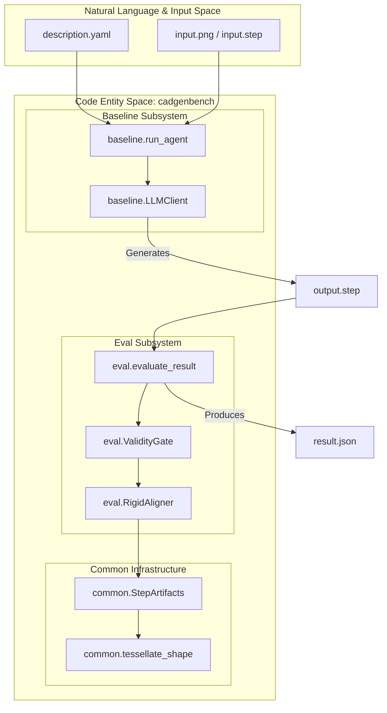
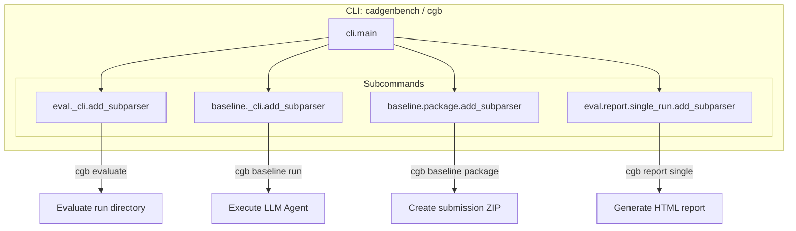

<!-- source: DeepWiki mcp.deepwiki.com · repo huggingface/cadgenbench · page 1 CADGenBench Overview · fetched 2026-10-26 -->

# CADGenBench Overview

Relevant source files

The following files were used as context for generating this wiki page:

- [.cursor/rules/project-context.mdc](.cursor/rules/project-context.mdc)
- [README.md](README.md)
- [docs/metrics.md](docs/metrics.md)
- [pyproject.toml](pyproject.toml)
- [src/cadgenbench/baseline/cadquery_cheat_sheet.md](src/cadgenbench/baseline/cadquery_cheat_sheet.md)
- [src/cadgenbench/cli.py](src/cadgenbench/cli.py)
- [src/cadgenbench/common/baseline_models.py](src/cadgenbench/common/baseline_models.py)
- [tests/test_cli_optional_extras.py](tests/test_cli_optional_extras.py)

**CADGenBench** is a technical benchmark designed to measure the performance of AI systems in producing 3D mechanical parts. It evaluates systems on two primary tasks: **Generation** (creating a 3D model from a textual or visual description) and **Editing** (applying a requested change to an existing STEP file) [README.md:8-14]().

The benchmark is system-agnostic. It does not assume a specific CAD kernel or modeling approach; instead, it defines a contract where a submission consists of one candidate STEP/BREP file (`output.step`) per sample [README.md:16-21]().

## System Architecture

The codebase is organized into three major subsystems: a scoring engine for evaluation, shared geometric infrastructure, and a reference baseline agent.

### Subsystem Relationship
The following diagram illustrates how the major components interact to transform natural language/image inputs into scored CAD entities.

Sources: [README.md:31-38](), [src/cadgenbench/cli.py:48-60](), [.cursor/rules/project-context.mdc:62-71]()

## Key Subsystems

### 1. Scoring Engine (Eval)
The scoring engine implements the **CAD Score**, a weighted combination of three orthogonal metrics gated by a validity check [docs/metrics.md:16-23]().
- **CAD Validity Gate**: A mandatory check ensuring the STEP file is a well-formed, watertight B-rep that can be meshed into a closed manifold [docs/metrics.md:96-101]().
- **Shape Similarity**: Measures surface distance F1 and volumetric IoU [docs/metrics.md:105-109]().
- **Topology Match**: Compares Betti numbers ($b_0, b_1, b_2$) to verify the number of pieces, holes, and voids [docs/metrics.md:111-115]().
- **Interface Match**: Evaluates mating-feature correctness using keep-in/keep-out sub-volumes [docs/metrics.md:117-121]().

For details, see [Scoring Engine](#2).

### 2. Reference Baseline Agent
The repo includes an optional iterative agent that uses Large Language Models (LLMs) to write CAD code (supporting `build123d` and `cadquery` backends) [README.md:35-38](). It operates in a feedback loop, reviewing renders of its generated STEP files to refine the code until it passes validity checks [README.md:91-93]().

For details, see [Reference Baseline Agent](#4).

### 3. Geometry and Mesh Infrastructure
Shared utilities handle the heavy lifting of CAD geometry. The system strictly loads geometry from BREP/STEP using OpenCascade (OCCT) via the `OCP` bindings [README.md:13-16](), [.cursor/rules/project-context.mdc:38-41](). It provides:
- **Tessellation**: Converting B-reps to meshes for rendering and IoU calculations [pyproject.toml:29-33]().
- **Headless Rendering**: Using PyVista and VTK to generate visual feedback and report assets without requiring a GPU or browser [pyproject.toml:29-33]().

For details, see [Geometry and Mesh Infrastructure](#3).

## CLI and Tooling

The primary entry point is the `cadgenbench` (alias `cgb`) command-line tool [src/cadgenbench/cli.py:39-44]().

### CLI Command Structure

Sources: [src/cadgenbench/cli.py:45-61](), [README.md:121-168]()

For details on flags and usage, see [CLI Reference](#1.3).

## Data and Fixtures
Benchmark samples are hosted on the Hugging Face Hub in two repositories:
1. `cadgenbench-data`: Publicly available inputs (descriptions, images, input STEPs) [README.md:173-175]().
2. `cadgenbench-data-gt`: Private ground-truth data used by the leaderboard Space [README.md:40-42]().

The system resolves these paths at runtime using environment variables like `CADGENBENCH_DATA_REPO` [README.md:110]().

For details, see [Data Layout and Fixture Structure](#1.2).

## Installation
The core library requires Python 3.12+ [pyproject.toml:11](). Optional extras are available for the baseline agent (`[baseline]`) and development tools (`[dev]`) [pyproject.toml:43-54]().

For details, see [Getting Started: Installation and Configuration](#1.1).

---

