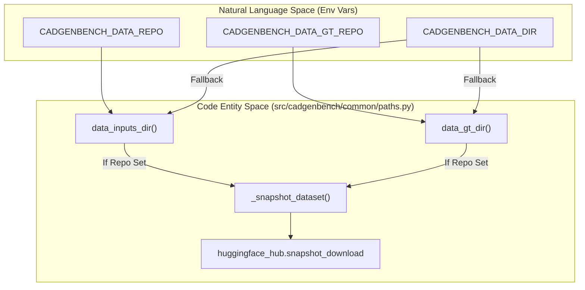
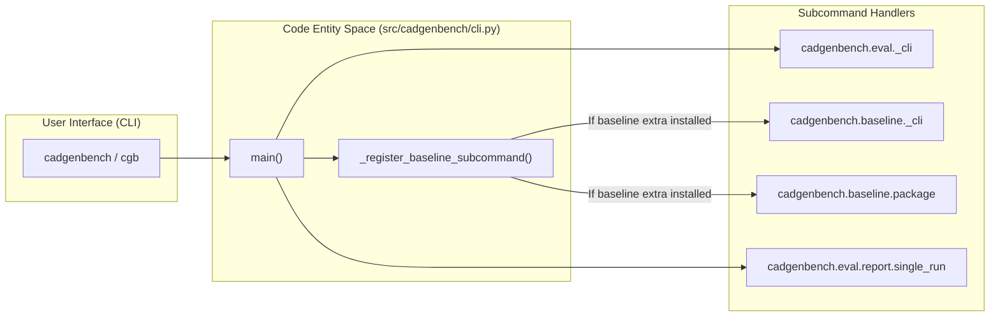

<!-- source: DeepWiki mcp.deepwiki.com · repo huggingface/cadgenbench · page 1.1 Getting Started: Installation and Configuration · fetched 2026-10-26 -->

# Getting Started: Installation and Configuration

<details>
<summary>Relevant source files</summary>

The following files were used as context for generating this wiki page:

- [.cursor/rules/project-context.mdc](.cursor/rules/project-context.mdc)
- [README.md](README.md)
- [pyproject.toml](pyproject.toml)
- [src/cadgenbench/baseline/cadquery_cheat_sheet.md](src/cadgenbench/baseline/cadquery_cheat_sheet.md)
- [src/cadgenbench/cli.py](src/cadgenbench/cli.py)
- [src/cadgenbench/common/baseline_models.py](src/cadgenbench/common/baseline_models.py)
- [src/cadgenbench/common/paths.py](src/cadgenbench/common/paths.py)
- [tests/test_cli_optional_extras.py](tests/test_cli_optional_extras.py)

</details>


This page provides a technical guide for setting up the **CADGenBench** environment. It covers the installation of the core scoring engine and the optional reference baseline agent, the configuration of data paths via environment variables, and the integration of LLM providers.

## Installation Overview

CADGenBench is built on Python 3.12+ and leverages the OpenCascade (OCCT) kernel via `build123d` and `cadquery-ocp` [pyproject.toml:11-17](). The project is designed to be tool-agnostic, meaning the scoring engine evaluates standard STEP/BREP files regardless of how they were generated [README.md:16-21]().

### Core Installation
The core package includes the scoring engine and geometry utilities. It is sufficient for users who only need to evaluate existing submissions or run the local sanity checker.

```bash
# 1. Create a Python 3.12 environment
python -m venv .venv && source .venv/bin/activate

# 2. Install core dependencies
pip install -e .
```

### Baseline Agent Installation
To run the iterative LLM-driven CAD agent, you must install the `[baseline]` extra. This pulls in `litellm` for model routing and `python-dotenv` for secret management [pyproject.toml:43-50]().

```bash
# Install with baseline and development extras
pip install -e ".[baseline,dev]"
```

### System Dependencies
While the Python stack is self-contained via `pip` (including OCCT wheels), the headless renderer (`pyvista`/`VTK`) requires system-level OpenGL libraries on Linux (e.g., `libgl1` or Mesa) [README.md:113-116](). macOS generally works out of the box.

Sources: [pyproject.toml:11-54](), [README.md:97-116](), [src/cadgenbench/cli.py:80-90]()

---

## Configuration and Environment Variables

CADGenBench uses environment variables to resolve the location of fixture inputs and ground-truth data. This allows the system to switch between local development directories and cloud-hosted Hugging Face Hub datasets.

### Data Path Resolution
The `cadgenbench.common.paths` module manages a tiered resolution strategy for data directories [src/cadgenbench/common/paths.py:15-47]().

| Variable | Purpose | Default / Fallback |
|---|---|---|
| `CADGENBENCH_DATA_REPO` | HF Dataset ID for public inputs (e.g., `HuggingAI4Engineering/cadgenbench-data`). | `./data/inputs/` |
| `CADGENBENCH_DATA_GT_REPO` | HF Dataset ID for private ground truth. Requires `HF_TOKEN`. | `./data/gt/` |
| `CADGENBENCH_DATA_DIR` | Local override for the parent data folder. | `Path.cwd() / "data"` |

### LLM API Keys
If using the reference baseline, create a `.env` file in the project root to store your provider keys. The agent uses `litellm`, so any supported provider string (e.g., `anthropic/`, `openai/`, `gemini/`) can be used [README.md:104-105]().

```bash
ANTHROPIC_API_KEY=sk-...
OPENAI_API_KEY=sk-...
GEMINI_API_KEY=...
```

### Data Flow Diagram: Path Resolution
This diagram illustrates how `cadgenbench.common.paths` bridges the environment configuration to the local file system.

**Figure 1: Path Resolution Logic**

Sources: [src/cadgenbench/common/paths.py:56-139](), [README.md:107-111]()

---

## Verifying the Setup

Once installed, verify the installation by checking the CLI and running the test suite.

### CLI Smoke Test
The `cadgenbench` entry point (aliased as `cgb`) provides access to all subcommands. If the `[baseline]` extra is missing, the `baseline` subcommand will be gracefully omitted from the help menu [src/cadgenbench/cli.py:80-105]().

```bash
# Check if CLI is accessible
cgb --help

# Verify baseline registration (requires [baseline] extra)
cgb baseline --help
```

### Running Tests
The repository includes a comprehensive test suite using `pytest`. This verifies geometry kernels, mesh validation, and CLI routing [README.md:121-123]().

```bash
pytest tests/ -q
```

### System Entry Point Mapping
The following diagram maps the CLI commands to their respective internal implementation modules.

**Figure 2: CLI Command Routing**

Sources: [src/cadgenbench/cli.py:39-106](), [pyproject.toml:56-58](), [tests/test_cli_optional_extras.py:47-77]()

---

## Baseline Quick Start

To verify the LLM integration, run the baseline agent on a single sample. This will execute the iterative loop: generating code, exporting a STEP file, and rendering visual feedback [README.md:129-135]().

```bash
# Run on sample 101 using GPT-5.5
cgb baseline run 101 --model openai/gpt-5.5
```

The output will be stored in `results/<timestamp>_<model>/101/output.step`. You can then package this for submission:

```bash
cgb baseline package results/<timestamp>_<model> --submitter "Name" --agree
```

Sources: [README.md:129-170](), [src/cadgenbench/baseline/cadquery_cheat_sheet.md:8-30]()

---

