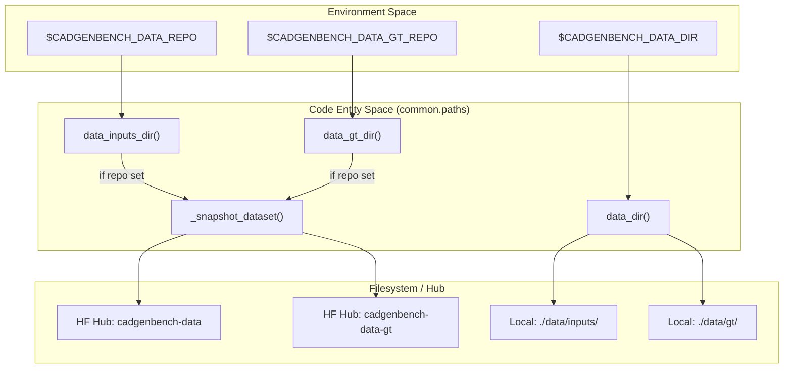
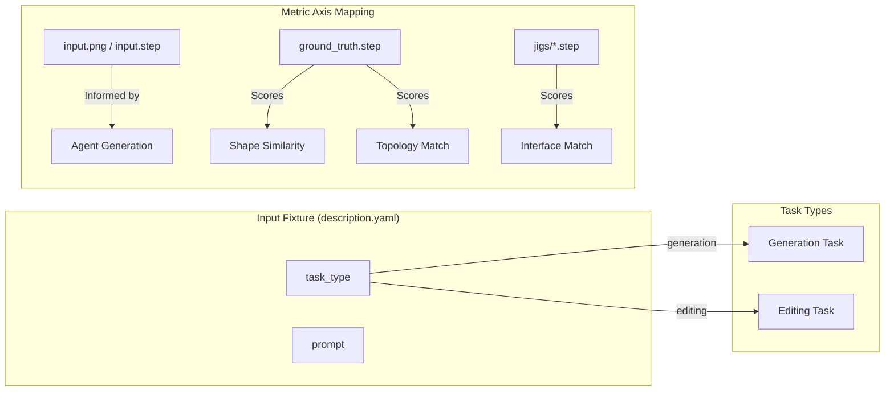

<!-- source: DeepWiki mcp.deepwiki.com · repo huggingface/cadgenbench · page 1.2 Data Layout and Fixture Structure · fetched 2026-10-26 -->

# Data Layout and Fixture Structure

<details>
<summary>Relevant source files</summary>

The following files were used as context for generating this wiki page:

- [README.md](README.md)
- [docs/benchmark/submission.md](docs/benchmark/submission.md)
- [src/cadgenbench/common/paths.py](src/cadgenbench/common/paths.py)

</details>


This page describes how CADGenBench organizes its benchmark data across local storage and the Hugging Face Hub. It details the file-level contract for inputs and ground-truth fixtures, and how the codebase resolves these paths at runtime.

## Overview of Fixture Organization

CADGenBench splits benchmark data into two distinct logical sets:
1.  **Inputs**: Publicly available data (drawings, text descriptions, starting STEP files) used by agents to generate or edit parts.
2.  **Ground Truth (GT)**: Privately held data (target STEP files, interface jigs) used by the scoring engine to evaluate candidates.

These sets are typically hosted in separate Hugging Face dataset repositories but can be mirrored locally for development or offline evaluation.

### Path Resolution Logic

The `cadgenbench.common.paths` module provides a single source of truth for locating these directories. It uses a hierarchical resolution strategy where environment variables take precedence.

| Environment Variable | Role | Description |
|---|---|---|
| `CADGENBENCH_DATA_REPO` | Public Inputs | HF Dataset ID (e.g., `HuggingAI4Engineering/cadgenbench-data`). |
| `CADGENBENCH_DATA_GT_REPO` | Private GT | HF Dataset ID (requires `HF_TOKEN` for access). |
| `CADGENBENCH_DATA_DIR` | Local Override | Path to a local directory containing `inputs/` and `gt/` subfolders. |

**Resolution Flow:**
The system first checks for Hub repository variables. If present, it uses `huggingface_hub.snapshot_download` to fetch and cache the data [src/cadgenbench/common/paths.py:127-138](). If no Hub variables are set, it looks for the local override path, and finally defaults to a `./data/` directory in the current working directory [src/cadgenbench/common/paths.py:61-94]().

**Sources:** [src/cadgenbench/common/paths.py:15-47](), [src/cadgenbench/common/paths.py:56-58]()

## Input Fixture Structure

The input directory contains one folder per sample (e.g., `101/`). Each folder contains the necessary context for a CAD generation or editing task.

| File | Requirement | Description |
|---|---|---|
| `description.yaml` | **Required** | Metadata including `task_type` (`generation` or `editing`) and the text prompt. |
| `input.png` | **Required** | High-resolution engineering drawing or reference image. |
| `input.step` | Optional | The starting geometry for **Editing** tasks. Not used for Generation tasks. |

**Sources:** [src/cadgenbench/common/paths.py:17-19](), [docs/benchmark/submission.md:23-26]()

## Ground-Truth Fixture Structure

The ground-truth directory mirrors the input folder names. These files are never shown to the agent and are only accessed by the `evaluate` command.

| File/Folder | Description |
|---|---|
| `ground_truth.step` | The "gold standard" CAD model used for shape similarity and topology scoring. |
| `jigs/` | A subdirectory containing STEP files representing keep-in (KIR) and keep-out (KOR) volumes. |
| `renders/` | Optional pre-rendered views of the ground truth for reporting. |

### Interface Jigs
Jigs are sub-volumes used to score the **Interface Match** metric. They represent functional constraints, such as a bolt hole that must remain empty (KOR) or a structural tab that must be filled (KIR).

**Sources:** [src/cadgenbench/common/paths.py:20-21](), [README.md:81-81]()

## System Entity Mapping

The following diagrams illustrate how the abstract concept of "Data Layout" maps to specific code entities and filesystem paths.

### Path Resolution and Data Flow
This diagram shows how `cadgenbench.common.paths` mediates between the environment and the rest of the system.


**Sources:** [src/cadgenbench/common/paths.py:56-138]()

### Fixture Component Mapping
This diagram associates specific files on disk with the metrics and tasks they support.


**Sources:** [README.md:11-21](), [docs/benchmark/submission.md:76-80](), [README.md:77-82]()

## Submission Directory Layout

When an agent or user produces results, they must be organized in a specific structure to be compatible with the `cadgenbench evaluate` and `cadgenbench baseline package` commands.

```text
results/
└── <run_name>/
    ├── meta.json                # Submission metadata (name, submitter, etc.)
    ├── <sample_id_101>/
    │   └── output.step          # The candidate CAD file (Required)
    ├── <sample_id_102>/
    │   └── output.step
    └── run_summary.json         # Generated by 'evaluate' after scoring
```

### The Candidate Contract
The primary artifact of any task is `output.step` (or `output.stp`).
- **Generation**: The file represents the entire part described in the prompt.
- **Editing**: The file represents the *entire* part after the requested modification has been applied [docs/benchmark/submission.md:23-26]().
- **Validity**: Every `output.step` must pass the "Validity Gate" (watertight, manifold, BRep-valid) to receive a non-zero score [docs/benchmark/submission.md:113-119]().

**Sources:** [docs/benchmark/submission.md:8-21](), [docs/benchmark/submission.md:113-119]()

---

