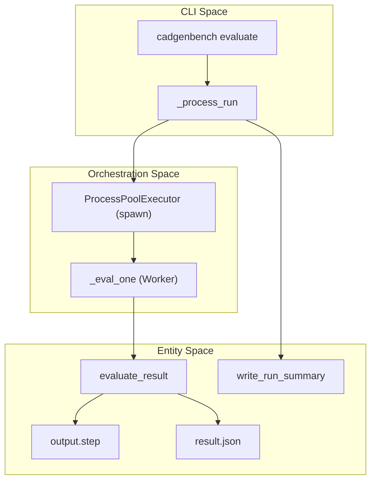
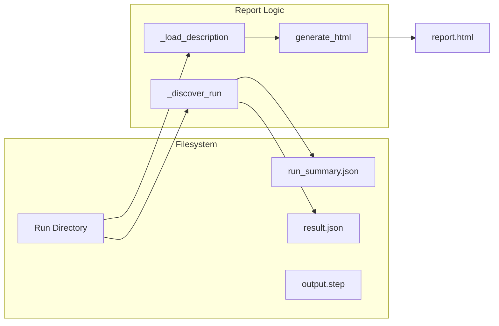

<!-- source: DeepWiki mcp.deepwiki.com · repo huggingface/cadgenbench · page 1.3 CLI Reference · fetched 2026-10-26 -->

# CLI Reference

<details>
<summary>Relevant source files</summary>

The following files were used as context for generating this wiki page:

- [.cursor/rules/project-context.mdc](.cursor/rules/project-context.mdc)
- [src/cadgenbench/baseline/_cli.py](src/cadgenbench/baseline/_cli.py)
- [src/cadgenbench/baseline/package.py](src/cadgenbench/baseline/package.py)
- [src/cadgenbench/cli.py](src/cadgenbench/cli.py)
- [src/cadgenbench/common/baseline_models.py](src/cadgenbench/common/baseline_models.py)
- [src/cadgenbench/common/profiling.py](src/cadgenbench/common/profiling.py)
- [src/cadgenbench/eval/_cli.py](src/cadgenbench/eval/_cli.py)
- [src/cadgenbench/eval/report/single_run.py](src/cadgenbench/eval/report/single_run.py)
- [tests/baseline/test_package.py](tests/baseline/test_package.py)
- [tests/eval/test_cli_parallelism.py](tests/eval/test_cli_parallelism.py)
- [tests/test_cli_optional_extras.py](tests/test_cli_optional_extras.py)

</details>


The `cadgenbench` CLI (aliased as `cgb`) is the primary interface for running benchmark experiments, evaluating CAD models, and generating interactive reports [src/cadgenbench/cli.py:15-18](). It is designed to be system-agnostic, handling CAD geometry via STEP files regardless of whether they were produced by an LLM agent, a script, or a human [src/cadgenbench/cli.py:43-44]().

## Command Overview

The CLI uses a modular architecture where heavy dependencies (like `litellm`, `scipy`, or `manifold3d`) are lazily imported within specific subcommand handlers to keep `--help` commands fast [src/cadgenbench/cli.py:22-25]().

### Subcommand Registration and Dispatch
The CLI employs a "spawn" multiprocessing context on Linux to ensure VTK/OpenGL safety during parallel evaluation [src/cadgenbench/eval/_cli.py:53-53]().

| Subcommand | Purpose | Primary File |
| :--- | :--- | :--- |
| `evaluate` | (Re)compute metrics for result directories. | [src/cadgenbench/eval/_cli.py:15-31]() |
| `baseline run` | Execute the reference LLM agent on fixtures. | [src/cadgenbench/baseline/_cli.py:15-30]() |
| `baseline package` | Bundle run outputs into a leaderboard ZIP. | [src/cadgenbench/baseline/package.py:15-37]() |
| `report single` | Generate an interactive HTML report for a run. | [src/cadgenbench/eval/report/single_run.py:15-29]() |

### Optional Extras
The `baseline` subcommands require the `[baseline]` optional dependencies. If these are missing (e.g., in an eval-only environment), the CLI gracefully omits these commands from the help menu instead of failing [src/cadgenbench/cli.py:26-32]().

## `cadgenbench evaluate`

Computes or updates metrics for one or more experiment runs. It orchestrates the alignment of candidate STEP files, fills in missing renders, and writes the `result.json` for each fixture [src/cadgenbench/eval/_cli.py:15-22]().

### Usage
```bash
cadgenbench evaluate results/my_run_dir --workers 4
```

### Arguments and Flags
* `run_dirs`: One or more paths to directories containing fixture results [src/cadgenbench/eval/_cli.py:134-136]().
* `--force`: Realign and re-render even if cached artifacts exist [src/cadgenbench/eval/_cli.py:138-140]().
* `--workers`: Number of parallel worker processes. Defaults to `min(8, os.cpu_count())` [src/cadgenbench/eval/_cli.py:142-148]().

### Implementation: Parallel Orchestration
The evaluator dispatches work across a `ProcessPoolExecutor`. To avoid CPU oversubscription by underlying libraries like Open3D (OpenMP) and NumPy (BLAS), the CLI automatically caps the thread count for each worker based on the allocated CPU quota [src/cadgenbench/eval/_cli.py:105-122]().

#### Evaluation Data Flow
The diagram below illustrates how `_process_run` coordinates the evaluation lifecycle.

"CLI Evaluation Flow"

Sources: [src/cadgenbench/eval/_cli.py:152-180](), [src/cadgenbench/eval/_cli.py:53-53]()

## `cadgenbench baseline run`

Runs the reference LLM agent against benchmark fixtures. It reads descriptions from the `data/inputs/` directory and generates `output.step` files [src/cadgenbench/baseline/_cli.py:15-22]().

### Usage
```bash
cadgenbench baseline run 101 --model openai/gpt-5.5 --parallel 4
```

### Key Flags
* `fixtures`: Specific fixture names to run [src/cadgenbench/baseline/_cli.py:90-91]().
* `--all`: Run all available fixtures in the input dataset [src/cadgenbench/baseline/_cli.py:92-93]().
* `--model`: LiteLLM model string (e.g., `anthropic/claude-3-5-sonnet`) [src/cadgenbench/baseline/_cli.py:115-116]().
* `--backend`: The CAD kernel targeted by the agent (`build123d` or `cadquery`) [src/cadgenbench/baseline/_cli.py:110-114]().
* `--parallel`: Number of fixtures to run concurrently [src/cadgenbench/baseline/_cli.py:108-109]().

### Resource Management
The agent respects several "hard gates" to prevent runaway costs or time:
* `--max-iter`: Maximum agent turns per fixture [src/cadgenbench/baseline/_cli.py:96-97]().
* `--max-tokens`: Total token budget across all turns [src/cadgenbench/baseline/_cli.py:98-99]().
* `--max-duration`: Wall-clock timeout in seconds [src/cadgenbench/baseline/_cli.py:104-105]().

Sources: [src/cadgenbench/baseline/_cli.py:70-131]()

## `cadgenbench baseline package`

Bundles a baseline run directory into a ZIP file compliant with the leaderboard submission contract [src/cadgenbench/baseline/package.py:15-19]().

### Submission Contract
The resulting ZIP contains:
1. A `meta.json` file with submitter information [src/cadgenbench/baseline/package.py:142-148]().
2. One folder per fixture, containing the `output.step` candidate if generated [src/cadgenbench/baseline/package.py:155-160]().

### Arguments
* `run_dir`: Path to the directory produced by `baseline run` [src/cadgenbench/baseline/package.py:67-68]().
* `--agree`: Required flag to set `agree_to_publish=true` in `meta.json` [src/cadgenbench/baseline/package.py:80-82]().

Sources: [src/cadgenbench/baseline/package.py:59-83](), [src/cadgenbench/baseline/package.py:153-161]()

## `cadgenbench report single`

Generates an interactive, standalone HTML report for a specific run. The report includes a thumbnail grid, metric pills, and a debug panel with the full LLM conversation and execution history [src/cadgenbench/eval/report/single_run.py:15-23]().

### Usage
```bash
cadgenbench report single results/my_run -o report.html
```

### Implementation Details
* **Asset Inlining**: By default, the command inlines images and renders as Base64 data URIs to make the HTML file portable [src/cadgenbench/eval/report/single_run.py:78-82]().
* **Data Discovery**: It scans the run directory for `params.json`, `run_summary.json`, and per-fixture `result.json` files [src/cadgenbench/eval/report/single_run.py:15-23]().
* **Metrics Display**: Uses `METRIC_DISPLAY` metadata to format scores (e.g., F1 scores, IoU) and links them to documentation anchors [src/cadgenbench/eval/report/single_run.py:47-52](), [src/cadgenbench/eval/report/single_run.py:103-107]().

#### Report Generation Data Flow
"Report Generation Architecture"

Sources: [src/cadgenbench/eval/report/single_run.py:15-29](), [src/cadgenbench/eval/report/single_run.py:148-163]()

## Exit Codes

The CLI follows standard POSIX exit code conventions [src/cadgenbench/cli.py:77-77]():

| Code | Meaning |
| :--- | :--- |
| `0` | Success. |
| `1` | General failure (e.g., evaluation errors, missing fixtures) [src/cadgenbench/eval/_cli.py:176-176](). |
| `2` | Configuration or environment error (e.g., `data/` directory not found) [src/cadgenbench/baseline/_cli.py:154-154](). |

Sources: [src/cadgenbench/cli.py:39-77](), [src/cadgenbench/eval/_cli.py:152-176](), [src/cadgenbench/baseline/_cli.py:137-164]()

---

