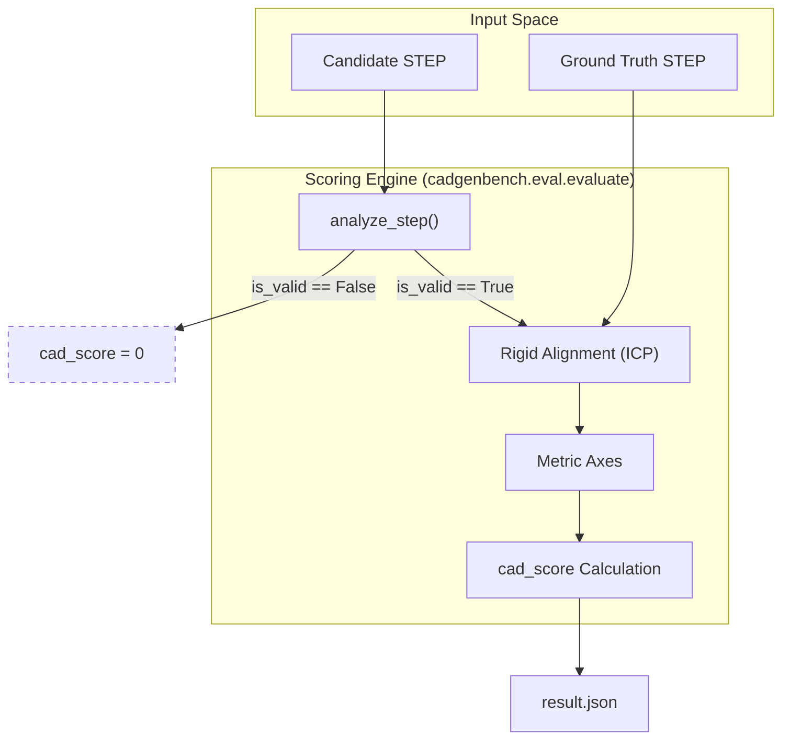

<!-- source: DeepWiki mcp.deepwiki.com · repo huggingface/cadgenbench · page 2 Scoring Engine · fetched 2026-10-26 -->

# Scoring Engine

<details>
<summary>Relevant source files</summary>

The following files were used as context for generating this wiki page:

- [docs/benchmark/submission.md](docs/benchmark/submission.md)
- [docs/metrics.md](docs/metrics.md)
- [src/cadgenbench/eval/evaluate.py](src/cadgenbench/eval/evaluate.py)

</details>


The Scoring Engine is the core evaluation pipeline of `cadgenbench`. It transforms a raw candidate STEP file into a `cad_score`—a single scalar value in the range $[0, 1]$ that represents how well the generated geometry matches the ground truth (GT) across multiple engineering axes.

The engine is designed to be idempotent and generator-agnostic. It handles the mandatory validity checks, rigid alignment to the ground truth, and the computation of three orthogonal metric axes: **Shape Similarity**, **Topology Match**, and **Interface Match**.

### Evaluation Pipeline Flow

The scoring process follows a strict sequence: a hard validity gate, followed by spatial alignment, and finally metric computation. If the validity gate fails, the score is zeroed immediately, and further metrics are skipped to save resources.

**The Scoring Lifecycle**


Sources: [src/cadgenbench/eval/evaluate.py:15-64](), [docs/metrics.md:52-80]()

---

### 2.1 Evaluation Orchestration
The evaluation is driven by `evaluate_result`, which manages the per-fixture lifecycle. It coordinates calling the validity gate, performing (or loading cached) alignment, and dispatching to specific metric modules. It persists results into a standardized `result.json` and aggregates run-wide statistics into `run_summary.json`.

For details, see [Evaluation Orchestration](#2.1).

Sources: [src/cadgenbench/eval/evaluate.py:139-168](), [docs/benchmark/submission.md:76-112]()

---

### 2.2 CAD Validity Gate
Every candidate must pass the `analyze_step` gate before it is considered for scoring. This gate ensures the STEP file contains a well-formed, watertight B-Rep that can be successfully tessellated into a manifold mesh. It checks for B-Rep errors, solid counts, and physical sanity (e.g., non-zero volume).

For details, see [CAD Validity Gate](#2.2).

Sources: [src/cadgenbench/common/validity.py:1-20](), [docs/metrics.md:96-103]()

---

### 2.3 Rigid Alignment
Since candidates may be generated in arbitrary orientations, the engine performs rigid alignment (rotation and translation only) to the ground truth. This uses a PCA-based octahedral pose pool followed by multi-scale Open3D ICP refinement. The resulting transformation is cached as an `aligned/output_aligned.step` to accelerate subsequent re-runs.

For details, see [Rigid Alignment](#2.3).

Sources: [docs/metrics.md:38-50](), [docs/benchmark/submission.md:139-154]()

---

### 2.4 Metric Axes
The `cad_score` is a weighted mean of three orthogonal axes, each catching specific engineering failures:

| Axis | Weight (Gen) | Purpose |
| :--- | :--- | :--- |
| **Shape Similarity** | 0.4 | Matches bulk volume and surface positioning. |
| **Interface Match** | 0.4 | Ensures the part fits into its intended assembly (mating features). |
| **Topology Match** | 0.2 | Checks for correct hole counts, pieces, and internal voids (Betti numbers). |

For details, see [Metric Axes](#2.4).

Sources: [src/cadgenbench/eval/evaluate.py:95-99](), [docs/metrics.md:82-91]()

---

### 2.5 Editing Task Scoring
For editing tasks, the scoring logic shifts to "No-op Renormalization." Instead of measuring absolute similarity, the engine uses an `edit_baseline.json` to ensure that submitting the original input unchanged results in a score of `0`. Axes are classified as `ROLE_TARGET` (expected to change) or `ROLE_PRESERVE` (must remain identical), and the final score reflects the quality of the requested change while penalizing unintended alterations.

For details, see [Editing Task Scoring](#2.5).

Sources: [src/cadgenbench/eval/edit_baseline.py:80-89](), [docs/metrics.md:125-164]()

---

### System Entity Mapping

The following diagram maps the high-level scoring concepts to the specific code entities and files that implement them.

**Code Entity Mapping: Scoring Pipeline**

```mermaid
graph LR
    subgraph "Orchestration"
        Eval["evaluate_result()"]:::file
        Summary["run_summary.py"]:::file
    end

    subgraph "Validation & Data"
        StepArt["StepArtifacts"]:::class
        Analyze["analyze_step()"]:::func
    end

    subgraph "Metrics Logic"
        Shape["compare_step_files()"]:::func
        Topo["topo_match()"]:::func
        Interface["best_iou_in_context()"]:::func
    end

    Eval --> Analyze
    Eval --> StepArt
    Eval --> Shape
    Eval --> Topo
    Eval --> Interface
    Summary --> Eval

    classDef file font-family:monospace,fill:transparent
    classDef func font-family:monospace,fill:transparent
    classDef class font-family:monospace,fill:transparent
```
Sources: [src/cadgenbench/eval/evaluate.py:100-108](), [src/cadgenbench/common/artifacts.py:73-77]()

---

