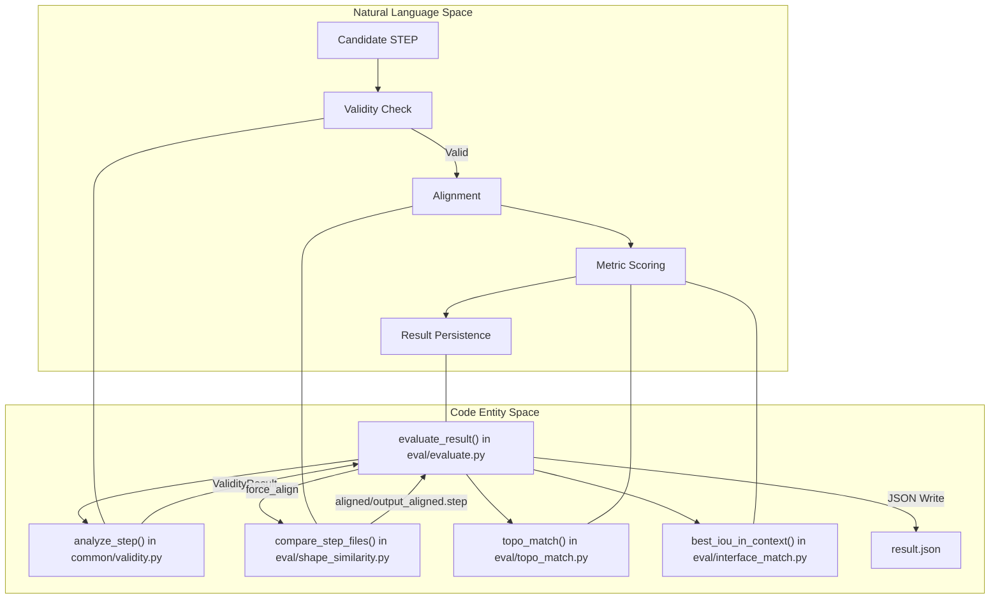
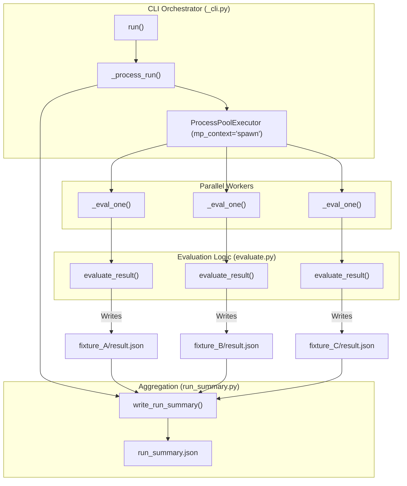

<!-- source: DeepWiki mcp.deepwiki.com · repo huggingface/cadgenbench · page 2.1 Evaluation Orchestration · fetched 2026-10-26 -->

# Evaluation Orchestration

Relevant source files

The following files were used as context for generating this wiki page:

- [docs/benchmark/submission.md](docs/benchmark/submission.md)
- [src/cadgenbench/common/profiling.py](src/cadgenbench/common/profiling.py)
- [src/cadgenbench/eval/_cli.py](src/cadgenbench/eval/_cli.py)
- [src/cadgenbench/eval/evaluate.py](src/cadgenbench/eval/evaluate.py)
- [src/cadgenbench/eval/run_summary.py](src/cadgenbench/eval/run_summary.py)
- [tests/eval/test_cli_parallelism.py](tests/eval/test_cli_parallelism.py)
- [tests/eval/test_run_summary.py](tests/eval/test_run_summary.py)

The evaluation orchestration layer manages the end-to-end lifecycle of scoring candidate CAD models. It is driven primarily by `evaluate_result`, which acts as a central coordinator for validity checking, rigid alignment, metric computation, and artifact persistence [src/cadgenbench/eval/evaluate.py:17-64]().

## Per-Fixture Lifecycle

Each fixture follows a deterministic pipeline to produce a `result.json`. This process is idempotent; it reuses cached alignment data and renders if they are fresher than the raw candidate STEP file [src/cadgenbench/eval/evaluate.py:19-21]().

### 1. Validity Gate
The orchestrator first subjects the candidate `output.step` to the CAD Validity Gate via `analyze_step`. If the file is missing, the status is set to `STATUS_MISSING`. If it exists but fails structural or manifold checks, it is marked `STATUS_INVALID` and assigned a `cad_score` of 0 [src/cadgenbench/eval/evaluate.py:129-132](), [src/cadgenbench/eval/evaluate.py:205-220]().

### 2. Rigid Alignment
Valid candidates are aligned to the ground truth using a multi-scale ICP process. The orchestrator checks for a cached aligned file at `aligned/output_aligned.step`. If missing or stale, it triggers the alignment pipeline and persists the transformation [src/cadgenbench/eval/evaluate.py:112-112](), [src/cadgenbench/eval/evaluate.py:246-265]().

### 3. Metric Dispatch
Once aligned, the orchestrator dispatches the model to three orthogonal metric axes:
*   **Shape Similarity**: Point-to-surface distances and volume IoU [src/cadgenbench/eval/evaluate.py:30-31]().
*   **Topology Match**: Betti-number agreement (b0, b1, b2) [src/cadgenbench/eval/evaluate.py:35-38]().
*   **Interface Match**: Scored only if jig sub-volumes are discovered in the ground truth directory [src/cadgenbench/eval/evaluate.py:33-34]().

### 4. Result Composition
The final `cad_score` is a weighted mean of the available axes. For standard generation tasks, the weights are defined in `GENERATION_AXIS_WEIGHTS` (Shape: 0.4, Interface: 0.4, Topology: 0.2) [src/cadgenbench/eval/evaluate.py:95-99](). For editing tasks, the orchestrator performs no-op renormalization against an `edit_baseline.json` and uses `EDITING_AXIS_WEIGHTS` [src/cadgenbench/eval/evaluate.py:80-89]().

### Data Flow: Per-Fixture Evaluation
This diagram maps the natural language lifecycle to the specific functions and files responsible for execution.

Sources: [src/cadgenbench/eval/evaluate.py:139-164](), [src/cadgenbench/eval/evaluate.py:205-240](), [src/cadgenbench/eval/evaluate.py:270-310](), [docs/benchmark/submission.md:34-58]()

---

## Parallel Execution and Resource Management

The `cadgenbench evaluate` CLI utilizes a `ProcessPoolExecutor` to parallelize evaluation across fixtures. Because the underlying OpenCascade (OCC) and VTK libraries involve heavy compute and OpenGL contexts, specific safeguards are implemented for stability and performance.

### Process Isolation and Fork Safety
On Linux, the orchestrator uses the `spawn` multiprocessing context. This is required because VTK/Mesa GL state is not fork-safe; forking a process after a GL context has been initialized can lead to `BrokenProcessPool` errors [src/cadgenbench/eval/_cli.py:45-53]().

### CPU Oversubscription Prevention
Native libraries like Open3D (OpenMP) and NumPy (BLAS) default to using all available cores. To prevent `N_workers * N_cores` thread explosions, the orchestrator calculates an effective CPU count (accounting for cgroup quotas) and caps worker threads via `_cap_worker_threads` [src/cadgenbench/eval/_cli.py:56-90](), [src/cadgenbench/eval/_cli.py:105-122]().

### Orchestration Architecture
This diagram illustrates the relationship between the CLI, the process pool, and the individual evaluation workers.

Sources: [src/cadgenbench/eval/_cli.py:152-176](), [src/cadgenbench/eval/_cli.py:179-205](), [src/cadgenbench/eval/_cli.py:214-250](), [tests/eval/test_cli_parallelism.py:1-20]()

---

## Run Aggregation

After all fixtures are processed, `write_run_summary` walks the run directory to aggregate individual `result.json` files into a single `run_summary.json` [src/cadgenbench/eval/run_summary.py:78-103]().

### Aggregation Rules
*   **Inclusion of Zeros**: The `aggregate_score` includes 0.0 values from `invalid` and `missing` samples to prevent inflating scores by only averaging successful runs [src/cadgenbench/eval/run_summary.py:50-53](), [src/cadgenbench/eval/run_summary.py:132-133]().
*   **Task Type Segmentation**: The aggregator reads `description.yaml` for each fixture to bucket results by `task_type` (e.g., `generation` vs `editing`) [src/cadgenbench/eval/run_summary.py:134-140]().
*   **Schema Stability**: Unknown task types are automatically added to the `per_task_scores` map without requiring schema changes [src/cadgenbench/eval/run_summary.py:56-58]().

### Summary Schema Example
| Field | Description |
| :--- | :--- |
| `aggregate_score` | Mean `cad_score` over all samples in the run [src/cadgenbench/eval/run_summary.py:21](). |
| `validity_rate` | Ratio of `n_valid` to `n_samples` [src/cadgenbench/eval/run_summary.py:22](). |
| `score_by_task_type` | Breakdown of mean scores by task family [src/cadgenbench/eval/run_summary.py:27-30](). |
| `per_sample_scores` | Map of fixture names to their status and score [src/cadgenbench/eval/run_summary.py:41-47](). |

Sources: [src/cadgenbench/eval/run_summary.py:15-59](), [src/cadgenbench/eval/run_summary.py:106-191](), [docs/benchmark/submission.md:76-105]()

---

