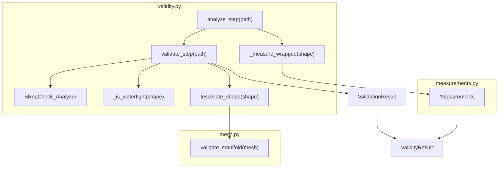
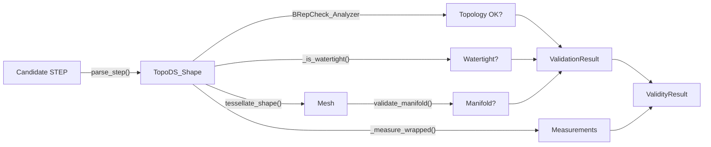

<!-- source: DeepWiki mcp.deepwiki.com · repo huggingface/cadgenbench · page 2.2 CAD Validity Gate · fetched 2026-10-26 -->

# CAD Validity Gate

Relevant source files

The following files were used as context for generating this wiki page:

- [docs/benchmark/validation.md](docs/benchmark/validation.md)
- [docs/metrics/cad_validity.md](docs/metrics/cad_validity.md)
- [src/cadgenbench/common/validity.py](src/cadgenbench/common/validity.py)
- [tests/common/test_validity.py](tests/common/test_validity.py)

The **CAD Validity Gate** is a mandatory diagnostic pipeline that runs before any other metric on a raw candidate STEP file [docs/metrics/cad_validity.md:1-4](). It serves as a zero-cascade: if a file fails this gate, `is_valid` is set to `False` and the final `cad_score` is forced to `0` [src/cadgenbench/common/validity.py:75-86]().

The gate ensures that the geometry is not just parseable, but is a well-formed, watertight solid capable of supporting downstream topological analysis (like Betti number calculation) and Boolean operations [src/cadgenbench/common/validity.py:27-31]().

## Validation Workflow

The validity check is encapsulated in the `ValidationResult` class and is primarily driven by the `analyze_step` and `validate_step` functions [src/cadgenbench/common/validity.py:75-118]().

### The Three Pillars of Validity
A candidate is considered valid if and only if it satisfies three distinct criteria [docs/metrics/cad_validity.md:6-10]():

1.  **BRepCheck Analysis**: The OpenCASCADE `BRepCheck_Analyzer` must report no errors (e.g., self-intersecting wires, edges off-surface) [src/cadgenbench/common/validity.py:22-23]().
2.  **Watertightness**: Every shell in the shape must be closed, meaning no "naked" or free edges exist [src/cadgenbench/common/validity.py:24-25]().
3.  **Manifold Meshability**: The shape must successfully tessellate into a closed, orientable manifold mesh where every edge is shared by exactly two triangles with opposite orientations [src/cadgenbench/common/validity.py:32-37]().

### Code Entity Relationship: Validity Pipeline
The following diagram illustrates how the validity functions interact with the underlying OpenCASCADE (OCC) and Mesh logic.

"CAD Validity Logic Flow"

**Sources:** [src/cadgenbench/common/validity.py:75-118](), [src/cadgenbench/common/validity.py:15-52]().

---

## Safety Ceilings and Resource Management

To prevent pathological STEP files from exhausting system resources or hanging the evaluation process, the gate enforces three generous but firm limits [src/cadgenbench/common/validity.py:128-131]().

| Limit | Logic | Action |
| :--- | :--- | :--- |
| **File Size** | `MAX_STEP_FILE_BYTES` (Default: 50MB) | Rejects before parsing to prevent OOM [src/cadgenbench/common/validity.py:155-157](). |
| **Triangle Count** | `MAX_TRIANGLES` (Default: 1M) | Rejects after tessellation but before metrics [src/cadgenbench/common/validity.py:154-154](). |
| **Timeout** | `MESH_TIMEOUT_S` (Default: 30s) | Process-isolated kill for runaway OCC calls [src/cadgenbench/common/validity.py:161-163](). |

### Process Isolation
Because OpenCASCADE tessellation is a native C++ call, it does not reliably honor Python signals [src/cadgenbench/common/validity.py:142-144](). The validity gate runs the tessellation in a separate `multiprocessing.Process` and terminates it if the `MESH_TIMEOUT_S` is exceeded [src/cadgenbench/common/validity.py:144-147]().

**Sources:** [src/cadgenbench/common/validity.py:128-163]().

---

## Implementation Details

### BRepCheck and Watertightness
The function `_is_watertight` checks if a shape is closed by iterating through its shells and ensuring they have no free edges [src/cadgenbench/common/validity.py:24-25](). This is critical because non-watertight shapes cannot be reliably used for volume-based IoU or Betti number calculations [src/cadgenbench/common/validity.py:27-31]().

### Failure Memoization
When a failure occurs, the `topology_errors` field in `ValidationResult` captures a de-duplicated list of human-readable strings [src/cadgenbench/common/validity.py:91-98](). These strings combine:
*   OCC BRep errors (e.g., `BRepCheck_SelfIntersectingWire`).
*   Watertightness failures (`BREP not watertight: open shells / naked edges`).
*   Mesh-pipeline errors (e.g., `mesh non-manifold: edge shared by 4 triangles`).

### Advisory Diagnostics
In addition to the hard gate, the system computes advisory diagnostics that do **not** affect the score but flag "fragile" geometry [docs/metrics/cad_validity.md:14-19]():
*   **Minimum Face Area**: Flags below `0.001 mm²`.
*   **Max Face Aspect Ratio**: Flags above `1000`.
*   **Max BREP Tolerance**: Flags above `0.1 mm`.

"Data Flow from File to Result"

**Sources:** [src/cadgenbench/common/validity.py:75-118](), [docs/metrics/cad_validity.md:21-26](), [tests/common/test_validity.py:121-148]().

---

## Key Functions and Classes

### `ValidationResult`
The core dataclass storing the boolean `is_valid` status and the `topology_errors` list [src/cadgenbench/common/validity.py:75-104]().

### `analyze_step(path: Path) -> ValidityResult`
The primary entry point. It loads the STEP file once and performs both validity analysis and physical measurements (volume, bounding box, counts), returning them in a bundled `ValidityResult` [src/cadgenbench/common/validity.py:107-113]().

### `parse_step(path: Path) -> None`
A "cheap" gate used to verify that a file is at least a valid STEP format before attempting more expensive geometric analysis [tests/common/test_validity.py:154-188]().

**Sources:** [src/cadgenbench/common/validity.py:75-121](), [tests/common/test_validity.py:154-188]().

---

