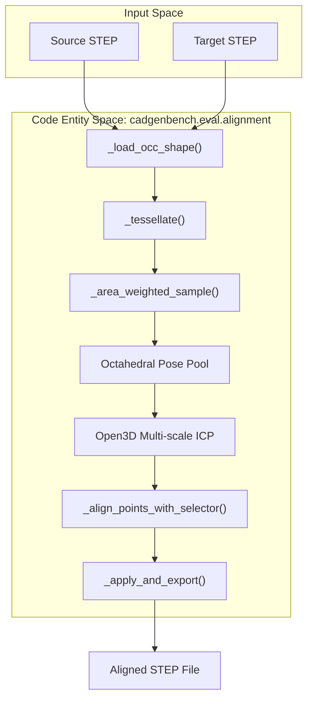
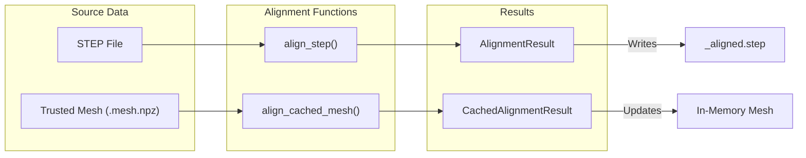

<!-- source: DeepWiki mcp.deepwiki.com · repo huggingface/cadgenbench · page 2.3 Rigid Alignment · fetched 2026-10-26 -->

# Rigid Alignment

Relevant source files

The following files were used as context for generating this wiki page:

- [docs/metrics.md](docs/metrics.md)
- [src/cadgenbench/eval/alignment.py](src/cadgenbench/eval/alignment.py)
- [src/cadgenbench/eval/edit_baseline.py](src/cadgenbench/eval/edit_baseline.py)
- [tests/eval/test_alignment.py](tests/eval/test_alignment.py)
- [tests/eval/test_sidecar_alignment.py](tests/eval/test_sidecar_alignment.py)

Rigid alignment is a critical preprocessing step in the CADGenBench evaluation pipeline. It ensures that candidate STEP files are correctly oriented and positioned relative to the ground truth (GT) before any geometric or topological metrics are computed [docs/metrics.md:38-43](). The aligner handles rotation and translation only; it never applies scaling, shearing, or mirroring [src/cadgenbench/eval/alignment.py:17-18]().

## Alignment Pipeline Overview

The alignment process follows a multi-stage strategy to find the optimal pose, combining global search via PCA-based orientations with local refinement using Iterative Closest Point (ICP).

### 1. Sampling and Initialization
The aligner first generates area-weighted point clouds from both the source and target geometries [src/cadgenbench/eval/alignment.py:103-113](). By default, 10,000 samples are used to ensure sufficient density for refinement [src/cadgenbench/eval/alignment.py:71]().

### 2. PCA and Octahedral Pose Pool
To overcome local minima in ICP, the system generates a pool of candidate starting poses:
*   **Identity**: The original pose provided in the submission.
*   **PCA Orientations**: Principal Component Analysis is performed on the point clouds to align the major axes of the candidate to the GT.
*   **Octahedral Symmetry**: The 24 octahedral rotations are applied to the PCA-aligned pose to account for axis-swapping or inversion errors [src/cadgenbench/eval/alignment.py:18-19]().

### 3. Multi-scale ICP Refinement
Each candidate pose in the pool is refined using **Open3D multi-scale point-to-plane ICP** [src/cadgenbench/eval/alignment.py:19-20](). The multi-scale approach uses a voxel-based divisor to progressively refine the alignment from coarse to fine [src/cadgenbench/eval/alignment.py:42]().

### 4. Pose Selection and Tie-Breaking
The best pose is selected based on shape agreement. The selector evaluates:
1.  **Bidirectional Surface F1**: The primary metric for pose quality [src/cadgenbench/eval/alignment.py:20-21]().
2.  **Capped Symmetric Chamfer**: Used as a secondary metric if F1 scores are within a tolerance of 0.005 [src/cadgenbench/eval/alignment.py:44-49]().
3.  **RMSE**: Root-mean-square error of nearest-neighbor distances [src/cadgenbench/eval/alignment.py:21-22]().
4.  **Canonical Tie-break**: If geometric fits are indistinguishable, the pose with the "least rotation" is chosen to ensure deterministic results for symmetric parts [src/cadgenbench/eval/alignment.py:44-50]().

### Data Flow: Alignment Logic
The following diagram illustrates the flow from raw STEP files to the final aligned result.

**Alignment Execution Flow**

Sources: [src/cadgenbench/eval/alignment.py:15-50](), [src/cadgenbench/eval/alignment.py:67-132]()

## Implementation Details

### B-Rep Transformation
Once the optimal rotation ($R$) and translation ($t$) are found, they are applied directly to the Open CASCADE (OCC) B-Rep structure using `_apply_and_export` [src/cadgenbench/eval/alignment.py:124-125](). This ensures that the resulting `_aligned.step` file contains the exact original topology, simply moved in 3D space.

### Alignment Caching and Trusted Meshes
For performance and stability, CADGenBench utilizes **StepArtifacts** to manage alignment:
*   **Trusted Meshes**: If a "trusted mesh" sidecar (`.mesh.npz`) exists, the aligner operates entirely in memory. The transform is applied to the mesh vertices, and no re-tessellation occurs [src/cadgenbench/eval/alignment.py:24-25]().
*   **Sidecar-Awareness**: The function `align_cached_mesh` recovers the transform from the cached meshes directly, avoiding the overhead of loading the full B-Rep [src/cadgenbench/eval/alignment.py:152-159]().

**Entity Mapping: Alignment Types**

Sources: [src/cadgenbench/eval/alignment.py:53-61](), [src/cadgenbench/eval/alignment.py:135-143](), [src/cadgenbench/eval/alignment.py:152-178]()

## Alignment in Editing Tasks
In editing tasks, the `input.step` (the "no-op" baseline) must be aligned to the GT to determine the `edit_baseline.json` [src/cadgenbench/eval/edit_baseline.py:15-21]().
*   **No-op Alignment**: The alignment of the original input is treated as a fixture constant [src/cadgenbench/eval/edit_baseline.py:40-41]().
*   **Staleness Detection**: Baselines are stamped with the `cadgenbench_version`. If the alignment implementation changes, the system enforces regeneration of the baseline to prevent scoring against stale poses [src/cadgenbench/eval/edit_baseline.py:49-52]().

### Key Classes and Functions
| Entity | Description |
| :--- | :--- |
| `align_step` | Main entry point for aligning one STEP file to another and exporting the result [src/cadgenbench/eval/alignment.py:67-91](). |
| `align_cached_mesh` | Aligns meshes in-memory using `StepArtifacts`, skipping B-Rep processing [src/cadgenbench/eval/alignment.py:152-160](). |
| `AlignmentResult` | Dataclass containing the rotation matrix, translation vector, RMSE, and path to the aligned file [src/cadgenbench/eval/alignment.py:53-60](). |
| `_align_points_with_selector` | Internal logic for evaluating the pose pool and selecting the winner [src/cadgenbench/eval/alignment.py:115-122](). |

Sources: [src/cadgenbench/eval/alignment.py:53-178](), [src/cadgenbench/eval/edit_baseline.py:15-53]()

---

