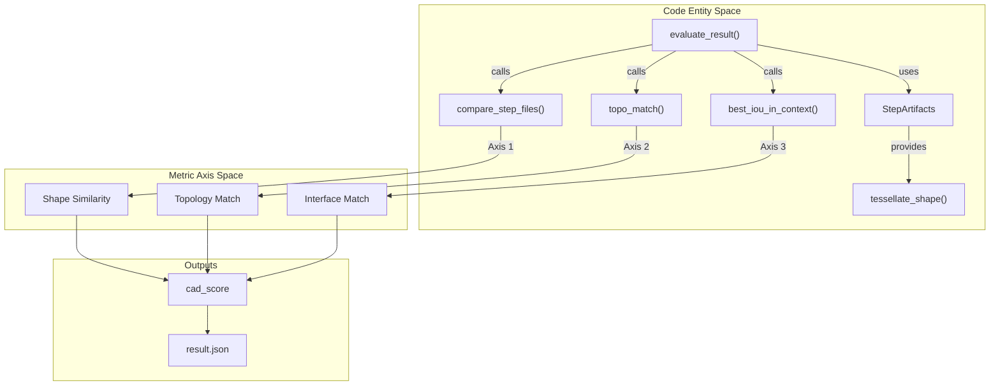
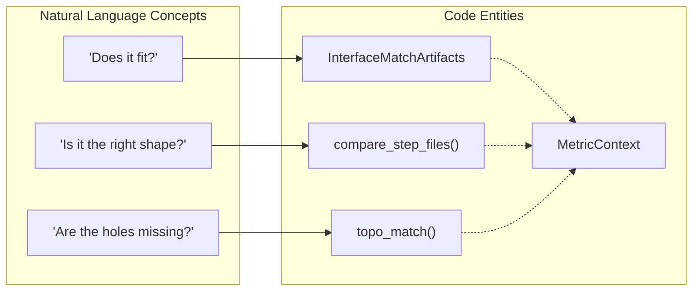

<!-- source: DeepWiki mcp.deepwiki.com · repo huggingface/cadgenbench · page 2.4 Metric Axes · fetched 2026-10-26 -->

# Metric Axes

Relevant source files

The following files were used as context for generating this wiki page:

- [docs/metrics.md](docs/metrics.md)
- [docs/metrics/shape_similarity.md](docs/metrics/shape_similarity.md)
- [docs/metrics/topo_match.md](docs/metrics/topo_match.md)
- [src/cadgenbench/eval/evaluate.py](src/cadgenbench/eval/evaluate.py)

The CADGenBench scoring engine evaluates candidate STEP files along three orthogonal axes. Each axis is designed to capture a specific category of geometric or functional error that the others might miss. These axes are combined into a single `cad_score` between 0 and 1, which serves as the headline performance metric for a fixture [src/cadgenbench/eval/evaluate.py:39-50]().

### The Orthogonality Principle

The metrics are constructed to be mutually exclusive in the types of defects they penalize:

*   **Shape Similarity:** Captures "wrong bulk geometry" (e.g., a cube instead of a sphere). It is blind to topology (a torus and a thin loop have similar IoU) [docs/metrics.md:86-86]().
*   **Topology Match:** Captures "wrong number of features" (e.g., missing a through-hole or having disconnected parts). It is blind to feature position (a hole on the left vs. a hole on the right is identical) [docs/metrics.md:87-87]().
*   **Interface Match:** Captures "functional failure" (e.g., a bolt hole is the wrong size or shifted). It is blind to the overall aesthetic shape of the part [docs/metrics.md:88-88]().

### Score Composition

For standard **Generation** tasks, the `cad_score` is a weighted mean of the three axes. The weights are biased toward shape and functional interfaces, with topology acting as a secondary check [src/cadgenbench/eval/evaluate.py:95-99]().

| Axis | Weight | Responsibility |
| :--- | :--- | :--- |
| **Shape Similarity** | 0.4 | Bulk volume and surface alignment. |
| **Interface Match** | 0.4 | Alignment with keep-in/keep-out functional jigs. |
| **Topology Match** | 0.2 | Correct count of pieces, holes, and voids. |

For **Editing** tasks, these axes are renormalized against a "no-op" baseline (the original input) to ensure that submitting an unchanged file scores 0. For details on editing logic, see [Editing Task Scoring](#2.5) [docs/metrics.md:125-133]().

### Metric Data Flow

The following diagram illustrates how the `evaluate_result` orchestrator [src/cadgenbench/eval/evaluate.py:139-164]() dispatches data from the `StepArtifacts` container [src/cadgenbench/common/artifacts.py:115-115]() to the specialized metric modules.

**Metric Dispatch Architecture**

Sources: [src/cadgenbench/eval/evaluate.py:100-107](), [docs/metrics.md:54-80]()

---

### 2.4.1 Shape Similarity
The Shape Similarity axis measures the geometric agreement between the candidate and the ground truth. It consists of two sub-metrics:
1.  **Surface Distance F1:** A point-to-surface matching score that uses surface normals to ensure faces are oriented correctly [docs/metrics/shape_similarity.md:11-13]().
2.  **Volume IoU:** A volumetric Intersection over Union calculated using a manifold Boolean kernel [docs/metrics/shape_similarity.md:15-17]().

For details, see [Shape Similarity](#2.4.1).

### 2.4.2 Topology Match
The Topology Match axis evaluates the structural "skeleton" of the part using Betti numbers ($b_0, b_1, b_2$). This metric ensures the candidate has the correct number of disconnected pieces, through-holes, and internal cavities [docs/metrics/topo_match.md:7-11](). It is invariant to the CAD modeling kernel or feature tree used [docs/metrics/topo_match.md:13-13]().

For details, see [Topology Match](#2.4.2).

### 2.4.3 Interface Match
The Interface Match axis focuses on functional requirements. It uses "jigs" (sub-volumes representing mating parts or keep-out zones) to verify that the generated part will physically fit its intended assembly [docs/metrics/interface_match.md:117-121](). It performs a local pose search to find the best possible fit for each interface group [src/cadgenbench/eval/interface_match.py:270-275]().

For details, see [Interface Match](#2.4.3).

---

### System Integration

The `MetricContext` (defined in [src/cadgenbench/eval/shape_similarity.py:46-46]()) acts as a lazy-loading container that ensures meshes and point clouds are only computed once and shared across axes where applicable.

**Data Flow: Natural Language to Code Entities**

Sources: [src/cadgenbench/eval/evaluate.py:100-107](), [src/cadgenbench/eval/shape_similarity.py:46-46]()

---

