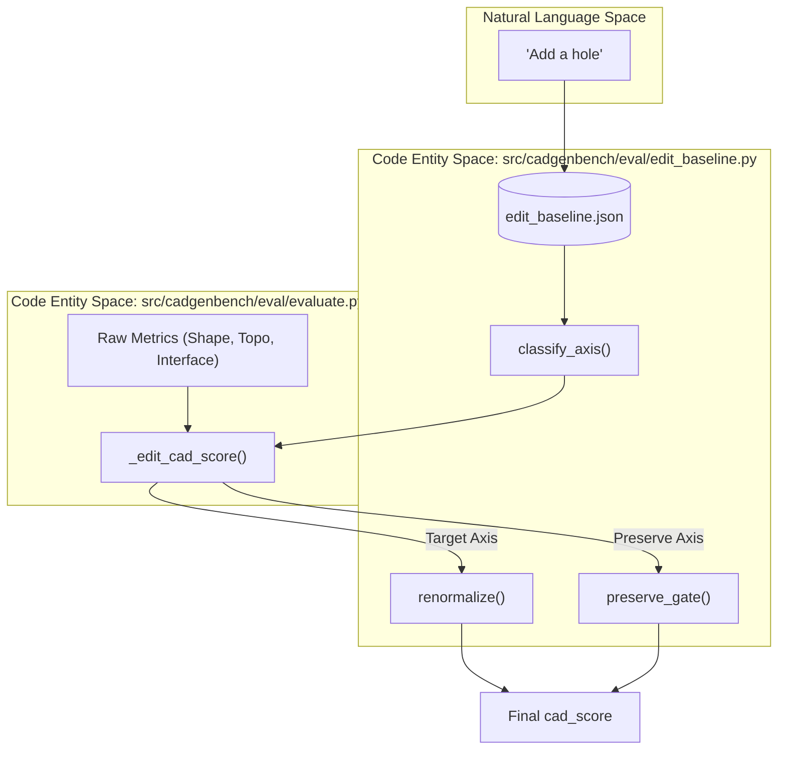
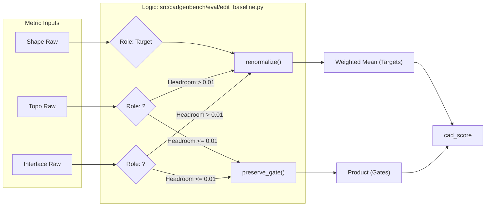

<!-- source: DeepWiki mcp.deepwiki.com · repo huggingface/cadgenbench · page 2.5 Editing Task Scoring · fetched 2026-10-26 -->

# Editing Task Scoring

Relevant source files

The following files were used as context for generating this wiki page:

- [docs/metrics.md](docs/metrics.md)
- [docs/metrics/illustrations/example_editing/edit_diff.png](docs/metrics/illustrations/example_editing/edit_diff.png)
- [src/cadgenbench/__init__.py](src/cadgenbench/__init__.py)
- [src/cadgenbench/eval/alignment.py](src/cadgenbench/eval/alignment.py)
- [src/cadgenbench/eval/edit_baseline.py](src/cadgenbench/eval/edit_baseline.py)
- [tests/eval/test_edit_baseline.py](tests/eval/test_edit_baseline.py)

Editing tasks (`task_type: editing`) evaluate a model's ability to perform local modifications on an existing CAD part. Unlike generation tasks, where a model starts from an empty canvas, editing tasks provide an `input.step` file and a natural language instruction to modify it. The ground truth (GT) is a modified version of that input.

Because the input and GT are often geometrically similar, a "no-op" submission (returning the `input.step` unchanged) would achieve a high raw score. To prevent this, the scoring engine uses **no-op renormalization** to ensure that doing nothing scores 0, while a perfect edit scores 1.

## The Edit Baseline Sidecar

For every editing fixture, a sidecar file named `edit_baseline.json` is stored alongside the ground truth. This file is the "single source of truth" that identifies a fixture as an editing task [src/cadgenbench/eval/edit_baseline.py:41-47]().

The baseline file contains precomputed scores of the `input.step` against the `ground_truth.step`. These values are used to anchor the scoring axes at evaluation time.

### Baseline Components
| Component | Description |
| :--- | :--- |
| `cadgenbench_version` | Ensures the baseline was computed with the current metric logic [src/cadgenbench/eval/edit_baseline.py:49-52](). |
| `axes` | A map of `shape`, `topology`, and `interface` to their respective baseline values and roles [src/cadgenbench/eval/edit_baseline.py:129-134](). |
| `alignment_rmse` | The RMSE of the rigid alignment between the input and GT [src/cadgenbench/eval/edit_baseline.py:132-132](). |

## Axis Classification: Target vs. Preserve

Each metric axis is assigned a **Role** based on how much the edit is expected to change that specific property. This classification is determined by the "headroom" ($1 - \text{baseline}$) available on that axis [src/cadgenbench/eval/edit_baseline.py:21-31]().

### ROLE_TARGET
*   **Definition**: The edit explicitly intends to change this axis.
*   **Logic**: The raw score is renormalized so the no-op baseline maps to 0.
*   **Assignment**: The `shape` axis is **always** a target [src/cadgenbench/eval/edit_baseline.py:115-116](). `topology` and `interface` become targets if their headroom exceeds `PRESERVE_HEADROOM_FLOOR` (0.01) [src/cadgenbench/eval/edit_baseline.py:102-117]().

### ROLE_PRESERVE
*   **Definition**: The edit should leave this axis unchanged.
*   **Logic**: Acts as a one-sided **gate**. It cannot increase the score, but it can pull the score down if the candidate accidentally modifies parts of the model that should have been preserved.
*   **Assignment**: Used for `topology` or `interface` when headroom is below the floor [src/cadgenbench/eval/edit_baseline.py:117-117]().

### ROLE_ABSENT
*   **Definition**: The metric does not apply to this fixture (e.g., no Interface Match jigs defined).
*   **Logic**: The axis is excluded from the calculation [src/cadgenbench/eval/edit_baseline.py:31-31]().

Sources: [src/cadgenbench/eval/edit_baseline.py:21-31](), [src/cadgenbench/eval/edit_baseline.py:70-72](), [src/cadgenbench/eval/edit_baseline.py:105-117]()

## Scoring Composition Formula

The final `cad_score` for an editing task is the product of the weighted mean of **Target** axes and the product of all **Preserve** gates.

### 1. Renormalization (Target Axes)
For axes marked as `ROLE_TARGET`, the raw metric $S_{raw}$ is transformed into $S_{renorm}$ using the baseline $B$:

$$S_{renorm} = \max\left(0, \frac{S_{raw} - B}{1 - B}\right)$$

This ensures that $S_{raw} = B$ results in 0, and $S_{raw} = 1$ results in 1 [src/cadgenbench/eval/edit_baseline.py:23-26]().

### 2. Preserve Gates
For axes marked as `ROLE_PRESERVE`, the raw metric is turned into a gate $G$:

$$G = \min\left(1, \frac{S_{raw}}{B}\right)$$

If the candidate maintains the property as well as the input did ($S_{raw} \ge B$), the gate is 1.0 (no penalty). If the candidate breaks the preserved property ($S_{raw} < B$), the score is penalized proportionally [src/cadgenbench/eval/edit_baseline.py:27-30]().

### 3. Final Composition
The scores are combined using `EDITING_AXIS_WEIGHTS` (Shape: 0.6, Interface: 0.3, Topology: 0.1), which are renormalized over the subset of axes that are actually targets [src/cadgenbench/eval/edit_baseline.py:80-84]().

**The Formula:**
`cad_score = weighted_mean(target_renorms) * product(preserve_gates)`

Sources: [docs/metrics.md:125-165](), [src/cadgenbench/eval/edit_baseline.py:21-37](), [src/cadgenbench/eval/edit_baseline.py:80-84]()

## Data Flow and Implementation

The following diagrams illustrate how the `_edit_cad_score` function in `evaluate.py` processes raw metrics using the `edit_baseline.json` metadata.

### Scoring Logic Flow
This diagram shows the transformation from raw metric values to the final composite score.

Sources: [src/cadgenbench/eval/edit_baseline.py:105-117](), [src/cadgenbench/eval/evaluate.py:34-34](), [docs/metrics.md:162-164]()

### Axis Processing Pipeline
Detailed view of how individual metrics are routed based on their `ROLE`.

Sources: [src/cadgenbench/eval/edit_baseline.py:70-72](), [src/cadgenbench/eval/edit_baseline.py:105-117](), [tests/eval/test_edit_baseline.py:116-167]()

## Authoring Constraints
To ensure editing tasks are meaningful, the `shape` axis must have a minimum headroom of `EDIT_HEADROOM_FLOOR` (0.002). If an edit is so minor that the `input.step` already matches the GT shape within the noise floor of point-sampling (~2e-4), the fixture is rejected during the authoring phase [src/cadgenbench/eval/edit_baseline.py:94-95]().

Sources: [src/cadgenbench/eval/edit_baseline.py:92-95]()

---

