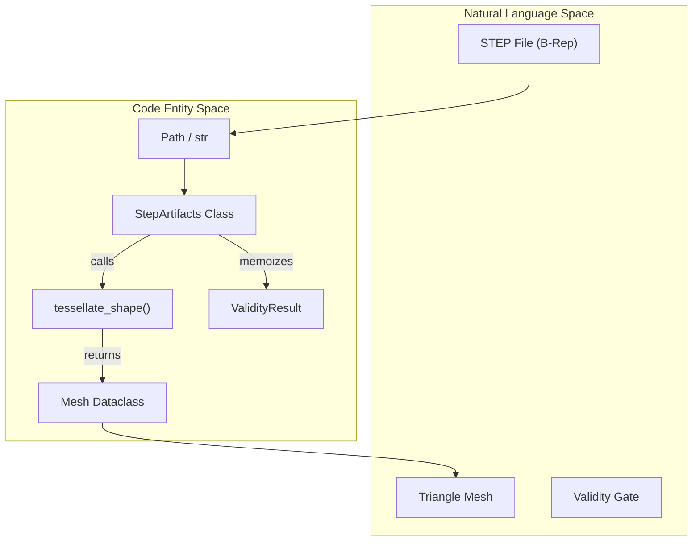
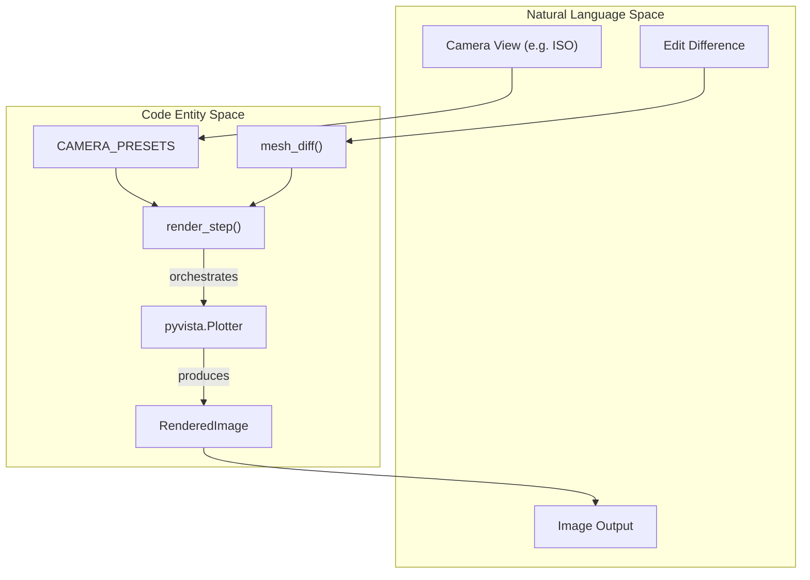

<!-- source: DeepWiki mcp.deepwiki.com · repo huggingface/cadgenbench · page 3 Geometry and Mesh Infrastructure · fetched 2026-10-26 -->

# Geometry and Mesh Infrastructure

Relevant source files

The following files were used as context for generating this wiki page:

- [.cursor/rules/style.mdc](.cursor/rules/style.mdc)
- [src/cadgenbench/common/artifacts.py](src/cadgenbench/common/artifacts.py)
- [src/cadgenbench/common/mesh.py](src/cadgenbench/common/mesh.py)
- [src/cadgenbench/common/viewer.py](src/cadgenbench/common/viewer.py)
- [tests/common/test_viewer.py](tests/common/test_viewer.py)

The `cadgenbench` geometry and mesh infrastructure provides a shared foundation for both the scoring engine and the baseline agent. It handles the translation of B-Rep (Boundary Representation) data from STEP files into discrete triangle meshes used for metric calculation, manifold analysis, and headless visualization.

### System Overview

The infrastructure is built on three primary pillars:
1.  **Tessellation**: Converting precise mathematical surfaces into topologically consistent meshes [src/cadgenbench/common/mesh.py:15-56]().
2.  **Artifact Management**: Lazy-loading and caching geometric data to avoid redundant heavy computations [src/cadgenbench/common/artifacts.py:1-6]().
3.  **Headless Rendering**: Visualizing CAD models and metric diffs without a GPU or display server [src/cadgenbench/common/viewer.py:15-39]().

### Natural Language to Code Entity Mapping

The following diagrams bridge high-level geometric concepts to their specific implementations in the codebase.

**Geometric Data Flow**

Sources: [src/cadgenbench/common/artifacts.py:66-83](), [src/cadgenbench/common/mesh.py:135-182]()

**Rendering and Visualization Pipeline**

Sources: [src/cadgenbench/common/viewer.py:101-168](), [src/cadgenbench/common/viewer.py:421-460]()

### Core Components

#### STEP Tessellation and Mesh Pipeline
The system utilizes OpenCASCADE (via `build123d`) and `BRepMesh_IncrementalMesh` to generate triangulations [src/cadgenbench/common/mesh.py:24-28](). Unlike standard meshers that produce "triangle soup," this pipeline performs topology-based vertex stitching. It ensures that the resulting mesh is a closed, orientation-consistent manifold, which is a prerequisite for calculating topological metrics like Betti numbers [src/cadgenbench/common/mesh.py:18-20]().

For details, see [STEP Tessellation and Mesh Pipeline](#3.1).

#### StepArtifacts and Caching
`StepArtifacts` serves as a centralized, lazy-loading container for all geometric data associated with a STEP file [src/cadgenbench/common/artifacts.py:66-73](). It manages:
*   **In-memory caching**: Avoiding repeated STEP parsing or mesh welding [src/cadgenbench/common/artifacts.py:79-83]().
*   **On-disk caching**: Using `.mesh.npz` sidecar files to store "trusted" meshes, allowing the system to skip expensive validation gates for known-good geometry [src/cadgenbench/common/artifacts.py:30-38]().
*   **Validity State**: Encapsulating BRep check results and physical measurements [src/cadgenbench/common/artifacts.py:100-146]().

For details, see [StepArtifacts and Caching](#3.2).

#### Headless Rendering and Visualization
Visualization is handled via PyVista and VTK, supporting standard orthographic CAD views [src/cadgenbench/common/viewer.py:17-25](). The infrastructure supports:
*   **Standard Views**: ISO, Front, Top, and Right views with consistent lighting [src/cadgenbench/common/viewer.py:101-102]().
*   **Edit Diffs**: A specialized "ghost-body" visualization that highlights added material in red and missing material in amber [src/cadgenbench/common/viewer.py:118-134]().
*   **Turntable Animations**: Generating WebP animations for 360-degree inspection [src/cadgenbench/common/viewer.py:534-550]().

For details, see [Headless Rendering and Visualization](#3.3).

### Infrastructure Constants
| Constant | Value | Description |
| :--- | :--- | :--- |
| `DEFLECTION_RELATIVE` | `0.001` | Default chord error relative to bbox diagonal [src/cadgenbench/common/mesh.py:108](). |
| `DIFF_TOL_FRACTION` | `0.005` | Distance gate for rendering surface deviations [src/cadgenbench/common/viewer.py:152](). |
| `DEFAULT_BODY_RGB` | `(0.85, 0.87, 0.90)` | Standard color for rendered CAD bodies [src/cadgenbench/common/viewer.py:101](). |

Sources: [src/cadgenbench/common/mesh.py:108-110](), [src/cadgenbench/common/viewer.py:101-153]()

---

