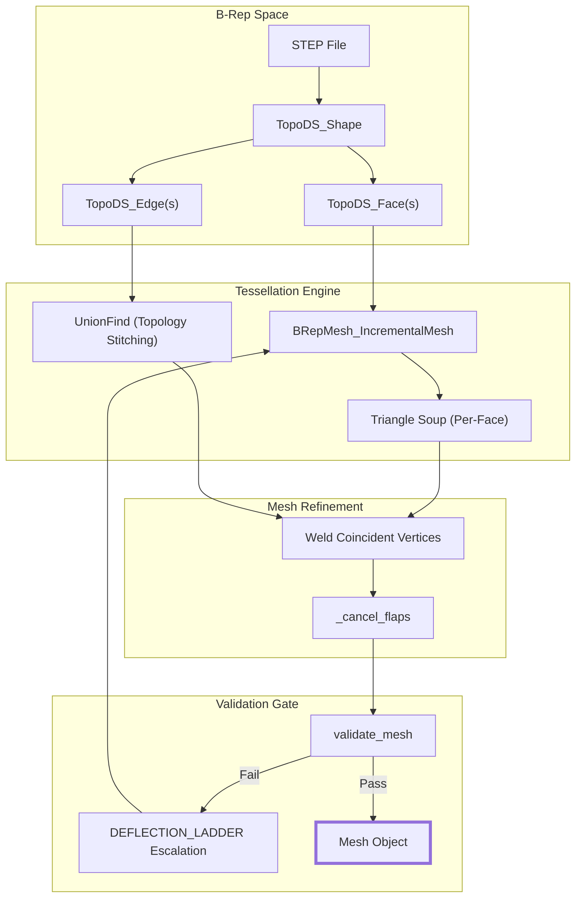
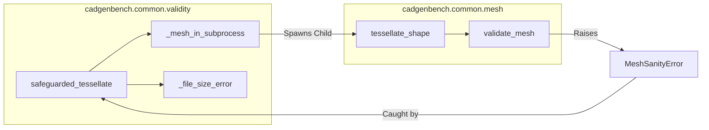

<!-- source: DeepWiki mcp.deepwiki.com · repo huggingface/cadgenbench · page 3.1 STEP Tessellation and Mesh Pipeline · fetched 2026-10-26 -->

# STEP Tessellation and Mesh Pipeline

Relevant source files

The following files were used as context for generating this wiki page:

- [src/cadgenbench/common/artifacts.py](src/cadgenbench/common/artifacts.py)
- [src/cadgenbench/common/mesh.py](src/cadgenbench/common/mesh.py)
- [tests/common/adversarial_meshes.py](tests/common/adversarial_meshes.py)
- [tests/common/test_mesh.py](tests/common/test_mesh.py)
- [tests/common/test_mesh_safeguards.py](tests/common/test_mesh_safeguards.py)

The `cadgenbench` tessellation pipeline transforms B-Rep (Boundary Representation) geometry from STEP files into clean, closed, manifold triangle meshes. This pipeline is critical for the **Topology Match** metric, as it ensures the mesh's Euler characteristic accurately reflects the genuine topological $\chi$ of the boundary surface.

## Core Pipeline Architecture

The pipeline follows a multi-stage process to move from face-based B-Rep geometry to a single stitched manifold:

1.  **BRepMesh Generation**: Uses OpenCASCADE's `BRepMesh_IncrementalMesh` to produce a per-face triangulation based on a specific deflection [src/cadgenbench/common/mesh.py:24-28]().
2.  **Triangle Soup Collection**: Iterates through every face, emitting fresh global vertices for each face node. Winding is automatically flipped on `REVERSED` faces to ensure consistent outward orientation [src/cadgenbench/common/mesh.py:30-34]().
3.  **Topology-Based Stitching**: Instead of relying purely on spatial coordinates, the pipeline uses the underlying B-Rep topology (shared edges and vertices) to weld the mesh together [src/cadgenbench/common/mesh.py:192-195]().
4.  **Manifold Validation**: The resulting mesh is subjected to a rigorous "Validity Gate" to ensure it is watertight, winding-consistent, and free of "pinch" vertices [src/cadgenbench/common/mesh.py:42-51]().

### Implementation Flow

The primary entry point is `tessellate_shape`, which orchestrates the conversion from an OCC `TopoDS_Shape` to a `Mesh` object.

| Component | Function / Class | Role |
| :--- | :--- | :--- |
| **Orchestrator** | `tessellate_shape` | Manages the full stitching and welding logic [src/cadgenbench/common/mesh.py:170-182](). |
| **Data Container** | `Mesh` | Frozen dataclass holding `vertices`, `triangles`, and the `linear_deflection_mm` used [src/cadgenbench/common/mesh.py:76-93](). |
| **Stitcher** | `UnionFind` | Internal helper used to group coincident B-Rep entities (vertices/edges) [src/cadgenbench/common/mesh.py:202-211](). |
| **Validator** | `validate_mesh` | Enforces the manifold and watertightness constraints [src/cadgenbench/common/mesh.py:383-400](). |

**Sources:** [src/cadgenbench/common/mesh.py:15-56](), [src/cadgenbench/common/mesh.py:76-93]()

## Topology-Based Vertex Stitching

Unlike standard mesh welding which uses a spatial KD-tree, `cadgenbench` leverages the STEP file's internal connectivity. This prevents the "cracking" or "over-welding" often seen in purely coordinate-based approaches.

### Implementation Logic
1.  **Union-Find on Entities**: The pipeline identifies all unique `TopoDS_Vertex` and `TopoDS_Edge` objects. If multiple faces share the same B-Rep edge, they are grouped via a `UnionFind` structure [src/cadgenbench/common/mesh.py:202-211]().
2.  **Seam Merging**: Points along a `TopoDS_Edge` are mapped to global indices. This ensures that even if two faces have slightly different floating-point coordinates for a shared edge, they are merged into the same mesh vertices [src/cadgenbench/common/mesh.py:247-260]().
3.  **Flap Cancellation**: If the tessellator produces "flaps" (zero-area triangles or duplicate triangles with opposite winding on the same face), these are cancelled out to maintain a clean manifold [src/cadgenbench/common/mesh.py:300-310]().

**Sources:** [src/cadgenbench/common/mesh.py:192-211](), [src/cadgenbench/common/mesh.py:247-260]()

## The DEFLECTION_LADDER Escalation Strategy

Tessellation can fail if the chord error (deflection) is too coarse to resolve small features, leading to non-manifold "pinches." To handle this, `cadgenbench` uses an escalation strategy.

### Escalation Steps
1.  **Initial Deflection**: Calculated via `deflection_for_bbox` based on the Ground Truth bounding box [src/cadgenbench/common/mesh.py:113-127]().
2.  **Laddering**: If `validate_mesh` raises a `MeshSanityError`, the system attempts to re-tessellate using the `DEFLECTION_LADDER`. This ladder provides progressively finer resolutions (e.g., $0.5\times, 0.25\times$ of the original deflection) to resolve topological ambiguities [src/cadgenbench/common/validity.py:465-475]().
3.  **Terminal Failure**: If the finest level of the ladder still produces an invalid mesh, the part is marked `is_valid = False` [src/cadgenbench/common/validity.py:480-485]().

**Sources:** [src/cadgenbench/common/mesh.py:113-127](), [src/cadgenbench/common/validity.py:465-485]()

## Manifold Validation Gates

Every mesh must pass `validate_mesh` before it is used for scoring. A failure in any gate results in a `MeshSanityError`.

### Gate Requirements
*   **Watertightness**: Every edge must be incident to exactly 2 triangles [src/cadgenbench/common/mesh.py:410-415]().
*   **Winding Consistency**: Shared edges must be traversed in opposite orientations by their two incident triangles [src/cadgenbench/common/mesh.py:420-425]().
*   **Vertex-Manifold**: No "pinch" points where two surface sheets meet at a single vertex. This is detected by checking if the "link" of a vertex is a single closed loop of edges [src/cadgenbench/common/mesh.py:430-440](), [tests/common/test_mesh.py:108-113]().

### Pipeline Data Flow Diagram
This diagram shows the transition from STEP file entities to the validated `Mesh` object.

**Sources:** [src/cadgenbench/common/mesh.py:22-56](), [src/cadgenbench/common/validity.py:465-485]()

## Safeguards and Resource Limits

To prevent adversarial or malformed STEP files from crashing the evaluation process, `safeguarded_tessellate` enforces three ceilings:

1.  **File-Size Ceiling**: STEP files exceeding `MAX_STEP_FILE_BYTES` (default 50MB) are rejected before parsing [src/cadgenbench/common/validity.py:50-55](), [tests/common/test_mesh_safeguards.py:73-84]().
2.  **Triangle Ceiling**: Meshes exceeding `MAX_TRIANGLES` (default 2M) are rejected [src/cadgenbench/common/validity.py:60-65](), [tests/common/test_mesh_safeguards.py:113-127]().
3.  **Process-Isolated Timeout**: Tessellation runs in a subprocess via `_mesh_in_subprocess`. If it exceeds `MESH_TIMEOUT_S`, the process is killed to prevent hangs [src/cadgenbench/common/validity.py:440-455](), [tests/common/test_mesh_safeguards.py:154-175]().

### Code Entity Mapping
This diagram bridges the conceptual safeguards to the specific code implementations.

**Sources:** [src/cadgenbench/common/validity.py:430-460](), [src/cadgenbench/common/mesh.py:170-185](), [tests/common/test_mesh_safeguards.py:1-21]()

---

